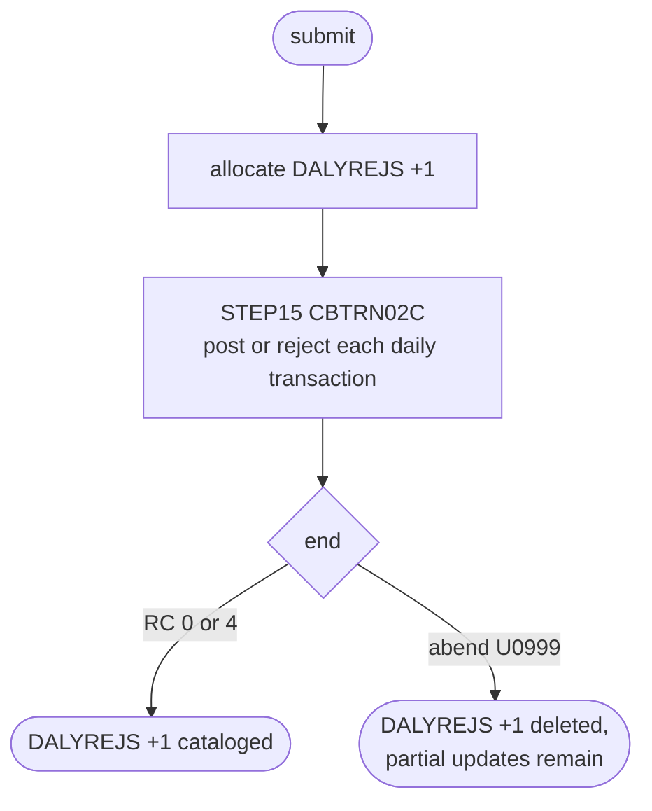

# POSTTRAN: Daily transaction posting job

## 1. Summary

POSTTRAN is the one-step job that runs the posting program `CBTRN02C`. It reads the day's transactions from `AWS.M2.CARDDEMO.DALYTRAN.PS`, posts the valid ones to the account master, the category balance file and the (empty) transaction master, and writes the rejected ones to a new generation of the GDG `AWS.M2.CARDDEMO.DALYREJS`. Every business rule is the program's and is specified in `programs/CBTRN02C.md`; this spec covers what the JCL adds: the dataset bindings, the new reject generation, the return code and the place of the job in the cycle.

## 2. Rules at a glance

| ID | Rule |
| :-- | :-- |
| FLOW-JPOST-001 | One step: run `CBTRN02C` with the six files bound to the cycle datasets. |
| SE-JPOST-001 | Allocate and catalog a new reject generation `DALYREJS(+1)`, RECFM F, LRECL 430. |
| SE-JPOST-002 | Update the account, category balance and transaction master files in place (program side effects). |
| ERR-JPOST-001 | Return code 4 means "some transactions rejected" and is a success; an abend on a checked file error leaves partial updates; some file errors are not checked at all. |
| NUM-JPOST-001 | Reject generations: LIMIT 5, `SCRATCH`, unblocked 430-byte records. |
| DEF-JPOST-001 | The `DALYREJS` GDG base is not created by the README initialisation sequence. |
| DEF-JPOST-002 | The CA-7 chain runs POSTTRAN without emptying `TRANSACT` first and only after an optional-module job. |
| DEF-JPOST-003 | Nothing prevents the same `DALYTRAN.PS` from being posted twice. |

## 3. Actors and triggers

- **Trigger:** submitted by an operator in the README "Running Batch Jobs" sequence after the data refresh (`./README.md:227`) and by the demo full-batch script (`scripts/run_full_batch.sh:46-47`). In CA-7 it is triggered by the completion of CBPAUP0J (`app/scheduler/CardDemo.ca7:43, 70`) and itself triggers WAITSTEP (`app/scheduler/CardDemo.ca7:97`). Control-M does not run it (see `SCHED-CONTROLM.md`). The local runner emulates it with the same DD names and accepts return code 4 (`tools/carddemo.py:641-648`).
- **Preconditions** (`docs/runbooks/batch-cycle-restart.md:30-36`): CICS has closed `TRANSACT`, `CCXREF` and `ACCTDAT` (CLOSEFIL); `TRANSACT.VSAM.KSDS` exists and is empty (TRANBKP); the GDG base `AWS.M2.CARDDEMO.DALYREJS` exists (DALYREJS job, DEF-JPOST-001); `DALYTRAN.PS` holds the day's transactions (FB 350).
- **Job card:** `CLASS=A,MSGCLASS=0,NOTIFY=&SYSUID` (`:1-2`). No `PARM`, no control cards, no symbolic parameters.

## 4. Interfaces

| Step | Program | DD | Dataset | Disposition | Use | Source |
| :-- | :-- | :-- | :-- | :-- | :-- | :-- |
| `STEP15` | CBTRN02C | `STEPLIB` | `AWS.M2.CARDDEMO.LOADLIB` | `SHR` | load library | `:24-25` |
| `STEP15` | CBTRN02C | `SYSPRINT` | `SYSOUT=*` | - | not written by the program | `:26` |
| `STEP15` | CBTRN02C | `SYSOUT` | `SYSOUT=*` | - | program `DISPLAY` output (counts, errors) | `:27` |
| `STEP15` | CBTRN02C | `TRANFILE` | `AWS.M2.CARDDEMO.TRANSACT.VSAM.KSDS` | `SHR` | output, KSDS (opened `OUTPUT`) | `:28-29` |
| `STEP15` | CBTRN02C | `DALYTRAN` | `AWS.M2.CARDDEMO.DALYTRAN.PS` | `SHR` | input, sequential | `:30-31` |
| `STEP15` | CBTRN02C | `XREFFILE` | `AWS.M2.CARDDEMO.CARDXREF.VSAM.KSDS` | `SHR` | input, KSDS random | `:32-33` |
| `STEP15` | CBTRN02C | `DALYREJS` | `AWS.M2.CARDDEMO.DALYREJS(+1)` | `(NEW,CATLG,DELETE)` | output, sequential; `UNIT=SYSDA`, `DCB=(RECFM=F,LRECL=430,BLKSIZE=0)`, `SPACE=(CYL,(1,1),RLSE)` | `:34-38` |
| `STEP15` | CBTRN02C | `ACCTFILE` | `AWS.M2.CARDDEMO.ACCTDATA.VSAM.KSDS` | `SHR` | input-output, KSDS random | `:39-40` |
| `STEP15` | CBTRN02C | `TCATBALF` | `AWS.M2.CARDDEMO.TCATBALF.VSAM.KSDS` | `SHR` | input-output, KSDS random | `:41-42` |

Return code of the job: the return code of `CBTRN02C` (0 or 4), or abend U0999 (BR-POST-008, ERR-POST-008).

## 5. Data used

ENT-DAILY-TRAN (input), ENT-CARD-XREF (lookup), ENT-ACCOUNT and ENT-TCAT-BAL (updated), ENT-TRANSACTION (written), ENT-DAILY-REJECT (written). Field use is in `programs/CBTRN02C.md` §5. The GDG base `AWS.M2.CARDDEMO.DALYREJS` has `LIMIT 5`, `SCRATCH` in the 09/01/22 catalog (`app/catlg/LISTCAT.txt:684-690`), as DALYREJS defines it (`app/jcl/DALYREJS.jcl:24-28`).

## 6. Processing flow

| # | Step | Class | What it does | Runs when |
| --: | :-- | :-- | :-- | :-- |
| 1 | `STEP15` | business | run `CBTRN02C`: validate and post the daily transactions | always |

#### FLOW-JPOST-001 · Run the posting program
- **What:** `STEP15` executes `PGM=CBTRN02C` from `AWS.M2.CARDDEMO.LOADLIB` with the DD bindings of section 4. The program's DD names (`TRANFILE`, `DALYTRAN`, `XREFFILE`, `DALYREJS`, `ACCTFILE`, `TCATBALF`) all have a DD statement; no DD is optional.
- **Rules:** validation VAL-POST-001, VAL-POST-002, BR-POST-001 to BR-POST-003; posting BR-POST-004 to BR-POST-007; return code BR-POST-008 (all in `programs/CBTRN02C.md`).
- **Source:** `:23-42`
- **Fidelity:** must-preserve · **Confidence:** reviewed

## 7. Business rules

The job adds no rule of its own. The rules are BR-POST-001 to BR-POST-008 of `programs/CBTRN02C.md`, run once per job through FLOW-JPOST-001.

## 8. Validations and messages

None at job level. Validations are VAL-POST-001 and VAL-POST-002 and the console texts are in `programs/CBTRN02C.md` §4.3, all on `SYSOUT` (`:27`).

## 9. Side effects

#### SE-JPOST-001 · Create the reject generation
- **What:** the system allocates a new dataset `AWS.M2.CARDDEMO.DALYREJS(+1)` (RECFM F, LRECL 430, 1 cylinder primary and 1 secondary, unused space released) before the program starts. The program writes one record per rejected transaction (SE-POST-004). With `DISP=(NEW,CATLG,DELETE)` the generation is cataloged when the step ends normally, with return code 0 or 4, even when it holds no record; it becomes `DALYREJS(0)` and the oldest of 5 generations is scratched. An abend deletes it with every reject written so far (DEF-POST-013).
- **Source:** `:34-38`
- **Fidelity:** must-preserve (one reject set per run, kept for later review) · **Confidence:** reviewed (JCL); platform-inferred (GDG roll-off)

#### SE-JPOST-002 · Update the master files in place
- **What:** `ACCTFILE`, `TCATBALF` and `TRANFILE` are allocated `DISP=SHR` to the live clusters, so every change the program makes (SE-POST-001 to SE-POST-003) is applied directly to them, record by record, with no backup taken by this job.
- **Source:** `:28-29, 39-42`
- **Fidelity:** must-preserve · **Confidence:** reviewed

## 10. Error handling

#### ERR-JPOST-001 · Return code and abend
- **When:** the step ends.
- **Then:** return code 0 (nothing rejected) or 4 (at least one reject, BR-POST-008) are both normal ends; the runbook treats 4 as "not a failure" (`docs/runbooks/batch-cycle-restart.md:62`). A file error that `CBTRN02C` checks (opens and closes, the daily read, the category balance I/O, the transaction and reject writes: ERR-POST-001 to ERR-POST-005) abends with U0999 through `CEE3ABD` (ERR-POST-008, `app/cbl/CBTRN02C.cbl:711-712`); updates already made stay (DEF-POST-008) and the reject generation is deleted (SE-JPOST-001). Not every file error ends the step: a failed account rewrite is not treated as an error (ERR-POST-006, DEF-POST-012), and I/O errors on the cross-reference and account lookups are not checked (DEF-POST-007), so the step can end with return code 0 or 4 after such an error. There is no `COND`, no checkpoint and no restart step.
- **Restart:** the runbook restores `ACCTDATA` and `TCATBALF`, empties `TRANSACT` with TRANBKP and resubmits (`docs/runbooks/batch-cycle-restart.md:67-85`). A JCL error on `DALYREJS` (missing base) changes nothing (`docs/runbooks/batch-cycle-restart.md:57`).
- **Source:** `:23, 34`, `app/cbl/CBTRN02C.cbl:708-712`
- **Fidelity:** must-preserve (RC 4 counts as success for the scheduler) · **Confidence:** reviewed (which errors abend); platform-inferred (disposition and scheduler behaviour, high)

## 11. Interactions

- **Upstream:** CLOSEFIL (CICS files closed), TRANBKP (empty `TRANSACT`), DALYREJS (GDG base), the data refresh jobs in the demo (`./README.md:215-226`). In CA-7, CBPAUP0J of the optional authorization module (`app/scheduler/CardDemo.ca7:43-70`).
- **Downstream:** INTCALC (reads `TCATBALF` and updates `ACCTDATA`), TRANBKP (backs up `TRANSACT`), TRANREPT (reports on `TRANSACT`), the daily rejects review (`docs/runbooks/daily-rejects.md`). In CA-7, WAITSTEP, whose completion under SCHID 030 triggers both OPENFIL and CLOSEFIL (`app/scheduler/CardDemo.ca7:97, 124, 303, 335`).

## 12. Numeric, date and format details

#### NUM-JPOST-001 · Reject generation format and retention
- `RECFM=F` (fixed, unblocked; `BLKSIZE=0` gives one 430-byte record per block). `SYSTRAN(+1)`, written by INTCALC, is also `RECFM=F` (`app/jcl/INTCALC.jcl:39`); the backup GDGs `TRANSACT.BKUP` and `TCATBALF.BKUP` are `FB` (`app/jcl/TRANBKP.jcl:31`, `app/jcl/PRTCATBL.jcl:37`). The GDG keeps 5 generations and scratches the older ones (`app/jcl/DALYREJS.jcl:26-27`), so rejects are lost after five runs unless they are reviewed or copied.
- **Source:** `:36`, `app/jcl/DALYREJS.jcl:24-28`, `app/jcl/INTCALC.jcl:39`
- **Fidelity:** incidental (blocking), must-preserve (430-byte record) · **Confidence:** reviewed

## 13. Known defects and oddities

#### DEF-JPOST-001 · The reject GDG base is outside the initialisation sequence
- The README initialisation table (`./README.md:150-167`) lists DEFGDGB and DEFGDGD but not DALYREJS, and DEFGDGB does not define `DALYREJS`. Without the base the job fails with a JCL error on `DALYREJS(+1)`. The runbook notes this (`docs/runbooks/batch-cycle-restart.md:32-33`).
- **Source:** `:38`
- **Status:** open · **Fidelity:** incidental · **Confidence:** reviewed

#### DEF-JPOST-002 · The CA-7 chain does not prepare POSTTRAN's files
- In CA-7, POSTTRAN runs after CLOSEFIL and CBPAUP0J only (`app/scheduler/CardDemo.ca7:43, 70`). No job in the CA-7 schedule empties `TRANSACT` (TRANBKP is only in the Control-M folder `DAILY-TransactionBackup`), so unless TRANBKP ran from Control-M or by hand, `TRANSACT` (an output file, opened `OUTPUT` at `app/cbl/CBTRN02C.cbl:256`) still holds the previous cycle's records and the output open fails (`docs/runbooks/batch-cycle-restart.md:58`). The two schedules are not linked by any condition. CBPAUP0J belongs to the optional authorization module, so a base installation has no job to trigger POSTTRAN. See `SCHED-CA7.md`.
- **Source:** `:28-29`, `app/scheduler/CardDemo.ca7:43-97`
- **Status:** open · **Fidelity:** defect-decide · **Confidence:** reviewed

#### DEF-JPOST-003 · No protection against posting the same input twice
- `DALYTRAN` is allocated `DISP=SHR` to the fixed name `AWS.M2.CARDDEMO.DALYTRAN.PS` (not a generation), and neither the job nor `CBTRN02C` empties, renames or marks it after a successful run. A second POSTTRAN after a successful run is stopped only while `TRANSACT` still holds the posted records, because the output open then fails (DEF-JPOST-002). Once TRANBKP has emptied it, which the README cycle does right after INTCALC (`./README.md:229`), a resubmitted POSTTRAN with the same `DALYTRAN.PS` posts the same transactions again: account balances and category totals are added a second time, and the transactions reach `TRANSACT` and, through COMBTRAN, the master. The target needs an explicit "already posted" control.
- **Source:** `:28-31`
- **Status:** open · **Fidelity:** defect-decide · **Confidence:** reviewed (JCL); platform-inferred (operator scenarios, high)

## 14. Open questions

| ID | Question | For |
| :-- | :-- | :-- |
| Q-JPOST-001 | How long must reject sets be kept in the target (AS-IS: the last 5 runs)? | operations |

## 15. Equivalence contract

The program-level contract of `programs/CBTRN02C.md` §15 applies. In addition, each successful run (return code 0 or 4) produces exactly one new reject set holding the rejected records in input order (possibly empty), and an abend produces none. Return code 4 must not stop the cycle.

Review evidence (independent reviewers checked every item against the source, all WRONG and MINOR findings were fixed, and a fresh reviewer re-checked every changed or added item): [evidence/g-jobs-ops-review.md](../evidence/g-jobs-ops-review.md).

## 16. Paragraph coverage

| Step | Lines | Covered by |
| :-- | :-- | :-- |
| (job card) | 1-2 | §3 |
| `STEP15` | 23-42 | FLOW-JPOST-001, SE-JPOST-001, SE-JPOST-002, ERR-JPOST-001, NUM-JPOST-001, DEF-JPOST-001, DEF-JPOST-002, DEF-JPOST-003 |
