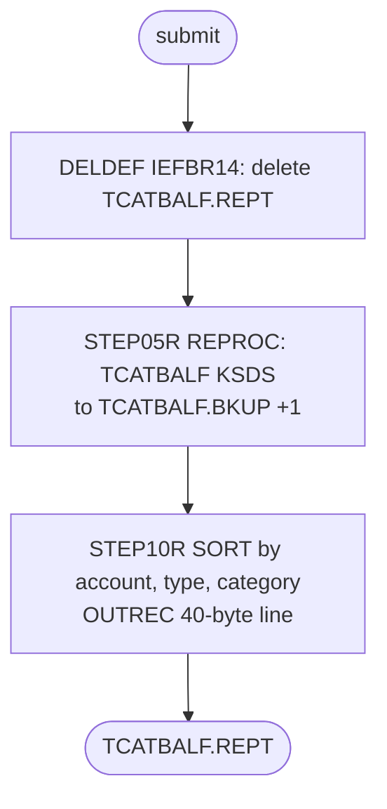

# PRTCATBL: Print the category balance file

## 1. Summary

PRTCATBL produces a readable listing of the transaction category balance file. `DELDEF` deletes the previous listing `AWS.M2.CARDDEMO.TCATBALF.REPT`. `STEP05R` (procedure REPROC) unloads the KSDS `AWS.M2.CARDDEMO.TCATBALF.VSAM.KSDS` into a new generation of `AWS.M2.CARDDEMO.TCATBALF.BKUP`. `STEP10R` sorts that generation by account, type and category and reformats each record into a 40-byte line: account, type, category and the balance edited with a decimal point, separated by blanks. The backup generation doubles as a restore point for the category balances (`docs/runbooks/batch-cycle-restart.md:76-81`). The job changes no master file.

## 2. Rules at a glance

| ID | Rule |
| :-- | :-- |
| SE-JPCAT-001 | Delete the previous listing `TCATBALF.REPT` (no error when it does not exist). |
| SE-JPCAT-002 | Unload every category balance record to a new generation `TCATBALF.BKUP(+1)` (FB 50). |
| BR-JPCAT-001 | List every balance, sorted by account, type and category, as `account type category balance`. |
| NUM-JPCAT-001 | The balance is edited as 9 digits, a point and 2 digits, with no sign. |
| ERR-JPCAT-001 | No step has a `COND`: the old listing is gone even when the new one is not written. |
| DEF-JPCAT-001 | Negative balances print without their minus sign. |
| DEF-JPCAT-002 | The formatted line is 41 bytes, the output is 40. |
| DEF-JPCAT-003 | Comments describe a different job. |

## 3. Actors and triggers

- **Trigger:** in CA-7, PRTCATBL runs only in a run under schedule ID 031: `CLOSEFIL` completing under 031 triggers it (`app/scheduler/CardDemo.ca7:537`), and `CLOSEFIL` runs under 031 only when an operator demands it (or OPENFIL) with SCHID 31, or when OPENFIL completes under 031 (`app/scheduler/CardDemo.ca7:532`; FLOW-JCA7-004, FLOW-JCA7-006). A run under 030 never reaches it: the CREASTMT chain (CREASTMT, TXT2PDF1, WAITSTEP, OPENFIL, `app/scheduler/CardDemo.ca7:495, 522, 527`) ends at OPENFIL, whose trigger of `CLOSEFIL` is defined for 031 only (platform-inferred, schedule ID rule of FLOW-JCA7-005). PRTCATBL then triggers WAITSTEP and OPENFIL with schedule ID 031 (`app/scheduler/CardDemo.ca7:564, 569`). The schedule also has a job `CLOSEFIL1` (member `CLOSEFIL`) triggered with schedule ID 031 (`app/scheduler/CardDemo.ca7:216, 225`); it triggers TRANCATG, not PRTCATBL (`app/scheduler/CardDemo.ca7:244`). Control-M, the README sequence and the full-batch script do not run it. The restart runbook suggests running it before POSTTRAN to get a restore point (`docs/runbooks/batch-cycle-restart.md:76-78`).
- **Preconditions:** the GDG base `TCATBALF.BKUP` exists (DEFGDGB, `app/jcl/DEFGDGB.jcl:42-47`); the procedure library holds REPROC. `TCATBALF` is not a CICS file, so closing CICS files is not needed for this job.
- **Job card:** `CLASS=A,MSGCLASS=0,NOTIFY=&SYSUID` (`:1-2`). Procedure library `JCLLIB ORDER=('AWS.M2.CARDDEMO.PROC')` (`:19`). Symbolic parameter `CNTLLIB=AWS.M2.CARDDEMO.CNTL` on `STEP05R` (`:29-30`).

## 4. Interfaces

| Step | Program | DD | Dataset | Disposition | Use | Source |
| :-- | :-- | :-- | :-- | :-- | :-- | :-- |
| `DELDEF` | IEFBR14 | `THEFILE` | `AWS.M2.CARDDEMO.TCATBALF.REPT` | `(MOD,DELETE)` | delete; `UNIT=SYSDA`, `SPACE=(TRK,(1,1),RLSE)` | `:22-25` |
| `STEP05R` (`PRC001`) | IDCAMS | `FILEIN` | `AWS.M2.CARDDEMO.TCATBALF.VSAM.KSDS` | `SHR` | input, KSDS | `:32-33` |
| `STEP05R` (`PRC001`) | IDCAMS | `FILEOUT` | `AWS.M2.CARDDEMO.TCATBALF.BKUP(+1)` | `(NEW,CATLG,DELETE)` | output; `UNIT=SYSDA`, `DCB=(LRECL=50,RECFM=FB,BLKSIZE=0)`, `SPACE=(CYL,(1,1),RLSE)` | `:35-39` |
| `STEP05R` (`PRC001`) | IDCAMS | `SYSIN`, `SYSPRINT` | `AWS.M2.CARDDEMO.CNTL(REPROCT)`, `SYSOUT=*` | `SHR` | from REPROC | `app/proc/REPROC.prc:22, 27-28` |
| `STEP10R` | SORT | `SORTIN` | `AWS.M2.CARDDEMO.TCATBALF.BKUP(+1)` | `SHR` | input: the generation created by `STEP05R` | `:44-45` |
| `STEP10R` | SORT | `SYMNAMES` | in-stream | - | four field symbols | `:46-50` |
| `STEP10R` | SORT | `SYSIN` | in-stream | - | `SORT` and `OUTREC` | `:51-57` |
| `STEP10R` | SORT | `SYSOUT` | `SYSOUT=*` | - | sort messages | `:58` |
| `STEP10R` | SORT | `SORTOUT` | `AWS.M2.CARDDEMO.TCATBALF.REPT` | `(NEW,CATLG,DELETE)` | output; `UNIT=SYSDA`, `DCB=(LRECL=40,RECFM=FB,BLKSIZE=0)`, `SPACE=(CYL,(1,1),RLSE)` | `:59-63` |

Return code of the job: the highest step return code.

## 5. Data used

ENT-TCAT-BAL (layout `app/cpy/CVTRA01Y.cpy:4-10`): `TRANCAT-ACCT-ID` 9(11), `TRANCAT-TYPE-CD` X(2), `TRANCAT-CD` 9(4), `TRAN-CAT-BAL` S9(09)V99 (zoned, sign in the last byte), FILLER X(22). The sort symbols match these positions: `TRANCAT-ACCT-ID,1,11,ZD`, `TRANCAT-TYPE-CD,12,2,CH`, `TRANCAT-CD,14,4,ZD`, `TRAN-CAT-BAL,18,11,ZD` (`:47-50`). Catalog on 09/01/22: `TCATBALF.BKUP` `LIMIT 5`, `SCRATCH`, generations `G0005V00` to `G0009V00` (`app/catlg/LISTCAT.txt:1202-1214`); `TCATBALF.REPT` is a plain sequential dataset (`app/catlg/LISTCAT.txt:1319-1333`).

## 6. Processing flow

| # | Step | Class | What it does | Runs when |
| --: | :-- | :-- | :-- | :-- |
| 1 | `DELDEF` | plumbing | delete the previous listing | always |
| 2 | `STEP05R` | plumbing | unload `TCATBALF` to `TCATBALF.BKUP(+1)` | always (no `COND`) |
| 3 | `STEP10R` | business | sort and format the listing | always (no `COND`) |

## 7. Business rules

#### BR-JPCAT-001 · Category balance listing
- **When:** `STEP10R` reads the backup generation.
- **Then:** every record is kept (no `INCLUDE` or `OMIT`), sorted by `TRANCAT-ACCT-ID`, `TRANCAT-TYPE-CD`, `TRANCAT-CD` ascending, and written as: account (11 digits), a blank, type (2 characters), a blank, category (4 digits), a blank, balance edited by `EDIT=(TTTTTTTTT.TT)` (12 characters), then blanks (NUM-JPCAT-001, DEF-JPCAT-002). Because the input is a KSDS unloaded in key order and the key is the same three fields, the sort keeps the key order.
- **Source:** `:52-56`
- **Fidelity:** must-preserve (content and order); incidental (exact column layout) · **Confidence:** reviewed

## 8. Validations and messages

None. The job checks no field; sort and IDCAMS messages go to `SYSOUT` and `SYSPRINT`.

## 9. Side effects

In execution order. No step undoes an earlier one.

#### SE-JPCAT-001 · Delete the previous listing
- **What:** IEFBR14 does nothing itself; the DD `THEFILE` with `DISP=(MOD,DELETE)` allocates `TCATBALF.REPT` (creating an empty one if it does not exist, thanks to `MOD` with `UNIT` and `SPACE`) and deletes it at step end. The result is that no `TCATBALF.REPT` exists before the new one is written.
- **Source:** `:21-25`
- **Fidelity:** incidental (the target only needs "replace the listing") · **Confidence:** platform-inferred

#### SE-JPCAT-002 · Unload the category balances to a new backup generation
- **What:** REPROC `PRC001` copies every record of `TCATBALF.VSAM.KSDS`, in key order, byte for byte, to the new dataset `TCATBALF.BKUP(+1)` (FB 50), cataloged on a normal end, deleted on an abend; the oldest of 5 generations is scratched. The KSDS is not changed.
- **Source:** `:29-39`
- **Fidelity:** must-preserve (restore point named by the runbook) · **Confidence:** reviewed (JCL); platform-inferred (roll-off)

## 10. Error handling

#### ERR-JPCAT-001 · Steps run regardless of earlier failures
- **When:** a step ends with a non-zero return code without abending.
- **Then:** the next step still runs, because no `EXEC` has a `COND`. `DELDEF` has already removed the previous listing, so a failure in `STEP05R` or `STEP10R` leaves no listing or a partial one (`SORTOUT` is cataloged on a normal end even with a non-zero return code). An abend skips the remaining steps and deletes the failing step's new dataset. The job can be rerun from the top; each rerun adds a backup generation.
- **Source:** `:21, 29, 43`
- **Fidelity:** incidental · **Confidence:** platform-inferred

## 11. Interactions

- **Upstream:** TCATBALF (load), POSTTRAN (updates the balances). INTCALC is not upstream: it opens the category balance file for input only (`app/cbl/CBACT04C.cbl:237`) and changes no balance. In CA-7, `CLOSEFIL` completing under schedule ID 031 (`app/scheduler/CardDemo.ca7:537`); a 030 run, including the CREASTMT chain, does not reach it (FLOW-JCA7-004).
- **Downstream:** none in the repository reads `TCATBALF.REPT`. `TCATBALF.BKUP` generations are the restore source in the runbook (`docs/runbooks/batch-cycle-restart.md:76-81`).
- **Schedule:** in CA-7 it sits between a `CLOSEFIL` and an `OPENFIL` (`app/scheduler/CardDemo.ca7:532-569`), although it touches no CICS file.

## 12. Numeric, date and format details

#### NUM-JPCAT-001 · Balance edit mask
- `TRAN-CAT-BAL,18,11,ZD` is read as an 11-digit zoned decimal number (the sign is in the zone of byte 28). `EDIT=(TTTTTTTTT.TT)` prints all 11 digits, leading zeros included, with a point before the last two; the field has two implied decimals, so the printed value equals the balance: 1234.56 prints as `000001234.56`. The mask has no sign position (DEF-JPCAT-001).
- **Source:** `:50, 56`
- **Fidelity:** must-preserve (value, two decimals) · **Confidence:** platform-inferred (DFSORT edit mask rules)

## 13. Known defects and oddities

#### DEF-JPCAT-001 · Negative balances print without a sign
- The edit mask `TTTTTTTTT.TT` has no sign character, so a balance of -12.34 prints as `000000012.34`, the same as +12.34. Category balances can be negative (credits and returns post negative amounts through POSTTRAN).
- **Source:** `:56`
- **Status:** open · **Fidelity:** defect-decide · **Confidence:** platform-inferred

#### DEF-JPCAT-002 · The formatted line is longer than the output record
- The `OUTREC` builds 11 + 1 + 2 + 1 + 4 + 1 + 12 + 9 = 41 bytes, while `SORTOUT` is `LRECL=40`. With the DFSORT default (`TRUNC=RC0`) the last blank is cut and the step ends normally; with another setting the step can end with return code 4 or 16. Only a trailing blank is lost.
- **Source:** `:53-56, 61`
- **Status:** open · **Fidelity:** incidental · **Confidence:** platform-inferred

#### DEF-JPCAT-003 · Comments describe a different job
- The comment before `STEP10R` reads "Filter the TCATBALFions for a the parm date and sort by card num" (`:41`), copied from TRANREPT: the step has no filter, no date and no card number. The comment line `:26` contains a stray backtick.
- **Source:** `:26, 41`
- **Status:** open · **Fidelity:** incidental · **Confidence:** reviewed

## 14. Open questions

| ID | Question | For |
| :-- | :-- | :-- |
| Q-JPCAT-001 | Should the target listing show the sign of negative balances (DEF-JPCAT-001)? | business |

## 15. Equivalence contract

After a successful run: a new backup generation holds every category balance record, byte for byte, in key order; the listing holds one line per record in the same order with account, type, category and balance value with two decimals. A reimplementation that prints signs (Q-JPCAT-001) differs only for negative balances. The category balance store is unchanged.

## 16. Paragraph coverage

| Step | Lines | Covered by |
| :-- | :-- | :-- |
| (job card and JOBLIB) | 1-19 | §3 |
| `DELDEF` | 21-25 | SE-JPCAT-001, ERR-JPCAT-001 |
| `STEP05R` | 29-39 | SE-JPCAT-002, ERR-JPCAT-001 |
| `STEP10R` | 43-63 | BR-JPCAT-001, NUM-JPCAT-001, ERR-JPCAT-001, DEF-JPCAT-001, DEF-JPCAT-002, DEF-JPCAT-003 |
