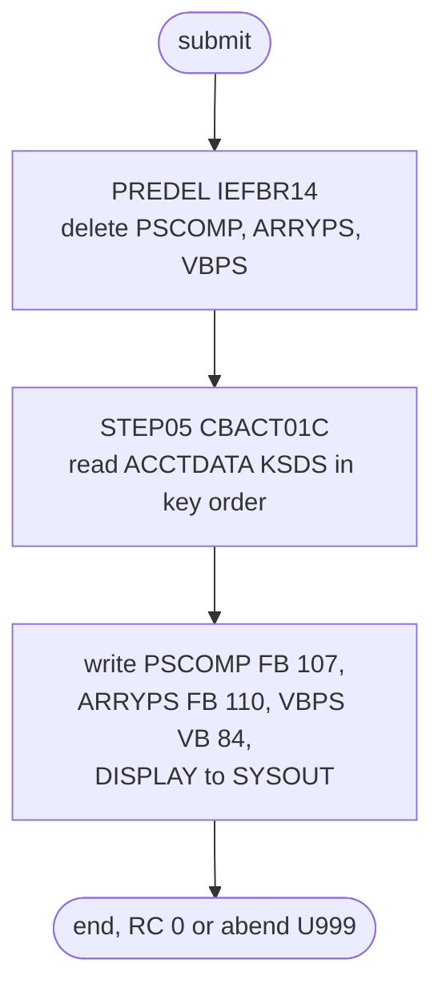

# READACCT: Account master diagnostic read

## 1. Summary

READACCT runs CBACT01C over the account master to show that the file is readable and to demonstrate three output record formats. `PREDEL` deletes the three output files of the previous run; `STEP05` reads every record of `AWS.M2.CARDDEMO.ACCTDATA.VSAM.KSDS` in key order, prints each account to `SYSOUT`, and writes a fixed 107-byte copy with a packed field (`ACCTDATA.PSCOMP`), a fixed 110-byte record with a repeating group (`ACCTDATA.ARRYPS`) and two variable-length records per account (`ACCTDATA.VBPS`). No other job or program reads the three outputs. CA-7 runs it as the first of four diagnostic readers after CLOSEFIL. The job itself has no business logic; what the program puts into each output record belongs to the CBACT01C program spec.

## 2. Rules at a glance

The job has no business rules. Its items:

| ID | Rule |
| :-- | :-- |
| SE-JRACCT-001 | Delete the three output files of the previous run, if they exist. |
| FLOW-JRACCT-001 | Run CBACT01C once over the whole account master, read only. |
| SE-JRACCT-002 | Create and catalogue the three output files (FB 107, FB 110, VB 84). |
| ERR-JRACCT-001 | An I/O error abends the program with user code 999; the new outputs are then deleted. |
| DEF-JRACCT-001 | `UNIT=SYSAD` on all three outputs is a typo for `SYSDA`. |
| DEF-JRACCT-002 | [security] Every account record is printed to `SYSOUT`. |
| DEF-JRACCT-003 | The program never closes its three output files. |
| DEF-JRACCT-004 | Nothing reads the three output files. |

## 3. Actors and triggers

- **Trigger:** CA-7 submits it when CLOSEFIL ends (`app/scheduler/CardDemo.ca7:339-340`), and it triggers READCARD in turn (`app/scheduler/CardDemo.ca7:366-367`). The chain continues with READCUST, READXREF, WAITSTEP and OPENFIL. Control-M, the README job tables and the demo scripts do not run it. It can be submitted by hand.
- **Preconditions:** the account master is loaded (ACCTFILE). The job opens it for input with `DISP=SHR`, so CICS may keep it open; CA-7 runs CLOSEFIL first anyway.
- **Job card:** `REGION=8M,CLASS=A,MSGCLASS=H,NOTIFY=&SYSUID` (`:1-2`). Line 1 also carries `JOB05427` in columns 73-80, which JCL ignores (a JES job number pasted from a job log). No parameters.

## 4. Interfaces

| Step | Program | DD | Dataset | Disposition | Use | Source |
| :-- | :-- | :-- | :-- | :-- | :-- | :-- |
| `PREDEL` | IEFBR14 | `DD01` | `AWS.M2.CARDDEMO.ACCTDATA.PSCOMP` | `(MOD,DELETE,DELETE)` | delete if present | `:23-24` |
| `PREDEL` | IEFBR14 | `DD02` | `AWS.M2.CARDDEMO.ACCTDATA.ARRYPS` | `(MOD,DELETE,DELETE)` | delete if present | `:25-26` |
| `PREDEL` | IEFBR14 | `DD03` | `AWS.M2.CARDDEMO.ACCTDATA.VBPS` | `(MOD,DELETE,DELETE)` | delete if present | `:27-28` |
| `STEP05` | CBACT01C | `STEPLIB` | `AWS.M2.CARDDEMO.LOADLIB` | `SHR` | program library | `:33-34` |
| `STEP05` | CBACT01C | `ACCTFILE` | `AWS.M2.CARDDEMO.ACCTDATA.VSAM.KSDS` | `SHR` | input, KSDS read sequentially in key order | `:35-36` |
| `STEP05` | CBACT01C | `OUTFILE` | `AWS.M2.CARDDEMO.ACCTDATA.PSCOMP` | `(NEW,CATLG,DELETE)` | output, `LRECL=107,RECFM=FB`, `UNIT=SYSAD`, `SPACE=(CYL,(1,2),RLSE)` | `:37-40` |
| `STEP05` | CBACT01C | `ARRYFILE` | `AWS.M2.CARDDEMO.ACCTDATA.ARRYPS` | `(NEW,CATLG,DELETE)` | output, `LRECL=110,RECFM=FB`, same unit and space | `:41-44` |
| `STEP05` | CBACT01C | `VBRCFILE` | `AWS.M2.CARDDEMO.ACCTDATA.VBPS` | `(NEW,CATLG,DELETE)` | output, `LRECL=84,RECFM=VB`, same unit and space | `:45-48` |
| `STEP05` | CBACT01C | `SYSOUT` | `SYSOUT=*` | - | program `DISPLAY` output | `:49` |
| `STEP05` | CBACT01C | `SYSPRINT` | `SYSOUT=*` | - | not written by the program | `:50` |

The DD names match the program's `SELECT ... ASSIGN TO` clauses (`app/cbl/CBACT01C.cbl:29-48`). Return code of the job: 0 on success; an abend (user 999) ends it otherwise.

## 5. Data used

- ENT-ACCOUNT, whole 300-byte records read from the KSDS in ascending `ACCT-ID` order (layout `app/cpy/CVACT01Y.cpy`). The program reads; it does not update.
- The three outputs are derived account records; their layouts are in the program: `OUT-ACCT-REC`, 107 bytes (`app/cbl/CBACT01C.cbl:57-69`), `ARR-ARRAY-REC`, 110 bytes (`app/cbl/CBACT01C.cbl:72-78`), and `VBR-REC`, 10 to 80 bytes (`app/cbl/CBACT01C.cbl:80-85`). The `LRECL` values in the JCL match them: 107 and 110 for the fixed files, 84 (80 plus the 4-byte record descriptor word) for the variable file.

## 6. Processing flow

| # | Step | Class | What it does | Runs when |
| --: | :-- | :-- | :-- | :-- |
| 1 | `PREDEL` | plumbing | delete the three outputs of the last run | always |
| 2 | `STEP05` | plumbing | run CBACT01C: print every account and write the three outputs | always (no `COND`) |

The program's processing is diagnostic and demonstrative, not part of a business flow, so the step is classed as plumbing.

#### FLOW-JRACCT-001 · Run CBACT01C over the whole account master
- **What:** `EXEC PGM=CBACT01C` from `AWS.M2.CARDDEMO.LOADLIB`, with no `PARM`. The program opens `ACCTFILE` for input and reads it sequentially to the end; the account master is not changed.
- **Source:** `:32-36`
- **Fidelity:** incidental (diagnostic) · **Confidence:** runtime-verified (`python3 tools/carddemo.py run READACCT`: RETURN-CODE 0, all 50 sample accounts displayed)

## 7. Business rules

None in the job. The values the program moves into the output records, including fixed sample amounts, are the CBACT01C program spec's business.

## 8. Validations and messages

None in the job. The program's messages (`ERROR OPENING ACCTFILE`, `ERROR READING ACCOUNT FILE`, `ACCOUNT FILE WRITE STATUS IS:` and others) go to `SYSOUT`; see ERR-JRACCT-001.

## 9. Side effects

#### SE-JRACCT-001 · Delete the previous outputs
- **What:** `DISP=(MOD,DELETE,DELETE)` on `DD01`, `DD02` and `DD03` deletes `ACCTDATA.PSCOMP`, `ACCTDATA.ARRYPS` and `ACCTDATA.VBPS`. A file that does not exist is allocated with system defaults (the DDs give no `UNIT` or `SPACE`) and deleted, so a first run works.
- **Source:** `:22-28`
- **Fidelity:** incidental · **Confidence:** platform-inferred

#### SE-JRACCT-002 · Create the three output files
- **What:** `OUTFILE`, `ARRYFILE` and `VBRCFILE` are new catalogued datasets, `SPACE=(CYL,(1,2),RLSE)`, system-determined block size. For each account read, the program writes one record to `OUTFILE`, one to `ARRYFILE` and two to `VBRCFILE` (a 12-byte and a 39-byte record, `app/cbl/CBACT01C.cbl:290-318`). If the step abends, `DISP=(NEW,CATLG,DELETE)` deletes all three.
- **Source:** `:37-48`
- **Fidelity:** incidental · **Confidence:** runtime-verified (`python3 tools/carddemo.py run READACCT`: `OUTFILE` 50 records, 5350 bytes; `ARRYFILE` 50 records, 5500 bytes; `VBRCFILE` 100 records)

## 10. Error handling

#### ERR-JRACCT-001 · I/O errors abend the step
- **When:** opening, reading or closing `ACCTFILE`, or opening or writing an output file, returns a status other than success (or end of file on the read).
- **Then:** the program displays the error and the file status and calls `CEE3ABD` with abend code 999 (`app/cbl/CBACT01C.cbl:409-413`), so the step ends with user abend U999. The three new outputs are deleted by their abnormal disposition; the account master is unchanged. The step is the last one, so nothing else is skipped.
- **Source:** `:32, 37-48`
- **Fidelity:** must-preserve (fail visibly) · **Confidence:** reviewed

## 11. Interactions

- **Upstream:** ACCTFILE loads the account master; in CA-7, CLOSEFIL precedes this job.
- **Downstream:** READCARD (CA-7 trigger). No job or program reads `ACCTDATA.PSCOMP`, `ACCTDATA.ARRYPS` or `ACCTDATA.VBPS`; the names appear only in this JCL (DEF-JRACCT-004).
- **Local runner:** `tools/carddemo.py:632-637` emulates the job with the same DD names and the sample account file.

## 12. Numeric, date and format details

#### NUM-JRACCT-001 · Output record formats
- `ACCTDATA.PSCOMP` is fixed 107: one of its amount fields (`OUT-ACCT-CURR-CYC-DEBIT`) is packed decimal, the others are zoned. `ACCTDATA.ARRYPS` is fixed 110: an 11-digit account ID, five repetitions of a zoned and a packed amount, and 4 bytes of filler. `ACCTDATA.VBPS` is variable-blocked with a 4-byte record descriptor word in front of each 12- or 39-byte record. A target that produces these files must keep the packed fields and the record descriptor words, or say that it replaces them with a different format.
- **Fidelity:** incidental · **Confidence:** reviewed

## 13. Known defects and oddities

#### DEF-JRACCT-001 · `UNIT=SYSAD` instead of `SYSDA`
- All three output DDs ask for unit `SYSAD` (`:40`, `:44`, `:48`). Without such a unit, allocation of `STEP05` fails with a JCL error and the program does not run; with SMS-managed storage the unit may be ignored. DUSRSECJ and ESDSRRDS have the same value.
- **Status:** open · **Fidelity:** defect-fix · **Confidence:** platform-inferred

#### DEF-JRACCT-002 · [security] Account records printed to `SYSOUT`
- The program displays every account record, balances and credit limits included, to the job log (`docs/security/data-handling.md:90`). Anyone who can browse the job output sees the whole account master. The repository's guidance is not to run the READ* jobs against real data (`docs/security/data-handling.md:94`).
- **Status:** open · **Fidelity:** defect-decide · **Confidence:** reviewed

#### DEF-JRACCT-003 · The output files are never closed
- The program closes `ACCTFILE` only; the three output files stay open until the run unit ends and the runtime closes them. On z/OS, Language Environment closes them at termination; in the local run, GnuCOBOL warns `implicit CLOSE of VBRC-FILE`, `ARRY-FILE` and `OUT-FILE`.
- **Status:** open · **Fidelity:** incidental · **Confidence:** runtime-verified (`python3 tools/carddemo.py run READACCT`: three libcob implicit-close warnings, RETURN-CODE 0)

#### DEF-JRACCT-004 · Nothing reads the outputs
- The three files demonstrate a packed field, a repeating group and variable-length records; no job, program or schedule uses them.
- **Status:** open · **Fidelity:** incidental · **Confidence:** reviewed (repository-wide search for the dataset names)

## 14. Open questions

| ID | Question | For |
| :-- | :-- | :-- |
| Q-JRACCT-001 | Does the target need a "file loaded correctly" check for the account store at all, and if so, should it report counts and totals instead of printing records? | operations |

## 15. Equivalence contract

After a successful run (return code 0), the account master is unchanged, and the three outputs hold one fixed 107-byte record, one fixed 110-byte record and two variable records per account, in ascending account-ID order (50, 50 and 100 records for the sample data). An unreadable account master must make the run fail visibly. Printing records to the log is not part of the contract (DEF-JRACCT-002).

## 16. Paragraph coverage

| Step | Lines | Covered by |
| :-- | :-- | :-- |
| (job card) | 1-2 | §3 |
| `PREDEL` | 22-28 | SE-JRACCT-001 |
| `STEP05` | 32-50 | FLOW-JRACCT-001, SE-JRACCT-002, ERR-JRACCT-001, NUM-JRACCT-001, DEF-JRACCT-001, DEF-JRACCT-002, DEF-JRACCT-003, DEF-JRACCT-004 |
