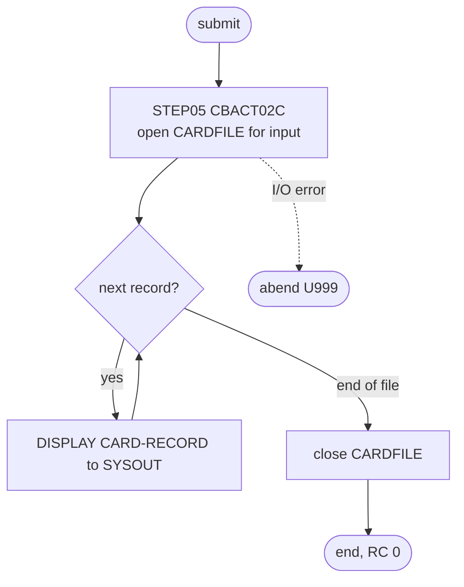

# READCARD: Card master diagnostic read

## 1. Summary

READCARD runs CBACT02C once to show that the card master file `AWS.M2.CARDDEMO.CARDDATA.VSAM.KSDS` is loaded and readable. Its only step, `STEP05`, opens the file for input, reads every record in key order and prints each one to `SYSOUT`. Nothing is written or changed. CA-7 runs it in the chain of diagnostic readers that follows CLOSEFIL. The job has no business logic; the program's own behaviour belongs to the CBACT02C program spec.

## 2. Rules at a glance

The job has no business rules. Its items:

| ID | Rule |
| :-- | :-- |
| FLOW-JRCARD-001 | Run CBACT02C once over the whole card master file, read only, and print every record. |
| ERR-JRCARD-001 | An open, read or close error abends the program with user code 999. |
| DEF-JRCARD-001 | [security] Every card record is printed to `SYSOUT`. |
| DEF-JRCARD-002 | The job has no output except the log. |

## 3. Actors and triggers

- **Trigger:** CA-7 submits it when READACCT ends (`app/scheduler/CardDemo.ca7:366-367`), and it triggers READCUST in turn (`app/scheduler/CardDemo.ca7:393-394`). The chain continues with READXREF, WAITSTEP and OPENFIL. Control-M, the README job tables and the demo scripts do not run it. It can be submitted by hand.
- **Preconditions:** the card master file is loaded (CARDFILE). It is opened for input with `DISP=SHR`.
- **Job card:** `CLASS=A,MSGCLASS=0,NOTIFY=&SYSUID` (`:1-2`). No parameters, no symbolic overrides.

## 4. Interfaces

| Step | Program | DD | Dataset | Disposition | Use | Source |
| :-- | :-- | :-- | :-- | :-- | :-- | :-- |
| `STEP05` | CBACT02C | `STEPLIB` | `AWS.M2.CARDDEMO.LOADLIB` | `SHR` | program library | `:23-24` |
| `STEP05` | CBACT02C | `CARDFILE` | `AWS.M2.CARDDEMO.CARDDATA.VSAM.KSDS` | `SHR` | input, KSDS read sequentially in key order | `:25-26` |
| `STEP05` | CBACT02C | `SYSOUT` | `SYSOUT=*` | - | program `DISPLAY` output: one line per record | `:27` |
| `STEP05` | CBACT02C | `SYSPRINT` | `SYSOUT=*` | - | not written by the program | `:28` |

The DD name matches the program's `SELECT ... ASSIGN TO` clause (`app/cbl/CBACT02C.cbl:29-31`). Return code of the job: 0 on success; an abend (user 999) otherwise.

## 5. Data used

- ENT-CARD, whole 150-byte records (layout `app/cpy/CVACT02Y.cpy`), read in ascending key order; nothing is updated.
- Catalog state on 09/01/22: the data component has `KEYLEN 16`, `MAXLRECL 150`, `SHROPTNS(2,3)` and `REC-TOTAL 50` (`app/catlg/LISTCAT.txt:202-207`), so a run on that file prints 50 records.

## 6. Processing flow

| # | Step | Class | What it does | Runs when |
| --: | :-- | :-- | :-- | :-- |
| 1 | `STEP05` | plumbing | run CBACT02C: read and print every record | always |

#### FLOW-JRCARD-001 · Run CBACT02C over the whole file
- **What:** `EXEC PGM=CBACT02C` from `AWS.M2.CARDDEMO.LOADLIB`, with no `PARM`. The program opens `CARDFILE` for input, reads it sequentially to the end and displays each record (`app/cbl/CBACT02C.cbl:71-87`).
- **Source:** `:22-26`
- **Fidelity:** incidental (diagnostic) · **Confidence:** runtime-verified (`python3 tools/carddemo.py run READCARD`: RETURN-CODE 0, 50 records displayed between the start and end messages)

## 7. Business rules

None. The job reads and prints; it makes no decision about the data.

## 8. Validations and messages

None in the job. The program's own messages go to `SYSOUT`: `START OF EXECUTION OF PROGRAM CBACT02C` and `END OF EXECUTION OF PROGRAM CBACT02C` around the records, and `ERROR OPENING CARDFILE`, `ERROR READING CARDFILE` or `ERROR CLOSING CARDFILE` followed on an error by the literal text `FILE STATUS IS: NNNN` with the status as four characters appended (`FILE STATUS IS: NNNN0035` for status `35`) and `ABENDING PROGRAM` (`app/cbl/CBACT02C.cbl:110, 129, 147, 154-174`); see ERR-JRCARD-001.

## 9. Side effects

None. The job opens its only file for input and writes nothing except the job log.

## 10. Error handling

#### ERR-JRCARD-001 · I/O errors abend the step
- **When:** opening, reading or closing `CARDFILE` returns a status other than success (or end of file on the read), for example because the file is missing or not loaded.
- **Then:** the program displays the error message and the file status and calls `CEE3ABD` with abend code 999 (`app/cbl/CBACT02C.cbl:154-158`); the step ends with user abend U999. Nothing has been changed, so a rerun is safe. In CA-7 an abend ends this reader path: CA-7 does not trigger READCUST, READXREF or this path's WAITSTEP. The other paths that the same CLOSEFIL completion starts still reach WAITSTEP, which triggers OPENFIL (DEF-JCA7-002), so the abend does not by itself keep the CICS files closed.
- **Source:** `:22-26`
- **Fidelity:** must-preserve (fail visibly) · **Confidence:** reviewed (program); platform-inferred (CA-7 does not trigger successors of an abended job; schedule ID inheritance)

## 11. Interactions

- **Upstream:** CARDFILE loads the file; in CA-7, READACCT precedes this job.
- **Downstream:** READCUST (CA-7 trigger). No data is passed on.
- **Local runner:** `tools/carddemo.py:638` emulates the job with the same DD name and the sample data.

## 12. Numeric, date and format details

None. The job prints records as stored; it does not interpret any field.

## 13. Known defects and oddities

#### DEF-JRCARD-001 · [security] Every card record is printed to `SYSOUT`
- The program displays each whole record, which includes the card number and the card verification value (CVV) (`docs/security/data-handling.md:88`) as well as the account ID, the embossed name, the expiry date and the active flag (`app/cpy/CVACT02Y.cpy:5-10`), to the job log. Anyone who can browse the job output sees the whole file. The repository's guidance is not to run the READ* jobs against real data (`docs/security/data-handling.md:94`).
- **Status:** open · **Fidelity:** defect-decide (the target must not print these fields) · **Confidence:** reviewed

#### DEF-JRCARD-002 · The job has no output except the log
- The job proves only that the file can be opened and read to the end. It writes no count or total that an operator or a later job could check; the result is 50 printed records and return code 0.
- **Status:** open · **Fidelity:** incidental · **Confidence:** reviewed

## 14. Open questions

| ID | Question | For |
| :-- | :-- | :-- |
| Q-JRCARD-001 | Does the target need a "file loaded correctly" check for this store, and if so, should it report a record count and key range instead of printing records? | operations |

## 15. Equivalence contract

A successful run (return code 0) leaves the card master file unchanged and reads every record once, in ascending key order (50 for the sample data). A missing or unreadable file must make the run fail visibly. Printing the records to the log is not part of the contract (DEF-JRCARD-001).

Review evidence (independent reviewers checked every item against the source, all WRONG and MINOR findings were fixed, and a fresh reviewer re-checked every changed or added item): [evidence/g-jobs-ops-review.md](../evidence/g-jobs-ops-review.md).

## 16. Paragraph coverage

| Step | Lines | Covered by |
| :-- | :-- | :-- |
| (job card) | 1-2 | §3 |
| `STEP05` | 22-28 | FLOW-JRCARD-001, ERR-JRCARD-001, DEF-JRCARD-001, DEF-JRCARD-002 |
