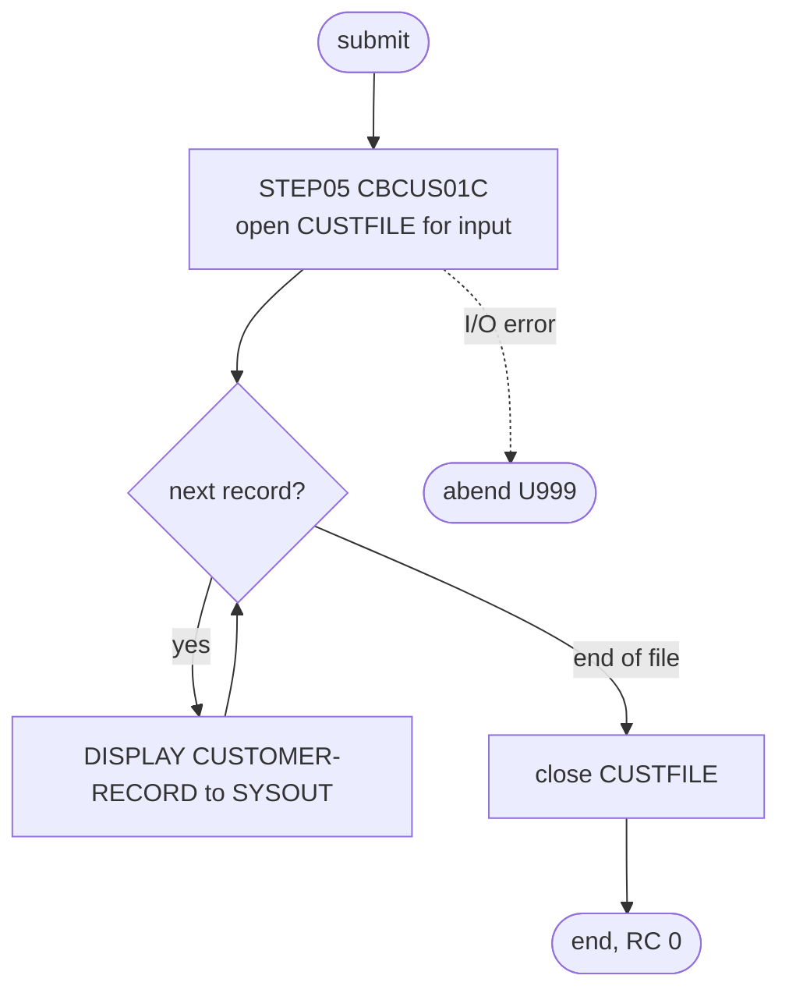

# READCUST: Customer master diagnostic read

## 1. Summary

READCUST runs CBCUS01C once to show that the customer master file `AWS.M2.CARDDEMO.CUSTDATA.VSAM.KSDS` is loaded and readable. Its only step, `STEP05`, opens the file for input, reads every record in key order and prints each one to `SYSOUT`. Nothing is written or changed. CA-7 runs it in the chain of diagnostic readers that follows CLOSEFIL. The job has no business logic; the program's own behaviour belongs to the CBCUS01C program spec.

## 2. Rules at a glance

The job has no business rules. Its items:

| ID | Rule |
| :-- | :-- |
| FLOW-JRCUST-001 | Run CBCUS01C once over the whole customer master file, read only, and print every record. |
| ERR-JRCUST-001 | An open, read or close error abends the program with user code 999. |
| DEF-JRCUST-001 | [security] Every customer record is printed to `SYSOUT`. |
| DEF-JRCUST-002 | `NOTIFY=&SYUID` is a typo for `&SYSUID`. |
| DEF-JRCUST-003 | The job has no output except the log. |

## 3. Actors and triggers

- **Trigger:** CA-7 submits it when READCARD ends (`app/scheduler/CardDemo.ca7:393-394`), and it triggers READXREF in turn (`app/scheduler/CardDemo.ca7:420-421`). The chain continues with WAITSTEP and OPENFIL. Control-M, the README job tables and the demo scripts do not run it. It can be submitted by hand.
- **Preconditions:** the customer master file is loaded (CUSTFILE). It is opened for input with `DISP=SHR`.
- **Job card:** `CLASS=A,MSGCLASS=0,NOTIFY=&SYUID` (`:1-2`). No parameters, no symbolic overrides. The notify symbol is misspelt (DEF-JRCUST-002).

## 4. Interfaces

| Step | Program | DD | Dataset | Disposition | Use | Source |
| :-- | :-- | :-- | :-- | :-- | :-- | :-- |
| `STEP05` | CBCUS01C | `STEPLIB` | `AWS.M2.CARDDEMO.LOADLIB` | `SHR` | program library | `:22-23` |
| `STEP05` | CBCUS01C | `CUSTFILE` | `AWS.M2.CARDDEMO.CUSTDATA.VSAM.KSDS` | `SHR` | input, KSDS read sequentially in key order | `:24-25` |
| `STEP05` | CBCUS01C | `SYSOUT` | `SYSOUT=*` | - | program `DISPLAY` output: one line per record | `:26` |
| `STEP05` | CBCUS01C | `SYSPRINT` | `SYSOUT=*` | - | not written by the program | `:27` |

The DD name matches the program's `SELECT ... ASSIGN TO` clause (`app/cbl/CBCUS01C.cbl:29-31`). Return code of the job: 0 on success; an abend (user 999) otherwise.

## 5. Data used

- The customer master record (no entity in `entities.md`; layout `app/cpy/CVCUS01Y.cpy`), 500 bytes, read in ascending key order; nothing is updated.
- Catalog state on 09/01/22: the data component has `KEYLEN 9`, `MAXLRECL 500`, `SHROPTNS(2,3)` and `REC-TOTAL 50` (`app/catlg/LISTCAT.txt:632-637`), so a run on that file prints 50 records.

## 6. Processing flow

| # | Step | Class | What it does | Runs when |
| --: | :-- | :-- | :-- | :-- |
| 1 | `STEP05` | plumbing | run CBCUS01C: read and print every record | always |

#### FLOW-JRCUST-001 · Run CBCUS01C over the whole file
- **What:** `EXEC PGM=CBCUS01C` from `AWS.M2.CARDDEMO.LOADLIB`, with no `PARM`. The program opens `CUSTFILE` for input, reads it sequentially to the end and displays each record (`app/cbl/CBCUS01C.cbl:71-87`).
- **Source:** `:21-25`
- **Fidelity:** incidental (diagnostic) · **Confidence:** runtime-verified (`python3 tools/carddemo.py run READCUST`: RETURN-CODE 0, 50 records displayed between the start and end messages)

## 7. Business rules

None. The job reads and prints; it makes no decision about the data.

## 8. Validations and messages

None in the job. The program's own messages go to `SYSOUT`: `START OF EXECUTION OF PROGRAM CBCUS01C` and `END OF EXECUTION OF PROGRAM CBCUS01C` around the records, and `ERROR OPENING CUSTFILE`, `ERROR READING CUSTOMER FILE` or `ERROR CLOSING CUSTOMER FILE` followed by the file status on an error (ERR-JRCUST-001).

## 9. Side effects

None. The job opens its only file for input and writes nothing except the job log.

## 10. Error handling

#### ERR-JRCUST-001 · I/O errors abend the step
- **When:** opening, reading or closing `CUSTFILE` returns a status other than success (or end of file on the read), for example because the file is missing or not loaded.
- **Then:** the program displays the error message and the file status and calls `CEE3ABD` with abend code 999 (`app/cbl/CBCUS01C.cbl:154-158`); the step ends with user abend U999. Nothing has been changed, so a rerun is safe. In CA-7 an abend stops the chain at this job, so the later readers, WAITSTEP and OPENFIL do not run until the operator intervenes.
- **Source:** `:21-25`
- **Fidelity:** must-preserve (fail visibly) · **Confidence:** reviewed (program); platform-inferred (CA-7 does not trigger successors of an abended job)

## 11. Interactions

- **Upstream:** CUSTFILE loads the file; in CA-7, READCARD precedes this job.
- **Downstream:** READXREF (CA-7 trigger). No data is passed on.
- **Local runner:** `tools/carddemo.py:640` emulates the job with the same DD name and the sample data.

## 12. Numeric, date and format details

None. The job prints records as stored; it does not interpret any field.

## 13. Known defects and oddities

#### DEF-JRCUST-001 · [security] Every customer record is printed to `SYSOUT`
- The program displays each whole record, which includes the name, address, phone numbers, Social Security number, government ID, date of birth, EFT account ID and FICO score (`docs/security/data-handling.md:87`), to the job log. Anyone who can browse the job output sees the whole file. The repository's guidance is not to run the READ* jobs against real data (`docs/security/data-handling.md:94`).
- **Status:** open · **Fidelity:** defect-decide (the target must not print these fields) · **Confidence:** reviewed

#### DEF-JRCUST-002 · `NOTIFY=&SYUID` is a typo for `&SYSUID`
- The job card asks for notification of `&SYUID` (`:2`), not the system symbol `&SYSUID` that every other job uses. `SYUID` is not a defined symbol, so the job is either rejected with a JCL error before it runs or runs without notifying the submitter, depending on how the system treats the unresolved symbol. The typo has been in the member since the first release.
- **Status:** open · **Fidelity:** defect-fix · **Confidence:** platform-inferred

#### DEF-JRCUST-003 · The job has no output except the log
- The job proves only that the file can be opened and read to the end. It writes no count or total that an operator or a later job could check; the result is 50 printed records and return code 0.
- **Status:** open · **Fidelity:** incidental · **Confidence:** reviewed

## 14. Open questions

| ID | Question | For |
| :-- | :-- | :-- |
| Q-JRCUST-001 | Does the target need a "file loaded correctly" check for this store, and if so, should it report a record count and key range instead of printing records? | operations |

## 15. Equivalence contract

A successful run (return code 0) leaves the customer master file unchanged and reads every record once, in ascending key order (50 for the sample data). A missing or unreadable file must make the run fail visibly. Printing the records to the log is not part of the contract (DEF-JRCUST-001).

## 16. Paragraph coverage

| Step | Lines | Covered by |
| :-- | :-- | :-- |
| (job card) | 1-2 | §3, DEF-JRCUST-002 |
| `STEP05` | 21-27 | FLOW-JRCUST-001, ERR-JRCUST-001, DEF-JRCUST-001, DEF-JRCUST-003 |
