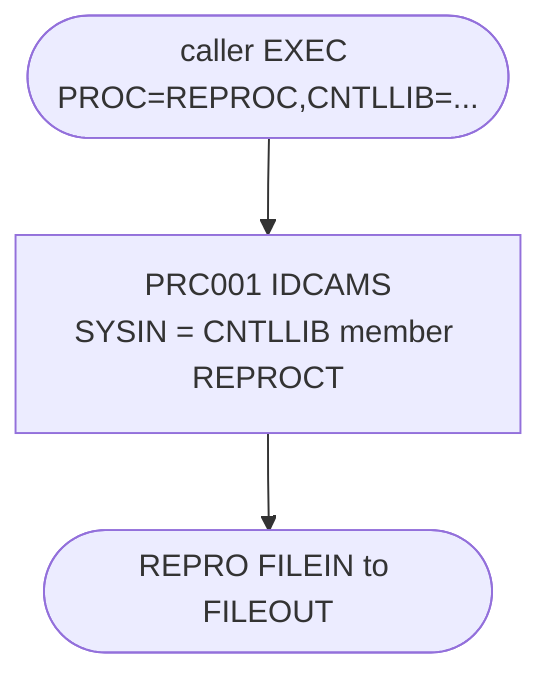

# REPROC: Copy procedure

## 1. Summary

REPROC is a one-step cataloged procedure that copies one dataset to another with IDCAMS `REPRO`. Its step `PRC001` has two placeholder DDs, `FILEIN` and `FILEOUT`, both pointing at the dummy dataset `NULLFILE`, which every caller overrides with the real input and output. The `REPRO` statement is not in-stream: it is read from member `REPROCT` of the library named by the symbolic parameter `CNTLLIB`. CardDemo uses it to unload a VSAM file into a new generation of a backup GDG: TRANBKP and TRANREPT for the transaction master, PRTCATBL for the category balance file.

## 2. Rules at a glance

| ID | Rule |
| :-- | :-- |
| SE-JRPROC-001 | Copy every record of `FILEIN` to `FILEOUT` with `REPRO INFILE(FILEIN) OUTFILE(FILEOUT)`. |
| VAL-JRPROC-001 | The caller must override `FILEIN` and `FILEOUT` and supply `CNTLLIB`. |
| DEF-JRPROC-001 | `CNTLLIB` has no default, so a caller that omits it gets a JCL error. |

## 3. Actors and triggers

- **Trigger:** called with `EXEC PROC=REPROC` by TRANBKP (`app/jcl/TRANBKP.jcl:23-24`), PRTCATBL (`app/jcl/PRTCATBL.jcl:29-30`), TRANREPT (`app/jcl/TRANREPT.jcl:23-24`) and the procedure in `app/proc/TRANREPT.prc` (`app/proc/TRANREPT.prc:21-22`). The callers find it through `JCLLIB ORDER=('AWS.M2.CARDDEMO.PROC')` (for example `app/jcl/TRANBKP.jcl:19`).
- **Preconditions:** member `REPROCT` exists in the library passed as `CNTLLIB` (all callers pass `AWS.M2.CARDDEMO.CNTL`).
- **Header:** `//REPROC PROC` with no default values for symbolic parameters (`:1`); the procedure ends with `// PEND` (`:29`), which is optional in a cataloged procedure.

## 4. Interfaces

| Step | Program | DD | Dataset | Disposition | Use | Source |
| :-- | :-- | :-- | :-- | :-- | :-- | :-- |
| `PRC001` | IDCAMS | `SYSPRINT` | `SYSOUT=*` | - | IDCAMS messages | `:22` |
| `PRC001` | IDCAMS | `FILEIN` | `NULLFILE` | `SHR` | input placeholder, overridden as `PRC001.FILEIN` | `:23-24` |
| `PRC001` | IDCAMS | `FILEOUT` | `NULLFILE` | `SHR` | output placeholder, overridden as `PRC001.FILEOUT` | `:25-26` |
| `PRC001` | IDCAMS | `SYSIN` | `&CNTLLIB(REPROCT)` | `SHR` | control statement | `:27-28` |

Overrides by the callers:

| Caller step | `FILEIN` | `FILEOUT` | Source |
| :-- | :-- | :-- | :-- |
| TRANBKP `STEP05R` | `AWS.M2.CARDDEMO.TRANSACT.VSAM.KSDS` | `AWS.M2.CARDDEMO.TRANSACT.BKUP(+1)`, FB 350 | `app/jcl/TRANBKP.jcl:26-33` |
| PRTCATBL `STEP05R` | `AWS.M2.CARDDEMO.TCATBALF.VSAM.KSDS` | `AWS.M2.CARDDEMO.TCATBALF.BKUP(+1)`, FB 50 | `app/jcl/PRTCATBL.jcl:32-39` |
| TRANREPT `STEP05R` | `AWS.M2.CARDDEMO.TRANSACT.VSAM.KSDS` | `AWS.M2.CARDDEMO.TRANSACT.BKUP(+1)`, FB 350 | `app/jcl/TRANREPT.jcl:26-33` |
| TRANREPT procedure `STEP01R` | `AWS.M2.CARDDEMO.TRANSACT.VSAM.KSDS` | `AWS.M2.CARDDEMO.TRANSACT.BKUP(+1)`, FB 350 | `app/proc/TRANREPT.prc:24-31` |

## 5. Data used

None of its own: the procedure copies whatever the caller binds to `FILEIN` and `FILEOUT`, record by record, without interpreting any field.

## 6. Processing flow

| # | Step | Class | What it does | Runs when |
| --: | :-- | :-- | :-- | :-- |
| 1 | `PRC001` | plumbing | `REPRO` `FILEIN` to `FILEOUT` | as the caller's step, subject to the caller's `COND` |

## 7. Business rules

None. The procedure copies data without interpreting it.

## 8. Validations and messages

#### VAL-JRPROC-001 · The caller must supply the files and the control library
- **When:** a caller runs the procedure.
- **Then:** without overrides, `FILEIN` and `FILEOUT` both point at `NULLFILE` (a dummy dataset): the input is empty and nothing is written. `&CNTLLIB` has no default, so the `SYSIN` DD can only be resolved when the caller sets it (DEF-JRPROC-001).
- **Source:** `:1, 23-28`
- **Fidelity:** incidental · **Confidence:** platform-inferred

## 9. Side effects

#### SE-JRPROC-001 · Copy the input to the output
- **What:** IDCAMS reads `SYSIN` = `&CNTLLIB(REPROCT)`, whose only statement is `REPRO INFILE(FILEIN) OUTFILE(FILEOUT)` (`app/ctl/REPROCT.ctl:15`; lines 1-14 are comments). It copies every record of `FILEIN`, in its order (key order for a KSDS), to `FILEOUT`. With a new sequential output, the result is a byte-for-byte copy of every record. The output's disposition and DCB come from the caller's override.
- **Source:** `:21-28`, `app/ctl/REPROCT.ctl:15`
- **Fidelity:** must-preserve · **Confidence:** reviewed

## 10. Error handling

None in the procedure. It has no `COND` and no `IF MAXCC` logic; the step's return code is IDCAMS's, and the caller's later steps decide what to do with it (for example TRANBKP `STEP10` has `COND=(4,LT)`, `app/jcl/TRANBKP.jcl:51`).

## 11. Interactions

- **Callers:** TRANBKP, PRTCATBL, TRANREPT and the TRANREPT procedure (section 3). Each writes a new generation of a backup GDG through `FILEOUT`.
- **Shared data:** member `REPROCT` in `AWS.M2.CARDDEMO.CNTL` (`app/ctl/REPROCT.ctl`). Changing that member changes all callers at once.

## 12. Numeric, date and format details

None. The procedure has no fields or sizes of its own; the caller's override sets the output format.

## 13. Known defects and oddities

#### DEF-JRPROC-001 · No default for `CNTLLIB`
- `//REPROC PROC` declares no default for `CNTLLIB`, and the `SYSIN` DD uses `&CNTLLIB(REPROCT)`. A caller that forgets `CNTLLIB=` gets a JCL error instead of the standard library. All four callers set it to `AWS.M2.CARDDEMO.CNTL`.
- **Source:** `:1, 28`
- **Status:** open · **Fidelity:** incidental · **Confidence:** platform-inferred

## 14. Open questions

None. The procedure is a generic copy; the target replaces it with the copy or export step of each caller.

## 15. Equivalence contract

For any caller, the output holds every input record, in input order, byte for byte. The procedure itself adds no condition, filter or transformation.

## 16. Paragraph coverage

| Step | Lines | Covered by |
| :-- | :-- | :-- |
| (`PROC` statement) | 1 | §3, DEF-JRPROC-001 |
| `PRC001` | 21-29 | SE-JRPROC-001, VAL-JRPROC-001 |
