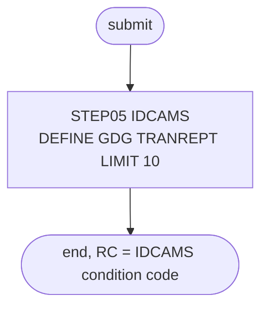

# REPTFILE: GDG base for the transaction report

## 1. Summary

REPTFILE is a set-up job with one IDCAMS step, `STEP05`, that defines the generation data group (GDG) base `AWS.M2.CARDDEMO.TRANREPT` with `LIMIT(10)` and no `SCRATCH` option. TRANREPT writes one generation of that GDG per run, the 133-byte transaction report. DEFGDGB defines the same base with different attributes (`LIMIT(5) SCRATCH`), so only the job that runs first has any effect, and the 09/01/22 catalog shows DEFGDGB's attributes. The job has no business logic and no documented place in the installation sequence.

## 2. Rules at a glance

The job has no business rules. Its items:

| ID | Rule |
| :-- | :-- |
| SE-JREPT-001 | Define the GDG base `AWS.M2.CARDDEMO.TRANREPT`, `LIMIT(10)`, no `SCRATCH`. |
| ERR-JREPT-001 | No return-code reset: when the base exists the job ends with condition code 12 and changes nothing. |
| NUM-JREPT-001 | Ten generations without `SCRATCH`; rolled-off reports stay on disk. |
| DEF-JREPT-001 | Conflicts with DEFGDGB's define of the same base (`LIMIT(5) SCRATCH`). |
| DEF-JREPT-002 | The step comment describes a delete of the transaction master, which the job does not do. |
| DEF-JREPT-003 | No documentation or schedule says when to run the job. |

## 3. Actors and triggers

- **Trigger:** none documented. The README lists the job in neither its initialisation table (`./README.md:150-167`) nor its batch table (`./README.md:351-379`), no runbook names it, neither the CA-7 nor the Control-M schedule runs it, and `scripts/run_full_batch.sh` does not submit it. It can only be submitted by hand. The local runner does not emulate it: TRANREPT's report DD is a plain new file there (`tools/carddemo.py:670`).
- **Preconditions:** the base `AWS.M2.CARDDEMO.TRANREPT` does not exist yet (otherwise ERR-JREPT-001).
- **Job card:** `'DEF GDG FOR REPORT FILE',CLASS=A,MSGCLASS=0,NOTIFY=&SYSUID` (`:1-2`). No parameters, no symbolic overrides.

## 4. Interfaces

| Step | Program | DD | Dataset | Disposition | Use | Source |
| :-- | :-- | :-- | :-- | :-- | :-- | :-- |
| `STEP05` | IDCAMS | `SYSPRINT` | `SYSOUT=*` | - | IDCAMS messages | `:23` |
| `STEP05` | IDCAMS | `SYSIN` | in-stream | - | `DEFINE GENERATIONDATAGROUP` statement | `:24-29` |

The job allocates no data set; the GDG base is a catalog entry. Return code of the job: the IDCAMS condition code.

## 5. Data used

- No records are read or written. The future generations `AWS.M2.CARDDEMO.TRANREPT.GnnnnV00` hold the 133-byte report lines that CBTRN03C writes (`app/jcl/TRANREPT.jcl:76-80`); the report has no entry in `entities.md`.
- Catalog state on 09/01/22 (`app/catlg/LISTCAT.txt:1527-1541`): GDG base `AWS.M2.CARDDEMO.TRANREPT`, `LIMIT 5`, `SCRATCH`, `NOEMPTY`, `LIFO`, `NOPURGE`, `NOEXTENDED`, created 2022.156, last altered 2022.199, with five generations `G0010V00` to `G0014V00`. These are DEFGDGB's attributes, not this job's (DEF-JREPT-001).

## 6. Processing flow

The only step is plumbing.

| # | Step | Class | What it does | Runs when |
| --: | :-- | :-- | :-- | :-- |
| 1 | `STEP05` | plumbing | define the GDG base `TRANREPT` | always |



## 7. Business rules

None. The job defines a catalog entry; the report itself is TRANREPT's (program CBTRN03C).

## 8. Validations and messages

None. The job checks no input; IDCAMS writes its own `IDCnnnnI` messages to `SYSPRINT`.

## 9. Side effects

#### SE-JREPT-001 · Define the report GDG base with limit 10
- **What:** IDCAMS runs this statement:

```text
DEFINE GENERATIONDATAGROUP -
(NAME(AWS.M2.CARDDEMO.TRANREPT) -
 LIMIT(10) -
)
```

  It creates the GDG base `AWS.M2.CARDDEMO.TRANREPT` that keeps at most ten generations cataloged. No `SCRATCH` is coded, so the IDCAMS default `NOSCRATCH` applies: a generation that rolls off is no longer an active generation, but its data set is not deleted (NUM-JREPT-001).
- **Source:** `:25-28`
- **Fidelity:** defect-decide (DEF-JREPT-001) · **Confidence:** reviewed (statement); platform-inferred (`NOSCRATCH` default)

## 10. Error handling

#### ERR-JREPT-001 · Existing base: condition code 12, nothing changed
- **When:** `AWS.M2.CARDDEMO.TRANREPT` already exists, for example because DEFGDGB ran first.
- **Then:** the define fails as a duplicate name, IDCAMS ends with condition code 12 and the job with return code 12. The existing base keeps its attributes (the catalog's `LIMIT 5 SCRATCH`). The job has no `IF LASTCC` reset. There is nothing to restart.
- **Source:** `:22-28`
- **Fidelity:** incidental · **Confidence:** platform-inferred (IDCAMS duplicate-name condition code)

## 11. Interactions

- **Downstream:** TRANREPT step `STEP10R` allocates `AWS.M2.CARDDEMO.TRANREPT(+1)` with `DISP=(NEW,CATLG,DELETE)`, `LRECL=133`, `RECFM=FB` (`app/jcl/TRANREPT.jcl:76-80`); the cataloged procedure does the same (`app/proc/TRANREPT.prc:74-78`). CORPT00C submits TRANREPT from CICS (`./README.md:375`).
- **Shared data:** DEFGDGB defines the same base (`app/jcl/DEFGDGB.jcl:36-41`); see DEF-JREPT-001 and the DEFGDGB spec.

## 12. Numeric, date and format details

#### NUM-JREPT-001 · Ten generations, rolled-off reports kept
- If this job defines the base, ten report generations stay active instead of DEFGDGB's five, and because of the `NOSCRATCH` default older reports are not deleted when they roll off; they keep using space until someone deletes them. Each generation holds 133-byte `FB` report lines (`app/jcl/TRANREPT.jcl:78`).
- **Fidelity:** defect-decide · **Confidence:** reviewed (limit); platform-inferred (roll-off without `SCRATCH`)

## 13. Known defects and oddities

#### DEF-JREPT-001 · Two jobs define the same GDG base differently
- REPTFILE defines `AWS.M2.CARDDEMO.TRANREPT` with `LIMIT(10)` and no `SCRATCH`; DEFGDGB defines it with `LIMIT(5) SCRATCH` (`app/jcl/DEFGDGB.jcl:36-41`). Whichever runs first wins and the other fails with condition code 12: DEFGDGB hides its failure with `IF LASTCC=12 THEN SET MAXCC=0` (`app/jcl/DEFGDGB.jcl:41`), REPTFILE does not. The retention of the reports therefore depends on job order. The 09/01/22 catalog shows `LIMIT 5 SCRATCH` (`app/catlg/LISTCAT.txt:1535`), so DEFGDGB's definition (or a later alter) is the one in effect.
- **Source:** `:25-28`
- **Status:** open · **Fidelity:** defect-decide · **Confidence:** reviewed

#### DEF-JREPT-002 · Misleading step comment
- The comment before `STEP05` reads `DELETE TRANSACATION MASTER VSAM FILE IF ONE ALREADY EXISTS` (`:20`), the same text as in DALYREJS. The step deletes nothing.
- **Source:** `:20, 25-28`
- **Status:** open · **Fidelity:** incidental · **Confidence:** reviewed

#### DEF-JREPT-003 · No documented trigger
- No README table, runbook or schedule names REPTFILE (section 3), so nothing tells an operator whether to run it, before or instead of DEFGDGB.
- **Source:** `:1-2`
- **Status:** open · **Fidelity:** incidental · **Confidence:** reviewed

## 14. Open questions

| ID | Question | For |
| :-- | :-- | :-- |
| Q-JREPT-001 | How many transaction reports should be kept, five (DEFGDGB, the catalog) or ten (REPTFILE), and should old reports be deleted? | operations, business owner |

## 15. Equivalence contract

None of the job's own behaviour needs reproducing beyond the report retention that the business chooses (Q-JREPT-001). A reimplementation must have one definition of report retention, not two that depend on job order. IDCAMS messages and condition codes may differ.

## 16. Paragraph coverage

| Step | Lines | Covered by |
| :-- | :-- | :-- |
| (job card) | 1-2 | §3 |
| `STEP05` | 22-29 | SE-JREPT-001, ERR-JREPT-001, NUM-JREPT-001, DEF-JREPT-001, DEF-JREPT-002 |
