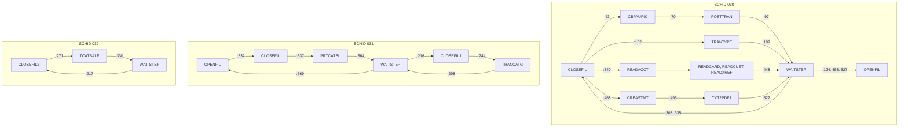

# SCHED-CA7: CA-7 job definitions and triggers

## 1. Summary

`app/scheduler/CardDemo.ca7` is a printed CA-7 `LJOB,LIST=ALL` listing, not a CA-7 load deck. It contains 30 `LJOB` entries: 18 full job listings (job information, maintenance data and, except for OPENFIL, triggered jobs) and 12 short ones that show only the triggered jobs of a job already listed. Together they define job-completion triggers among 17 CA-7 job names that run 15 JCL members. The entries are laid out as four chains that read top to bottom: posting after the authorization purge (FLOW-JCA7-001), the reload of the reference files followed by four diagnostic file readers (FLOW-JCA7-002), statements (FLOW-JCA7-003), and the category balance listing (FLOW-JCA7-004). Chains 1 to 3 start with CLOSEFIL, chain 4 starts from an OPENFIL completion, and all of them end with WAITSTEP and OPENFIL. Each trigger is defined for one schedule ID (SCHID 030, 031 or 032) and fires only when the triggering job runs under that ID; the triggered job then runs under the same ID (FLOW-JCA7-005). Read that way, a run under SCHID 030 starts chains 1 and 3 and the TRANTYPE and reader parts of chain 2 together, never reaches the TRANCATG and TCATBALF branches, and returns to CLOSEFIL after every WAITSTEP (FLOW-JCA7-006, DEF-JCA7-002); runs under 031 and 032 loop as well (DEF-JCA7-008). What starts a run is not in the listing: every job names schedule member 000652, whose content is not shown, and a `DEMAND` without a schedule ID matches no trigger (DEF-JCA7-001, DEF-JCA7-009). The listing also leaves out INTCALC, TRANBKP, COMBTRAN and TRANIDX, which the README cycle needs (DEF-JCA7-005), and it disagrees with the Control-M definitions on almost every job. What a target must take from it is the set of ordering constraints that also appear in the README cycle (close the online files, run the batch job, pause, reopen). The CA-7 attributes themselves are not behaviour to copy. Which cycle the Airflow DAGs implement is a decision (Q-JCA7-001).

## 2. Rules at a glance

| ID | Rule |
| :-- | :-- |
| FLOW-JCA7-001 | Chain 1 (SCHID 030): CLOSEFIL, CBPAUP0J, POSTTRAN, WAITSTEP, OPENFIL. |
| FLOW-JCA7-002 | Chain 2 as laid out: CLOSEFIL, TRANTYPE, WAITSTEP, two branches through TRANCATG and TCATBALF, CLOSEFIL, the four readers, WAITSTEP, OPENFIL; under SCHID 030 the branches never run. |
| FLOW-JCA7-003 | Chain 3 (SCHID 030): CLOSEFIL, CREASTMT, TXT2PDF1, WAITSTEP, OPENFIL. |
| FLOW-JCA7-004 | Chain 4 (SCHID 031): OPENFIL triggers CLOSEFIL, then PRTCATBL, WAITSTEP, and from WAITSTEP both OPENFIL and `CLOSEFIL1`, TRANCATG. |
| FLOW-JCA7-005 | A trigger fires when its job completes under the trigger's schedule ID; the triggered job inherits that ID; the queue time sets its deadline. |
| FLOW-JCA7-006 | What a run under SCHID 030, 031 or 032 actually triggers. |
| SE-JCA7-001 | Every job is submitted from member `<name>` of the library `&CARDDEMOPRODJCL` with the same job attributes. |
| ERR-JCA7-001 | A failed job triggers nothing; its path stops and waits for an operator. |
| NUM-JCA7-001 | Julian dates, `hhmm` times and identical statistics in every listing. |
| DEF-JCA7-001 | What starts a chain is not in the listing; the schedule member 000652 is not shown. |
| DEF-JCA7-002 | Under SCHID 030 the trigger graph fans out and returns to CLOSEFIL after every WAITSTEP. |
| DEF-JCA7-003 | `CLOSEFIL1` and `CLOSEFIL2` are 9-character job names. |
| DEF-JCA7-004 | The listing is a copied template, not an export of a working definition. |
| DEF-JCA7-005 | INTCALC, TRANBKP, COMBTRAN and TRANIDX are missing; POSTTRAN's input is not prepared. |
| DEF-JCA7-006 | Chains that start from the same CLOSEFIL run in parallel on the same files. |
| DEF-JCA7-007 | An optional-module job gates the base posting job. |
| DEF-JCA7-008 | Runs under SCHID 031 and 032 never end; the 031 run reopens and closes the files at the same time. |
| DEF-JCA7-009 | A `DEMAND` without a schedule ID triggers nothing. |

## 3. Actors and triggers

- **Who uses it:** a CA-7 operator or scheduler administrator. CA-7 submits a job when a job that triggers it completes under the trigger's schedule ID (FLOW-JCA7-005). The listing does not show what starts the first job of a chain (DEF-JCA7-001): either schedule member 000652, whose content is not in the repository, or an operator `DEMAND` of CLOSEFIL that names schedule ID 30 (chains 1 to 3) or 31 (chain 4). A `DEMAND` without a schedule ID runs CLOSEFIL alone (DEF-JCA7-009).
- **Preconditions:** the JCL members exist in the library that the symbolic `&CARDDEMOPRODJCL` resolves to (`:35`); the CICS region named in CLOSEFIL and OPENFIL is up; for chain 1, the optional authorization module is installed (DEF-JCA7-007).
- **Format:** each full listing starts with a command echo `1LJOB,JOB=<name>,LIST=ALL` and a page header `DATE=06.198` (`:18-19`), followed by a job line (`:24`), the job information flags (`:26-33`), the maintenance data (`:35-40`) and the triggered jobs (`:42-43`). A short listing has only the command echo and the triggered jobs (`:159-162`). The leading space before `1LJOB` varies: none at `:18` and from `:450` on, one at `:45` to `:423`; the line at `:423` is cut off after `LIST=`.

## 4. Interfaces

The CA-7 jobs, the JCL member each one runs, the jobs it triggers and the job spec. A job name appears in several listings; the triggers below are the union over all of them. A trigger applies only when the job in the first column completes under the SCHID shown, and the triggered job then runs under the same SCHID (FLOW-JCA7-005, FLOW-JCA7-006).

| CA-7 job | JCL member | Full listing | Triggers (SCHID) | Job spec |
| :-- | :-- | :-- | :-- | :-- |
| CLOSEFIL | CLOSEFIL | `:18-43` | CBPAUP0J (030) `:43`, TRANTYPE (030) `:162`, READACCT (030) `:340`, CREASTMT (030) `:468`, PRTCATBL (031) `:537` | `CLOSEFIL.md` |
| CLOSEFIL1 | CLOSEFIL | `:219-244` | TRANCATG (031) `:244` | `CLOSEFIL.md` |
| CLOSEFIL2 | CLOSEFIL | `:246-271` | TCATBALF (032) `:271` | `CLOSEFIL.md` |
| CBPAUP0J | CBPAUP0J | `:45-70` | POSTTRAN (030) `:70` | optional module (area e) |
| POSTTRAN | POSTTRAN | `:72-97` | WAITSTEP (030) `:97` | `POSTTRAN.md` |
| TRANTYPE | TRANTYPE | `:164-189` | WAITSTEP (030) `:189` | `TRANTYPE.md` |
| TRANCATG | TRANCATG | `:273-298` | WAITSTEP (031) `:298` | `TRANCATG.md` |
| TCATBALF | TCATBALF | `:305-330` | WAITSTEP (032) `:330` | `TCATBALF.md` |
| READACCT | READACCT | `:342-367` | READCARD (030) `:367` | `READACCT.md` |
| READCARD | READCARD | `:369-394` | READCUST (030) `:394` | `READCARD.md` |
| READCUST | READCUST | `:396-421` | READXREF (030) `:421` | `READCUST.md` |
| READXREF | READXREF | `:423-448` | WAITSTEP (030) `:448` | `READXREF.md` |
| CREASTMT | CREASTMT | `:470-495` | TXT2PDF1 (030) `:495` | `CREASTMT.md` |
| TXT2PDF1 | TXT2PDF1 | `:497-522` | WAITSTEP (030) `:522` | `TXT2PDF1.md` |
| PRTCATBL | PRTCATBL | `:539-564` | WAITSTEP (031) `:564` | `PRTCATBL.md` |
| WAITSTEP | WAITSTEP | `:99-124`, `:191-217` | OPENFIL (030) `:124, 453, 527`, CLOSEFIL1 (031) `:216`, CLOSEFIL2 (032) `:217`, CLOSEFIL (030) `:303, 335`, OPENFIL (031) `:569` | `WAITSTEP.md` |
| OPENFIL | OPENFIL | `:126-148` | CLOSEFIL (031) `:532`; the full listing has no triggered-jobs section and its flag says none (`:138`) | `OPENFIL.md` |

Every job name that appears as a trigger target also has a full listing, so the table is complete: 17 job names (WAITSTEP has two full listings) for 15 JCL members, because CA-7 jobs `CLOSEFIL1` and `CLOSEFIL2` run member `CLOSEFIL` (`:225, 252`).

## 5. Data used

The schedule reads and writes no data. The datasets each job uses are in its job spec. The schedule does not declare data set requirements: every job is marked as a maintenance job (`:28`), and no listing shows a requirement although "REQUIREMNTS TO BE LISTED" is `Y` (`:30`).

## 6. Processing flow

The four chains as the listing lays them out, with the line of each trigger:

```mermaid
flowchart TD
    subgraph C1[Chain 1]
      A1[CLOSEFIL] -->|:43| A2[CBPAUP0J] -->|:70| A3[POSTTRAN] -->|:97| A4[WAITSTEP] -->|:124| A5[OPENFIL]
    end
    subgraph C2[Chain 2]
      B1[CLOSEFIL] -->|:162| B2[TRANTYPE] -->|:189| B3[WAITSTEP]
      B3 -->|:216 SCHID 031| B4[CLOSEFIL1] -->|:244| B5[TRANCATG] -->|:298| B6[WAITSTEP] -->|:303| B9[CLOSEFIL]
      B3 -->|:217 SCHID 032| B7[CLOSEFIL2] -->|:271| B8[TCATBALF] -->|:330| B10[WAITSTEP] -->|:335| B9
      B9 -->|:340| R1[READACCT] -->|:367| R2[READCARD] -->|:394| R3[READCUST] -->|:421| R4[READXREF] -->|:448| B11[WAITSTEP] -->|:453| B12[OPENFIL]
    end
    subgraph C3[Chain 3]
      D1[CLOSEFIL] -->|:468| D2[CREASTMT] -->|:495| D3[TXT2PDF1] -->|:522| D4[WAITSTEP] -->|:527| D5[OPENFIL]
    end
    subgraph C4[Chain 4]
      E0[OPENFIL] -->|:532 SCHID 031| E1[CLOSEFIL] -->|:537| E2[PRTCATBL] -->|:564| E3[WAITSTEP] -->|:569| E4[OPENFIL]
    end
```

What actually runs when the triggers are applied per schedule ID (FLOW-JCA7-005, FLOW-JCA7-006):

#### FLOW-JCA7-001 · Chain 1: authorization purge and posting
- **When:** CLOSEFIL completes under schedule ID 030.
- **Then:** CLOSEFIL triggers CBPAUP0J (`:43`), the purge of expired authorizations of the optional IMS module; CBPAUP0J triggers POSTTRAN (`:70`), the posting of the daily transactions; POSTTRAN triggers WAITSTEP (`:97`); WAITSTEP triggers OPENFIL (`:124`). The chain ends at OPENFIL because OPENFIL's only trigger is defined for SCHID 031 (`:532`), which a run under 030 does not match (FLOW-JCA7-005); OPENFIL's flag "COMP TRIGGERS OTHER JOBS" `N` (`:138`) agrees. The same WAITSTEP completion also fires WAITSTEP's other 030 trigger, CLOSEFIL (`:303, 335`), so the run as a whole does not stop at OPENFIL (DEF-JCA7-002).
- **Source:** `:18-148, 303, 335, 532`
- **Fidelity:** defect-decide (DEF-JCA7-005, DEF-JCA7-007) · **Confidence:** reviewed (triggers); platform-inferred (schedule ID inheritance)

#### FLOW-JCA7-002 · Chain 2: reference file reload and file readers
- **When:** CLOSEFIL completes under schedule ID 030.
- **Then:** as laid out, CLOSEFIL triggers TRANTYPE (`:162`), which reloads the transaction type file, and TRANTYPE triggers WAITSTEP (`:189`). That WAITSTEP listing triggers `CLOSEFIL1` with SCHID 031 and `CLOSEFIL2` with SCHID 032 (`:216-217`). Branch 031: `CLOSEFIL1` triggers TRANCATG (`:244`), which triggers WAITSTEP (`:298`); the short WAITSTEP listing that follows triggers CLOSEFIL with SCHID 030 (`:303`). Branch 032: `CLOSEFIL2` triggers TCATBALF (`:271`), which triggers WAITSTEP (`:330`), followed by a WAITSTEP trigger of CLOSEFIL with SCHID 030 (`:335`). CLOSEFIL then triggers READACCT (`:340`), which triggers READCARD (`:367`), READCUST (`:394`) and READXREF (`:421`) in turn; READXREF triggers WAITSTEP (`:448`) and WAITSTEP triggers OPENFIL (`:453`).
- **With schedule ID inheritance** (FLOW-JCA7-005) the chain does not run this way. TRANTYPE runs under 030, so the WAITSTEP after it runs under 030 and does not fire the 031 and 032 triggers at `:216-217`. It fires WAITSTEP's 030 triggers instead: OPENFIL (`:124, 453, 527`) and CLOSEFIL (`:303, 335`). A run under 030 therefore goes CLOSEFIL, TRANTYPE, WAITSTEP, then OPENFIL and CLOSEFIL again, and the readers start from the first CLOSEFIL together with TRANTYPE (`:340`), not after the branches. The TRANCATG and TCATBALF branches run only in a run under SCHID 031 or 032 (FLOW-JCA7-004, DEF-JCA7-008); their WAITSTEPs then run under 031 or 032, which the 030 triggers at `:303` and `:335` do not match, so the branches never lead to the readers. The WAITSTEP after TRANTYPE also triggers OPENFIL while the readers may still run.
- **Source:** `:159-455`
- **Fidelity:** incidental (order); defect-decide (DEF-JCA7-002, DEF-JCA7-008) · **Confidence:** reviewed (triggers); platform-inferred (schedule ID inheritance and the resulting runs)

#### FLOW-JCA7-003 · Chain 3: statements
- **When:** CLOSEFIL completes under schedule ID 030.
- **Then:** CLOSEFIL triggers CREASTMT (`:468`), which writes the text and HTML statements; CREASTMT triggers TXT2PDF1 (`:495`), which converts the text statements to PDF; TXT2PDF1 triggers WAITSTEP (`:522`), and WAITSTEP triggers OPENFIL (`:527`). The same WAITSTEP completion also triggers CLOSEFIL (`:303, 335`), which starts the 030 round again (DEF-JCA7-002). The chain does not depend on POSTTRAN, so statements can be produced before or while the day's transactions are posted (see CREASTMT, Q-JSTMT-001).
- **Source:** `:465-527, 303, 335`
- **Fidelity:** defect-decide (DEF-JCA7-006) · **Confidence:** reviewed (triggers); platform-inferred (schedule ID inheritance)

#### FLOW-JCA7-004 · Chain 4: category balance listing
- **When:** OPENFIL completes under schedule ID 031, or an operator demands CLOSEFIL with SCHID 31. A run under 030 never gets here: OPENFIL's trigger at `:532` is defined for 031 only.
- **Then:** OPENFIL triggers CLOSEFIL with SCHID 031 (`:532`). CLOSEFIL triggers PRTCATBL with SCHID 031 (`:537`), PRTCATBL triggers WAITSTEP (`:564`), and WAITSTEP, running under 031, fires both of its 031 triggers: OPENFIL (`:569`) and `CLOSEFIL1` (`:216`). OPENFIL triggers CLOSEFIL again (`:532`); `CLOSEFIL1` triggers TRANCATG (`:244`), whose WAITSTEP (`:298`) fires OPENFIL and `CLOSEFIL1` once more. The 031 run therefore never ends, and it opens and closes the files in parallel (DEF-JCA7-008). OPENFIL's flag "COMP TRIGGERS OTHER JOBS" is `N` (`:138`) although the trigger at `:532` exists (DEF-JCA7-004).
- **Source:** `:138, 216, 244, 298, 529-571`
- **Fidelity:** defect-decide (DEF-JCA7-008) · **Confidence:** reviewed (triggers); platform-inferred (schedule ID inheritance and effect)

#### FLOW-JCA7-005 · Trigger semantics
- **When:** a job ends normally.
- **Then:** CA-7 looks at the "TRIGGERED JOBS" list of that job. Each entry shows `SCHID`, the schedule ID of the triggering job's run for which the trigger is defined (030, 031 or 032), and `QTM`, `LEADTM` and `SUBMTM`. An entry fires only when the triggering job completed under that schedule ID. The listing shows no separate schedule ID for the triggered job (`TRGID`); if none is defined, the triggered job runs under the schedule ID of the job that triggered it: a run started under 030 stays under 030 along the whole chain. `QTM=0100` (one hour of queue time) sets the triggered job's deadline start time to one hour after the trigger, and the due-out time follows from that deadline; `LEADTM=0000` adds no lead time; `SUBMTM` is blank at `:43` and `:70` and `0000` elsewhere, so no job has a fixed submit time. Every job is marked "JOB MARKED AS MAINT ONLY" `Y` (`:28`): CA-7 then ignores its input data set requirements and does not post its output data sets to other jobs, so no job can start through data set triggering either. "LOAD STEP TO BE EXECUTED" is `N` (`:27`), so CA-7 does not reload the JCL to learn the data sets. "SCHD RESOLUTION REQUIRED" `N` (`:27`) says only that no schedule resolution is pending; it does not show whether the job has a calendar schedule (DEF-JCA7-001).
- **Source:** `:27-30, 42-43, 70`
- **Fidelity:** incidental · **Confidence:** reviewed (values); platform-inferred (CA-7 meaning, schedule ID inheritance)

#### FLOW-JCA7-006 · What a run under each schedule ID triggers
- **When:** a job completes under SCHID 030, 031 or 032.
- **Then:** applying FLOW-JCA7-005 to the union of the triggers in section 4:
  - **SCHID 030:** CLOSEFIL starts CBPAUP0J, TRANTYPE, READACCT and CREASTMT at once (`:43, 162, 340, 468`). CBPAUP0J leads to POSTTRAN (`:70`), READACCT to READCARD, READCUST and READXREF (`:367, 394, 421`), CREASTMT to TXT2PDF1 (`:495`). POSTTRAN, TRANTYPE, READXREF and TXT2PDF1 each trigger WAITSTEP (`:97, 189, 448, 522`). Every WAITSTEP completion triggers OPENFIL (`:124, 453, 527`) and CLOSEFIL (`:303, 335`); OPENFIL triggers nothing under 030. `CLOSEFIL1`, `CLOSEFIL2`, TRANCATG, TCATBALF and PRTCATBL never run.
  - **SCHID 031:** CLOSEFIL starts PRTCATBL (`:537`); PRTCATBL and TRANCATG trigger WAITSTEP (`:564, 298`); WAITSTEP triggers OPENFIL (`:569`) and `CLOSEFIL1` (`:216`); OPENFIL triggers CLOSEFIL (`:532`); `CLOSEFIL1` triggers TRANCATG (`:244`).
  - **SCHID 032:** `CLOSEFIL2` starts TCATBALF (`:271`), TCATBALF triggers WAITSTEP (`:330`) and WAITSTEP triggers `CLOSEFIL2` (`:217`). No job triggers OPENFIL under 032, and CLOSEFIL has no 032 trigger, so this run starts only from a demand with SCHID 32 (of `CLOSEFIL2`, TCATBALF or WAITSTEP) or from schedule member 000652, if it defines SCHID 32 (DEF-JCA7-001).
  Because the triggered job keeps the schedule ID, the three runs never lead into each other. Each of them loops (DEF-JCA7-002, DEF-JCA7-008).
- **Source:** `:43, 70, 97, 124, 162, 189, 216-217, 244, 271, 298, 303, 330, 335, 340, 367, 394, 421, 448, 453, 468, 495, 522, 527, 532, 537, 564, 569`
- **Fidelity:** defect-decide (DEF-JCA7-002, DEF-JCA7-008) · **Confidence:** reviewed (triggers); platform-inferred (schedule ID inheritance)

## 7. Business rules

None. The schedule orders jobs; the business rules are in the programs the jobs run.

## 8. Validations and messages

None.

## 9. Side effects

#### SE-JCA7-001 · Job submission attributes
- **What:** every job is submitted from the JCL library `JCLLIB=&CARDDEMOPRODJCL`, a CA-7 symbolic whose value is not in the repository, with JCL ID 255 and system name `CARDDEMO` (`:24, 35`). All 18 full listings have the same attributes: owner none, `CLASS=` (empty), `MSGCLASS=A`, `REGION=4096K`, `PRTY=000`, `CPUTM=00023`, `ELAPTM=2359` (`:37`), "JOB SET FOR EXEC ON MAIN" `Y`, "JOB SET FOR HOLD IN REQQ" `N`, "MANUAL VERIFICATION REQD" `N`, "JCL TO BE KEPT IN PRRN/Q" `N` (`:28-33`). No job waits for manual release, so a triggered job is submitted as soon as CA-7 queues it.
- **Source:** `:24-40`
- **Fidelity:** incidental · **Confidence:** reviewed (values); platform-inferred (CA-7 meaning)

## 10. Error handling

#### ERR-JCA7-001 · A failed job stops its path
- **When:** a job abends or CA-7 judges its completion as abnormal.
- **Then:** CA-7 does not trigger the job's successors; the job stays in the request queue for an operator to restart, cancel or force complete. The listing defines no condition-code tests, no alternate or recovery jobs and no notification ("ERRORS FOR RQMT NOT USED" and "ERRORS FOR DSN NOT FOUND" are `Y`, `:32-33`, but no requirements exist). A failure stops only the path it is on: under SCHID 030 another path of the same round can still reach WAITSTEP and OPENFIL (FLOW-JCA7-006), but when every path has stopped, or in a run under 032, which has no OPENFIL, the CICS files stay closed until someone intervenes. WAITSTEP is a fixed pause and checks nothing (see WAITSTEP, DEF-JWAIT-003); CLOSEFIL and OPENFIL end normally whether or not CICS acted (ERR-JCLOSE-001, ERR-JOPEN-001), so the chain can continue on files that are still open. Which completion codes CA-7 treats as normal is not in the listing, so a CBPAUP0J run that ends with return code 16 instead of an abend may count as a normal completion and trigger POSTTRAN (`app/app-authorization-ims-db2-mq/cbl/CBPAUP0C.cbl:382`, `docs/runbooks/authorization-purge.md:96-97`); POSTTRAN's return code 4 means some transactions were rejected and must not stop the chain (ERR-JPOST-001).
- **Source:** `:32-33`
- **Fidelity:** must-preserve (do not continue after a failure) · **Confidence:** platform-inferred

## 11. Interactions

- **Jobs:** every job in section 4 has its own spec; the triggers here are cited in their section 3.
- **Control-M:** `SCHED-CONTROLM.md` describes the other schedule. The two are not linked by any condition or cross-scheduler dependency; they share only CLOSEFIL, WAITSTEP and OPENFIL. Only CA-7 runs CBPAUP0J, POSTTRAN, TRANTYPE, TRANCATG, TCATBALF, the four READ jobs, CREASTMT, TXT2PDF1 and PRTCATBL; only Control-M runs TRANBKP, INTCALC, COMBTRAN, DISCGRP, MNTTRDB2 and TRANEXTR (`app/scheduler/CardDemo.controlm:3-92`).
- **README and runbook:** the README's "Running Batch Jobs" table (`./README.md:209-235`), the restart runbook (`docs/runbooks/batch-cycle-restart.md:7-24`) and the three demo scripts (`scripts/run_full_batch.sh:9-70`, `scripts/run_posting.sh:12-34`, `scripts/run_interest_calc.sh:14-34`) give five more orders. `jobs/README.md` compares all seven.
- **Optional module:** CBPAUP0J is in `app/app-authorization-ims-db2-mq/jcl/` (area e).

## 12. Numeric, date and format details

#### NUM-JCA7-001 · Dates, times and statistics in the listing
- Dates are Julian `yy.ddd` or `yyddd`: the page date `06.198` is 17 July 2006 (`:19`), "LAST MAINTENANCE ON 03.237" is 25 August 2003 (`:36`), "DONT SCHEDULE BEFORE 03237 AT 0000" is the same day (`:39`), and the last run `06198/0700` is 17 July 2006 at 07:00 (`:24`). Times in triggers are `hhmm` (`QTM=0100` is one hour). Every full listing shows the same job line values: 5 steps, 0 DDs, 1058 runs, schedule member `000652`, no prose member (`:24`), and "# OF TIMES LATE = 0008", "# OF TIMES RESTARTED = 0000" (`:40`). The CardDemo CSD definitions date from 2022 (`app/csd/CARDDEMO.CSD:97, 155`), so the listing dates are from an older system.
- **Source:** `:19, 24, 36-40`
- **Fidelity:** incidental · **Confidence:** reviewed (values); platform-inferred (date reading)

## 13. Known defects and oddities

#### DEF-JCA7-001 · What starts a chain is not in the listing
- Every full listing names schedule member `000652` in the "SCHED DSNBR" column (`:24`; NUM-JCA7-001), so the jobs may well have a calendar schedule, but its content (calendar, start times, schedule IDs) is not in the listing. "SCHD RESOLUTION REQUIRED" `N` (`:27`) does not say that no schedule exists, only that no resolution is pending. Inside the listing, CLOSEFIL is triggered under SCHID 030 only by WAITSTEP (`:303, 335`), which itself runs only after a CLOSEFIL; OPENFIL's trigger of CLOSEFIL is for 031 (`:532`). Unless member 000652 schedules CLOSEFIL under SCHID 030, chains 1 to 3 start only from a `DEMAND` that names SCHID 30 (DEF-JCA7-009). The listing therefore says nothing reliable about frequency or start time. The CBTRN02C program spec says POSTTRAN is "scheduled daily in CA-7"; the listing does not show "daily" (correction proposed in the area entities file).
- **Source:** `:24, 27, 303, 335, 532`
- **Status:** open · **Fidelity:** defect-decide (Q-JCA7-001, Q-JCA7-002) · **Confidence:** reviewed (values); platform-inferred (meaning of the schedule member and the flag)

#### DEF-JCA7-002 · Under SCHID 030 the trigger graph fans out and loops
- CA-7 keeps triggers per job name, not per position in a chain. A CLOSEFIL completion under SCHID 030 triggers CBPAUP0J, TRANTYPE, READACCT and CREASTMT (`:43, 162, 340, 468`), so chain 1, chain 3 and the TRANTYPE and reader parts of chain 2 start together (DEF-JCA7-006). Each of the four paths ends in WAITSTEP, and every WAITSTEP completion under 030 triggers both OPENFIL (`:124, 453, 527`) and CLOSEFIL (`:303, 335`). The new CLOSEFIL starts the four paths again, so a run under 030 never ends, and in every round OPENFIL reopens the files while the next CLOSEFIL closes them. One round ends in four WAITSTEP runs, each of which triggers CLOSEFIL again; whether CA-7 queues every one of those triggers is not in the listing. Read as written, the definitions cannot run as four separate chains.
- **Source:** `:43, 124, 162, 303, 335, 340, 453, 468, 527`
- **Status:** open · **Fidelity:** defect-decide (Q-JCA7-001) · **Confidence:** reviewed (triggers); platform-inferred (schedule ID inheritance, run-time effect)

#### DEF-JCA7-003 · 9-character job names
- `CLOSEFIL1` and `CLOSEFIL2` (`:216-217, 219-225, 246-252`) have nine characters. z/OS job names and CA-7 job names are at most eight characters, so these definitions cannot exist as shown. The intent appears to be two copies of CLOSEFIL that can be triggered on two branches.
- **Source:** `:216-217, 225, 252`
- **Status:** open · **Fidelity:** incidental · **Confidence:** reviewed (names); platform-inferred (length limit)

#### DEF-JCA7-004 · A copied template, not a working definition
- All 18 full listings carry the same statistics, dates and attributes (NUM-JCA7-001, SE-JCA7-001), down to 1058 runs and 8 late runs, and the dates predate CardDemo. The command echo at `:423` is truncated (`LIST=`), `SUBMTM` is blank in two triggers (`:43, 70`) and set elsewhere, blank lines stand where listings for CLOSEFIL and OPENFIL would be (`:149-158, 456-464`), and the command echo has no leading space at `:18` and from `:450` on, but one at `:45` to `:423`. OPENFIL's full listing has no triggered-jobs section and its flag says it triggers nothing (`:126-148`, `:138`), yet a later short listing gives it a trigger (`:532`). The same trigger appears several times: WAITSTEP to OPENFIL with SCHID 030 three times (`:124, 453, 527`) and WAITSTEP to CLOSEFIL with SCHID 030 twice (`:303, 335`). CA-7 keeps one trigger per triggering job, triggered job and schedule ID, and an `LJOB` listing shows all triggers of a job together, so a real listing would show each of these once, in one WAITSTEP entry. The file reads as a hand-edited illustration of how the jobs could be triggered, not as an export from a CA-7 database.
- **Source:** `:43, 70, 124, 126-158, 303, 335, 423, 450, 453, 456-464, 527, 532`
- **Status:** open · **Fidelity:** incidental · **Confidence:** reviewed (listing); platform-inferred (how CA-7 stores triggers)

#### DEF-JCA7-005 · Cycle jobs missing; POSTTRAN's input not prepared
- The listing has no INTCALC, TRANBKP, COMBTRAN or TRANIDX, which the README cycle runs after POSTTRAN (`./README.md:227-233`). No interest is computed, no interest transactions are merged into the transaction master and no transaction backup is taken. Nothing empties `TRANSACT` before POSTTRAN, which opens it for output and needs it empty (DEF-JPOST-002). The listing also has no ACCTFILE, CARDFILE, XREFFILE, CUSTFILE, DISCGRP or DUSRSECJ, so its chain 2 reloads only three (transaction types, categories, category balances) of the ten files that the README's data refresh reloads or empties (`./README.md:215-226`).
- **Source:** `:18-571`
- **Status:** open · **Fidelity:** defect-decide (Q-JCA7-001) · **Confidence:** reviewed

#### DEF-JCA7-006 · Parallel chains on the same files
- Chain 1, chain 3 and the TRANTYPE and reader parts of chain 2 all start from one CLOSEFIL completion under SCHID 030 (DEF-JCA7-002). CREASTMT sorts `TRANSACT` while POSTTRAN may be writing it, and READACCT reads the account file that POSTTRAN updates. The first path to reach WAITSTEP triggers OPENFIL, which gives the files back to CICS while the other paths still use them, and CLOSEFIL, which starts the round again. Nothing in the listing serialises the paths; only data set enqueues (`DISP=OLD` in the reload jobs) would make some of them wait.
- **Source:** `:43, 162, 340, 468`
- **Status:** open · **Fidelity:** defect-decide · **Confidence:** reviewed (triggers); platform-inferred (schedule ID inheritance, concurrency)

#### DEF-JCA7-007 · An optional-module job gates the base posting job
- POSTTRAN is triggered only by CBPAUP0J (`:70`), the purge job of the optional authorization module, which needs IMS (`app/app-authorization-ims-db2-mq/jcl/CBPAUP0J.jcl`). In a base installation without the module, nothing triggers POSTTRAN. The README lists CBPAUP0J last, as optional (`./README.md:235`), and the runbook places it after the cycle (`docs/runbooks/batch-cycle-restart.md:24`); CA-7 places it before posting. CBPAUP0C reports errors with return code 16 instead of an abend (`app/app-authorization-ims-db2-mq/cbl/CBPAUP0C.cbl:382`), and the listing shows no condition-code test, so a failed purge may still count as a normal completion and trigger POSTTRAN (ERR-JCA7-001).
- **Source:** `:43, 70`, `app/app-authorization-ims-db2-mq/cbl/CBPAUP0C.cbl:382`
- **Status:** open · **Fidelity:** defect-decide · **Confidence:** reviewed (triggers, return code); platform-inferred (CA-7 treatment of return code 16)

#### DEF-JCA7-008 · Runs under SCHID 031 and 032 never end
- **SCHID 031** (FLOW-JCA7-004): OPENFIL triggers CLOSEFIL (`:532`), CLOSEFIL triggers PRTCATBL (`:537`), PRTCATBL triggers WAITSTEP (`:564`), and WAITSTEP triggers OPENFIL (`:569`) and `CLOSEFIL1` (`:216`); `CLOSEFIL1` triggers TRANCATG (`:244`), which triggers WAITSTEP (`:298`) again. The loop OPENFIL, CLOSEFIL, PRTCATBL, WAITSTEP, OPENFIL has no exit, and each WAITSTEP completion starts OPENFIL and `CLOSEFIL1` at the same time, so the files are reopened while `CLOSEFIL1` closes them and TRANCATG reloads the category file. TRANCATG and PRTCATBL rerun on every round.
- **SCHID 032:** `CLOSEFIL2` triggers TCATBALF (`:271`), TCATBALF triggers WAITSTEP (`:330`) and WAITSTEP triggers `CLOSEFIL2` (`:217`). The loop has no exit and no OPENFIL, so the files stay closed while TCATBALF reloads the category balance file over and over.
- Neither run can be reached from a run under 030 (FLOW-JCA7-006); each starts only when an operator demands a job with SCHID 31 or 32, or when schedule member 000652 schedules one under that ID (DEF-JCA7-001).
- **Source:** `:216-217, 244, 271, 298, 330, 532, 537, 564, 569`
- **Status:** open · **Fidelity:** defect-decide (Q-JCA7-001) · **Confidence:** reviewed (triggers); platform-inferred (schedule ID inheritance, run-time effect)

#### DEF-JCA7-009 · A DEMAND without a schedule ID triggers nothing
- A CA-7 `DEMAND` that names no schedule ID runs the job under schedule ID 1. Every trigger in the listing is defined for 030, 031 or 032 (section 4), so `DEMAND,JOB=CLOSEFIL` closes the files and triggers nothing: no batch job runs and nothing reopens the files. To start chains 1 to 3 the operator must demand CLOSEFIL with `SCHID=30`; to start chain 4, CLOSEFIL with `SCHID=31` (or OPENFIL with `SCHID=31`, which closes the files again at once, `:532`). Starting `CLOSEFIL1` or `CLOSEFIL2` needs SCHID 31 or 32 respectively (`:244, 271`).
- **Source:** `:43, 162, 244, 271, 340, 468, 532, 537`
- **Status:** open · **Fidelity:** defect-decide (Q-JCA7-002) · **Confidence:** reviewed (trigger IDs); platform-inferred (CA-7 default schedule ID)

## 14. Open questions

| ID | Question | For |
| :-- | :-- | :-- |
| Q-JCA7-001 | Which cycle should the Airflow DAGs implement: the README "Running Batch Jobs" sequence, the restart runbook order, the CA-7 chains, the Control-M folders (daily backup, weekly refresh, monthly interest), or the demo scripts (`scripts/run_full_batch.sh`, the split `scripts/run_posting.sh` and `scripts/run_interest_calc.sh`)? The seven disagree on which jobs run, in what order and how often (`jobs/README.md`). | business, operations, architecture |
| Q-JCA7-002 | Is `CardDemo.ca7` an export of a real CA-7 definition or an illustration? If real: what does schedule member 000652 (`:24`) contain (which jobs it schedules, on which calendar, at what time and under which schedule IDs), or are the chains started by `DEMAND`, and with which schedule ID (DEF-JCA7-001, DEF-JCA7-009)? | mainframe team |
| Q-JCA7-003 | Should the authorization purge (CBPAUP0J) run before posting, as in CA-7, or after the cycle, as in the README and the runbook (DEF-JCA7-007)? | business |
| Q-JCA7-004 | Are the four diagnostic readers (READACCT to READXREF) and the PRTCATBL listing part of the production cycle, or demonstration only? | operations |

## 15. Equivalence contract

The schedule itself carries no behaviour that a target must copy: its trigger graph loops under every schedule ID (DEF-JCA7-002, DEF-JCA7-008) and is incomplete (DEF-JCA7-005). A target orchestration must keep the dependencies that every source agrees on: online updates to the affected stores stop before a batch job that changes them and resume only after it ends (the CLOSEFIL and OPENFIL hand-over, Q-JCLOSE-001); a job runs only after its predecessor ended successfully (ERR-JCA7-001); and a failed job stops the chain and is reported. The job list, order and frequency follow the answer to Q-JCA7-001. CA-7 attributes (JCL ID, class, region, schedule IDs, queue time, statistics) are not reproduced.

## 16. Paragraph coverage

| Unit | Lines | Covered by |
| :-- | :-- | :-- |
| (licence header) | 1-16 | NUM-JCA7-001 |
| (`LJOB CLOSEFIL`, full listing, triggers CBPAUP0J) | 18-43 | FLOW-JCA7-001, FLOW-JCA7-005, FLOW-JCA7-006, SE-JCA7-001, NUM-JCA7-001, DEF-JCA7-001, DEF-JCA7-002, DEF-JCA7-009 |
| (`LJOB CBPAUP0J`) | 45-70 | FLOW-JCA7-001, FLOW-JCA7-006, DEF-JCA7-007 |
| (`LJOB POSTTRAN`) | 72-97 | FLOW-JCA7-001, FLOW-JCA7-006, DEF-JCA7-005 |
| (`LJOB WAITSTEP`, triggers OPENFIL) | 99-124 | FLOW-JCA7-001, FLOW-JCA7-006, DEF-JCA7-002, DEF-JCA7-004 |
| (`LJOB OPENFIL`, full listing) | 126-158 | FLOW-JCA7-001, FLOW-JCA7-004, DEF-JCA7-004 |
| (`LJOB CLOSEFIL`, triggers TRANTYPE) | 159-162 | FLOW-JCA7-002, FLOW-JCA7-006, DEF-JCA7-002 |
| (`LJOB TRANTYPE`) | 164-189 | FLOW-JCA7-002, FLOW-JCA7-006 |
| (`LJOB WAITSTEP`, triggers CLOSEFIL1 and CLOSEFIL2) | 191-217 | FLOW-JCA7-002, FLOW-JCA7-006, DEF-JCA7-003, DEF-JCA7-008 |
| (`LJOB CLOSEFIL1`) | 219-244 | FLOW-JCA7-002, DEF-JCA7-003, DEF-JCA7-008 |
| (`LJOB CLOSEFIL2`) | 246-271 | FLOW-JCA7-002, DEF-JCA7-003, DEF-JCA7-008 |
| (`LJOB TRANCATG`) | 273-298 | FLOW-JCA7-002, FLOW-JCA7-004, DEF-JCA7-008 |
| (`LJOB WAITSTEP`, SCHID 030 trigger of CLOSEFIL) | 300-303 | FLOW-JCA7-002, FLOW-JCA7-006, DEF-JCA7-002, DEF-JCA7-004 |
| (`LJOB TCATBALF`) | 305-330 | FLOW-JCA7-002, DEF-JCA7-008 |
| (`LJOB WAITSTEP`, SCHID 030 trigger of CLOSEFIL) | 332-335 | FLOW-JCA7-002, FLOW-JCA7-006, DEF-JCA7-002, DEF-JCA7-004 |
| (`LJOB CLOSEFIL`, triggers READACCT) | 337-340 | FLOW-JCA7-002, FLOW-JCA7-006, DEF-JCA7-002 |
| (`LJOB READACCT`) | 342-367 | FLOW-JCA7-002, FLOW-JCA7-006 |
| (`LJOB READCARD`) | 369-394 | FLOW-JCA7-002, FLOW-JCA7-006 |
| (`LJOB READCUST`) | 396-421 | FLOW-JCA7-002, FLOW-JCA7-006 |
| (`LJOB READXREF`, truncated command echo) | 423-448 | FLOW-JCA7-002, DEF-JCA7-004 |
| (`LJOB WAITSTEP`, triggers OPENFIL) | 450-453 | FLOW-JCA7-002, DEF-JCA7-004 |
| (`LJOB OPENFIL`, empty) | 455-464 | FLOW-JCA7-002, DEF-JCA7-004 |
| (`LJOB CLOSEFIL`, triggers CREASTMT) | 465-468 | FLOW-JCA7-003, FLOW-JCA7-006, DEF-JCA7-006 |
| (`LJOB CREASTMT`) | 470-495 | FLOW-JCA7-003 |
| (`LJOB TXT2PDF1`) | 497-522 | FLOW-JCA7-003 |
| (`LJOB WAITSTEP`, triggers OPENFIL) | 524-527 | FLOW-JCA7-003, DEF-JCA7-004 |
| (`LJOB OPENFIL`, triggers CLOSEFIL) | 529-532 | FLOW-JCA7-004, FLOW-JCA7-006, DEF-JCA7-004, DEF-JCA7-008 |
| (`LJOB CLOSEFIL`, triggers PRTCATBL) | 534-537 | FLOW-JCA7-004, DEF-JCA7-008, DEF-JCA7-009 |
| (`LJOB PRTCATBL`) | 539-564 | FLOW-JCA7-004, DEF-JCA7-008 |
| (`LJOB WAITSTEP`, SCHID 031) | 566-569 | FLOW-JCA7-004, DEF-JCA7-008 |
| (`LJOB OPENFIL`, empty) | 571-571 | FLOW-JCA7-004 |
