# SCHED-CA7: CA-7 job definitions and triggers

## 1. Summary

`app/scheduler/CardDemo.ca7` is a printed CA-7 `LJOB,LIST=ALL` listing, not a CA-7 load deck. It contains 30 `LJOB` entries: 18 full job listings (job information, maintenance data and triggered jobs) and 12 short ones that show only the triggered jobs of a job already listed. Together they define job-completion triggers among 17 CA-7 job names that run 15 JCL members. The entries are laid out as four chains that read top to bottom: posting after the authorization purge (FLOW-JCA7-001), the reload of the reference files followed by four diagnostic file readers (FLOW-JCA7-002), statements (FLOW-JCA7-003), and the category balance listing (FLOW-JCA7-004). Every chain starts with CLOSEFIL and ends with WAITSTEP and OPENFIL. The listing contains no calendar or time schedule, so nothing starts a chain except an operator (DEF-JCA7-001). Because CA-7 triggers belong to the job name and not to a position in a chain, the merged trigger graph fans out and loops back on itself (DEF-JCA7-002). The listing also leaves out INTCALC, TRANBKP, COMBTRAN and TRANIDX, which the README cycle needs (DEF-JCA7-005), and it disagrees with the Control-M definitions on almost every job. What a target must take from it is the set of ordering constraints that also appear in the README cycle (close the online files, run the batch job, pause, reopen). The CA-7 attributes themselves are not behaviour to copy. Which cycle the Airflow DAGs implement is a decision (Q-JCA7-001).

## 2. Rules at a glance

| ID | Rule |
| :-- | :-- |
| FLOW-JCA7-001 | Chain 1: CLOSEFIL, CBPAUP0J, POSTTRAN, WAITSTEP, OPENFIL. |
| FLOW-JCA7-002 | Chain 2: CLOSEFIL, TRANTYPE, WAITSTEP, then TRANCATG and TCATBALF on two branches, then CLOSEFIL, READACCT, READCARD, READCUST, READXREF, WAITSTEP, OPENFIL. |
| FLOW-JCA7-003 | Chain 3: CLOSEFIL, CREASTMT, TXT2PDF1, WAITSTEP, OPENFIL. |
| FLOW-JCA7-004 | Chain 4: OPENFIL triggers CLOSEFIL (SCHID 031), then PRTCATBL, WAITSTEP, OPENFIL. |
| FLOW-JCA7-005 | A job starts only when another job completes; triggers carry a schedule ID and a queue time. |
| SE-JCA7-001 | Every job is submitted from member `<name>` of the library `&CARDDEMOPRODJCL` with the same job attributes. |
| ERR-JCA7-001 | A failed job triggers nothing; the chain stops and waits for an operator. |
| NUM-JCA7-001 | Julian dates, `hhmm` times and identical statistics in every listing. |
| DEF-JCA7-001 | No calendar schedule: no chain starts by itself. |
| DEF-JCA7-002 | The merged trigger graph fans out and contains loops. |
| DEF-JCA7-003 | `CLOSEFIL1` and `CLOSEFIL2` are 9-character job names. |
| DEF-JCA7-004 | The listing is a copied template, not an export of a working definition. |
| DEF-JCA7-005 | INTCALC, TRANBKP, COMBTRAN and TRANIDX are missing; POSTTRAN's input is not prepared. |
| DEF-JCA7-006 | Chains that start from the same CLOSEFIL run in parallel on the same files. |
| DEF-JCA7-007 | An optional-module job gates the base posting job. |

## 3. Actors and triggers

- **Who uses it:** a CA-7 operator or scheduler administrator. CA-7 submits a job when a job that triggers it completes. Because the listing has no calendar schedule (DEF-JCA7-001), the first CLOSEFIL of a chain must be started by hand, for example with a CA-7 `DEMAND` command.
- **Preconditions:** the JCL members exist in the library that the symbolic `&CARDDEMOPRODJCL` resolves to (`:35`); the CICS region named in CLOSEFIL and OPENFIL is up; for chain 1, the optional authorization module is installed (DEF-JCA7-007).
- **Format:** each full listing starts with a command echo `1LJOB,JOB=<name>,LIST=ALL` and a page header `DATE=06.198` (`:18-19`), followed by a job line (`:24`), the job information flags (`:26-33`), the maintenance data (`:35-40`) and the triggered jobs (`:42-43`). A short listing has only the command echo and the triggered jobs (`:159-162`). The leading space before `1LJOB` varies (`:45`, `:450`); the line at `:423` is cut off after `LIST=`.

## 4. Interfaces

The CA-7 jobs, the JCL member each one runs, the jobs it triggers and the job spec. A job name appears in several listings; the triggers below are the union over all of them.

| CA-7 job | JCL member | Full listing | Triggers (SCHID) | Job spec |
| :-- | :-- | :-- | :-- | :-- |
| CLOSEFIL | CLOSEFIL | `:18-43` | CBPAUP0J (030) `:43`, TRANTYPE (030) `:162`, READACCT (030) `:340`, CREASTMT (030) `:468`, PRTCATBL (031) `:537` | `CLOSEFIL.md` |
| CLOSEFIL1 | CLOSEFIL | `:219-244` | TRANCATG (031) `:244` | `CLOSEFIL.md` |
| CLOSEFIL2 | CLOSEFIL | `:246-271` | TCATBALF (032) `:271` | `CLOSEFIL.md` |
| CBPAUP0J | CBPAUP0J | `:45-70` | POSTTRAN (030) `:70` | optional module (area e) |
| POSTTRAN | POSTTRAN | `:72-97` | WAITSTEP (030) `:97` | `POSTTRAN.md` |
| TRANTYPE | TRANTYPE | `:164-189` | WAITSTEP (030) `:189` | `TRANTYPE.md` |
| TRANCATG | TRANCATG | `:273-298` | WAITSTEP (031) `:298` | `TRANCATG.md` |
| TCATBALF | TCATBALF | `:305-330` | WAITSTEP (032) `:330` | `TCATBALF.md` |
| READACCT | READACCT | `:342-367` | READCARD (030) `:367` | `READACCT.md` |
| READCARD | READCARD | `:369-394` | READCUST (030) `:394` | `READCARD.md` |
| READCUST | READCUST | `:396-421` | READXREF (030) `:421` | `READCUST.md` |
| READXREF | READXREF | `:423-448` | WAITSTEP (030) `:448` | `READXREF.md` |
| CREASTMT | CREASTMT | `:470-495` | TXT2PDF1 (030) `:495` | `CREASTMT.md` |
| TXT2PDF1 | TXT2PDF1 | `:497-522` | WAITSTEP (030) `:522` | `TXT2PDF1.md` |
| PRTCATBL | PRTCATBL | `:539-564` | WAITSTEP (031) `:564` | `PRTCATBL.md` |
| WAITSTEP | WAITSTEP | `:99-124`, `:191-217` | OPENFIL (030) `:124, 453, 527`, CLOSEFIL1 (031) `:216`, CLOSEFIL2 (032) `:217`, CLOSEFIL (030) `:303, 335`, OPENFIL (031) `:569` | `WAITSTEP.md` |
| OPENFIL | OPENFIL | `:126-148` | flag says none (`:138`); CLOSEFIL (031) `:532` | `OPENFIL.md` |

Every job name that appears as a trigger target also has a full listing, so the table is complete: 17 job names (WAITSTEP has two full listings) for 15 JCL members, because CA-7 jobs `CLOSEFIL1` and `CLOSEFIL2` run member `CLOSEFIL` (`:225, 252`).

## 5. Data used

The schedule reads and writes no data. The datasets each job uses are in its job spec. The schedule does not declare data set requirements: every job is marked as a maintenance job (`:28`), and no listing shows a requirement although "REQUIREMNTS TO BE LISTED" is `Y` (`:30`).

## 6. Processing flow

The four chains as the listing lays them out, with the line of each trigger:

```mermaid
flowchart TD
    subgraph C1[Chain 1]
      A1[CLOSEFIL] -->|:43| A2[CBPAUP0J] -->|:70| A3[POSTTRAN] -->|:97| A4[WAITSTEP] -->|:124| A5[OPENFIL]
    end
    subgraph C2[Chain 2]
      B1[CLOSEFIL] -->|:162| B2[TRANTYPE] -->|:189| B3[WAITSTEP]
      B3 -->|:216 SCHID 031| B4[CLOSEFIL1] -->|:244| B5[TRANCATG] -->|:298| B6[WAITSTEP] -->|:303| B9[CLOSEFIL]
      B3 -->|:217 SCHID 032| B7[CLOSEFIL2] -->|:271| B8[TCATBALF] -->|:330| B10[WAITSTEP] -->|:335| B9
      B9 -->|:340| R1[READACCT] -->|:367| R2[READCARD] -->|:394| R3[READCUST] -->|:421| R4[READXREF] -->|:448| B11[WAITSTEP] -->|:453| B12[OPENFIL]
    end
    subgraph C3[Chain 3]
      D1[CLOSEFIL] -->|:468| D2[CREASTMT] -->|:495| D3[TXT2PDF1] -->|:522| D4[WAITSTEP] -->|:527| D5[OPENFIL]
    end
    subgraph C4[Chain 4]
      E0[OPENFIL] -->|:532 SCHID 031| E1[CLOSEFIL] -->|:537| E2[PRTCATBL] -->|:564| E3[WAITSTEP] -->|:569| E4[OPENFIL]
    end
```

#### FLOW-JCA7-001 · Chain 1: authorization purge and posting
- **When:** CLOSEFIL completes (schedule ID 030).
- **Then:** CLOSEFIL triggers CBPAUP0J (`:43`), the purge of expired authorizations of the optional IMS module; CBPAUP0J triggers POSTTRAN (`:70`), the posting of the daily transactions; POSTTRAN triggers WAITSTEP (`:97`); WAITSTEP triggers OPENFIL (`:124`). OPENFIL's flag "COMP TRIGGERS OTHER JOBS" is `N` (`:138`), so this listing ends the chain there.
- **Source:** `:18-148`
- **Fidelity:** defect-decide (DEF-JCA7-005, DEF-JCA7-007) · **Confidence:** reviewed

#### FLOW-JCA7-002 · Chain 2: reference file reload and file readers
- **When:** CLOSEFIL completes (schedule ID 030).
- **Then:** CLOSEFIL triggers TRANTYPE (`:162`), which reloads the transaction type file; TRANTYPE triggers WAITSTEP (`:189`). That WAITSTEP triggers two jobs with different schedule IDs: `CLOSEFIL1` with SCHID 031 and `CLOSEFIL2` with SCHID 032 (`:216-217`). Branch 031: `CLOSEFIL1` triggers TRANCATG (`:244`), which triggers WAITSTEP (`:298`), which triggers CLOSEFIL with SCHID 030 (`:303`). Branch 032: `CLOSEFIL2` triggers TCATBALF (`:271`), which triggers WAITSTEP (`:330`), which triggers CLOSEFIL with SCHID 030 (`:335`). CLOSEFIL then triggers READACCT (`:340`), which triggers READCARD (`:367`), READCUST (`:394`) and READXREF (`:421`) in turn; READXREF triggers WAITSTEP (`:448`) and WAITSTEP triggers OPENFIL (`:453`). The two branches do not join: each WAITSTEP triggers CLOSEFIL on its own, so the readers can start twice (DEF-JCA7-002). Between TRANTYPE and READXREF no OPENFIL runs, so the online files stay closed for the whole chain.
- **Source:** `:159-455`
- **Fidelity:** incidental (order); defect-decide (DEF-JCA7-002) · **Confidence:** reviewed (triggers); platform-inferred (double start)

#### FLOW-JCA7-003 · Chain 3: statements
- **When:** CLOSEFIL completes (schedule ID 030).
- **Then:** CLOSEFIL triggers CREASTMT (`:468`), which writes the text and HTML statements; CREASTMT triggers TXT2PDF1 (`:495`), which converts the text statements to PDF; TXT2PDF1 triggers WAITSTEP (`:522`), and WAITSTEP triggers OPENFIL (`:527`). The chain does not depend on POSTTRAN, so statements can be produced before or while the day's transactions are posted (see CREASTMT, Q-JSTMT-001).
- **Source:** `:465-527`
- **Fidelity:** defect-decide (DEF-JCA7-006) · **Confidence:** reviewed

#### FLOW-JCA7-004 · Chain 4: category balance listing
- **When:** OPENFIL completes.
- **Then:** OPENFIL triggers CLOSEFIL with SCHID 031 (`:532`), which contradicts OPENFIL's own flag "COMP TRIGGERS OTHER JOBS N" (`:138`). CLOSEFIL triggers PRTCATBL with SCHID 031 (`:537`), PRTCATBL triggers WAITSTEP (`:564`) and WAITSTEP triggers OPENFIL (`:569`). If the trigger at `:532` is active, every OPENFIL completion closes the files again (DEF-JCA7-002).
- **Source:** `:529-571`
- **Fidelity:** defect-decide (DEF-JCA7-002) · **Confidence:** reviewed (triggers); platform-inferred (effect)

#### FLOW-JCA7-005 · Trigger semantics
- **When:** a job ends normally.
- **Then:** CA-7 adds every job in the "TRIGGERED JOBS" list of that job to its request queue. Each trigger shows `SCHID` (the schedule ID the trigger is defined for: 030, 031 or 032), `QTM=0100` (queue time of one hour, used to compute the job's due-out time), `LEADTM=0000` and `SUBMTM` (no fixed submit time; blank at `:43` and `:70`, `0000` elsewhere). No job has a calendar schedule ("SCHD RESOLUTION REQUIRED" is `N`, `:27`), so the triggers are the only way any job starts. Every job is marked "JOB MARKED AS MAINT ONLY" `Y` (`:28`): CA-7 then ignores its input data set requirements and does not post its output data sets to other jobs, so no job can start through data set triggering either. "LOAD STEP TO BE EXECUTED" is `N` (`:27`), so CA-7 does not reload the JCL to learn the data sets.
- **Source:** `:27-30, 42-43, 70`
- **Fidelity:** incidental · **Confidence:** reviewed (values); platform-inferred (CA-7 meaning)

## 7. Business rules

None. The schedule orders jobs; the business rules are in the programs the jobs run.

## 8. Validations and messages

None.

## 9. Side effects

#### SE-JCA7-001 · Job submission attributes
- **What:** every job is submitted from the JCL library `JCLLIB=&CARDDEMOPRODJCL`, a CA-7 symbolic whose value is not in the repository, with JCL ID 255 and system name `CARDDEMO` (`:24, 35`). All 18 full listings have the same attributes: owner none, `CLASS=` (empty), `MSGCLASS=A`, `REGION=4096K`, `PRTY=000`, `CPUTM=00023`, `ELAPTM=2359` (`:37`), "JOB SET FOR EXEC ON MAIN" `Y`, "JOB SET FOR HOLD IN REQQ" `N`, "MANUAL VERIFICATION REQD" `N`, "JCL TO BE KEPT IN PRRN/Q" `N` (`:28-33`). No job waits for manual release, so a triggered job is submitted as soon as CA-7 queues it.
- **Source:** `:24-40`
- **Fidelity:** incidental · **Confidence:** reviewed (values); platform-inferred (CA-7 meaning)

## 10. Error handling

#### ERR-JCA7-001 · A failed job stops its chain
- **When:** a job abends or CA-7 judges its completion as abnormal.
- **Then:** CA-7 does not trigger the job's successors; the job stays in the request queue for an operator to restart, cancel or force complete. The listing defines no condition-code tests, no alternate or recovery jobs and no notification ("ERRORS FOR RQMT NOT USED" and "ERRORS FOR DSN NOT FOUND" are `Y`, `:32-33`, but no requirements exist). As a result a failure anywhere before OPENFIL leaves the CICS files closed until someone intervenes. WAITSTEP is a fixed pause and checks nothing (see WAITSTEP, DEF-JWAIT-003); CLOSEFIL and OPENFIL end normally whether or not CICS acted (ERR-JCLOSE-001, ERR-JOPEN-001), so the chain can continue on files that are still open. Which completion codes CA-7 treats as normal is not in the listing; POSTTRAN's return code 4 means some transactions were rejected and must not stop the chain (ERR-JPOST-001).
- **Source:** `:31-33, 40`
- **Fidelity:** must-preserve (do not continue after a failure) · **Confidence:** platform-inferred

## 11. Interactions

- **Jobs:** every job in section 4 has its own spec; the triggers here are cited in their section 3.
- **Control-M:** `SCHED-CONTROLM.md` describes the other schedule. The two are not linked by any condition or cross-scheduler dependency; they share only CLOSEFIL, WAITSTEP and OPENFIL. Only CA-7 runs CBPAUP0J, POSTTRAN, TRANTYPE, TRANCATG, TCATBALF, the four READ jobs, CREASTMT, TXT2PDF1 and PRTCATBL; only Control-M runs TRANBKP, INTCALC, COMBTRAN, DISCGRP, MNTTRDB2 and TRANEXTR (`app/scheduler/CardDemo.controlm:3-92`).
- **README and runbook:** the README's "Running Batch Jobs" table (`./README.md:209-235`), the restart runbook (`docs/runbooks/batch-cycle-restart.md:7-24`) and `scripts/run_full_batch.sh:9-70` give a third, fourth and fifth order. `jobs/README.md` compares all five.
- **Optional module:** CBPAUP0J is in `app/app-authorization-ims-db2-mq/jcl/` (area e).

## 12. Numeric, date and format details

#### NUM-JCA7-001 · Dates, times and statistics in the listing
- Dates are Julian `yy.ddd` or `yyddd`: the page date `06.198` is 17 July 2006 (`:19`), "LAST MAINTENANCE ON 03.237" is 25 August 2003 (`:36`), "DONT SCHEDULE BEFORE 03237 AT 0000" is the same day (`:39`), and the last run `06198/0700` is 17 July 2006 at 07:00 (`:24`). Times in triggers are `hhmm` (`QTM=0100` is one hour). Every full listing shows the same job line values: 5 steps, 0 DDs, 1058 runs, schedule member `000652`, no prose member (`:24`), and "# OF TIMES LATE = 0008", "# OF TIMES RESTARTED = 0000" (`:40`). The CardDemo CSD definitions date from 2022 (`app/csd/CARDDEMO.CSD:97, 155`), so the listing dates are from an older system.
- **Source:** `:19, 24, 36-40`
- **Fidelity:** incidental · **Confidence:** reviewed (values); platform-inferred (date reading)

## 13. Known defects and oddities

#### DEF-JCA7-001 · No calendar schedule
- No listing has a schedule ("SCHD RESOLUTION REQUIRED" `N` at `:27` and in every other listing), and no job triggers the first CLOSEFIL of chains 1, 2 or 3; CLOSEFIL is triggered only by WAITSTEP and OPENFIL inside the chains (`:303, 335, 532`). The listing therefore says nothing about frequency or start time. The CBTRN02C program spec says POSTTRAN is "scheduled daily in CA-7"; the listing does not support "daily" (correction proposed in the area entities file).
- **Source:** `:27, 303, 335, 532`
- **Status:** open · **Fidelity:** defect-decide (Q-JCA7-001, Q-JCA7-002) · **Confidence:** reviewed

#### DEF-JCA7-002 · The merged trigger graph fans out and loops
- CA-7 keeps triggers per job name. Merged, a CLOSEFIL completion with SCHID 030 triggers CBPAUP0J, TRANTYPE, READACCT and CREASTMT (`:43, 162, 340, 468`), so chains 1, 2 and 3 and the reader part of chain 2 start together. A WAITSTEP completion with SCHID 030 triggers both OPENFIL (`:124, 453, 527`) and CLOSEFIL (`:303, 335`), and CLOSEFIL leads back to WAITSTEP: a loop (CLOSEFIL, POSTTRAN path or reader path, WAITSTEP, CLOSEFIL). OPENFIL triggers CLOSEFIL (`:532`) although its flag says it triggers nothing (`:138`); if active, every reopen closes the files again. Whether CA-7 applies a trigger depends on the triggering job's schedule ID, which this listing cannot show for demanded runs. Read as written, the definitions cannot run as four separate chains.
- **Source:** `:43, 124, 138, 162, 303, 335, 340, 453, 468, 527, 532`
- **Status:** open · **Fidelity:** defect-decide (Q-JCA7-001) · **Confidence:** reviewed (triggers); platform-inferred (run-time effect)

#### DEF-JCA7-003 · 9-character job names
- `CLOSEFIL1` and `CLOSEFIL2` (`:216-217, 219-225, 246-252`) have nine characters. z/OS job names and CA-7 job names are at most eight characters, so these definitions cannot exist as shown. The intent appears to be two copies of CLOSEFIL that can be triggered on two branches.
- **Source:** `:216-217, 225, 252`
- **Status:** open · **Fidelity:** incidental · **Confidence:** reviewed (names); platform-inferred (length limit)

#### DEF-JCA7-004 · A copied template, not a working definition
- All 18 full listings carry the same statistics, dates and attributes (NUM-JCA7-001, SE-JCA7-001), down to 1058 runs and 8 late runs, and the dates predate CardDemo. The command echo at `:423` is truncated (`LIST=`), `SUBMTM` is blank in two triggers (`:43, 70`) and set elsewhere, blank lines stand where listings for CLOSEFIL and OPENFIL would be (`:149-158, 456-464`), and the leading space of the command echo changes from `:450` on. The file reads as a hand-edited illustration of how the jobs could be triggered, not as an export from a CA-7 database.
- **Source:** `:43, 70, 149-158, 423, 450, 456-464`
- **Status:** open · **Fidelity:** incidental · **Confidence:** reviewed

#### DEF-JCA7-005 · Cycle jobs missing; POSTTRAN's input not prepared
- The listing has no INTCALC, TRANBKP, COMBTRAN or TRANIDX, which the README cycle runs after POSTTRAN (`./README.md:227-233`). No interest is computed, no interest transactions are merged into the transaction master and no transaction backup is taken. Nothing empties `TRANSACT` before POSTTRAN, which opens it for output and needs it empty (DEF-JPOST-002). The listing also has no ACCTFILE, CARDFILE, XREFFILE, CUSTFILE, DISCGRP or DUSRSECJ, so its chain 2 reloads only three (transaction types, categories, category balances) of the ten files that the README's data refresh reloads or empties (`./README.md:215-226`).
- **Source:** `:18-571`
- **Status:** open · **Fidelity:** defect-decide (Q-JCA7-001) · **Confidence:** reviewed

#### DEF-JCA7-006 · Parallel chains on the same files
- Chains 1, 2 and 3 all start from a CLOSEFIL completion with SCHID 030 (DEF-JCA7-002). CREASTMT sorts `TRANSACT` while POSTTRAN may be writing it, and TCATBALF reloads the category balance file that POSTTRAN updates. The first chain to reach OPENFIL gives the files back to CICS while the others still use them. Nothing in the listing serialises the chains; only data set enqueues (`DISP=OLD` in the reload jobs) would make some of them wait.
- **Source:** `:43, 162, 340, 468`
- **Status:** open · **Fidelity:** defect-decide · **Confidence:** reviewed (triggers); platform-inferred (concurrency)

#### DEF-JCA7-007 · An optional-module job gates the base posting job
- POSTTRAN is triggered only by CBPAUP0J (`:70`), the purge job of the optional authorization module, which needs IMS (`app/app-authorization-ims-db2-mq/jcl/CBPAUP0J.jcl`). In a base installation without the module, nothing triggers POSTTRAN. The README lists CBPAUP0J last, as optional (`./README.md:235`), and the runbook places it after the cycle (`docs/runbooks/batch-cycle-restart.md:24`); CA-7 places it before posting.
- **Source:** `:43, 70`
- **Status:** open · **Fidelity:** defect-decide · **Confidence:** reviewed

## 14. Open questions

| ID | Question | For |
| :-- | :-- | :-- |
| Q-JCA7-001 | Which cycle should the Airflow DAGs implement: the README "Running Batch Jobs" sequence, the restart runbook order, the CA-7 chains, the Control-M folders (daily backup, weekly refresh, monthly interest), or `scripts/run_full_batch.sh`? The five disagree on which jobs run, in what order and how often (`jobs/README.md`). | business, operations, architecture |
| Q-JCA7-002 | Is `CardDemo.ca7` an export of a real CA-7 definition or an illustration? If real: what calendar or demand starts each chain, at what time and how often, and with which schedule IDs? | mainframe team |
| Q-JCA7-003 | Should the authorization purge (CBPAUP0J) run before posting, as in CA-7, or after the cycle, as in the README and the runbook (DEF-JCA7-007)? | business |
| Q-JCA7-004 | Are the four diagnostic readers (READACCT to READXREF) and the PRTCATBL listing part of the production cycle, or demonstration only? | operations |

## 15. Equivalence contract

The schedule itself carries no behaviour that a target must copy: its trigger graph is ambiguous (DEF-JCA7-002) and incomplete (DEF-JCA7-005). A target orchestration must keep the dependencies that every source agrees on: online updates to the affected stores stop before a batch job that changes them and resume only after it ends (the CLOSEFIL and OPENFIL hand-over, Q-JCLOSE-001); a job runs only after its predecessor ended successfully (ERR-JCA7-001); and a failed job stops the chain and is reported. The job list, order and frequency follow the answer to Q-JCA7-001. CA-7 attributes (JCL ID, class, region, queue time, statistics) are not reproduced.

## 16. Paragraph coverage

| Unit | Lines | Covered by |
| :-- | :-- | :-- |
| (licence header) | 1-16 | NUM-JCA7-001 |
| (`LJOB CLOSEFIL`, full listing, triggers CBPAUP0J) | 18-43 | FLOW-JCA7-001, FLOW-JCA7-005, SE-JCA7-001, NUM-JCA7-001, DEF-JCA7-002 |
| (`LJOB CBPAUP0J`) | 45-70 | FLOW-JCA7-001, DEF-JCA7-007 |
| (`LJOB POSTTRAN`) | 72-97 | FLOW-JCA7-001, DEF-JCA7-005 |
| (`LJOB WAITSTEP`, triggers OPENFIL) | 99-124 | FLOW-JCA7-001, DEF-JCA7-002 |
| (`LJOB OPENFIL`, full listing) | 126-158 | FLOW-JCA7-001, FLOW-JCA7-004, DEF-JCA7-004 |
| (`LJOB CLOSEFIL`, triggers TRANTYPE) | 159-162 | FLOW-JCA7-002, DEF-JCA7-002 |
| (`LJOB TRANTYPE`) | 164-189 | FLOW-JCA7-002 |
| (`LJOB WAITSTEP`, triggers CLOSEFIL1 and CLOSEFIL2) | 191-217 | FLOW-JCA7-002, DEF-JCA7-003 |
| (`LJOB CLOSEFIL1`) | 219-244 | FLOW-JCA7-002, DEF-JCA7-003 |
| (`LJOB CLOSEFIL2`) | 246-271 | FLOW-JCA7-002, DEF-JCA7-003 |
| (`LJOB TRANCATG`) | 273-298 | FLOW-JCA7-002 |
| (`LJOB WAITSTEP`, SCHID 031 branch) | 300-303 | FLOW-JCA7-002, DEF-JCA7-002 |
| (`LJOB TCATBALF`) | 305-330 | FLOW-JCA7-002, DEF-JCA7-006 |
| (`LJOB WAITSTEP`, SCHID 032 branch) | 332-335 | FLOW-JCA7-002, DEF-JCA7-002 |
| (`LJOB CLOSEFIL`, triggers READACCT) | 337-340 | FLOW-JCA7-002, DEF-JCA7-002 |
| (`LJOB READACCT`) | 342-367 | FLOW-JCA7-002 |
| (`LJOB READCARD`) | 369-394 | FLOW-JCA7-002 |
| (`LJOB READCUST`) | 396-421 | FLOW-JCA7-002 |
| (`LJOB READXREF`, truncated command echo) | 423-448 | FLOW-JCA7-002, DEF-JCA7-004 |
| (`LJOB WAITSTEP`, triggers OPENFIL) | 450-453 | FLOW-JCA7-002 |
| (`LJOB OPENFIL`, empty) | 455-464 | FLOW-JCA7-002, DEF-JCA7-004 |
| (`LJOB CLOSEFIL`, triggers CREASTMT) | 465-468 | FLOW-JCA7-003, DEF-JCA7-006 |
| (`LJOB CREASTMT`) | 470-495 | FLOW-JCA7-003 |
| (`LJOB TXT2PDF1`) | 497-522 | FLOW-JCA7-003 |
| (`LJOB WAITSTEP`, triggers OPENFIL) | 524-527 | FLOW-JCA7-003 |
| (`LJOB OPENFIL`, triggers CLOSEFIL) | 529-532 | FLOW-JCA7-004, DEF-JCA7-002 |
| (`LJOB CLOSEFIL`, triggers PRTCATBL) | 534-537 | FLOW-JCA7-004 |
| (`LJOB PRTCATBL`) | 539-564 | FLOW-JCA7-004 |
| (`LJOB WAITSTEP`, SCHID 031) | 566-569 | FLOW-JCA7-004 |
| (`LJOB OPENFIL`, empty) | 571-571 | FLOW-JCA7-004 |
