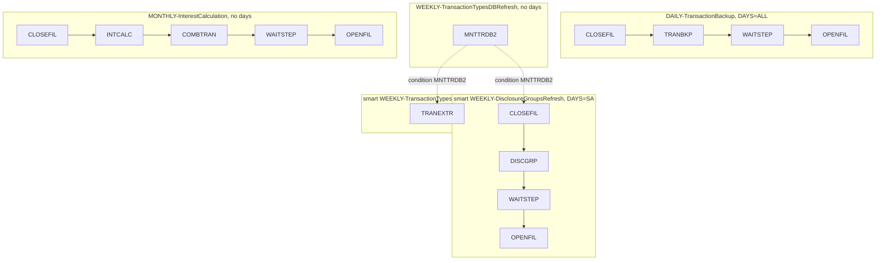

# SCHED-CONTROLM: Control-M folders

## 1. Summary

`app/scheduler/CardDemo.controlm` is a Control-M XML definition table (`DEFTABLE`) with five folders: three regular folders (daily, monthly and one for a Db2 maintenance job) and two weekly smart folders. They hold 15 job definitions that run 9 JCL members. `DAILY-TransactionBackup` closes the CICS files, backs up and empties the transaction master (TRANBKP), waits and reopens the files every day (FLOW-JCTLM-001). `WEEKLY-TransactionTypesDBRefresh` runs the Db2 transaction type maintenance MNTTRDB2 (FLOW-JCTLM-002), whose completion releases two Saturday smart folders: the disclosure group reload (FLOW-JCTLM-003) and the Db2 extract TRANEXTR (FLOW-JCTLM-004). `MONTHLY-InterestCalculation` computes interest and rebuilds the transaction master (FLOW-JCTLM-005). Jobs are chained by conditions (FLOW-JCTLM-006). Control-M never runs POSTTRAN, so it has no posting cycle at all, and the daily backup empties the transaction master every day with nothing reloading it (DEF-JCTLM-001). Only the daily folder and the two smart folders have scheduling days; MNTTRDB2 and the monthly folder run only when an operator forces them (DEF-JCTLM-002). Because every condition is scoped to its order date, one day's chain does not wait for the previous day's (DEF-JCTLM-009). The weekly Db2 refresh writes new flat files but never loads them into VSAM (DEF-JCTLM-005). The table was last uploaded on 9 September 2025, so it is much newer than the CA-7 listing, and it disagrees with that listing on almost every job. Which cycle the Airflow DAGs implement is a decision (Q-JCTLM-001). Several attributes suggest a distributed Control-M rather than Control-M for z/OS, which changes what the member names and return codes mean (Q-JCTLM-005).

## 2. Rules at a glance

| ID | Rule |
| :-- | :-- |
| FLOW-JCTLM-001 | Daily: CLOSEFIL, TRANBKP, WAITSTEP, OPENFIL, every day of every month, by 23:00. |
| FLOW-JCTLM-002 | MNTTRDB2 alone in a regular folder; its completion sets condition `WEEKLY-TransactionTypesDBRefresh-MNTTRDB2`. |
| FLOW-JCTLM-003 | Saturday smart folder: after MNTTRDB2, CLOSEFIL, DISCGRP, WAITSTEP, OPENFIL; then the MNTTRDB2 condition is deleted. |
| FLOW-JCTLM-004 | Saturday smart folder: after MNTTRDB2, TRANEXTR; then the MNTTRDB2 condition is deleted. |
| FLOW-JCTLM-005 | Monthly: CLOSEFIL, INTCALC, COMBTRAN, WAITSTEP, OPENFIL. |
| FLOW-JCTLM-006 | Each job waits for its predecessor's condition for the same order date, deletes it, and sets its own. |
| SE-JCTLM-001 | Every job runs member `<JOBNAME>` as user `xuemingh` with the same limits. |
| ERR-JCTLM-001 | A job that ends not OK sets no condition; its successors wait, and no automatic action is defined. |
| NUM-JCTLM-001 | Order date conditions, `TIMETO 23:00`, `MAXWAIT 7`, `MAXRERUN 5`, smart-folder interval 5 minutes. |
| DEF-JCTLM-001 | No POSTTRAN; the daily backup empties the transaction master every day. |
| DEF-JCTLM-002 | MNTTRDB2 and the monthly folder have no scheduling days and run only when forced; MNTTRDB2 has no in-condition. |
| DEF-JCTLM-003 | Two folders share one name, and the parent folder attributes point the wrong way. |
| DEF-JCTLM-004 | Two smart folders consume and delete the same condition. |
| DEF-JCTLM-005 | The weekly Db2 refresh never reloads the VSAM type and category files; DISCGRP waits for an unrelated Db2 job. |
| DEF-JCTLM-006 | The monthly folder has no posting, no backup before COMBTRAN and no index rebuild. |
| DEF-JCTLM-007 | Folder and job attributes contradict each other or are placeholders. |
| DEF-JCTLM-008 | Folders that run on the same day close and reopen the same files independently. |
| DEF-JCTLM-009 | Conditions are scoped to the order date, so a new day's chain can run while an earlier day's chain still waits. |

## 3. Actors and triggers

- **Who uses it:** the Control-M scheduler. At each New Day, Control-M orders the jobs and smart folders whose scheduling criteria match the date; ordered jobs then wait for their in-conditions and their time window. An operator can also order a folder by hand, which checks its scheduling criteria for the date, or force it, which ignores them (DEF-JCTLM-002).
- **Preconditions:** the JCL members exist in the library the data centre uses (the table names no library, SE-JCTLM-001); the user `xuemingh` may submit them; for the weekly folders, the optional Db2 transaction type module is installed (MNTTRDB2, TRANEXTR, `app/app-transaction-type-db2/jcl/`).
- **Format:** XML `DEFTABLE` (`:1-2`) with `FOLDER` (`TYPE="1"`) and `SMART_FOLDER` (`TYPE="2"`) elements; each `JOB` element carries its attributes on one line, followed by `INCOND`, `OUTCOND` and `RULE_BASED_CALENDARS` elements (`:4-7`).

## 4. Interfaces

The folders and their jobs. "In" and "out" are the conditions each job waits for and sets (`+`) or deletes (`-`).

| Folder (lines) | Job (lines) | Member | In | Out | Job spec |
| :-- | :-- | :-- | :-- | :-- | :-- |
| `DAILY-TransactionBackup` (`:3-25`) | CLOSEFIL (`:4-7`) | CLOSEFIL | none | `+…-CLOSEFIL` | `CLOSEFIL.md` |
| | TRANBKP (`:8-13`) | TRANBKP | `…-CLOSEFIL` | `-…-CLOSEFIL`, `+…-TRANBKP` | `TRANBKP.md` |
| | WAITSTEP (`:14-19`) | WAITSTEP | `…-TRANBKP` | `-…-TRANBKP`, `+…-WAITSTEP` | `WAITSTEP.md` |
| | OPENFIL (`:20-24`) | OPENFIL | `…-WAITSTEP` | `-…-WAITSTEP` | `OPENFIL.md` |
| `WEEKLY-TransactionTypesDBRefresh` (`:26-31`) | MNTTRDB2 (`:27-30`) | MNTTRDB2 | none | `+WEEKLY-TransactionTypesDBRefresh-MNTTRDB2` | optional module (area f) |
| `WEEKLY-DisclosureGroupsRefresh`, smart (`:32-56`) | CLOSEFIL (`:33-37`) | CLOSEFIL | `…-MNTTRDB2` | `+…-CLOSEFIL` | `CLOSEFIL.md` |
| | DISCGRP (`:38-43`) | DISCGRP | `…-CLOSEFIL` | `-…-CLOSEFIL`, `+…-DISCGRP` | `DISCGRP.md` |
| | WAITSTEP (`:44-49`) | WAITSTEP | `…-DISCGRP` | `-…-DISCGRP`, `+…-WAITSTEP` | `WAITSTEP.md` |
| | OPENFIL (`:50-54`) | OPENFIL | `…-WAITSTEP` | `-…-WAITSTEP` | `OPENFIL.md` |
| | (folder end, `:55`) | | | `-…-MNTTRDB2` | |
| `WEEKLY-TransactionTypesDBRefresh`, smart (`:57-63`) | TRANEXTR (`:58-61`) | TRANEXTR | `…-MNTTRDB2` | none | optional module (area f) |
| | (folder end, `:62`) | | | `-…-MNTTRDB2` | |
| `MONTHLY-InterestCalculation` (`:64-92`) | CLOSEFIL (`:65-68`) | CLOSEFIL | none | `+…-CLOSEFIL` | `CLOSEFIL.md` |
| | INTCALC (`:69-74`) | INTCALC | `…-CLOSEFIL` | `-…-CLOSEFIL`, `+…-INTCALC` | `INTCALC.md` |
| | COMBTRAN (`:75-80`) | COMBTRAN | `…-INTCALC` | `-…-INTCALC`, `+…-COMBTRAN` | `COMBTRAN.md` |
| | WAITSTEP (`:81-86`) | WAITSTEP | `…-COMBTRAN` | `-…-COMBTRAN`, `+…-WAITSTEP` | `WAITSTEP.md` |
| | OPENFIL (`:87-91`) | OPENFIL | `…-WAITSTEP` | `-…-WAITSTEP` | `OPENFIL.md` |

Condition names are the folder name, a hyphen and the job name (for example `DAILY-TransactionBackup-CLOSEFIL`, `:5`); "…" stands for the folder name of the same row.

## 5. Data used

The table reads and writes no data. The datasets of each job are in its job spec.

## 6. Processing flow

#### FLOW-JCTLM-001 · Daily transaction backup
- **When:** every day: the four jobs have `DAYS="ALL"` and all twelve month flags set (`:4`), so Control-M orders them at each New Day.
- **Then:** CLOSEFIL closes the CICS files and sets `DAILY-TransactionBackup-CLOSEFIL` (`:5`); TRANBKP waits for it (`:9`), backs up `TRANSACT` to a new `TRANSACT.BKUP` generation, then deletes and redefines `TRANSACT` empty (see TRANBKP); WAITSTEP pauses (`:14-19`); OPENFIL reopens the files (`:20-24`). Each job may be submitted until 23:00 (`TIMETO="23:00"`), with no earliest time.
- **Source:** `:3-25`
- **Fidelity:** defect-decide (DEF-JCTLM-001) · **Confidence:** reviewed (definition); platform-inferred (ordering)

#### FLOW-JCTLM-002 · Db2 transaction type maintenance
- **When:** MNTTRDB2 is ordered. Its job has month flags but no `DAYS` attribute (`:27`), so New Day does not order it and an ordinary order skips it as well; an operator must force it (DEF-JCTLM-002). It has no `INCOND` (`:27-31`), so once forced it is submitted at once, with no CLOSEFIL or other job before it.
- **Then:** MNTTRDB2 runs program `COBTUPDT` under the TSO terminal monitor against Db2, with input `INPFILE` (`app/app-transaction-type-db2/jcl/MNTTRDB2.jcl:21-30`), and on success sets `WEEKLY-TransactionTypesDBRefresh-MNTTRDB2` (`:28`). It deletes no condition.
- **Source:** `:26-31`, `app/app-transaction-type-db2/jcl/MNTTRDB2.jcl:21-30`
- **Fidelity:** incidental · **Confidence:** reviewed

#### FLOW-JCTLM-003 · Weekly disclosure group reload
- **When:** Saturday: the smart folder has `DAYS="SA"` (`:32`); its jobs inherit the folder's scheduling. CLOSEFIL starts only when `WEEKLY-TransactionTypesDBRefresh-MNTTRDB2` exists for the same order date (`:34`).
- **Then:** CLOSEFIL (`:33-37`), DISCGRP, which rebuilds the disclosure group file from its flat file (`:38-43`), WAITSTEP (`:44-49`) and OPENFIL (`:50-54`) run in turn. When the smart folder ends, it deletes the MNTTRDB2 condition (`:55`).
- **Source:** `:32-56`
- **Fidelity:** defect-decide (DEF-JCTLM-004, DEF-JCTLM-005) · **Confidence:** reviewed (definition); platform-inferred (smart-folder ordering)

#### FLOW-JCTLM-004 · Weekly Db2 extract
- **When:** Saturday (`DAYS="SA"`, `:57`), once `WEEKLY-TransactionTypesDBRefresh-MNTTRDB2` exists for the same order date (`:59`).
- **Then:** TRANEXTR backs up `TRANTYPE.PS` and `TRANCATG.PS` to new generations, deletes them and unloads the Db2 tables `CARDDEMO.TRANSACTION_TYPE` and `CARDDEMO.TRANSACTION_TYPE_CATEGORY` into new `TRANTYPE.PS` and `TRANCATG.PS` flat files (`app/app-transaction-type-db2/jcl/TRANEXTR.jcl:31-122`). The job sets no condition; when the smart folder ends, it deletes the MNTTRDB2 condition (`:62`).
- **Source:** `:57-63`, `app/app-transaction-type-db2/jcl/TRANEXTR.jcl:31-122`
- **Fidelity:** defect-decide (DEF-JCTLM-005) · **Confidence:** reviewed

#### FLOW-JCTLM-005 · Monthly interest calculation
- **When:** an operator forces the folder. Its jobs have month flags but no `DAYS` and no calendar (`:65`), so New Day never orders them and "monthly" is only in the folder name (DEF-JCTLM-002).
- **Then:** CLOSEFIL (`:65-68`), INTCALC, which writes interest transactions to `SYSTRAN(+1)` and adds interest to the account balances (`:69-74`), COMBTRAN, which merges `TRANSACT.BKUP(0)` and `SYSTRAN(0)` and loads the result into `TRANSACT` (`:75-80`), WAITSTEP (`:81-86`) and OPENFIL (`:87-91`) run in turn.
- **Source:** `:64-92`
- **Fidelity:** defect-decide (DEF-JCTLM-006) · **Confidence:** reviewed

#### FLOW-JCTLM-006 · Condition chaining
- **When:** a job ends OK.
- **Then:** Control-M performs its `OUTCOND` actions: `SIGN="+"` adds a condition, `SIGN="-"` deletes one, both for the job's order date (`ODATE="ODAT"`). A job is submitted only when all its `INCOND`s (`AND_OR="A"`) exist for its order date. In every chain each job after the first deletes its predecessor's condition, and each job except the last (OPENFIL, TRANEXTR) adds its own, so a completed chain leaves no condition of its folder behind. The shared MNTTRDB2 condition is deleted by the smart folders when they end (`:55, 62`). Every job has `RULE_BASED_CALENDARS NAME="*"` (`:6`), meaning it accepts every rule-based calendar of its folder; no rule-based calendar is defined in the table.
- **Source:** `:5-6, 9-11, 15-17, 21-22`
- **Fidelity:** must-preserve (a job starts only after its predecessor ended OK) · **Confidence:** reviewed (definition); platform-inferred (Control-M semantics)

## 7. Business rules

None. The table orders jobs; the business rules are in the programs the jobs run.

## 8. Validations and messages

None.

## 9. Side effects

#### SE-JCTLM-001 · Job submission attributes
- **What:** every job has `APPLICATION="CARD-DEMO"`, `TASKTYPE="Job"`, `APPL_TYPE="OS"`, `MEMNAME` equal to `JOBNAME`, `RUN_AS="xuemingh"`, `CRITICAL="0"`, `CONFIRM="0"` (no manual confirmation), `CYCLIC="0"`, `MAXWAIT="7"`, `MAXRERUN="5"`, `AUTOARCH="1"` and `TIMETO="23:00"` (`:4`). No job names a member library (`MEMLIB`), so the library the members are taken from is not in the table; on a distributed Control-M, `MEMNAME` without `MEMLIB` names a script on the agent host instead (Q-JCTLM-005). `SUB_APPLICATION` is `CTRLM` in the regular folders; in the smart folders it is the smart folder's `JOBNAME`, `DisclosureGroupsRefresh` and `TransactionTypesDBRefresh`, not its `FOLDER_NAME` (`:32-33, 57-58`).
- **Source:** `:4, 32-33, 57-58`
- **Fidelity:** incidental · **Confidence:** reviewed

## 10. Error handling

#### ERR-JCTLM-001 · A failed job stops its chain
- **When:** a job ends not OK (abend, JCL error, or a completion that Control-M does not accept).
- **Then:** its `OUTCOND`s are not performed, so its successor's in-condition never appears and the successor waits. No job has `ON`/`DO` statements, shouts or a rerun interval, so nothing reruns the job, notifies anyone or opens the CICS files again: after a failure before OPENFIL the files stay closed until an operator acts. A waiting job stays in the active environment for `MAXWAIT="7"` days and is then removed. `MAXRERUN="5"` caps the number of reruns but does not by itself cause one. Which return codes count as OK is not defined in the table, so the site default applies; POSTTRAN-style return code 4 (some records rejected) would need an explicit rule if such a job were added. On a distributed Control-M any non-zero exit code ends the job NOTOK, so a return code 4 would stop the chain (Q-JCTLM-005).
- **Source:** `:4-24`
- **Fidelity:** must-preserve (stop after a failure) · **Confidence:** platform-inferred

## 11. Interactions

- **Jobs:** each job in section 4 has its own spec (MNTTRDB2 and TRANEXTR in area f).
- **CA-7:** `SCHED-CA7.md` describes the other schedule. Neither scheduler refers to the other. They share only CLOSEFIL, WAITSTEP and OPENFIL; only Control-M runs TRANBKP, INTCALC, COMBTRAN, DISCGRP, MNTTRDB2 and TRANEXTR, and only CA-7 runs CBPAUP0J, POSTTRAN, TRANTYPE, TRANCATG, TCATBALF, the READ jobs, CREASTMT, TXT2PDF1 and PRTCATBL (`app/scheduler/CardDemo.ca7:18-571`).
- **README:** the README cycle runs POSTTRAN, INTCALC, TRANBKP and COMBTRAN in one sequence (`./README.md:227-230`); Control-M splits them over a daily and a monthly folder and drops POSTTRAN. `jobs/README.md` compares all seven orders.

## 12. Numeric, date and format details

#### NUM-JCTLM-001 · Dates, times and limits
- Conditions are dated with the job's order date (`ODAT`). `TIMETO="23:00"` with no `TIMEFROM` (`:4`). `MAXWAIT="7"` days, `MAXRERUN="5"`, `MAXDAYS="0"` and `MAXRUNS="0"`. The smart folders: `PRIORITY="AA"`, `INTERVAL="00005M"` (5 minutes, meaningful only for cyclic folders, and `CYCLIC="0"`), `SHIFT="Ignore Job"` (no shift to another day when Saturday is not a working day), `MAXWAIT="0"`, `MAXRERUN="0"`, `DAYSKEEPINNOTOK="1"` (a smart folder that ended not OK is kept one day), `REMOVEATONCE="Y"` (`:32, 57`). Creation and change dates are `20250909`, time `120700`; `LAST_UPLOAD="20250909"` on every folder (`:3, 26, 32, 57, 64`).
- **Source:** `:3-4, 26, 32, 57, 64`
- **Fidelity:** incidental · **Confidence:** reviewed (values); platform-inferred (meaning)

## 13. Known defects and oddities

#### DEF-JCTLM-001 · No posting; the daily backup empties the transaction master
- No folder runs POSTTRAN, the posting of the daily transactions (`:3-92`). The daily folder runs TRANBKP every day (`:8-13`); TRANBKP saves `TRANSACT` and then deletes and redefines it empty, together with its alternate index (see TRANBKP), and no job in the folder reloads it. After every daily run the online transaction screens show no transactions until something writes new ones. The README uses TRANBKP in this way only in the demo data refresh and as the backup step right before COMBTRAN reloads the file (`./README.md:220, 229-230`).
- **Source:** `:3-25`
- **Status:** open · **Fidelity:** defect-decide (Q-JCTLM-001, Q-JCTLM-004) · **Confidence:** reviewed

#### DEF-JCTLM-002 · Jobs without scheduling days
- MNTTRDB2 (`:27`) and the five jobs of `MONTHLY-InterestCalculation` (`:65, 69, 75, 81, 87`) have month flags but no `DAYS`, `WEEKDAYS`, `DAYSCAL` or rule-based calendar other than `"*"`. Control-M does not order such jobs at New Day, so the monthly interest calculation and the weekly Db2 maintenance run only when an operator forces them (a forced order ignores the scheduling criteria; an ordinary order checks them and skips these jobs); the two Saturday smart folders then wait for an MNTTRDB2 condition that never appears. MNTTRDB2 also has no `INCOND` (`:27-31`). The first CLOSEFIL of the daily and monthly folders has none either (`:4-7, 65-68`), but the daily one is ordered every day; MNTTRDB2, the head of the weekly chain, is tied neither to a day nor to the end of another job.
- **Source:** `:27-31, 65, 69, 75, 81, 87`
- **Status:** open · **Fidelity:** defect-decide (Q-JCTLM-002) · **Confidence:** reviewed (attributes); platform-inferred (ordering and forcing)

#### DEF-JCTLM-003 · Duplicate folder name and inverted parent folders
- The regular folder at `:26` and the smart folder at `:57` are both named `WEEKLY-TransactionTypesDBRefresh` (`REAL_FOLDER_ID` 2 and 4); Control-M requires folder names to be unique in a data centre. The smart folder `WEEKLY-DisclosureGroupsRefresh` has `PARENT_FOLDER="WEEKLY-TransactionTypesDBRefresh"` (`:32`), while the TRANEXTR job inside the smart folder `WEEKLY-TransactionTypesDBRefresh` has `PARENT_FOLDER="WEEKLY-DisclosureGroupsRefresh"` (`:58`): the parent references point at each other's folder.
- **Source:** `:26, 32, 57-58`
- **Status:** open · **Fidelity:** incidental · **Confidence:** reviewed (attributes); platform-inferred (load behaviour)

#### DEF-JCTLM-004 · Two smart folders consume one condition
- Both Saturday smart folders wait for `WEEKLY-TransactionTypesDBRefresh-MNTTRDB2` (`:34, 59`) and both delete it when they end (`:55, 62`). Whichever folder ends first deletes the condition. That is harmless only if the other folder's first job has already started; otherwise that job loses its in-condition and waits until `MAXWAIT` removes it. The condition also carries MNTTRDB2's order date (`ODAT`), so it satisfies the Saturday folders only when MNTTRDB2 was ordered for the same Saturday.
- **Source:** `:28, 34, 55, 59, 62`
- **Status:** open · **Fidelity:** defect-decide · **Confidence:** reviewed (conditions); platform-inferred (timing)

#### DEF-JCTLM-005 · The weekly refresh stops at the flat files
- TRANEXTR writes new `TRANTYPE.PS` and `TRANCATG.PS` from Db2 (FLOW-JCTLM-004), but no Control-M job runs TRANTYPE or TRANCATG, which copy those files into the VSAM files that the batch and online programs read. The Db2 changes therefore reach VSAM only when someone runs those jobs (the README places them right after TRANEXTR, `./README.md:221-223`). DISCGRP, by contrast, reloads the disclosure groups from a flat file that no Db2 job touches, yet its folder waits for MNTTRDB2 (`:34`).
- **Source:** `:34, 57-63`
- **Status:** open · **Fidelity:** defect-decide (Q-JCTLM-001) · **Confidence:** reviewed

#### DEF-JCTLM-006 · The monthly folder is not a complete interest cycle
- The README runs POSTTRAN, INTCALC, TRANBKP and COMBTRAN together (`./README.md:227-230`). The monthly folder runs INTCALC right after CLOSEFIL and COMBTRAN right after INTCALC (`:69-80`): no posting before interest, so INTCALC works on whatever category balances the last posting left; no TRANBKP before COMBTRAN, so `TRANSACT.BKUP(0)` is the latest daily backup and `TRANSACT` is not emptied before the load (DEF-JCOMB-002); and no TRANIDX afterwards, so the alternate index the daily TRANBKP deleted is not rebuilt.
- **Source:** `:64-92`
- **Status:** open · **Fidelity:** defect-decide (Q-JCTLM-001, Q-JINTC-002) · **Confidence:** reviewed

#### DEF-JCTLM-007 · Contradictory and placeholder attributes
- `JOBS_IN_GROUP="00001"` on the disclosure smart folder, which holds four jobs (`:32-54`); `INTERVAL="00005M"` on non-cyclic folders (`:32, 57`); WAITSTEP and OPENFIL of the monthly folder both have `JOBISN="4"` (`:81, 87`; the order still follows the conditions); `VERSION_HOST="MY-HOST"` everywhere; jobs run as the personal user `xuemingh`, and `CREATION_USER` is `emuser` for some jobs and `XUEMINGH` for others (`:4, 27`).
- **Source:** `:4, 27, 32, 57, 81, 87`
- **Status:** open · **Fidelity:** incidental · **Confidence:** reviewed

#### DEF-JCTLM-008 · Same-day folders work on the same files independently
- The daily folder runs every day, including Saturdays and any day the monthly folder is ordered. Each folder has its own CLOSEFIL, WAITSTEP and OPENFIL with its own conditions, and no condition links the folders. On such a day the daily OPENFIL can reopen the CICS files while the monthly INTCALC or COMBTRAN still update them, and the daily TRANBKP can delete `TRANSACT` while the monthly COMBTRAN loads it. Only data set enqueues would serialise them.
- **Source:** `:3-25, 64-92`
- **Status:** open · **Fidelity:** defect-decide · **Confidence:** reviewed (definitions); platform-inferred (concurrency)

#### DEF-JCTLM-009 · Order-date scoping lets days overlap
- Every condition is dated with the job's order date (`ODATE="ODAT"`, FLOW-JCTLM-006), and the first CLOSEFIL of the daily folder has no in-condition (`:4-7`). A day's chain therefore does not wait for the previous day's chain to finish. If a daily job fails or is held, its successors stay in the active environment waiting for a condition of their own order date, for up to `MAXWAIT="7"` days (`:4`), while the next New Day orders a new chain that closes the files, backs up and empties `TRANSACT` and reopens the files. When the earlier chain is released, its TRANBKP or OPENFIL runs in the middle of a later day's chain. Nothing in the table serialises the days.
- **Source:** `:4-24`
- **Status:** open · **Fidelity:** defect-decide · **Confidence:** reviewed (conditions); platform-inferred (ordering)

## 14. Open questions

| ID | Question | For |
| :-- | :-- | :-- |
| Q-JCTLM-001 | Which cycle should the Airflow DAGs implement: the README "Running Batch Jobs" sequence, the restart runbook order, the CA-7 chains, these Control-M folders, or the demo scripts (`scripts/run_full_batch.sh`, the split `scripts/run_posting.sh` and `scripts/run_interest_calc.sh`)? The seven disagree on which jobs run, in what order and how often (`jobs/README.md`). Same question as Q-JCA7-001. | business, operations, architecture |
| Q-JCTLM-002 | How often should interest be calculated and transaction types maintained: monthly and weekly as the folder names say (and on which day), or every cycle as the README runs them? | business |
| Q-JCTLM-003 | Should a failed job be rerun automatically (the table sets `MAXRERUN="5"` but no rerun rule), or held for an operator with a notification? | operations |
| Q-JCTLM-004 | Is the daily backup meant to empty the transaction master (DEF-JCTLM-001), or only to save it? | business, operations |
| Q-JCTLM-005 | Which Control-M runs this table: Control-M for z/OS, or a distributed Control-M server with agents? The table points to a distributed one: `PLATFORM="UNIX"` on the smart folders (`:32, 57`), folder names of up to 32 characters, the lower-case user `xuemingh` in `RUN_AS` (`:4`) and condition names of up to 41 characters (`WEEKLY-TransactionTypesDBRefresh-MNTTRDB2`, `:28`). If it is distributed, `MEMNAME` without `MEMLIB` names a script that the agent runs, not a JCL member, and any non-zero exit code ends the job NOTOK, so a job that ends with return code 4 stops its chain (ERR-JCTLM-001). | mainframe team, operations |

## 15. Equivalence contract

The table carries no behaviour that a target must copy as is: the posting job is missing (DEF-JCTLM-001), two folders are never ordered (DEF-JCTLM-002) and the weekly refresh is incomplete (DEF-JCTLM-005). A target orchestration must keep the rules every source agrees on: a job starts only after its predecessor ended successfully (FLOW-JCTLM-006); a failure stops the chain and is reported (ERR-JCTLM-001); online updates to the affected stores stop before a batch job that changes them and resume after it (Q-JCLOSE-001). The job list, order and frequency follow the answer to Q-JCTLM-001. Control-M attributes (user, priority, version metadata, wait and rerun limits) are not reproduced unless the operations team asks for them (Q-JCTLM-003).

Review evidence (independent reviewers checked every item against the source, all WRONG and MINOR findings were fixed, and a fresh reviewer re-checked every changed or added item): [evidence/g-jobs-ops-review.md](../evidence/g-jobs-ops-review.md).

## 16. Paragraph coverage

| Unit | Lines | Covered by |
| :-- | :-- | :-- |
| (XML declaration and `DEFTABLE`) | 1-2 | FLOW-JCTLM-006 |
| (`FOLDER DAILY-TransactionBackup`) | 3-3 | FLOW-JCTLM-001, NUM-JCTLM-001 |
| (job CLOSEFIL, daily) | 4-7 | FLOW-JCTLM-001, FLOW-JCTLM-006, SE-JCTLM-001, NUM-JCTLM-001, DEF-JCTLM-009 |
| (job TRANBKP, daily) | 8-13 | FLOW-JCTLM-001, DEF-JCTLM-001, DEF-JCTLM-009 |
| (job WAITSTEP, daily) | 14-19 | FLOW-JCTLM-001 |
| (job OPENFIL, daily) | 20-25 | FLOW-JCTLM-001, DEF-JCTLM-008, DEF-JCTLM-009 |
| (`FOLDER WEEKLY-TransactionTypesDBRefresh`) | 26-26 | FLOW-JCTLM-002, DEF-JCTLM-003 |
| (job MNTTRDB2) | 27-31 | FLOW-JCTLM-002, DEF-JCTLM-002 |
| (`SMART_FOLDER WEEKLY-DisclosureGroupsRefresh`) | 32-32 | FLOW-JCTLM-003, NUM-JCTLM-001, DEF-JCTLM-003, DEF-JCTLM-007 |
| (job CLOSEFIL, weekly) | 33-37 | FLOW-JCTLM-003, DEF-JCTLM-004, DEF-JCTLM-005 |
| (job DISCGRP, weekly) | 38-43 | FLOW-JCTLM-003, DEF-JCTLM-005 |
| (job WAITSTEP, weekly) | 44-49 | FLOW-JCTLM-003 |
| (job OPENFIL, weekly) | 50-54 | FLOW-JCTLM-003 |
| (smart folder end, deletes MNTTRDB2 condition) | 55-56 | FLOW-JCTLM-003, DEF-JCTLM-004 |
| (`SMART_FOLDER WEEKLY-TransactionTypesDBRefresh`) | 57-57 | FLOW-JCTLM-004, DEF-JCTLM-003, DEF-JCTLM-007 |
| (job TRANEXTR) | 58-61 | FLOW-JCTLM-004, DEF-JCTLM-003, DEF-JCTLM-005 |
| (smart folder end, deletes MNTTRDB2 condition) | 62-63 | FLOW-JCTLM-004, DEF-JCTLM-004 |
| (`FOLDER MONTHLY-InterestCalculation`) | 64-64 | FLOW-JCTLM-005, DEF-JCTLM-002 |
| (job CLOSEFIL, monthly) | 65-68 | FLOW-JCTLM-005, DEF-JCTLM-002 |
| (job INTCALC, monthly) | 69-74 | FLOW-JCTLM-005, DEF-JCTLM-006 |
| (job COMBTRAN, monthly) | 75-80 | FLOW-JCTLM-005, DEF-JCTLM-006 |
| (job WAITSTEP, monthly) | 81-86 | FLOW-JCTLM-005, DEF-JCTLM-007 |
| (job OPENFIL, monthly, and end of table) | 87-93 | FLOW-JCTLM-005, DEF-JCTLM-007, DEF-JCTLM-008 |
