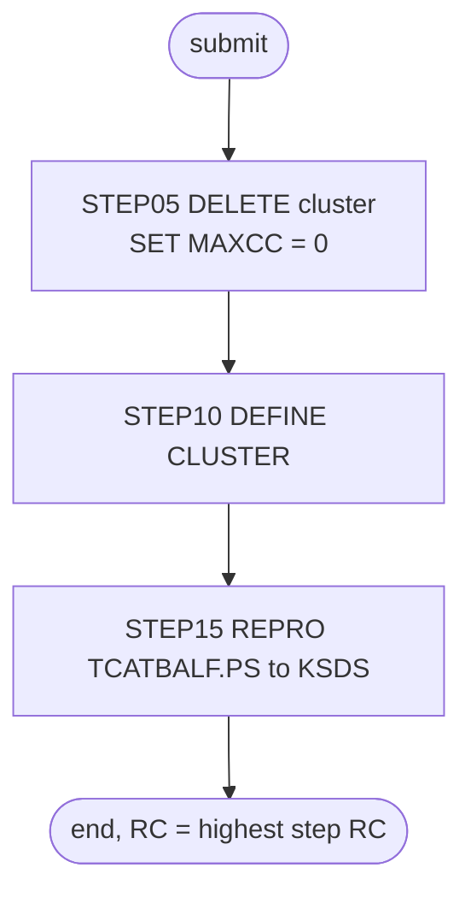

# TCATBALF: Transaction category balance reload

## 1. Summary

TCATBALF throws away the transaction category balance file (ENT-TCAT-BAL: one running balance per account, transaction type and category) and rebuilds it from the flat file. `STEP05` deletes the VSAM cluster `AWS.M2.CARDDEMO.TCATBALF.VSAM.KSDS`, `STEP10` defines it again empty (key 17 bytes at offset 0, fixed 50-byte records), and `STEP15` copies every record of `AWS.M2.CARDDEMO.TCATBALF.PS` into it. It is run by hand during installation and before demo cycles, by three demo scripts, and by the CA-7 schedule. Because the file holds running balances that POSTTRAN updates, a run resets every balance to the values in the flat file (DEF-JTCAT-002). The job contains no business logic; what it must preserve is the file definition and the fact that the result is an exact copy of the flat file.

## 2. Rules at a glance

The job has no business rules. Its items:

| ID | Rule |
| :-- | :-- |
| SE-JTCAT-001 | Delete the category balance cluster; the return code is then set to 0 whatever the result. |
| SE-JTCAT-002 | Define the cluster: key 17 at offset 0, records 50 fixed, `SHAREOPTIONS(2 3)`, `ERASE`, no `REUSE`. |
| SE-JTCAT-003 | Load the cluster with every record of `TCATBALF.PS`, in file order, with exclusive use of the cluster (`DISP=OLD`). |
| VAL-JTCAT-001 | The load rejects records out of key order or with duplicate keys (VSAM rule). |
| ERR-JTCAT-001 | No step has a `COND`, so every step runs even when an earlier one failed. |
| ERR-JTCAT-002 | The job waits to start while another job has the cluster allocated. |
| NUM-JTCAT-001 | Key and record size. |
| DEF-JTCAT-001 | The unconditional return-code reset hides every delete failure. |
| DEF-JTCAT-002 | A reload replaces every running balance with the flat file's values, and the CA-7 schedule triggers it like a regular job. |

## 3. Actors and triggers

- **Trigger:** submitted by an operator. It is in the README's initialisation sequence (`./README.md:162`) and its "Running Batch Jobs" sequence (`./README.md:225`), and in the demo scripts `scripts/run_full_batch.sh:34-35`, `scripts/remote_refresh.sh:34-35` and `scripts/run_posting.sh:19-20`. In the CA-7 schedule, `CLOSEFIL2` (a CLOSEFIL run under schedule ID 032) triggers it and it triggers `WAITSTEP` (`app/scheduler/CardDemo.ca7:246-271, 305-330`). Control-M does not run it. The restart runbook uses it to restore the demo balances after a partial POSTTRAN (`docs/runbooks/batch-cycle-restart.md:73-75`). The local runner has no TCATBALF job; it loads `app/data/ASCII/tcatbal.txt` into the `TCATBALF` dataset directly for every run (`tools/batch-programs.toml:213-217`).
- **Preconditions:** no other job has `AWS.M2.CARDDEMO.TCATBALF.VSAM.KSDS` allocated (ERR-JTCAT-002); `AWS.M2.CARDDEMO.TCATBALF.PS` exists and is sorted by key (`./README.md:145`, FB 50); volume `AWSHJ1` exists. The CSD defines no CICS file on this cluster (checked with a search over `app/csd/CARDDEMO.CSD`), so no CICS close is needed for it.
- **Job card:** `CLASS=A,MSGCLASS=0,NOTIFY=&SYSUID` (`:1-2`). No parameters, no symbolic overrides.

## 4. Interfaces

| Step | Program | DD | Dataset | Disposition | Use | Source |
| :-- | :-- | :-- | :-- | :-- | :-- | :-- |
| `STEP05` | IDCAMS | `SYSPRINT` | `SYSOUT=*` | - | IDCAMS messages | `:23` |
| `STEP05` | IDCAMS | `SYSIN` | in-stream | - | `DELETE` and `SET` statements | `:24-28` |
| `STEP10` | IDCAMS | `SYSPRINT` | `SYSOUT=*` | - | IDCAMS messages | `:34` |
| `STEP10` | IDCAMS | `SYSIN` | in-stream | - | `DEFINE CLUSTER` statement | `:35-50` |
| `STEP15` | IDCAMS | `SYSPRINT` | `SYSOUT=*` | - | IDCAMS messages | `:55` |
| `STEP15` | IDCAMS | `TCATBAL` | `AWS.M2.CARDDEMO.TCATBALF.PS` | `SHR` | input, sequential, FB 50 | `:56-57` |
| `STEP15` | IDCAMS | `TCATBALV` | `AWS.M2.CARDDEMO.TCATBALF.VSAM.KSDS` | `OLD` | output, KSDS | `:58-59` |
| `STEP15` | IDCAMS | `SYSIN` | in-stream | - | `REPRO` statement | `:60-62` |

Return code of the job: the highest step return code. Console output is IDCAMS `SYSPRINT` only (incidental).

## 5. Data used

- ENT-TCAT-BAL (`TRAN-CAT-BAL-RECORD`, `app/cpy/CVTRA01Y.cpy:4-10`, 50 bytes), whole records copied unchanged from `TCATBALF.PS` to the KSDS. No field is interpreted. The key is bytes 1-17 (`TRAN-CAT-KEY`: `TRANCAT-ACCT-ID` `9(11)`, `TRANCAT-TYPE-CD` `X(02)`, `TRANCAT-CD` `9(04)`); the balance `TRAN-CAT-BAL` (`S9(09)V99`, zoned decimal with the sign in the last digit, bytes 18-28) and a 22-byte filler are carried along.
- Catalog state on 09/01/22 (`app/catlg/LISTCAT.txt:1334-1422`): the data component has `KEYLEN 17`, `RKP 0`, `MAXLRECL 50`, `SHROPTNS(2,3)`, `ERASE`, `NOREUSE` (`app/catlg/LISTCAT.txt:1371-1373`), space `CYLINDER` primary 1 secondary 5 (`app/catlg/LISTCAT.txt:1383-1384`). This matches SE-JTCAT-002. Its statistics, `REC-TOTAL 100`, `REC-INSERTED 49` and `REC-UPDATED 212` (`app/catlg/LISTCAT.txt:1376-1379`), show a cluster that POSTTRAN had already updated after the load, not the state right after this job. The listing also shows the backup GDG `AWS.M2.CARDDEMO.TCATBALF.BKUP` with five generations written by PRTCATBL (`app/catlg/LISTCAT.txt:1202-1302`); this job neither reads nor writes it.
- Sample data: `app/data/ASCII/tcatbal.txt` has 50 records of 50 bytes, keys strictly ascending, one record per account from `00000000001` to `00000000050`, all with type `01` and category `0001`. Checked locally with a Python script over the file.

## 6. Processing flow

| # | Step | Program | Class | What it does | Runs when |
| --: | :-- | :-- | :-- | :-- | :-- |
| 1 | `STEP05` | IDCAMS | plumbing | delete the cluster | always |
| 2 | `STEP10` | IDCAMS | plumbing | define the cluster | always (no `COND`) |
| 3 | `STEP15` | IDCAMS | plumbing | copy `TCATBALF.PS` into the cluster | always |

## 7. Business rules

None. The job moves data without interpreting it; see the side effects in section 9.

## 8. Validations and messages

#### VAL-JTCAT-001 · The load requires ascending, unique keys
- **When:** `STEP15` copies a record whose key (bytes 1-17) is not higher than the previous record's key.
- **Then:** VSAM rejects that record and IDCAMS prints an error message for it; the step ends with return code 8 or higher. The remaining records are still copied until IDCAMS reaches its error limit (by default it stops after 4 such errors).
- **Source:** `:61`
- **Fidelity:** must-preserve (the target load must also fail visibly on unsorted or duplicate input) · **Confidence:** platform-inferred (IDCAMS `REPRO` into a KSDS; no local run)

No operator-facing message text is produced by the job itself; all messages are IDCAMS `IDCnnnnI` messages in `SYSPRINT`.

## 9. Side effects

In execution order. There is no rollback: each step's change is permanent.

#### SE-JTCAT-001 · Delete the category balance cluster
- **What:** `DELETE AWS.M2.CARDDEMO.TCATBALF.VSAM.KSDS CLUSTER`, which removes the cluster with its data and index components and all its records.
- **Return code:** `SET MAXCC = 0` follows without a condition, so the step ends with return code 0 whatever the delete did. A missing cluster (first run) is therefore not an error, but neither is any other failure (DEF-JTCAT-001).
- **Source:** `:25-27`
- **Fidelity:** must-preserve (the reload starts from nothing) · **Confidence:** reviewed

#### SE-JTCAT-002 · Define the category balance cluster
- **What:** `DEFINE CLUSTER` named `AWS.M2.CARDDEMO.TCATBALF.VSAM.KSDS` with:

| Attribute | Value |
| :-- | :-- |
| Organisation | `INDEXED` (KSDS) |
| Key | `KEYS(17 0)`: 17 bytes at offset 0 (`TRAN-CAT-KEY`: account ID, transaction type, category) |
| Record size | `RECORDSIZE(50 50)`: average and maximum 50, so fixed 50 |
| Space | `CYLINDERS(1 5)` on `VOLUMES(AWSHJ1)` |
| Sharing | `SHAREOPTIONS(2 3)` |
| Other | `ERASE`; no `REUSE` |
| Components | data `...TCATBALF.VSAM.KSDS.DATA`, index `...TCATBALF.VSAM.KSDS.INDEX` |

- **Source:** `:36-49`
- **Fidelity:** must-preserve (key and record size); incidental (space, volume, sharing, `ERASE`) · **Confidence:** reviewed

#### SE-JTCAT-003 · Load the cluster from the flat file
- **What:** `REPRO INFILE(TCATBAL) OUTFILE(TCATBALV)` copies every record of `AWS.M2.CARDDEMO.TCATBALF.PS`, in file order, into the new cluster, byte for byte. The output DD has `DISP=OLD`, which asks for exclusive use of the cluster name (ERR-JTCAT-002); the reload jobs for the card, customer and cross-reference files use `DISP=SHR` instead.
- **Source:** `:56-61`
- **Fidelity:** must-preserve (exact copy); incidental (disposition) · **Confidence:** reviewed

If a later step fails, everything before it has happened: the old cluster is gone, and the new one may be empty or partly loaded. POSTTRAN and INTCALC then fail to open the file or work on incomplete balances.

## 10. Error handling

#### ERR-JTCAT-001 · Steps run regardless of earlier failures
- **When:** a step ends with a non-zero return code without abending.
- **Then:** the next step still runs, because no `EXEC` has a `COND` parameter. If `STEP10` fails (for example because the delete did not remove the cluster), `STEP15` loads the records into whatever cluster exists (DEF-JTCAT-001). An abend in a step skips the remaining steps (JES default).
- **Restart:** rerun the whole job; every step either recreates its object or is reset. There is no partial restart point.
- **Source:** `:22, 33, 54`
- **Fidelity:** defect-decide · **Confidence:** platform-inferred

#### ERR-JTCAT-002 · The job waits for exclusive use of the cluster
- **When:** another job (for example POSTTRAN, INTCALC or PRTCATBL) has `AWS.M2.CARDDEMO.TCATBALF.VSAM.KSDS` allocated when this job is selected to run.
- **Then:** because of `DISP=OLD` the system requests an exclusive data set enqueue on the cluster name when the job starts, before `STEP05` runs. The job waits until the other job ends, and while it runs no other job can allocate the cluster. This protects the delete and the load against concurrent batch use within one system. No error is reported; the operator sees the job waiting for the data set.
- **Source:** `:58-59`
- **Fidelity:** must-preserve (no reader or updater may use the file during the reload); incidental (mechanism) · **Confidence:** platform-inferred

## 11. Interactions

- **Upstream:** none. In the CA-7 chain a CLOSEFIL run precedes it, although the CSD defines no CICS file on this cluster.
- **Downstream:** POSTTRAN (`CBTRN02C`) adds every posted transaction to the matching balance record or creates it (DD `TCATBALF`, `app/jcl/POSTTRAN.jcl:41-42`; `docs/runbooks/batch-cycle-restart.md:15`); INTCALC (`CBACT04C`) reads it in key order, account by account, to compute interest (DD `TCATBALF`, `app/jcl/INTCALC.jcl:27-28`; `docs/runbooks/batch-cycle-restart.md:89-91`); PRTCATBL unloads it to `TCATBALF.BKUP(+1)` (`app/jcl/PRTCATBL.jcl:32-33`).
- **Shared data:** the account IDs must exist in ENT-ACCOUNT and ENT-CARD-XREF, and the type and category codes in ENT-TRAN-TYPE and ENT-TRAN-CATEGORY; nothing in this job checks it. INTCALC reports `ACCOUNT NOT FOUND:` for a balance whose account is missing (`docs/runbooks/batch-cycle-restart.md:99`).
- **Restore:** to restore real balances, the restart runbook deletes and defines the cluster with this job's `STEP05` and `STEP10` statements and then copies a `TCATBALF.BKUP` generation into it instead of `TCATBALF.PS` (`docs/runbooks/batch-cycle-restart.md:76-81`).

## 12. Numeric, date and format details

#### NUM-JTCAT-001 · Key and record size
- Primary key: 17 bytes at offset 0 (`TRAN-CAT-KEY`: account ID, transaction type, category), unique, compared as bytes. Records: fixed 50 bytes. Space: `CYLINDERS(1 5)`.
- Key content: account ID (11 digits), transaction type (2 characters), category (4 digits). All records of one account are adjacent, in type and category order; INTCALC relies on this order.
- **Source:** `:37, 40-42`
- **Fidelity:** must-preserve (key, record size); incidental (space) · **Confidence:** reviewed

## 13. Known defects and oddities

#### DEF-JTCAT-001 · The unconditional return-code reset hides every delete failure
- `SET MAXCC = 0` is meant for "cluster not found" on a first run, but it has no `IF`, so it also hides a delete that failed for any other reason (cluster in use from another system, no authority, catalog error). The card, customer and cross-reference reload jobs at least limit their reset to `IF MAXCC LE 08`. After a hidden failure `STEP10` fails because the name already exists, and `STEP15` copies the flat file on top of the old, loaded cluster: records with existing keys are rejected as duplicates, new keys are added, and the job ends with a non-zero code from `STEP10` and `STEP15`, but old and new data stay mixed.
- **Source:** `:27, 33, 54`
- **Status:** open · **Fidelity:** defect-decide · **Confidence:** platform-inferred

#### DEF-JTCAT-002 · A reload resets every running balance
- `TRAN-CAT-BAL` is not reference data: POSTTRAN adds every posted transaction to it and INTCALC computes interest from it. This job replaces the whole file with `TCATBALF.PS`, so every balance accumulated since that file was written is lost, and the balance records that POSTTRAN created are removed. The job takes no backup first; PRTCATBL is a separate job. That suits the demo refresh, but the CA-7 schedule triggers the job from `CLOSEFIL2` (`app/scheduler/CardDemo.ca7:246-271`) like a regular job, which in a real cycle would discard the balances.
- **Source:** `:22-27, 54-61`
- **Status:** open · **Fidelity:** defect-decide · **Confidence:** reviewed (job); platform-inferred (intent of the schedule)

## 14. Open questions

| ID | Question | For |
| :-- | :-- | :-- |
| Q-JTCAT-001 | Is the category balance file ever reloaded outside the demo refresh and restores? If not, should the target offer only an initial seed and a restore from backup, and should the CA-7 trigger be dropped? | operations |

## 15. Equivalence contract

After a successful run (return code 0), the category balance store contains exactly the records of `TCATBALF.PS`: same count (50 for the sample data), same bytes, keyed by `TRAN-CAT-KEY`, and nothing else. A reimplementation must fail (non-zero result, no silent partial load) when the input has keys out of order or duplicated (VAL-JTCAT-001), and nothing may read or update the file while the reload runs (ERR-JTCAT-002). Because the file holds running balances, the target must keep a reload a separate, explicit action that cannot run as part of a normal cycle by accident (DEF-JTCAT-002). IDCAMS message text may differ.

## 16. Paragraph coverage

| Step | Lines | Covered by |
| :-- | :-- | :-- |
| (job card) | 1-2 | §3 |
| `STEP05` | 22-28 | SE-JTCAT-001, DEF-JTCAT-001, DEF-JTCAT-002 |
| `STEP10` | 33-50 | SE-JTCAT-002, NUM-JTCAT-001, ERR-JTCAT-001 |
| `STEP15` | 54-62 | SE-JTCAT-003, VAL-JTCAT-001, ERR-JTCAT-001, ERR-JTCAT-002, DEF-JTCAT-002 |
