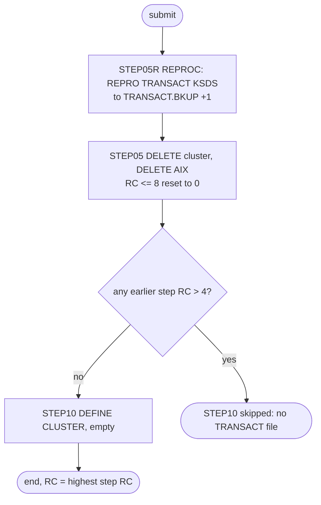

# TRANBKP: Transaction master backup and reset

## 1. Summary

TRANBKP saves the transaction master and then empties it. `STEP05R` runs the cataloged procedure REPROC to copy every record of the KSDS `AWS.M2.CARDDEMO.TRANSACT.VSAM.KSDS` into a new generation of the GDG `AWS.M2.CARDDEMO.TRANSACT.BKUP`. `STEP05` deletes the cluster and its alternate index, and `STEP10` defines the cluster again, empty (key 16 bytes at offset 0, fixed 350-byte records). The job has two roles in the README sequence: in the demo data refresh it gives POSTTRAN the empty `TRANSACT` file that `CBTRN02C` needs, and after INTCALC it saves the day's posted transactions so that COMBTRAN can merge them with the interest transactions. It contains no business logic; what it must preserve is a complete backup before the reset, the empty file afterwards, and the file definition.

## 2. Rules at a glance

The job has no business rules. Its items:

| ID | Rule |
| :-- | :-- |
| SE-JTBKP-001 | Copy every `TRANSACT` record, in key order, to a new generation `TRANSACT.BKUP(+1)` (FB 350). |
| SE-JTBKP-002 | Delete the `TRANSACT` cluster; a result of 8 or less is ignored. |
| SE-JTBKP-003 | Delete the `TRANSACT` alternate index; a result of 8 or less is ignored. |
| SE-JTBKP-004 | Define an empty `TRANSACT` cluster: key 16 at offset 0, records 350 fixed, `SHAREOPTIONS(2 3)`, `ERASE`, no `REUSE`, no alternate index. |
| ERR-JTBKP-001 | The delete step has no `COND`: it runs even when the backup failed. |
| ERR-JTBKP-002 | The define step is skipped when any earlier step ended above 4. |
| DEF-JTBKP-001 | A failed backup leaves no transaction master at all. |
| DEF-JTBKP-002 | The return-code reset also hides a delete that failed because the file is in use. |
| DEF-JTBKP-003 | Catalog and JCL disagree on the backup GDG (`NOSCRATCH` against `SCRATCH`). |
| DEF-JTBKP-004 | One job name for two different purposes in the README sequence. |

## 3. Actors and triggers

- **Trigger:** submitted by an operator or a scheduler. The README "Running Batch Jobs" sequence lists it twice: in the data refresh as "Creates Transaction database" (`./README.md:220`) and after INTCALC as "Backup Transaction database" (`./README.md:229`). The demo full-batch script submits it in both places (`scripts/run_full_batch.sh:28-29`, `scripts/run_full_batch.sh:54-55`). Control-M runs it in folder `DAILY-TransactionBackup` between CLOSEFIL and WAITSTEP (`app/scheduler/CardDemo.controlm:8-13`). CA-7 does not run it (see `SCHED-CA7.md`).
- **Preconditions:** CICS has closed file `TRANSACT` (run CLOSEFIL first; see DEF-JTBKP-002); the GDG base `AWS.M2.CARDDEMO.TRANSACT.BKUP` exists (DEFGDGB, `app/jcl/DEFGDGB.jcl:24-29`); the procedure library `AWS.M2.CARDDEMO.PROC` holds `REPROC` and `AWS.M2.CARDDEMO.CNTL` holds member `REPROCT`; volume `AWSHJ1` exists. On the very first run the cluster must exist, or `STEP05R` fails (ERR-JTBKP-002).
- **Job card:** `CLASS=A,MSGCLASS=0,NOTIFY=&SYSUID` (`:1-2`). The procedure library is set by `//JOBLIB JCLLIB ORDER=('AWS.M2.CARDDEMO.PROC')` (`:19`). The only symbolic parameter is `CNTLLIB=AWS.M2.CARDDEMO.CNTL` on `STEP05R` (`:23-24`).

## 4. Interfaces

`STEP05R` runs procedure step `PRC001` of REPROC (`app/proc/REPROC.prc:21-28`); the job overrides its `FILEIN` and `FILEOUT` DDs.

| Step | Program | DD | Dataset | Disposition | Use | Source |
| :-- | :-- | :-- | :-- | :-- | :-- | :-- |
| `STEP05R` (`PRC001`) | IDCAMS | `SYSPRINT` | `SYSOUT=*` | - | IDCAMS messages | `app/proc/REPROC.prc:22` |
| `STEP05R` (`PRC001`) | IDCAMS | `FILEIN` | `AWS.M2.CARDDEMO.TRANSACT.VSAM.KSDS` | `SHR` | input, KSDS (overrides `DSN=NULLFILE`) | `:26-27` |
| `STEP05R` (`PRC001`) | IDCAMS | `FILEOUT` | `AWS.M2.CARDDEMO.TRANSACT.BKUP(+1)` | `(NEW,CATLG,DELETE)` | output, sequential; `UNIT=SYSDA`, `DCB=(LRECL=350,RECFM=FB,BLKSIZE=0)`, `SPACE=(CYL,(1,1),RLSE)` (overrides `DSN=NULLFILE`) | `:29-33` |
| `STEP05R` (`PRC001`) | IDCAMS | `SYSIN` | `AWS.M2.CARDDEMO.CNTL(REPROCT)` | `SHR` | `REPRO` statement (`&CNTLLIB(REPROCT)`) | `app/proc/REPROC.prc:27-28` |
| `STEP05` | IDCAMS | `SYSPRINT` | `SYSOUT=*` | - | IDCAMS messages | `:38` |
| `STEP05` | IDCAMS | `SYSIN` | in-stream | - | two `DELETE` statements | `:39-46` |
| `STEP10` | IDCAMS | `SYSPRINT` | `SYSOUT=*` | - | IDCAMS messages | `:52` |
| `STEP10` | IDCAMS | `SYSIN` | in-stream | - | `DEFINE CLUSTER` statement | `:53-68` |

Return code of the job: the highest step return code. Console output is IDCAMS `SYSPRINT` only (incidental).

## 5. Data used

- ENT-TRANSACTION, whole 350-byte records (layout `app/cpy/CVTRA05Y.cpy`), copied unchanged from the KSDS to the backup generation. No field is interpreted; the key is bytes 1-16 (`TRAN-ID`).
- Catalog state on 09/01/22: the cluster has `KEYLEN 16`, `RKP 0`, `MAXLRECL 350`, `SHROPTNS(2,3)`, `ERASE`, `NOREUSE` and `REC-TOTAL 311` (`app/catlg/LISTCAT.txt:3593-3598`), which matches SE-JTBKP-004. Its alternate index `TRANSACT.VSAM.AIX` and path `TRANSACT.VSAM.AIX.PATH` are associated with it (`app/catlg/LISTCAT.txt:3541-3552, 3579-3582`); they are created by TRANIDX.
- GDG `AWS.M2.CARDDEMO.TRANSACT.BKUP`: catalog `LIMIT 5`, `NOSCRATCH`, with generations `G0072V00` to `G0076V00` associated (`app/catlg/LISTCAT.txt:1631-1643`). See DEF-JTBKP-003.

## 6. Processing flow

All three steps are plumbing; none carries a business decision.

| # | Step | Class | What it does | Runs when |
| --: | :-- | :-- | :-- | :-- |
| 1 | `STEP05R` | plumbing | unload `TRANSACT` to `TRANSACT.BKUP(+1)` | always |
| 2 | `STEP05` | plumbing | delete the cluster and the alternate index | always (no `COND`) |
| 3 | `STEP10` | plumbing | define the empty cluster | only when no earlier step ended above 4 (`COND=(4,LT)`) |

## 7. Business rules

None. The job moves and resets data without interpreting it; see the side effects in section 9.

## 8. Validations and messages

None. The job performs no validation of its own. All messages are IDCAMS `IDCnnnnI` messages in `SYSPRINT`.

## 9. Side effects

In execution order. There is no rollback: each step's change is permanent.

#### SE-JTBKP-001 · Unload the transaction master to a new backup generation
- **What:** procedure step `PRC001` runs `REPRO INFILE(FILEIN) OUTFILE(FILEOUT)` (`app/ctl/REPROCT.ctl:15`), which copies every record of `AWS.M2.CARDDEMO.TRANSACT.VSAM.KSDS`, in key order, byte for byte, into the new dataset `AWS.M2.CARDDEMO.TRANSACT.BKUP(+1)` (RECFM FB, LRECL 350). `DISP=(NEW,CATLG,DELETE)` catalogs the generation when the step ends normally, even with a non-zero return code, and deletes it only on an abend. Cataloging a new generation makes it `(0)` and rolls the oldest generation off when the GDG already holds 5 (`app/jcl/DEFGDGB.jcl:24-28`).
- **Source:** `:23-33`, `app/proc/REPROC.prc:21-28`, `app/ctl/REPROCT.ctl:15`
- **Fidelity:** must-preserve (a complete, ordered copy before the reset) · **Confidence:** reviewed (statements); platform-inferred (GDG roll-off and disposition behaviour)

#### SE-JTBKP-002 · Delete the transaction master
- **What:** `DELETE AWS.M2.CARDDEMO.TRANSACT.VSAM.KSDS CLUSTER` removes the cluster, its data and index components and all records. Deleting a base cluster also deletes the alternate indexes and paths related to it, so `TRANSACT.VSAM.AIX` and `TRANSACT.VSAM.AIX.PATH` go with it.
- **Return code:** `IF MAXCC LE 08 THEN SET MAXCC = 0` turns any result of 8 or less into 0, so a missing cluster is not an error.
- **Source:** `:40-42`
- **Fidelity:** must-preserve (the master is empty afterwards) · **Confidence:** reviewed (statement); platform-inferred (deletion of related objects)

#### SE-JTBKP-003 · Delete the alternate index
- **What:** `DELETE AWS.M2.CARDDEMO.TRANSACT.VSAM.AIX ALTERNATEINDEX`. When SE-JTBKP-002 succeeded, the alternate index is already gone and this statement ends with return code 8 (entry not found), which the following `IF MAXCC LE 08 THEN SET MAXCC = 0` resets. It only has an effect when the cluster delete did not remove the AIX.
- **Source:** `:43-45`
- **Fidelity:** incidental (the target needs only "no transaction index left") · **Confidence:** platform-inferred

#### SE-JTBKP-004 · Define the empty transaction master
- **What:** `DEFINE CLUSTER` named `AWS.M2.CARDDEMO.TRANSACT.VSAM.KSDS` with:

| Attribute | Value |
| :-- | :-- |
| Organisation | `INDEXED` (KSDS) |
| Key | `KEYS(16 0)`: 16 bytes at offset 0 (`TRAN-ID`) |
| Record size | `RECORDSIZE(350 350)`: average and maximum 350, so fixed 350 |
| Space | `CYLINDERS(1 5)` on `VOLUMES(AWSHJ1)` |
| Sharing | `SHAREOPTIONS(2 3)` |
| Other | `ERASE`; no `REUSE`, so the file can be opened for output only while it is empty |
| Components | data `...TRANSACT.VSAM.KSDS.DATA`, index `...TRANSACT.VSAM.KSDS.INDEX` |

  The job does not define the alternate index or its path; TRANIDX does that after the file is loaded.
- **Source:** `:51, 54-67`
- **Fidelity:** must-preserve (key, record size, empty result); incidental (space, volume, `ERASE`) · **Confidence:** reviewed

## 10. Error handling

#### ERR-JTBKP-001 · The delete runs even when the backup failed
- **When:** `STEP05R` ends with a return code above 0 without abending (for example 12 because `TRANSACT` does not exist or cannot be opened).
- **Then:** `STEP05` still runs, because its `EXEC` has no `COND`, and deletes the cluster. See DEF-JTBKP-001.
- **Source:** `:37`
- **Fidelity:** defect-decide · **Confidence:** platform-inferred

#### ERR-JTBKP-002 · The define is skipped after any return code above 4
- **When:** any earlier step (`STEP05R.PRC001` or `STEP05`) ends with a return code above 4.
- **Then:** `COND=(4,LT)` bypasses `STEP10` (the test "4 is less than the return code" is true), so no new cluster is defined. `STEP05` reaches this only with a result above 8, because of its resets. An abend in any step skips the remaining steps (JES default). On the first run, before any `TRANSACT` exists, `STEP05R` fails and `STEP10` is skipped, so TRANBKP cannot create the file from nothing; TRANFILE does that.
- **Restart:** the runbook describes recovery: do not run COMBTRAN, define the cluster with the `STEP10` statements, `REPRO` the last good generation into it, fix the cause and rerun TRANBKP (`docs/runbooks/batch-cycle-restart.md:123-137`).
- **Source:** `:51`
- **Fidelity:** must-preserve (no empty master after a failed backup is the intent) · **Confidence:** platform-inferred

## 11. Interactions

- **Upstream:** CLOSEFIL closes `TRANSACT` in CICS (Control-M `app/scheduler/CardDemo.controlm:3-13`). In the cycle, INTCALC runs before the backup role (`./README.md:228-229`).
- **Downstream:** POSTTRAN (`CBTRN02C`) opens the empty `TRANSACT` for output (`docs/runbooks/batch-cycle-restart.md:34-36`); COMBTRAN reads `TRANSACT.BKUP(0)`, the generation this job created, and reloads `TRANSACT`; TRANIDX rebuilds the alternate index that `STEP05` deleted; the online programs see an empty `TRANSACT` until COMBTRAN reloads it.
- **Shared data:** TRANREPT also writes `TRANSACT.BKUP(+1)` (its own `STEP05R`), so a TRANREPT run between TRANBKP and COMBTRAN changes what `TRANSACT.BKUP(0)` means for COMBTRAN.

## 12. Numeric, date and format details

#### NUM-JTBKP-001 · Backup generation format and retention
- The backup is RECFM FB, LRECL 350 (`BLKSIZE=0`, system-chosen), the same record as the KSDS. The GDG keeps 5 generations (`LIMIT(5)`, `app/jcl/DEFGDGB.jcl:26`); every run of TRANBKP or TRANREPT adds one, so in a cycle that runs TRANBKP twice (refresh and backup) the data refresh backup is `(-1)` by the time COMBTRAN runs.
- **Source:** `:31, 33`, `app/jcl/DEFGDGB.jcl:24-28`
- **Fidelity:** incidental (retention), must-preserve (record length) · **Confidence:** reviewed

## 13. Known defects and oddities

#### DEF-JTBKP-001 · A failed backup leaves no transaction master at all
- When `STEP05R` ends with a return code above 4 without abending, `STEP05` deletes `TRANSACT` anyway (ERR-JTBKP-001) and `STEP10` is skipped (ERR-JTBKP-002). The file no longer exists and the generation that `STEP05R` cataloged may be incomplete. The posted transactions survive only in earlier backup generations. The restart runbook describes this case (`docs/runbooks/batch-cycle-restart.md:128-130`).
- **Source:** `:23, 37, 51`
- **Status:** open · **Fidelity:** defect-decide · **Confidence:** platform-inferred

#### DEF-JTBKP-002 · The return-code reset hides a failed delete
- `IF MAXCC LE 08 THEN SET MAXCC = 0` is meant for "not found", but it also hides a delete that failed with return code 8 for other reasons, for example while CICS still has `TRANSACT` allocated. `STEP10` then runs and fails because the name exists, and the old, full file stays in place. POSTTRAN then fails to open it for output (`docs/runbooks/batch-cycle-restart.md:58`).
- **Source:** `:42, 45, 51`
- **Status:** open · **Fidelity:** defect-decide · **Confidence:** platform-inferred

#### DEF-JTBKP-003 · Catalog and JCL disagree on the backup GDG
- DEFGDGB defines `TRANSACT.BKUP` with `SCRATCH` (`app/jcl/DEFGDGB.jcl:25-27`), but the 09/01/22 catalog shows `NOSCRATCH` and a last alter date of 2022.242 (`app/catlg/LISTCAT.txt:1635-1637`), and generations `G0001V00` to `G0071V00` still listed after they rolled off the base. The installation was altered by hand after DEFGDGB ran; rolled-off backups are kept rather than scratched.
- **Source:** `app/jcl/DEFGDGB.jcl:24-29`, `app/catlg/LISTCAT.txt:1631-1643`
- **Status:** open · **Fidelity:** incidental · **Confidence:** reviewed

#### DEF-JTBKP-004 · One job name for two purposes
- The README sequence runs TRANBKP once as "Creates Transaction database" in the data refresh and once as "Backup Transaction database" after INTCALC (`./README.md:220, 229`). The README component table calls it "Refresh Transaction Master" (`./README.md:368`). The job always does both things (backup, then reset); in the refresh role the backup is a by-product that uses one of the five generations.
- **Source:** `:1, 23-68`
- **Status:** open · **Fidelity:** incidental · **Confidence:** reviewed

## 14. Open questions

| ID | Question | For |
| :-- | :-- | :-- |
| Q-JTBKP-001 | In the target, should the backup and the reset be separate, so that a failed backup can never remove the transaction store (DEF-JTBKP-001)? | operations |
| Q-JTBKP-002 | Should rolled-off backups be kept (catalog `NOSCRATCH`) or deleted (DEFGDGB `SCRATCH`), and for how many cycles? | operations |

## 15. Equivalence contract

After a successful run (return code 0): the new backup generation contains exactly the records the transaction store held before the run, in `TRAN-ID` order, byte for byte; the transaction store exists, is empty, and has key `TRAN-ID` (16 bytes) and 350-byte records; no transaction index remains. A reimplementation must not empty the store when the backup did not complete; the AS-IS job does (DEF-JTBKP-001), and the decision is open (Q-JTBKP-001). IDCAMS message text may differ.

## 16. Paragraph coverage

| Step | Lines | Covered by |
| :-- | :-- | :-- |
| (job card and JOBLIB) | 1-19 | §3 |
| `STEP05R` | 23-33 | SE-JTBKP-001, NUM-JTBKP-001, DEF-JTBKP-001 |
| `STEP05` | 37-46 | SE-JTBKP-002, SE-JTBKP-003, ERR-JTBKP-001, DEF-JTBKP-002 |
| `STEP10` | 51-68 | SE-JTBKP-004, ERR-JTBKP-002 |
