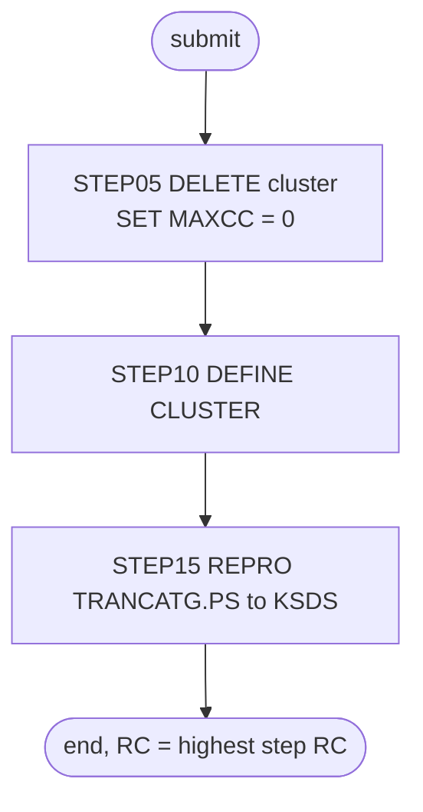

# TRANCATG: Transaction category reload

## 1. Summary

TRANCATG throws away the transaction category reference file (ENT-TRAN-CATEGORY: the description of each transaction type and category pair) and rebuilds it from the flat file. `STEP05` deletes the VSAM cluster `AWS.M2.CARDDEMO.TRANCATG.VSAM.KSDS`, `STEP10` defines it again empty (key 6 bytes at offset 0, fixed 60-byte records), and `STEP15` copies every record of `AWS.M2.CARDDEMO.TRANCATG.PS` into it. It is run by hand during installation and in the demo data refresh, and the CA-7 schedule triggers it. With the optional Db2 module, TRANEXTR first writes the flat file again from Db2. The job contains no business logic; what it must preserve is the file definition and the fact that the result is an exact copy of the flat file.

## 2. Rules at a glance

The job has no business rules. Its items:

| ID | Rule |
| :-- | :-- |
| SE-JTCATG-001 | Delete the transaction category cluster; the return code is then set to 0 unless the delete ended with a severe error (ERR-JTCATG-003). |
| SE-JTCATG-002 | Define the cluster: key 6 at offset 0, records 60 fixed, `SHAREOPTIONS(2 3)`, `ERASE`, no `REUSE`. |
| SE-JTCATG-003 | Load the cluster with every record of `TRANCATG.PS`, in file order, with exclusive use of the cluster (`DISP=OLD`). |
| VAL-JTCATG-001 | The load rejects records out of key order or with duplicate keys (VSAM rule). |
| ERR-JTCATG-001 | No step has a `COND`, so every step runs even when an earlier one failed. |
| ERR-JTCATG-002 | The job waits to start while another job has the cluster allocated. |
| ERR-JTCATG-003 | A severe IDCAMS error (condition code 16) in the delete skips the return-code reset. |
| NUM-JTCATG-001 | Key and record size. |
| DEF-JTCATG-001 | The unconditional return-code reset hides every delete failure. |
| DEF-JTCATG-002 | `scripts/run_full_batch.sh` leaves the job out, although the README sequence includes it. |

## 3. Actors and triggers

- **Trigger:** submitted by an operator. It is in the README's initialisation sequence (`./README.md:163`) and its "Running Batch Jobs" sequence (`./README.md:222`), and in the demo script `scripts/remote_refresh.sh:37-38`, but not in `scripts/run_full_batch.sh` (DEF-JTCATG-002). In the CA-7 schedule, `CLOSEFIL1` (a CLOSEFIL run under schedule ID 031) triggers it with SCHID 031 (`app/scheduler/CardDemo.ca7:244`) and it triggers `WAITSTEP` with SCHID 031 (`app/scheduler/CardDemo.ca7:298`). A trigger fires only when its job completed under the trigger's schedule ID, and the triggered job inherits that ID (FLOW-JCA7-005), so TRANCATG runs only in a run under SCHID 031: WAITSTEP's trigger of `CLOSEFIL1` is defined for 031 (`app/scheduler/CardDemo.ca7:216`), and its trigger of `CLOSEFIL2`, which leads to TCATBALF, for 032 (`app/scheduler/CardDemo.ca7:217, 271`). One WAITSTEP completion therefore never starts both TRANCATG and TCATBALF. The WAITSTEP that follows TRANTYPE in the regular run under 030 never reaches TRANCATG (FLOW-JCA7-002). Under 031 the job is also part of chain 4, after PRTCATBL (FLOW-JCA7-004), and that run reloads the category file on every round without end (DEF-JCA7-008). This reading of the schedule is platform-inferred (medium). Control-M does not run it. The local runner has no TRANCATG job; it loads `app/data/ASCII/trancatg.txt` into the `TRANCATG` dataset directly (`tools/batch-programs.toml:231-235`).
- **Preconditions:** no other job has `AWS.M2.CARDDEMO.TRANCATG.VSAM.KSDS` allocated (ERR-JTCATG-002); `AWS.M2.CARDDEMO.TRANCATG.PS` exists and is sorted by key (`./README.md:143`, FB 60). The define names volume `AWSHJ1`, but the cluster is SMS-managed (storage class `SCTECH`, `app/catlg/LISTCAT.txt:1446`) and the catalog shows its data component on volume `YYYYTL` (`app/catlg/LISTCAT.txt:1492`), so on the reference system SMS chose the volume; `AWSHJ1` matters only where SMS does not manage these names (platform-inferred, medium). The CSD defines no CICS file on this cluster (checked with a search over `app/csd/CARDDEMO.CSD`), so no CICS close is needed for it.
- **Job card:** `CLASS=A,MSGCLASS=0,NOTIFY=&SYSUID` (`:1-2`). No parameters, no symbolic overrides.

## 4. Interfaces

| Step | Program | DD | Dataset | Disposition | Use | Source |
| :-- | :-- | :-- | :-- | :-- | :-- | :-- |
| `STEP05` | IDCAMS | `SYSPRINT` | `SYSOUT=*` | - | IDCAMS messages | `:23` |
| `STEP05` | IDCAMS | `SYSIN` | in-stream | - | `DELETE` and `SET` statements | `:24-28` |
| `STEP10` | IDCAMS | `SYSPRINT` | `SYSOUT=*` | - | IDCAMS messages | `:34` |
| `STEP10` | IDCAMS | `SYSIN` | in-stream | - | `DEFINE CLUSTER` statement | `:35-50` |
| `STEP15` | IDCAMS | `SYSPRINT` | `SYSOUT=*` | - | IDCAMS messages | `:55` |
| `STEP15` | IDCAMS | `TRANCATG` | `AWS.M2.CARDDEMO.TRANCATG.PS` | `SHR` | input, sequential, FB 60 | `:56-57` |
| `STEP15` | IDCAMS | `TCATVSAM` | `AWS.M2.CARDDEMO.TRANCATG.VSAM.KSDS` | `OLD` | output, KSDS | `:58-59` |
| `STEP15` | IDCAMS | `SYSIN` | in-stream | - | `REPRO` statement | `:60-62` |

Return code of the job: the highest step return code. Console output is IDCAMS `SYSPRINT` only (incidental).

## 5. Data used

- ENT-TRAN-CATEGORY (`TRAN-CAT-RECORD`, `app/cpy/CVTRA04Y.cpy:4-9`, 60 bytes), whole records copied unchanged from `TRANCATG.PS` to the KSDS. No field is interpreted. The key is bytes 1-6 (`TRAN-CAT-KEY`: `TRAN-TYPE-CD` `X(02)`, `TRAN-CAT-CD` `9(04)`); the description `TRAN-CAT-TYPE-DESC` (`X(50)`) and a 4-byte filler are carried along. The filler holds `0000` in every sample record, and TRANEXTR writes the same four zeros when it rebuilds the flat file from Db2 (`REPEAT('0',4)`, `app/app-transaction-type-db2/jcl/TRANEXTR.jcl:106-115`), so both sources give the same bytes. The content of the filler is incidental.
- Catalog state (`app/catlg/LISTCAT.txt:1440-1526`): the data component has `KEYLEN 6`, `RKP 0`, `MAXLRECL 60`, `SHROPTNS(2,3)`, `ERASE`, `NOREUSE` (`app/catlg/LISTCAT.txt:1475-1477`), `REC-TOTAL 18` with no inserts or updates (`app/catlg/LISTCAT.txt:1482-1485`), space `CYLINDER` primary 1 secondary 5 (`app/catlg/LISTCAT.txt:1489-1490`). This matches SE-JTCATG-002. Its system timestamp (`X'DBD5...'`, `app/catlg/LISTCAT.txt:1485`) is older than those of the other reloaded clusters in the listing (`X'DC08...'`), so it was last loaded before them.
- Sample data: `app/data/ASCII/trancatg.txt` has 18 records of 60 bytes, keys strictly ascending from `010001` (Regular Sales Draft) to `070001` (Sales draft credit adjustment), covering types `01` to `07`. Checked locally with a Python script over the file.

## 6. Processing flow

| # | Step | Program | Class | What it does | Runs when |
| --: | :-- | :-- | :-- | :-- | :-- |
| 1 | `STEP05` | IDCAMS | plumbing | delete the cluster | always |
| 2 | `STEP10` | IDCAMS | plumbing | define the cluster | always (no `COND`) |
| 3 | `STEP15` | IDCAMS | plumbing | copy `TRANCATG.PS` into the cluster | always |

## 7. Business rules

None. The job moves data without interpreting it; see the side effects in section 9.

## 8. Validations and messages

#### VAL-JTCATG-001 · The load requires ascending, unique keys
- **When:** `STEP15` copies a record whose key (bytes 1-6) is not higher than the previous record's key.
- **Then:** VSAM rejects that record and IDCAMS prints an error message for it; the step ends with return code 8 or higher. The remaining records are still copied until IDCAMS reaches its error limit (by default it stops after 4 such errors).
- **Source:** `:61`
- **Fidelity:** must-preserve (the target load must also fail visibly on unsorted or duplicate input) · **Confidence:** platform-inferred (IDCAMS `REPRO` into a KSDS; no local run)

No operator-facing message text is produced by the job itself; all messages are IDCAMS `IDCnnnnI` messages in `SYSPRINT`.

## 9. Side effects

In execution order. There is no rollback: each step's change is permanent.

#### SE-JTCATG-001 · Delete the transaction category cluster
- **What:** `DELETE AWS.M2.CARDDEMO.TRANCATG.VSAM.KSDS CLUSTER`, which removes the cluster with its data and index components and all its records.
- **Return code:** `SET MAXCC = 0` follows without a condition, so the step ends with return code 0 whatever the delete did, unless the delete ends with condition code 16 and IDCAMS skips the `SET` (ERR-JTCATG-003). A missing cluster (first run) is therefore not an error, but neither is any other failure (DEF-JTCATG-001).
- **Source:** `:25-27`
- **Fidelity:** must-preserve (the reload starts from nothing) · **Confidence:** reviewed

#### SE-JTCATG-002 · Define the transaction category cluster
- **What:** `DEFINE CLUSTER` named `AWS.M2.CARDDEMO.TRANCATG.VSAM.KSDS` with:

| Attribute | Value |
| :-- | :-- |
| Organisation | `INDEXED` (KSDS) |
| Key | `KEYS(6 0)`: 6 bytes at offset 0 (`TRAN-CAT-KEY`: transaction type, category) |
| Record size | `RECORDSIZE(60 60)`: average and maximum 60, so fixed 60 |
| Space | `CYLINDERS(1 5)` on `VOLUMES(AWSHJ1)` |
| Sharing | `SHAREOPTIONS(2 3)` |
| Other | `ERASE`; no `REUSE` |
| Components | data `...TRANCATG.VSAM.KSDS.DATA`, index `...TRANCATG.VSAM.KSDS.INDEX` |

- **Source:** `:36-49`
- **Fidelity:** must-preserve (key and record size); incidental (space, volume, sharing, `ERASE`) · **Confidence:** reviewed

#### SE-JTCATG-003 · Load the cluster from the flat file
- **What:** `REPRO INFILE(TRANCATG) OUTFILE(TCATVSAM)` copies every record of `AWS.M2.CARDDEMO.TRANCATG.PS`, in file order, into the new cluster, byte for byte. The output DD has `DISP=OLD`, which asks for exclusive use of the cluster name (ERR-JTCATG-002); the reload jobs for the card, customer and cross-reference files use `DISP=SHR` instead.
- **Source:** `:56-61`
- **Fidelity:** must-preserve (exact copy); incidental (disposition) · **Confidence:** reviewed

If a later step fails, everything before it has happened: the old cluster is gone, and the new one may be empty or partly loaded. TRANREPT then fails to open the file or finds no category descriptions.

## 10. Error handling

#### ERR-JTCATG-001 · Steps run regardless of earlier failures
- **When:** a step ends with a non-zero return code without abending.
- **Then:** the next step still runs, because no `EXEC` has a `COND` parameter. If `STEP10` fails (for example because the delete did not remove the cluster), `STEP15` loads the records into whatever cluster exists (DEF-JTCATG-001). An abend in a step skips the remaining steps (JES default).
- **Restart:** rerun the whole job; every step either recreates its object or is reset. There is no partial restart point.
- **Source:** `:22, 33, 54`
- **Fidelity:** defect-decide · **Confidence:** platform-inferred

#### ERR-JTCATG-002 · The job waits for exclusive use of the cluster
- **When:** another job (for example TRANREPT) has `AWS.M2.CARDDEMO.TRANCATG.VSAM.KSDS` allocated when this job is selected to run.
- **Then:** because of `DISP=OLD` the system requests an exclusive data set enqueue on the cluster name when the job starts, before `STEP05` runs. The job waits until the other job ends, and while it runs no other job can allocate the cluster. This protects the delete and the load against concurrent batch use within one system. No error is reported; the operator sees the job waiting for the data set.
- **Source:** `:58-59`
- **Fidelity:** must-preserve (no reader or updater may use the file during the reload); incidental (mechanism) · **Confidence:** platform-inferred

#### ERR-JTCATG-003 · A severe IDCAMS error skips the return-code reset
- **When:** the `DELETE` in `STEP05` ends with condition code 16, a severe error such as a catalog that cannot be accessed.
- **Then:** IDCAMS does not process the remaining commands of the step, so `SET MAXCC = 0` never runs and `STEP05` ends with return code 16. The job still goes on to `STEP10` (ERR-JTCATG-001). The unconditional reset therefore turns every delete result except 16 into 0. `STEP10` and `STEP15` hold one command each, so for them a severe error simply ends the step with 16.
- **Source:** `:25-27`
- **Fidelity:** incidental · **Confidence:** platform-inferred (high; IDCAMS condition-code rules, no local run)

## 11. Interactions

- **Upstream (optional Db2 module):** TRANEXTR copies `TRANCATG.PS` to a backup generation, deletes it, and writes it again from Db2 table `CARDDEMO.TRANSACTION_TYPE_CATEGORY`, ordered by type and category (`app/app-transaction-type-db2/jcl/TRANEXTR.jcl:42-61, 95-115`). The README runs TRANEXTR before TRANCATG (`./README.md:221-222`). Without the module, `TRANCATG.PS` is the shipped sample.
- **Downstream:** TRANREPT (`CBTRN03C`) reads the category descriptions for the transaction report (DD `TRANCATG`, `app/jcl/TRANREPT.jcl:71-72`; the procedure version `app/proc/TRANREPT.prc:69-70`).
- **Shared data:** every type code must exist in ENT-TRAN-TYPE (loaded by TRANTYPE); nothing in this job checks it.

## 12. Numeric, date and format details

#### NUM-JTCATG-001 · Key and record size
- Primary key: 6 bytes at offset 0 (`TRAN-CAT-KEY`: transaction type, category), unique, compared as bytes. Records: fixed 60 bytes. Space: `CYLINDERS(1 5)`.
- **Source:** `:37, 40-42`
- **Fidelity:** must-preserve (key, record size); incidental (space) · **Confidence:** reviewed

## 13. Known defects and oddities

#### DEF-JTCATG-001 · The unconditional return-code reset hides every delete failure
- `SET MAXCC = 0` is meant for "cluster not found" on a first run, but it has no `IF`, so it also hides a delete that failed for any other reason (cluster in use from another system, no authority, catalog error); only a severe error with condition code 16 escapes it (ERR-JTCATG-003). The card, customer and cross-reference reload jobs at least limit their reset to `IF MAXCC LE 08`. After a hidden failure `STEP10` fails because the name already exists, and `STEP15` copies the flat file on top of the old, loaded cluster: records with existing keys are rejected as duplicates, new keys are added, and the job ends with a non-zero code from `STEP10` and `STEP15`, but old and new data stay mixed.
- **Source:** `:27, 33, 54`
- **Status:** open · **Fidelity:** defect-decide · **Confidence:** platform-inferred

#### DEF-JTCATG-002 · Left out of the full-batch demo script
- The README "Running Batch Jobs" sequence has TRANCATG between TRANEXTR and TRANTYPE (`./README.md:221-222`), but `scripts/run_full_batch.sh` goes from TCATBALF (job 8) to TRANTYPE (job 9) and then to job 11 without TRANCATG (`scripts/run_full_batch.sh:34-41`). A demo run with that script keeps whatever category file was loaded before. `scripts/remote_refresh.sh:37-38` includes the job.
- **Source:** `scripts/run_full_batch.sh:31-41`
- **Status:** open · **Fidelity:** incidental · **Confidence:** reviewed

## 14. Open questions

| ID | Question | For |
| :-- | :-- | :-- |
| Q-JTCATG-001 | With the optional Db2 module installed, Db2 holds the master copy of the categories and this file is an extract. Should the target keep a single store for categories and drop the flat-file reload? | business |

## 15. Equivalence contract

After a successful run (return code 0), the transaction category store contains exactly the records of `TRANCATG.PS`: same count (18 for the sample data), same bytes, keyed by `TRAN-CAT-KEY` (type and category), and nothing else. A reimplementation must fail (non-zero result, no silent partial load) when the input has keys out of order or duplicated (VAL-JTCATG-001), and nothing may read or update the file while the reload runs (ERR-JTCATG-002). IDCAMS message text may differ.

Review evidence (independent reviewers checked every item against the source, all WRONG and MINOR findings were fixed, and a fresh reviewer re-checked every changed or added item): [evidence/g-jobs-ops-review.md](../evidence/g-jobs-ops-review.md).

## 16. Paragraph coverage

| Step | Lines | Covered by |
| :-- | :-- | :-- |
| (job card) | 1-2 | §3 |
| `STEP05` | 22-28 | SE-JTCATG-001, ERR-JTCATG-003, DEF-JTCATG-001 |
| `STEP10` | 33-50 | SE-JTCATG-002, NUM-JTCATG-001, ERR-JTCATG-001 |
| `STEP15` | 54-62 | SE-JTCATG-003, VAL-JTCATG-001, ERR-JTCATG-001, ERR-JTCATG-002 |
