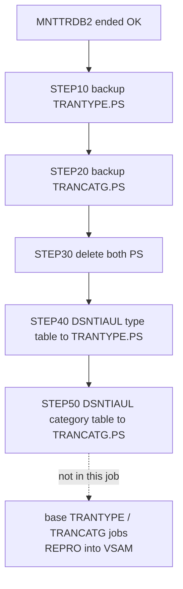

# TRANEXTR: Weekly unload of the transaction type and category tables

## 1. Summary

The job copies the Db2 reference data back into the base application's file format. It first backs up the current sequential files `AWS.M2.CARDDEMO.TRANTYPE.PS` and `AWS.M2.CARDDEMO.TRANCATG.PS` to new generations of their backup GDGs, deletes them, then unloads `CARDDEMO.TRANSACTION_TYPE` and `CARDDEMO.TRANSACTION_TYPE_CATEGORY` with the Db2 utility DSNTIAUL into new files with the 60-byte layouts of ENT-TRAN-TYPE and ENT-TRAN-CATEGORY. It does not load the VSAM files that the batch and online programs read; that is done by the base jobs TRANTYPE and TRANCATG (DEF-JTREX-001). Control-M runs it after MNTTRDB2 in the weekly refresh.

## 2. Rules at a glance

| ID | Rule |
| :-- | :-- |
| BR-JTREX-001 | Type file record: code (2) + description as 50 characters + `00000000`, 60 bytes, in code order. |
| BR-JTREX-002 | Category file record: type (2) + category (4) + description as 50 characters + `0000`, 60 bytes, in (type, category) order. |
| SE-JTREX-001 | Back up the type file to `TRANTYPE.BKUP(+1)`. |
| SE-JTREX-002 | Back up the category file to `TRANCATG.PS.BKUP(+1)`. |
| SE-JTREX-003 | Delete both files. |
| SE-JTREX-004 | Unload the type table to a new `TRANTYPE.PS`. |
| SE-JTREX-005 | Unload the category table to a new `TRANCATG.PS`. |
| ERR-JTREX-001 | Steps 20-40 run only if every earlier step ended with 0; step 50 runs unless an earlier step ended above 4. |

## 3. Actors and triggers

- **Scheduler:** Control-M smart folder `WEEKLY-TransactionTypesDBRefresh` (`DAYS="SA"`, Saturdays), job `TRANEXTR`, waiting for condition `WEEKLY-TransactionTypesDBRefresh-MNTTRDB2` (`app/scheduler/CardDemo.controlm:57-63`).
- **Manual:** the module README asks for a run after installation to "extract initial data".
- **Preconditions:** `TRANTYPE.PS` and `TRANCATG.PS` exist (created by the base data load, `app/catlg/LISTCAT.txt`); the GDG bases `AWS.M2.CARDDEMO.TRANTYPE.BKUP` and `AWS.M2.CARDDEMO.TRANCATG.PS.BKUP` exist (`app/jcl/DEFGDGD.jcl:28, 51`); DSNTIAUL is bound with plan `DSNTIAUL`.
- The header comment says the job "runs once a day" for the transaction report (`:19-21`); the schedule is weekly and the report reads the VSAM files (DEF-JTREX-002).

## 4. Interfaces

Job card: `CLASS=A`, `MSGCLASS=0`, `NOTIFY=&SYSUID` (`:1-2`). Symbol `HLQ=AWS.M2.CARDDEMO` (`:25`).

| Step | DD | Dataset | DISP | DCB / space | Use |
| :-- | :-- | :-- | :-- | :-- | :-- |
| STEP10 | `SYSUT1` | `AWS.M2.CARDDEMO.TRANTYPE.PS` | SHR | existing | input of the copy |
| STEP10 | `SYSUT2` | `AWS.M2.CARDDEMO.TRANTYPE.BKUP(+1)` | (NEW,CATLG) | FB, LRECL 60, BLKSIZE 600; TRK(1,1) RLSE | backup |
| STEP10 | `SYSIN` | DUMMY | - | - | no IEBGENER control statements: straight copy |
| STEP20 | `SYSUT1` | `AWS.M2.CARDDEMO.TRANCATG.PS` | SHR | existing | input |
| STEP20 | `SYSUT2` | `AWS.M2.CARDDEMO.TRANCATG.PS.BKUP(+1)` | (NEW,CATLG) | FB, 60, 600; TRK(1,1) RLSE | backup |
| STEP30 | `DD01` | `AWS.M2.CARDDEMO.TRANTYPE.PS` | (MOD,DELETE,DELETE) | SYSDA, TRK(1,1) | delete |
| STEP30 | `DD02` | `AWS.M2.CARDDEMO.TRANCATG.PS` | (MOD,DELETE,DELETE) | SYSDA, TRK(1,1) | delete |
| STEP40 | `SYSREC00` | `AWS.M2.CARDDEMO.TRANTYPE.PS` | (NEW,CATLG,DELETE) | TRK(1,1) RLSE; DCB set by DSNTIAUL | unload output |
| STEP40 | `SYSPUNCH` | DUMMY | - | - | LOAD control statements discarded |
| STEP40 | `SYSIN` | in-stream SQL | - | - | BR-JTREX-001 |
| STEP40 | `SYSTSIN` | in-stream | - | - | `DSN SYSTEM(DAZ1)` / `RUN PROGRAM(DSNTIAUL) PLAN(DSNTIAUL) PARMS('SQL')` |
| STEP50 | `SYSREC00` | `AWS.M2.CARDDEMO.TRANCATG.PS` | (NEW,CATLG,DELETE) | as STEP40 | unload output |
| STEP50 | `SYSIN`, `SYSTSIN`, `SYSPUNCH` | as STEP40 | - | - | BR-JTREX-002 |

All steps also have `SYSPRINT` (and STEP40/50 `SYSTSPRT`, `SYSUDUMP`) to SYSOUT.

## 5. Data used

| Entity field | Read | Written | Use |
| :-- | :-- | :-- | :-- |
| ENT-DB2-TRAN-TYPE.TR_TYPE, TR_DESCRIPTION | yes | - | BR-JTREX-001 |
| ENT-DB2-TRAN-TYPE-CAT.TRC_TYPE_CODE, TRC_TYPE_CATEGORY, TRC_CAT_DATA | yes | - | BR-JTREX-002 |
| ENT-TRAN-TYPE (sequential copy, 60 bytes) | yes (backup) | yes (new file) | SE-JTREX-001, SE-JTREX-004 |
| ENT-TRAN-CATEGORY (sequential copy, 60 bytes) | yes (backup) | yes (new file) | SE-JTREX-002, SE-JTREX-005 |

## 6. Processing flow

| Step | Program | Purpose | Class | COND |
| :-- | :-- | :-- | :-- | :-- |
| STEP10 | IEBGENER | back up the type file | plumbing | none |
| STEP20 | IEBGENER | back up the category file | plumbing | `(0,NE)` |
| STEP30 | IEFBR14 | delete both files | plumbing | `(0,NE)` |
| STEP40 | IKJEFT01 (DSNTIAUL) | unload the type table | business | `(0,NE)` |
| STEP50 | IKJEFT01 (DSNTIAUL) | unload the category table | business | `(4,LT)` |

## 7. Business rules

#### BR-JTREX-001 · Type file layout
- **When:** STEP40 runs.
- **Then:** one 60-byte record per table row: `TR_TYPE` (2 bytes), then `TR_DESCRIPTION` cast to `CHAR(50)` (padded with spaces to 50), then `REPEAT('0',8)`, eight zero characters; the whole cast to `CHAR(60)`. Rows in `ORDER BY TR_TYPE` (EBCDIC byte order). This matches ENT-TRAN-TYPE (`TRAN-TYPE` X(2), `TRAN-TYPE-DESC` X(50), FILLER X(8), `app/cpy/CVTRA03Y.cpy:4-7`); the sample file has eight `0` characters in the FILLER too.
- **Source:** `:65-91`
- **Fidelity:** must-preserve · **Confidence:** reviewed

#### BR-JTREX-002 · Category file layout
- **When:** STEP50 runs.
- **Then:** one 60-byte record per row: `TRC_TYPE_CODE` (2) + `TRC_TYPE_CATEGORY` (4) + `TRC_CAT_DATA` cast to `CHAR(50)` + `REPEAT('0',4)`, cast to `CHAR(60)`, in `ORDER BY TRC_TYPE_CODE, TRC_TYPE_CATEGORY`. This matches ENT-TRAN-CATEGORY (`app/cpy/CVTRA04Y.cpy:4-9`), whose `TRAN-CAT-CD` is `PIC 9(04)`; the Db2 column is `CHAR(4)` and nothing makes it numeric (the seed is all digits).
- **Source:** `:95-122`
- **Fidelity:** must-preserve · **Confidence:** reviewed

## 8. Validations

None. The unload copies every row as it is.

## 9. Side effects

In step order.

#### SE-JTREX-001 · Back up the type file (STEP10)
- IEBGENER copies `TRANTYPE.PS` unchanged to a new generation `TRANTYPE.BKUP(+1)` (FB 60/600).
- **Source:** `:31-38`

#### SE-JTREX-002 · Back up the category file (STEP20)
- The same for `TRANCATG.PS` to `TRANCATG.PS.BKUP(+1)`. The two GDG names follow different patterns (DEF-JTREX-005).
- **Source:** `:42-49`

#### SE-JTREX-003 · Delete both files (STEP30)
- IEFBR14 with `DISP=(MOD,DELETE,DELETE)` deletes `TRANTYPE.PS` and `TRANCATG.PS` (MOD allocates them if they do not exist, so the step does not fail on a missing file).
- **Source:** `:53-61`

#### SE-JTREX-004 · Unload the type table (STEP40)
- DSNTIAUL in SQL mode runs the SELECT of BR-JTREX-001 and writes the result to a new `TRANTYPE.PS` (catalogued at normal step end, deleted on abend).
- **Source:** `:65-91`

#### SE-JTREX-005 · Unload the category table (STEP50)
- The same for BR-JTREX-002 into a new `TRANCATG.PS`.
- **Source:** `:95-122`

## 10. Error handling

#### ERR-JTREX-001 · Step conditions
- STEP20, STEP30 and STEP40 have `COND=(0,NE)`: each is skipped when any earlier step ended with a non-zero code. STEP50 has `COND=(4,LT)`: it is skipped only when an earlier step ended above 4. So a warning (RC 4) from STEP40 still lets STEP50 run, while a warning in STEP10 or STEP20 stops the type unload.
- **Source:** `:42, 53, 65, 95`
- **Confidence:** platform-inferred

#### ERR-JTREX-002 · Failure after the delete loses the files
- If STEP40 or STEP50 fails after STEP30, the deleted file is not re-created (or is catalogued partly written, when DSNTIAUL ends with an error code instead of abending). The next run's STEP10 then fails on a missing `TRANTYPE.PS` (a JCL error at allocation for `DISP=SHR`), and the base TRANTYPE and TRANCATG jobs fail too. Recovery is a manual copy from the latest backup generation, or a restart at STEP40.
- **Source:** `:31-38, 53-61, 72-74, 102-104`
- **Confidence:** platform-inferred

#### ERR-JTREX-003 · First run needs existing files and GDG bases
- STEP10 and STEP20 read the files with `DISP=SHR` and write `(+1)` generations, so the files and the GDG bases (`app/jcl/DEFGDGD.jcl`) must exist before the first run.
- **Source:** `:34-35, 45-46`
- **Confidence:** platform-inferred

## 11. Interactions

- **Before:** MNTTRDB2 (Control-M condition); the online programs COTRTLIC and COTRTUPC change the same tables at any time.
- **After (not chained):** the base jobs TRANTYPE (`app/jcl/TRANTYPE.jcl:22-62`: delete, define with `KEYS(2 0)`, `RECORDSIZE(60 60)`, `REPRO INFILE(TRANTYPE) OUTFILE(TTYPVSAM)`) and TRANCATG (`app/jcl/TRANCATG.jcl`) rebuild the VSAM files from these sequential files. They are not successors of TRANEXTR in Control-M; they appear only in the CA-7 schedule (owned by the base jobs area).
- **Consumers of the VSAM files:** the transaction report TRANREPT reads `TRANTYPE.VSAM.KSDS` and `TRANCATG.VSAM.KSDS` (`app/jcl/TRANREPT.jcl:69-72`), and other base programs read them through ENT-TRAN-TYPE and ENT-TRAN-CATEGORY.

## 12. Numeric, date and format details

#### NUM-JTREX-001 · Records, keys and space
- Both output files: 60-byte records, sorted ascending by the VSAM key (2 bytes for types, 6 bytes for categories), unique because they are the tables' primary keys, so the REPRO into the KSDS gets keys in order and without duplicates. Backups FB 60, blocks of 600 (10 records). Space 1 track primary and 1 secondary everywhere; ample for the 7 and 18 seed rows.
- **Source:** `:37, 48, 74, 84, 104, 113-115`

#### NUM-JTREX-002 · Text conversions
- `CAST(TR_DESCRIPTION AS CHAR(50))` pads with spaces; descriptions are at most 50 characters, so nothing is truncated. The stored trailing spaces (NUM-TTBU-004) make no difference here. The text keeps its case, so Db2 upper-case descriptions replace the mixed-case VSAM sample text after a reload (DEF-JCRDB-005).
- **Source:** `:76-81, 106-111`

## 13. Known defects and oddities

#### DEF-JTREX-001 · Db2 changes do not reach the programs until a manual reload
- The job writes the sequential files only. The README says it "creates VSAM-compatible files"; the VSAM files the programs read are rebuilt only when TRANTYPE and TRANCATG run, which the Control-M schedule does not do after TRANEXTR. Until then Db2 and VSAM disagree.
- **Source:** `:63-122` · **Status:** open · **Fidelity:** defect-decide (Q-JTREX-001)

#### DEF-JTREX-002 · Header comment is out of date
- It says the job runs once a day for the transaction report (`:19-21`); the schedule is weekly and the report reads the VSAM files, not these files.
- **Source:** `:19-21` · **Status:** open · **Fidelity:** incidental

#### DEF-JTREX-003 · STEP50 is described as the type extract and has a different condition
- The comment above STEP50 says "EXTRACT DATA FROM TRANSACTION TYPE TABLE" (`:93`) although it extracts categories, and its `COND=(4,LT)` differs from the `(0,NE)` of the other steps (ERR-JTREX-001).
- **Source:** `:93-95` · **Status:** open · **Fidelity:** incidental

#### DEF-JTREX-004 · Not restartable after the delete
- See ERR-JTREX-002: the delete-then-create order leaves no file when an unload fails.
- **Source:** `:53-61` · **Status:** open (operations)

#### DEF-JTREX-005 · Inconsistent names
- Backup GDGs `TRANTYPE.BKUP` and `TRANCATG.PS.BKUP`; `MSGCLASS=0` here, `H` or `A` in the other module jobs.
- **Source:** `:2, 35, 46` · **Status:** open · **Fidelity:** incidental

#### DEF-JTREX-006 · Non-numeric categories would break the VSAM layout
- `TRC_TYPE_CATEGORY` is `CHAR(4)` with no check; a non-digit value would be copied into the `PIC 9(04)` `TRAN-CAT-CD` of ENT-TRAN-CATEGORY. No program in the repository writes categories, so only a manual SQL change can cause it.
- **Source:** `:106-111` · **Status:** open · **Confidence:** reviewed

## 14. Open questions

| ID | Question | For |
| :-- | :-- | :-- |
| Q-JTREX-001 | Should the VSAM reload (TRANTYPE, TRANCATG) be chained after TRANEXTR, or should the target read the reference data from one store only? | architecture, operations |
| Q-JTREX-002 | Should the two unloads be taken in one consistent read (same unit of work), so a concurrent online change cannot produce a category whose type is missing from the type file? | architecture |

## 15. Equivalence contract

Equivalent when, for the same table contents, the two output files are byte-identical to the layouts of BR-JTREX-001 and BR-JTREX-002 (EBCDIC on the mainframe; the local sample files are the ASCII form) in key order, and the previous files are kept as backups. Worked example: the seed tables produce 7 type records starting `01PURCHASE` and 18 category records starting `010001REGULAR SALES DRAFT`, each padded with spaces to byte 52 or 56 and ending in `00000000` or `0000`. Nothing here runs locally; the review is in `docs/modernization/spec/evidence/f-trantype-vsam-mq-review.md`.

## 16. Step coverage

| Step | Lines | Covered by |
| :-- | :-- | :-- |
| (job statement, comments and symbols) | 1-25 | §4, DEF-JTREX-002, DEF-JTREX-005 |
| `STEP10` | 31-38 | SE-JTREX-001, ERR-JTREX-003 |
| `STEP20` | 42-49 | SE-JTREX-002, ERR-JTREX-001, DEF-JTREX-005 |
| `STEP30` | 53-61 | SE-JTREX-003, ERR-JTREX-002, DEF-JTREX-004 |
| `STEP40` | 65-91 | BR-JTREX-001, SE-JTREX-004, NUM-JTREX-001, NUM-JTREX-002, DEF-JTREX-001 |
| `STEP50` | 95-122 | BR-JTREX-002, SE-JTREX-005, ERR-JTREX-001, DEF-JTREX-003, DEF-JTREX-006 |

5 of 5 steps covered.
