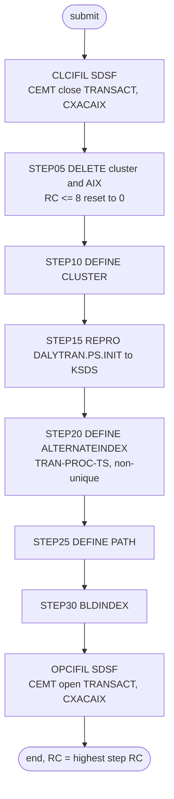

# TRANFILE: Transaction master initialisation

## 1. Summary

TRANFILE throws away the transaction master file (ENT-TRANSACTION) and recreates it holding only the contents of the initialisation file `AWS.M2.CARDDEMO.DALYTRAN.PS.INIT`, together with an alternate index on the processed timestamp. It first asks the CICS region to close CICS files `TRANSACT` and `CXACAIX`. `STEP05` deletes the cluster `AWS.M2.CARDDEMO.TRANSACT.VSAM.KSDS` and its alternate index, `STEP10` defines the cluster again empty (key 16 bytes at offset 0, fixed 350-byte records), `STEP15` copies the initialisation file into it, and `STEP20` to `STEP30` define the non-unique alternate index on `TRAN-PROC-TS` (26 bytes at offset 304), its path, and build it. The last step asks CICS to open the two files again. The shipped initialisation file holds a single record that is binary zeros except for its last eight bytes, which hold the EBCDIC characters `00000100` inside the trailing filler. The job is run by hand during installation and by one demo script; the README's batch sequence and the other demo script use TRANBKP instead. It contains no business logic; what it must preserve is the file and index definitions and the fact that the result is an exact copy of the initialisation file.

## 2. Rules at a glance

The job has no business rules. Its items:

| ID | Rule |
| :-- | :-- |
| SE-JTRAN-001 | Ask CICS region `CICSAWSA` to close files `TRANSACT` and `CXACAIX`. |
| SE-JTRAN-002 | Delete the transaction cluster and its alternate index; each failure with return code 8 or less is ignored. |
| SE-JTRAN-003 | Define the cluster: key 16 at offset 0, records 350 fixed, `SHAREOPTIONS(2 3)`, `ERASE`, no `REUSE`. |
| SE-JTRAN-004 | Load the cluster with every record of `DALYTRAN.PS.INIT`, in file order. |
| SE-JTRAN-005 | Define a non-unique, upgraded alternate index on the processed timestamp (26 bytes at offset 304). |
| SE-JTRAN-006 | Define the path over the alternate index. |
| SE-JTRAN-007 | Build the alternate index from the loaded cluster. |
| SE-JTRAN-008 | Ask CICS to open `TRANSACT` and `CXACAIX` again. |
| VAL-JTRAN-001 | The load rejects records out of key order or with duplicate transaction IDs (VSAM rule). |
| ERR-JTRAN-001 | No step has a `COND`, so every step runs even when an earlier one failed. |
| ERR-JTRAN-002 | The CICS steps end normally whether or not CICS closed or opened the files. |
| ERR-JTRAN-003 | While CICS still holds the cluster open, the load and the index build fail as well as the delete and define. |
| NUM-JTRAN-001 | Keys, record size and alternate-index capacity. |
| DEF-JTRAN-001 | The return-code reset also hides a delete that failed because the file is still open. |
| DEF-JTRAN-002 | The job does not wait for CICS to finish closing the files before it deletes them. |
| DEF-JTRAN-003 | The CICS region name `CICSAWSA` is hard-coded. |
| DEF-JTRAN-004 | The job closes and reopens `CXACAIX`, the cross-reference path, which it does not touch. |
| DEF-JTRAN-005 | The result is not empty, so POSTTRAN cannot open it until TRANBKP has run. |
| DEF-JTRAN-006 | The alternate index holds at most 19 transactions per processed timestamp; extra ones are most likely left out with a warning. |
| DEF-JTRAN-007 | Nothing in the repository reads the transaction alternate index. |
| DEF-JTRAN-008 | Misspelt comments. |

## 3. Actors and triggers

- **Trigger:** submitted by an operator. It is in the README's initialisation sequence (`./README.md:159`, "Copies initial Transaction file to VSAM") and job list (`./README.md:362`), and in the demo script `scripts/remote_refresh.sh:28-29`. The README's "Running Batch Jobs" sequence (`./README.md:220`) and `scripts/run_full_batch.sh:28-29` run TRANBKP at this point instead. Neither the CA-7 nor the Control-M schedule runs it. The local runner has no TRANFILE job.
- **Preconditions:** the CICS region is called `CICSAWSA` and the submitter may issue MVS `MODIFY` commands through SDSF; `AWS.M2.CARDDEMO.DALYTRAN.PS.INIT` exists (`./README.md:139`, FB 350, layout `CVTRA06Y`) and is sorted by transaction ID; volume `AWSHJ1` exists. CLOSEFIL also closes `TRANSACT` and `CXACAIX` (`docs/runbooks/cics-vsam-files.md:15, 18`).
- **Job card:** `CLASS=A,MSGCLASS=0,NOTIFY=&SYSUID` (`:1-2`). No parameters, no symbolic overrides.

## 4. Interfaces

| Step | Program | DD | Dataset | Disposition | Use | Source |
| :-- | :-- | :-- | :-- | :-- | :-- | :-- |
| `CLCIFIL` | SDSF | `ISFOUT` | `SYSOUT=*` | - | SDSF output | `:23` |
| `CLCIFIL` | SDSF | `CMDOUT` | `SYSOUT=*` | - | command responses | `:24` |
| `CLCIFIL` | SDSF | `ISFIN` | in-stream | - | `/F CICSAWSA,'CEMT SET FIL(TRANSACT ) CLO'`, `/F CICSAWSA,'CEMT SET FIL(CXACAIX ) CLO'` | `:25-28` |
| `STEP05` | IDCAMS | `SYSPRINT` | `SYSOUT=*` | - | IDCAMS messages | `:33` |
| `STEP05` | IDCAMS | `SYSIN` | in-stream | - | two `DELETE` statements | `:34-41` |
| `STEP10` | IDCAMS | `SYSPRINT` | `SYSOUT=*` | - | IDCAMS messages | `:47` |
| `STEP10` | IDCAMS | `SYSIN` | in-stream | - | `DEFINE CLUSTER` statement | `:48-63` |
| `STEP15` | IDCAMS | `SYSPRINT` | `SYSOUT=*` | - | IDCAMS messages | `:68` |
| `STEP15` | IDCAMS | `TRANSACT` | `AWS.M2.CARDDEMO.DALYTRAN.PS.INIT` | `SHR` | input, sequential, FB 350 | `:69-70` |
| `STEP15` | IDCAMS | `TRANVSAM` | `AWS.M2.CARDDEMO.TRANSACT.VSAM.KSDS` | `SHR` | output, KSDS | `:71-72` |
| `STEP15` | IDCAMS | `SYSIN` | in-stream | - | `REPRO` statement | `:73-75` |
| `STEP20` | IDCAMS | `SYSPRINT` | `SYSOUT=*` | - | IDCAMS messages | `:80` |
| `STEP20` | IDCAMS | `SYSIN` | in-stream | - | `DEFINE ALTERNATEINDEX` statement | `:81-92` |
| `STEP25` | IDCAMS | `SYSPRINT` | `SYSOUT=*` | - | IDCAMS messages | `:97` |
| `STEP25` | IDCAMS | `SYSIN` | in-stream | - | `DEFINE PATH` statement | `:98-102` |
| `STEP30` | IDCAMS | `SYSPRINT` | `SYSOUT=*` | - | IDCAMS messages | `:107` |
| `STEP30` | IDCAMS | `SYSIN` | in-stream | - | `BLDINDEX` statement | `:108-112` |
| `OPCIFIL` | SDSF | `ISFOUT` | `SYSOUT=*` | - | SDSF output | `:117` |
| `OPCIFIL` | SDSF | `CMDOUT` | `SYSOUT=*` | - | command responses | `:118` |
| `OPCIFIL` | SDSF | `ISFIN` | in-stream | - | `/F CICSAWSA,'CEMT SET FIL(TRANSACT ) OPE'`, `/F CICSAWSA,'CEMT SET FIL(CXACAIX ) OPE'` | `:119-122` |

In `STEP15` the DD named `TRANSACT` is the flat input file, not the cluster; the cluster is `TRANVSAM`. CICS file `TRANSACT` is defined on the cluster and `CXACAIX` on the cross-reference path `AWS.M2.CARDDEMO.CARDXREF.VSAM.AIX.PATH` (`app/csd/CARDDEMO.CSD:63-65, 76-77`); no CICS file is defined on the transaction path. Return code of the job: the highest step return code. Console output is SDSF `ISFOUT`/`CMDOUT` and IDCAMS `SYSPRINT` only (incidental).

## 5. Data used

- Input: the daily transaction layout (`DALYTRAN-RECORD`, `app/cpy/CVTRA06Y.cpy:4-18`, 350 bytes). Output: ENT-TRANSACTION (`TRAN-RECORD`, `app/cpy/CVTRA05Y.cpy:4-18`, 350 bytes). The two layouts have the same fields at the same offsets, so whole records are copied unchanged and no field is interpreted. The primary key is bytes 1-16 (`TRAN-ID`); the alternate key is bytes 305-330 (`TRAN-PROC-TS`, `X(26)`, a timestamp `YYYY-MM-DD-HH.MM.SS.hh0000`). The records carry card numbers, which the job does not print.
- Catalog state on 09/01/22 (`app/catlg/LISTCAT.txt:3541-3720`): the cluster's data component has `KEYLEN 16`, `RKP 0`, `MAXLRECL 350`, `SHROPTNS(2,3)`, `ERASE`, `NOREUSE` (`app/catlg/LISTCAT.txt:3593-3595`) and `REC-TOTAL 311` (`app/catlg/LISTCAT.txt:3598`), so the listing shows the file after a batch cycle, not right after this job. The AIX is `UPGRADE` (`app/catlg/LISTCAT.txt:3656`); its data component has `KEYLEN 26`, `AXRKP 304`, `MAXLRECL 350`, `SHROPTNS(1,3)`, `SPANNED`, `NONUNIQKEY` (`app/catlg/LISTCAT.txt:3674-3678`) and `REC-TOTAL 39` (`app/catlg/LISTCAT.txt:3680`): 311 transactions share 39 processed timestamps. The path has `UPDATE` (`app/catlg/LISTCAT.txt:3554`). `SPANNED` on the AIX (`app/catlg/LISTCAT.txt:3678`) is not coded in `STEP20`, whose default is non-spanned, so the catalogued AIX was probably defined by another statement than this job's; low confidence, and it does not change the 350-byte maximum. The initialisation file is catalogued as a non-VSAM dataset (`app/catlg/LISTCAT.txt:801-814`).
- Sample data: the EBCDIC upload file `app/data/EBCDIC/AWS.M2.CARDDEMO.DALYTRAN.PS.INIT` is 350 bytes long: one record. Bytes 1-342 are `X'00'`; bytes 343-350 are `X'F0F0F0F0F0F1F0F0'`, the EBCDIC characters `00000100`, which lie in the 20-byte `FILLER` at bytes 331-350 (`app/cpy/CVTRA06Y.cpy:18`). So the job leaves one transaction whose ID, timestamps and every named field are binary zeros, with `00000100` at the end of its filler. There is no ASCII version. Checked locally with a Python script over the file.

## 6. Processing flow

| # | Step | Program | Class | What it does | Runs when |
| --: | :-- | :-- | :-- | :-- | :-- |
| 1 | `CLCIFIL` | SDSF | plumbing | close `TRANSACT` and `CXACAIX` in CICS | always |
| 2 | `STEP05` | IDCAMS | plumbing | delete the cluster and the AIX | always (no `COND`) |
| 3 | `STEP10` | IDCAMS | plumbing | define the cluster | always |
| 4 | `STEP15` | IDCAMS | plumbing | copy `DALYTRAN.PS.INIT` into the cluster | always |
| 5 | `STEP20` | IDCAMS | plumbing | define the AIX on the processed timestamp | always |
| 6 | `STEP25` | IDCAMS | plumbing | define the path | always |
| 7 | `STEP30` | IDCAMS | plumbing | build the AIX | always |
| 8 | `OPCIFIL` | SDSF | plumbing | open `TRANSACT` and `CXACAIX` in CICS | always |



## 7. Business rules

None. The job moves data without interpreting it; see the side effects in section 9.

## 8. Validations and messages

#### VAL-JTRAN-001 · The load requires ascending, unique transaction IDs
- **When:** `STEP15` copies a record whose key (bytes 1-16) is not higher than the previous record's key.
- **Then:** VSAM rejects that record and IDCAMS prints an error message for it; the step ends with return code 8 or higher. The remaining records are still copied until IDCAMS reaches its error limit (by default it stops after 4 such errors). With the one-record sample this cannot happen.
- **Source:** `:74`
- **Fidelity:** must-preserve · **Confidence:** platform-inferred (IDCAMS `REPRO` into a KSDS; no local run)

No operator-facing message text is produced by the job itself; all messages are IDCAMS `IDCnnnnI` messages in `SYSPRINT` and CICS responses in `CMDOUT`.

## 9. Side effects

In execution order. There is no rollback: each step's change is permanent.

#### SE-JTRAN-001 · Close the transaction and cross-reference path files in CICS
- **What:** SDSF issues `/F CICSAWSA,'CEMT SET FIL(TRANSACT ) CLO'` and `/F CICSAWSA,'CEMT SET FIL(CXACAIX ) CLO'`, MVS `MODIFY` commands that pass a CEMT request to the CICS region. CICS closes each file when no running task is using it (`docs/runbooks/cics-vsam-files.md:57-58`). While closed, online transaction list, view and add, bill payment and the account-to-card lookups through `CXACAIX` fail (DEF-JTRAN-004).
- **Source:** `:22-28`, `app/csd/CARDDEMO.CSD:63-65, 76-77`
- **Fidelity:** must-preserve (batch reload and online use must not overlap); incidental (mechanism) · **Confidence:** platform-inferred

#### SE-JTRAN-002 · Delete the transaction cluster and its alternate index
- **What:** two IDCAMS commands, each followed by a return-code reset:

```
DELETE AWS.M2.CARDDEMO.TRANSACT.VSAM.KSDS CLUSTER
IF MAXCC LE 08 THEN SET MAXCC = 0
DELETE AWS.M2.CARDDEMO.TRANSACT.VSAM.AIX ALTERNATEINDEX
IF MAXCC LE 08 THEN SET MAXCC = 0
```

- Deleting a cluster also deletes its alternate indexes and paths, so when the first delete works the second normally finds nothing (return code 8, reset to 0). On a first run neither exists and both are reset. Every transaction in the old file is lost; the job takes no backup (TRANBKP does).
- **Source:** `:35-40`
- **Fidelity:** must-preserve (the reload starts from nothing) · **Confidence:** reviewed (statements); platform-inferred (cascade delete)

#### SE-JTRAN-003 · Define the transaction cluster
- **What:** `DEFINE CLUSTER` named `AWS.M2.CARDDEMO.TRANSACT.VSAM.KSDS` with:

| Attribute | Value |
| :-- | :-- |
| Organisation | `INDEXED` (KSDS) |
| Key | `KEYS(16 0)`: 16 bytes at offset 0 (`TRAN-ID`) |
| Record size | `RECORDSIZE(350 350)`: average and maximum 350, so fixed 350 |
| Space | `CYLINDERS(1 5)` on `VOLUMES(AWSHJ1)` |
| Sharing | `SHAREOPTIONS(2 3)` |
| Other | `ERASE`; no `REUSE` |
| Components | data `...TRANSACT.VSAM.KSDS.DATA`, index `...TRANSACT.VSAM.KSDS.INDEX` |

- The definition is the same as TRANBKP's `STEP10` (`app/jcl/TRANBKP.jcl:54-67`).
- **Source:** `:49-62`
- **Fidelity:** must-preserve (key and record size); incidental (space, volume, `ERASE`) · **Confidence:** reviewed

#### SE-JTRAN-004 · Load the cluster from the initialisation file
- **What:** `REPRO INFILE(TRANSACT) OUTFILE(TRANVSAM)` copies every record of `AWS.M2.CARDDEMO.DALYTRAN.PS.INIT`, in file order, into the new cluster, byte for byte. No AIX exists yet, so nothing else is updated. With the shipped file the cluster then holds one record whose named fields are all binary zeros (only the filler ends with `00000100`, section 5). The job does not say why it seeds a record. A common explanation is that CICS cannot use a KSDS that has never held a record, but that is only a hypothesis: CICS can open an empty KSDS and add records to it in VSAM load mode when the file allows adds, which `TRANSACT` does (`ADD(YES)`, `app/csd/CARDDEMO.CSD:81`) (Q-JTRAN-001).
- **Source:** `:69-74`
- **Fidelity:** must-preserve (exact copy); defect-decide (the seed record, DEF-JTRAN-005) · **Confidence:** reviewed (copy, file content); platform-inferred (reason for the seed, medium confidence)

#### SE-JTRAN-005 · Define the alternate index on the processed timestamp
- **What:** `DEFINE ALTERNATEINDEX` named `AWS.M2.CARDDEMO.TRANSACT.VSAM.AIX` with:

| Attribute | Value |
| :-- | :-- |
| Base cluster | `RELATE(AWS.M2.CARDDEMO.TRANSACT.VSAM.KSDS)` |
| Key | `KEYS(26 304)`: 26 bytes at offset 304 (`TRAN-PROC-TS`) |
| Uniqueness | `NONUNIQUEKEY`: one AIX record per timestamp, listing every transaction processed at it |
| Maintenance | `UPGRADE`: VSAM updates the AIX whenever the base cluster changes through an upgrade-set open |
| Record size | `RECORDSIZE(350,350)` (NUM-JTRAN-001) |
| Space | `CYLINDERS(5,1)` on `VOLUMES(AWSHJ1)`; no `FREESPACE` |
| Sharing | not specified, so the default `SHAREOPTIONS(1 3)` (LISTCAT shows `SHROPTNS(1,3)`) |
| Components | data `...TRANSACT.VSAM.AIX.DATA`, index `...TRANSACT.VSAM.AIX.INDEX` |

- The same statement is TRANIDX's `STEP20` (see `TRANIDX.md`).
- **Source:** `:82-91`
- **Fidelity:** must-preserve (key, non-unique) if the index is kept (DEF-JTRAN-007); incidental (space, volume) · **Confidence:** reviewed

#### SE-JTRAN-006 · Define the path
- **What:** `DEFINE PATH (NAME(AWS.M2.CARDDEMO.TRANSACT.VSAM.AIX.PATH) PATHENTRY(AWS.M2.CARDDEMO.TRANSACT.VSAM.AIX))`. No `UPDATE`/`NOUPDATE` is given, so the default `UPDATE` applies (LISTCAT `app/catlg/LISTCAT.txt:3554`). No CICS file and no JCL DD in the repository names this path.
- **Source:** `:99-101`
- **Fidelity:** incidental (DEF-JTRAN-007) · **Confidence:** reviewed

#### SE-JTRAN-007 · Build the alternate index
- **What:** `BLDINDEX INDATASET(AWS.M2.CARDDEMO.TRANSACT.VSAM.KSDS) OUTDATASET(AWS.M2.CARDDEMO.TRANSACT.VSAM.AIX)` reads every transaction, takes the processed timestamp from bytes 305-330, sorts the (timestamp, transaction ID) pairs and writes one AIX record per timestamp. With the shipped seed record the index has one entry, for a timestamp of binary zeros.
- **Source:** `:109-111`
- **Fidelity:** must-preserve if the index is kept · **Confidence:** platform-inferred

#### SE-JTRAN-008 · Open the files in CICS again
- **What:** SDSF issues `/F CICSAWSA,'CEMT SET FIL(TRANSACT ) OPE'` and `/F CICSAWSA,'CEMT SET FIL(CXACAIX ) OPE'`; the online functions work again once CICS has opened the files.
- **Source:** `:116-122`
- **Fidelity:** incidental (mechanism) · **Confidence:** platform-inferred

If a later step fails, everything before it has happened: the files are closed in CICS, the old cluster and all its transactions are gone, and the new one may be empty, loaded without an index, or loaded with an index but no path. `OPCIFIL` still runs and reopens the files on whatever exists.

## 10. Error handling

#### ERR-JTRAN-001 · Steps run regardless of earlier failures
- **When:** a step ends with a non-zero return code without abending.
- **Then:** the next step still runs, because no `EXEC` has a `COND` parameter. If `STEP10` fails (for example because the delete did not remove the cluster), `STEP15` loads the seed record into whatever cluster exists, unless CICS still holds it open (ERR-JTRAN-003), `STEP20` and `STEP25` fail on the existing AIX and path names, and `STEP30` fails on the existing, already built AIX (DEF-JTRAN-001). An abend in a step skips the remaining steps, including `OPCIFIL`, so the files stay closed in CICS (JES default).
- **Restart:** rerun the whole job; every step either recreates its object or is reset. There is no partial restart point.
- **Source:** `:22, 32, 46, 67, 79, 96, 106, 116`
- **Fidelity:** defect-decide · **Confidence:** platform-inferred

#### ERR-JTRAN-002 · The CICS steps do not report whether the files changed state
- **When:** CICS rejects a CEMT command (region not named `CICSAWSA`, no authority to issue `MODIFY`) or closes a file only later.
- **Then:** SDSF still ends normally once it has issued the commands; the CEMT response goes to the console and `CMDOUT`, not to the step's return code. The job continues to `STEP05` either way (DEF-JTRAN-002).
- **Source:** `:22-28, 116-122`
- **Fidelity:** defect-decide · **Confidence:** platform-inferred

#### ERR-JTRAN-003 · An open file in CICS makes every IDCAMS step fail
- **When:** CICS still has `TRANSACT` open when `STEP05` runs, because the close was refused or is still waiting for tasks (ERR-JTRAN-002, DEF-JTRAN-002).
- **Then:** not only the delete (`STEP05`, reset to 0, DEF-JTRAN-001) and the define (`STEP10`, existing name) fail. `STEP15` cannot open the cluster for output: with `SHAREOPTIONS(2 3)` (`:55`) only one region may have it open for update, and CICS does. `STEP20` and `STEP25` fail on the existing AIX and path names. `STEP30` cannot write the AIX, which CICS has open as part of the upgrade set and which already holds the old index. Each of these steps ends with return code 8 or 12, the old cluster, AIX and path stay as they were with every old transaction, and `OPCIFIL` reissues an open for a file that is already open. The job's return code shows the failure; the data is unchanged.
- **Source:** `:32, 46, 55, 67, 79, 96, 106`
- **Fidelity:** defect-decide · **Confidence:** platform-inferred (VSAM share options and CICS upgrade-set opens)

## 11. Interactions

- **Upstream:** none required; the job closes `TRANSACT` itself. CLOSEFIL closes it too (`docs/runbooks/cics-vsam-files.md:15`).
- **Downstream:** POSTTRAN (`CBTRN02C`) opens the cluster for output (DD `TRANFILE`, `app/jcl/POSTTRAN.jcl:28-29`), which fails on a cluster that is not empty and has no `REUSE` (`docs/runbooks/batch-cycle-restart.md:34-36, 58`); TRANBKP backs the cluster up, deletes it with its AIX and defines it empty (`docs/runbooks/batch-cycle-restart.md:17`); CREASTMT and CBEXPORT read it; the online programs use CICS file `TRANSACT`, for example `COTRN00C` (list), `COTRN01C` (view), `COTRN02C` (add) and `COBIL00C` (bill payment).
- **Alternatives:** TRANBKP leaves an empty cluster without an AIX, and TRANIDX adds the AIX later. The README "Running Batch Jobs" sequence and `scripts/run_full_batch.sh:28-29` use TRANBKP; only the README initialisation sequence and `scripts/remote_refresh.sh:28-29` use TRANFILE.
- **Operations:** the runbook lists TRANFILE as the only job other than CLOSEFIL and OPENFIL that closes and reopens `TRANSACT` and `CXACAIX` (`docs/runbooks/cics-vsam-files.md:15, 18`).

## 12. Numeric, date and format details

#### NUM-JTRAN-001 · Keys, record size and alternate-index capacity
- Primary key: 16 bytes at offset 0 (`TRAN-ID`), unique. Records: fixed 350 bytes.
- Alternate key: 26 bytes at offset 304 (`TRAN-PROC-TS`), non-unique. Offset 304 is the sum of the fields before it in `CVTRA05Y` (16 + 2 + 4 + 10 + 100 + 11 + 9 + 50 + 50 + 10 + 16 + 26).
- A non-unique AIX record holds a 5-byte header, the 26-byte alternate key and one 16-byte transaction ID per transaction with that timestamp. With the maximum record size of 350 (`RECORDSIZE(350,350)`), one timestamp can have at most (350 - 5 - 26) / 16 = 19 transactions (rounded down) in the index (DEF-JTRAN-006).
- Space: cluster `CYLINDERS(1 5)`; AIX `CYLINDERS(5,1)`.
- **Source:** `:53-54, 84-89`
- **Fidelity:** must-preserve (keys, record size); incidental (space) · **Confidence:** reviewed (values); platform-inferred (AIX record layout)

## 13. Known defects and oddities

#### DEF-JTRAN-001 · The return-code reset hides a failed delete
- `IF MAXCC LE 08 THEN SET MAXCC = 0` is meant for "not found", but it also hides other delete failures with return code 8, for example when CICS has not yet closed `TRANSACT` (DEF-JTRAN-002). Then `STEP10` fails because the name already exists. If CICS still holds the cluster, `STEP15` cannot open it for output either (`SHAREOPTIONS(2 3)`, `:55`; ERR-JTRAN-003); if the delete failed for another reason and the cluster is free, `STEP15` inserts the seed record into the old, loaded cluster. `STEP20` and `STEP25` fail on the existing names, and `STEP30` fails too, because `BLDINDEX` cannot write into the existing AIX, which is already built and was defined without `REUSE`. The job ends with a non-zero code, but the old transactions stay.
- **Source:** `:37, 40, 46, 55, 67, 79, 96, 106-111`
- **Status:** open · **Fidelity:** defect-decide · **Confidence:** platform-inferred

#### DEF-JTRAN-002 · The delete does not wait for the CICS close
- `STEP05` runs as soon as SDSF has issued the close commands. CICS closes a file only when current tasks have finished with it (`docs/runbooks/cics-vsam-files.md:57-58`), and nothing in the job waits or checks. A busy region therefore leads to DEF-JTRAN-001.
- **Source:** `:22-28, 32`
- **Status:** open · **Fidelity:** defect-decide · **Confidence:** platform-inferred

#### DEF-JTRAN-003 · The CICS region name is hard-coded
- Both SDSF steps name region `CICSAWSA` in in-stream data; there is no symbolic parameter. On a system whose region has another job name the commands fail and the files are not closed or reopened.
- **Source:** `:26-27, 120-121`
- **Status:** open · **Fidelity:** incidental · **Confidence:** reviewed

#### DEF-JTRAN-004 · The job closes the cross-reference path instead of its own
- `CXACAIX` is the CICS file on the card cross-reference path `AWS.M2.CARDDEMO.CARDXREF.VSAM.AIX.PATH` (`app/csd/CARDDEMO.CSD:63-65`), which this job does not change. Closing it only makes the account-to-card lookups unavailable while the job runs. The transaction path that the job does rebuild has no CICS file, so there is nothing to close for it.
- **Source:** `:27, 121`
- **Status:** open · **Fidelity:** incidental · **Confidence:** reviewed

#### DEF-JTRAN-005 · The seeded file blocks POSTTRAN and shows a dummy transaction
- The job leaves the cluster with the records of `DALYTRAN.PS.INIT` (in the shipped file, one record of binary zeros except for `00000100` at the end of the filler, section 5). POSTTRAN opens the cluster for output, which a non-empty cluster without `REUSE` refuses, so POSTTRAN fails with `ERROR OPENING TRANSACTION FILE` until TRANBKP has emptied it (`docs/runbooks/batch-cycle-restart.md:34-36, 58`). The README's batch sequence therefore uses TRANBKP, not TRANFILE (`./README.md:220`). Until then the online transaction list, which browses from the lowest key (`app/cbl/COTRN00C.cbl:206-207`), starts with a transaction whose ID and named fields are binary zeros, and TRANBKP saves that record in its backup generation.
- **Source:** `:69-74`
- **Status:** open · **Fidelity:** defect-decide · **Confidence:** reviewed (data, sequence); platform-inferred (open failure, online display)

#### DEF-JTRAN-006 · At most 19 transactions per processed timestamp in the alternate index
- With `RECORDSIZE(350,350)` a non-unique AIX record has room for 19 transaction IDs (NUM-JTRAN-001). POSTTRAN sets `TRAN-PROC-TS` from the current time to the hundredth of a second (`app/cbl/CBTRN02C.cbl:694-702`), so many transactions posted in one run share a timestamp: the catalog shows 311 transactions on 39 timestamps, about 8 each (`app/catlg/LISTCAT.txt:3598, 3680`). If more than 19 share one, `BLDINDEX` most likely does not fail the build: IDCAMS reports the alternate key whose record overflows with a warning, leaves the extra transaction IDs out of the AIX record and goes on, so the step ends with a warning return code and lookups by that timestamp silently miss transactions. A later write through the upgrade set that would add a 20th ID to a full record is most likely rejected by VSAM. The seed load here cannot hit the limit; the same definition in TRANIDX can.
- **Source:** `:84-87`
- **Status:** open · **Fidelity:** defect-decide · **Confidence:** platform-inferred (the limit: reviewed arithmetic; the overflow behaviour of `BLDINDEX` and of upgrade: medium to low confidence)

#### DEF-JTRAN-007 · Nothing reads the transaction alternate index
- No CICS file in `app/csd/CARDDEMO.CSD`, no JCL DD and no local runner dataset in `tools/batch-programs.toml` names `AWS.M2.CARDDEMO.TRANSACT.VSAM.AIX` or its path (checked with a search over the repository). The job builds and maintains an index that no program uses, and `UPGRADE` makes every write to the cluster also update it.
- **Source:** `:82-111`
- **Status:** open · **Fidelity:** defect-decide · **Confidence:** reviewed (within this repository)

#### DEF-JTRAN-008 · Misspelt comments
- The comments read "TRANSACATION MASTER" and "Opem files". No effect on processing.
- **Source:** `:30, 44, 114`
- **Status:** open · **Fidelity:** incidental · **Confidence:** reviewed

## 14. Open questions

| ID | Question | For |
| :-- | :-- | :-- |
| Q-JTRAN-001 | Is the binary-zero seed record there only so that CICS can open a newly defined file (which CICS can also do on an empty file in load mode, SE-JTRAN-004), or also so that bill payment's search for the last transaction ID (`app/cbl/COBIL00C.cbl:213-215`) finds a record? If only the former, the target needs no seed and must not show a dummy transaction. | operations |
| Q-JTRAN-002 | Is the processed-timestamp index used by anything outside this repository (reports, the modernization runtime)? If not, the target can drop it together with its 19-per-timestamp limit. | business |

## 15. Equivalence contract

After a successful run (return code 0), the transaction store contains exactly the records of `DALYTRAN.PS.INIT` (for the shipped file, one record that is binary zeros except for bytes 343-350 of the filler, which hold EBCDIC `00000100`), keyed by `TRAN-ID`, and nothing else; all earlier transactions are gone. If the timestamp index is kept, a lookup by processed timestamp returns, for each timestamp, exactly the transaction IDs whose bytes 305-330 equal it, in ascending ID order. A reimplementation must fail (non-zero result, no silent partial load) on input keys out of order or duplicated (VAL-JTRAN-001), and the online system must not use the transaction data while the job runs. Whether the seed record and the index are reproduced is decided by DEF-JTRAN-005 and DEF-JTRAN-007. IDCAMS and CICS message text may differ.

## 16. Paragraph coverage

| Step | Lines | Covered by |
| :-- | :-- | :-- |
| (job card) | 1-2 | §3 |
| `CLCIFIL` | 22-28 | SE-JTRAN-001, ERR-JTRAN-002, DEF-JTRAN-002, DEF-JTRAN-003, DEF-JTRAN-004 |
| `STEP05` | 32-41 | SE-JTRAN-002, DEF-JTRAN-001, DEF-JTRAN-008 |
| `STEP10` | 46-63 | SE-JTRAN-003, NUM-JTRAN-001, ERR-JTRAN-001, DEF-JTRAN-008 |
| `STEP15` | 67-75 | SE-JTRAN-004, VAL-JTRAN-001, ERR-JTRAN-001, ERR-JTRAN-003, DEF-JTRAN-005 |
| `STEP20` | 79-92 | SE-JTRAN-005, NUM-JTRAN-001, DEF-JTRAN-006, DEF-JTRAN-007 |
| `STEP25` | 96-102 | SE-JTRAN-006, DEF-JTRAN-007 |
| `STEP30` | 106-112 | SE-JTRAN-007, ERR-JTRAN-003, DEF-JTRAN-001, DEF-JTRAN-006 |
| `OPCIFIL` | 116-122 | SE-JTRAN-008, ERR-JTRAN-002, DEF-JTRAN-003, DEF-JTRAN-004, DEF-JTRAN-008 |
