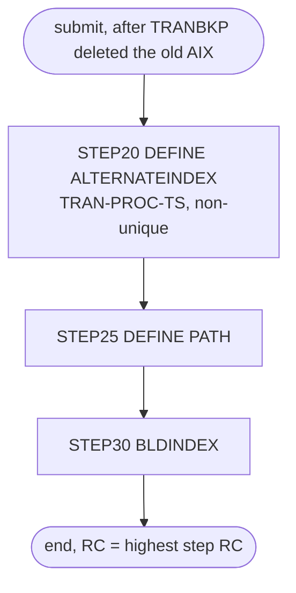

# TRANIDX: Transaction timestamp index build

## 1. Summary

TRANIDX adds the alternate index on the processed timestamp to the transaction master file (ENT-TRANSACTION) after the batch cycle has rebuilt that file. `STEP20` defines the non-unique alternate index `AWS.M2.CARDDEMO.TRANSACT.VSAM.AIX` on `TRAN-PROC-TS` (26 bytes at offset 304) over the cluster `AWS.M2.CARDDEMO.TRANSACT.VSAM.KSDS`, `STEP25` defines its path, and `STEP30` builds it from the transactions in the cluster. The job deletes nothing: it relies on TRANBKP having deleted the old index earlier in the cycle. It is the last data job of the README batch sequence and of three demo scripts. It contains no business logic; what it must preserve is the index definition, if the index is kept, since nothing in the repository reads it (DEF-JTIDX-004).

## 2. Rules at a glance

The job has no business rules. Its items:

| ID | Rule |
| :-- | :-- |
| SE-JTIDX-001 | Define a non-unique, upgraded alternate index on the processed timestamp (26 bytes at offset 304). |
| SE-JTIDX-002 | Define the path over the alternate index. |
| SE-JTIDX-003 | Build the alternate index from the transactions in the cluster. |
| ERR-JTIDX-001 | No step has a `COND`, so every step runs even when an earlier one failed. |
| NUM-JTIDX-001 | Alternate key and index capacity. |
| DEF-JTIDX-001 | The job cannot be rerun: it has no delete step. |
| DEF-JTIDX-002 | The index holds at most 19 transactions per processed timestamp; extra ones are most likely left out with a warning. |
| DEF-JTIDX-003 | The job does not close the transaction file in CICS. |
| DEF-JTIDX-004 | Nothing in the repository reads the index. |

## 3. Actors and triggers

- **Trigger:** submitted by an operator. It is in the README "Running Batch Jobs" sequence after CREASTMT and before OPENFIL (`./README.md:227-233`) and in its job list (`./README.md:370`), and in the demo scripts `scripts/run_full_batch.sh:61-63` (after COMBTRAN), `scripts/run_posting.sh:29-31` (after POSTTRAN) and `scripts/run_interest_calc.sh:29-31` (after COMBTRAN). Neither the CA-7 nor the Control-M schedule runs it. The local runner has no TRANIDX job, and its `TRANSACT` dataset has no alternate key.
- **Preconditions:** `AWS.M2.CARDDEMO.TRANSACT.VSAM.KSDS` exists; `AWS.M2.CARDDEMO.TRANSACT.VSAM.AIX` and its path do not. In each sequence above TRANBKP runs first, and its `STEP05` deletes the old index (`app/jcl/TRANBKP.jcl:43-45`; `docs/runbooks/batch-cycle-restart.md:17, 159-162`). Running TRANIDX after TRANFILE, which builds the same index, fails (DEF-JTIDX-001). Volume `AWSHJ1` exists. CICS should not have `TRANSACT` open (DEF-JTIDX-003).
- **Job card:** `CLASS=A,MSGCLASS=0,NOTIFY=&SYSUID` (`:1-2`). No parameters, no symbolic overrides.

## 4. Interfaces

| Step | Program | DD | Dataset | Disposition | Use | Source |
| :-- | :-- | :-- | :-- | :-- | :-- | :-- |
| `STEP20` | IDCAMS | `SYSPRINT` | `SYSOUT=*` | - | IDCAMS messages | `:23` |
| `STEP20` | IDCAMS | `SYSIN` | in-stream | - | `DEFINE ALTERNATEINDEX` statement | `:24-35` |
| `STEP25` | IDCAMS | `SYSPRINT` | `SYSOUT=*` | - | IDCAMS messages | `:40` |
| `STEP25` | IDCAMS | `SYSIN` | in-stream | - | `DEFINE PATH` statement | `:41-45` |
| `STEP30` | IDCAMS | `SYSPRINT` | `SYSOUT=*` | - | IDCAMS messages | `:50` |
| `STEP30` | IDCAMS | `SYSIN` | in-stream | - | `BLDINDEX` statement | `:51-55` |

The steps name the cluster, the alternate index and the path by dataset name inside the IDCAMS statements, not through DD statements. Return code of the job: the highest step return code. Console output is IDCAMS `SYSPRINT` only (incidental).

## 5. Data used

- ENT-TRANSACTION (`TRAN-RECORD`, `app/cpy/CVTRA05Y.cpy:4-18`, 350 bytes), read by `BLDINDEX` only for the transaction ID (bytes 1-16) and the processed timestamp `TRAN-PROC-TS` (bytes 305-330, `X(26)`, `YYYY-MM-DD-HH.MM.SS.hh0000`). No record is changed.
- Catalog state on 09/01/22 (`app/catlg/LISTCAT.txt:3541-3720`): the AIX is `UPGRADE` (`app/catlg/LISTCAT.txt:3656`); its data component has `KEYLEN 26`, `AXRKP 304`, `MAXLRECL 350`, `SHROPTNS(1,3)`, `SPANNED`, `NONUNIQKEY` (`app/catlg/LISTCAT.txt:3674-3678`), `REC-TOTAL 39` (`app/catlg/LISTCAT.txt:3680`) and space `CYLINDER` primary 5 secondary 1 (`app/catlg/LISTCAT.txt:3687-3688`), for 311 transactions in the cluster (`app/catlg/LISTCAT.txt:3598`). The path has `UPDATE` (`app/catlg/LISTCAT.txt:3554`). This matches SE-JTIDX-001 and SE-JTIDX-002 except for `SPANNED` (`app/catlg/LISTCAT.txt:3678`), which `STEP20` does not code (its default is non-spanned), so the catalogued AIX was probably defined by another statement than this job's; low confidence, and it does not change the 350-byte maximum.
- Sample data: none of its own; the index is built from whatever POSTTRAN or COMBTRAN left in the cluster.

## 6. Processing flow

| # | Step | Program | Class | What it does | Runs when |
| --: | :-- | :-- | :-- | :-- | :-- |
| 1 | `STEP20` | IDCAMS | plumbing | define the AIX on the processed timestamp | always |
| 2 | `STEP25` | IDCAMS | plumbing | define the path | always (no `COND`) |
| 3 | `STEP30` | IDCAMS | plumbing | build the AIX | always |

## 7. Business rules

None. The job builds an index without interpreting the data; see the side effects in section 9.

## 8. Validations and messages

None. The job checks no input. No operator-facing message text is produced by the job itself; all messages are IDCAMS `IDCnnnnI` messages in `SYSPRINT`.

## 9. Side effects

In execution order. There is no rollback: each step's change is permanent.

#### SE-JTIDX-001 · Define the alternate index on the processed timestamp
- **What:** `DEFINE ALTERNATEINDEX` named `AWS.M2.CARDDEMO.TRANSACT.VSAM.AIX` with:

| Attribute | Value |
| :-- | :-- |
| Base cluster | `RELATE(AWS.M2.CARDDEMO.TRANSACT.VSAM.KSDS)` |
| Key | `KEYS(26 304)`: 26 bytes at offset 304 (`TRAN-PROC-TS`) |
| Uniqueness | `NONUNIQUEKEY`: one AIX record per timestamp, listing every transaction processed at it |
| Maintenance | `UPGRADE`: VSAM updates the AIX whenever the base cluster changes through an upgrade-set open |
| Record size | `RECORDSIZE(350,350)` (NUM-JTIDX-001) |
| Space | `CYLINDERS(5,1)` on `VOLUMES(AWSHJ1)`; no `FREESPACE` |
| Sharing | not specified, so the default `SHAREOPTIONS(1 3)` (LISTCAT shows `SHROPTNS(1,3)`) |
| Components | data `...TRANSACT.VSAM.AIX.DATA`, index `...TRANSACT.VSAM.AIX.INDEX` |

- The statement is the same as TRANFILE's `STEP20` (SE-JTRAN-005).
- **Source:** `:25-34`
- **Fidelity:** must-preserve (key, non-unique) if the index is kept (DEF-JTIDX-004); incidental (space, volume) · **Confidence:** reviewed

#### SE-JTIDX-002 · Define the path
- **What:** `DEFINE PATH (NAME(AWS.M2.CARDDEMO.TRANSACT.VSAM.AIX.PATH) PATHENTRY(AWS.M2.CARDDEMO.TRANSACT.VSAM.AIX))`. No `UPDATE`/`NOUPDATE` is given, so the default `UPDATE` applies. No CICS file and no JCL DD in the repository names this path.
- **Source:** `:42-44`
- **Fidelity:** incidental (DEF-JTIDX-004) · **Confidence:** reviewed

#### SE-JTIDX-003 · Build the alternate index
- **What:** `BLDINDEX INDATASET(AWS.M2.CARDDEMO.TRANSACT.VSAM.KSDS) OUTDATASET(AWS.M2.CARDDEMO.TRANSACT.VSAM.AIX)` reads every transaction, takes the processed timestamp from bytes 305-330, sorts the (timestamp, transaction ID) pairs and writes one AIX record per timestamp. The job supplies no `IDCUT1`/`IDCUT2` work files, so the sort must fit in storage (enough for the sample's few hundred transactions).
- **Source:** `:52-54`
- **Fidelity:** must-preserve if the index is kept · **Confidence:** platform-inferred

If a later step fails, the earlier ones have happened: an empty AIX may exist without a path, or with a path but not built. The transaction cluster itself is never changed, so POSTTRAN, CREASTMT and the online programs are not affected.

## 10. Error handling

#### ERR-JTIDX-001 · Steps run regardless of earlier failures
- **When:** a step ends with a non-zero return code without abending.
- **Then:** the next step still runs, because no `EXEC` has a `COND` parameter. When the AIX already exists (TRANBKP did not run, or this is a rerun), `STEP20` fails on the existing name, `STEP25` fails if the path exists too, and `STEP30` tries to build into the existing AIX, which fails when it is not empty because it has no `REUSE`. The job ends with return code 12 and the old index stays (DEF-JTIDX-001). An abend in a step skips the remaining steps (JES default).
- **Restart:** delete the AIX first (`DELETE AWS.M2.CARDDEMO.TRANSACT.VSAM.AIX ALTERNATEINDEX`, which also removes the path), then rerun the whole job (`docs/runbooks/batch-cycle-restart.md:162-164`).
- **Source:** `:22, 39, 49`
- **Fidelity:** defect-decide · **Confidence:** platform-inferred

## 11. Interactions

- **Upstream:** TRANBKP deletes the old index and redefines the cluster without one (`docs/runbooks/batch-cycle-restart.md:17`); POSTTRAN or COMBTRAN then fill the cluster. CLOSEFIL has closed CICS file `TRANSACT` (`docs/runbooks/cics-vsam-files.md:15`).
- **Downstream:** OPENFIL follows in the README sequence and in each script, and reopens `TRANSACT` in CICS; from then on, because of `UPGRADE`, every write to the cluster through CICS or batch also updates the index. No program reads the index (DEF-JTIDX-004).
- **Related job:** TRANFILE defines and builds the same index as part of its full reload (SE-JTRAN-005 to SE-JTRAN-007).
- **Operations:** the runbook lists TRANIDX among the jobs that must not run while CICS users are signed on (`docs/runbooks/cics-vsam-files.md:89-90`).

## 12. Numeric, date and format details

#### NUM-JTIDX-001 · Alternate key and index capacity
- Alternate key: 26 bytes at offset 304 (`TRAN-PROC-TS`), non-unique, compared as bytes, so in time order for well-formed timestamps.
- A non-unique AIX record holds a 5-byte header, the 26-byte alternate key and one 16-byte transaction ID per transaction with that timestamp. With the maximum record size of 350 (`RECORDSIZE(350,350)`), one timestamp can have at most (350 - 5 - 26) / 16 = 19 transactions (rounded down) in the index (DEF-JTIDX-002).
- Space: `CYLINDERS(5,1)`.
- **Source:** `:27-32`
- **Fidelity:** must-preserve (key) if the index is kept; incidental (space) · **Confidence:** reviewed (values); platform-inferred (AIX record layout)

## 13. Known defects and oddities

#### DEF-JTIDX-001 · No delete step, so the job cannot be rerun
- Unlike TRANFILE, the job does not delete an existing index before defining it. It works only when TRANBKP has run since the index was last built; a rerun after a partial or complete run fails as in ERR-JTIDX-001, and the runbook asks for a manual delete first (`docs/runbooks/batch-cycle-restart.md:159-164`).
- **Source:** `:22-35`
- **Status:** open · **Fidelity:** defect-decide · **Confidence:** reviewed (missing step); platform-inferred (failure)

#### DEF-JTIDX-002 · At most 19 transactions per processed timestamp
- POSTTRAN sets `TRAN-PROC-TS` from the current time to the hundredth of a second (`app/cbl/CBTRN02C.cbl:694-702`), so a run posts many transactions with the same timestamp; the catalog shows 311 transactions on 39 timestamps (`app/catlg/LISTCAT.txt:3598, 3680`). When more than 19 share one (NUM-JTIDX-001), `BLDINDEX` most likely does not fail the build: IDCAMS reports the alternate key whose record overflows with a warning, leaves the extra transaction IDs out of the AIX record and goes on, so `STEP30` ends with a warning return code and lookups by that timestamp silently miss transactions. A later write through the upgrade set that would add a 20th ID to a full record is most likely rejected by VSAM. The same limit applies to TRANFILE (DEF-JTRAN-006), but only this job builds the index over a posted file.
- **Source:** `:27-30, 52-54`
- **Status:** open · **Fidelity:** defect-decide · **Confidence:** platform-inferred (the limit: reviewed arithmetic; the overflow behaviour of `BLDINDEX` and of upgrade: medium to low confidence)

#### DEF-JTIDX-003 · No CICS close of the transaction file
- The job relies on CLOSEFIL having closed `TRANSACT`. If CICS has the cluster open when the AIX is defined, the AIX is not part of the upgrade set CICS opened with, so online writes (bill payments, added transactions) until CICS reopens the file are missing from the index; and `BLDINDEX` may read the cluster while CICS changes it.
- **Source:** `:22-35, 49-55`
- **Status:** open · **Fidelity:** defect-decide · **Confidence:** platform-inferred

#### DEF-JTIDX-004 · Nothing reads the index
- No CICS file in `app/csd/CARDDEMO.CSD`, no JCL DD and no local runner dataset names `AWS.M2.CARDDEMO.TRANSACT.VSAM.AIX` or its path (checked with a search over the repository; same finding as DEF-JTRAN-007). The job builds, and `UPGRADE` then maintains, an index that no program uses.
- **Source:** `:25-54`
- **Status:** open · **Fidelity:** defect-decide · **Confidence:** reviewed (within this repository)

## 14. Open questions

| ID | Question | For |
| :-- | :-- | :-- |
| Q-JTIDX-001 | Is the processed-timestamp index used by anything outside this repository? If not, the target can drop this job; if so, the target index must allow any number of transactions per timestamp. | business |

## 15. Equivalence contract

After a successful run (return code 0), if the index is kept, a lookup by processed timestamp returns, for each timestamp present in the transaction store, exactly the transaction IDs whose bytes 305-330 equal it, in ascending ID order, and the index stays current as transactions are added. The transaction store itself is unchanged. IDCAMS message text may differ.

## 16. Paragraph coverage

| Step | Lines | Covered by |
| :-- | :-- | :-- |
| (job card) | 1-2 | §3 |
| `STEP20` | 22-35 | SE-JTIDX-001, NUM-JTIDX-001, ERR-JTIDX-001, DEF-JTIDX-001, DEF-JTIDX-002, DEF-JTIDX-003 |
| `STEP25` | 39-45 | SE-JTIDX-002, ERR-JTIDX-001, DEF-JTIDX-004 |
| `STEP30` | 49-55 | SE-JTIDX-003, ERR-JTIDX-001, DEF-JTIDX-002, DEF-JTIDX-004 |
