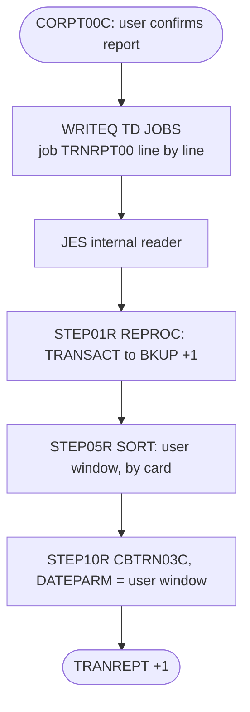

# TRANREPT-PROC: On-demand transaction report procedure

## 1. Summary

`app/proc/TRANREPT.prc` is the cataloged procedure behind the online report function. CORPT00C (transaction `CR00`) builds a small job `TRNRPT00` whose only step runs `EXEC PROC=TRANREPT` and overrides two DDs with the user's date range, and writes it line by line to the CICS transient data queue `JOBS`, which feeds the JES internal reader. The procedure has the same three steps as the batch job TRANREPT: unload the transaction master to `TRANSACT.BKUP(+1)` (`STEP01R`, through REPROC), keep the transactions processed within the window and sort them by card number into `TRANSACT.DALY(+1)` (`STEP05R`), and print the report with `CBTRN03C` into `TRANREPT(+1)` (`STEP10R`). The in-procedure window `2022-01-01` to `2022-07-06` and the `DATEPARM` dataset are only defaults; the submitted job replaces both.

## 2. Rules at a glance

| ID | Rule |
| :-- | :-- |
| FLOW-JTRPTP-001 | CORPT00C submits job `TRNRPT00` = `EXEC PROC=TRANREPT` with the user's start and end dates overriding `STEP05R.SYMNAMES` and `STEP10R.DATEPARM`. |
| SE-JTRPTP-001 | Unload every `TRANSACT` record to a new generation `TRANSACT.BKUP(+1)` (FB 350). |
| BR-JTRPTP-001 | Keep transactions whose processing date (bytes 305-314) is within the start and end date, inclusive. |
| SE-JTRPTP-002 | Write the kept transactions, sorted by card number, to `TRANSACT.DALY(+1)`. |
| FLOW-JTRPTP-002 | Run `CBTRN03C` on `TRANSACT.DALY(+1)` with the same range in `DATEPARM`. |
| SE-JTRPTP-003 | Create the report generation `TRANREPT(+1)`, FB 133. |
| ERR-JTRPTP-001 | No step has a `COND`; CICS learns nothing about the job's result. |
| DEF-JTRPTP-001 | The `PROC` statement is labelled `REPROC`, the name of another procedure; harmless for the cataloged member (answers Q-RPTS-005). |
| DEF-JTRPTP-002 | The procedure carries in-stream data. |
| DEF-JTRPTP-003 | Each report adds a `TRANSACT.BKUP` generation, the GDG that COMBTRAN reads. |
| DEF-JTRPTP-004 | [security] The job log prints every selected transaction, card number included. |
| DEF-JTRPTP-005 | [security] The report job runs under the CICS region's user ID, not the online user's. |
| DEF-JTRPTP-006 | Concurrent or failed submissions can interleave or leave partial jobs in queue `JOBS`; all jobs are named `TRNRPT00`. |

## 3. Actors and triggers

- **Trigger:** an online user confirms a report request in CORPT00C (monthly, yearly or custom range; `app/cbl/CORPT00C.cbl:220-255, 429-435`). The program writes the job of FLOW-JTRPTP-001 to the transient data queue `JOBS`, defined as an extrapartition output queue on DD `INREADER`, 80-byte fixed records (`app/csd/CARDDEMO.CSD:499-505`). The CICS region's `INREADER` DD is expected to point at the JES internal reader. No schedule or script runs the procedure.
- **Preconditions:** the procedure is member `TRANREPT` of `AWS.M2.CARDDEMO.PROC` (the job's `JCLLIB`, `app/cbl/CORPT00C.cbl:90`), with REPROC beside it; the GDG bases `TRANSACT.BKUP`, `TRANSACT.DALY`, `TRANREPT` exist; the job reads `TRANSACT` while CICS may have it open; the cluster's `SHAREOPTIONS(2 3)` (`app/jcl/TRANBKP.jcl:60`) lets a batch reader in next to one CICS updater, without read integrity (platform-inferred; see DEF-JTRPT-005, which applies here unchanged).
- **Header:** `//REPROC PROC` (`:1`, DEF-JTRPTP-001), no symbolic parameters; `// PEND` (`:79`).

## 4. Interfaces

The procedure's DDs are identical to the batch job TRANREPT (`app/jcl/TRANREPT.jcl:23-80`) apart from the first step name; see `TRANREPT.md` §4. Lines in this member:

| Step | Program | DD | Dataset | Disposition | Use | Source |
| :-- | :-- | :-- | :-- | :-- | :-- | :-- |
| `STEP01R` (`PRC001`) | IDCAMS | `FILEIN` | `AWS.M2.CARDDEMO.TRANSACT.VSAM.KSDS` | `SHR` | input, KSDS | `:24-25` |
| `STEP01R` (`PRC001`) | IDCAMS | `FILEOUT` | `AWS.M2.CARDDEMO.TRANSACT.BKUP(+1)` | `(NEW,CATLG,DELETE)` | output; FB 350, `SPACE=(CYL,(1,1),RLSE)` | `:27-31` |
| `STEP05R` | SORT | `SORTIN` | `AWS.M2.CARDDEMO.TRANSACT.BKUP(+1)` | `SHR` | input | `:36-37` |
| `STEP05R` | SORT | `SYMNAMES` | in-stream (default window), overridden | - | symbols | `:38-42` |
| `STEP05R` | SORT | `SYSIN` | in-stream | - | `SORT FIELDS=(TRAN-CARD-NUM,A)` and `INCLUDE` | `:43-47` |
| `STEP05R` | SORT | `SORTOUT` | `AWS.M2.CARDDEMO.TRANSACT.DALY(+1)` | `(NEW,CATLG,DELETE)` | output; `DCB=(*.SORTIN)` | `:49-53` |
| `STEP10R` | CBTRN03C | `TRANFILE` | `AWS.M2.CARDDEMO.TRANSACT.DALY(+1)` | `SHR` | input | `:63-64` |
| `STEP10R` | CBTRN03C | `CARDXREF`, `TRANTYPE`, `TRANCATG` | the three reference KSDS | `SHR` | lookups | `:65-70` |
| `STEP10R` | CBTRN03C | `DATEPARM` | `AWS.M2.CARDDEMO.DATEPARM`, overridden | `SHR` | date range record | `:71-72` |
| `STEP10R` | CBTRN03C | `TRANREPT` | `AWS.M2.CARDDEMO.TRANREPT(+1)` | `(NEW,CATLG,DELETE)` | output; FB 133 | `:74-78` |

Interface with the caller (the job written to queue `JOBS`, `app/cbl/CORPT00C.cbl:81-127`), each line 80 bytes:

| Line | Text |
| --: | :-- |
| 1-2 | `//TRNRPT00 JOB 'TRAN REPORT',CLASS=A,MSGCLASS=0,` / `// NOTIFY=&SYSUID` |
| 4 | `//JOBLIB JCLLIB ORDER=('AWS.M2.CARDDEMO.PROC')` |
| 6 | `//STEP10 EXEC PROC=TRANREPT` |
| 8-12 | `//STEP05R.SYMNAMES DD *`, `TRAN-CARD-NUM,263,16,ZD`, `TRAN-PROC-DT,305,10,CH`, `PARM-START-DATE,C'<start>'`, `PARM-END-DATE,C'<end>'` |
| 13 | `/*` |
| 14-15 | `//STEP10R.DATEPARM DD *`, then `<start> <end>` (10 characters, one space, 10 characters) |
| 16-17 | `/*`, `/*EOF` |

Lines 3, 5 and 7 are `//*`. `<start>` and `<end>` are `YYYY-MM-DD`.

## 5. Data used

As in `TRANREPT.md` §5: ENT-TRANSACTION (fields `TRAN-CARD-NUM` and the date of `TRAN-PROC-TS`), ENT-CARD-XREF, ENT-TRAN-TYPE, ENT-TRAN-CATEGORY. The range record read by `CBTRN03C` is `WS-START-DATE X(10)`, one filler byte, `WS-END-DATE X(10)` (`app/cbl/CBTRN03C.cbl:122-125`), which matches the override line 15 above.

## 6. Processing flow

| # | Step | Class | What it does | Runs when |
| --: | :-- | :-- | :-- | :-- |
| 1 | `STEP01R` | plumbing | unload `TRANSACT` to `TRANSACT.BKUP(+1)` | always |
| 2 | `STEP05R` | business | keep the window, sort by card, write `TRANSACT.DALY(+1)` | always (no `COND`) |
| 3 | `STEP10R` | business | print the report with `CBTRN03C` | always (no `COND`) |

#### FLOW-JTRPTP-001 · Submission from CICS with the user's window
- **What:** CORPT00C moves the start and end dates into both places of its job image, in each of its three branches: monthly (`app/cbl/CORPT00C.cbl:220-221, 235-236`), yearly (`app/cbl/CORPT00C.cbl:247-248, 252-253`) and custom (`app/cbl/CORPT00C.cbl:429-432`). It then writes the lines, 80 bytes each, to queue `JOBS` with `EXEC CICS WRITEQ TD`, until it has written the line `/*EOF` or a blank line (`app/cbl/CORPT00C.cbl:498-523`). `/*EOF` ends the job for the internal reader. The step `STEP10` runs the procedure; `//STEP05R.SYMNAMES DD *` replaces the whole procedure `SYMNAMES` (so the job repeats the two field symbols) and `//STEP10R.DATEPARM DD *` replaces the `DATEPARM` dataset by the in-stream range. The override step names match the procedure's `STEP05R` and `STEP10R`.
- **Source:** `:35, 38, 57, 71`, `app/cbl/CORPT00C.cbl:81-127, 220-221, 235-236, 247-248, 252-253, 429-432, 498-523`
- **Fidelity:** must-preserve (one report per confirmed request, with the requested range used for selection and heading) · **Confidence:** reviewed (job image); platform-inferred (internal reader, override rules)

#### FLOW-JTRPTP-002 · Print the report
- **What:** `STEP10R` executes `CBTRN03C` on `TRANSACT.DALY(+1)`. With the override, `DATEPARM` carries the same range as the selection, so every record the sort kept passes the program's own date check (`app/cbl/CBTRN03C.cbl:173-178`). That equality matters: the check's "outside" branch is `NEXT SENTENCE`, which leaves the whole read loop (`app/cbl/CBTRN03C.cbl:207`), so a record outside `DATEPARM` would end the report without the later records and without totals (FLOW-TRPT-001, NUM-RPTS-003, DEF-JTRPT-001). Because CORPT00C writes the same two dates into both the `SYMNAMES` override and the `DATEPARM` override (FLOW-JTRPTP-001), the cut-off cannot happen on the online path.
- **Source:** `:57-78`, `app/cbl/CBTRN03C.cbl:173-178, 207`
- **Fidelity:** must-preserve · **Confidence:** reviewed

## 7. Business rules

#### BR-JTRPTP-001 · Report window by processing date
- **When:** `STEP05R` reads each record of `TRANSACT.BKUP(+1)`.
- **Then:** it keeps the record only if bytes 305-314 (`TRAN-PROC-DT`, characters) are greater than or equal to the start date and less than or equal to the end date (`INCLUDE COND=(TRAN-PROC-DT,GE,PARM-START-DATE,AND,TRAN-PROC-DT,LE,PARM-END-DATE)`). The dates come from the caller's `SYMNAMES` override; without it the defaults `C'2022-01-01'` and `C'2022-07-06'` apply (`:41-42`).
- **Source:** `:39-46`
- **Fidelity:** must-preserve · **Confidence:** reviewed

## 8. Validations and messages

None in the procedure. CORPT00C validates the dates before it submits; when the queue write fails it shows `Unable to Write TDQ (JOBS)...` (`app/cbl/CORPT00C.cbl:525-535`). The user sees `<report name> report submitted for printing ...` once the job image is written (`app/cbl/CORPT00C.cbl:449-452`), not when the job ends.

## 9. Side effects

#### SE-JTRPTP-001 · Unload the transaction master to a new backup generation
- **What:** nested procedure REPROC (`EXEC PROC=REPROC`, `CNTLLIB=AWS.M2.CARDDEMO.CNTL`) copies every `TRANSACT.VSAM.KSDS` record to the new dataset `TRANSACT.BKUP(+1)`, FB 350, cataloged on a normal end. `TRANSACT` is not changed.
- **Source:** `:21-31`
- **Fidelity:** incidental (sort input only) · **Confidence:** reviewed

#### SE-JTRPTP-002 · Write the selected transactions in card order
- **What:** sort by `TRAN-CARD-NUM` (bytes 263-278, `ZD`) ascending, records unchanged, into the new dataset `TRANSACT.DALY(+1)` with the DCB of `SORTIN` (FB 350). No `EQUALS`, so the order within one card number follows the sort product's default.
- **Source:** `:35-53`
- **Fidelity:** must-preserve (card order) · **Confidence:** reviewed

#### SE-JTRPTP-003 · Create the report generation
- **What:** `AWS.M2.CARDDEMO.TRANREPT(+1)`, FB 133, cataloged on a normal end; the oldest of 5 generations is scratched.
- **Source:** `:74-78`
- **Fidelity:** must-preserve · **Confidence:** reviewed (JCL); platform-inferred (roll-off)

## 10. Error handling

#### ERR-JTRPTP-001 · No step conditions and no feedback to the user
- **When:** a step of the submitted job fails.
- **Then:** the next steps still run (no `COND`); an abend skips the rest and deletes the failing step's new generation. CORPT00C has already told the user the report was submitted; the result is visible only in the job output. The job card's `NOTIFY=&SYSUID` (`app/cbl/CORPT00C.cbl:86`) resolves to the user ID under which the job was submitted. For a job written through an extrapartition queue to the internal reader that is normally the CICS region's user ID, so the end-of-job message goes to that user ID and the online user is not notified (DEF-RPTS-007, DEF-JTRPTP-005).
- **Source:** `:21, 35, 57`, `app/cbl/CORPT00C.cbl:86`
- **Fidelity:** defect-decide · **Confidence:** platform-inferred (COND and abend handling; `&SYSUID` resolution for a TDQ-submitted job, medium)

## 11. Interactions

- **Caller:** CORPT00C through queue `JOBS` (CSD `app/csd/CARDDEMO.CSD:499-505`).
- **Nested:** REPROC.
- **Shared data:** `TRANSACT.BKUP` with TRANBKP and COMBTRAN (DEF-JTRPTP-003); `TRANSACT.DALY`, `TRANREPT` with the batch job TRANREPT.

## 12. Numeric, date and format details

None beyond `TRANREPT.md` NUM-JTRPT-001, which applies unchanged: card number as 16-digit zoned decimal, dates as 10 characters `YYYY-MM-DD`.

## 13. Known defects and oddities

#### DEF-JTRPTP-001 · The PROC statement is labelled REPROC
- The member starts with `//REPROC PROC` (`:1`) and calls `EXEC PROC=REPROC` (`:21`). A cataloged procedure is found by its member name (`TRANREPT`), so the label has no effect on z/OS, but it misleads readers and breaks tools that index procedures by the `PROC` label.
- **Answer to Q-RPTS-005** (asked of the batch area by CORPT00C): yes, the job's `EXEC PROC=TRANREPT` (`app/cbl/CORPT00C.cbl:94`) finds this member, `TRANREPT` in `AWS.M2.CARDDEMO.PROC`, through the job's `JCLLIB` (`app/cbl/CORPT00C.cbl:90`); the `REPROC` label on its `PROC` statement is ignored. The nested call works and is intended: `EXEC PROC=REPROC` in `STEP01R` is a second-level call that finds the separate cataloged member `REPROC` (`app/proc/REPROC.prc`) in the same library, and the `PRC001.FILEIN` and `PRC001.FILEOUT` overrides (`:24-31`) address its step, exactly as the batch job TRANREPT does (`app/jcl/TRANREPT.jcl:23-33`). Only the label is misleading; `//TRANREPT PROC`, or no label, would match the member name. The procedure named `REPROC` thus contains a step that executes a procedure named `REPROC` (the cataloged `app/proc/REPROC.prc`, see `REPROC.md`). Copied into a job as an in-stream procedure, the label would make the in-stream definition the one that `EXEC PROC=REPROC` finds first, so the procedure would call itself and the job would fail with a JCL error. CORPT00C's job calls the member as a cataloged procedure by its member name (`EXEC PROC=TRANREPT`, FLOW-JTRPTP-001), so the online report path works and the defect is latent. CORPT00C raises the same point as Q-RPTS-005.
- **Source:** `:1, 21-31`, `app/cbl/CORPT00C.cbl:90, 94`
- **Status:** open · **Fidelity:** incidental · **Confidence:** platform-inferred (procedure search and nesting rules, medium-high)

#### DEF-JTRPTP-002 · In-stream data inside the procedure
- `STEP05R` has `SYMNAMES DD *` and `SYSIN DD *` with data in the procedure (`:38-47`). z/OS accepts in-stream data in cataloged procedures only from z/OS 2.1 on; older systems reject the member. The `SYSIN` data is not overridden by CORPT00C.
- **Source:** `:38-47`
- **Status:** open · **Fidelity:** incidental · **Confidence:** platform-inferred

#### DEF-JTRPTP-003 · Each report adds a backup generation
- Every online report request writes `TRANSACT.BKUP(+1)`. A request between TRANBKP and COMBTRAN replaces the cycle backup as `TRANSACT.BKUP(0)` with a copy of the then empty `TRANSACT` (DEF-JCOMB-001); frequent requests push cycle backups out of the 5 generations.
- **Source:** `:27-31`
- **Status:** open · **Fidelity:** defect-decide · **Confidence:** reviewed

#### DEF-JTRPTP-004 · [security] The job log prints every selected transaction
- `CBTRN03C` displays each record it reads (`app/cbl/CBTRN03C.cbl:180`) and `SYSOUT` goes to the spool (`:60`), so every report request writes the card numbers of its window to the job log.
- **Source:** `:60`, `app/cbl/CBTRN03C.cbl:180`
- **Status:** open · **Fidelity:** defect-decide · **Confidence:** reviewed

#### DEF-JTRPTP-005 · [security] The report job runs with the CICS region's authority
- CORPT00C writes the job to the extrapartition queue `JOBS` (DD `INREADER`, `app/csd/CARDDEMO.CSD:499-505`) without any user identity in the job card (`app/cbl/CORPT00C.cbl:84-86`). A job submitted this way normally runs under the CICS region's user ID, not under the identity of the person who requested it. So any user who can run transaction `CR00` starts a batch job that copies the whole transaction master and reads the reference files with the region's authority, and the job output and the `NOTIFY` message are tied to the region's user ID, not to the requester (ERR-JTRPTP-001). The program itself checks no user identity (DEF-RPTS-007).
- **Source:** `app/cbl/CORPT00C.cbl:84-86, 517-523`, `app/csd/CARDDEMO.CSD:499-505`
- **Status:** open · **Fidelity:** defect-decide · **Confidence:** platform-inferred (security context of jobs submitted through a CICS extrapartition queue, medium)

#### DEF-JTRPTP-006 · Interleaved and partial jobs in queue JOBS, one job name for all
- CORPT00C writes the 17 lines of a job with 17 separate `WRITEQ TD` commands and no enqueue around them (`app/cbl/CORPT00C.cbl:498-523`). If two users submit at the same moment and CICS switches tasks between writes, the lines of the two jobs can mix in the queue, and the internal reader then sees one malformed job stream (DEF-RPTS-005). If a write fails part way, the lines already written stay in the queue without `/*EOF`, and the next request's lines follow them (DEF-RPTS-004). The queue is defined with `ERROROPTION(IGNORE)` (`app/csd/CARDDEMO.CSD:501`), so some I/O errors may not reach the program's `Unable to Write TDQ (JOBS)...` branch at all (low confidence). Every request uses the job name `TRNRPT00` (`app/cbl/CORPT00C.cbl:84`); by the JES2 default for duplicate job names, a second request waits until the first ends, which also keeps two report jobs from creating the same `(+1)` generations at once.
- **Source:** `app/cbl/CORPT00C.cbl:84, 498-535`, `app/csd/CARDDEMO.CSD:499-505`
- **Status:** open · **Fidelity:** defect-decide · **Confidence:** platform-inferred (CICS task switching between writes and JES2 duplicate job name handling, medium; `ERROROPTION(IGNORE)` effect, low)

## 14. Open questions

| ID | Question | For |
| :-- | :-- | :-- |
| Q-JTRPTP-001 | Should the target tell the user when the report has finished or failed, rather than only that it was submitted (ERR-JTRPTP-001)? | business |

## 15. Equivalence contract

For a request with start date S and end date E: one report job runs; its report covers exactly the transactions whose processing date is from S to E inclusive, in ascending card number order, and its heading shows S and E; the transaction store is unchanged. The user gets the "submitted" message as soon as the request is queued.

Review evidence (independent reviewers checked every item against the source, all WRONG and MINOR findings were fixed, and a fresh reviewer re-checked every changed or added item): [evidence/g-jobs-ops-review.md](../evidence/g-jobs-ops-review.md).

## 16. Paragraph coverage

| Step | Lines | Covered by |
| :-- | :-- | :-- |
| (`PROC` statement) | 1 | §3, DEF-JTRPTP-001, DEF-JTRPTP-005, DEF-JTRPTP-006 |
| `STEP01R` | 21-31 | SE-JTRPTP-001, DEF-JTRPTP-003 |
| `STEP05R` | 35-53 | FLOW-JTRPTP-001, BR-JTRPTP-001, SE-JTRPTP-002, DEF-JTRPTP-002 |
| `STEP10R` | 57-79 | FLOW-JTRPTP-001, FLOW-JTRPTP-002, SE-JTRPTP-003, ERR-JTRPTP-001, DEF-JTRPTP-004 |
