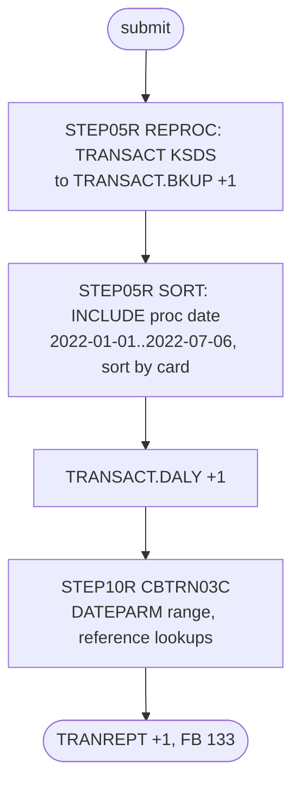

# TRANREPT: Transaction report batch job

## 1. Summary

TRANREPT prints the transaction detail report for a fixed date window. `STEP05R` (procedure REPROC) unloads the transaction master `AWS.M2.CARDDEMO.TRANSACT.VSAM.KSDS` into a new backup generation `TRANSACT.BKUP(+1)`. The second step, also named `STEP05R`, keeps the transactions whose processing date is from 2022-01-01 to 2022-07-06, sorts them by card number and writes them to `TRANSACT.DALY(+1)`. `STEP10R` runs `CBTRN03C`, which reads that file, the reference files and the date range in `AWS.M2.CARDDEMO.DATEPARM`, and writes the 133-byte report `TRANREPT(+1)`. The report layout and totals belong to `CBTRN03C`. The online report function (CORPT00C) does not submit this job: it submits its own job, which calls the procedure `app/proc/TRANREPT.prc` (see `TRANREPT-PROC.md`).

## 2. Rules at a glance

| ID | Rule |
| :-- | :-- |
| SE-JTRPT-001 | Unload every `TRANSACT` record to a new generation `TRANSACT.BKUP(+1)` (FB 350). |
| BR-JTRPT-001 | Select transactions whose processing date (bytes 305-314) is from `2022-01-01` to `2022-07-06` inclusive. |
| SE-JTRPT-002 | Write the selected transactions, sorted by card number, to `TRANSACT.DALY(+1)`. |
| FLOW-JTRPT-001 | Run `CBTRN03C` on `TRANSACT.DALY(+1)` with the date range from `DATEPARM`. |
| SE-JTRPT-003 | Create the report generation `TRANREPT(+1)`, FB 133. |
| ERR-JTRPT-001 | No step has a `COND`: each step runs whatever the previous one returned. |
| NUM-JTRPT-001 | Card number sorted as 16-digit zoned decimal; dates compared as 10 characters. |
| DEF-JTRPT-001 | The date window is hard-coded twice, in the JCL and in the `DATEPARM` dataset; a narrower `DATEPARM` silently cuts the report off. |
| DEF-JTRPT-002 | Each run adds a `TRANSACT.BKUP` generation, the GDG that COMBTRAN reads. |
| DEF-JTRPT-003 | Two steps have the same name `STEP05R`. |
| DEF-JTRPT-004 | [security] The job log prints every selected transaction, card number included. |
| DEF-JTRPT-005 | The job copies `TRANSACT` while CICS may have it open; nothing closes it first. |

## 3. Actors and triggers

- **Trigger:** submitted by an operator. The README component table describes TRANREPT as "Transaction Report - Submitted from CICS" (`./README.md:375`), but the CICS report program CORPT00C builds its own job `TRNRPT00` that runs `EXEC PROC=TRANREPT` (`app/cbl/CORPT00C.cbl:84, 94`), not this member. Neither schedule runs it, and neither the README batch sequence nor the full-batch script lists it. The local runner emulates it: it runs POSTTRAN first, replaces the two `STEP05R` steps by a Python filter and sort with the same window, and passes `2022-01-01 2022-07-06` as `DATEPARM` (`tools/carddemo.py:617-629, 664-671`).
- **Preconditions:** the GDG bases `TRANSACT.BKUP`, `TRANSACT.DALY` and `TRANREPT` exist (DEFGDGB, `app/jcl/DEFGDGB.jcl:24-41`); `AWS.M2.CARDDEMO.DATEPARM` exists with a date range record; the procedure library holds REPROC.
- **Job card:** `CLASS=A,MSGCLASS=0,NOTIFY=&SYSUID` (`:1-2`). Procedure library: a `JCLLIB ORDER=('AWS.M2.CARDDEMO.PROC')` statement whose label is `JOBLIB` (`:19`); it is not a `JOBLIB` DD. Symbolic parameter `CNTLLIB=AWS.M2.CARDDEMO.CNTL` on the first step (`:23-24`). The job ends at the null statement `//` (`:81`).

## 4. Interfaces

| Step | Program | DD | Dataset | Disposition | Use | Source |
| :-- | :-- | :-- | :-- | :-- | :-- | :-- |
| `STEP05R` (1st, `PRC001`) | IDCAMS | `FILEIN` | `AWS.M2.CARDDEMO.TRANSACT.VSAM.KSDS` | `SHR` | input, KSDS | `:26-27` |
| `STEP05R` (1st, `PRC001`) | IDCAMS | `FILEOUT` | `AWS.M2.CARDDEMO.TRANSACT.BKUP(+1)` | `(NEW,CATLG,DELETE)` | output; `UNIT=SYSDA`, `DCB=(LRECL=350,RECFM=FB,BLKSIZE=0)`, `SPACE=(CYL,(1,1),RLSE)` | `:29-33` |
| `STEP05R` (1st, `PRC001`) | IDCAMS | `SYSIN`, `SYSPRINT` | `AWS.M2.CARDDEMO.CNTL(REPROCT)`, `SYSOUT=*` | `SHR` | from REPROC | `app/proc/REPROC.prc:22, 27-28` |
| `STEP05R` (2nd) | SORT | `SORTIN` | `AWS.M2.CARDDEMO.TRANSACT.BKUP(+1)` | `SHR` | input: the generation created by the first step | `:38-39` |
| `STEP05R` (2nd) | SORT | `SYMNAMES` | in-stream | - | four symbols | `:40-44` |
| `STEP05R` (2nd) | SORT | `SYSIN` | in-stream | - | `SORT` and `INCLUDE` statements | `:45-49` |
| `STEP05R` (2nd) | SORT | `SYSOUT` | `SYSOUT=*` | - | sort messages | `:50` |
| `STEP05R` (2nd) | SORT | `SORTOUT` | `AWS.M2.CARDDEMO.TRANSACT.DALY(+1)` | `(NEW,CATLG,DELETE)` | output; `UNIT=SYSDA`, `DCB=(*.SORTIN)`, `SPACE=(CYL,(1,1),RLSE)` | `:51-55` |
| `STEP10R` | CBTRN03C | `STEPLIB` | `AWS.M2.CARDDEMO.LOADLIB` | `SHR` | load library | `:60-61` |
| `STEP10R` | CBTRN03C | `SYSOUT`, `SYSPRINT` | `SYSOUT=*` | - | program `DISPLAY` output | `:62-63` |
| `STEP10R` | CBTRN03C | `TRANFILE` | `AWS.M2.CARDDEMO.TRANSACT.DALY(+1)` | `SHR` | input, sequential | `:65-66` |
| `STEP10R` | CBTRN03C | `CARDXREF` | `AWS.M2.CARDDEMO.CARDXREF.VSAM.KSDS` | `SHR` | input, KSDS random | `:67-68` |
| `STEP10R` | CBTRN03C | `TRANTYPE` | `AWS.M2.CARDDEMO.TRANTYPE.VSAM.KSDS` | `SHR` | input, KSDS random | `:69-70` |
| `STEP10R` | CBTRN03C | `TRANCATG` | `AWS.M2.CARDDEMO.TRANCATG.VSAM.KSDS` | `SHR` | input, KSDS random | `:71-72` |
| `STEP10R` | CBTRN03C | `DATEPARM` | `AWS.M2.CARDDEMO.DATEPARM` | `SHR` | input, one 80-byte record: start date, one byte, end date | `:73-74` |
| `STEP10R` | CBTRN03C | `TRANREPT` | `AWS.M2.CARDDEMO.TRANREPT(+1)` | `(NEW,CATLG,DELETE)` | output; `UNIT=SYSDA`, `DCB=(LRECL=133,RECFM=FB,BLKSIZE=0)`, `SPACE=(CYL,(1,1),RLSE)` | `:76-80` |

Return code of the job: the highest step return code.

## 5. Data used

- ENT-TRANSACTION, whole 350-byte records. The job interprets two fields: `TRAN-CARD-NUM` (bytes 263-278) and the date part of `TRAN-PROC-TS` (bytes 305-314, `YYYY-MM-DD`). The program also uses ENT-CARD-XREF, ENT-TRAN-TYPE and ENT-TRAN-CATEGORY for the report lines.
- `AWS.M2.CARDDEMO.DATEPARM` is a cataloged sequential dataset (`app/catlg/LISTCAT.txt:818-832`); its content is not in the repository. `CBTRN03C` reads it as `WS-START-DATE X(10)`, one filler byte, `WS-END-DATE X(10)` (`app/cbl/CBTRN03C.cbl:122-125`).
- GDGs in the 09/01/22 catalog: `TRANSACT.BKUP` `LIMIT 5`, `NOSCRATCH` (`app/catlg/LISTCAT.txt:1631-1637`); `TRANSACT.DALY` `LIMIT 5`, `NOSCRATCH` (`app/catlg/LISTCAT.txt:3021-3027`); `TRANREPT` `LIMIT 5`, `SCRATCH` (`app/catlg/LISTCAT.txt:1527-1535`). DEFGDGB defines `TRANSACT.BKUP` and `TRANSACT.DALY` with `SCRATCH` (`app/jcl/DEFGDGB.jcl:24-34`; DEF-JGDGB-002).

## 6. Processing flow

| # | Step | Class | What it does | Runs when |
| --: | :-- | :-- | :-- | :-- |
| 1 | `STEP05R` (1st) | plumbing | unload `TRANSACT` to `TRANSACT.BKUP(+1)` | always |
| 2 | `STEP05R` (2nd) | business | keep the date window, sort by card, write `TRANSACT.DALY(+1)` | always (no `COND`) |
| 3 | `STEP10R` | business | print the report with `CBTRN03C` | always (no `COND`) |

#### FLOW-JTRPT-001 · Print the report
- **What:** `STEP10R` executes `PGM=CBTRN03C` with `TRANFILE` bound to the selected and sorted generation `TRANSACT.DALY(+1)`. The program reads the date range from `DATEPARM` once and then, for each record, checks `TRAN-PROC-TS (1:10)` against that range again (`app/cbl/CBTRN03C.cbl:168-175`); report lines, page and account totals are the program's.
- **Local run (2022-07-06 sample, after POSTTRAN):** 262 transactions in the window, report of 453 lines, return code 0 (`python3 tools/carddemo.py run TRANREPT`; the two `STEP05R` steps are emulated by the runner, not executed).
- **Source:** `:59-80`
- **Fidelity:** must-preserve · **Confidence:** runtime-verified (local runner, COBOL step only)

## 7. Business rules

#### BR-JTRPT-001 · Report window by processing date
- **When:** the second `STEP05R` reads each record of `TRANSACT.BKUP(+1)`.
- **Then:** it keeps the record only if `TRAN-PROC-DT` (bytes 305-314, characters) is greater than or equal to `PARM-START-DATE` `C'2022-01-01'` and less than or equal to `PARM-END-DATE` `C'2022-07-06'` (`INCLUDE COND=(TRAN-PROC-DT,GE,PARM-START-DATE,AND,TRAN-PROC-DT,LE,PARM-END-DATE)`). Both ends are inclusive. Records outside are dropped and appear in no output.
- **Source:** `:41-48`
- **Fidelity:** must-preserve (inclusive bounds, processing date not original date); defect-decide (fixed values, DEF-JTRPT-001) · **Confidence:** reviewed

## 8. Validations and messages

None at job level. `CBTRN03C` prints `Reporting from <start> to <end>` and its error lines on `SYSOUT` (`app/cbl/CBTRN03C.cbl:233-234`).

## 9. Side effects

In execution order. No step undoes an earlier one.

#### SE-JTRPT-001 · Unload the transaction master to a new backup generation
- **What:** REPROC `PRC001` runs `REPRO INFILE(FILEIN) OUTFILE(FILEOUT)` (`app/ctl/REPROCT.ctl:15`) from `TRANSACT.VSAM.KSDS` to the new dataset `TRANSACT.BKUP(+1)`, FB 350, cataloged on a normal end and deleted on an abend. `TRANSACT` is not changed. This is the same GDG as TRANBKP's backup (DEF-JTRPT-002).
- **Source:** `:23-33`
- **Fidelity:** incidental (the backup is only a sort input here) · **Confidence:** reviewed

#### SE-JTRPT-002 · Write the selected transactions in card order
- **What:** the sort applies BR-JTRPT-001, sorts the kept records by `TRAN-CARD-NUM` ascending (`SORT FIELDS=(TRAN-CARD-NUM,A)`, symbol `TRAN-CARD-NUM,263,16,ZD`) and writes them unchanged to the new dataset `TRANSACT.DALY(+1)` with the DCB of `SORTIN` (FB 350). No `EQUALS` is coded, so the order of records with the same card number is not guaranteed to be the input (transaction ID) order unless the installation default is `EQUALS`.
- **Source:** `:37-55`
- **Fidelity:** must-preserve (card order); defect-decide (order within a card) · **Confidence:** reviewed (statements); platform-inferred (`EQUALS` default)

#### SE-JTRPT-003 · Create the report generation
- **What:** the system allocates `AWS.M2.CARDDEMO.TRANREPT(+1)`, FB 133, for `CBTRN03C`'s report; it is cataloged on a normal end and becomes `TRANREPT(0)`; the oldest of 5 generations is scratched.
- **Source:** `:76-80`
- **Fidelity:** must-preserve · **Confidence:** reviewed (JCL); platform-inferred (roll-off)

## 10. Error handling

#### ERR-JTRPT-001 · Steps run regardless of earlier failures
- **When:** a step ends with a non-zero return code without abending.
- **Then:** the next step still runs, because no `EXEC` has a `COND`. If the unload fails with a return code, the sort reads a generation that may be empty or incomplete and the report covers fewer transactions without any error in the report itself. An abend skips the remaining steps (JES default) and deletes the new generation of the failing step.
- **Source:** `:23, 37, 59`
- **Fidelity:** defect-decide · **Confidence:** platform-inferred

## 11. Interactions

- **Upstream:** POSTTRAN and COMBTRAN fill `TRANSACT`; the reference jobs TRANTYPE, TRANCATG and XREFFILE load the lookup files.
- **Shared data:** `TRANSACT.BKUP` with TRANBKP and COMBTRAN (DEF-JTRPT-002); `TRANSACT.DALY` and `TRANREPT` with the procedure `app/proc/TRANREPT.prc`, which CORPT00C submits through the CICS transient data queue `JOBS` (`app/cbl/CORPT00C.cbl:498-523`).
- **Downstream:** none in the repository; the report is for printing.
- **Related:** the procedure `app/proc/TRANREPT.prc` starts with `//REPROC PROC` and nests `EXEC PROC=REPROC`. Q-RPTS-005 (CORPT00C) asks whether this works; the batch-area answer is in DEF-JTRPTP-001 (the member found is `TRANREPT`, and the nested call reaches the cataloged REPROC). This batch job does not use that procedure: it calls REPROC directly (`:23-24`).

## 12. Numeric, date and format details

#### NUM-JTRPT-001 · Sort and compare formats
- `TRAN-CARD-NUM,263,16,ZD`: the 16 card number digits are compared as a zoned decimal number, so the order is numeric (equal to character order for 16 digits without signs). `TRAN-PROC-DT,305,10,CH` is compared as 10 characters with the constants `C'2022-01-01'` and `C'2022-07-06'`; this is a correct date comparison only because the field has the form `YYYY-MM-DD`. The trailing text `//Date` on the constant lines (`:43-44`) is a SYMNAMES remark.
- **Source:** `:41-44`
- **Fidelity:** must-preserve · **Confidence:** platform-inferred (DFSORT symbol and remark rules)

## 13. Known defects and oddities

#### DEF-JTRPT-001 · The date window is hard-coded twice
- The window is a literal in the `SYMNAMES` (`:43-44`), and `CBTRN03C` tests the date again against the range in the dataset `AWS.M2.CARDDEMO.DATEPARM` (`:73-74`), whose content is maintained outside the repository. The two are not combined as an intersection. The program's "outside the range" branch is `NEXT SENTENCE`, which continues after the end of the whole read loop (`app/cbl/CBTRN03C.cbl:173-178, 207`; FLOW-TRPT-001, DEF-TRPT-001). So:
  - If `DATEPARM` is narrower than the `SYMNAMES` window, the first selected record (in card order) whose processing date is outside `DATEPARM` ends the report. Later records are not printed, and no account, page or grand total is written. The files are closed normally and the return code is 0, so nothing signals the cut-off.
  - If `DATEPARM` is wider, every selected record is printed, but the `Reporting from` line and the heading show the `DATEPARM` range, not the range actually selected.
- The online path avoids both cases by writing the same range into both places (see `TRANREPT-PROC.md`, FLOW-JTRPTP-002).
- **Source:** `:43-44, 73-74`, `app/cbl/CBTRN03C.cbl:173-178, 207`
- **Status:** open · **Fidelity:** defect-decide · **Confidence:** reviewed (job); runtime-verified at program level (the cut-off, FLOW-TRPT-001)

#### DEF-JTRPT-002 · The report adds a generation to the transaction backup GDG
- The first step writes `TRANSACT.BKUP(+1)`, the GDG that TRANBKP uses for the cycle backup and COMBTRAN reads as `(0)`. A TRANREPT run between TRANBKP and COMBTRAN makes COMBTRAN read this copy instead (DEF-JCOMB-001). At that point TRANBKP has already deleted and redefined the transaction cluster (`app/jcl/TRANBKP.jcl:37-67`), so the copy is empty: IDCAMS copies no records or (platform-inferred) cannot open the never-loaded cluster and ends with condition code 12. Either way the step ends normally and the empty generation is cataloged. COMBTRAN then reloads `TRANSACT` from that empty copy plus `SYSTRAN` only (`app/jcl/COMBTRAN.jcl:22-26, 41-48`), so the day's posted transactions are lost from the master. Every run also uses one of the 5 generations, pushing older cycle backups out.
- **Source:** `:29-33`, `app/jcl/TRANBKP.jcl:37-67`, `app/jcl/COMBTRAN.jcl:22-26, 41-48`
- **Status:** open · **Fidelity:** defect-decide · **Confidence:** reviewed (job order and datasets); platform-inferred (IDCAMS result on a never-loaded cluster, medium)

#### DEF-JTRPT-003 · Duplicate step name
- The first and second steps are both named `STEP05R` (`:23, 37`). JES accepts it, but step-level overrides, restarts (`RESTART=STEP05R`) and referbacks to `STEP05R` cannot address the second step. The comment line `:20` also contains a stray backtick.
- **Source:** `:23, 37`
- **Status:** open · **Fidelity:** incidental · **Confidence:** platform-inferred

#### DEF-JTRPT-004 · [security] The job log prints every selected transaction
- `CBTRN03C` displays each transaction record it reads (`DISPLAY TRAN-RECORD`, `app/cbl/CBTRN03C.cbl:180`), and `SYSOUT` goes to the spool (`:62`). The job log therefore holds every card number in the report window. The local run shows the 262 records on the console.
- **Source:** `:62`, `app/cbl/CBTRN03C.cbl:180`
- **Status:** open · **Fidelity:** defect-decide · **Confidence:** runtime-verified

#### DEF-JTRPT-005 · The transaction master is copied while CICS may have it open
- The first step reads `AWS.M2.CARDDEMO.TRANSACT.VSAM.KSDS` with `DISP=SHR` (`:26-27`). The job has no step that closes the CICS file `TRANSACT` (as CLOSEFIL does, `app/jcl/CLOSEFIL.jcl:26`), and no schedule runs the job, so nothing orders it after CLOSEFIL. The CICS region defines the file on the same cluster with `ADD(YES)` and `UPDATE(YES)` (`app/csd/CARDDEMO.CSD:76-82`), so online programs such as the transaction add can write to it while the copy runs. The cluster's `SHAREOPTIONS(2 3)` (`app/jcl/TRANBKP.jcl:60`) lets one updater and batch readers share it across regions, without read integrity for the readers, so the copy (and the report) can miss or partly reflect records being added at that moment. The online procedure has the same exposure (TRANREPT-PROC section 3).
- **Source:** `:26-27`, `app/jcl/TRANBKP.jcl:60`, `app/csd/CARDDEMO.CSD:76-82`
- **Status:** open · **Fidelity:** defect-decide · **Confidence:** platform-inferred (VSAM cross-region share options, medium)

## 14. Open questions

| ID | Question | For |
| :-- | :-- | :-- |
| Q-JTRPT-001 | Is the batch member TRANREPT still needed in the target, or only the on-demand report that CORPT00C requests (with user-chosen dates)? | business, operations |
| Q-JTRPT-002 | Should the report keep a copy of the whole transaction master (first step), or read the store directly? | architecture |

## 15. Equivalence contract

For the same transaction store and window, the report input holds exactly the transactions whose processing date is within the window, inclusive, in ascending card number order, and the report output equals `CBTRN03C`'s for that input (program-level contract). The transaction store must not change. A target that fixes DEF-JTRPT-001 must use a single window for both the selection and the report header.

Review evidence (independent reviewers checked every item against the source, all WRONG and MINOR findings were fixed, and a fresh reviewer re-checked every changed or added item): [evidence/g-jobs-ops-review.md](../evidence/g-jobs-ops-review.md).

## 16. Paragraph coverage

| Step | Lines | Covered by |
| :-- | :-- | :-- |
| (job card and JCLLIB) | 1-19 | §3 |
| `STEP05R` | 23-33 | SE-JTRPT-001, DEF-JTRPT-002, DEF-JTRPT-003, DEF-JTRPT-005 |
| `STEP05R` | 37-55 | BR-JTRPT-001, SE-JTRPT-002, NUM-JTRPT-001, DEF-JTRPT-001, DEF-JTRPT-003 |
| `STEP10R` | 59-80 | FLOW-JTRPT-001, SE-JTRPT-003, ERR-JTRPT-001, DEF-JTRPT-001, DEF-JTRPT-004 |
