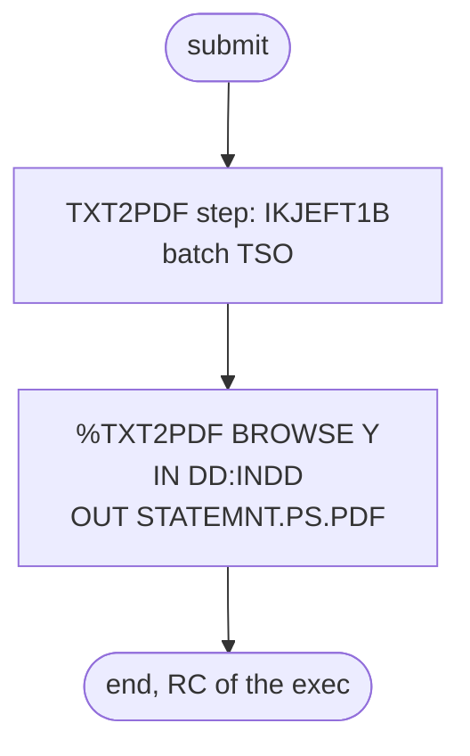

# TXT2PDF1: Convert the statement file to PDF

## 1. Summary

TXT2PDF1 turns the plain-text account statements that CREASTMT prints into a PDF. Its only step runs the TSO terminal monitor program in batch (IKJEFT1B), which executes the REXX exec `TXT2PDF` from the library `AWS.M2.LBD.TXT2PDF.EXEC`; the exec reads `AWS.M2.CARDDEMO.STATEMNT.PS` through DD `INDD` and writes the dataset `AWS.M2.CARDDEMO.STATEMNT.PS.PDF`. CA-7 runs it right after CREASTMT. The exec and its load library are not part of the repository (DEF-JPDF-001), so the conversion itself, page layout included, is outside what this spec can describe. The job has no business logic. The PDF holds customer names and addresses (DEF-JPDF-003).

## 2. Rules at a glance

The job has no business rules. Its items:

| ID | Rule |
| :-- | :-- |
| FLOW-JPDF-001 | Run the TXT2PDF exec under batch TSO with input `DD:INDD` and output `'AWS.M2.CARDDEMO.STATEMNT.PS.PDF'`. |
| SE-JPDF-001 | The exec creates the PDF dataset. |
| ERR-JPDF-001 | The step's `COND=(0,NE)` never applies, and nothing deletes the PDF before a rerun. |
| DEF-JPDF-001 | The TXT2PDF exec and its libraries are not in the repository. |
| DEF-JPDF-002 | `COND=(0,NE)` on the first and only step has no effect. |
| DEF-JPDF-003 | [security] The PDF holds customer names and addresses and is never deleted. |

## 3. Actors and triggers

- **Trigger:** CA-7 submits it when CREASTMT ends (`app/scheduler/CardDemo.ca7:494-495`); CREASTMT itself follows CLOSEFIL (`app/scheduler/CardDemo.ca7:465-468`). TXT2PDF1 then triggers WAITSTEP (`app/scheduler/CardDemo.ca7:521-522`), which triggers OPENFIL (`app/scheduler/CardDemo.ca7:526-527`). Control-M and the demo scripts do not run it. The README mentions TXT2PDF only as one of the JCL utilities (`./README.md:57`).
- **Preconditions:** CREASTMT has written `STATEMNT.PS`; the libraries `AWS.M2.LBD.TXT2PDF.LOAD` and `AWS.M2.LBD.TXT2PDF.EXEC` exist on the system (DEF-JPDF-001).
- **Job card:** `(T,TEST),'TXT2PDF',MSGCLASS=X,CLASS=A,NOTIFY=&SYSUID` (`:1`), on one line. No parameters.

## 4. Interfaces

| Step | Program | DD | Dataset | Disposition | Use | Source |
| :-- | :-- | :-- | :-- | :-- | :-- | :-- |
| `TXT2PDF` | IKJEFT1B | (EXEC) | - | - | `DYNAMNBR=50` (room for up to 50 dynamic allocations, such as the exec's output dataset), `PARM=('')`, `COND=(0,NE)` | `:24-26` |
| `TXT2PDF` | IKJEFT1B | `STEPLIB` | `AWS.M2.LBD.TXT2PDF.LOAD` | `SHR` | load modules used by the exec | `:28-29` |
| `TXT2PDF` | IKJEFT1B | `SYSEXEC` | `AWS.M2.LBD.TXT2PDF.EXEC` | `SHR` | REXX library holding `TXT2PDF` | `:31` |
| `TXT2PDF` | IKJEFT1B | `INDD` | `AWS.M2.CARDDEMO.STATEMNT.PS` | `SHR` | input, the text statements | `:33` |
| `TXT2PDF` | IKJEFT1B | `SYSPRINT` | `SYSOUT=*` | - | utility messages | `:35` |
| `TXT2PDF` | IKJEFT1B | `SYSTSPRT` | `SYSOUT=*` | - | TSO and REXX output | `:36` |
| `TXT2PDF` | IKJEFT1B | `SYSTSIN` | in-stream | - | the TSO command, two lines | `:37-40` |
| `TXT2PDF` | TXT2PDF exec | (dynamic) | `AWS.M2.CARDDEMO.STATEMNT.PS.PDF` | allocated by the exec | output, the PDF | `:39` |

Return code of the job: the return code IKJEFT1B passes back from the last TSO command, here the exec.

## 5. Data used

- **Input:** the text statement file `AWS.M2.CARDDEMO.STATEMNT.PS` (no entity in `entities.md`), fixed 80-byte print lines written by CREASTMT's `STEP040` (`app/jcl/CREASTMT.JCL:87-91`). The job does not interpret the content; it contains customer names and addresses, account data and transactions (`docs/security/data-handling.md:98-99`).
- **Output:** `AWS.M2.CARDDEMO.STATEMNT.PS.PDF`, a PDF rendering of the same lines. Its dataset attributes are chosen by the exec and are not visible in the repository.

## 6. Processing flow

| # | Step | Class | What it does | Runs when |
| --: | :-- | :-- | :-- | :-- |
| 1 | `TXT2PDF` | plumbing | convert `STATEMNT.PS` to a PDF dataset | always (see DEF-JPDF-002) |

#### FLOW-JPDF-001 · Run the TXT2PDF exec under batch TSO
- **What:** `EXEC PGM=IKJEFT1B` starts TSO in batch with an empty `PARM`, so it reads its commands from `SYSTSIN`. The two lines ` %TXT2PDF BROWSE Y IN DD:INDD +` and ` OUT 'AWS.M2.CARDDEMO.STATEMNT.PS.PDF'` form one command (the `+` continues it): run the exec `TXT2PDF` from `SYSEXEC`, read the input from DD `INDD`, write the output to the named dataset, with the exec's option `BROWSE` set to `Y`. What `BROWSE Y` does and how the text is laid out on PDF pages is defined by the external exec.
- **Source:** `:24-26, 31-39`
- **Fidelity:** must-preserve (a PDF of every statement page is produced after each statement run, if the target keeps PDF output) · **Confidence:** reviewed (JCL); the exec's behaviour is not verifiable in the repository

## 7. Business rules

None. The job converts a report's format; it makes no decision about the data.

## 8. Validations and messages

None in the job. Messages from TSO and the exec go to `SYSTSPRT`.

## 9. Side effects

#### SE-JPDF-001 · Create the PDF dataset
- **What:** the exec allocates and writes `AWS.M2.CARDDEMO.STATEMNT.PS.PDF`. No step of this job or of CREASTMT deletes it beforehand: CREASTMT's `STEP030` deletes only `STATEMNT.HTML` and `STATEMNT.PS` (`app/jcl/CREASTMT.JCL:66-75`). Whether a second run replaces the old PDF or fails because the dataset exists depends on the exec (see ERR-JPDF-001).
- **Source:** `:39`
- **Fidelity:** must-preserve · **Confidence:** platform-inferred (the allocation is done by code outside the repository)

## 10. Error handling

#### ERR-JPDF-001 · No effective condition, no clean-up before a rerun
- **When:** the job runs after a failed CREASTMT, or a second time.
- **Then:** `COND=(0,NE)` tests the return codes of earlier steps of the same job, and there are none, so the step always runs (DEF-JPDF-002). CA-7 triggers TXT2PDF1 when CREASTMT completes normally (`app/scheduler/CardDemo.ca7:494-495`), which is the real guard. Whether a non-zero return code of CREASTMT counts as normal completion depends on the condition-code test in CREASTMT's CA-7 definition, which the listing does not show; without such a test, only an abend or a JCL error stops the trigger. If `STATEMNT.PS` is missing, the `INDD` allocation fails with a JCL error and the step does not run. If the PDF dataset still exists from an earlier run, the outcome (overwrite or allocation failure) depends on the exec. IKJEFT1B passes the exec's return code back as the step's return code, so a failure inside the exec can surface only as a non-zero return code. CA-7 then holds back WAITSTEP and OPENFIL (`app/scheduler/CardDemo.ca7:521-527`) only if TXT2PDF1's CA-7 definition treats that code as a failure, which is not visible in the repository (Q-JPDF-003).
- **Source:** `:24-26, 33`, `app/scheduler/CardDemo.ca7:494-495, 521-527`
- **Fidelity:** defect-decide · **Confidence:** platform-inferred (CA-7 completion and condition-code rules, low-medium)

## 11. Interactions

- **Upstream:** CREASTMT writes `STATEMNT.PS` (`app/jcl/CREASTMT.JCL:87-91`); in CA-7 it triggers this job.
- **Downstream:** WAITSTEP, then OPENFIL (CA-7). No job reads the PDF dataset; it is for people to download or browse.
- **External:** the TXT2PDF exec and its load library, which the installation must provide.

## 12. Numeric, date and format details

None. The job passes the statement lines to the exec without interpreting them.

## 13. Known defects and oddities

#### DEF-JPDF-001 · The TXT2PDF exec is not in the repository
- The job depends on the REXX exec `TXT2PDF` in `AWS.M2.LBD.TXT2PDF.EXEC` and on modules in `AWS.M2.LBD.TXT2PDF.LOAD` (`:28-31`). Neither library is created by any job in the repository, and the exec's source is not included, so the job cannot run on a system that has not installed the TXT2PDF tool separately, and the PDF's layout cannot be specified from the repository.
- **Status:** open · **Fidelity:** defect-decide · **Confidence:** reviewed (repository-wide search)

#### DEF-JPDF-002 · `COND=(0,NE)` has no effect on the first step
- A `COND` on an `EXEC` statement compares with return codes of earlier steps in the same job (`:26`). This is the only step, so the test never bypasses it. The parameter probably came from a copy of a later step of a longer job; it suggests a dependency on CREASTMT's result that only the scheduler provides.
- **Status:** open · **Fidelity:** incidental · **Confidence:** platform-inferred

#### DEF-JPDF-003 · [security] The PDF holds customer data and is never deleted
- The statements contain customer names and full addresses (`docs/security/data-handling.md:98-99`). No job deletes the PDF, so the last PDF stays on the system indefinitely. The data-handling guide's retention table listed only the text and HTML statements until commit 4a03121, which added the PDF as written by TXT2PDF1 and never deleted by any job (`docs/security/data-handling.md:171`).
- **Status:** open · **Fidelity:** defect-decide · **Confidence:** reviewed

## 14. Open questions

| ID | Question | For |
| :-- | :-- | :-- |
| Q-JPDF-001 | Which TXT2PDF version and options does the installation use (page size, font, what `BROWSE Y` does), and must the target reproduce that PDF layout or only deliver the same statement content as PDF? | product owner |
| Q-JPDF-002 | Should the target keep the PDF after each run, replace it, or archive it per statement cycle? | operations |
| Q-JPDF-003 | Which condition-code test do the CA-7 definitions of CREASTMT and TXT2PDF1 use, that is, does a non-zero return code stop the triggers to TXT2PDF1 and to WAITSTEP and OPENFIL? | mainframe team, operations |

## 15. Equivalence contract

After a successful run (return code 0), a PDF exists that contains every line of `STATEMNT.PS`, in order, and `STATEMNT.PS` is unchanged. Fonts, page size and other layout details are not part of the contract until Q-JPDF-001 is answered.

Review evidence (independent reviewers checked every item against the source, all WRONG and MINOR findings were fixed, and a fresh reviewer re-checked every changed or added item): [evidence/g-jobs-ops-review.md](../evidence/g-jobs-ops-review.md).

## 16. Paragraph coverage

| Step | Lines | Covered by |
| :-- | :-- | :-- |
| (job card) | 1-1 | §3 |
| `TXT2PDF` | 24-40 | FLOW-JPDF-001, SE-JPDF-001, ERR-JPDF-001, DEF-JPDF-001, DEF-JPDF-002, DEF-JPDF-003 |
