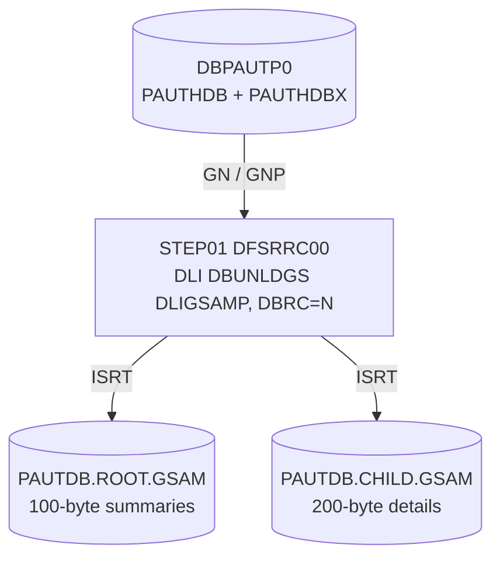

# UNLDGSAM: Pending authorization database unload to GSAM files

## 1. Summary

UNLDGSAM is the one-step job that runs DBUNLDGS in a DL/I batch region. The program reads every summary and detail of `DBPAUTP0` and writes them to two GSAM data sets: 100-byte summary records to `AWS.M2.CARDDEMO.PAUTDB.ROOT.GSAM` and 200-byte detail records, without their account key, to `AWS.M2.CARDDEMO.PAUTDB.CHILD.GSAM` (rules in the DBUNLDGS spec). This spec covers the JCL: the batch region that opens the database itself with DBRC switched off, the output data sets that must already exist and are kept even after a failure, and the absence of any reader of the files. It is run on demand.

## 2. Rules at a glance

| ID | Rule |
| :-- | :-- |
| FLOW-JULGS-001 | One step: `DFSRRC00` runs DBUNLDGS in a DL/I batch region with PSB `DLIGSAMP` and DBRC off. |
| SE-JULGS-001 | The database is read only. |
| SE-JULGS-002 | The two existing GSAM data sets are rewritten from the start and kept in every case. |
| ERR-JULGS-001 | A program error ends with return code 16 and leaves partial GSAM files. |
| ERR-JULGS-002 | Missing GSAM data sets or database data sets fail the job at allocation. |
| NUM-JULGS-001 | GSAM records: 100 and 200 bytes, `RECFM=F`. |
| DEF-JULGS-001 | No job creates the GSAM data sets and nothing reads them. |
| DEF-JULGS-002 | The database is opened in a batch region with DBRC off and `DISP=SHR`. |
| DEF-JULGS-003 | Partial output is kept after a failure. |

## 3. Actors and triggers

- **Trigger:** submitted by an operator; no scheduler runs it.
- **Job card:** `'M2APP',CLASS=A,MSGCLASS=H,MSGLEVEL=(1,1),REGION=0M,NOTIFY=&SYSUID,TIME=1440` (`:1-2`), no CPU limit.
- **Preconditions:** the two GSAM data sets exist (DEF-JULGS-001); the database data sets are not in use in a way that conflicts with a batch read (DEF-JULGS-002); `DLIGSAMP` and the GSAM DBDs `PASFLDBD`, `PADFLDBD` are generated.

## 4. Interfaces

### Step `STEP01` (DFSRRC00, DL/I batch DBUNLDGS)

| DD | Dataset | DISP | DCB | Use | Source |
| :-- | :-- | :-- | :-- | :-- | :-- |
| `STEPLIB` | `OEMA.IMS.IMSP.SDFSRESL`, `OEMA.IMS.IMSP.SDFSRESL.V151`, `AWS.M2.CARDDEMO.LOADLIB` | `SHR` | - | IMS modules, then the program | `:28-30` |
| `DFSRESLB` | `OEMA.IMS.IMSP.SDFSRESL` | `SHR` | - | IMS resident library | `:31` |
| `IMS` | `OEM.IMS.IMSP.PSBLIB`, then `OEM.IMS.IMSP.DBDLIB` | `SHR` | - | PSB `DLIGSAMP` and the DBDs | `:33-34` |
| `PASFILOP` | `AWS.M2.CARDDEMO.PAUTDB.ROOT.GSAM` | `(OLD,KEEP,KEEP)` | from the GSAM DBD: `RECORD=(100)`, `RECFM=F` (`PASFLDBD.DBD:27`) | output data set of GSAM `PASFLDBD` (`DD2`): summary records | `:36-37` |
| `PADFILOP` | `AWS.M2.CARDDEMO.PAUTDB.CHILD.GSAM` | `(OLD,KEEP,KEEP)` | `RECORD=(200)`, `RECFM=F` (`PADFLDBD.DBD:27`) | output data set of GSAM `PADFLDBD` (`DD2`): detail records | `:39-40` |
| `DDPAUTP0` | `OEM.IMS.IMSP.PAUTHDB` | `SHR` | - | database data set of `DBPAUTP0` | `:42` |
| `DDPAUTX0` | `OEM.IMS.IMSP.PAUTHDBX` | `SHR` | - | primary index `DBPAUTX0` | `:43` |
| `DFSVSAMP` | `OEMPP.IMS.V15R01MB.PROCLIB(DFSVSMDB)` | `SHR` | - | VSAM buffer pools for the database | `:46-47` |
| `IMSLOGR`, `IEFRDER` | `DUMMY` | - | - | no input log, no output log: changes would not be logged (the program makes none to the database) | `:48-49` |
| `SYSPRINT`, `SYSUDUMP`, `IMSERR` | `SYSOUT=*` | - | - | messages, dump, IMS errors | `:50-52` |

There is no `SYSOUT` DD for the program's `DISPLAY` output (DBUNLDGS section 4.3); where it appears depends on the installation's COBOL run-time defaults. **Confidence:** platform-inferred.

Return code of the job: the return code DBUNLDGS sets (0, or 16 after an error, DBUNLDGS ERR-DBUL-004).

## 5. Data used

ENT-AUTH-SUMMARY and ENT-AUTH-DETAIL (read through `PAUTBPCB`, `PROCOPT=GOTP`, `DLIGSAMP.PSB:18-20`); ENT-AUTH-ROOT-FILE and ENT-AUTH-CHILD-GSAM (written through the two GSAM PCBs, `PROCOPT=LS`, `DLIGSAMP.PSB:21-22`).

## 6. Processing flow

| # | Step | Program or utility | Purpose | Class |
| --: | :-- | :-- | :-- | :-- |
| 1 | `STEP01` | `DFSRRC00` → DBUNLDGS (DL/I batch, PSB `DLIGSAMP`) | copy the database to two GSAM files | plumbing |

#### FLOW-JULGS-001 · Run the GSAM unload in a DL/I batch region
- **What:** `STEP01` executes `DFSRRC00` with `PARM='DLI,DBUNLDGS,DLIGSAMP,,,,,,,,,,,N'`: region type `DLI` (batch region that opens the databases itself), program DBUNLDGS, PSB `DLIGSAMP`, positions 4 to 13 empty (defaults) and `N` in position 14, which in the DL/I batch parameter list is `DBRC`: DBRC is not used. The program then walks the database (DBUNLDGS FLOW-DBUL-001).
- **Source:** `:26-27`
- **Fidelity:** must-preserve (program and PSB); incidental (region parameters) · **Confidence:** platform-inferred

## 7. Business rules

None. The step copies data; the copy rules are DBUNLDGS BR-DBUL-001 and BR-DBUL-002.

## 8. Validations and messages

None at job level.

## 9. Side effects

#### SE-JULGS-001 · Database read only
- **What:** the database is opened through `DDPAUTP0` and `DDPAUTX0` with `DISP=SHR` and read with `PROCOPT=GOTP`; nothing in it changes.
- **Source:** `:42-43`
- **Fidelity:** must-preserve · **Confidence:** reviewed

#### SE-JULGS-002 · GSAM files rewritten and kept
- **What:** `PASFILOP` and `PADFILOP` name existing data sets (`DISP=OLD`). The GSAM PCBs are opened for output (`PROCOPT=LS`), so writing starts at the beginning and replaces the previous content (DBUNLDGS SE-DBUL-001, SE-DBUL-002). `KEEP,KEEP` keeps both data sets after a normal and an abnormal end.
- **Source:** `:36-40`
- **Fidelity:** must-preserve · **Confidence:** platform-inferred

## 10. Error handling

#### ERR-JULGS-001 · Program error
- **When:** a database read or GSAM insert fails (DBUNLDGS ERR-DBUL-001..003).
- **Then:** the program ends with return code 16 (DBUNLDGS ERR-DBUL-004). The GSAM files keep the records written so far (DEF-JULGS-003); nothing in the database needs backing out.
- **Source:** `:26-27, 36-40`
- **Confidence:** platform-inferred

#### ERR-JULGS-002 · Allocation failure
- **When:** a GSAM data set or a database data set is not cataloged, or another job holds one of them exclusively.
- **Then:** the job fails at allocation (JCL error) or waits for the data set, before the program runs.
- **Source:** `:36-43`
- **Confidence:** platform-inferred

## 11. Interactions

- **Program:** DBUNLDGS.
- **Upstream:** the database as written by COPAUA0C, COPAUS1C, CBPAUP0C and PAUDBLOD.
- **Downstream:** none in the repository (DBUNLDGS Q-DBUL-001). PAUDBLOD reads the files of UNLDPADB, not these.

## 12. Numeric, date and format details

#### NUM-JULGS-001 · GSAM record sizes
- Summary GSAM: 100-byte fixed records (`PASFLDBD.DBD:27`); detail GSAM: 200-byte fixed records (`PADFLDBD.DBD:27`). The JCL gives no DCB; the records follow the DBDs and the existing data sets.
- **Source:** `:36-40`
- **Fidelity:** must-preserve · **Confidence:** reviewed

## 13. Known defects and oddities

#### DEF-JULGS-001 · Output data sets created nowhere, read nowhere
- `DISP=OLD` requires both GSAM data sets to exist, but no job in the repository allocates them (with which space and DCB is unknown), and no job reads them.
- **Source:** `:36-40` · **Status:** open · **Fidelity:** defect-decide (DBUNLDGS Q-DBUL-001) · **Confidence:** reviewed

#### DEF-JULGS-002 · Batch read with DBRC off
- The batch region opens the database data sets directly with `DISP=SHR` and DBRC off (`N`). IMS therefore does not check whether the online system has the database open for update; if it has, the unload can read a database that is changing under it (summaries and details out of step) and IMS cannot record or prevent this. The job does not stop the database first.
- **Source:** `:27, 42-43` · **Status:** open · **Fidelity:** defect-decide · **Confidence:** platform-inferred

#### DEF-JULGS-003 · Partial output kept
- `KEEP` on abnormal end and return code 16 on errors both leave partially written GSAM files that look complete to a later reader.
- **Source:** `:37, 40` · **Status:** open · **Fidelity:** defect-decide · **Confidence:** platform-inferred

## 14. Open questions

| ID | Question | For |
| :-- | :-- | :-- |
| Q-JULGS-001 | Is DBRC meant to be off (`N` in position 14) for UNLDGSAM and UNLDPADB, and must the database be stopped in the online system while they run (DEF-JULGS-002)? | mainframe team |
| Q-JULGS-002 | Who allocates the GSAM data sets, with which space and DCB, and does anything outside the repository read them (DEF-JULGS-001)? | mainframe team |

## 15. Equivalence contract

The program-level output is defined by DBUNLDGS's equivalence contract. At job level: the target's export replaces the previous export, reads a consistent state of the database, and makes a failed export recognizable (DEF-JULGS-003 is defect-decide). Not runnable locally (IMS). Review record: `docs/modernization/spec/evidence/e-review.md`.

## 16. Step coverage

| Step | Lines | Covered by |
| :-- | :-- | :-- |
| (job card) | 1-2 | FLOW-JULGS-001 |
| `STEP01` | 26-52 | FLOW-JULGS-001, SE-JULGS-001, SE-JULGS-002, ERR-JULGS-001, ERR-JULGS-002, NUM-JULGS-001, DEF-JULGS-001, DEF-JULGS-002, DEF-JULGS-003 |
