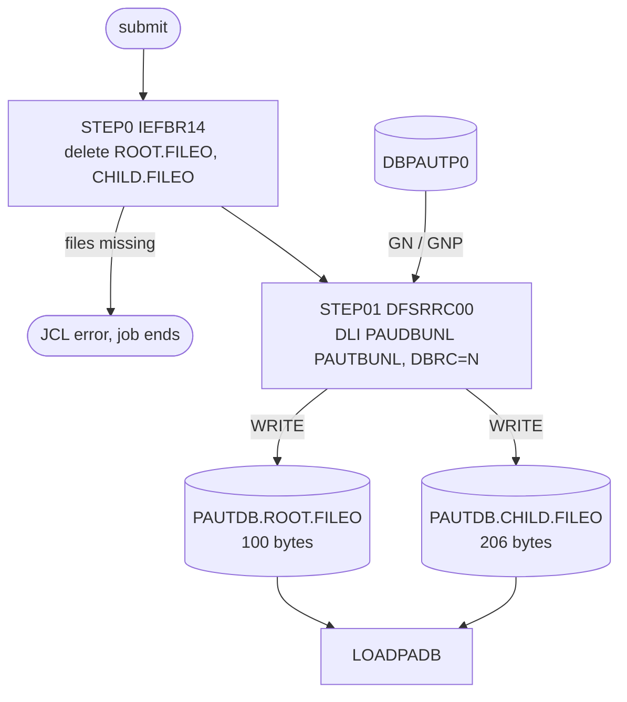

# UNLDPADB: Pending authorization database unload to sequential files

## 1. Summary

UNLDPADB deletes the previous unload files and then runs PAUDBUNL in a DL/I batch region. The program writes every summary of `DBPAUTP0` as a 100-byte record to `AWS.M2.CARDDEMO.PAUTDB.ROOT.FILEO` and every detail, prefixed with its account key (PAUDBUNL DEF-PDUL-005), as a 206-byte record to `AWS.M2.CARDDEMO.PAUTDB.CHILD.FILEO` (rules in the PAUDBUNL spec). These files are the input of LOADPADB. This spec covers the JCL: the delete step that fails when the files do not exist (DEF-JULPA-001), the new cataloged output files and their small space, and the batch region with DBRC off. It is run on demand.

## 2. Rules at a glance

| ID | Rule |
| :-- | :-- |
| FLOW-JULPA-001 | Two steps without conditions: delete the old files, then unload. |
| SE-JULPA-001 | `STEP0` deletes both previous unload files, which must exist. |
| SE-JULPA-002 | `STEP01` creates and catalogs the two new files; the database is read only. |
| ERR-JULPA-001 | Missing files in `STEP0` fail the job before the unload. |
| ERR-JULPA-002 | A program error ends with return code 16 and catalogs partial files; an abend deletes them. |
| NUM-JULPA-001 | Output records 100 and 206 bytes `FB`; space in 400-byte blocks. |
| DEF-JULPA-001 | The job cannot run when the previous files are missing (first run, or after a failed run). |
| DEF-JULPA-002 | The database is opened in a batch region with DBRC off and `DISP=SHR`. |
| DEF-JULPA-003 | The output space is small for a production database. |

## 3. Actors and triggers

- **Trigger:** submitted by an operator, before LOADPADB; no scheduler runs it.
- **Job card:** `'M2APP',CLASS=A,MSGCLASS=H,MSGLEVEL=(1,1),REGION=0M,NOTIFY=&SYSUID,TIME=1440` (`:1-2`), no CPU limit.
- **Preconditions:** both previous unload files exist (DEF-JULPA-001); `PAUTBUNL` is generated (`PAUTBUNL.PSB:18-21`); the database data sets can be read by a batch region (DEF-JULPA-002).

## 4. Interfaces

### Step `STEP0` (IEFBR14)

| DD | Dataset | DISP | DCB | Use | Source |
| :-- | :-- | :-- | :-- | :-- | :-- |
| `SYSPRINT`, `SYSOUT`, `SYSDUMP` | `SYSOUT=*` | - | - | not written | `:27-31` |
| `DD1` | `AWS.M2.CARDDEMO.PAUTDB.ROOT.FILEO` | `(OLD,DELETE,DELETE)` | - | deleted at step end | `:33-34` |
| `DD2` | `AWS.M2.CARDDEMO.PAUTDB.CHILD.FILEO` | `(OLD,DELETE,DELETE)` | - | deleted at step end | `:35-36` |

### Step `STEP01` (DFSRRC00, DL/I batch PAUDBUNL)

| DD | Dataset | DISP | DCB | Use | Source |
| :-- | :-- | :-- | :-- | :-- | :-- |
| `STEPLIB` | `OEMA.IMS.IMSP.SDFSRESL`, `OEMA.IMS.IMSP.SDFSRESL.V151`, `AWS.M2.CARDDEMO.LOADLIB` | `SHR` | - | IMS modules, then the program | `:40-42` |
| `DFSRESLB` | `OEMA.IMS.IMSP.SDFSRESL` | `SHR` | - | IMS resident library | `:43` |
| `IMS` | `OEM.IMS.IMSP.PSBLIB`, then `OEM.IMS.IMSP.DBDLIB` | `SHR` | - | PSB `PAUTBUNL` and DBD `DBPAUTP0` | `:45-46` |
| `OUTFIL1` | `AWS.M2.CARDDEMO.PAUTDB.ROOT.FILEO` | `(NEW,CATLG,DELETE)`, `UNIT=3390`, `SPACE=(400,(20,20),RLSE)` | `LRECL=100,BLKSIZE=0,RECFM=FB` | summary records (PAUDBUNL SE-PDUL-001) | `:48-51` |
| `OUTFIL2` | `AWS.M2.CARDDEMO.PAUTDB.CHILD.FILEO` | `(NEW,CATLG,DELETE)`, `UNIT=3390`, `SPACE=(400,(20,20),RLSE)` | `LRECL=206,BLKSIZE=0,RECFM=FB` | detail records with parent key (PAUDBUNL SE-PDUL-002) | `:53-56` |
| `DDPAUTP0` | `OEM.IMS.IMSP.PAUTHDB` | `SHR` | - | database data set of `DBPAUTP0` | `:58` |
| `DDPAUTX0` | `OEM.IMS.IMSP.PAUTHDBX` | `SHR` | - | primary index `DBPAUTX0` | `:59` |
| `DFSVSAMP` | `OEMPP.IMS.V15R01MB.PROCLIB(DFSVSMDB)` | `SHR` | - | VSAM buffer pools | `:62-63` |
| `IMSLOGR`, `IEFRDER` | `DUMMY` | - | - | no logs (the program changes nothing in the database) | `:64-65` |
| `SYSPRINT`, `SYSUDUMP`, `IMSERR` | `SYSOUT=*` | - | - | messages, dump, IMS errors | `:66-68` |

`OUTFIL1` and `OUTFIL2` are the DD names of the program's files `OPFILE1` and `OPFILE2` (`PAUDBUNL.CBL:26-35`). There is no `SYSOUT` DD in `STEP01` for the program's `DISPLAY` output (PAUDBUNL section 4.3); where it appears depends on the installation's COBOL run-time defaults. **Confidence:** platform-inferred.

Return code of the job: the highest step code; `STEP01` returns what PAUDBUNL sets (0, or 16 after an open or IMS error, PAUDBUNL ERR-PDUL-004).

## 5. Data used

ENT-AUTH-SUMMARY and ENT-AUTH-DETAIL (read through `PAUTBPCB`, `PROCOPT=GOTP`, `PAUTBUNL.PSB:18-20`); ENT-AUTH-ROOT-FILE and ENT-AUTH-CHILD-FILE (written).

## 6. Processing flow

| # | Step | Program or utility | Purpose | Class |
| --: | :-- | :-- | :-- | :-- |
| 1 | `STEP0` | `IEFBR14` | delete the previous unload files | plumbing |
| 2 | `STEP01` | `DFSRRC00` → PAUDBUNL (DL/I batch, PSB `PAUTBUNL`) | unload the database to two sequential files | plumbing |

#### FLOW-JULPA-001 · Two steps without conditions
- **What:** `STEP0` runs `IEFBR14` (a program that does nothing; the work is done by the DD dispositions). `STEP01` executes `DFSRRC00` with `PARM='DLI,PAUDBUNL,PAUTBUNL,,,,,,,,,,,N'`: region type `DLI`, program PAUDBUNL, PSB `PAUTBUNL`, `N` in position 14 (`DBRC`): DBRC is not used. Neither step has `COND`.
- **Source:** `:25, 38-39`
- **Fidelity:** must-preserve (program and PSB); incidental (region parameters) · **Confidence:** platform-inferred

## 7. Business rules

None. Both steps are plumbing; the unload rules are PAUDBUNL BR-PDUL-001..003.

## 8. Validations and messages

None at job level.

## 9. Side effects

#### SE-JULPA-001 · Delete the previous unload files
- **What:** `DD1` and `DD2` allocate `ROOT.FILEO` and `CHILD.FILEO` with `DISP=(OLD,DELETE,DELETE)`, so both are deleted when `STEP0` ends, normally or not. `OLD` requires each to be cataloged (ERR-JULPA-001).
- **Source:** `:33-36`
- **Fidelity:** incidental · **Confidence:** platform-inferred

#### SE-JULPA-002 · Create the new unload files
- **What:** `OUTFIL1` and `OUTFIL2` are allocated new on a 3390 volume and cataloged at a normal step end, also when the program ends with return code 16; an abend deletes them (`DISP=(NEW,CATLG,DELETE)`). PAUDBUNL writes the records (PAUDBUNL SE-PDUL-001, SE-PDUL-002). The database is opened with `DISP=SHR` and read only (`PROCOPT=GOTP`).
- **Source:** `:48-59`
- **Fidelity:** must-preserve · **Confidence:** platform-inferred

## 10. Error handling

#### ERR-JULPA-001 · Missing previous files
- **When:** `ROOT.FILEO` or `CHILD.FILEO` is not cataloged when the job starts.
- **Then:** the allocation of `STEP0` fails with a JCL error ("data set not found"), the job ends and `STEP01` does not run. No unload is written (DEF-JULPA-001).
- **Source:** `:33-36`
- **Confidence:** platform-inferred

#### ERR-JULPA-002 · Unload failure
- **When:** an open or database error in PAUDBUNL (PAUDBUNL ERR-PDUL-001, ERR-PDUL-002), or an abend, for example when an output file runs out of space (DEF-JULPA-003).
- **Then:** after return code 16 both files are cataloged with the records written so far (PAUDBUNL DEF-PDUL-003); after an abend both are deleted. Either way the previous files are already gone. A following run then fails in `STEP0` if the abend deleted the files (DEF-JULPA-001).
- **Source:** `:48-56`
- **Confidence:** platform-inferred

## 11. Interactions

- **Program:** PAUDBUNL.
- **Upstream:** the database as written by COPAUA0C, COPAUS1C, CBPAUP0C and PAUDBLOD.
- **Downstream:** LOADPADB reads both files (`LOADPADB.JCL:36-38`).

## 12. Numeric, date and format details

#### NUM-JULPA-001 · Output record sizes and space
- `OUTFIL1`: `RECFM=FB`, `LRECL=100`; `OUTFIL2`: `RECFM=FB`, `LRECL=206`, matching the program's records (`PAUDBUNL.CBL:26-35`). `BLKSIZE=0` lets the system choose the block size. Space: 20 blocks of an average 400 bytes primary and 20 secondary for each file, released at close; the space is rounded up to whole tracks.
- **Source:** `:48-56`
- **Fidelity:** must-preserve (record sizes); incidental (space) · **Confidence:** reviewed (JCL); platform-inferred (allocation)

## 13. Known defects and oddities

#### DEF-JULPA-001 · Delete step fails when the files are missing
- `DISP=(OLD,DELETE,DELETE)` needs both files to exist. On the first run, after a manual delete, or after an unload that abended (which deletes the new files), the job fails in `STEP0` and cannot produce an unload until someone allocates dummy files. `DISP=(MOD,DELETE)`, as DBPAUTP0 uses (DBPAUTP0 SE-JDBPA-001), would not fail.
- **Source:** `:33-36` · **Status:** open · **Fidelity:** defect-decide · **Confidence:** platform-inferred

#### DEF-JULPA-002 · Batch read with DBRC off
- As in UNLDGSAM (UNLDGSAM DEF-JULGS-002): the database data sets are opened by a batch region with `DISP=SHR` and DBRC off, while the online system may be updating them, so the unload can be inconsistent. The matching load (LOADPADB) then reloads that state.
- **Source:** `:39, 58-59` · **Status:** open · **Fidelity:** defect-decide (UNLDGSAM Q-JULGS-001) · **Confidence:** platform-inferred

#### DEF-JULPA-003 · Small output space
- `SPACE=(400,(20,20),RLSE)` asks for room for 20 blocks of 400 bytes (8,000 bytes) per extent. The real capacity depends on the track rounding and the system-chosen block size, but it is sized for the sample data (22 summaries, 202 details: about 2,200 and 41,600 bytes), not for a production database; a larger database can end the step with an out-of-space abend.
- **Source:** `:51, 56` · **Status:** open · **Fidelity:** incidental · **Confidence:** platform-inferred

## 14. Open questions

| ID | Question | For |
| :-- | :-- | :-- |
| Q-JULPA-001 | How large can the authorization database get in production, and what space should the unload files have (DEF-JULPA-003)? | operations |

## 15. Equivalence contract

The program-level output is defined by PAUDBUNL's equivalence contract. At job level: an export replaces the previous one, is readable by the matching import (LOADPADB), and a failed export is recognizable; the target need not reproduce the delete-step failure (DEF-JULPA-001) or the space limits. Not runnable locally (IMS). Review record: `docs/modernization/spec/evidence/e-review.md`.

## 16. Step coverage

| Step | Lines | Covered by |
| :-- | :-- | :-- |
| (job card) | 1-2 | FLOW-JULPA-001 |
| `STEP0` | 25-36 | FLOW-JULPA-001, SE-JULPA-001, ERR-JULPA-001, DEF-JULPA-001 |
| `STEP01` | 38-68 | FLOW-JULPA-001, SE-JULPA-002, ERR-JULPA-002, NUM-JULPA-001, DEF-JULPA-002, DEF-JULPA-003 |
