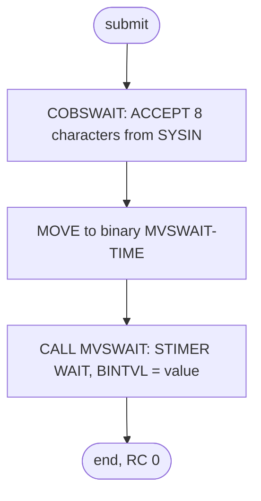

# WAITSTEP: Fixed delay between batch jobs

## 1. Summary

WAITSTEP does nothing except wait. Its only step runs COBSWAIT, which reads an eight-digit number from `SYSIN` and passes it to the assembler routine MVSWAIT, which suspends the step for that many hundredths of a second with an MVS timer. The shipped value `00003600` gives a 36-second wait. Both schedules place it after a batch job and before the job that hands the files back to CICS (OPENFIL); in CA-7 the same WAITSTEP completion can also trigger a job that takes them away again (CLOSEFIL, `CLOSEFIL1` or `CLOSEFIL2`, depending on the schedule ID, section 3). It is a fixed pause rather than a real completion check. It reads and writes no data and has no business logic.

## 2. Rules at a glance

The job has no business rules. Its items:

| ID | Rule |
| :-- | :-- |
| FLOW-JWAIT-001 | Read the wait time from `SYSIN` and suspend the step for that many centiseconds (36 seconds as shipped). |
| ERR-JWAIT-001 | There is no error handling; the step always ends with return code 0 unless it abends. |
| NUM-JWAIT-001 | The value is eight characters taken as an unsigned whole number of centiseconds. |
| DEF-JWAIT-001 | The comment says the time is in the `PARM`, but it is read from `SYSIN`. |
| DEF-JWAIT-002 | A short or non-numeric `SYSIN` value would give a platform-dependent wait; the shipped `00003600` is well formed. |
| DEF-JWAIT-003 | A fixed delay stands in for a real synchronisation with CICS. |

## 3. Actors and triggers

- **Trigger:** both schedules.
  - CA-7 triggers it after POSTTRAN (`app/scheduler/CardDemo.ca7:96-97`), TRANTYPE (`app/scheduler/CardDemo.ca7:188-189`), TRANCATG (`app/scheduler/CardDemo.ca7:297-298`), TCATBALF (`app/scheduler/CardDemo.ca7:329-330`), READXREF (`app/scheduler/CardDemo.ca7:447-448`), TXT2PDF1 (`app/scheduler/CardDemo.ca7:521-522`) and PRTCATBL (`app/scheduler/CardDemo.ca7:563-564`). What WAITSTEP then triggers depends on the schedule ID it runs under, which it inherits from the job that triggered it (FLOW-JCA7-005): under 030 (after POSTTRAN, TRANTYPE, READXREF and TXT2PDF1) it triggers both OPENFIL (`app/scheduler/CardDemo.ca7:124, 453, 527`) and CLOSEFIL (`app/scheduler/CardDemo.ca7:303, 335`); under 031 (after TRANCATG and PRTCATBL) OPENFIL and `CLOSEFIL1` (`app/scheduler/CardDemo.ca7:216, 569`); under 032 (after TCATBALF) only `CLOSEFIL2` (`app/scheduler/CardDemo.ca7:217`). See `SCHED-CA7.md` (FLOW-JCA7-006).
  - Control-M runs it after TRANBKP in folder `DAILY-TransactionBackup` (`app/scheduler/CardDemo.controlm:14-19`), after DISCGRP in `WEEKLY-DisclosureGroupsRefresh` (`app/scheduler/CardDemo.controlm:44-49`) and after COMBTRAN in the monthly interest calculation (`app/scheduler/CardDemo.controlm:81-86`), each time followed by OPENFIL.
  - The README lists it (`./README.md:234`, `./README.md:379`), and the restart runbook says it "can be placed between jobs" (`docs/runbooks/batch-cycle-restart.md:23`).
- **Preconditions:** none.
- **Job card:** `CLASS=A,MSGCLASS=0,NOTIFY=&SYSUID` (`:1-2`). No parameters; the wait time is in-stream data.

## 4. Interfaces

| Step | Program | DD | Dataset | Disposition | Use | Source |
| :-- | :-- | :-- | :-- | :-- | :-- | :-- |
| `WAIT` | COBSWAIT | `STEPLIB` | `AWS.M2.CARDDEMO.LOADLIB` | `SHR` | program library (COBSWAIT and MVSWAIT) | `:23` |
| `WAIT` | COBSWAIT | `SYSOUT` | `SYSOUT=*` | - | runtime messages only; the program displays nothing | `:24` |
| `WAIT` | COBSWAIT | `SYSIN` | in-stream, one record | - | wait time: `00003600` followed by the text `VALUE IN CENTISECONDS` | `:25-27` |

Columns 73-80 of lines 22-27 hold sequence numbers, which JCL ignores. Return code of the job: 0.

## 5. Data used

None. The only input is the wait time in `SYSIN`: COBSWAIT accepts the first eight characters of the record into `PARM-VALUE` (`PIC X(8)`) and moves them to `MVSWAIT-TIME` (`PIC 9(8) COMP`, a 4-byte binary fullword), which it passes to MVSWAIT (`app/cbl/COBSWAIT.cbl:30-31`, `app/cbl/COBSWAIT.cbl:36-38`). The rest of the record, including the descriptive text, is ignored.

## 6. Processing flow

| # | Step | Class | What it does | Runs when |
| --: | :-- | :-- | :-- | :-- |
| 1 | `WAIT` | plumbing | wait the number of centiseconds in `SYSIN` | always |

#### FLOW-JWAIT-001 · Wait the number of centiseconds in `SYSIN`
- **What:** `EXEC PGM=COBSWAIT`. COBSWAIT reads the wait time and calls MVSWAIT, which loads the binary value and issues `STIMER WAIT,BINTVL=` with it through the ASMWAIT macro (`app/asm/MVSWAIT.asm:20-23`, `app/maclib/ASMWAIT.mac:17-20`). `BINTVL` counts hundredths of a second, so `00003600` suspends the step for 36 seconds. MVSWAIT then restores the registers, sets the byte at offset 12 of COBSWAIT's save area to X'FF' (`app/asm/MVSWAIT.asm:24-25`; the linkage convention's "returned" flag, which nothing reads, DEF-MWAT-001 in `MVSWAIT.md`), clears register 15 and returns (`app/asm/MVSWAIT.asm:26-27`), and COBSWAIT stops the run (`app/cbl/COBSWAIT.cbl:40`).
- **Source:** `:22-26`
- **Fidelity:** must-preserve (the length of the pause, if the target keeps the pause at all; see Q-JWAIT-001) · **Confidence:** reviewed; locally runtime-verified with a shorter value (`python3 tools/carddemo.py run WAITSTEP`: RETURN-CODE 0, program step 0.52 seconds, with the runner's `SYSIN` of `00000050`, 0.5 seconds)

## 7. Business rules

None. The job only delays the next job in the schedule.

## 8. Validations and messages

None. The program does not check the value it reads and displays nothing.

## 9. Side effects

None. The job reads and writes no dataset; its only effect is the elapsed time.

## 10. Error handling

#### ERR-JWAIT-001 · No error handling; return code 0
- **When:** always.
- **Then:** neither COBSWAIT nor MVSWAIT checks anything. MVSWAIT returns 0 in register 15 (`app/asm/MVSWAIT.asm:26-27`) and COBSWAIT stops the run without setting a return code (`app/cbl/COBSWAIT.cbl:38-40`), so the step's return code is 0. A bad value does not fail the step unless it causes a data exception on z/OS; otherwise it changes the length of the wait (DEF-JWAIT-002). With a missing or empty `SYSIN` the local run waits 0; what happens on z/OS has not been determined (Q-WAIT-001 in `COBSWAIT.md`). Only an abend stops the step, and then the scheduler does not trigger the following OPENFIL or CLOSEFIL.
- **Source:** `app/asm/MVSWAIT.asm:26-27`, `app/cbl/COBSWAIT.cbl:38-40`
- **Fidelity:** incidental · **Confidence:** reviewed (code); platform-inferred (missing `SYSIN` on z/OS)

## 11. Interactions

- **Upstream and downstream:** the jobs listed in section 3. In CA-7, a WAITSTEP completion triggers OPENFIL, a CLOSEFIL job or both, depending on its schedule ID (section 3); in Control-M, WAITSTEP is followed by OPENFIL.
- **Schedule detail:** in the Control-M monthly folder, WAITSTEP and OPENFIL both have `JOBISN="4"` (`app/scheduler/CardDemo.controlm:81`, `app/scheduler/CardDemo.controlm:87`); the order is still set by the WAITSTEP condition that OPENFIL waits for (`app/scheduler/CardDemo.controlm:84`, `app/scheduler/CardDemo.controlm:88`).
- **Local runner:** `tools/carddemo.py:689-690` runs the job with `SYSIN` `00000050` (0.5 seconds) instead of the JCL's `00003600`, and MVSWAIT is replaced by a COBOL shim that sleeps for the value times 10 milliseconds (`tools/shims/MVSWAIT.cbl:13-17`).

## 12. Numeric, date and format details

#### NUM-JWAIT-001 · The wait value
- The first eight characters of the `SYSIN` record are an unsigned whole number of centiseconds (hundredths of a second). The largest value, `99999999`, is about 11.6 days. `00003600` is 36 seconds; the JCL comment states the same conversion.
- **Fidelity:** must-preserve (if the pause is kept) · **Confidence:** reviewed

## 13. Known defects and oddities

#### DEF-JWAIT-001 · The comment says `PARM`, the value is in `SYSIN`
- The comment above the step says to give the centiseconds "IN THE PARM" (`:20`), but the `EXEC` statement has no `PARM` and the program reads the value from `SYSIN` (`:25-26`).
- **Status:** open · **Fidelity:** incidental · **Confidence:** reviewed

#### DEF-JWAIT-002 · A bad `SYSIN` value gives an unpredictable wait
- The program moves the eight characters to a binary field without checking them, so the effect of a malformed value depends on the platform (NUM-WAIT-001 and DEF-WAIT-001 in `COBSWAIT.md`). The shipped card `00003600` (`app/jcl/WAITSTEP.jcl:26`) is eight digits and gives 36 seconds. A short value would not: if the card held only `36` followed by blanks, GnuCOBOL would take it as 36, a wait of 0.36 seconds, while on z/OS the conversion most likely ignores the zone bits and counts the blanks as zeros, giving 36,000,000 centiseconds, about 100 hours. A byte whose low-order half is not a digit, such as `.`, can abend the step with S0C7 on z/OS, and the scheduler then stops the chain (ERR-JWAIT-001). An empty or missing `SYSIN` waits 0 locally and is undetermined on z/OS (Q-WAIT-001).
- **Source:** `app/cbl/COBSWAIT.cbl:36-37`
- **Status:** open · **Fidelity:** defect-decide (Q-WAIT-001) · **Confidence:** runtime-verified (local conversion, NUM-WAIT-001); platform-inferred (z/OS)

#### DEF-JWAIT-003 · A fixed delay instead of real synchronisation
- WAITSTEP sits between a batch job and OPENFIL or CLOSEFIL in every chain. A fixed 36-second pause does not check that anything has finished, so it is either longer than needed or, under load, too short; nothing in the repository says what it is waiting for.
- **Status:** open · **Fidelity:** defect-decide · **Confidence:** reviewed (schedule structure); the purpose is not documented

## 14. Open questions

| ID | Question | For |
| :-- | :-- | :-- |
| Q-JWAIT-001 | What does the pause protect against (CICS finishing the close or open commands, a storage or catalog delay, or nothing in particular), and can the target replace it with an explicit completion check? | operations |

## 15. Equivalence contract

A run ends with return code 0 after waiting the number of centiseconds given (36 seconds as shipped) and changes no data. If the target replaces the pause with a completion check (Q-JWAIT-001), the requirement becomes: the following job does not start until the condition the pause stood for holds.

Review evidence (independent reviewers checked every item against the source, all WRONG and MINOR findings were fixed, and a fresh reviewer re-checked every changed or added item): [evidence/g-jobs-ops-review.md](../evidence/g-jobs-ops-review.md).

## 16. Paragraph coverage

| Step | Lines | Covered by |
| :-- | :-- | :-- |
| (job card) | 1-2 | §3 |
| `WAIT` | 22-27 | FLOW-JWAIT-001, ERR-JWAIT-001, NUM-JWAIT-001, DEF-JWAIT-001, DEF-JWAIT-002, DEF-JWAIT-003 |
