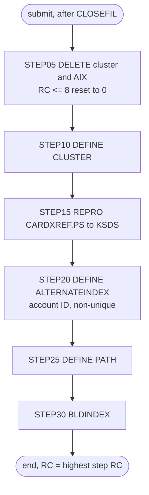

# XREFFILE: Card cross-reference reload

## 1. Summary

XREFFILE throws away the card cross-reference file (ENT-CARD-XREF: card number, customer ID, account ID) and rebuilds it from the flat sample file, together with its alternate index by account. `STEP05` deletes the cluster `AWS.M2.CARDDEMO.CARDXREF.VSAM.KSDS` and its alternate index, `STEP10` defines the cluster again empty (key 16 bytes at offset 0, fixed 50-byte records), `STEP15` copies every record of `AWS.M2.CARDDEMO.CARDXREF.PS` into it, and `STEP20` to `STEP30` define the non-unique alternate index on the account ID (11 bytes at offset 25), its path, and build it. Unlike CARDFILE and CUSTFILE it does not close or reopen any CICS file itself; it relies on CLOSEFIL having closed `CCXREF` and `CXACAIX`. It is run by hand during installation and in the demo data refresh. It contains no business logic; what it must preserve is the file and index definitions and the fact that the result is an exact copy of the flat file.

## 2. Rules at a glance

The job has no business rules. Its items:

| ID | Rule |
| :-- | :-- |
| SE-JXREF-001 | Delete the cross-reference cluster and its alternate index; each failure with return code 8 or less is ignored. |
| SE-JXREF-002 | Define the cluster: key 16 at offset 0, records 50 fixed, `SHAREOPTIONS(2 3)`, `ERASE`, no `REUSE`. |
| SE-JXREF-003 | Load the cluster with every record of `CARDXREF.PS`, in file order. |
| SE-JXREF-004 | Define a non-unique, upgraded alternate index on the account ID (11 bytes at offset 25). |
| SE-JXREF-005 | Define the path over the alternate index. |
| SE-JXREF-006 | Build the alternate index from the loaded cluster. |
| SE-JXREF-007 | No other program writes the cross-reference or its index; this job is its only writer. |
| VAL-JXREF-001 | The load rejects records out of key order or with duplicate card numbers (VSAM rule). |
| ERR-JXREF-001 | No step has a `COND`, so every step runs even when an earlier one failed. |
| ERR-JXREF-002 | A severe IDCAMS error (condition code 16) in the first delete skips the second delete and both resets, and ends `STEP05` with 16. |
| ERR-JXREF-003 | While CICS has `CCXREF` or `CXACAIX` open, nothing is deleted, loaded or rebuilt and the old file and index stay. |
| NUM-JXREF-001 | Keys, record size and alternate-index capacity. |
| DEF-JXREF-001 | The return-code reset also hides a delete that failed because the file is still open. |
| DEF-JXREF-002 | The job closes no CICS file itself and depends on CLOSEFIL. |
| DEF-JXREF-003 | The alternate index holds at most 2 cards per account. |

## 3. Actors and triggers

- **Trigger:** submitted by an operator. It is in the README's initialisation sequence (`./README.md:157`) and its "Running Batch Jobs" sequence (`./README.md:218`), both after CLOSEFIL, and in the demo scripts `scripts/run_full_batch.sh:22-23` and `scripts/remote_refresh.sh:22-23`, which also submit CLOSEFIL first. Neither the CA-7 nor the Control-M schedule runs it. The local runner has no XREFFILE job; it loads `app/data/ASCII/cardxref.txt` into the `CARDXREF` dataset, with the same alternate key, directly for every run (`tools/batch-programs.toml:205-211`).
- **Preconditions:** CICS files `CCXREF` and `CXACAIX` are closed (CLOSEFIL closes both, `docs/runbooks/cics-vsam-files.md:16, 18`); no batch job has the cluster open; `AWS.M2.CARDDEMO.CARDXREF.PS` exists and is sorted by card number (`./README.md:138`, FB 50). The defines name volume `AWSHJ1`, but the cluster and the alternate index are SMS-managed (storage class `SCTECH`, `app/catlg/LISTCAT.txt:371`; `SMS MANAGED (YES)`, `app/catlg/LISTCAT.txt:460`) and the catalog shows their data components on volumes `YYYYTA` and `YYYYTC` (`app/catlg/LISTCAT.txt:418, 500`), so on the reference system SMS chose the volumes; `AWSHJ1` matters only where SMS does not manage these names (platform-inferred, medium).
- **Job card:** `CLASS=A,MSGCLASS=0,NOTIFY=&SYSUID` (`:1-2`). No parameters, no symbolic overrides.

## 4. Interfaces

| Step | Program | DD | Dataset | Disposition | Use | Source |
| :-- | :-- | :-- | :-- | :-- | :-- | :-- |
| `STEP05` | IDCAMS | `SYSPRINT` | `SYSOUT=*` | - | IDCAMS messages | `:23` |
| `STEP05` | IDCAMS | `SYSIN` | in-stream | - | two `DELETE` statements | `:24-31` |
| `STEP10` | IDCAMS | `SYSPRINT` | `SYSOUT=*` | - | IDCAMS messages | `:37` |
| `STEP10` | IDCAMS | `SYSIN` | in-stream | - | `DEFINE CLUSTER` statement | `:38-53` |
| `STEP15` | IDCAMS | `SYSPRINT` | `SYSOUT=*` | - | IDCAMS messages | `:58` |
| `STEP15` | IDCAMS | `XREFDATA` | `AWS.M2.CARDDEMO.CARDXREF.PS` | `SHR` | input, sequential, FB 50 | `:59-60` |
| `STEP15` | IDCAMS | `XREFVSAM` | `AWS.M2.CARDDEMO.CARDXREF.VSAM.KSDS` | `SHR` | output, KSDS | `:61-62` |
| `STEP15` | IDCAMS | `SYSIN` | in-stream | - | `REPRO` statement | `:63-65` |
| `STEP20` | IDCAMS | `SYSPRINT` | `SYSOUT=*` | - | IDCAMS messages | `:70` |
| `STEP20` | IDCAMS | `SYSIN` | in-stream | - | `DEFINE ALTERNATEINDEX` statement | `:71-83` |
| `STEP25` | IDCAMS | `SYSPRINT` | `SYSOUT=*` | - | IDCAMS messages | `:88` |
| `STEP25` | IDCAMS | `SYSIN` | in-stream | - | `DEFINE PATH` statement | `:89-93` |
| `STEP30` | IDCAMS | `SYSPRINT` | `SYSOUT=*` | - | IDCAMS messages | `:98` |
| `STEP30` | IDCAMS | `SYSIN` | in-stream | - | `BLDINDEX` statement | `:99-103` |

`STEP20` to `STEP30` name the cluster, alternate index and path by dataset name inside the IDCAMS statements, not through DD statements. CICS file `CCXREF` is defined on the cluster and `CXACAIX` on the path (`app/csd/CARDDEMO.CSD:37-39, 63-65`). Return code of the job: the highest step return code. Console output is IDCAMS `SYSPRINT` only (incidental).

## 5. Data used

- ENT-CARD-XREF (`CARD-XREF-RECORD`, `app/cpy/CVACT03Y.cpy:4-8`, 50 bytes), whole records copied unchanged from `CARDXREF.PS` to the KSDS. No field is interpreted. The primary key is bytes 1-16 (`XREF-CARD-NUM`, `X(16)`); the alternate key is bytes 26-36 (`XREF-ACCT-ID`, `9(11)`); `XREF-CUST-ID` (bytes 17-25) and a 14-byte filler are carried along. The card number is sensitive data; the job copies it and does not print it.
- Catalog state on 09/01/22 (`app/catlg/LISTCAT.txt:351-531`): the cluster's data component has `KEYLEN 16`, `RKP 0`, `MAXLRECL 50`, `SHROPTNS(2,3)`, `ERASE`, `NOREUSE` and `REC-TOTAL 50` (`app/catlg/LISTCAT.txt:403-408`), space `CYLINDER` primary 1 secondary 5 (`app/catlg/LISTCAT.txt:414-416`). The AIX is `UPGRADE` (`app/catlg/LISTCAT.txt:466`); its data component has `KEYLEN 11`, `AXRKP 25`, `MAXLRECL 50`, `SHROPTNS(1,3)`, `SPANNED`, `NONUNIQKEY`, `REC-TOTAL 50` and free space 10% per CI and 20% per CA (`app/catlg/LISTCAT.txt:482-493`), so the sample has one AIX record, that is one card, per account. The path has `UPDATE` (`app/catlg/LISTCAT.txt:364`). This matches SE-JXREF-002 and SE-JXREF-004 except for `SPANNED` (`app/catlg/LISTCAT.txt:488`): the define at `:72-82` does not code it and the IDCAMS default is `NONSPANNED`, so the catalogued index was defined by another statement or took the attribute from SMS (platform-inferred). A spanned AIX record is still limited to `MAXLRECL 50`, so NUM-JXREF-001 does not change.
- Sample data: `app/data/ASCII/cardxref.txt` has 50 records of 36 significant bytes (the local loader pads them to 50), card numbers strictly ascending, 50 distinct account IDs. Checked locally with a Python script over the file.

## 6. Processing flow

| # | Step | Program | Class | What it does | Runs when |
| --: | :-- | :-- | :-- | :-- | :-- |
| 1 | `STEP05` | IDCAMS | plumbing | delete the cluster and the AIX | always |
| 2 | `STEP10` | IDCAMS | plumbing | define the cluster | always (no `COND`) |
| 3 | `STEP15` | IDCAMS | plumbing | copy `CARDXREF.PS` into the cluster | always |
| 4 | `STEP20` | IDCAMS | plumbing | define the AIX on the account ID | always |
| 5 | `STEP25` | IDCAMS | plumbing | define the path | always |
| 6 | `STEP30` | IDCAMS | plumbing | build the AIX | always |



## 7. Business rules

None. The job moves data without interpreting it; see the side effects in section 9.

## 8. Validations and messages

#### VAL-JXREF-001 · The load requires ascending, unique card numbers
- **When:** `STEP15` copies a record whose key (bytes 1-16) is not higher than the previous record's key.
- **Then:** VSAM rejects that record and IDCAMS prints an error message for it; the step ends with return code 8 or higher. The remaining records are still copied until IDCAMS reaches its error limit (by default it stops after 4 such errors).
- **Source:** `:64`
- **Fidelity:** must-preserve (the target load must also fail visibly on unsorted or duplicate input) · **Confidence:** platform-inferred (IDCAMS `REPRO` into a KSDS; no local run)

No operator-facing message text is produced by the job itself; all messages are IDCAMS `IDCnnnnI` messages in `SYSPRINT`.

## 9. Side effects

In execution order. There is no rollback: each step's change is permanent.

#### SE-JXREF-001 · Delete the cross-reference cluster and its alternate index
- **What:** two IDCAMS commands, each followed by a return-code reset:

```
DELETE AWS.M2.CARDDEMO.CARDXREF.VSAM.KSDS CLUSTER
IF MAXCC LE 08 THEN SET MAXCC = 0
DELETE AWS.M2.CARDDEMO.CARDXREF.VSAM.AIX ALTERNATEINDEX
IF MAXCC LE 08 THEN SET MAXCC = 0
```

- Deleting a cluster also deletes its alternate indexes and paths, so when the first delete works the second normally finds nothing (return code 8, reset to 0). On a first run neither exists and both are reset.
- **Source:** `:25-30`
- **Fidelity:** must-preserve (the reload starts from nothing) · **Confidence:** reviewed (statements); platform-inferred (cascade delete)

#### SE-JXREF-002 · Define the cross-reference cluster
- **What:** `DEFINE CLUSTER` named `AWS.M2.CARDDEMO.CARDXREF.VSAM.KSDS` with:

| Attribute | Value |
| :-- | :-- |
| Organisation | `INDEXED` (KSDS) |
| Key | `KEYS(16 0)`: 16 bytes at offset 0 (`XREF-CARD-NUM`) |
| Record size | `RECORDSIZE(50 50)`: average and maximum 50, so fixed 50 |
| Space | `CYLINDERS(1 5)` on `VOLUMES(AWSHJ1)` |
| Sharing | `SHAREOPTIONS(2 3)` |
| Other | `ERASE`; no `REUSE` |
| Components | data `...CARDXREF.VSAM.KSDS.DATA`, index `...CARDXREF.VSAM.KSDS.INDEX` |

- **Source:** `:39-52`
- **Fidelity:** must-preserve (key and record size); incidental (space, volume, `ERASE`) · **Confidence:** reviewed

#### SE-JXREF-003 · Load the cluster from the flat file
- **What:** `REPRO INFILE(XREFDATA) OUTFILE(XREFVSAM)` copies every record of `AWS.M2.CARDDEMO.CARDXREF.PS`, in file order, into the new cluster, byte for byte. No AIX exists yet, so nothing else is updated.
- **Source:** `:59-64`
- **Fidelity:** must-preserve · **Confidence:** reviewed

#### SE-JXREF-004 · Define the alternate index on the account ID
- **What:** `DEFINE ALTERNATEINDEX` named `AWS.M2.CARDDEMO.CARDXREF.VSAM.AIX` with:

| Attribute | Value |
| :-- | :-- |
| Base cluster | `RELATE(AWS.M2.CARDDEMO.CARDXREF.VSAM.KSDS)` |
| Key | `KEYS(11,25)`: 11 bytes at offset 25 (`XREF-ACCT-ID`) |
| Uniqueness | `NONUNIQUEKEY`: one AIX record per account, listing every card of that account |
| Maintenance | `UPGRADE`: VSAM updates the AIX whenever the base cluster changes through an upgrade-set open |
| Record size | `RECORDSIZE(50,50)` (NUM-JXREF-001) |
| Free space | `FREESPACE(10,20)`: 10% of each control interval, 20% of each control area left empty |
| Space | `CYLINDERS(5,1)` on `VOLUMES(AWSHJ1)` |
| Sharing | not specified, so the default `SHAREOPTIONS(1 3)` (LISTCAT shows `SHROPTNS(1,3)`) |
| Components | data `...CARDXREF.VSAM.AIX.DATA`, index `...CARDXREF.VSAM.AIX.INDEX` |

- **Source:** `:72-82`
- **Fidelity:** must-preserve (key, non-unique); incidental (space, volume, free space) · **Confidence:** reviewed

#### SE-JXREF-005 · Define the path
- **What:** `DEFINE PATH (NAME(AWS.M2.CARDDEMO.CARDXREF.VSAM.AIX.PATH) PATHENTRY(AWS.M2.CARDDEMO.CARDXREF.VSAM.AIX))`. The path is the name a program opens to read the cross-reference by account: CICS file `CXACAIX` points at it (`app/csd/CARDDEMO.CSD:63-65`), and INTCALC opens it as DD `XREFFIL1` (`app/jcl/INTCALC.jcl:31-32`). No `UPDATE`/`NOUPDATE` is given, so the default `UPDATE` applies (LISTCAT `app/catlg/LISTCAT.txt:364`).
- **Source:** `:90-92`
- **Fidelity:** must-preserve (access by account) · **Confidence:** reviewed

#### SE-JXREF-006 · Build the alternate index
- **What:** `BLDINDEX INDATASET(AWS.M2.CARDDEMO.CARDXREF.VSAM.KSDS) OUTDATASET(AWS.M2.CARDDEMO.CARDXREF.VSAM.AIX)` reads every cross-reference record, takes the account ID from bytes 26-36, sorts the (account, card number) pairs and writes one AIX record per account. The statement codes no `SORTCALL`, so the default `SORTCALL(YES)` applies: BLDINDEX sorts with DFSORT, which allocates its own work data sets when the sort does not fit in storage. The `IDCUT1`/`IDCUT2` work files, which the job does not supply, are needed only with `SORTCALL(NO)`.
- **Source:** `:100-102`
- **Fidelity:** must-preserve (the index must reflect every card) · **Confidence:** platform-inferred (medium for the sort defaults)

#### SE-JXREF-007 · This job is the only writer of the cross-reference
- **What:** after this job, nothing in the repository changes the cross-reference cluster or its index. The online programs open CICS files `CCXREF` and `CXACAIX` only to read them (for example `app/cbl/COTRN02C.cbl:576-612`, `app/cbl/COBIL00C.cbl:408-411` and, in the optional authorisation module, `app/app-authorization-ims-db2-mq/cbl/COPAUA0C.cbl:478`); the batch programs open DD `XREFFILE` for input (`app/cbl/CBTRN02C.cbl:275`, `app/cbl/CBACT04C.cbl:255`, `app/cbl/CBTRN03C.cbl:415`, `app/cbl/CBACT03C.cbl:120`, `app/cbl/CBTRN01C.cbl:291`, `app/cbl/CBEXPORT.cbl:219`); and CBIMPORT writes its cross-reference records to the separate sequential dataset `AWS.M2.CARDDEMO.CARDXREF.IMPORT` (`app/cbl/CBIMPORT.cbl:224, 369`, `app/jcl/CBIMPORT.jcl:43-44`), not to the cluster. The CSD nevertheless allows add, update and delete on both CICS files (`app/csd/CARDDEMO.CSD:43-44, 69-70`). Checked with a search of `app/` for `WRITE`, `REWRITE` and `DELETE` on these files. A card is therefore linked to an account and a customer only by a reload, and the `UPGRADE` attribute (SE-JXREF-004) is never exercised by an online change.
- **Source:** `:57-65, 97-103`
- **Fidelity:** must-preserve (the link between card, customer and account changes only by reload) · **Confidence:** reviewed

If a later step fails, everything before it has happened: the old cluster is gone, and the new one may be empty, loaded without an index, or loaded with an index but no path. POSTTRAN, INTCALC and the online functions that look up a card or an account then fail or find nothing.

## 10. Error handling

#### ERR-JXREF-001 · Steps run regardless of earlier failures
- **When:** a step ends with a non-zero return code without abending.
- **Then:** the next step still runs, because no `EXEC` has a `COND` parameter. If `STEP10` fails (for example because the delete did not remove the cluster), `STEP15` loads the records into whatever cluster exists, or cannot open it while CICS has it open (ERR-JXREF-003). Whether `STEP20` and `STEP25` fail then depends on the second delete: if it removed the alternate index, and with it the path, they define new ones and `STEP30` builds the index from whatever the old cluster holds; if it failed too, they fail on the existing names (DEF-JXREF-001). An abend in a step skips the remaining steps (JES default).
- **Restart:** rerun the whole job; every step either recreates its object or is reset. There is no partial restart point.
- **Source:** `:22, 36, 57, 69, 87, 97`
- **Fidelity:** defect-decide · **Confidence:** platform-inferred

#### ERR-JXREF-002 · A severe IDCAMS error skips the second delete and the return-code resets
- **When:** the first `DELETE` in `STEP05` ends with condition code 16, a severe error such as a catalog that cannot be accessed.
- **Then:** IDCAMS does not process the remaining commands of the step: neither `IF MAXCC LE 08 THEN SET MAXCC = 0` nor the `DELETE` of the alternate index runs, and `STEP05` ends with return code 16. The job still goes on to `STEP10` (ERR-JXREF-001). A severe error in the second `DELETE` likewise skips the second reset. The resets therefore turn only results of 8 or less into 0. The other steps hold one command each, so for them a severe error simply ends the step with 16.
- **Source:** `:25-30`
- **Fidelity:** incidental · **Confidence:** platform-inferred (high; IDCAMS condition-code rules, no local run)

#### ERR-JXREF-003 · Nothing is reloaded while CICS has the files open
- **When:** CICS file `CCXREF` (the cluster) or `CXACAIX` (the path) is open when the job runs, because CLOSEFIL has not run or CICS has not yet closed the file (DEF-JXREF-002). CICS opens both for update, since their definitions allow add, update and delete (`app/csd/CARDDEMO.CSD:37-44, 63-70`); opening the path for update also opens the base cluster and the alternate index, which is in its upgrade set.
- **Then:** `STEP05` deletes neither object (return code 8 each, reset to 0; DEF-JXREF-001) and `STEP10` fails because the name exists. With `SHAREOPTIONS(2 3)` only one region at a time may have the cluster open for output, and CICS already has it, so `REPRO` in `STEP15` cannot open `XREFVSAM`, copies nothing and ends with return code 12. `STEP20` and `STEP25` fail on the existing names, and `STEP30` cannot open the alternate index for output: its default `SHAREOPTIONS(1 3)` admits no second open while CICS has it open for update. The old cluster and index keep their data; the job ends with return code 12.
- **Source:** `:25-30, 45, 61-64, 72-82, 100-102`, `app/csd/CARDDEMO.CSD:37-44, 63-70`
- **Fidelity:** must-preserve (no reload while the online system uses the file) · **Confidence:** platform-inferred (high; VSAM share options and the CICS open mode, no local run)

## 11. Interactions

- **Upstream:** CLOSEFIL must have closed CICS files `CCXREF` and `CXACAIX` (`docs/runbooks/cics-vsam-files.md:16, 18`); OPENFIL reopens them afterwards. The README sequences and both demo scripts submit CLOSEFIL first (DEF-JXREF-002).
- **Downstream:** every reader of the cross-reference: POSTTRAN (`CBTRN02C`, DD `XREFFILE`, `app/jcl/POSTTRAN.jcl:32-33`), INTCALC (`CBACT04C`, DD `XREFFILE` and the path as `XREFFIL1`, `app/jcl/INTCALC.jcl:29-32`), CREASTMT (DD `XREFFILE`, `app/jcl/CREASTMT.JCL:84`), TRANREPT (`CBTRN03C`), READXREF (`CBACT03C`), TRANVALD (`CBTRN01C`), CBEXPORT, and the online programs through CICS files `CCXREF` (by card) and `CXACAIX` (by account), for example `COBIL00C`, `COTRN02C`, `COACTVWC` and `COACTUPC`.
- **Shared data:** the account ID must match ENT-ACCOUNT (loaded by ACCTFILE), the customer ID the customer master (loaded by CUSTFILE), and the card number the card master (loaded by CARDFILE); nothing in this job checks it.
- **Operations:** the runbook names XREFFILE among the jobs whose delete fails when the cluster is still in use (`docs/runbooks/cics-vsam-files.md:37-38`) and that must not run while CICS users are signed on (`docs/runbooks/cics-vsam-files.md:89-90`).

## 12. Numeric, date and format details

#### NUM-JXREF-001 · Keys, record size and alternate-index capacity
- Primary key: 16 bytes at offset 0, text (`XREF-CARD-NUM`), unique. Records: fixed 50 bytes.
- Alternate key: 11 bytes at offset 25 (`XREF-ACCT-ID`, digits), non-unique.
- A non-unique AIX record holds a 5-byte header, the 11-byte alternate key and one 16-byte card number per card of that account. With the maximum record size of 50 (`RECORDSIZE(50,50)`), one account can have at most (50 - 5 - 11) / 16 = 2 cards (rounded down) in the index (DEF-JXREF-003).
- Space: cluster `CYLINDERS(1 5)`; AIX `CYLINDERS(5,1)`.
- **Source:** `:43-44, 74-80`
- **Fidelity:** must-preserve (keys, record size); incidental (space) · **Confidence:** reviewed (values); platform-inferred (AIX record layout)

## 13. Known defects and oddities

#### DEF-JXREF-001 · The return-code reset hides a failed delete
- `IF MAXCC LE 08 THEN SET MAXCC = 0` is meant for "not found", but it also hides other delete failures with return code 8, for example when CICS or a batch job still has the cluster open (DEF-JXREF-002). Then `STEP10` fails because the name already exists. While CICS has the files open, nothing is copied or rebuilt (ERR-JXREF-003). Only when the delete failed for another reason, or a batch job has the cluster open for input only (which `SHAREOPTIONS(2 3)` allows next to one writer), does `STEP15` copy the flat file on top of the old, loaded cluster: records with existing keys are rejected as duplicates and records with new keys are added. `STEP20` and `STEP25` then fail on the existing names unless the second delete removed the alternate index (ERR-JXREF-001), and `STEP30` cannot build into an existing alternate index that still holds records, because the index is `NOREUSE` (`app/catlg/LISTCAT.txt:487`); the old index stays and does not list the added cards. The job ends with a non-zero code, but the old data stays.
- **Source:** `:27, 30, 36, 57, 69, 87`
- **Status:** open · **Fidelity:** defect-decide · **Confidence:** platform-inferred

#### DEF-JXREF-002 · No CICS close or open in the job
- CARDFILE and CUSTFILE close and reopen their own CICS files; XREFFILE does not. Run on its own, without CLOSEFIL first, it meets CICS files `CCXREF` and `CXACAIX` that may be open (they open on first reference), and the delete fails as in DEF-JXREF-001. After the run the files stay closed until OPENFIL runs.
- **Source:** `:22-31`
- **Status:** open · **Fidelity:** defect-decide · **Confidence:** reviewed (absence of the steps); platform-inferred (effect)

#### DEF-JXREF-003 · At most 2 cards per account in the alternate index
- With `RECORDSIZE(50,50)` a non-unique AIX record has room for 2 card numbers (NUM-JXREF-001). An account with a third card does not fit: `BLDINDEX` cannot write a complete index record for it, and whether it then reports an error and leaves the card out or ends the step has not been verified. No program adds cards to the cross-reference later (SE-JXREF-007), so the limit applies only to the data this job loads. The sample data has one card per account, so this does not show. The card master's index (CARDFILE) allows 8 cards per account, so the two indexes disagree on the limit.
- **Source:** `:74-77, 100-102`
- **Status:** open · **Fidelity:** defect-decide · **Confidence:** platform-inferred

## 14. Open questions

| ID | Question | For |
| :-- | :-- | :-- |
| Q-JXREF-001 | How many cards may one account have? The cross-reference index allows 2, the card index 8, the sample has 1. The target's account-to-card lookup must not impose a smaller limit than the business needs. | business |
| Q-JXREF-002 | Is a full delete-and-reload of the cross-reference needed in the target outside demo set-up, or only a seed load for new environments? | operations |

## 15. Equivalence contract

After a successful run (return code 0), the cross-reference store contains exactly the records of `CARDXREF.PS`: same count (50 for the sample data), same bytes, keyed by `XREF-CARD-NUM`, and nothing else; and a lookup by account ID returns, for each account, exactly the card numbers whose bytes 26-36 equal it, in ascending card-number order. A reimplementation must fail (non-zero result, no silent partial load) when the input has keys out of order or duplicated (VAL-JXREF-001), and nothing may use the cross-reference while the reload runs. IDCAMS message text may differ.

## 16. Paragraph coverage

| Step | Lines | Covered by |
| :-- | :-- | :-- |
| (job card) | 1-2 | §3 |
| `STEP05` | 22-31 | SE-JXREF-001, ERR-JXREF-002, DEF-JXREF-001, DEF-JXREF-002 |
| `STEP10` | 36-53 | SE-JXREF-002, NUM-JXREF-001, ERR-JXREF-001 |
| `STEP15` | 57-65 | SE-JXREF-003, SE-JXREF-007, VAL-JXREF-001, ERR-JXREF-001, ERR-JXREF-003 |
| `STEP20` | 69-83 | SE-JXREF-004, NUM-JXREF-001, DEF-JXREF-003 |
| `STEP25` | 87-93 | SE-JXREF-005 |
| `STEP30` | 97-103 | SE-JXREF-006, SE-JXREF-007, ERR-JXREF-003, DEF-JXREF-003 |
