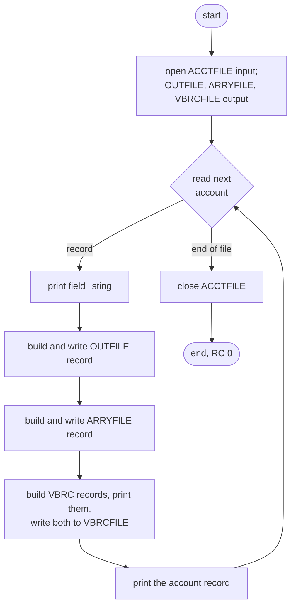
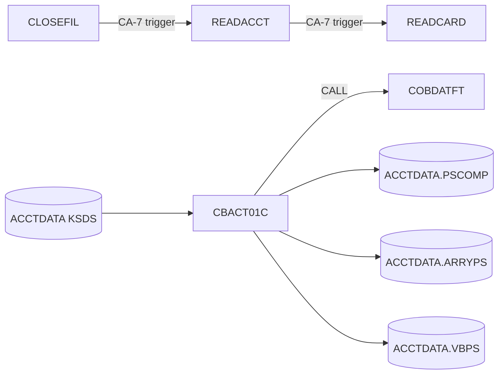

# CBACT01C: Account file listing and extract files (READACCT)

## 1. Summary

The account listing program reads the account master from start to end in key order. For each account it prints the account's fields one per line, then writes three extract files that show three record formats: a fixed-length copy of the account (`OUTFILE`) with the reissue date reformatted to `YYYYMMDD` and a packed cycle debit, a fixed-length record with a five-slot array (`ARRYFILE`) filled partly from the account and partly with constants, and two variable-length records (`VBRCFILE`). Then it prints the whole account record. Nothing in the repository reads the three files; the job is a utility and format demonstration, not part of the posting cycle. It changes no file it reads and ends with return code 0, or abends (U0999) on a file error.

## 2. Rules at a glance

| ID | Rule |
| :-- | :-- |
| BR-ACRD-001 | Every account is read once, in account-number order; each produces 15 SYSOUT lines, one OUTFILE record, one ARRYFILE record and two VBRCFILE records. |
| BR-ACRD-002 | The field listing prints 11 labelled fields and a separator line. |
| BR-ACRD-003 | OUTFILE is the account's first 11 fields minus the ZIP code, with the reissue date as `YYYYMMDD` and the cycle debit packed. |
| BR-ACRD-004 | The reissue date is rearranged by position (characters 1-4, 6-7, 9-10) and followed by 2 spaces; it is not validated. |
| BR-ACRD-005 | A zero cycle debit is written to OUTFILE as 2525.00. |
| BR-ACRD-006 | ARRYFILE: account number, then slots 1-2 hold the balance with debits 1005.00 and 1525.00, slot 3 holds -1025.00 and -2500.00, slots 4-5 are zero, then 4 spaces. |
| BR-ACRD-007 | VBRCFILE gets a 12-byte record (account number, status) and a 39-byte record (account number, balance, credit limit, reissue year). |
| BR-ACRD-008 | After the files are written, the whole 300-byte account record is printed. |

## 3. Actors and triggers

- **Trigger:** JCL job `READACCT`: step `PREDEL` (`IEFBR14`) deletes the three output datasets if they exist, then step `STEP05` runs CBACT01C (`app/jcl/READACCT.jcl:22-50`). In the CA-7 schedule `CLOSEFIL` triggers `READACCT`, which triggers `READCARD`, then `READCUST`, `READXREF`, `WAITSTEP` and `OPENFIL` (`app/scheduler/CardDemo.ca7:335-455`). The CA-7 entry marks the job "maint only" (`app/scheduler/CardDemo.ca7:352`). Control-M does not list it.
- **Preconditions:** the account master can be opened for input (the CA-7 chain runs it after CLOSEFIL has closed the CICS files); the three output datasets do not exist (PREDEL).
- **Parameters:** none. The program does not use the date or the clock.

## 4. Interfaces

### 4.1 Files

| DD | Entity | Organisation | Open | Access | Key | Record | Source |
| :-- | :-- | :-- | :-- | :-- | :-- | --: | :-- |
| `ACCTFILE` | ENT-ACCOUNT | indexed | INPUT | read next | `ACCT-ID` (11) | 300 | `:29-33, 52-55` |
| `OUTFILE` | ENT-ACCT-EXTRACT | sequential, FB | OUTPUT | write | - | 107 | `:35-38, 56-69` |
| `ARRYFILE` | ENT-ACCT-EXTRACT | sequential, FB | OUTPUT | write | - | 110 | `:40-43, 71-78` |
| `VBRCFILE` | ENT-ACCT-EXTRACT | sequential, VB | OUTPUT | write | - | 10-80 (12 and 39 used) | `:45-48, 80-85` |

The JCL allocates `OUTFILE` as `AWS.M2.CARDDEMO.ACCTDATA.PSCOMP` (`RECFM=FB,LRECL=107`), `ARRYFILE` as `...ACCTDATA.ARRYPS` (`RECFM=FB,LRECL=110`) and `VBRCFILE` as `...ACCTDATA.VBPS` (`RECFM=VB,LRECL=84`, so 80 bytes of data plus the 4-byte record descriptor), all `DISP=(NEW,CATLG,DELETE)` (`app/jcl/READACCT.jcl:37-48`). The record layouts are in ENT-ACCT-EXTRACT (`docs/modernization/spec/areas/d1-core-batch-entities.md`).

### 4.2 Console output (SYSOUT), in order

| Text (exact) | When | Source |
| :-- | :-- | :-- |
| `START OF EXECUTION OF PROGRAM CBACT01C` | start | `:141` |
| 11 field lines and a separator (BR-ACRD-002) | each account | `:200-213` |
| `VBRC-REC1:` + the 12-byte first variable record | each account | `:286` |
| `VBRC-REC2:` + the 39-byte second variable record | each account | `:287` |
| the 300-byte account record (BR-ACRD-008) | each account | `:151` |
| `END OF EXECUTION OF PROGRAM CBACT01C` | normal end | `:158` |
| error lines of section 10 | on error | |

The field lines, in order (each label is 25 characters including the colon, followed directly by the value):

| Line | Label (exact) | Value |
| --: | :-- | :-- |
| 1 | `ACCT-ID                 :` | `ACCT-ID`, 11 digits |
| 2 | `ACCT-ACTIVE-STATUS      :` | 1 character |
| 3 | `ACCT-CURR-BAL           :` | signed number (NUM-ACRD-001) |
| 4 | `ACCT-CREDIT-LIMIT       :` | signed number |
| 5 | `ACCT-CASH-CREDIT-LIMIT  :` | signed number |
| 6 | `ACCT-OPEN-DATE          :` | 10 characters as stored |
| 7 | `ACCT-EXPIRAION-DATE     :` | 10 characters as stored |
| 8 | `ACCT-REISSUE-DATE       :` | 10 characters as stored |
| 9 | `ACCT-CURR-CYC-CREDIT    :` | signed number |
| 10 | `ACCT-CURR-CYC-DEBIT     :` | signed number |
| 11 | `ACCT-GROUP-ID           :` | 10 characters as stored |
| 12 | 49 hyphens `-` | |

So each account gives 15 lines: 12 listing lines, 2 `VBRC-REC` lines, 1 record line.

### 4.3 Return code

0 at normal end; abend U0999 on error (ERR-ACRD-006).

## 5. Data used

| Entity field | Read | Use |
| :-- | :-- | :-- |
| ENT-ACCOUNT.ACCT-ID | yes | listing, all three files |
| ENT-ACCOUNT.ACCT-ACTIVE-STATUS | yes | listing, OUTFILE, VBRC-REC1 |
| ENT-ACCOUNT.ACCT-CURR-BAL | yes | listing, OUTFILE, ARRYFILE slots 1-2, VBRC-REC2 |
| ENT-ACCOUNT.ACCT-CREDIT-LIMIT | yes | listing, OUTFILE, VBRC-REC2 |
| ENT-ACCOUNT.ACCT-CASH-CREDIT-LIMIT | yes | listing, OUTFILE |
| ENT-ACCOUNT.ACCT-OPEN-DATE, ACCT-EXPIRAION-DATE | yes | listing, OUTFILE |
| ENT-ACCOUNT.ACCT-REISSUE-DATE | yes | listing, OUTFILE (BR-ACRD-004), VBRC-REC2 (year) |
| ENT-ACCOUNT.ACCT-CURR-CYC-CREDIT | yes | listing, OUTFILE |
| ENT-ACCOUNT.ACCT-CURR-CYC-DEBIT | yes | listing, OUTFILE (BR-ACRD-005) |
| ENT-ACCOUNT.ACCT-GROUP-ID | yes | listing, OUTFILE |
| ENT-ACCOUNT.ACCT-ADDR-ZIP, FILLER | yes | record line only |

No input file is changed. Program-local data with behaviour (`:119-137`): `END-OF-FILE` (`'N'` until the account file is at end); `WS-RECD-LEN` (the length of the next VBRCFILE record); `VBRC-REC1`, `VBRC-REC2` (the two variable records); `WS-ACCT-REISSUE-DATE` (a copy of the reissue date whose first 4 characters are the year); `CODATECN-REC` (the COBDATFT interface, `app/cpy/CODATECN.cpy:17-52`).

## 6. Processing flow

1. Print the start line; open ACCTFILE (input), OUTFILE, ARRYFILE, VBRCFILE (output), in that order (`:141-145`). Any failure abends (ERR-ACRD-001).
2. Repeat until the account file is at end (`:147-154`): read the next account (ERR-ACRD-002); at end of file leave the loop. Otherwise, inside the read paragraph (`:166-178`): clear the array record; print the listing (BR-ACRD-002); build and write the OUTFILE record (BR-ACRD-003); build and write the ARRYFILE record (BR-ACRD-006); clear the first variable record, build both, print them and write them (BR-ACRD-007). Back in the loop, print the account record (BR-ACRD-008).
3. Close ACCTFILE (`:156`, ERR-ACRD-004); print the end line (`:158`). The three output files are not closed by the program (DEF-ACRD-001).

## 7. Business rules

#### BR-ACRD-001 · One pass over the account master
- **When:** each pass of the main loop.
- **Then:** read the next ENT-ACCOUNT record in key order. At end of file the loop ends and nothing is written or printed for it. Otherwise apply BR-ACRD-002 to BR-ACRD-008 in that order.
- **Source:** `:147-154, 165-198`
- **Fidelity:** must-preserve · **Confidence:** runtime-verified (sample: 50 accounts, 50 + 50 + 100 records, 752 SYSOUT lines; `tests/integration/test_reader_jobs.py:42-86`)

#### BR-ACRD-002 · Field listing
- **When:** each account.
- **Then:** print the 11 field lines and the separator of §4.2. Text fields are printed as stored (trailing spaces kept); `ACCT-ID` as 11 digits; the signed amounts as described in NUM-ACRD-001.
- **Source:** `:200-213`
- **Fidelity:** incidental · **Confidence:** runtime-verified

#### BR-ACRD-003 · OUTFILE record
- **When:** each account, after the listing.
- **Then:** write one 107-byte OUTFILE record (ENT-ACCT-EXTRACT): `ACCT-ID`, `ACCT-ACTIVE-STATUS`, `ACCT-CURR-BAL`, `ACCT-CREDIT-LIMIT`, `ACCT-CASH-CREDIT-LIMIT`, `ACCT-OPEN-DATE`, `ACCT-EXPIRAION-DATE`, the converted reissue date (BR-ACRD-004), `ACCT-CURR-CYC-CREDIT`, the cycle debit as packed decimal (BR-ACRD-005, NUM-ACRD-002), `ACCT-GROUP-ID`. The amounts other than the cycle debit stay zoned decimal with the same picture (NUM-ACRD-001); `ACCT-ADDR-ZIP` and the FILLER are not copied.
- **Source:** `:215-243, 245-254`
- **Fidelity:** must-preserve · **Confidence:** runtime-verified

#### BR-ACRD-004 · Reissue date as YYYYMMDD
- **When:** building the OUTFILE record.
- **Then:** the 10-character `ACCT-REISSUE-DATE` is passed to the date-format routine `COBDATFT` with input type `2` (`YYYY-MM-DD`) and output type `2` (`YYYYMMDD`), with the output area set to spaces first. The routine copies characters 1-4, 6-7 and 9-10 of the input to output positions 1-4, 5-6 and 7-8 and leaves the rest of the output as spaces. The first 10 output characters go to `OUT-ACCT-REISSUE-DATE`, so the field is `YYYYMMDD` followed by 2 spaces, for example `2025-05-20` → `20250520  `.
- The input is not checked: the separators may be anything, a blank date gives 10 spaces, and `20250520  ` (already without dashes) gives `202552    `.
- **Source:** `:223-234`; `app/asm/COBDATFT.asm:46-54`; `app/cpy/CODATECN.cpy:17-52`
- **Fidelity:** must-preserve · **Confidence:** runtime-verified with the local shim `tools/shims/COBDATFT.cbl`; the assembler routine does the same three moves (reviewed)

#### BR-ACRD-005 · Default cycle debit
- **When:** building the OUTFILE record.
- **Then:** if `ACCT-CURR-CYC-DEBIT` is zero (a negative zero counts as zero), `OUT-ACCT-CURR-CYC-DEBIT` is 2525.00; otherwise it is the account's cycle debit, sign included.
- The constant is test data written into the program, not a business value (DEF-ACRD-002).
- **Source:** `:237-241`
- **Fidelity:** must-preserve (defect-decide, DEF-ACRD-002) · **Confidence:** runtime-verified

#### BR-ACRD-006 · ARRYFILE record
- **When:** each account, after the OUTFILE record.
- **Then:** the record is cleared (NUM-ACRD-003), then: `ARR-ACCT-ID` = `ACCT-ID`; slot 1 = (`ACCT-CURR-BAL`, 1005.00); slot 2 = (`ACCT-CURR-BAL`, 1525.00); slot 3 = (-1025.00, -2500.00); slots 4 and 5 keep the cleared values (zero, zero); `ARR-FILLER` keeps 4 spaces. In each slot the first value is zoned decimal and the second packed decimal. One 110-byte record is written.
- **Source:** `:169, 256-264, 266-277`
- **Fidelity:** must-preserve (defect-decide, DEF-ACRD-002) · **Confidence:** runtime-verified (`tests/integration/test_reader_jobs.py:72-81`)

#### BR-ACRD-007 · VBRCFILE records
- **When:** each account, after the ARRYFILE record.
- **Then:** `VBRC-REC1` is cleared, then filled with `ACCT-ID` (11) and `ACCT-ACTIVE-STATUS` (1). `VBRC-REC2` gets `ACCT-ID` (11), `ACCT-CURR-BAL` (12, zoned), `ACCT-CREDIT-LIMIT` (12, zoned) and the first 4 characters of `ACCT-REISSUE-DATE` (the year; spaces when the date is blank). Both are printed (`VBRC-REC1:` + 12 bytes, `VBRC-REC2:` + 39 bytes), then written as two variable-length records: first the 12-byte one, then the 39-byte one.
- **Source:** `:175-178, 279-318`
- **Fidelity:** must-preserve · **Confidence:** runtime-verified

#### BR-ACRD-008 · Account record line
- **When:** each account, after BR-ACRD-007.
- **Then:** print the whole 300-byte account record as one line (trailing spaces kept), as it is in the program's record area after the steps above (see NUM-ACRD-004 for the one local difference from the bytes read).
- **Source:** `:150-152`
- **Fidelity:** incidental · **Confidence:** runtime-verified

## 8. Validations

None. No field is checked; the reissue date conversion accepts any text (BR-ACRD-004).

## 9. Side effects

#### SE-ACRD-001 · Extract file writes
- OUTFILE, ARRYFILE and VBRCFILE are created (the JCL deletes old copies first) and written sequentially, one OUTFILE record, one ARRYFILE record and two VBRCFILE records per account, in account order. The account master is only read.
- **Source:** `:245-318`; `app/jcl/READACCT.jcl:22-48`

## 10. Error handling

#### ERR-ACRD-001 · Open failures
- Any status other than `00` on OPEN prints the message below, the file status (ERR-ACRD-005) and abends (ERR-ACRD-006). For the three output files the message is followed directly by the two status characters.

| File | Open message |
| :-- | :-- |
| ACCTFILE | `ERROR OPENING ACCTFILE` |
| OUTFILE | `ERROR OPENING OUTFILE` + status |
| ARRYFILE | `ERROR OPENING ARRAYFILE` + status |
| VBRCFILE | `ERROR OPENING VBRC FILE` + status |

- **Source:** `:320-389` · **Confidence:** reviewed

#### ERR-ACRD-002 · Account read
- Status `00`: process the account; `10`: end of file; anything else: `ERROR READING ACCOUNT FILE`, the status, abend.
- **Source:** `:165-198` · **Confidence:** reviewed

#### ERR-ACRD-003 · Write failures
- After each write, a status other than `00` and other than `10` prints `ACCOUNT FILE WRITE STATUS IS:` + the two status characters, the file status and abends. The same text is used for all three files (DEF-ACRD-003).
- **Source:** `:245-254, 266-277, 290-318` · **Confidence:** reviewed

#### ERR-ACRD-004 · Account file close
- A status other than `00` prints `ERROR CLOSING ACCOUNT FILE`, the status and abends.
- **Source:** `:391-407` · **Confidence:** reviewed

#### ERR-ACRD-005 · File status display
- `FILE STATUS IS: NNNN` + 4 characters: `00` + the two status characters when the status is numeric and does not start with `9`; otherwise the first character, then the binary value of the second character as 3 digits. The same routine as CBTRN02C (ERR-POST-007).
- **Source:** `:416-429` · **Fidelity:** incidental

#### ERR-ACRD-006 · Abend
- Prints `ABENDING PROGRAM` and calls `CEE3ABD` with code 999, timing 0: U0999 (locally return code 16 and `CEE3ABD: USER ABEND U0999` on stderr). No file is closed and the end line is not printed. On z/OS the abend also deletes the new output datasets (`DISP=(NEW,CATLG,DELETE)`).
- **Source:** `:409-413` · **Confidence:** reviewed

## 11. Interactions

- **Upstream:** the account master, maintained by POSTTRAN, INTCALC and the online programs.
- **Downstream:** none in the repository reads the three extract files.
- **Calls:** `COBDATFT` (assembler date-format routine `app/asm/COBDATFT.asm`, specified with area d2) for the reissue date; `CEE3ABD` on error.
- **Schedule:** CA-7 chain `CLOSEFIL` → `READACCT` → `READCARD` → `READCUST` → `READXREF` → `WAITSTEP` → `OPENFIL` (`app/scheduler/CardDemo.ca7:335-455`).

## 12. Numeric, date and format details

#### NUM-ACRD-001 · Zoned amounts in the files and on SYSOUT
- The account amounts are `PIC S9(10)V99` zoned decimal: 12 digits, 2 of them decimals, with the sign in the last byte (in the ASCII sample data `{`, `A`-`I` for a positive last digit 0-9, `}`, `J`-`R` for a negative one; format.md glossary). Copies into OUTFILE, ARRYFILE and VBRC-REC2 keep the value and are written in the same encoding; a value whose last byte is a plain digit is written with the positive overpunch (`000000019400` → `00000001940{`), and a negative zero (`00000000000}`) stays negative zero.
- **SYSOUT:** the listing prints a signed amount as its 12 digits without a decimal point, followed by `+` or `-`: `000000019400+` is 194.00, `000000019400-` is -194.00; a negative zero prints `000000000000-`. This is the GnuCOBOL display format; on z/OS the 12 digits are printed with the sign folded into the last one (`00000001940{`). **Fidelity:** incidental.
- **Source:** `:57-69, 200-213`; `app/cpy/CVACT01Y.cpy:7-14` · **Confidence:** runtime-verified on GnuCOBOL 3.2

#### NUM-ACRD-002 · Packed amounts
- `OUT-ACCT-CURR-CYC-DEBIT` and `ARR-ACCT-CURR-CYC-DEBIT` are `PIC S9(10)V99 COMP-3`: 7 bytes, 12 digits two per byte, the last half-byte the sign, `C` for positive or zero and `D` for negative. 2525.00 is `00 00 00 02 52 50 0C`; -2500.00 is `00 00 00 25 00 00 0D`; a negative cycle debit of -5.01 is `00 00 00 00 05 01 0D`.
- **Source:** `:67-68, 76-77` · **Confidence:** runtime-verified

#### NUM-ACRD-003 · Cleared array record and first variable record
- `INITIALIZE` sets the numeric fields to zero and the text fields to spaces. Locally a cleared zoned amount (slots 4 and 5) is 12 plain zeros `000000000000` (no overpunch) and a cleared packed amount is `00 00 00 00 00 00 0C`; the filler is 4 spaces. On z/OS a cleared signed zoned zero carries the positive sign in the last byte (the equivalent of `00000000000{`), so slots 4 and 5 differ by that one byte per field. **Fidelity:** incidental · **Confidence:** runtime-verified (GnuCOBOL); platform-inferred (z/OS).
- `VBRC-REC1` is cleared and then fully overwritten, so its clearing has no visible effect. `VBRC-REC2` is not cleared but every byte is set for each account.
- **Source:** `:169, 175`

#### NUM-ACRD-004 · Plain-digit signs are rewritten in the record area (local only)
- When a signed amount of the account record ends in a plain digit (`0`-`9` instead of an overpunch character), the GnuCOBOL build rewrites that byte in the program's copy of the record with the positive overpunch when it prints or copies the field, so the record line of BR-ACRD-008 shows `00000001234E` where the file holds `000000012345`. The file itself is not changed. On z/OS a plain digit is a valid unsigned positive zone and is printed unchanged. The sample data always uses overpunch signs, so this never shows on the sample.
- **Fidelity:** incidental · **Confidence:** runtime-verified (GnuCOBOL 3.2 with `-fsign=EBCDIC`)

#### NUM-ACRD-005 · Variable-length records
- Each VBRCFILE record is written with the length the program sets (12, then 39). On z/OS each record has a 4-byte record descriptor word in front. Locally GnuCOBOL writes a 4-byte header too: 2 bytes big-endian data length (not counting the header), then 2 zero bytes. The record contents are the same.
- **Source:** `:80-85, 290-318` · **Fidelity:** incidental (header format) · **Confidence:** runtime-verified

## 13. Known defects and oddities

#### DEF-ACRD-001 · The output files are never closed
- Only ACCTFILE is closed (`:156`). OUTFILE, ARRYFILE and VBRCFILE stay open until the program ends; the runtime closes them (locally with the warnings `libcob: warning: implicit CLOSE of VBRC-FILE ('VBRCFILE')`, then ARRY-FILE and OUT-FILE, on stderr), so a close error would go unnoticed.
- **Source:** `:156, 391-407` · **Status:** open · **Fidelity:** incidental · **Confidence:** runtime-verified

#### DEF-ACRD-002 · Constants written as data
- The default cycle debit 2525.00 (BR-ACRD-005) and the array values 1005.00, 1525.00, -1025.00, -2500.00 (BR-ACRD-006) are fixed values in the program, so the files mix account data with test values. They look like format demonstration data.
- **Status:** open · **Fidelity:** defect-decide (Q-ACRD-001)

#### DEF-ACRD-003 · One write message for three files
- All three write failures print `ACCOUNT FILE WRITE STATUS IS:` although none of the three is the account file, and status `10` (end of file, which cannot happen on a write) is accepted as success.
- **Source:** `:248-249, 269-272, 295-298, 310-313` · **Status:** open · **Fidelity:** incidental

#### DEF-ACRD-004 · Reissue date has a different format from the other dates
- OUTFILE holds the open and expiry dates as `YYYY-MM-DD` but the reissue date as `YYYYMMDD` + 2 spaces (BR-ACRD-004), and the conversion does not check its input.
- **Status:** open

#### DEF-ACRD-005 · Padding and cycle debit (fixed in this branch)
- The program used to leave the rest of the date routine's output area uninitialised, so the 2 characters after `YYYYMMDD` were whatever the previous call left, and it set the OUTFILE cycle debit only when the account's was zero, so a non-zero debit kept the previous account's value. It now clears the output area (`:227`) and copies a non-zero debit (`:239-240`).
- **Status:** fixed in this branch, "batch: CBACT01C (READACCT) reissue date padding and cycle debit" (`CHANGELOG.md:43`, commit 3816bcd, squashed into b5e0139).

#### DEF-ACRD-006 · The group ID is copied from the wrong place in the sample data
- OUTFILE copies `ACCT-GROUP-ID` (positions 113-122). The sample account records hold the group-like value `A000000000` in positions 103-112, which is `ACCT-ADDR-ZIP`, and spaces in `ACCT-GROUP-ID`, so every OUTFILE group ID is blank on the sample. This is the data issue of entities Q-ENT-001, not a program defect.
- **Status:** open (data)

## 14. Open questions

| ID | Question | For |
| :-- | :-- | :-- |
| Q-ACRD-001 | Is READACCT needed in the target at all? Nothing reads its three files and two of them carry constants (DEF-ACRD-002). If it is kept, should the constants be kept? | business |
| Q-ACRD-002 | Who uses the SYSOUT listing (it prints every account in full) and should it be kept? | operations |

## 15. Equivalence contract

A reimplementation is equivalent when, for the same account master:

- OUTFILE and ARRYFILE are byte-identical (107 and 110 bytes per record, same order);
- VBRCFILE holds the same records with the same lengths and bytes in the same order (the record header is platform-specific, NUM-ACRD-005);
- SYSOUT has the same lines in the same order (§4.2), with the local number display of NUM-ACRD-001;
- the return code is equal (0, or the abend of section 10);
- the account master is unchanged.

Slots 4 and 5 of ARRYFILE (NUM-ACRD-003) and the record line for plain-digit signs (NUM-ACRD-004) follow the local build; a z/OS run differs there.

Sample check (`app/data/ASCII`): 50 accounts, 50 OUTFILE records, 50 ARRYFILE records, 100 VBRCFILE records, 752 SYSOUT lines, return code 0. The spec-only reimplementation and its comparison are in `docs/modernization/spec/checks/readacct_reimpl/` and `docs/modernization/spec/evidence/d1-core-batch-review.md`.

## 16. Paragraph coverage

| Paragraph | Lines | Covered by |
| :-- | :-- | :-- |
| (file and data division) | 29-137 | §4.1, §5, NUM-ACRD-001, NUM-ACRD-002 |
| (procedure division main line) | 141-160 | §6, BR-ACRD-001, BR-ACRD-008, DEF-ACRD-001 |
| `1000-ACCTFILE-GET-NEXT` | 165-198 | BR-ACRD-001, ERR-ACRD-002, NUM-ACRD-003 |
| `1100-DISPLAY-ACCT-RECORD` | 200-213 | BR-ACRD-002, NUM-ACRD-001 |
| `1300-POPUL-ACCT-RECORD` | 215-243 | BR-ACRD-003, BR-ACRD-004, BR-ACRD-005 |
| `1350-WRITE-ACCT-RECORD` | 245-254 | SE-ACRD-001, ERR-ACRD-003 |
| `1400-POPUL-ARRAY-RECORD` | 256-264 | BR-ACRD-006 |
| `1450-WRITE-ARRY-RECORD` | 266-277 | SE-ACRD-001, ERR-ACRD-003 |
| `1500-POPUL-VBRC-RECORD` | 279-288 | BR-ACRD-007 |
| `1550-WRITE-VB1-RECORD` | 290-303 | BR-ACRD-007, ERR-ACRD-003, NUM-ACRD-005 |
| `1575-WRITE-VB2-RECORD` | 305-318 | BR-ACRD-007, ERR-ACRD-003, NUM-ACRD-005 |
| `0000-ACCTFILE-OPEN` | 320-336 | ERR-ACRD-001 |
| `2000-OUTFILE-OPEN` | 337-353 | ERR-ACRD-001 |
| `3000-ARRFILE-OPEN` | 355-371 | ERR-ACRD-001 |
| `4000-VBRFILE-OPEN` | 373-389 | ERR-ACRD-001 |
| `9000-ACCTFILE-CLOSE` | 391-407 | ERR-ACRD-004 |
| `9999-ABEND-PROGRAM` | 409-413 | ERR-ACRD-006 |
| `9910-DISPLAY-IO-STATUS` | 416-429 | ERR-ACRD-005 |

16 of 16 paragraphs plus the main line covered.
