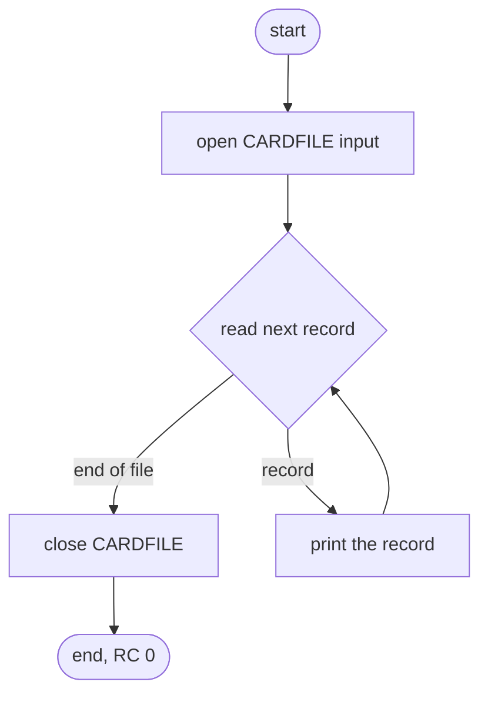
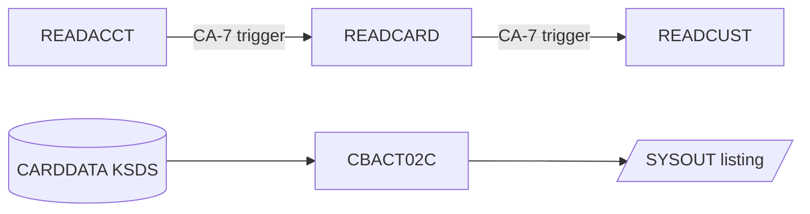

# CBACT02C: Card file listing (READCARD)

## 1. Summary

The card listing program reads the card master (ENT-CARD) from start to end in key order and prints every record, unchanged and in full, as one SYSOUT line. It writes no file, changes nothing and ends with return code 0, or abends (U0999) on an open, read or close error. It is a utility for looking at the file; nothing in the batch cycle depends on it. The listing contains the card number, the CVV and the embossed name in clear (DEF-CDRD-001).

## 2. Rules at a glance

| ID | Rule |
| :-- | :-- |
| BR-CDRD-001 | Every record of the card file is read once, in key order (CARD-NUM), and printed as one 150-byte SYSOUT line. |
| BR-CDRD-002 | Nothing is written or changed; the return code is 0 at normal end. |

## 3. Actors and triggers

- **Trigger:** JCL job `READCARD`, step `STEP05` (`app/jcl/READCARD.jcl:22-28`). In the CA-7 schedule `READACCT` triggers `READCARD` and `READCARD` triggers `READCUST`, in the chain `CLOSEFIL` → `READACCT` → `READCARD` → `READCUST` → `READXREF` → `WAITSTEP` → `OPENFIL` (`app/scheduler/CardDemo.ca7:367-392`); the entry marks the job "maint only". Control-M does not list it.
- **Preconditions:** the card file can be opened for input (the CA-7 chain runs after CLOSEFIL has closed the CICS files).
- **Parameters:** none. The program does not use the date or the clock.

## 4. Interfaces

### 4.1 Files

| DD | Entity | Organisation | Open | Access | Key | Record | Source |
| :-- | :-- | :-- | :-- | :-- | :-- | --: | :-- |
| `CARDFILE` | ENT-CARD | indexed | INPUT | read next | `CARD-NUM` (16) | 150 | `:29-33, 37-40` |

The JCL allocates `CARDFILE` as `AWS.M2.CARDDEMO.CARDDATA.VSAM.KSDS`, `DISP=SHR` (`app/jcl/READCARD.jcl:25-26`).

### 4.2 Console output (SYSOUT), in order

| Text (exact) | When | Source |
| :-- | :-- | :-- |
| `START OF EXECUTION OF PROGRAM CBACT02C` | start | `:71` |
| the 150-byte record as read, trailing spaces included | each record (BR-CDRD-001) | `:78` |
| `END OF EXECUTION OF PROGRAM CBACT02C` | normal end | `:85` |
| error lines of section 10 | on error | |

### 4.3 Return code

0 at normal end; abend U0999 on error (ERR-CDRD-005).

## 5. Data used

| Entity field | Read | Use |
| :-- | :-- | :-- |
| ENT-CARD (whole record) | yes | printed (BR-CDRD-001) |

No file is changed. Program-local data with behaviour (`:65`): `END-OF-FILE` (`'N'` until the card file is at end).

## 6. Processing flow

1. Print the start line; open the file (`:71-72`, ERR-CDRD-001).
2. Repeat until end of file (`:74-81`): read the next record (ERR-CDRD-002); at end of file leave the loop; otherwise print the record (BR-CDRD-001).
3. Close the file (`:83`, ERR-CDRD-003); print the end line (`:85`).

## 7. Business rules

#### BR-CDRD-001 · Print every record once, in key order
- **When:** each pass of the main loop.
- **Then:** read the next ENT-CARD record in ascending `CARD-NUM` order and print the whole 150-byte record as one line, byte for byte as read (text and zoned-decimal fields are not reformatted). At end of file nothing is printed for the end-of-file read.
- The read paragraph has a commented-out second print of the record (`:96`); only the print in the main loop runs.
- **Source:** `:74-81, 92-116`
- **Fidelity:** incidental (the listing exists for operators, DEF-CDRD-001) · **Confidence:** runtime-verified (`tests/integration/test_reader_jobs.py:24-28`; sample: 50 records, 52 SYSOUT lines)

#### BR-CDRD-002 · No output, return code 0
- **When:** normal end.
- **Then:** no file is written or changed and no count is printed; the return code is 0.
- **Source:** `:83-87`
- **Fidelity:** must-preserve · **Confidence:** runtime-verified

## 8. Validations

None.

## 9. Side effects

None. The card file is opened for input only.

## 10. Error handling

#### ERR-CDRD-001 · Open failure
- A status other than `00` on OPEN prints `ERROR OPENING CARDFILE`, the file status (ERR-CDRD-004) and abends (ERR-CDRD-005).
- **Source:** `:118-134` · **Confidence:** reviewed

#### ERR-CDRD-002 · Read failure
- Status `00`: print the record; `10`: end of file; anything else: `ERROR READING CARDFILE`, the status, abend.
- **Source:** `:92-116` · **Confidence:** reviewed

#### ERR-CDRD-003 · Close failure
- A status other than `00` on CLOSE prints `ERROR CLOSING CARDFILE`, the status and abends.
- **Source:** `:136-152` · **Confidence:** reviewed

#### ERR-CDRD-004 · File status display
- `FILE STATUS IS: NNNN` + 4 characters: `00` + the two status characters when the status is numeric and does not start with `9`; otherwise the first character, then the binary value of the second character as 3 digits. The same routine as CBTRN02C (ERR-POST-007).
- **Source:** `:161-174` · **Fidelity:** incidental

#### ERR-CDRD-005 · Abend
- Prints `ABENDING PROGRAM` and calls `CEE3ABD` with code 999, timing 0: U0999 (locally return code 16 and `CEE3ABD: USER ABEND U0999` on stderr). The file is not closed and the end line is not printed.
- **Source:** `:154-158` · **Confidence:** reviewed

## 11. Interactions

- **Upstream:** the card master, maintained by the online card programs and CBIMPORT.
- **Downstream:** none.
- **Calls:** `CEE3ABD` only.

## 12. Numeric, date and format details

#### NUM-CDRD-001 · Record line
- The line is the record exactly as stored: card number (16), account number (11 digits), CVV (3 digits), embossed name (50), expiry date (10), active flag (1), 59 filler bytes (ENT-CARD). No field is converted, so numbers appear as their stored digits (with overpunch sign characters where the field is signed) and dates as stored.
- **Source:** `:78` · **Confidence:** runtime-verified

## 13. Known defects and oddities

#### DEF-CDRD-001 · [security] Card number and CVV printed in full
- Every card record is printed in full, including `CARD-NUM` (the PAN), `CARD-CVV-CD` and `CARD-EMBOSSED-NAME`. Printing a CVV breaks card-data handling rules wherever the log is kept. See `docs/security/data-handling.md`.
- **Source:** `:78` · **Status:** open · **Fidelity:** defect-decide (Q-CDRD-001)

## 14. Open questions

| ID | Question | For |
| :-- | :-- | :-- |
| Q-CDRD-001 | Is the full listing of the card file needed in the target? If so, which fields may it show (DEF-CDRD-001)? | security |

## 15. Equivalence contract

A reimplementation is equivalent when, for the same card file:

- SYSOUT has the same lines in the same order: the start line, one line per record in key order with the full record, the end line;
- the return code is equal (0, or the abend of section 10);
- no file is created or changed.

Sample check (`app/data/ASCII/carddata.txt`): 50 records, 52 SYSOUT lines, return code 0.

## 16. Paragraph coverage

| Paragraph | Lines | Covered by |
| :-- | :-- | :-- |
| (file and data division) | 29-67 | §4.1, §5 |
| (procedure division main line) | 71-87 | §6, BR-CDRD-001, BR-CDRD-002 |
| `1000-CARDFILE-GET-NEXT` | 92-116 | BR-CDRD-001, ERR-CDRD-002 |
| `0000-CARDFILE-OPEN` | 118-134 | ERR-CDRD-001 |
| `9000-CARDFILE-CLOSE` | 136-152 | ERR-CDRD-003 |
| `9999-ABEND-PROGRAM` | 154-158 | ERR-CDRD-005 |
| `9910-DISPLAY-IO-STATUS` | 161-174 | ERR-CDRD-004 |

5 of 5 paragraphs plus the main line covered.
