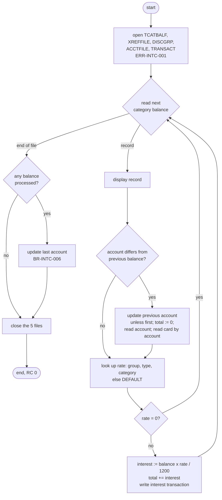
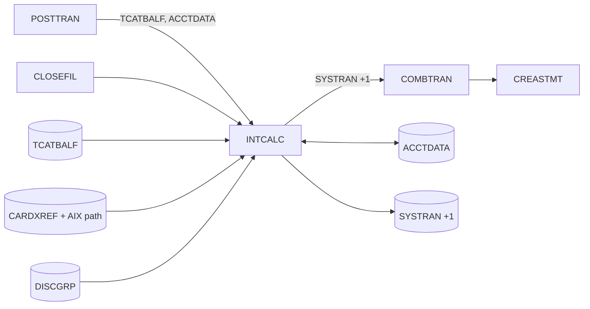

# CBACT04C: Monthly interest calculation (INTCALC)

## 1. Summary

The monthly interest job reads every transaction category balance (one balance per account, transaction type and category) in key order, so all balances of one account come together. For each balance it looks up the annual interest rate in the disclosure group file for the account's disclosure group, type and category, falling back to the group `DEFAULT` when there is no specific rate. When the rate is not zero it computes one month of interest (balance × rate / 1200, truncated to cents) and writes an **interest transaction** to a new sequential transaction file (`SYSTRAN`), which the later COMBTRAN job merges into the transaction master. When it has finished an account it adds the account's total interest to the account's current balance and **resets the cycle credit and cycle debit to zero**. It has no fees logic (the paragraph is empty). It abends (U0999) on any unexpected file error.

## 2. Rules at a glance

| ID | Rule |
| :-- | :-- |
| BR-INTC-001 | Monthly interest for one category balance = `TRAN-CAT-BAL` × annual rate / 1200, truncated (not rounded) to 2 decimals. |
| BR-INTC-002 | The rate comes from the disclosure group record for (account group, type, category); if there is none, from (`DEFAULT`, type, category). |
| BR-INTC-003 | A category whose rate is zero produces no interest and no transaction. |
| BR-INTC-004 | Every category with a non-zero rate produces exactly one interest transaction (type 01, category 0005, source `System`), even when the interest is 0.00. |
| BR-INTC-005 | Interest transaction IDs are the 10-character job PARM followed by a 6-digit sequence that starts at 000001 in each run. |
| BR-INTC-006 | After the last balance of an account: current balance += total interest of the account; cycle credit and cycle debit := 0. This happens for every account that has at least one category balance, also when the total interest is zero. |
| BR-INTC-007 | The interest transaction carries the card number of the account's card found through the account-to-card alternate index. |
| BR-INTC-008 | Balances are processed in key order; an account is "finished" when the next balance belongs to another account or the file ends. |

## 3. Actors and triggers

- **Trigger:** JCL job `INTCALC`, step `STEP15`, `EXEC PGM=CBACT04C,PARM='2022071800'` (`app/jcl/INTCALC.jcl:22-41`). Control-M runs it monthly in folder `MONTHLY-InterestCalculation`, after CLOSEFIL and before COMBTRAN (`app/scheduler/CardDemo.controlm:64-80`). The batch-cycle runbook places it after POSTTRAN and before TRANBKP and COMBTRAN (`docs/runbooks/batch-cycle-restart.md:11-21`). The CA-7 schedule does not list it.
- **Preconditions:** the CICS files are closed (the job rewrites `ACCTDATA`); POSTTRAN has run so `TCATBALF` holds the cycle's category balances; `DISCGRP` is loaded and has `DEFAULT` records for every type and category that occurs (ERR-INTC-005); the `SYSTRAN` generation data group exists.
- **Parameter:** the JCL PARM. The program uses its first 10 characters (`PARM-DATE`) as the prefix of every transaction ID (BR-INTC-005); the length halfword is ignored. The runbook asks operators to set it to the cycle date (`docs/runbooks/batch-cycle-restart.md:37-39`).
- **Clock:** the transaction timestamps come from the system clock (NUM-INTC-005).

## 4. Interfaces

### 4.1 Files

| DD | Entity | Organisation | Open | Access | Key | Record | Source |
| :-- | :-- | :-- | :-- | :-- | :-- | --: | :-- |
| `TCATBALF` | ENT-TCAT-BAL | indexed (KSDS) | INPUT | sequential read next | account (11) + type (2) + category (4) | 50 | `:28-32, 61-67` |
| `XREFFILE` | ENT-CARD-XREF | indexed | INPUT | random read by alternate key `XREF-ACCT-ID` (11, offset 25) | primary `XREF-CARD-NUM` | 50 | `:34-39, 69-74` |
| `XREFFIL1` | ENT-CARD-XREF | alternate index path | (opened with XREFFILE) | used for the alternate-key read | `XREF-ACCT-ID` | 50 | `app/jcl/INTCALC.jcl:31-32` |
| `ACCTFILE` | ENT-ACCOUNT | indexed | I-O | random read, rewrite | `ACCT-ID` (11, offset 0) | 300 | `:41-45, 84-87` |
| `DISCGRP` | ENT-DISC-GROUP | indexed | INPUT | random read | group (10) + type (2) + category (4) | 50 | `:47-51, 76-82` |
| `TRANSACT` | ENT-TRANSACTION | sequential, fixed | OUTPUT | write | - | 350 | `:53-56, 89-92` |

`TRANSACT` is allocated as `AWS.M2.CARDDEMO.SYSTRAN(+1)`, `DISP=(NEW,CATLG,DELETE)`, `RECFM=F,LRECL=350` (`app/jcl/INTCALC.jcl:37-41`). Records are read into and written from the copybook layouts; the FD areas are byte containers.

### 4.2 Interest transaction record (TRANSACT, 350 bytes, ENT-TRANSACTION layout)

| Bytes | Field | Content |
| :-- | :-- | :-- |
| 1-16 | `TRAN-ID` | `PARM-DATE` (10 characters) + sequence (6 digits, leading zeros), e.g. `2022071800000001` |
| 17-18 | `TRAN-TYPE-CD` | `01` |
| 19-22 | `TRAN-CAT-CD` | `0005` |
| 23-32 | `TRAN-SOURCE` | `System` + 4 spaces |
| 33-132 | `TRAN-DESC` | `Int. for a/c ` (13 characters, one trailing space) + `ACCT-ID` (11 digits), then 76 spaces |
| 133-143 | `TRAN-AMT` | monthly interest, decimal(11,2) zoned (NUM-INTC-001) |
| 144-152 | `TRAN-MERCHANT-ID` | `000000000` |
| 153-262 | merchant name, city, ZIP | spaces |
| 263-278 | `TRAN-CARD-NUM` | `XREF-CARD-NUM` of the account's cross-reference (BR-INTC-007) |
| 279-304 | `TRAN-ORIG-TS` | current timestamp `YYYY-MM-DD-HH.MM.SS.hh0000` (NUM-INTC-005) |
| 305-330 | `TRAN-PROC-TS` | the same value as `TRAN-ORIG-TS` |
| 331-350 | FILLER | spaces |

Source: `:474-500`.

### 4.3 Console output (SYSOUT), in order

| Text (exact) | When | Source |
| :-- | :-- | :-- |
| `START OF EXECUTION OF PROGRAM CBACT04C` | start | `:181` |
| the 50-byte category balance record, as stored | every balance read (DEF-INTC-011) | `:193` |
| `DISCLOSURE GROUP RECORD MISSING` then `TRY WITH DEFAULT GROUP CODE` | each balance whose own group has no rate record (BR-INTC-002) | `:419-420` |
| `ACCOUNT NOT FOUND: <11 digits>` | account or cross-reference missing (ERR-INTC-003, ERR-INTC-004) | `:376, 398` |
| `END OF EXECUTION OF PROGRAM CBACT04C` | normal end | `:231` |
| error lines of section 10 | on error | |

There is no count or total line. `WS-RECORD-COUNT` is incremented but never printed (`:192`).

### 4.4 Return code

0 at normal end (GOBACK without setting `RETURN-CODE`); abend U0999 on error (ERR-INTC-009).

## 5. Data used

| Entity field | Read | Written | Use |
| :-- | :-- | :-- | :-- |
| ENT-TCAT-BAL (all) | yes | - | displayed; key and balance drive the computation; the file is not changed |
| ENT-TCAT-BAL.TRANCAT-ACCT-ID | yes | - | account grouping, account key, alternate key for the cross-reference |
| ENT-TCAT-BAL.TRANCAT-TYPE-CD, TRANCAT-CD | yes | - | disclosure group key |
| ENT-TCAT-BAL.TRAN-CAT-BAL | yes | - | interest base (BR-INTC-001) |
| ENT-ACCOUNT.ACCT-GROUP-ID | yes | - | disclosure group key (BR-INTC-002, DEF-INTC-006) |
| ENT-ACCOUNT.ACCT-ID | yes | - | transaction description |
| ENT-ACCOUNT.ACCT-CURR-BAL | yes | yes | += total interest (BR-INTC-006) |
| ENT-ACCOUNT.ACCT-CURR-CYC-CREDIT, ACCT-CURR-CYC-DEBIT | - | yes | set to zero (BR-INTC-006) |
| ENT-ACCOUNT (other fields) | yes | rewritten with the bytes read | |
| ENT-CARD-XREF.XREF-CARD-NUM | yes | - | card number on the interest transaction |
| ENT-DISC-GROUP.DIS-INT-RATE | yes | - | annual rate in percent |
| ENT-TRANSACTION (all) | - | yes | interest transactions (§4.2) |

Program-local data with behaviour (`:166-178`): `WS-LAST-ACCT-NUM` (`PIC X(11)`, initially spaces; the account being processed), `WS-MONTHLY-INT` and `WS-TOTAL-INT` (`PIC S9(09)V99`), `WS-FIRST-TIME` (`'Y'` until the first balance), `WS-TRANID-SUFFIX` (`PIC 9(06)`, starts at 0), `PARM-DATE` (`PIC X(10)`, linkage).

## 6. Processing flow

1. Print the start line; open TCATBALF (input), XREFFILE (input), DISCGRP (input), ACCTFILE (input-output), TRANSACT (output), in that order (`:181-186`).
2. Repeat until end of file (`:188-220`):
   1. Read the next category balance (`:326-349`). End of file ends the loop.
   2. Display the record.
   3. If its account differs from `WS-LAST-ACCT-NUM`: if this is not the first balance, update the previous account (BR-INTC-006); set the total interest to 0; remember the account; read the account (`:373-392`); read the cross-reference by account (`:394-414`).
   4. Look up the rate (BR-INTC-002, `:416-461`).
   5. If the rate is not zero: compute the interest, add it to the account total, write the interest transaction (`:463-517`); then the empty fees paragraph (`:520-522`).
3. After the loop, if at least one balance was read, update the last account (`:221-223`).
4. Close the five files in the order they were opened (`:225-229`); print the end line.

## 7. Business rules

#### BR-INTC-001 · Monthly interest per category balance
- **When:** a category balance is read and its rate (BR-INTC-002) is not zero.
- **Then:** monthly interest = `TRAN-CAT-BAL` × `DIS-INT-RATE` / 1200, where the rate is an annual percentage (15.00 means 15 % a year). The product and quotient are exact; the result is **truncated toward zero** to 2 decimals (no rounding), stored in `WS-MONTHLY-INT` and added to the account's total interest `WS-TOTAL-INT`. Examples: 1,164.87 × 15.00 / 1200 = 14.560875 → 14.56; -1.00 × 15.00 / 1200 = -0.0125 → -0.01; -0.50 × 15.00 / 1200 = -0.00625 → 0.00.
- **Negative balances** (credits, as POSTTRAN posts type 03 with negative amounts) give negative interest when their rate is not zero (DEF-INTC-012). In the sample disclosure groups the credit and payment types `02` and `03` have rate 0.
- **Source:** `:463-469`
- **Fidelity:** must-preserve (truncation: defect-decide, Q-INTC-004) · **Confidence:** runtime-verified

#### BR-INTC-002 · Rate lookup with DEFAULT fallback
- **When:** each category balance.
- **Then:** read ENT-DISC-GROUP with key `ACCT-GROUP-ID` (10, from the account record read for this account) + `TRANCAT-TYPE-CD` (2) + `TRANCAT-CD` (4 digits).
  - **Found:** use its `DIS-INT-RATE`.
  - **Not found (status 23):** print `DISCLOSURE GROUP RECORD MISSING` and `TRY WITH DEFAULT GROUP CODE`, then read with key `DEFAULT` (padded with spaces to 10) + the same type and category, and use that rate. If that record is missing too, the program abends (ERR-INTC-005).
  - The group part of the key is set from `ACCT-GROUP-ID` again for every balance, so a fallback for one category does not carry over to the next.
- **Sample data:** every sample account has a blank `ACCT-GROUP-ID` (Q-ENT-001), so every lookup falls back to `DEFAULT` and prints the two lines (100 lines for the 50 balances of the sample `TCATBALF`). See DEF-INTC-006 for what changes when the group is filled in.
- **Source:** `:210-213, 416-461`
- **Fidelity:** must-preserve · **Confidence:** runtime-verified

#### BR-INTC-003 · Zero rate: nothing happens
- **When:** the rate found by BR-INTC-002 is zero.
- **Then:** no interest, no transaction, the transaction sequence is not advanced. The account is still updated at the end of the account (BR-INTC-006).
- **Source:** `:214-217`
- **Fidelity:** must-preserve · **Confidence:** runtime-verified

#### BR-INTC-004 · Interest transaction
- **When:** BR-INTC-001 applies (rate not zero), also when the computed interest is 0.00 (balance zero or too small).
- **Then:** write one 350-byte record laid out as §4.2: start from all spaces; ID per BR-INTC-005; type `01`; category `0005`; source `System`; description `Int. for a/c ` + the 11-digit `ACCT-ID`; amount = the monthly interest; merchant ID zero; merchant name, city and ZIP spaces; card number per BR-INTC-007; both timestamps = one reading of the clock (NUM-INTC-005).
- In the transaction-type reference data `01`/`0005` is "Purchase / Interest Amount" (ENT-TRAN-CATEGORY).
- **Source:** `:474-502`
- **Fidelity:** must-preserve · **Confidence:** runtime-verified

#### BR-INTC-005 · Interest transaction ID
- **When:** each interest transaction.
- **Then:** add 1 to the run's sequence (starts at 0, so the first transaction gets 000001) and set `TRAN-ID` = the first 10 characters of the PARM followed by the sequence as 6 digits. The sequence runs over the whole file, not per account. With `PARM='2022071800'` the IDs are `2022071800000001`, `2022071800000002`, ...
- Two runs with the same PARM produce the same IDs (DEF-INTC-010). More than 999,999 transactions in one run would wrap the sequence to 000000 (NUM-INTC-004).
- **Source:** `:173, 476-482`
- **Fidelity:** must-preserve · **Confidence:** runtime-verified

#### BR-INTC-006 · Account update
- **When:** the first balance of a different account is read and an earlier account exists (`:194-199`), or the file ends after at least one balance (`:221-223`).
- **Then:** for the account read most recently (the previous account): `ACCT-CURR-BAL` += `WS-TOTAL-INT`; `ACCT-CURR-CYC-CREDIT` := 0; `ACCT-CURR-CYC-DEBIT` := 0; rewrite the whole account record. Every other byte is written back as read.
- This happens for every account that has at least one category balance, whatever the rates: an account whose rates are all zero still gets its cycle credit and debit reset and its balance rewritten unchanged (DEF-INTC-005). Accounts without any category balance are not touched.
- **Source:** `:194-199, 221-223, 351-371`
- **Fidelity:** must-preserve · **Confidence:** runtime-verified

#### BR-INTC-007 · Card number on the interest transaction
- **When:** an account starts (BR-INTC-008).
- **Then:** read ENT-CARD-XREF by its alternate key `XREF-ACCT-ID` = the account ID; the record found gives `XREF-CARD-NUM`, which goes on every interest transaction of the account.
- **Several cards per account:** the alternate index is non-unique (ENT-CARD-XREF). Locally (GnuCOBOL with Berkeley DB) the read returns the first card in ascending card-number order and status `00`. On z/OS the read returns the first record of the alternate index for that key, with status `02` when more exist, which the program treats as an error (DEF-INTC-007). The sample data has one card per account.
- **Source:** `:204-205, 394-414, 497`
- **Fidelity:** must-preserve · **Confidence:** runtime-verified (local); platform-inferred (z/OS)

#### BR-INTC-008 · Account grouping
- **When:** each category balance.
- **Then:** the balances arrive in key order (account, type, category), so all balances of one account are consecutive. A balance whose `TRANCAT-ACCT-ID` differs from `WS-LAST-ACCT-NUM` starts a new account: the total interest goes back to 0 and the account and its cross-reference are read once. The comparison is character by character (11 digits against 11 characters; `WS-LAST-ACCT-NUM` starts as spaces, so the first balance always starts an account).
- **Source:** `:194-206`
- **Fidelity:** must-preserve · **Confidence:** runtime-verified

## 8. Validations

None with a user-visible outcome. The program does not validate the PARM, the balance, the rate, or that the account is active; missing reference data abends (section 10).

## 9. Side effects

In execution order. There is no commit or rollback: each write and rewrite is permanent as soon as it is made.

#### SE-INTC-001 · Interest transaction write
- TRANSACT: sequential WRITE of the §4.2 record, one per balance with a non-zero rate, in balance key order.
- **Source:** `:474-517`

#### SE-INTC-002 · Account rewrite
- ACCTFILE: REWRITE of the account record read when the account started, after all its balances (BR-INTC-006). An account's interest transactions are written before its rewrite.
- **Source:** `:351-371`

Reads with no side effect: TCATBALF (sequential), ACCTFILE (random, before the rewrite), XREFFILE (random by alternate key), DISCGRP (random, one or two reads per balance).

## 10. Error handling

#### ERR-INTC-001 · Open and close failures
- Any status other than `00` on OPEN or CLOSE prints the message below, the file status (ERR-INTC-008) and abends (ERR-INTC-009).

| File | Open message | Close message |
| :-- | :-- | :-- |
| TCATBALF | `ERROR OPENING TRANSACTION CATEGORY BALANCE` | `ERROR CLOSING TRANSACTION BALANCE FILE` |
| XREFFILE | `ERROR OPENING CROSS REF FILE` followed directly by the 2-character status (no space), e.g. `ERROR OPENING CROSS REF FILE35` | `ERROR CLOSING CROSS REF FILE` |
| DISCGRP | `ERROR OPENING DALY REJECTS FILE` (wrong text, DEF-INTC-003) | `ERROR CLOSING DISCLOSURE GROUP FILE` |
| ACCTFILE | `ERROR OPENING ACCOUNT MASTER FILE` | `ERROR CLOSING ACCOUNT FILE` |
| TRANSACT | `ERROR OPENING TRANSACTION FILE` | `ERROR CLOSING TRANSACTION FILE` |

- **Source:** `:235-324, 524-613`
- **Confidence:** runtime-verified for the TCATBALF open (`tests/integration/test_abends.py:7-30`)

#### ERR-INTC-002 · Category balance read
- Status `00`: process; `10`: end of file; anything else: `ERROR READING TRANSACTION CATEGORY FILE`, file status, abend.
- **Source:** `:326-349`

#### ERR-INTC-003 · Account read
- Not found: prints `ACCOUNT NOT FOUND: ` + the 11-digit account ID; then, because the status is not `00`, `ERROR READING ACCOUNT FILE`, `FILE STATUS IS: NNNN0023` and abend. Any other non-`00` status: the same without the first line.
- By then the previous accounts have been rewritten and their interest transactions written (DEF-INTC-009).
- **Source:** `:373-392`
- **Confidence:** reviewed

#### ERR-INTC-004 · Cross-reference read by account
- Not found: `ACCOUNT NOT FOUND: ` + the 11-digit account ID (the same text as ERR-INTC-003), then `ERROR READING XREF FILE`, `FILE STATUS IS: NNNN0023`, abend. Any other non-`00` status (including `02`, DEF-INTC-007): `ERROR READING XREF FILE`, status, abend.
- The account record has already been read but not changed.
- **Source:** `:394-414`
- **Confidence:** reviewed

#### ERR-INTC-005 · Disclosure group reads
- First read: status `00` or `23` continue; anything else: `ERROR READING DISCLOSURE GROUP FILE`, status, abend.
- `DEFAULT` read (after `23`): any status other than `00`: `ERROR READING DEFAULT DISCLOSURE GROUP`, status, abend. A missing `DEFAULT` record therefore prints `DISCLOSURE GROUP RECORD MISSING`, `TRY WITH DEFAULT GROUP CODE`, `ERROR READING DEFAULT DISCLOSURE GROUP`, `FILE STATUS IS: NNNN0023`, `ABENDING PROGRAM`.
- **Source:** `:416-461`
- **Confidence:** reviewed

#### ERR-INTC-006 · Transaction write
- Status not `00`: `ERROR WRITING TRANSACTION RECORD`, status, abend.
- **Source:** `:502-516`

#### ERR-INTC-007 · Account rewrite
- Status not `00`: `ERROR RE-WRITING ACCOUNT FILE`, status, abend.
- **Source:** `:357-370`

#### ERR-INTC-008 · File status display
- Prints `FILE STATUS IS: NNNN` followed by 4 characters: for a numeric status not starting with `9`, `00` + the 2 status digits (`FILE STATUS IS: NNNN0023`); otherwise the first character and the binary value of the second byte as 3 digits. Same routine as CBTRN02C (ERR-POST-007).
- **Source:** `:637-650` · **Fidelity:** incidental

#### ERR-INTC-009 · Abend
- Prints `ABENDING PROGRAM` and calls `CEE3ABD` with code 999, timing 0: user abend U0999. Locally the shim prints `CEE3ABD: USER ABEND U0999` on stderr and the step ends with return code 16 (`tools/shims/CEE3ABD.cbl:21-23`).
- The end line is not printed and no file is closed. Writes and rewrites done before stay (DEF-INTC-009).
- **Source:** `:630-634` · **Confidence:** runtime-verified (`tests/integration/test_abends.py:20-30`)

## 11. Interactions

- **Upstream:** POSTTRAN (`CBTRN02C`) builds the category balances (BR-POST-004) and the cycle credit and debit (BR-POST-005) that this program reads and resets. The DISCGRP job loads the rates (`app/jcl/DISCGRP.jcl:54-62`).
- **Downstream:** COMBTRAN sorts `TRANSACT.BKUP(0)` and `SYSTRAN(0)` together and loads the result into the transaction master (`docs/runbooks/batch-cycle-restart.md:18`), so interest transactions appear in statements (CREASTMT) and in the online transaction list. TRANREPT reports on the transaction master.
- **Shared data:** `ACCTDATA` with POSTTRAN and the online programs (bill payment `COBIL00C`, account update `COACTUPC`). The cycle credit and debit reset here is what makes POSTTRAN's over-limit figure (BR-POST-001) a per-cycle figure.
- **Not reset:** the category balances in `TCATBALF` are not changed, so the next INTCALC charges interest on the same balances again unless something else resets them (DEF-INTC-005, Q-INTC-005).
- **Calls:** `CEE3ABD` only.

## 12. Numeric, date and format details

#### NUM-INTC-001 · Amounts, rates and signs
- `TRAN-CAT-BAL`, `WS-MONTHLY-INT`, `WS-TOTAL-INT`, `TRAN-AMT`: decimal(11,2), `PIC S9(09)V99` zoned. `ACCT-CURR-BAL`: decimal(12,2), `PIC S9(10)V99`. `DIS-INT-RATE`: decimal(6,2), `PIC S9(04)V99` zoned (`00150{` = 15.00).
- Values the program computes are written with the sign folded into the last byte: `{`, `A`-`I` for +0..+9, `}`, `J`-`R` for -0..-9 (ASCII sample convention, as NUM-POST-001). A computed zero, including a negative interest truncated to zero, is written as `{` (positive): -0.50 × 15 / 1200 gives `0000000000{`. The cycle credit and debit are written as `00000000000{`.
- The `IF DIS-INT-RATE NOT = 0` test is numeric: `00000{` and `00000}` are both zero.
- **Confidence:** runtime-verified on GnuCOBOL 3.2 `-std=ibm -fsign=EBCDIC`

#### NUM-INTC-002 · Truncation
- The interest COMPUTE has no `ROUNDED`: digits beyond the second decimal are dropped, toward zero for negative values (BR-INTC-001 examples). The total interest is the sum of the truncated monthly amounts.
- **Source:** `:465-466` · **Confidence:** runtime-verified

#### NUM-INTC-003 · Overflow
- No size-error handling. A monthly interest that exceeds 999,999,999.99 (only possible with rates above 1,200 % or balances near the field maximum) keeps its low-order 11 digits and its sign; so does a total interest above that, and an `ACCT-CURR-BAL` above 9,999,999,999.99 (9,999,999,999.99 + 0.02 is stored as +0.01). Not reachable with the sample data.
- **Source:** `:353, 465-468` · **Confidence:** runtime-verified on GnuCOBOL 3.2; z/OS platform-inferred

#### NUM-INTC-004 · Transaction ID
- 16 characters = `PARM-DATE` (`PIC X(10)`, the first 10 PARM characters, padded with spaces locally when the PARM is shorter) + `WS-TRANID-SUFFIX` (`PIC 9(06)`, unsigned, leading zeros). The ADD has no size-error handling, so after 999,999 the suffix wraps to 000000.
- **Source:** `:173, 178, 476-482`

#### NUM-INTC-005 · Timestamps
- `TRAN-ORIG-TS` and `TRAN-PROC-TS` (26 characters each) = `YYYY-MM-DD-HH.MM.SS.hh0000` from the system clock, read once per transaction (both fields get the same value): date with `-`, a `-`, time with `.`, a `.`, the hundredths of a second and `0000`. Example from a local run: `2022-07-06-12.00.00.130000` (the date is pinned to `CARDDEMO_BUSINESS_DATE`). This is the POSTTRAN processing-timestamp layout (NUM-POST-007), not the daily-input layout.
- **Source:** `:498-500, 615-628`

#### NUM-INTC-006 · Category code
- `TRAN-CAT-CD` (`PIC 9(04)`) is set from the literal `'05'`, which is stored as `0005`.
- **Source:** `:485` · **Confidence:** runtime-verified

## 13. Known defects and oddities

#### DEF-INTC-001 · The last account was not updated (fixed in this branch)
- The account update was in the loop's "end of file" branch, which never ran because the loop ended first, so the account that came last in `TCATBALF` got its interest transactions but no balance update and no cycle reset. Now done after the loop (`:221-223`).
- **Status:** fixed in this branch, "batch: CBACT04C updates the last account and blanks its records" (`CHANGELOG.md:49`, commit 268af56, squashed into b5e0139). The runbook section "Known defect: last account" (`docs/runbooks/batch-cycle-restart.md:115-121`) still describes the old behaviour.

#### DEF-INTC-002 · Interest transaction was not cleared (fixed in this branch)
- The transaction record was built field by field without clearing it, so FILLER kept its initial working-storage content (low-values on GnuCOBOL, undefined on z/OS). Now cleared to spaces first (`:475`).
- **Status:** fixed in this branch (same commit).

#### DEF-INTC-003 · Wrong message on the disclosure group open error
- A DISCGRP open failure prints `ERROR OPENING DALY REJECTS FILE`, copied from POSTTRAN.
- **Source:** `:282` · **Status:** open (diagnostic only)

#### DEF-INTC-004 · Fees are not implemented
- `1400-COMPUTE-FEES` is empty ("To be implemented"), although the job's comment says it computes "interest and fees" (`app/jcl/INTCALC.jcl:20`).
- **Source:** `:520-522` · **Status:** open · **Fidelity:** defect-decide (Q-INTC-007)

#### DEF-INTC-005 · Cycle reset and repeated interest
- The cycle credit and debit are reset for every account that has a category balance, also when no interest is charged (BR-INTC-006); accounts without a category balance keep their cycle totals.
- The category balances are not reduced or reset, and nothing records that interest was charged. A second INTCALC run (rerun after a failure, or two runs in a cycle) charges the interest again on the same balances, adds it to the balance a second time and writes transactions with the same IDs (DEF-INTC-010). The runbook warns about this for restarts (`docs/runbooks/batch-cycle-restart.md:102-113`).
- **Status:** open · **Fidelity:** defect-decide (Q-INTC-005)

#### DEF-INTC-006 · Disclosure group is blank in the sample data (Q-ENT-001)
- All 50 sample accounts have a blank `ACCT-GROUP-ID` (the group-like value `A000000000` sits in `ACCT-ADDR-ZIP`), so every lookup falls back to `DEFAULT` and every balance prints the two "missing" lines.
- **Effect on interest, measured:** the sample `DISCGRP` holds groups `A000000000`, `DEFAULT` and `ZEROAPR` (17 type and category records each, 51 in total). `A000000000` and `DEFAULT` have the same rates for every key except type `07` category `0001` (15.00 in `A000000000`, 0.00 in `DEFAULT`); `ZEROAPR` is 0.00 everywhere. Running INTCALC after the sample POSTTRAN with `ACCT-GROUP-ID` = `A000000000` on every account gave byte-identical interest transactions and account records; only the 100 "missing" lines disappeared. The interest would differ only for type 07 category 0001 balances (adjustments), which POSTTRAN's sample day does not create, and for accounts assigned to `ZEROAPR` (no interest at all).
- **Status:** open (data question, Q-ENT-001, Q-INTC-001) · **Confidence:** runtime-verified

#### DEF-INTC-007 · Several cards per account on z/OS
- The `SELECT` declares the alternate key without `WITH DUPLICATES` (`:38`) while the alternate index is defined `NONUNIQUEKEY` (ENT-CARD-XREF). On z/OS a keyed read through a non-unique alternate index returns status `02` when more records have the same key, and the program accepts only `00` (ERR-INTC-004), so an account with two cards would abend the job; the open itself may also be rejected for the mismatched key attribute. Locally GnuCOBOL returns `00` and the lowest card number.
- **Source:** `:34-39, 394-414` · **Status:** open · **Confidence:** platform-inferred (Q-INTC-002)

#### DEF-INTC-008 · Only status `00` counts as success
- Every open, close, read, write and rewrite accepts only `00` (plus `10` at end of file and `23` on the first disclosure read). A successful but non-zero status (`02`, `97`) abends the job. Same pattern as DEF-POST-014.
- **Source:** `:235-324, 326-349, 351-461, 502-516, 524-613` · **Status:** open · **Confidence:** platform-inferred

#### DEF-INTC-009 · Partial update on abend
- Accounts finished before an abend are already rewritten; on z/OS the abend deletes `SYSTRAN(+1)` (`DISP=(NEW,CATLG,DELETE)`), so their interest is in the balances but the transactions are lost. Rerunning charges it again (DEF-INTC-005). The runbook's restart restores `ACCTDATA` first (`docs/runbooks/batch-cycle-restart.md:102-113`). Locally the partial `TRANSACT` file stays.
- **Source:** `app/jcl/INTCALC.jcl:37-41`, `:630-634` · **Status:** open · **Confidence:** platform-inferred (disposition processing)

#### DEF-INTC-010 · PARM not validated; IDs not unique across runs
- The PARM length is ignored and the text is not checked. With a PARM shorter than 10 characters the ID prefix contains whatever follows the PARM in storage on z/OS (spaces locally). The same PARM in two runs (the JCL hardcodes `2022071800`) gives the same transaction IDs, and COMBTRAN then loads two records with one key into the transaction master.
- **Source:** `:176-178, 478-482`, `app/jcl/INTCALC.jcl:22` · **Status:** open · **Fidelity:** defect-decide (Q-INTC-006)

#### DEF-INTC-011 · [security] Balances printed to SYSOUT
- Every category balance record (account number and balance) is displayed. No card number or other PAN is displayed. See `docs/security/data-handling.md`.
- **Source:** `:193` · **Status:** open (low)

#### DEF-INTC-012 · Negative interest on credit balances
- A negative category balance with a non-zero rate produces a negative interest transaction that reduces the account balance (BR-INTC-001). With the sample rates this cannot happen for types 02 and 03 (rate 0) but can for any other type with a negative balance.
- **Status:** open · **Fidelity:** defect-decide (Q-INTC-003)

#### DEF-INTC-013 · Origin timestamp is the processing time
- Both timestamps of an interest transaction are the time of the run, in the processing layout (NUM-INTC-005); there is no separate "interest date" and the PARM date is used only in the ID.
- **Status:** open (informational)

## 14. Open questions

| ID | Question | For |
| :-- | :-- | :-- |
| Q-INTC-001 | Which disclosure group should each account have (Q-ENT-001)? With the sample rates only type 07 / category 0001 balances and `ZEROAPR` accounts would change (DEF-INTC-006). | business, data owner |
| Q-INTC-002 | On z/OS, what happens with two cards for one account: open status 39, read status 02 and abend (DEF-INTC-007), or something else? | mainframe team |
| Q-INTC-003 | Should negative category balances earn (negative) interest? | business |
| Q-INTC-004 | Keep truncation to cents, or round half up (or banker's rounding)? The difference is up to 0.01 per category per month. | business |
| Q-INTC-005 | Which job is meant to reset or age the category balances after interest, so interest is not charged twice on the same balance? Should INTCALC be idempotent per cycle? | business, architecture |
| Q-INTC-006 | Should the interest transaction ID come from the cycle date automatically, and be checked for uniqueness? | operations, architecture |
| Q-INTC-007 | What fees were meant to be computed in `1400-COMPUTE-FEES`? | business |

## 15. Equivalence contract

A reimplementation is equivalent when, for the same input files (TCATBALF, XREFFILE, ACCTFILE, DISCGRP), PARM and clock date:

- the return code is equal (0, or the abend of section 10);
- the `TRANSACT` output is byte-identical, in the same order, except bytes 279-304 and 305-330 (the timestamps), which must both match `YYYY-MM-DD-HH.MM.SS.hh0000` with the run date and be equal to each other;
- the account file after the run is byte-identical;
- SYSOUT has the same lines in the same order (start line, one record line per balance, the "missing" pairs, end line, or the error lines).

Sample check (`app/data/ASCII` after the sample POSTTRAN day, PARM `2022071800`): 100 category balances, 50 interest transactions (type 01 balances; the type 03 balances have rate 0), 50 accounts rewritten, return code 0. On the raw sample (before POSTTRAN, all balances zero): 50 transactions of 0.00. The spec-only reimplementation and its comparison against the GnuCOBOL runner are in `docs/modernization/spec/checks/intcalc_reimpl/` and `docs/modernization/spec/evidence/d1-core-batch-review.md`.

## 16. Paragraph coverage

| Paragraph | Lines | Covered by |
| :-- | :-- | :-- |
| (file and data division) | 28-178 | §4.1, §4.2, §5, NUM-INTC-001, NUM-INTC-004 |
| (procedure division main line) | 180-233 | §6, BR-INTC-002, BR-INTC-003, BR-INTC-006, BR-INTC-008, §4.3 |
| `0000-TCATBALF-OPEN` | 235-251 | ERR-INTC-001 |
| `0100-XREFFILE-OPEN` | 253-269 | ERR-INTC-001 |
| `0200-DISCGRP-OPEN` | 271-287 | ERR-INTC-001, DEF-INTC-003 |
| `0300-ACCTFILE-OPEN` | 290-306 | ERR-INTC-001 |
| `0400-TRANFILE-OPEN` | 308-324 | ERR-INTC-001 |
| `1000-TCATBALF-GET-NEXT` | 326-349 | ERR-INTC-002, §6 step 2.1 |
| `1050-UPDATE-ACCOUNT` | 351-371 | BR-INTC-006, SE-INTC-002, ERR-INTC-007, DEF-INTC-001 |
| `1100-GET-ACCT-DATA` | 373-392 | ERR-INTC-003 |
| `1110-GET-XREF-DATA` | 394-414 | BR-INTC-007, ERR-INTC-004, DEF-INTC-007 |
| `1200-GET-INTEREST-RATE` | 416-441 | BR-INTC-002, ERR-INTC-005 |
| `1200-A-GET-DEFAULT-INT-RATE` | 444-461 | BR-INTC-002, ERR-INTC-005 |
| `1300-COMPUTE-INTEREST` | 463-471 | BR-INTC-001, NUM-INTC-002, NUM-INTC-003 |
| `1300-B-WRITE-TX` | 474-517 | BR-INTC-004, BR-INTC-005, SE-INTC-001, ERR-INTC-006, NUM-INTC-006, DEF-INTC-002 |
| `1400-COMPUTE-FEES` | 520-522 | DEF-INTC-004 |
| `9000-TCATBALF-CLOSE` | 524-540 | ERR-INTC-001 |
| `9100-XREFFILE-CLOSE` | 543-559 | ERR-INTC-001 |
| `9200-DISCGRP-CLOSE` | 561-577 | ERR-INTC-001 |
| `9300-ACCTFILE-CLOSE` | 579-595 | ERR-INTC-001 |
| `9400-TRANFILE-CLOSE` | 597-613 | ERR-INTC-001 |
| `Z-GET-DB2-FORMAT-TIMESTAMP` | 615-628 | NUM-INTC-005 |
| `9999-ABEND-PROGRAM` | 630-634 | ERR-INTC-009, DEF-INTC-009 |
| `9910-DISPLAY-IO-STATUS` | 637-650 | ERR-INTC-008 |

22 of 22 named paragraphs plus the main line covered; no paragraph is unmapped.
