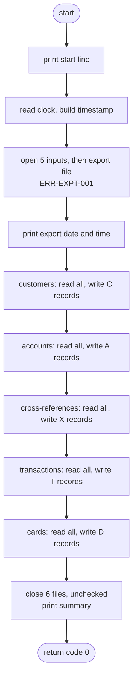
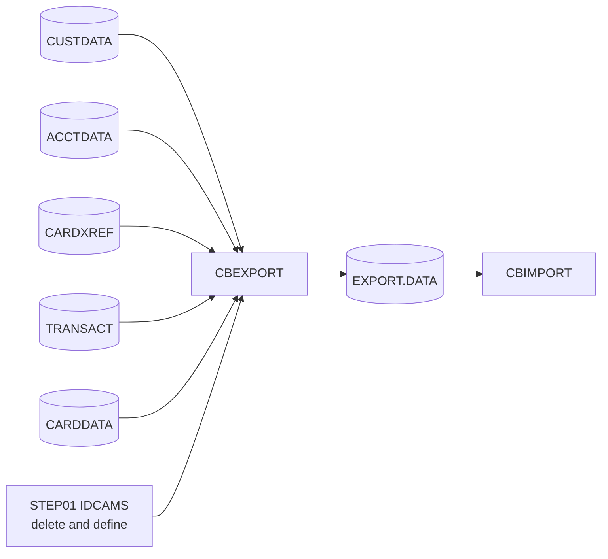

# CBEXPORT: Customer data export for branch migration

## 1. Summary

CBEXPORT copies five master files into one export file for a branch migration. It reads every customer, then every account, card cross-reference, transaction and card, each file from start to end in key order, and writes one 500-byte export record per input record. Each export record carries a type letter (`C`, `A`, `X`, `T`, `D`), the run timestamp, a sequence number that is also the record key, a constant branch `0001` and region `NORTH`, and the input fields, some of them re-encoded as packed decimal or binary. Nothing is selected, checked or joined: the export is a complete copy. The program prints a count per record type and ends with return code 0. Any open, read or write failure prints a message and abends through `CEE3ABD`. The export file is read back by CBIMPORT. The job is run on request; it is not in the batch schedule.

## 2. Rules at a glance

| ID | Rule |
| :-- | :-- |
| BR-EXPT-001 | All customers are exported first, then all accounts, cross-references, transactions and cards; each file in ascending key order, every record once. |
| BR-EXPT-002 | One sequence number, 1, 2, 3 ... in write order across all five types, is the key of the export file. |
| BR-EXPT-003 | Every record has the type letter, the run timestamp, the sequence number, branch `0001` and region `NORTH`. |
| BR-EXPT-004 | Customer record: every customer field is copied; the customer number becomes binary and the FICO score packed decimal. |
| BR-EXPT-005 | Account record: every account field is copied; current balance and cash limit become packed decimal, cycle debit becomes binary. |
| BR-EXPT-006 | Cross-reference record: card, customer and account; the account number becomes binary. |
| BR-EXPT-007 | Transaction record: every transaction field is copied; amount becomes packed decimal, merchant number binary. |
| BR-EXPT-008 | Card record: every card field is copied, CVV included; account number and CVV become binary. |
| BR-EXPT-009 | Bytes of the data area that no field fills are spaces; the input records' FILLER bytes are never exported. |
| BR-EXPT-010 | The run prints the count of each record type and the total, and ends with return code 0. |

## 3. Actors and triggers

- **Trigger:** JCL job `CBEXPORT` (`app/jcl/CBEXPORT.jcl`). Step `STEP01` (IDCAMS) deletes the export cluster and defines it again, empty (`app/jcl/CBEXPORT.jcl:24-38`); step `STEP02` runs the program (`app/jcl/CBEXPORT.jcl:43-68`). The job has no scheduler entry in `app/scheduler`; an operator submits it.
- **Preconditions:** the five input KSDS exist. The JCL allocates them `DISP=SHR` and does not close them in CICS first, so the online system may be updating them while they are read (DEF-EXPT-011). On z/OS a missing input dataset is a JCL allocation error and the step does not start; the open-failure path of ERR-EXPT-001 applies to datasets that are allocated but cannot be opened (platform-inferred). The export cluster must be empty: `STEP01` guarantees it.
- **No parameters**, no control cards. The only external input besides the files is the system clock (NUM-EXPT-001).
- **Local run:** `python3 tools/carddemo.py run CBEXPORT` runs POSTTRAN first (so that `TRANSACT` exists), loads the other inputs from `app/data/ASCII` and deletes any previous export file (`tools/carddemo.py:505-508, 672-679`); CBEXPORT's OPEN OUTPUT creates it, keyed at offset 27 as declared in the program (the runner's REPRO definition at `tools/batch-programs.toml:255-258` agrees). The clock is pinned to the business date 2022-07-06 at 12:00:00 through `COB_CURRENT_DATE` (`tools/carddemo.py:481-484, 567-583`).

## 4. Interfaces

### 4.1 Files

| DD | Entity | Organisation | Open | Access | Key | Record | Source |
| :-- | :-- | :-- | :-- | :-- | :-- | --: | :-- |
| `CUSTFILE` | ENT-CUSTOMER | indexed (KSDS) | INPUT | read next | `CUST-ID` (9, offset 0) | 500 | `:35-39, 74-75` |
| `ACCTFILE` | ENT-ACCOUNT | indexed | INPUT | read next | `ACCT-ID` (11, offset 0) | 300 | `:41-45, 77-78` |
| `XREFFILE` | ENT-CARD-XREF | indexed | INPUT | read next | `XREF-CARD-NUM` (16, offset 0) | 50 | `:47-51, 80-81` |
| `TRANSACT` | ENT-TRANSACTION | indexed | INPUT | read next | `TRAN-ID` (16, offset 0) | 350 | `:53-57, 83-84` |
| `CARDFILE` | ENT-CARD | indexed | INPUT | read next | `CARD-NUM` (16, offset 0) | 150 | `:59-63, 86-87` |
| `EXPFILE` | ENT-EXPORT-RECORD | indexed | OUTPUT | sequential write | `EXPORT-OUT-SEQUENCE-KEY` (4, offset 27) | 500 | `:65-69, 89-97` |

All six files are declared `ACCESS MODE IS SEQUENTIAL`. The input files are read without `INTO`: each copybook is the file's record area. The export record is built in the working-storage copy of `EXPORT-RECORD` (`:101`) and written with `WRITE ... FROM`; the file record has a single named field, the 4-byte key at the bytes of `EXPORT-SEQUENCE-NUM`. The IDCAMS definition of the export cluster puts the key one byte later (DEF-EXPT-002).

### 4.2 Export record (EXPFILE, 500 bytes)

Layout in ENT-EXPORT-RECORD: a 40-byte common header (type 1, timestamp 2-27, sequence 28-31, branch 32-35, region 36-40) and a 460-byte data area (41-500) in one of five layouts. How each field is filled is in BR-EXPT-003 to BR-EXPT-009 and section 12.

### 4.3 Console output (SYSOUT), in order

All lines are `DISPLAY` output (SYSOUT). Counts are `PIC 9(09)`, printed as 9 digits with leading zeros. The length given is that of the literal text, trailing space included.

| Text (exact) | Len | When | Source |
| :-- | --: | :-- | :-- |
| `CBEXPORT: Starting Customer Data Export` | 39 | start | `:168` |
| `CBEXPORT: Export Date: ` + `YYYY-MM-DD` | 23 + 10 | after the six files are open | `:173` |
| `CBEXPORT: Export Time: ` + `HH:MM:SS` | 23 + 8 | after the date line | `:174` |
| `CBEXPORT: Processing customer records` | 37 | before the first customer read | `:250` |
| `CBEXPORT: Customers exported: ` + count | 30 + 9 | after the last customer | `:259-260` |
| `CBEXPORT: Processing account records` | 36 | | `:319` |
| `CBEXPORT: Accounts exported: ` + count | 29 + 9 | | `:328-329` |
| `CBEXPORT: Processing cross-reference records` | 44 | | `:383` |
| `CBEXPORT: Cross-references exported: ` + count | 37 + 9 | | `:392-393` |
| `CBEXPORT: Processing transaction records` | 40 | | `:438` |
| `CBEXPORT: Transactions exported: ` + count | 33 + 9 | | `:447-448` |
| `CBEXPORT: Processing card records` | 33 | | `:503` |
| `CBEXPORT: Cards exported: ` + count | 26 + 9 | | `:512-513` |
| `CBEXPORT: Export completed` | 26 | after the six closes | `:568` |
| `CBEXPORT: Customers Exported: ` + count | 30 + 9 | | `:569-570` |
| `CBEXPORT: Accounts Exported: ` + count | 29 + 9 | | `:571-572` |
| `CBEXPORT: XRefs Exported: ` + count | 26 + 9 | | `:573` |
| `CBEXPORT: Transactions Exported: ` + count | 33 + 9 | | `:574-575` |
| `CBEXPORT: Cards Exported: ` + count | 26 + 9 | | `:576` |
| `CBEXPORT: Total Records Exported: ` + count | 34 + 9 | end | `:577-578` |
| error lines of section 10, then `CBEXPORT: ABENDING PROGRAM` (26) | | on error | `:207-243, 268-269, 309-310, 337-338, 372-373, 401-402, 427-428, 456-457, 492-493, 521-522, 550-551, 583` |

The per-type lines inside the run say `exported` (lower case) and `Cross-references`; the final summary says `Exported` and `XRefs`. Both are exact.

Sample day (local run): the 20 lines above with counts 50, 50, 50, 262, 50 and total 462, date `2022-07-06`, time `12:00:00`.

### 4.4 Return code

0 after a normal run (`GOBACK` at `:163`; nothing sets `RETURN-CODE`). On error the program calls `CEE3ABD` without arguments (ERR-EXPT-004): locally return code 16; on z/OS undefined (DEF-EXPT-005).

## 5. Data used

| Entity field | Read | Written | Use |
| :-- | :-- | :-- | :-- |
| ENT-CUSTOMER, every field except FILLER | yes | - | BR-EXPT-004 |
| ENT-ACCOUNT, every field except FILLER | yes | - | BR-EXPT-005 |
| ENT-CARD-XREF, every field except FILLER | yes | - | BR-EXPT-006 |
| ENT-TRANSACTION, every field except FILLER | yes | - | BR-EXPT-007 |
| ENT-CARD, every field except FILLER | yes | - | BR-EXPT-008 |
| ENT-EXPORT-RECORD, every field | - | yes | BR-EXPT-002 to BR-EXPT-009 |

No input file is updated. The FILLER bytes of the input records (ENT-CUSTOMER 168, ENT-ACCOUNT 178, ENT-CARD-XREF 14, ENT-TRANSACTION 20, ENT-CARD 59) are read but never moved (BR-EXPT-009).

Program-local data with behaviour:

| Field | PIC | Initial | Use | Source |
| :-- | :-- | :-- | :-- | :-- |
| `WS-EXPORT-DATE` | `X(10)` | none | `YYYY-MM-DD`, printed and part of the timestamp | `:125` |
| `WS-EXPORT-TIME` | `X(08)` | none | `HH:MM:SS`, printed and part of the timestamp | `:126` |
| `WS-FORMATTED-TIMESTAMP` | `X(26)` | none (no `VALUE`) | the header timestamp; only 22 bytes are ever set (NUM-EXPT-001) | `:127` |
| `WS-SEQUENCE-COUNTER` | `9(09)` | 0 | sequence number (BR-EXPT-002) | `:128` |
| `WS-CURRENT-DATE`, `WS-CURRENT-TIME` | `9(04)9(02)9(02)`, `9(02)` x 4 | none | clock values | `:132-140` |
| `WS-*-RECORDS-EXPORTED`, `WS-TOTAL-RECORDS-EXPORTED` | `9(09)` | 0 | counts (BR-EXPT-010) | `:144-149` |
| file status fields | `X(02)` | none | `00` OK, `10` end of file | `:104-121` |

## 6. Processing flow

1. Print `CBEXPORT: Starting Customer Data Export` (`:168`).
2. Read the date and the time from the clock and build the export date, export time and record timestamp (`:180-199`, NUM-EXPT-001).
3. Open CUSTFILE, ACCTFILE, XREFFILE, TRANSACT and CARDFILE for input and EXPFILE for output, in that order; the first failure abends (`:205-245`, ERR-EXPT-001).
4. Print the export date and time lines (`:173-174`).
5. For each input in the order customers, accounts, cross-references, transactions, cards (`:157-161`):
   1. Print `CBEXPORT: Processing <kind> records`.
   2. Read the first record (priming read). Until the read returns end of file: build and write one export record (BR-EXPT-003 to BR-EXPT-009), add 1 to the type count and the total, read the next record (FLOW-EXPT-002).
   3. Print the type count line.
6. Close the six files in the order of step 3, without checking the status; print `CBEXPORT: Export completed` and the six summary lines (`:561-578`).
7. `GOBACK`, return code 0 (`:163`).

#### FLOW-EXPT-001 · Start-up order
- **When:** the program starts.
- **Then:** print the start line; read the clock and build the timestamp (NUM-EXPT-001); open the six files (ERR-EXPT-001); only then print the export date and time lines. An open failure therefore leaves the date and time lines unprinted.
- **Source:** `:156, 166-174`
- **Fidelity:** must-preserve (SYSOUT order) · **Confidence:** runtime-verified

#### FLOW-EXPT-002 · One pass per input file
- **When:** for each of the five inputs, in the order customers, accounts, cross-references, transactions, cards.
- **Then:** print the `Processing` line; read the first record; while the read did not return end of file (`10`), build and write one export record, then read the next record; print the type count line. A read status other than `00` and `10` abends (ERR-EXPT-002). Each file is read exactly once, from its first record; there is no restart or positioning.
- **Source:** `:248-260, 317-329, 381-393, 436-448, 501-513`
- **Fidelity:** must-preserve · **Confidence:** runtime-verified

#### FLOW-EXPT-003 · Finalisation
- **When:** all five inputs are at end of file.
- **Then:** close CUSTFILE, ACCTFILE, XREFFILE, TRANSACT, CARDFILE and EXPFILE in that order without checking the result (ERR-EXPT-005); print `CBEXPORT: Export completed` and the six summary lines; return with code 0.
- **Source:** `:559-578, 163`
- **Fidelity:** must-preserve · **Confidence:** runtime-verified

## 7. Business rules

#### BR-EXPT-001 · Export order and completeness
- **When:** always.
- **Then:** the export holds every record of the five input files exactly once: first all ENT-CUSTOMER records, then all ENT-ACCOUNT, all ENT-CARD-XREF, all ENT-TRANSACTION and all ENT-CARD records. Within one type the records come in the order the file returns them on sequential reads, which is ascending primary key compared byte by byte (NUM-EXPT-008). Records of different types are not interleaved or grouped by customer, nothing is filtered, and no record is looked up in another file.
- **Edge cases:** an empty input file gives no records of that type and a count of 0; the following types still run. All five empty: no records, every count 0, return code 0.
- **Source:** `:154-163, 248-257, 317-326, 381-390, 436-445, 501-510`
- **Fidelity:** must-preserve · **Confidence:** runtime-verified (sample day, stress data with shuffled input order, empty inputs)

#### BR-EXPT-002 · Sequence number and export key
- **When:** each export record is built.
- **Then:** the counter `WS-SEQUENCE-COUNTER` (starts at 0) is increased by 1 and moved to `EXPORT-SEQUENCE-NUM`, before the record is written. The first record of the run is 1, the last is the total count, with no gap and no restart between types. It is stored as a 4-byte big-endian unsigned binary number (NUM-EXPT-002) and is the record key of the export file, so the KSDS sees strictly ascending keys.
- **Note:** the counter is increased before the write. When a write fails the run abends, so the number is never reused (ERR-EXPT-003).
- **Source:** `:128, 281-282, 350-351, 414-415, 469-470, 534-535`
- **Fidelity:** must-preserve (CBIMPORT reads the file in key order) · **Confidence:** runtime-verified

#### BR-EXPT-003 · Common header
- **When:** each export record is built, after the record is cleared (BR-EXPT-009).
- **Then:** byte 1 = `C` (customer), `A` (account), `X` (cross-reference), `T` (transaction) or `D` (card); bytes 2-27 = the 26 bytes of the run timestamp (NUM-EXPT-001), identical in every record of the run; bytes 28-31 = sequence number (BR-EXPT-002); bytes 32-35 = `0001`; bytes 36-40 = `NORTH`. Branch and region are constants (DEF-EXPT-012).
- **Source:** `:279-284, 348-353, 412-417, 467-472, 532-537`
- **Fidelity:** must-preserve · **Confidence:** runtime-verified

#### BR-EXPT-004 · Customer record (type C)
- **When:** an ENT-CUSTOMER record is read.
- **Then:** the data area (positions in ENT-EXPORT-RECORD) receives:

| Export field | From | Conversion |
| :-- | :-- | :-- |
| `EXP-CUST-ID` (41-44) | `CUST-ID` | unsigned display to 4-byte binary (NUM-EXPT-004) |
| `EXP-CUST-FIRST-NAME`, `-MIDDLE-NAME`, `-LAST-NAME` (45-119) | same names | byte copy |
| `EXP-CUST-ADDR-LINE` (1), (2), (3) (120-269) | `CUST-ADDR-LINE-1`, `-2`, `-3` | byte copy |
| `EXP-CUST-ADDR-STATE-CD`, `-COUNTRY-CD`, `-ZIP` (270-284) | same names | byte copy |
| `EXP-CUST-PHONE-NUM` (1), (2) (285-314) | `CUST-PHONE-NUM-1`, `-2` | byte copy |
| `EXP-CUST-SSN` (315-323) | `CUST-SSN` | byte copy (NUM-EXPT-005) |
| `EXP-CUST-GOVT-ISSUED-ID`, `EXP-CUST-DOB-YYYY-MM-DD`, `EXP-CUST-EFT-ACCOUNT-ID`, `EXP-CUST-PRI-CARD-HOLDER-IND` (324-364) | same names (`CUST-DOB-YYYY-MM-DD` in CVCUS01Y) | byte copy |
| `EXP-CUST-FICO-CREDIT-SCORE` (365-366) | `CUST-FICO-CREDIT-SCORE` | unsigned display to packed, sign nibble `F` (NUM-EXPT-003) |
| 367-500 | - | spaces |

- In effect, bytes 45-364 of the export record equal bytes 10-329 of the customer record.
- **Source:** `:274-304`
- **Fidelity:** must-preserve · **Confidence:** runtime-verified

#### BR-EXPT-005 · Account record (type A)
- **When:** an ENT-ACCOUNT record is read.
- **Then:**

| Export field | From | Conversion |
| :-- | :-- | :-- |
| `EXP-ACCT-ID` (41-51) | `ACCT-ID` | byte copy (NUM-EXPT-005) |
| `EXP-ACCT-ACTIVE-STATUS` (52) | `ACCT-ACTIVE-STATUS` | byte copy |
| `EXP-ACCT-CURR-BAL` (53-59) | `ACCT-CURR-BAL` | signed zoned to packed(12,2), 7 bytes (NUM-EXPT-003) |
| `EXP-ACCT-CREDIT-LIMIT` (60-71) | `ACCT-CREDIT-LIMIT` | byte copy, zoned stays zoned (NUM-EXPT-005) |
| `EXP-ACCT-CASH-CREDIT-LIMIT` (72-78) | `ACCT-CASH-CREDIT-LIMIT` | signed zoned to packed(12,2) |
| `EXP-ACCT-OPEN-DATE`, `-EXPIRAION-DATE`, `-REISSUE-DATE` (79-108) | same names | byte copy |
| `EXP-ACCT-CURR-CYC-CREDIT` (109-120) | `ACCT-CURR-CYC-CREDIT` | byte copy, zoned stays zoned |
| `EXP-ACCT-CURR-CYC-DEBIT` (121-128) | `ACCT-CURR-CYC-DEBIT` | signed zoned to 8-byte signed binary in cents (NUM-EXPT-004) |
| `EXP-ACCT-ADDR-ZIP`, `EXP-ACCT-GROUP-ID` (129-148) | same names | byte copy |
| 149-500 | - | spaces |

- The four amount fields of one account end up in three encodings (DEF-EXPT-008).
- **Source:** `:343-367`
- **Fidelity:** must-preserve · **Confidence:** runtime-verified

#### BR-EXPT-006 · Cross-reference record (type X)
- **When:** an ENT-CARD-XREF record is read.
- **Then:** `EXP-XREF-CARD-NUM` (41-56) = `XREF-CARD-NUM`, byte copy; `EXP-XREF-CUST-ID` (57-65) = `XREF-CUST-ID`, byte copy (NUM-EXPT-005); `EXP-XREF-ACCT-ID` (66-73) = `XREF-ACCT-ID`, unsigned display to 8-byte binary (NUM-EXPT-004); 74-500 spaces.
- **Source:** `:407-422`
- **Fidelity:** must-preserve · **Confidence:** runtime-verified

#### BR-EXPT-007 · Transaction record (type T)
- **When:** an ENT-TRANSACTION record is read.
- **Then:**

| Export field | From | Conversion |
| :-- | :-- | :-- |
| `EXP-TRAN-ID`, `EXP-TRAN-TYPE-CD` (41-58) | `TRAN-ID`, `TRAN-TYPE-CD` | byte copy |
| `EXP-TRAN-CAT-CD` (59-62) | `TRAN-CAT-CD` | byte copy (NUM-EXPT-005) |
| `EXP-TRAN-SOURCE`, `EXP-TRAN-DESC` (63-172) | same names | byte copy |
| `EXP-TRAN-AMT` (173-178) | `TRAN-AMT` | signed zoned to packed(11,2), 6 bytes (NUM-EXPT-003) |
| `EXP-TRAN-MERCHANT-ID` (179-182) | `TRAN-MERCHANT-ID` | unsigned display to 4-byte binary (NUM-EXPT-004) |
| `EXP-TRAN-MERCHANT-NAME`, `-CITY`, `-ZIP`, `EXP-TRAN-CARD-NUM`, `EXP-TRAN-ORIG-TS`, `EXP-TRAN-PROC-TS` (183-360) | same names | byte copy |
| 361-500 | - | spaces |

- In effect, bytes 41-172 equal transaction bytes 1-132 and bytes 183-360 equal transaction bytes 153-330.
- **Source:** `:462-487`
- **Fidelity:** must-preserve · **Confidence:** runtime-verified

#### BR-EXPT-008 · Card record (type D)
- **When:** an ENT-CARD record is read.
- **Then:** `EXP-CARD-NUM` (41-56) = `CARD-NUM`, byte copy; `EXP-CARD-ACCT-ID` (57-64) = `CARD-ACCT-ID`, unsigned display to 8-byte binary; `EXP-CARD-CVV-CD` (65-66) = `CARD-CVV-CD`, unsigned display to 2-byte binary (NUM-EXPT-004); `EXP-CARD-EMBOSSED-NAME`, `EXP-CARD-EXPIRAION-DATE`, `EXP-CARD-ACTIVE-STATUS` (67-127) = card bytes 31-91, byte copy; 128-500 spaces. The CVV is exported (DEF-EXPT-010).
- **Source:** `:527-545`
- **Fidelity:** must-preserve · **Confidence:** runtime-verified

#### BR-EXPT-009 · Unused bytes are spaces
- **When:** before the fields of each record are moved.
- **Then:** the whole working record is cleared with `INITIALIZE EXPORT-RECORD`. It acts on the first description only and skips the redefining layouts: type, timestamp, branch, region and the whole 460-byte data area become spaces, the sequence number becomes zero. The fields of the type-specific layout are then moved over this, so every byte of the data area that the layout does not fill (its FILLER, 134 to 427 bytes) is a space. Nothing is carried over from the previous record. The input records' FILLER bytes are never moved, so non-blank input FILLER does not reach the export.
- **Source:** `:276, 345, 409, 464, 529`, `app/cpy/CVEXPORT.cpy:9-19`
- **Fidelity:** must-preserve · **Confidence:** runtime-verified (stress data with non-blank FILLER in customer, account, cross-reference, transaction and card inputs; all export FILLER bytes are X'20')

#### BR-EXPT-010 · Counts and return code
- **When:** each export record is written successfully; end of run.
- **Then:** after each successful write, the type count and the total count are increased by 1. The five type counts and the total are printed twice: each type count right after its file is done (`... exported:`), and all six after the closes (`... Exported:`) (section 4.3). The total equals the sum of the five counts and the last sequence number. Return code 0.
- **Source:** `:144-149, 314-315, 377-378, 432-433, 497-498, 555-556, 259-260, 568-578, 163`
- **Fidelity:** must-preserve · **Confidence:** runtime-verified

## 8. Validations

None. The program checks no field value: it does not test that numeric fields hold digits, that keys are valid, or that cross-references, accounts and cards match. Every record the input files return is exported, and invalid bytes in numeric fields are converted without a message (NUM-EXPT-006, DEF-EXPT-008). The only checks are the file statuses of section 10.

## 9. Side effects

There is no commit or rollback. Each export record is permanent in the KSDS as soon as it is written (on z/OS subject to VSAM buffering until the close; platform-inferred).

#### SE-EXPT-001 · Export file creation and writes
- EXPFILE is opened for output after the five inputs (`:240`) and receives one 500-byte record per input record, written sequentially in ascending key order (BR-EXPT-002): all `C`, then `A`, `X`, `T`, `D` records. On z/OS the cluster has just been deleted and defined again by `STEP01`, so it starts empty (`app/jcl/CBEXPORT.jcl:27-38`); `SET MAXCC = 0` keeps a failed DELETE (cluster not there) from failing the step.
- If the run abends, the records written before the failure stay in the file: sequence numbers 1 to k with no trailer or count record, so a reader cannot tell a partial export from a complete one (DEF-EXPT-007).
- **Source:** `:240-245, 306, 369, 424, 489, 547`
- **Fidelity:** must-preserve · **Confidence:** runtime-verified (normal runs); reviewed (partial file after abend)

#### SE-EXPT-002 · Input files are read only
- CUSTFILE, ACCTFILE, XREFFILE, TRANSACT and CARDFILE are opened for input and read sequentially from the first record to end of file, one file after the other, in that order. They are not changed.
- **Source:** `:205-238, 265, 334, 398, 453, 518`
- **Fidelity:** must-preserve · **Confidence:** runtime-verified

## 10. Error handling

#### ERR-EXPT-001 · Open failures
- The files are opened one at a time in the order of the table. Any status other than `00` prints the message with the 2-character status appended, then abends (ERR-EXPT-004). The files opened before stay open (they are not closed; locally libcob closes them at the end of the run and prints `libcob: warning: implicit CLOSE of ...` on stderr, in reverse order of opening).
- Because the date and time lines are printed after the opens, an open failure produces exactly three SYSOUT lines: the start line, the error line, `CBEXPORT: ABENDING PROGRAM`.

| Order | File | Message (exact, status appended) | Source |
| --: | :-- | :-- | :-- |
| 1 | CUSTFILE | `ERROR: Cannot open CUSTOMER-INPUT, Status: ` | `:205-210` |
| 2 | ACCTFILE | `ERROR: Cannot open ACCOUNT-INPUT, Status: ` | `:212-217` |
| 3 | XREFFILE | `ERROR: Cannot open XREF-INPUT, Status: ` | `:219-224` |
| 4 | TRANSACT | `ERROR: Cannot open TRANSACTION-INPUT, Status: ` | `:226-231` |
| 5 | CARDFILE | `ERROR: Cannot open CARD-INPUT, Status: ` | `:233-238` |
| 6 | EXPFILE | `ERROR: Cannot open EXPORT-OUTPUT, Status: ` | `:240-245` |

- Observed locally: a missing input dataset gives status `35` (for example `ERROR: Cannot open CARD-INPUT, Status: 35`, with the four earlier inputs implicitly closed), an export path in a directory that does not exist gives `ERROR: Cannot open EXPORT-OUTPUT, Status: 30`. With the JCL as written, the export open is expected to fail on z/OS with status `39` (DEF-EXPT-002).
- **Source:** `:203-245`
- **Fidelity:** must-preserve (stop before any record is written); message text incidental · **Confidence:** runtime-verified (`tests/integration/test_abends.py:32-38`, and local runs with CUSTFILE missing, CARDFILE missing and an unwritable EXPFILE)

#### ERR-EXPT-002 · Read failures
- After each sequential read: status `00` continue; `10` end of this file, go to the next type; anything else prints the message with the status appended and abends. The export records already written stay (SE-EXPT-001); the per-type count line of the failing type and the summary are not printed.

| File | Message (exact, status appended) | Source |
| :-- | :-- | :-- |
| CUSTFILE | `ERROR: Reading CUSTOMER-INPUT, Status: ` | `:265-271` |
| ACCTFILE | `ERROR: Reading ACCOUNT-INPUT, Status: ` | `:334-340` |
| XREFFILE | `ERROR: Reading XREF-INPUT, Status: ` | `:398-404` |
| TRANSACT | `ERROR: Reading TRANSACTION-INPUT, Status: ` | `:453-459` |
| CARDFILE | `ERROR: Reading CARD-INPUT, Status: ` | `:518-524` |

- **Source:** `:263-271, 332-340, 396-404, 451-459, 516-524`
- **Fidelity:** must-preserve · **Confidence:** reviewed (no read error could be provoked locally)

#### ERR-EXPT-003 · Write failure
- Any status other than `00` on the export write prints `ERROR: Writing export record, Status: ` (38 characters) with the status appended, then abends. The type and total counts are not increased for that record, but the sequence counter already was. Possible causes: duplicate or descending key (`22`, `21`; not reachable while the counter is below 10^9, DEF-EXPT-014), no space (`24`).
- **Source:** `:306-312, 369-375, 424-430, 489-495, 547-553`
- **Fidelity:** must-preserve · **Confidence:** reviewed

#### ERR-EXPT-004 · Abend
- Prints `CBEXPORT: ABENDING PROGRAM` and calls `CEE3ABD` **without arguments**. No file is closed and no count is printed.
- **Locally** the shim finds no abend code, prints `CEE3ABD: USER ABEND U0000` on stderr, sets return code 16 and ends the run (`tools/shims/CEE3ABD.cbl:17-23`); libcob then closes the open files with `implicit CLOSE` warnings on stderr.
- **On z/OS** the LE service expects two parameters; the result of calling it with none is undefined (DEF-EXPT-005). If control ever came back, the program would continue after the failing statement (for example open the next file or write the next record).
- **Source:** `:581-584`
- **Fidelity:** must-preserve (the run stops with a non-zero result); abend code defect-decide · **Confidence:** runtime-verified locally (`tests/integration/test_abends.py:32-38`); platform-inferred on z/OS

#### ERR-EXPT-005 · Close results are not checked
- The six closes in the finalisation are not followed by any status test. A failing close is silent and the run still prints the summary and ends with return code 0.
- **Source:** `:561-566`
- **Fidelity:** incidental · **Confidence:** reviewed

## 11. Interactions

- **Upstream:** the five master files, maintained by the online programs (customers, accounts, cards) and the batch cycle (POSTTRAN writes `TRANSACT`). Locally `TRANSACT` is created by running POSTTRAN first. The job's own `STEP01` recreates the export cluster.
- **Downstream:** CBIMPORT (job `CBIMPORT`, DD `EXPFILE`, the same dataset `AWS.M2.CARDDEMO.EXPORT.DATA`, `app/jcl/CBIMPORT.jcl:28-29`) reads the export file in key order and splits it back into one file per record type, choosing the layout by byte 1. Shared invariants with it: record length 500, key = bytes 28-31, type letters `C A X T D`, the field encodings of ENT-EXPORT-RECORD. The local round trip reproduces the five input files exactly (`tests/integration/test_export_import.py:11-36`).
- **Calls:** `CEE3ABD` (LE abend service), only on error, with no arguments.
- **Shared data:** none written; read-only access to files that CICS may have open at the same time (DEF-EXPT-011).

## 12. Numeric, date and format details

#### NUM-EXPT-001 · Run timestamp, export date and time
- Taken once, before the files are opened: the date from `ACCEPT ... FROM DATE YYYYMMDD` and, in a second clock read, the time from `ACCEPT ... FROM TIME` (`HHMMSShh`).
- **Export date** (`WS-EXPORT-DATE`, 10): `YYYY-MM-DD`. **Export time** (`WS-EXPORT-TIME`, 8): `HH:MM:SS`. The hundredths are read but not used.
- **Record timestamp** (`WS-FORMATTED-TIMESTAMP`, 26 bytes, header bytes 2-27): the export date, one space, the export time and the literal `.00`, which fills 22 bytes: `YYYY-MM-DD HH:MM:SS.00`. The `STRING` statement does not pad, and the field has no initial value, so the last 4 bytes (header bytes 24-27) keep whatever the storage held at program start. Locally that is X'00000000' in every record (observed on the sample day and the stress data). On z/OS it depends on how working storage is initialised (compiler and LE options); it is not defined by the program.
- The timestamp is the same in every record of a run.
- Example (local, business date): `2022-07-06 12:00:00.00` followed by X'00000000'; console lines `CBEXPORT: Export Date: 2022-07-06`, `CBEXPORT: Export Time: 12:00:00`.
- **Source:** `:125-127, 131-140, 180-199, 173-174, 280`
- **Fidelity:** must-preserve for bytes 2-23; defect-decide for bytes 24-27 (DEF-EXPT-003) · **Confidence:** runtime-verified locally; platform-inferred for the z/OS content of bytes 24-27

#### NUM-EXPT-002 · Sequence number encoding
- `EXPORT-SEQUENCE-NUM` is `PIC 9(9) COMP`: 4 bytes, unsigned, big-endian. 1 = X'00000001', 462 = X'000001CE'. Big-endian order makes byte order equal numeric order, which the KSDS key relies on. The local build (`-std=ibm`) uses the same size and byte order as z/OS.
- **Source:** `app/cpy/CVEXPORT.cpy:16`, `:282`
- **Fidelity:** must-preserve · **Confidence:** runtime-verified

#### NUM-EXPT-003 · Zoned or unsigned display to packed decimal (COMP-3)
- **Signed amounts** (`ACCT-CURR-BAL`, `ACCT-CASH-CREDIT-LIMIT` to packed(12,2), 7 bytes; `TRAN-AMT` to packed(11,2), 6 bytes): the digits are copied in order, one per nibble, the decimal point is implied and not stored, and the last nibble is the sign. The sign and the last digit come from the last byte of the zoned field:

| Last byte (ASCII sample data) | Last digit | Sign nibble |
| :-- | :-- | :-- |
| `{` | 0 | `C` |
| `A`-`I` | 1-9 | `C` |
| `}` | 0 | `D` (negative zero is kept) |
| `J`-`R` | 1-9 | `D` |
| `0`-`9` (no sign) | that digit | `C` |

- A 12-digit value gets a leading pad nibble `0`: -1,234.54 (`00000012345M`) becomes X'0000000123454D'; 9,999,999,999.99 becomes X'0999999999999C'; negative zero `00000000000}` becomes X'0000000000000D'. An 11-digit `TRAN-AMT` has no pad: 999,999,999.99 becomes X'99999999999C', 5.00 written as `00000000500` (plain digit) becomes X'00000000500C'.
- **FICO score** (`CUST-FICO-CREDIT-SCORE`, `9(03)`, unsigned): 3 digit nibbles then sign nibble `F`: `274` becomes X'274F', `000` X'000F', `999` X'999F'.
- No value can overflow: target and source have the same number of digits.
- **Source:** `:304, 358, 360, 480`, `app/cpy/CVEXPORT.cpy:41, 50, 52, 71`
- **Fidelity:** must-preserve · **Confidence:** runtime-verified on GnuCOBOL 3.2 `-std=ibm -fsign=EBCDIC` (stress data: negative, maximum, negative zero, plain-digit sign); the negative-zero `D` on z/OS is platform-inferred

#### NUM-EXPT-004 · Display to binary (COMP)
- **Unsigned** (`CUST-ID` to 4 bytes, `TRAN-MERCHANT-ID` to 4 bytes, `XREF-ACCT-ID` and `CARD-ACCT-ID` to 8 bytes, `CARD-CVV-CD` to 2 bytes): the decimal value of the digits as a big-endian unsigned integer. Examples: customer `000000001` = X'00000001'; account `99999999999` = X'000000174876E7FF'; CVV `747` = X'02EB'.
- **Signed** (`ACCT-CURR-CYC-DEBIT` to 8 bytes): the value in cents (digits with the implied decimal point removed), signed by the last byte as in NUM-EXPT-003, as an 8-byte big-endian two's-complement integer. -0.01 = X'FFFFFFFFFFFFFFFF'; -9,999,999,999.99 = X'FFFFFF172B5AF001'; 0.01 written with a plain digit sign (`000000000001`) = X'0000000000000001'. **A negative zero becomes 0** (X'0000000000000000'): binary has no negative zero.
- No value can overflow the binary sizes.
- **Source:** `:287, 365, 422, 481, 541-542`, `app/cpy/CVEXPORT.cpy:25, 57, 72, 87, 95-96`
- **Fidelity:** must-preserve · **Confidence:** runtime-verified

#### NUM-EXPT-005 · Numeric fields copied byte for byte
- Six numeric fields are moved into a field with the same picture and usage: `ACCT-ID` (`9(11)`), `ACCT-CREDIT-LIMIT` and `ACCT-CURR-CYC-CREDIT` (`S9(10)V99`), `CUST-SSN` and `XREF-CUST-ID` (`9(09)`), `TRAN-CAT-CD` (`9(04)`). Locally the export bytes are exactly the input bytes: a plain digit in the sign byte stays a plain digit (`000000005000` stays `000000005000`), a negative zero stays `}`, and spaces or letters are copied unchanged. Together with the alphanumeric fields this means that every non-converted field is an exact copy.
- On z/OS a numeric move may rewrite a sign that is not in the preferred form (for example a plain-digit sign byte to positive), depending on compiler options; byte identity there is guaranteed only for values that already carry a preferred sign.
- **Source:** `:299, 356, 359, 364, 421, 477`
- **Fidelity:** must-preserve · **Confidence:** runtime-verified locally (stress and edge data); platform-inferred on z/OS

#### NUM-EXPT-006 · Non-digit bytes in numeric input fields (local behaviour)
- The input copybooks declare these fields numeric, but nothing checks them (section 8). Observed on GnuCOBOL 3.2 for the converted fields of NUM-EXPT-003 and NUM-EXPT-004:
  - Every byte except the sign byte of a signed field contributes its low 4 bits as a digit: space, X'00' and `0` give 0, `A` gives 1, `Z` (X'5A') gives 10. In a packed target the nibble is stored as is (`Z` becomes nibble X'A'); in a binary target the value is accumulated as value × 10 + nibble, so `99Z` as a CVV gives 1000 (X'03E8') and `99999999Z` as a customer number gives 1,000,000,000 (X'3B9ACA00'). Values are not truncated to the picture's digit count.
  - The last byte of a signed field that is not in the sign table of NUM-EXPT-003 counts as positive, with its low 4 bits as the last digit when they are 0-9 and 0 otherwise (`X` gives 8, `Z` gives 0, space gives 0).
  - All spaces therefore export as zero: X'0000000000000C' for the signed packed amounts, X'000F' for the FICO score, binary 0.
- On z/OS, converting such bytes to binary is likely to end in a data exception (abend S0C7) instead; platform-inferred.
- **Source:** `:287, 304, 358, 360, 365, 422, 480-481, 541-542`
- **Fidelity:** incidental (outside the contract for valid data; see section 15) · **Confidence:** runtime-verified locally (two edge data sets with spaces, X'00', letters and `Z` in numeric fields)

#### NUM-EXPT-007 · Counters
- The five type counts, the total and the sequence counter are `PIC 9(09)` display: up to 999,999,999, printed as 9 digits with leading zeros (`000000462`). None of the additions has an overflow check (DEF-EXPT-014).
- **Source:** `:128, 144-149`
- **Fidelity:** must-preserve · **Confidence:** reviewed (overflow not run)

#### NUM-EXPT-008 · Key order and collation
- Sequential reads return records in ascending primary key, compared byte by byte. The keys are text: `CUST-ID` (9 bytes), `ACCT-ID` (11), `XREF-CARD-NUM`, `TRAN-ID`, `CARD-NUM` (16), even where the picture is numeric. Locally (ASCII) space < digits < upper-case letters, so a key such as `ABCD000000000001` comes after every all-digit key. On z/OS (EBCDIC) space < letters < digits, so the same key would come before them, changing the export order and every later sequence number. With all-digit keys (all sample data) both orders are the same.
- **Source:** `:35-63`
- **Fidelity:** must-preserve (order decides the sequence numbers) · **Confidence:** runtime-verified locally (stress data with letters in card and transaction keys); platform-inferred for EBCDIC

## 13. Known defects and oddities

#### DEF-EXPT-001 · Export record key outside the file record (fixed in this branch)
- The original source declared `RECORD KEY IS EXPORT-SEQUENCE-NUM`, a field of the working-storage copybook, not of the file record, so the program did not compile. The file record now has a 4-byte key field at the same bytes (offset 27) and the write logic is unchanged.
- **Source:** `:65-69, 94-97`
- **Status:** fixed in this branch, "batch: put the export file RECORD KEY inside its record" (`CHANGELOG.md:53`, commit 6076eff, squashed into b5e0139).

#### DEF-EXPT-002 · IDCAMS key position differs from the program
- `STEP01` defines the cluster with `KEYS(4 28)`: length 4 at offset 28 (bytes 29-32). The program, the local build and the mainframe sample file all put the key at offset 27 (bytes 28-31). On z/OS the open of a KSDS whose key position differs from the program's declaration fails (file status `39`), so the job as written would end with `ERROR: Cannot open EXPORT-OUTPUT, Status: 39` and an abend, before any record is written. `RECORDSIZE(500 500)` matches the 500-byte record.
- **Source:** `app/jcl/CBEXPORT.jcl:32-33`, `:65-69, 94-97`, `tools/batch-programs.toml:255-258`
- **Status:** open · **Confidence:** platform-inferred (Q-EXPT-002) · **Fidelity:** defect-decide

#### DEF-EXPT-003 · Timestamp has 4 undefined bytes and no fraction
- The header timestamp is 26 bytes but only 22 are set (`.00` literal, the hundredths from the clock are dropped); bytes 24-27 hold uninitialised storage (NUM-EXPT-001). The layout matches none of the 26-character timestamps elsewhere in CardDemo (ENT-TRANSACTION) and differs from the mainframe sample file, which has `.000000`.
- **Source:** `:127, 196-199`
- **Status:** open · **Fidelity:** defect-decide (Q-EXPT-001)

#### DEF-EXPT-004 · Date and time read separately
- The date and the time come from two clock reads. A run started across midnight can stamp the old date with the new day's time (for example `2022-07-06 00:00:00.00` for a run started at 23:59:59.99 on 2022-07-06).
- **Source:** `:180-181`
- **Status:** open (cosmetic)

#### DEF-EXPT-005 · CEE3ABD called without parameters
- `CEE3ABD` takes an abend code and a timing option; the call passes none. On z/OS the outcome is undefined (it may use whatever the parameter registers point to, or fail with a protection exception), so the abend code is not predictable. Locally the shim reports U0000 and return code 16. CBTRN02C, for comparison, passes code 999 (ERR-POST-008).
- **Source:** `:584`, `tools/shims/CEE3ABD.cbl:17-23`
- **Status:** open · **Confidence:** platform-inferred (Q-EXPT-006) · **Fidelity:** defect-decide

#### DEF-EXPT-006 · Only status `00` counts as success; closes unchecked
- Every open, read and write check accepts only `00` (and `10` at end of file). A successful but non-zero status, such as `97` after an implicit VSAM verify on open, abends the job. Close statuses are not checked at all (ERR-EXPT-005).
- **Source:** `:206, 213, 220, 227, 234, 241, 267, 336, 400, 455, 520, 561-566`
- **Status:** open · **Confidence:** platform-inferred (the `97` case)

#### DEF-EXPT-007 · No completeness marker in the export file
- The file has no header or trailer record and no record counts; the counts exist only in SYSOUT. After an abend the export cluster keeps the records written so far (SE-EXPT-001), and CBIMPORT can read a partial export as if it were complete. The next run's `STEP01` deletes it.
- **Source:** `:306, 581-584`, `app/jcl/CBEXPORT.jcl:27-38`
- **Status:** open · **Fidelity:** defect-decide

#### DEF-EXPT-008 · Mixed encodings and no numeric validation
- One account record carries amounts in three encodings: zoned (credit limit, cycle credit), packed (balance, cash limit) and binary (cycle debit). The binary cycle debit loses the negative-zero sign that the packed fields keep. Numeric fields are not validated, so blanks export as zero and other bytes as described in NUM-EXPT-006.
- **Source:** `:358-365`, `app/cpy/CVEXPORT.cpy:50-57`
- **Status:** open (oddity of the export format)

#### DEF-EXPT-009 · [security] Customer PII in clear text
- Every customer record carries the SSN, government ID, date of birth, EFT bank account, names, address, phones and FICO score in clear (ENT-EXPORT-RECORD, type `C`). The file has no encryption or masking and is kept until deleted by hand (`docs/security/data-handling.md:102-103, 175`).
- **Source:** `:287-304`
- **Status:** open (Q-EXPT-003)

#### DEF-EXPT-010 · [security] Full card numbers and CVV in clear text
- Cross-reference, transaction and card records carry the full card number; card records also carry the CVV (`EXP-CARD-CVV-CD`, 2-byte binary, not encrypted). PCI DSS forbids storing the CVV after authorisation (`docs/security/data-handling.md:199-203`).
- **Source:** `:420, 485, 540, 542`
- **Status:** open (Q-EXPT-003)

#### DEF-EXPT-011 · No consistent snapshot
- The inputs are allocated `DISP=SHR` and the job does not close them in CICS. Online updates during the run can make the export inconsistent across files (for example an account exported before a card that refers to a new balance), and files read while CICS writes them may return records being changed.
- **Source:** `app/jcl/CBEXPORT.jcl:49-58`
- **Status:** open · **Confidence:** platform-inferred (Q-EXPT-005)

#### DEF-EXPT-012 · Branch and region are constants
- Every record of every run is marked branch `0001`, region `NORTH`, whatever the data. Nothing in the input says which branch a customer belongs to.
- **Source:** `:283-284, 352-353, 416-417, 471-472, 536-537`
- **Status:** open (Q-EXPT-004)

#### DEF-EXPT-013 · Mainframe sample export does not come from this source
- `app/data/EBCDIC/AWS.M2.CARDDEMO.EXPORT.DATA.PS` (500 records) has the timestamp `2025-09-28 22:53:40.000000` (26 characters filled) and sequence numbers 1-450 and 460-509, with 451-459 missing between the last transaction and the first card. This source cannot produce either: it writes `.00` plus 4 uninitialised bytes and numbers without gaps. The file is evidence of the layout (key at offset 27, type order `C A X T D`) but not a reference output.
- **Status:** open (Q-EXPT-001)

#### DEF-EXPT-014 · Counter overflow not handled
- The sequence counter and the counts are 9-digit fields increased without an overflow check. The addition after 999,999,999 records overflows; the program does not define the result (truncation gives 0), and the next write would then fail with a key sequence error (ERR-EXPT-003). Not reachable in practice.
- **Source:** `:281, 314-315`
- **Status:** open · **Confidence:** reviewed (not run)

## 14. Open questions

| ID | Question | For |
| :-- | :-- | :-- |
| Q-EXPT-001 | Which program version produced the mainframe sample export (26-character timestamp `.000000`, sequence gap 451-459, 300 transactions)? Is that timestamp the intended format, so that the 4 undefined bytes and the dropped fraction (DEF-EXPT-003) should be fixed? | mainframe team |
| Q-EXPT-002 | Confirm that the JCL as written fails the export open with status 39 (DEF-EXPT-002), and whether the fix is `KEYS(4 27)` in the JCL. CBIMPORT reads the same cluster. | mainframe team |
| Q-EXPT-003 | Should a migration export carry the SSN, government ID, date of birth, EFT account, full card number and CVV at all, and if so encrypted or tokenised? | business, security |
| Q-EXPT-004 | What do branch `0001` and region `NORTH` mean for the target? Should the export be selected or grouped by branch or by customer? | business |
| Q-EXPT-005 | Must the export run with the CICS files closed, to get a consistent snapshot? | operations |
| Q-EXPT-006 | Which abend code should a failed export end with (the call passes none)? | mainframe team |

## 15. Equivalence contract

A reimplementation is equivalent when, for the same five input files (as KSDS contents) and the same clock:

- the export file has the same records in the same key order and is byte-identical, including the timestamp bytes 2-23 and, for comparison with the local GnuCOBOL build, X'00000000' in bytes 24-27 (NUM-EXPT-001). When the clocks differ, bytes 2-23 must match `YYYY-MM-DD HH:MM:SS.00` and every other byte must be equal;
- SYSOUT has the same lines in the same order (section 4.3), with the same counts;
- the return code is 0 after a normal run; on an open, read or write failure the same SYSOUT lines appear (start line, error line with status, `CBEXPORT: ABENDING PROGRAM`), no later line is printed, the records written before the failure are kept, and the run ends with a non-zero result (16 locally). The stderr lines (`CEE3ABD: USER ABEND U0000`, libcob warnings) are incidental.
- Input with digits in the numeric fields, with or without a sign overpunch, plain-digit sign bytes and negative zeros is inside the contract. Non-digit bytes in numeric fields (NUM-EXPT-006) are outside it.

Sample day (`app/data/ASCII` after POSTTRAN, clock 2022-07-06 12:00:00): 462 records (`C` 50, `A` 50, `X` 50, `T` 262, `D` 50), sequence 1-462, return code 0. A scratch model written from these rules reproduced the GnuCOBOL output byte for byte (export file, SYSOUT, return code) on the sample day, on the stress data of `docs/modernization/spec/checks/cbexport_reimpl/gen_stress.py` (471 records), on empty inputs, on a missing first and fifth input, and on two data sets with non-digit bytes in numeric fields.

The runnable check is `python3 docs/modernization/spec/checks/cbexport_reimpl/run_check.py` (sample data) and `python3 docs/modernization/spec/checks/cbexport_reimpl/run_check.py --stress` (edge-case data); results are recorded in `docs/modernization/spec/evidence/d2-batch-utilities-review.md`.

## 16. Paragraph coverage

| Paragraph | Lines | Covered by |
| :-- | :-- | :-- |
| (file and data division) | 35-149 | §4.1, §5, BR-EXPT-002, NUM-EXPT-001, NUM-EXPT-002, NUM-EXPT-007, NUM-EXPT-008, DEF-EXPT-001 |
| `0000-MAIN-PROCESSING` | 154-163 | §6, BR-EXPT-001, BR-EXPT-010 |
| `1000-INITIALIZE` | 166-174 | FLOW-EXPT-001, §4.3 |
| `1050-GENERATE-TIMESTAMP` | 177-200 | NUM-EXPT-001, DEF-EXPT-003, DEF-EXPT-004 |
| `1100-OPEN-FILES` | 203-245 | ERR-EXPT-001, SE-EXPT-001, SE-EXPT-002, DEF-EXPT-002, DEF-EXPT-006 |
| `2000-EXPORT-CUSTOMERS` | 248-260 | FLOW-EXPT-002, BR-EXPT-001, BR-EXPT-010 |
| `2100-READ-CUSTOMER-RECORD` | 263-271 | SE-EXPT-002, ERR-EXPT-002 |
| `2200-CREATE-CUSTOMER-EXP-REC` | 274-315 | BR-EXPT-002, BR-EXPT-003, BR-EXPT-004, BR-EXPT-009, SE-EXPT-001, ERR-EXPT-003, DEF-EXPT-009 |
| `3000-EXPORT-ACCOUNTS` | 317-329 | FLOW-EXPT-002, BR-EXPT-001, BR-EXPT-010 |
| `3100-READ-ACCOUNT-RECORD` | 332-340 | SE-EXPT-002, ERR-EXPT-002 |
| `3200-CREATE-ACCOUNT-EXP-REC` | 343-378 | BR-EXPT-002, BR-EXPT-003, BR-EXPT-005, BR-EXPT-009, SE-EXPT-001, ERR-EXPT-003, DEF-EXPT-008 |
| `4000-EXPORT-XREFS` | 381-393 | FLOW-EXPT-002, BR-EXPT-001, BR-EXPT-010 |
| `4100-READ-XREF-RECORD` | 396-404 | SE-EXPT-002, ERR-EXPT-002 |
| `4200-CREATE-XREF-EXPORT-RECORD` | 407-433 | BR-EXPT-002, BR-EXPT-003, BR-EXPT-006, BR-EXPT-009, SE-EXPT-001, ERR-EXPT-003, DEF-EXPT-010 |
| `5000-EXPORT-TRANSACTIONS` | 436-448 | FLOW-EXPT-002, BR-EXPT-001, BR-EXPT-010 |
| `5100-READ-TRANSACTION-RECORD` | 451-459 | SE-EXPT-002, ERR-EXPT-002 |
| `5200-CREATE-TRAN-EXP-REC` | 462-498 | BR-EXPT-002, BR-EXPT-003, BR-EXPT-007, BR-EXPT-009, SE-EXPT-001, ERR-EXPT-003 |
| `5500-EXPORT-CARDS` | 501-513 | FLOW-EXPT-002, BR-EXPT-001, BR-EXPT-010 |
| `5600-READ-CARD-RECORD` | 516-524 | SE-EXPT-002, ERR-EXPT-002 |
| `5700-CREATE-CARD-EXPORT-RECORD` | 527-556 | BR-EXPT-002, BR-EXPT-003, BR-EXPT-008, BR-EXPT-009, SE-EXPT-001, ERR-EXPT-003, DEF-EXPT-010 |
| `6000-FINALIZE` | 559-578 | FLOW-EXPT-003, BR-EXPT-010, ERR-EXPT-005 |
| `9999-ABEND-PROGRAM` | 581-584 | ERR-EXPT-004, DEF-EXPT-005, DEF-EXPT-007 |

21 of 21 paragraphs covered; there is no code between `PROCEDURE DIVISION` and the first label. Line 316 has asterisks in the sequence area and in column 7, so it is a comment like the other separator lines.
