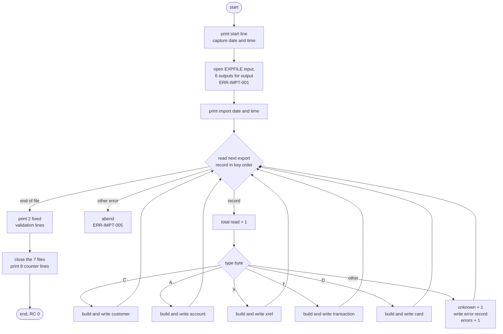
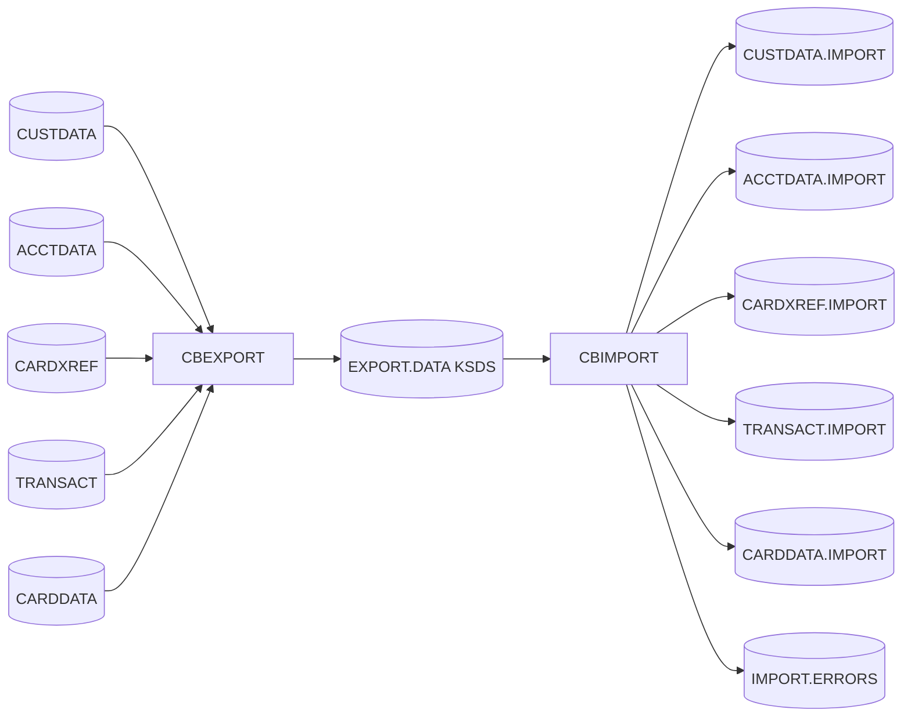

# CBIMPORT: Branch migration import

## 1. Summary

CBIMPORT is the second half of the branch migration pair. It reads the multi-record export file that CBEXPORT writes (ENT-EXPORT-RECORD, 500-byte records keyed by a binary sequence number), in sequence-number order. It sends each record, by its one-character type, to one of five normalized output files: customers (`C`, ENT-CUSTOMER), accounts (`A`, ENT-ACCOUNT), card cross-references (`X`, ENT-CARD-XREF), transactions (`T`, ENT-TRANSACTION) and cards (`D`, ENT-CARD). Packed and binary export fields are converted back to the zoned-decimal layouts of the source files. Any other type goes to an error file (ENT-IMPORT-ERROR) with a timestamp and the sequence number. At the end the program prints a fixed "validation" message, though no validation is done (DEF-IMPT-001), and eight counters, and ends with return code 0. Any open, read or output-write error abends the program. On the sample data the import reproduces the five source files byte for byte.

## 2. Rules at a glance

| ID | Rule |
| :-- | :-- |
| BR-IMPT-001 | Each record goes by its type byte: `C` customer, `A` account, `X` cross-reference, `T` transaction, `D` card. Any other byte, lower case included, is an unknown record. |
| BR-IMPT-002 | Records are processed in ascending order of the 4-byte unsigned binary sequence number, not in file arrival order. |
| BR-IMPT-003 | The header timestamp, branch and region, and the unused tail of each record's data area, are ignored. |
| BR-IMPT-004 | Every output record starts as all spaces, so its FILLER is spaces. Every named field is then set from the export record. |
| BR-IMPT-005 | Customer: 18 fields copied. The binary customer ID and the packed FICO score are converted to digits. |
| BR-IMPT-006 | Account: 12 fields copied. The packed balance and cash limit and the binary cycle debit are converted to signed zoned decimal. |
| BR-IMPT-007 | Cross-reference: card number and customer ID copied. The binary account ID is converted to 11 digits. |
| BR-IMPT-008 | Transaction: 13 fields copied. The packed amount and the binary merchant ID are converted. |
| BR-IMPT-009 | Card: 6 fields copied. The binary account ID and the binary CVV are converted to digits. |
| BR-IMPT-010 | An unknown record writes one error record and adds 1 to both the unknown count and the error count. Processing continues. |
| BR-IMPT-011 | The return code is 0 whenever the run ends normally, even when error records were written. |
| VAL-IMPT-001 | The "validation" step only prints two fixed lines. Nothing is checked. |

## 3. Actors and triggers

- **Trigger:** JCL job `CBIMPORT`, step `STEP01` (`app/jcl/CBIMPORT.jcl:22-70`), submitted by hand. It is not in the CA-7 or Control-M schedules under `app/scheduler`, and no procedure calls it.
- **Preconditions:** the export cluster `AWS.M2.CARDDEMO.EXPORT.DATA` exists and was loaded by CBEXPORT (`app/jcl/CBEXPORT.jcl:30-38`, `app/jcl/CBEXPORT.jcl:43-63`). The six output datasets do not exist yet: each one is allocated `DISP=(NEW,CATLG,DELETE)`, so a second run without deleting them first fails allocation (platform-inferred, z/OS JCL).
- **No parameters**, no control cards. Besides the export file, the only input is the system clock: the import date and time lines (NUM-IMPT-010) and the error-record timestamp (NUM-IMPT-008).
- **Local run:** `python3 tools/carddemo.py run CBIMPORT` runs POSTTRAN, then CBEXPORT, then CBIMPORT on fresh sample data (`tools/carddemo.py:672-688`). `docs/modernization/spec/checks/cbimport_reimpl/reference.py SCENARIO OUTDIR [--clock ...]` runs the built program on any file of raw 500-byte export records.

## 4. Interfaces

### 4.1 Files

| DD | Entity | Organisation | Open | Access | Key | Record | Source |
| :-- | :-- | :-- | :-- | :-- | :-- | --: | :-- |
| `EXPFILE` | ENT-EXPORT-RECORD | indexed (KSDS) | INPUT | sequential read (`READ ... INTO EXPORT-RECORD`) | `EXPORT-IN-SEQUENCE-KEY` = bytes 28-31 (offset 27, length 4) | 500 | `:37-41, 76-84, 266` |
| `CUSTOUT` | ENT-CUSTOMER | sequential, fixed | OUTPUT | write | - | 500 | `:43-46, 86-89` |
| `ACCTOUT` | ENT-ACCOUNT | sequential, fixed | OUTPUT | write | - | 300 | `:48-51, 91-94` |
| `XREFOUT` | ENT-CARD-XREF | sequential, fixed | OUTPUT | write | - | 50 | `:53-56, 96-99` |
| `TRNXOUT` | ENT-TRANSACTION | sequential, fixed | OUTPUT | write | - | 350 | `:58-61, 101-104` |
| `CARDOUT` | ENT-CARD | sequential, fixed | OUTPUT | write | - | 150 | `:63-66, 106-109` |
| `ERROUT` | ENT-IMPORT-ERROR | sequential, fixed | OUTPUT | write (`WRITE ... FROM`) | - | 132 | `:68-71, 111-114, 449` |

The five normalized outputs are written straight from the copybook records, which are the FD records themselves (`:89, 94, 99, 104, 109`). The JCL output DCBs match the FD sizes: `LRECL=500, 300, 50, 350, 150, 132`, all `RECFM=FB` (`app/jcl/CBIMPORT.jcl:33-65`). `EXPFILE` is `DISP=SHR` (`app/jcl/CBIMPORT.jcl:28-29`). `SYSOUT` and `SYSPRINT` go to the spool (`app/jcl/CBIMPORT.jcl:69-70`).

### 4.2 Export record header (ENT-EXPORT-RECORD)

| Bytes | Field | Use here |
| :-- | :-- | :-- |
| 1 | `EXPORT-REC-TYPE` | dispatch (BR-IMPT-001), copied to the error record |
| 2-27 | `EXPORT-TIMESTAMP` | ignored |
| 28-31 | `EXPORT-SEQUENCE-NUM`, `PIC 9(9) COMP`, 4-byte unsigned big-endian binary | file key (BR-IMPT-002), copied to the error record (NUM-IMPT-009) |
| 32-35 | `EXPORT-BRANCH-ID` | ignored |
| 36-40 | `EXPORT-REGION-CODE` | ignored |
| 41-500 | `EXPORT-RECORD-DATA`, redefined per type | mapped (BR-IMPT-005..009); unused bytes ignored |

Source: `app/cpy/CVEXPORT.cpy:9-19`. The per-type field positions are given in the mapping tables of section 7.

### 4.3 Error record (ERROUT, 132 bytes)

| Bytes | Content |
| :-- | :-- |
| 1-21 | `FUNCTION CURRENT-DATE`: `YYYYMMDDHHMMSShh` then `+hhmm`/`-hhmm` (NUM-IMPT-008) |
| 22-26 | spaces |
| 27 | `\|` |
| 28 | the export record type byte, unchanged |
| 29 | `\|` |
| 30-36 | sequence number, low-order 7 digits (NUM-IMPT-009) |
| 37 | `\|` |
| 38-87 | `Unknown record type encountered` (31 characters) + 19 spaces |
| 88-132 | spaces (43 from the work record's FILLER + 2 padding, DEF-IMPT-011) |

Source: `:157-165, 437-449`. Layout in ENT-IMPORT-ERROR.

### 4.4 Console output (SYSOUT), in order

| Text (exact) | Len of literal | When | Source |
| :-- | --: | :-- | :-- |
| `CBIMPORT: Starting Customer Data Import` | 39 | start, before any open | `:181` |
| `CBIMPORT: Import Date: YYYY-MM-DD` | 23 + 10 | after all seven opens succeeded | `:197` |
| `CBIMPORT: Import Time: HH:MM:SS` | 23 + 8 | after the date line | `:198` |
| `ERROR: Writing error record, Status: ss` | 37 + 2 | each failed error-record write (ERR-IMPT-004) | `:452-453` |
| `CBIMPORT: Import validation completed` | 37 | after the last record | `:461` |
| `CBIMPORT: No validation errors detected` | 39 | always, next | `:462` |
| `CBIMPORT: Import completed` | 26 | after the closes | `:475` |
| `CBIMPORT: Total Records Read: nnnnnnnnn` | 30 + 9 | end | `:476-477` |
| `CBIMPORT: Customers Imported: nnnnnnnnn` | 30 + 9 | end | `:478-479` |
| `CBIMPORT: Accounts Imported: nnnnnnnnn` | 29 + 9 | end | `:480-481` |
| `CBIMPORT: XRefs Imported: nnnnnnnnn` | 26 + 9 | end | `:482` |
| `CBIMPORT: Transactions Imported: nnnnnnnnn` | 33 + 9 | end | `:483-484` |
| `CBIMPORT: Cards Imported: nnnnnnnnn` | 26 + 9 | end | `:485` |
| `CBIMPORT: Errors Written: nnnnnnnnn` | 26 + 9 | end | `:486` |
| `CBIMPORT: Unknown Record Types: nnnnnnnnn` | 32 + 9 | end | `:487-488` |
| error lines of section 10 | | on error | |

Counters are 9 digits with leading zeros, directly after the literal with no separator, for example `CBIMPORT: Total Records Read: 000000462`. `ss` is the 2-character file status.

### 4.5 Return code

0 on every normal end (BR-IMPT-011). On an abend (ERR-IMPT-005): locally return code 16; on z/OS an abend whose code is not defined (DEF-IMPT-003).

## 5. Data used

| Entity field | Read | Written | Use |
| :-- | :-- | :-- | :-- |
| ENT-EXPORT-RECORD.EXPORT-REC-TYPE | yes | - | dispatch, error record |
| ENT-EXPORT-RECORD.EXPORT-SEQUENCE-NUM | yes (key) | - | read order, error record |
| ENT-EXPORT-RECORD.EXPORT-TIMESTAMP, EXPORT-BRANCH-ID, EXPORT-REGION-CODE | - | - | ignored (BR-IMPT-003) |
| ENT-EXPORT-RECORD per-type data fields | yes | - | BR-IMPT-005..009 |
| ENT-CUSTOMER (all named fields) | - | yes | BR-IMPT-005 |
| ENT-ACCOUNT (all named fields) | - | yes | BR-IMPT-006 |
| ENT-CARD-XREF (all named fields) | - | yes | BR-IMPT-007 |
| ENT-TRANSACTION (all named fields) | - | yes | BR-IMPT-008 |
| ENT-CARD (all named fields) | - | yes | BR-IMPT-009 |
| ENT-IMPORT-ERROR (all) | - | yes | BR-IMPT-010 |

Program-local data with behaviour: the eight counters `WS-TOTAL-RECORDS-READ`, `WS-CUSTOMER-RECORDS-IMPORTED`, `WS-ACCOUNT-RECORDS-IMPORTED`, `WS-XREF-RECORDS-IMPORTED`, `WS-TRAN-RECORDS-IMPORTED`, `WS-CARD-RECORDS-IMPORTED`, `WS-ERROR-RECORDS-WRITTEN`, `WS-UNKNOWN-RECORD-TYPE-COUNT` (`PIC 9(09) VALUE 0`, `:145-152`); `WS-IMPORT-DATE` `X(10)` and `WS-IMPORT-TIME` `X(08)` (`:140-141`); the seven file status fields (`:121-136`); the error work record `WS-ERROR-RECORD` (`:157-165`).

## 6. Processing flow



1. Print the start line. Take the import date and time from the clock. Open EXPFILE for input, then CUSTOUT, ACCTOUT, XREFOUT, TRNXOUT, CARDOUT and ERROUT for output, in that order; any failure abends. Print the date and time lines (FLOW-IMPT-002).
2. Read the first record. Until end of file: add 1 to the total read, process the record by its type (BR-IMPT-001), and read the next (FLOW-IMPT-003).
3. Print the two validation lines (VAL-IMPT-001).
4. Close the seven files without checking the status, then print `Import completed` and the eight counters. Return code 0 (FLOW-IMPT-004).

Pseudocode for one record:

```
total_read += 1
case rec[1]:
  'C': out = spaces(500); map customer;    write CUSTOUT; fail -> abend; customers += 1
  'A': out = spaces(300); map account;     write ACCTOUT; fail -> abend; accounts += 1
  'X': out = spaces(50);  map xref;        write XREFOUT; fail -> abend; xrefs += 1
  'T': out = spaces(350); map transaction; write TRNXOUT; fail -> abend; trans += 1
  'D': out = spaces(150); map card;        write CARDOUT; fail -> abend; cards += 1
  else: unknown += 1; build error record; write ERROUT; fail -> print line; errors += 1
```

#### FLOW-IMPT-001 · Main line
- **Then:** initialize (FLOW-IMPT-002), process the export file (FLOW-IMPT-003), the validation step (VAL-IMPT-001), finalize (FLOW-IMPT-004), then `GOBACK`. Nothing sets `RETURN-CODE`.
- **Source:** `:170-176`
- **Fidelity:** must-preserve · **Confidence:** runtime-verified

#### FLOW-IMPT-002 · Initialization
- **Then:** print `CBIMPORT: Starting Customer Data Import`. Build `WS-IMPORT-DATE` as `YYYY-MM-DD` and `WS-IMPORT-TIME` as `HH:MM:SS` from `FUNCTION CURRENT-DATE`, which is read six times, once per part (NUM-IMPT-010). Open the seven files (SE-IMPT-001, ERR-IMPT-001). Only then print `CBIMPORT: Import Date: ` + date and `CBIMPORT: Import Time: ` + time. An open failure therefore abends after the start line but before the date and time lines.
- **Source:** `:179-198, 201-250`
- **Fidelity:** must-preserve (console text incidental) · **Confidence:** runtime-verified

#### FLOW-IMPT-003 · Read loop
- **Then:** read the next record (ERR-IMPT-002). Status `00`: add 1 to the total read, then dispatch (BR-IMPT-001). Status `10`: leave the loop. The total read counts every record, unknown types included, so at a normal end it equals customers + accounts + xrefs + transactions + cards + unknown.
- **Source:** `:253-272`
- **Fidelity:** must-preserve · **Confidence:** runtime-verified

#### FLOW-IMPT-004 · Finalization
- **Then:** close EXPFILE, CUSTOUT, ACCTOUT, XREFOUT, TRNXOUT, CARDOUT, ERROUT in that order. The close statuses are not checked (ERR-IMPT-006). Then print `CBIMPORT: Import completed` and the eight counter lines in the order of section 4.4.
- **Source:** `:465-488`
- **Fidelity:** must-preserve · **Confidence:** runtime-verified

## 7. Business rules

#### BR-IMPT-001 · Record type dispatch
- **When:** a record has been read.
- **Then:** byte 1 (`EXPORT-REC-TYPE`) is compared exactly with the single characters `C`, `A`, `X`, `T`, `D`, in that order. Each match runs the mapping of BR-IMPT-005, 006, 007, 008 or 009 respectively.
- **Otherwise:** any other byte is an unknown record (BR-IMPT-010). This includes lower case (`c`), space, low-values (X'00'), digits and X'FF'.
- **Source:** `:275-290`
- **Fidelity:** must-preserve · **Confidence:** runtime-verified (stress types `Z`, `c`, space, X'00', `9`; edge types `Q`, `z`, X'FF')

#### BR-IMPT-002 · Processing order
- **When:** always.
- **Then:** EXPFILE is an indexed file read with sequential access, so records arrive in ascending order of the primary key, bytes 28-31. Those bytes are compared as unsigned bytes, which for a big-endian unsigned binary number is ascending numeric order of `EXPORT-SEQUENCE-NUM` (0 first, 4,294,967,295 last). Each output file receives its records in that order, so the output order of, say, transactions is export sequence order, not `TRAN-ID` order. Gaps in the numbering have no effect. Keys are unique: the KSDS cannot hold two records with the same sequence number.
- **Source:** `:37-41, 81-84, 257-261`
- **Fidelity:** must-preserve · **Confidence:** runtime-verified (records loaded in shuffled order come out in key order)

#### BR-IMPT-003 · Ignored bytes
- **When:** always.
- **Then:** bytes 2-27 (export timestamp), 32-35 (branch) and 36-40 (region) are never used, and neither are the unused trailing bytes of each type's data area (the `FILLER` of each redefinition; positions in the tables below). Changing any of them changes no output byte.
- **Source:** `app/cpy/CVEXPORT.cpy:10-19`, `:299-316, 335-346, 365-367, 386-398, 417-422`
- **Fidelity:** must-preserve · **Confidence:** runtime-verified (stress records with a non-blank header and FILLER)

#### BR-IMPT-004 · Output records start blank
- **When:** before each mapping.
- **Then:** the output record is set to spaces, then `INITIALIZE`d. INITIALIZE sets the alphanumeric fields to spaces and the numeric fields to zeros and leaves FILLER alone, so FILLER stays spaces. Every named field is then overwritten by the mapping, so the INITIALIZE has no visible effect. Result: customer bytes 333-500, account bytes 123-300, xref bytes 37-50, transaction bytes 331-350 and card bytes 92-150 are spaces.
- **Source:** `:295-296, 331-332, 361-362, 382-383, 413-414`
- **Fidelity:** must-preserve · **Confidence:** runtime-verified (see DEF-IMPT-005 for the fix)

#### BR-IMPT-005 · Customer mapping (type `C`)
- **Then:** build a 500-byte ENT-CUSTOMER record (`CUSTOMER-RECORD`, CVCUS01Y) and write it to CUSTOUT (SE-IMPT-002):

| Export bytes | Export field | Export PIC | Output bytes | Output field | Conversion |
| :-- | :-- | :-- | :-- | :-- | :-- |
| 41-44 | `EXP-CUST-ID` | `9(09) COMP` (4) | 1-9 | `CUST-ID` `9(09)` | NUM-IMPT-001 |
| 45-69 | `EXP-CUST-FIRST-NAME` | `X(25)` | 10-34 | `CUST-FIRST-NAME` | copy |
| 70-94 | `EXP-CUST-MIDDLE-NAME` | `X(25)` | 35-59 | `CUST-MIDDLE-NAME` | copy |
| 95-119 | `EXP-CUST-LAST-NAME` | `X(25)` | 60-84 | `CUST-LAST-NAME` | copy |
| 120-169 | `EXP-CUST-ADDR-LINE(1)` | `X(50)` | 85-134 | `CUST-ADDR-LINE-1` | copy |
| 170-219 | `EXP-CUST-ADDR-LINE(2)` | `X(50)` | 135-184 | `CUST-ADDR-LINE-2` | copy |
| 220-269 | `EXP-CUST-ADDR-LINE(3)` | `X(50)` | 185-234 | `CUST-ADDR-LINE-3` | copy |
| 270-271 | `EXP-CUST-ADDR-STATE-CD` | `X(02)` | 235-236 | `CUST-ADDR-STATE-CD` | copy |
| 272-274 | `EXP-CUST-ADDR-COUNTRY-CD` | `X(03)` | 237-239 | `CUST-ADDR-COUNTRY-CD` | copy |
| 275-284 | `EXP-CUST-ADDR-ZIP` | `X(10)` | 240-249 | `CUST-ADDR-ZIP` | copy |
| 285-299 | `EXP-CUST-PHONE-NUM(1)` | `X(15)` | 250-264 | `CUST-PHONE-NUM-1` | copy |
| 300-314 | `EXP-CUST-PHONE-NUM(2)` | `X(15)` | 265-279 | `CUST-PHONE-NUM-2` | copy |
| 315-323 | `EXP-CUST-SSN` | `9(09)` | 280-288 | `CUST-SSN` `9(09)` | byte copy (NUM-IMPT-005) |
| 324-343 | `EXP-CUST-GOVT-ISSUED-ID` | `X(20)` | 289-308 | `CUST-GOVT-ISSUED-ID` | copy |
| 344-353 | `EXP-CUST-DOB-YYYY-MM-DD` | `X(10)` | 309-318 | `CUST-DOB-YYYY-MM-DD` | copy |
| 354-363 | `EXP-CUST-EFT-ACCOUNT-ID` | `X(10)` | 319-328 | `CUST-EFT-ACCOUNT-ID` | copy |
| 364 | `EXP-CUST-PRI-CARD-HOLDER-IND` | `X(01)` | 329 | `CUST-PRI-CARD-HOLDER-IND` | copy |
| 365-366 | `EXP-CUST-FICO-CREDIT-SCORE` | `9(03) COMP-3` (2) | 330-332 | `CUST-FICO-CREDIT-SCORE` `9(03)` | NUM-IMPT-004 |
| 367-500 | FILLER (134) | | 333-500 | FILLER (168) | spaces (BR-IMPT-004) |

- "copy" means the bytes are copied unchanged (same length, alphanumeric).
- **Source:** `:293-326`, `app/cpy/CVEXPORT.cpy:24-42`, `app/cpy/CVCUS01Y.cpy:4-23`
- **Fidelity:** must-preserve · **Confidence:** runtime-verified

#### BR-IMPT-006 · Account mapping (type `A`)
- **Then:** build a 300-byte ENT-ACCOUNT record (`ACCOUNT-RECORD`, CVACT01Y) and write it to ACCTOUT (SE-IMPT-003):

| Export bytes | Export field | Export PIC | Output bytes | Output field | Conversion |
| :-- | :-- | :-- | :-- | :-- | :-- |
| 41-51 | `EXP-ACCT-ID` | `9(11)` | 1-11 | `ACCT-ID` `9(11)` | byte copy (NUM-IMPT-005) |
| 52 | `EXP-ACCT-ACTIVE-STATUS` | `X(01)` | 12 | `ACCT-ACTIVE-STATUS` | copy |
| 53-59 | `EXP-ACCT-CURR-BAL` | `S9(10)V99 COMP-3` (7) | 13-24 | `ACCT-CURR-BAL` `S9(10)V99` | NUM-IMPT-003 |
| 60-71 | `EXP-ACCT-CREDIT-LIMIT` | `S9(10)V99` (zoned) | 25-36 | `ACCT-CREDIT-LIMIT` `S9(10)V99` | byte copy (NUM-IMPT-005) |
| 72-78 | `EXP-ACCT-CASH-CREDIT-LIMIT` | `S9(10)V99 COMP-3` (7) | 37-48 | `ACCT-CASH-CREDIT-LIMIT` `S9(10)V99` | NUM-IMPT-003 |
| 79-88 | `EXP-ACCT-OPEN-DATE` | `X(10)` | 49-58 | `ACCT-OPEN-DATE` | copy |
| 89-98 | `EXP-ACCT-EXPIRAION-DATE` | `X(10)` | 59-68 | `ACCT-EXPIRAION-DATE` | copy |
| 99-108 | `EXP-ACCT-REISSUE-DATE` | `X(10)` | 69-78 | `ACCT-REISSUE-DATE` | copy |
| 109-120 | `EXP-ACCT-CURR-CYC-CREDIT` | `S9(10)V99` (zoned) | 79-90 | `ACCT-CURR-CYC-CREDIT` `S9(10)V99` | byte copy (NUM-IMPT-005) |
| 121-128 | `EXP-ACCT-CURR-CYC-DEBIT` | `S9(10)V99 COMP` (8) | 91-102 | `ACCT-CURR-CYC-DEBIT` `S9(10)V99` | NUM-IMPT-002 |
| 129-138 | `EXP-ACCT-ADDR-ZIP` | `X(10)` | 103-112 | `ACCT-ADDR-ZIP` | copy |
| 139-148 | `EXP-ACCT-GROUP-ID` | `X(10)` | 113-122 | `ACCT-GROUP-ID` | copy |
| 149-500 | FILLER (352) | | 123-300 | FILLER (178) | spaces (BR-IMPT-004) |

- **Source:** `:329-356`, `app/cpy/CVEXPORT.cpy:47-60`, `app/cpy/CVACT01Y.cpy:4-17`
- **Fidelity:** must-preserve · **Confidence:** runtime-verified

#### BR-IMPT-007 · Cross-reference mapping (type `X`)
- **Then:** build a 50-byte ENT-CARD-XREF record (`CARD-XREF-RECORD`, CVACT03Y) and write it to XREFOUT (SE-IMPT-004):

| Export bytes | Export field | Export PIC | Output bytes | Output field | Conversion |
| :-- | :-- | :-- | :-- | :-- | :-- |
| 41-56 | `EXP-XREF-CARD-NUM` | `X(16)` | 1-16 | `XREF-CARD-NUM` | copy |
| 57-65 | `EXP-XREF-CUST-ID` | `9(09)` | 17-25 | `XREF-CUST-ID` `9(09)` | byte copy (NUM-IMPT-005) |
| 66-73 | `EXP-XREF-ACCT-ID` | `9(11) COMP` (8) | 26-36 | `XREF-ACCT-ID` `9(11)` | NUM-IMPT-001 |
| 74-500 | FILLER (427) | | 37-50 | FILLER (14) | spaces (BR-IMPT-004) |

- **Source:** `:359-377`, `app/cpy/CVEXPORT.cpy:84-88`, `app/cpy/CVACT03Y.cpy:4-8`
- **Fidelity:** must-preserve · **Confidence:** runtime-verified

#### BR-IMPT-008 · Transaction mapping (type `T`)
- **Then:** build a 350-byte ENT-TRANSACTION record (`TRAN-RECORD`, CVTRA05Y) and write it to TRNXOUT (SE-IMPT-005):

| Export bytes | Export field | Export PIC | Output bytes | Output field | Conversion |
| :-- | :-- | :-- | :-- | :-- | :-- |
| 41-56 | `EXP-TRAN-ID` | `X(16)` | 1-16 | `TRAN-ID` | copy |
| 57-58 | `EXP-TRAN-TYPE-CD` | `X(02)` | 17-18 | `TRAN-TYPE-CD` | copy |
| 59-62 | `EXP-TRAN-CAT-CD` | `9(04)` | 19-22 | `TRAN-CAT-CD` `9(04)` | byte copy (NUM-IMPT-005) |
| 63-72 | `EXP-TRAN-SOURCE` | `X(10)` | 23-32 | `TRAN-SOURCE` | copy |
| 73-172 | `EXP-TRAN-DESC` | `X(100)` | 33-132 | `TRAN-DESC` | copy |
| 173-178 | `EXP-TRAN-AMT` | `S9(09)V99 COMP-3` (6) | 133-143 | `TRAN-AMT` `S9(09)V99` | NUM-IMPT-003 |
| 179-182 | `EXP-TRAN-MERCHANT-ID` | `9(09) COMP` (4) | 144-152 | `TRAN-MERCHANT-ID` `9(09)` | NUM-IMPT-001 |
| 183-232 | `EXP-TRAN-MERCHANT-NAME` | `X(50)` | 153-202 | `TRAN-MERCHANT-NAME` | copy |
| 233-282 | `EXP-TRAN-MERCHANT-CITY` | `X(50)` | 203-252 | `TRAN-MERCHANT-CITY` | copy |
| 283-292 | `EXP-TRAN-MERCHANT-ZIP` | `X(10)` | 253-262 | `TRAN-MERCHANT-ZIP` | copy |
| 293-308 | `EXP-TRAN-CARD-NUM` | `X(16)` | 263-278 | `TRAN-CARD-NUM` | copy |
| 309-334 | `EXP-TRAN-ORIG-TS` | `X(26)` | 279-304 | `TRAN-ORIG-TS` | copy |
| 335-360 | `EXP-TRAN-PROC-TS` | `X(26)` | 305-330 | `TRAN-PROC-TS` | copy (the timestamp is not regenerated) |
| 361-500 | FILLER (140) | | 331-350 | FILLER (20) | spaces (BR-IMPT-004) |

- **Source:** `:380-408`, `app/cpy/CVEXPORT.cpy:65-79`, `app/cpy/CVTRA05Y.cpy:4-18`
- **Fidelity:** must-preserve · **Confidence:** runtime-verified

#### BR-IMPT-009 · Card mapping (type `D`)
- **Then:** build a 150-byte ENT-CARD record (`CARD-RECORD`, CVACT02Y) and write it to CARDOUT (SE-IMPT-006):

| Export bytes | Export field | Export PIC | Output bytes | Output field | Conversion |
| :-- | :-- | :-- | :-- | :-- | :-- |
| 41-56 | `EXP-CARD-NUM` | `X(16)` | 1-16 | `CARD-NUM` | copy |
| 57-64 | `EXP-CARD-ACCT-ID` | `9(11) COMP` (8) | 17-27 | `CARD-ACCT-ID` `9(11)` | NUM-IMPT-001 |
| 65-66 | `EXP-CARD-CVV-CD` | `9(03) COMP` (2) | 28-30 | `CARD-CVV-CD` `9(03)` | NUM-IMPT-001 |
| 67-116 | `EXP-CARD-EMBOSSED-NAME` | `X(50)` | 31-80 | `CARD-EMBOSSED-NAME` | copy |
| 117-126 | `EXP-CARD-EXPIRAION-DATE` | `X(10)` | 81-90 | `CARD-EXPIRAION-DATE` | copy |
| 127 | `EXP-CARD-ACTIVE-STATUS` | `X(01)` | 91 | `CARD-ACTIVE-STATUS` | copy |
| 128-500 | FILLER (373) | | 92-150 | FILLER (59) | spaces (BR-IMPT-004) |

- **Source:** `:411-432`, `app/cpy/CVEXPORT.cpy:93-100`, `app/cpy/CVACT02Y.cpy:4-11`
- **Fidelity:** must-preserve · **Confidence:** runtime-verified

#### BR-IMPT-010 · Unknown record type
- **When:** the type byte is none of `C`, `A`, `X`, `T`, `D`.
- **Then:** add 1 to the unknown count. Build the error record (section 4.3): the current timestamp, the type byte, the low-order 7 digits of the sequence number, and the message `Unknown record type encountered`. Write it to ERROUT (SE-IMPT-007) and add 1 to the error count, whether or not the write succeeded (ERR-IMPT-004). No normalized output is written for the record, and processing continues with the next record.
- **Source:** `:435-456`
- **Fidelity:** must-preserve · **Confidence:** runtime-verified (`tests/integration/test_export_import.py:38-59`, stress and edge runs)

#### BR-IMPT-011 · Return code
- **When:** the run reaches the end of `0000-MAIN-PROCESSING`.
- **Then:** return code 0. Error records and unknown types do not change it.
- **Source:** `:170-176`
- **Fidelity:** must-preserve (defect-decide, Q-IMPT-002) · **Confidence:** runtime-verified (stress run with 5 unknown records ends with RC 0)

## 8. Validations and messages

#### VAL-IMPT-001 · Import validation is two fixed lines
- **When:** after the last record, every run that reaches it.
- **Then:** print `CBIMPORT: Import validation completed` and `CBIMPORT: No validation errors detected`. Nothing is checked: no checksum, no record counts, no referential checks, no numeric checks. The second line is printed even when unknown records were written to ERROUT (DEF-IMPT-001).
- **Source:** `:459-462`
- **Fidelity:** must-preserve (text), defect-decide (content, Q-IMPT-001) · **Confidence:** runtime-verified

No other check is made on the data (DEF-IMPT-001, DEF-IMPT-009). The record-type decision is BR-IMPT-001:

| Type byte | Output | Counter |
| :-- | :-- | :-- |
| `C` | CUSTOUT | Customers Imported |
| `A` | ACCTOUT | Accounts Imported |
| `X` | XREFOUT | XRefs Imported |
| `T` | TRNXOUT | Transactions Imported |
| `D` | CARDOUT | Cards Imported |
| any other | ERROUT | Unknown Record Types and Errors Written |

Message catalog: section 4.4 (normal lines) and section 10 (error lines).

## 9. Side effects

There is no commit or rollback. Every record written stays in its file, also when a later step abends.

#### SE-IMPT-001 · Opening the outputs
- OPEN OUTPUT creates (locally: creates or truncates) CUSTOUT, ACCTOUT, XREFOUT, TRNXOUT, CARDOUT and ERROUT, in that order, after EXPFILE has been opened for input. With an empty export file all six outputs exist and are empty at the end. When an open fails, the outputs opened before it exist and are empty (locally; on z/OS the abend deletes the new datasets, DEF-IMPT-012).
- **Source:** `:203-250`
- **Confidence:** runtime-verified (empty export; ERROUT open failure leaves five empty files)

#### SE-IMPT-002 · Customer write
- CUSTOUT: sequential WRITE of the 500-byte record of BR-IMPT-005, then the customer count + 1.
- **Source:** `:318-326`
- **Fidelity:** must-preserve · **Confidence:** runtime-verified (sample round trip)

#### SE-IMPT-003 · Account write
- ACCTOUT: sequential WRITE of the 300-byte record of BR-IMPT-006, then the account count + 1.
- **Source:** `:348-356`
- **Fidelity:** must-preserve · **Confidence:** runtime-verified (sample round trip)

#### SE-IMPT-004 · Cross-reference write
- XREFOUT: sequential WRITE of the 50-byte record of BR-IMPT-007, then the xref count + 1.
- **Source:** `:369-377`
- **Fidelity:** must-preserve · **Confidence:** runtime-verified (sample round trip)

#### SE-IMPT-005 · Transaction write
- TRNXOUT: sequential WRITE of the 350-byte record of BR-IMPT-008, then the transaction count + 1.
- **Source:** `:400-408`
- **Fidelity:** must-preserve · **Confidence:** runtime-verified (sample round trip)

#### SE-IMPT-006 · Card write
- CARDOUT: sequential WRITE of the 150-byte record of BR-IMPT-009, then the card count + 1.
- **Source:** `:424-432`
- **Fidelity:** must-preserve · **Confidence:** runtime-verified (sample round trip)

#### SE-IMPT-007 · Error write
- ERROUT: sequential WRITE of the 132-byte error record (BR-IMPT-010), then the error count + 1.
- **Source:** `:449-456`
- **Fidelity:** must-preserve · **Confidence:** runtime-verified (stress unknown-type records)

#### SE-IMPT-008 · Close
- All seven files are closed at the end, in the order EXPFILE, CUSTOUT, ACCTOUT, XREFOUT, TRNXOUT, CARDOUT, ERROUT.
- **Source:** `:467-473`
- **Fidelity:** must-preserve · **Confidence:** runtime-verified (sample round trip)

The export file is only read; CBIMPORT never changes it.

## 10. Error handling

#### ERR-IMPT-001 · Open failures
- Any status other than `00` on an OPEN prints the message below followed by the 2-character status, then abends (ERR-IMPT-005). A successful but non-zero open status such as `97` (implicit VSAM verify on z/OS) also abends (platform-inferred). The files are opened in table order, so a failure leaves the earlier files open and the later ones unopened.

| File | Message (exact, status appended) |
| :-- | :-- |
| EXPFILE | `ERROR: Cannot open EXPORT-INPUT, Status: ` |
| CUSTOUT | `ERROR: Cannot open CUSTOMER-OUTPUT, Status: ` |
| ACCTOUT | `ERROR: Cannot open ACCOUNT-OUTPUT, Status: ` |
| XREFOUT | `ERROR: Cannot open XREF-OUTPUT, Status: ` |
| TRNXOUT | `ERROR: Cannot open TRANSACTION-OUTPUT, Status: ` |
| CARDOUT | `ERROR: Cannot open CARD-OUTPUT, Status: ` |
| ERROUT | `ERROR: Cannot open ERROR-OUTPUT, Status: ` |

- Example, missing export file locally: `ERROR: Cannot open EXPORT-INPUT, Status: 35`. An output path that cannot be created gives status `30` locally.
- **Source:** `:201-250`
- **Fidelity:** must-preserve (abend), incidental (text) · **Confidence:** runtime-verified (EXPFILE 35, CUSTOUT 30, ERROUT 30)

#### ERR-IMPT-002 · Read failure
- Status `00`: process the record. Status `10`: end of file. Any other status prints `ERROR: Reading EXPORT-INPUT, Status: ` + status and abends. The records processed before it are already written.
- **Source:** `:264-272`
- **Fidelity:** must-preserve · **Confidence:** reviewed (not reachable in a local run)

#### ERR-IMPT-003 · Output write failures
- Status other than `00` on a normalized output write prints the message + status and abends. The counter for that record is not incremented. All earlier records stay written.

| File | Message (exact, status appended) |
| :-- | :-- |
| CUSTOUT | `ERROR: Writing customer record, Status: ` |
| ACCTOUT | `ERROR: Writing account record, Status: ` |
| XREFOUT | `ERROR: Writing xref record, Status: ` |
| TRNXOUT | `ERROR: Writing transaction record, Status: ` |
| CARDOUT | `ERROR: Writing card record, Status: ` |

- **Source:** `:318-324, 348-354, 369-375, 400-406, 424-430`
- **Fidelity:** must-preserve · **Confidence:** reviewed (not reachable in a local run)

#### ERR-IMPT-004 · Error-file write failure is not fatal
- Status other than `00` on the ERROUT write prints `ERROR: Writing error record, Status: ` + status and continues. There is no abend, and the error count is still incremented (DEF-IMPT-002).
- **Source:** `:449-456`
- **Fidelity:** defect-decide · **Confidence:** reviewed

#### ERR-IMPT-005 · Abend
- Prints `CBIMPORT: ABENDING PROGRAM` and calls `CEE3ABD` with no arguments.
- **Locally:** the shim finds no abend code, prints `CEE3ABD: USER ABEND U0000` on stderr and ends the run with return code 16 (`tools/shims/CEE3ABD.cbl:17-23`). GnuCOBOL then closes the open files implicitly and prints one `libcob: warning: implicit CLOSE of <file> ('<DD>')` line per open file on stderr, most recently opened first. These lines are incidental.
- **On z/OS:** CEE3ABD expects two parameters, an abend code and a timing value. Called with none, the abend code is undefined (DEF-IMPT-003). Platform-inferred.
- The end-of-run lines (validation, `Import completed`, counters) are not printed. Records already written stay in the outputs.
- **Source:** `:491-494`
- **Fidelity:** must-preserve (the run fails), incidental (code and text) · **Confidence:** runtime-verified locally; platform-inferred on z/OS

#### ERR-IMPT-006 · Close statuses are not checked
- The seven CLOSE statements have no status test. A close failure is ignored, and the run still prints the counters and ends with RC 0.
- **Source:** `:467-473`
- **Fidelity:** incidental · **Confidence:** reviewed

#### ERR-IMPT-007 · Empty and missing export file
- **Empty export (status `10` on the first read):** no record is processed. The six outputs are created empty, the sysout shows every count as `000000000`, RC 0.
- **Missing export dataset, locally:** OPEN status `35`, so the sysout is `CBIMPORT: Starting Customer Data Import`, `ERROR: Cannot open EXPORT-INPUT, Status: 35`, `CBIMPORT: ABENDING PROGRAM`, and stderr is `CEE3ABD: USER ABEND U0000`. RC 16. No output file is created.
- **Missing export dataset, z/OS:** `EXPFILE` is `DISP=SHR`, so allocation fails ("data set not found") and the step does not run at all (platform-inferred). An export cluster that was defined but never loaded may also fail the OPEN (Q-IMPT-003).
- **Source:** `:203-208, 255-257`, `app/jcl/CBIMPORT.jcl:28-29`
- **Fidelity:** must-preserve · **Confidence:** runtime-verified locally; platform-inferred on z/OS

## 11. Interactions



- **Upstream:** CBEXPORT is the only producer of the export file. Its JCL deletes and redefines the cluster on every run (`app/jcl/CBEXPORT.jcl:27-38`) and loads it in sequence-number order. CBEXPORT's spec describes how each export record is built, including the packed and binary encodings that CBIMPORT converts back; on the sample data the two conversions are exact inverses (section 15).
- **Interface fact (key position):** the export cluster is defined with `KEYS(4 28)`, that is bytes 29-32 (offset 28), while CBIMPORT and CBEXPORT declare the record key at bytes 28-31, offset 27 (`:79-83`, `app/jcl/CBEXPORT.jcl:32`). See DEF-IMPT-004.
- **Downstream:** none in the repository. The six outputs are new sequential datasets with the suffix `.IMPORT` or `.ERRORS`. No job loads them into the VSAM files and no program reads them (Q-IMPT-004). Their layouts are those of the source VSAM files, so a REPRO into new clusters would rebuild them.
- **Calls:** `CEE3ABD` (LE abend service) only, without arguments.
- **Shared data:** the copybooks CVCUS01Y, CVACT01Y, CVACT03Y, CVTRA05Y and CVACT02Y are shared with the online and batch programs listed in their entity sections. CVEXPORT is shared only with CBEXPORT.

## 12. Numeric, date and format details

#### NUM-IMPT-001 · Unsigned binary to digits
- `9(n) COMP` export fields are big-endian unsigned binary: 2 bytes for `n` = 3, 4 bytes for `n` = 9, 8 bytes for `n` = 11. The whole binary value V is read without truncation to the PICTURE (0..65,535, 0..4,294,967,295, 0..18,446,744,073,709,551,615). The output field `9(n)` receives V mod 10^n as `n` digit characters `0`-`9` with leading zeros, and no sign. High-order digits are dropped silently.
- Observed: customer ID 1,000,000,000 gives `000000000`, 4,294,967,295 gives `294967295`; merchant ID 4,294,967,295 gives `294967295`; xref or card account ID 2^64-1 gives `73709551615`, 100,000,000,000 gives `00000000000`, 2^63 gives `36854775808`; CVV 1,000 gives `000`, 32,768 gives `768`, 65,535 gives `535`.
- **Source:** `:299, 367, 392, 418-419`
- **Confidence:** runtime-verified on GnuCOBOL 3.2 `-std=ibm -fsign=EBCDIC`; the z/OS result for values above the PICTURE depends on the TRUNC compiler option (platform-inferred)

#### NUM-IMPT-002 · Signed binary cycle debit
- `EXP-ACCT-CURR-CYC-DEBIT` is `S9(10)V99 COMP`: 8 bytes, big-endian two's complement integer I, value I / 100. The output `ACCT-CURR-CYC-DEBIT` (decimal(12,2), zoned) receives the 12 low-order digits of |I| and the sign of I, encoded as in NUM-IMPT-007. A negative value whose kept digits are all zero is written as negative zero (`00000000000}`).
- Observed: -1 gives `00000000000J`; 0 gives `00000000000{`; 999,999,999,999 gives `99999999999I`; 1,000,000,000,000 gives `00000000000{`; -1,000,000,000,000 gives `00000000000}`; -1,000,000,000,001 gives `00000000000J`; 2^63-1 gives `03685477580G`; -2^63 gives `03685477580Q`.
- **Source:** `:344`
- **Confidence:** runtime-verified on GnuCOBOL 3.2; platform-inferred on z/OS for values above 12 digits

#### NUM-IMPT-003 · Signed packed decimal to zoned decimal
- `S9(10)V99 COMP-3` (balance, cash limit) is 7 bytes = 14 half-bytes: one leading half-byte that is not part of the value (ignored, even when non-zero), 12 digit half-bytes, 1 sign half-byte. `S9(09)V99 COMP-3` (transaction amount) is 6 bytes = 11 digit half-bytes + 1 sign half-byte, with no leading half-byte. The output receives the digits as characters with the sign folded into the last one (NUM-IMPT-007).
- **Sign:** half-byte X'D' is negative. Every other value (X'C', X'F', X'A', X'B', X'E', X'0'-X'9') is positive on GnuCOBOL. IBM hardware also treats X'B' as negative, so on z/OS an X'B' sign would give a negative output (platform-inferred, DEF-IMPT-009).
- **Negative zero** (all digits 0, sign X'D') is kept: `00000000000}` / `0000000000}`.
- Observed: balance X'9999999999999C' gives `99999999999I`; X'1000000000000D' gives `00000000000}`; cash limit X'9123456789012C' gives `12345678901B`; amount X'99999999999D' gives `9999999999R`; amount X'00000012345F' gives `0000001234E`.
- **Source:** `:337, 339, 391`
- **Confidence:** runtime-verified on GnuCOBOL 3.2; platform-inferred on z/OS

#### NUM-IMPT-004 · Unsigned packed FICO score
- `EXP-CUST-FICO-CREDIT-SCORE` is `9(03) COMP-3`: 2 bytes = 3 digit half-bytes + 1 sign half-byte. The output `CUST-FICO-CREDIT-SCORE` `9(03)` receives the 3 digits as `0`-`9`. The sign half-byte is ignored, so a negative value gives its absolute value (X'123D' gives `123`, X'000D' gives `000`).
- **Source:** `:316`
- **Confidence:** runtime-verified on GnuCOBOL 3.2

#### NUM-IMPT-005 · Zoned fields with the same picture are copied byte for byte
- `EXP-ACCT-ID` `9(11)`, `EXP-ACCT-CREDIT-LIMIT` and `EXP-ACCT-CURR-CYC-CREDIT` `S9(10)V99`, `EXP-CUST-SSN` and `EXP-XREF-CUST-ID` `9(09)`, and `EXP-TRAN-CAT-CD` `9(04)` have exactly the picture of their output field. The GnuCOBOL build copies their bytes unchanged, whatever they hold: spaces, letters, low-values, a plain digit in the sign position (`000000000125`), an ASCII-style sign (`00000000012p`), or an overpunch character in an unsigned field (`12345678}`).
- On z/OS the compiler may normalize the sign of a signed zoned field on such a move (for example a plain `F` zone becoming `C`), depending on the NUMPROC option. Byte identity for those three signed fields is therefore guaranteed only for preferred signs (platform-inferred).
- **Source:** `:311, 335, 338, 343, 366, 388`
- **Confidence:** runtime-verified on GnuCOBOL 3.2; platform-inferred on z/OS

#### NUM-IMPT-006 · Invalid half-bytes in packed fields
- A digit half-byte X'A'-X'F' in a packed field becomes the character with code X'30' + half-byte (`:`, `;`, `<`, `=`, `>`, `?`) in the output. In the last digit position of a signed output, the sign character for digit 0 is written instead (`{` or `}`, according to the sign half-byte).
- Observed: balance X'00000000A2345C' gives `0000000:234E`; FICO X'AB1C' gives `:;1`, X'FFFF' gives `???`, X'12AC' gives `12:`; amount X'0000001F345C' gives `0000001?34E`, X'0000000001AD' gives `0000000001}`.
- A valid CBEXPORT file never contains such values. On z/OS the result is not defined by the language (platform-inferred).
- **Source:** `:316, 337, 339, 391`
- **Confidence:** runtime-verified on GnuCOBOL 3.2

#### NUM-IMPT-007 · Sign encoding written by the conversions
- The signed outputs of NUM-IMPT-002 and NUM-IMPT-003 are written in the preferred zoned form. The last byte is `{`, `A`-`I` for digit 0-9 positive, `}`, `J`-`R` for digit 0-9 negative (the build uses `-fsign=EBCDIC`; on z/OS these are the EBCDIC zones X'C' and X'D'). The unsigned outputs of NUM-IMPT-001 and NUM-IMPT-004 are plain digits. Fields copied under NUM-IMPT-005 keep the bytes they had.
- **Source:** `:337, 339, 344, 391`
- **Confidence:** runtime-verified

#### NUM-IMPT-008 · Error record timestamp
- `ERR-TIMESTAMP` (26) gets the 21 characters of `FUNCTION CURRENT-DATE`, read once per error record, then 5 spaces. Layout: positions 1-8 `YYYYMMDD`, 9-14 `HHMMSS`, 15-16 hundredths of a second, 17 `+` or `-`, 18-21 offset from UTC as `hhmm`. When the system cannot supply the offset, positions 17-21 are `00000`.
- **Locally:** `COB_CURRENT_DATE` (from `CARDDEMO_BUSINESS_DATE`, default `2022/07/06 12:00:00`) pins positions 1-14 only. The hundredths still come from the wall clock (observed values 09 to 95 across runs), and the offset is that of the process time zone (`TZ`) at the real current time, not at the pinned date: `TZ=America/Chicago` with a pinned July date gave `-0600` in November.
- Example: `2024022908153050-0500     |c|2345678|Unknown record type encountered`.
- **Source:** `:158, 439`
- **Confidence:** runtime-verified (TZ=UTC `+0000`, Asia/Kolkata `+0530`, America/Chicago `-0600`, America/New_York `-0500`)

#### NUM-IMPT-009 · Error record sequence number
- `ERR-SEQUENCE` `9(07)` gets `EXPORT-SEQUENCE-NUM` (unsigned 4-byte binary, 0..4,294,967,295) mod 10^7, as 7 digits with leading zeros. Different records can therefore show the same number: 12,345,678 and 2,345,678 both show `2345678`; 10,000,000 shows `0000000`; 99,999,999 and 999,999,999 show `9999999`; 4,294,967,295 shows `4967295`; 2,147,483,648 shows `7483648`.
- **Source:** `:162, 441`
- **Confidence:** runtime-verified

#### NUM-IMPT-010 · Import date and time lines
- `WS-IMPORT-DATE` = CURRENT-DATE characters 1-4, `-`, 5-6, `-`, 7-8 (`YYYY-MM-DD`). `WS-IMPORT-TIME` = characters 9-10, `:`, 11-12, `:`, 13-14 (`HH:MM:SS`). Each of the six parts comes from its own call of `FUNCTION CURRENT-DATE` (DEF-IMPT-010). Locally, with the default business date: `CBIMPORT: Import Date: 2022-07-06` and `CBIMPORT: Import Time: 12:00:00`.
- **Source:** `:183-193, 197-198`
- **Confidence:** runtime-verified

#### NUM-IMPT-011 · Counters
- All counters are `PIC 9(09)` unsigned, start at 0 and are printed as 9 digits with leading zeros. The additions have no size-error clause. A count above 999,999,999 would keep only its low-order digits; with 10^9 records this cannot be reached in practice.
- **Source:** `:145-152, 258, 326, 356, 377, 408, 432, 437, 456`
- **Confidence:** reviewed (overflow not run)

#### NUM-IMPT-012 · Key comparison
- The 4-byte key is compared as unsigned bytes, left to right (VSAM and the local indexed file both compare keys as binary strings). Since the sequence number is big-endian unsigned binary, byte order equals numeric order (BR-IMPT-002). The EBCDIC/ASCII code page does not affect binary bytes.
- **Source:** `:40, 83`
- **Confidence:** runtime-verified locally; platform-inferred on z/OS

## 13. Known defects and oddities

#### DEF-IMPT-001 · No validation, despite the header and the message
- The program header promises "Validate data integrity using checksums" and the comment says "with validation", but nothing is validated. There is no checksum, no count reconciliation, no numeric check and no referential check (an account with no customer, a card with no cross-reference, duplicate keys). `No validation errors detected` is printed unconditionally (VAL-IMPT-001), even when ERROUT has records.
- **Source:** `:459-462`
- **Status:** open · **Fidelity:** defect-decide (Q-IMPT-001) · **Confidence:** reviewed

#### DEF-IMPT-002 · "Errors Written" counts attempts and always equals the unknown count
- The only error ever written is the unknown-type error, so `Errors Written` and `Unknown Record Types` are always equal. A failed ERROUT write is still counted as written (ERR-IMPT-004).
- **Source:** `:437, 451-456`
- **Status:** open · **Fidelity:** defect-decide · **Confidence:** reviewed

#### DEF-IMPT-003 · CEE3ABD is called without arguments
- `CALL 'CEE3ABD'` passes neither the abend code nor the timing parameter. On z/OS, LE reads parameters that were never passed, so the abend code and whether a dump is taken are undefined. Locally the shim reports `U0000`. The other batch programs, except CBEXPORT (`app/cbl/CBEXPORT.cbl:584`) and CBSTM03A (`app/cbl/CBSTM03A.CBL:923`), pass an abend code and a timing value (`app/cbl/CBTRN02C.cbl:712`).
- **Source:** `:494`, `tools/shims/CEE3ABD.cbl:18-21`
- **Status:** open · **Fidelity:** defect-decide · **Confidence:** platform-inferred (Q-IMPT-003)

#### DEF-IMPT-004 · Key position differs from the cluster definition
- CBEXPORT.jcl defines the export cluster with `KEYS(4 28)`: length 4 at offset 28, bytes 29-32. The program's record key is at offset 27, bytes 28-31, the position of `EXPORT-SEQUENCE-NUM` (`:79-83`). Locally the indexed file is defined from the program, so the two agree. On z/OS the key position in the program does not match the catalog, which for a VSAM file is expected to make the OPEN fail with status `39` (ERR-IMPT-001) in CBEXPORT and CBIMPORT. If the OPEN did succeed, the cluster would order records by bytes 29-32 (3 bytes of the sequence number and the first byte of the branch ID).
- **Source:** `:37-41, 81-84`, `app/jcl/CBEXPORT.jcl:30-33`
- **Status:** open · **Fidelity:** defect-decide · **Confidence:** platform-inferred (Q-IMPT-003)

#### DEF-IMPT-005 · Output FILLER was low-values (fixed in this branch)
- The output records were only `INITIALIZE`d, which skips FILLER, so the imported files held low-values where the source files have spaces. Now each record is set to spaces first (BR-IMPT-004).
- **Source:** `:295, 331, 361, 382, 413`
- **Status:** fixed in this branch, "fix(batch): CBIMPORT writes blank FILLER like the source files" (`CHANGELOG.md:46`, commit 70fe3e8, squashed into b5e0139)

#### DEF-IMPT-006 · The JCL had no CARDOUT DD (fixed in this branch)
- The program opens CARD-OUTPUT, but the job had no CARDOUT DD, so the open failed and the import abended. Now allocated with `LRECL=150`.
- **Source:** `app/jcl/CBIMPORT.jcl:53-57`
- **Status:** fixed in this branch, "fix(jcl): add the CARDOUT DD to CBIMPORT.jcl" (`CHANGELOG.md:51`, commit 07f21e6, squashed into b5e0139)

#### DEF-IMPT-007 · The record key was outside the file record (fixed in this branch)
- The SELECT named `EXPORT-SEQUENCE-NUM`, a working-storage field, as the record key, so the program did not compile. Now the FD record has its own key field at the same bytes.
- **Source:** `:37-41, 79-84`
- **Status:** fixed in this branch, "fix(batch): put the export file RECORD KEY inside its record" (`CHANGELOG.md:53`, commit 6076eff, squashed into b5e0139)

#### DEF-IMPT-008 · [security] Imported files hold sensitive data in clear
- CUSTOUT holds the SSN, government ID, date of birth and EFT account; XREFOUT, TRNXOUT and CARDOUT hold full card numbers (PAN); CARDOUT holds the CVV. All are plain sequential datasets with no masking or encryption, like the export file they come from. ERROUT and the sysout hold no customer data (timestamp, type byte, sequence number and counts only). See `docs/security/data-handling.md`.
- **Source:** `:311-314, 365, 396, 417-419`
- **Status:** open (handled by procedure) · **Confidence:** reviewed

#### DEF-IMPT-009 · Numeric conversions are unchecked
- Binary values larger than the target picture lose their high-order digits without any message (NUM-IMPT-001, NUM-IMPT-002). Non-numeric bytes in zoned fields pass through into numeric output fields (NUM-IMPT-005). Invalid packed half-bytes produce non-digit characters (NUM-IMPT-006). A packed sign X'B' is read as positive on GnuCOBOL and as negative on z/OS (NUM-IMPT-003). A reimplementation must reproduce the GnuCOBOL results to be byte-identical on such input.
- **Source:** `:299, 316, 337, 339, 344, 391-392, 418-419`
- **Status:** open · **Fidelity:** defect-decide · **Confidence:** runtime-verified (GnuCOBOL); platform-inferred (z/OS)

#### DEF-IMPT-010 · Clock read several times
- The import date and time are built from six separate CURRENT-DATE calls. A run that starts across a second, minute or midnight boundary can print a time or date that never existed together (for example `2022-07-06` with `23:59:00` when the seconds are read just after midnight, or `2022-07-01` when the day part is read just after midnight on 31 July). Each error record also reads the clock again, so error timestamps differ from the printed import time. The error timestamp is the raw 21-character CURRENT-DATE form, unlike the `YYYY-MM-DD-HH.MM.SS.hh0000` timestamps of the other CardDemo files.
- **Source:** `:183-193, 439`
- **Status:** open · **Fidelity:** incidental · **Confidence:** reviewed

#### DEF-IMPT-011 · Error work record is 130 bytes for a 132-byte file
- The fields of `WS-ERROR-RECORD` add up to 130 bytes. The write pads them to 132 with spaces, so the output is well formed, but the layout does not match the file's record size.
- **Source:** `:157-165, 111-114`
- **Status:** open (harmless) · **Fidelity:** incidental · **Confidence:** runtime-verified

#### DEF-IMPT-012 · Partial outputs on abend
- An abend in the middle leaves the records written so far in the outputs. On z/OS all six outputs, the error file included, are `DISP=(NEW,CATLG,DELETE)`, so an abend deletes them (platform-inferred). Locally they stay on disk, partly written. The program has no restart logic. A re-run needs the new datasets deleted first (section 3).
- **Source:** `:491-494`, `app/jcl/CBIMPORT.jcl:33-65`
- **Status:** open · **Confidence:** platform-inferred (z/OS disposition); runtime-verified locally

## 14. Open questions

| ID | Question | For |
| :-- | :-- | :-- |
| Q-IMPT-001 | What should the import validate (checksums, record counts against the export, referential integrity, numeric validity)? Should `No validation errors detected` reflect the outcome? | business |
| Q-IMPT-002 | Should unknown record types or failed error writes end the job with a non-zero return code (for example 4)? Today the run always ends with 0. | operations |
| Q-IMPT-003 | On z/OS: does the export cluster's `KEYS(4 28)` make the OPEN fail (status 39) against the program's key at offset 27? What does `CEE3ABD` do when called with no arguments? Does opening a defined but never loaded export cluster fail? | mainframe team |
| Q-IMPT-004 | Nothing loads the `*.IMPORT` datasets into VSAM. In the target, should the import write directly into the operational stores, and how should it handle records that already exist? | architecture |

## 15. Equivalence contract

A reimplementation is equivalent when, for the same export records (any byte content, any number of records, keys unique) and the same clock:

- CUSTOUT, ACCTOUT, XREFOUT, TRNXOUT and CARDOUT are byte-identical: the same records in the same order (ascending sequence number), with the conversions of section 12 including truncation, negative zero, invalid half-bytes and byte copies of the zoned fields;
- ERROUT has the same number of records and is byte-identical except bytes 15-21 (hundredths and UTC offset), which come from the wall clock and time zone. Bytes 1-14 must match the clock date and time;
- the sysout lines of section 4.4 match exactly (the date and time lines from the clock), and the return code is equal: 0 on a normal end, 16 locally on an abend;
- on the abend paths (missing export, unopenable output) the same lines are printed, and the files created before the failure exist and are empty.

Sample day (`python3 tools/carddemo.py run CBIMPORT`, business date 2022-07-06): 462 records read; 50 customers, 50 accounts, 50 xrefs, 262 transactions, 50 cards; 0 errors and 0 unknown; RC 0. The five outputs are byte-identical to the files CBEXPORT read (`tests/integration/test_export_import.py:11-36`). Stress data (`docs/modernization/spec/checks/cbimport_reimpl/gen_stress.py`): 483 read; C 53, A 53, X 54, T 265, D 53; 5 errors and 5 unknown; RC 0. Empty export: all counts 0, six empty outputs, RC 0. Missing export: RC 16 (ERR-IMPT-007).

Checks: `python3 docs/modernization/spec/checks/cbimport_reimpl/run_check.py` (sample) and `python3 docs/modernization/spec/checks/cbimport_reimpl/run_check.py --stress` (stress, empty and missing scenarios). Results and review: `docs/modernization/spec/evidence/d2-batch-utilities-review.md`.

## 16. Paragraph coverage

| Paragraph | Lines | Covered by |
| :-- | :-- | :-- |
| (environment and data division) | 37-165 | §4.1, §4.3, §5, BR-IMPT-002, NUM-IMPT-011, NUM-IMPT-012, DEF-IMPT-004, DEF-IMPT-007, DEF-IMPT-011 |
| `0000-MAIN-PROCESSING` | 170-176 | FLOW-IMPT-001, BR-IMPT-011 |
| `1000-INITIALIZE` | 179-198 | FLOW-IMPT-002, NUM-IMPT-010, DEF-IMPT-010 |
| `1100-OPEN-FILES` | 201-250 | SE-IMPT-001, ERR-IMPT-001, ERR-IMPT-007 |
| `2000-PROCESS-EXPORT-FILE` | 253-261 | FLOW-IMPT-003, BR-IMPT-002, ERR-IMPT-007 |
| `2100-READ-EXPORT-RECORD` | 264-272 | ERR-IMPT-002, FLOW-IMPT-003 |
| `2200-PROCESS-RECORD-BY-TYPE` | 275-290 | BR-IMPT-001 |
| `2300-PROCESS-CUSTOMER-RECORD` | 293-326 | BR-IMPT-004, BR-IMPT-005, SE-IMPT-002, ERR-IMPT-003, NUM-IMPT-001, NUM-IMPT-004, NUM-IMPT-005, DEF-IMPT-008 |
| `2400-PROCESS-ACCOUNT-RECORD` | 329-356 | BR-IMPT-004, BR-IMPT-006, SE-IMPT-003, ERR-IMPT-003, NUM-IMPT-002, NUM-IMPT-003, NUM-IMPT-005 |
| `2500-PROCESS-XREF-RECORD` | 359-377 | BR-IMPT-004, BR-IMPT-007, SE-IMPT-004, ERR-IMPT-003, NUM-IMPT-001 |
| `2600-PROCESS-TRAN-RECORD` | 380-408 | BR-IMPT-004, BR-IMPT-008, SE-IMPT-005, ERR-IMPT-003, NUM-IMPT-001, NUM-IMPT-003 |
| `2650-PROCESS-CARD-RECORD` | 411-432 | BR-IMPT-004, BR-IMPT-009, SE-IMPT-006, ERR-IMPT-003, NUM-IMPT-001, DEF-IMPT-008 |
| `2700-PROCESS-UNKNOWN-RECORD` | 435-444 | BR-IMPT-010, NUM-IMPT-008, NUM-IMPT-009 |
| `2750-WRITE-ERROR` | 447-456 | SE-IMPT-007, ERR-IMPT-004, DEF-IMPT-002 |
| `3000-VALIDATE-IMPORT` | 459-462 | VAL-IMPT-001, DEF-IMPT-001 |
| `4000-FINALIZE` | 465-488 | FLOW-IMPT-004, SE-IMPT-008, ERR-IMPT-006, §4.4 |
| `9999-ABEND-PROGRAM` | 491-494 | ERR-IMPT-005, DEF-IMPT-003, DEF-IMPT-012 |

16 of 16 paragraphs covered. The procedure division has no code before its first paragraph.
