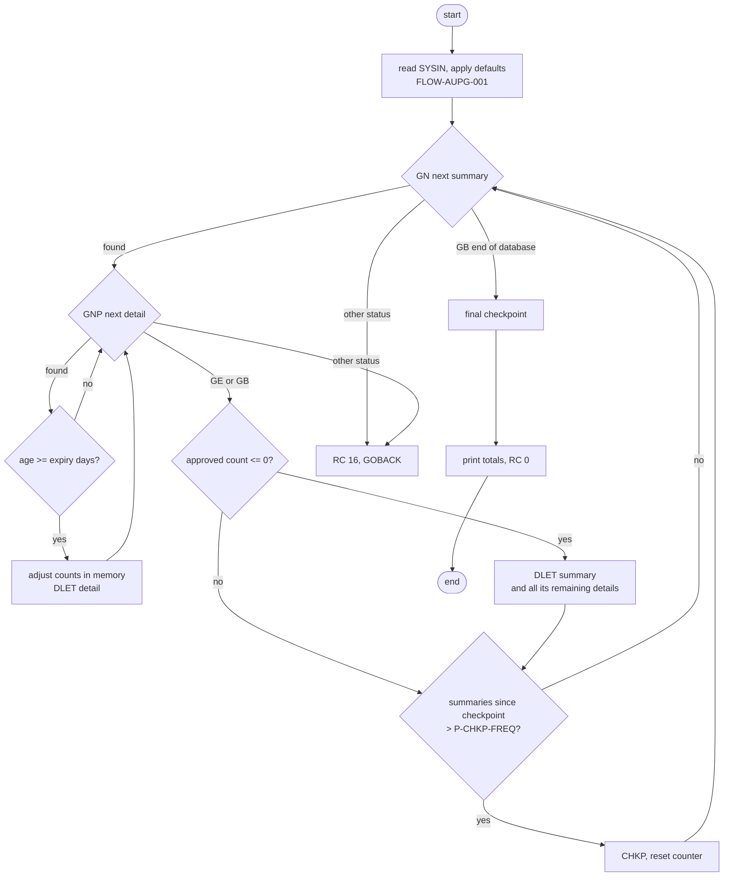
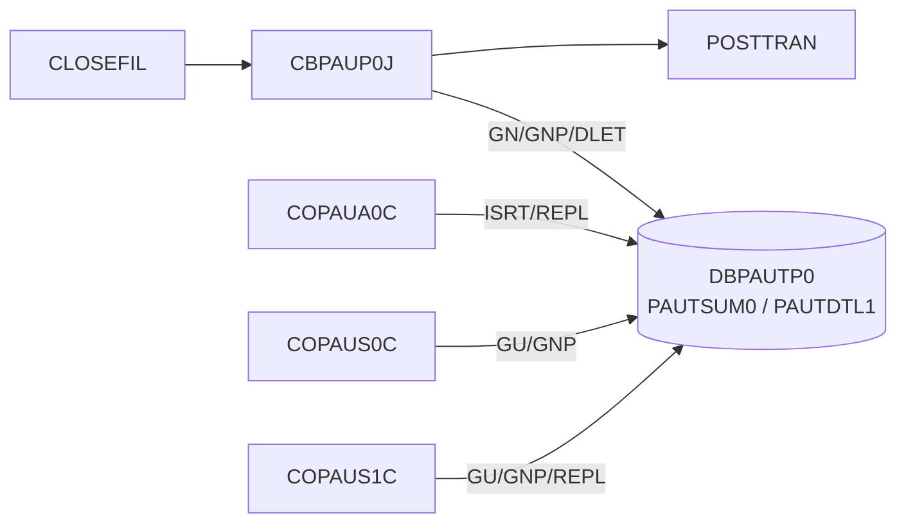

# CBPAUP0C: Expired pending authorization purge (CBPAUP0J)

## 1. Summary

An IMS batch program (BMP) that walks the whole pending-authorization database `DBPAUTP0`. For every account summary (ENT-AUTH-SUMMARY) it reads the authorization details (ENT-AUTH-DETAIL) under it and deletes each detail whose age in days is at least the expiry days from the parameter card. The age is today's `YYDDD` date minus the detail's `YYDDD` creation date. Each deleted detail is subtracted from the summary's approved or declined count and amount, but only in memory: the summary is never rewritten. A summary whose approved count is zero or less after the subtraction is deleted, and IMS deletes every detail still under it. The program takes IMS checkpoints, prints four totals and ends with return code 0, or 16 after any IMS error. The job is scheduled daily between CLOSEFIL and POSTTRAN. With the shipped parameter card it deletes every authorization (DEF-AUPG-001).

## 2. Rules at a glance

| ID | Rule |
| :-- | :-- |
| FLOW-AUPG-001 | One parameter record from SYSIN: expiry days, checkpoint frequency, checkpoint display frequency, debug flag, with defaults. |
| FLOW-AUPG-002 | Every summary is read in database order; for each, every detail under it is read and checked. |
| BR-AUPG-001 | Age of a detail = today's `YYDDD` - the detail's `YYDDD` (a difference of numbers, not of calendar days). |
| BR-AUPG-002 | A detail is deleted when its age is greater than or equal to the expiry days. |
| BR-AUPG-003 | A deleted approved detail reduces the summary's approved count by 1 and approved amount by the approved amount; any other deleted detail reduces the declined count by 1 and the declined amount by the requested amount. Only in memory. |
| BR-AUPG-004 | After its details, a summary is deleted (with every remaining detail) when its in-memory approved count is zero or less. |
| BR-AUPG-005 | A checkpoint is taken when the summaries read since the last one exceed the checkpoint frequency (compared as text, NUM-AUPG-002), and once at the end. |
| BR-AUPG-006 | The run ends with four totals: summaries read and deleted, details read and deleted. |

## 3. Actors and triggers

- **Trigger:** JCL job `CBPAUP0J`, step `STEP01`, program `DFSRRC00` with `PARM='BMP,CBPAUP0C,PSBPAUTB'` (`CBPAUP0J.jcl:24-25`). The program runs as a BMP: the IMS control region must be up (`authorization-purge.md:16-17`).
- **Schedule:** in CA-7, CLOSEFIL triggers `CBPAUP0J` and `CBPAUP0J` triggers POSTTRAN (`CardDemo.ca7:42-51, 69-70`).
- **Parameter:** the in-stream SYSIN record `00,00001,00001,Y` (`CBPAUP0J.jcl:36-37`).
- **PSB:** `PSBPAUTB`, one database PCB `PAUTBPCB` on `DBPAUTP0` with `PROCOPT=AP`, sensitive to `PAUTSUM0` and `PAUTDTL1`, `CMPAT=YES` (`PSBPAUTB.psb:17-20`).
- **Preconditions:** `DBPAUTP0` is available to the BMP for update. The program does not stop CICS; the online programs (COPAUA0C, COPAUS0C, COPAUS1C) can update the same database while it runs, and IMS serializes them.

## 4. Interfaces

### 4.1 Parameter record (SYSIN)

The program reads the first 17 bytes of one SYSIN record into `PRM-INFO` (`:98-108, 189`).

| Columns | Field | PIC | Shipped value | Use | Default |
| :-- | :-- | :-- | :-- | :-- | :-- |
| 1-2 | `P-EXPIRY-DAYS` | `9(02)` | `00` | expiry days (BR-AUPG-002) | 5 when the two characters are not numeric |
| 3 | separator | `X` | `,` | ignored | |
| 4-8 | `P-CHKP-FREQ` | `X(05)` | `00001` | checkpoint frequency (BR-AUPG-005) | `5    ` when spaces, `00000` or low-values |
| 9 | separator | `X` | `,` | ignored | |
| 10-14 | `P-CHKP-DIS-FREQ` | `X(05)` | `00001` | display a checkpoint line every this many checkpoints | `10   ` when spaces, `00000` or low-values |
| 15 | separator | `X` | `,` | ignored | |
| 16 | `P-DEBUG-FLAG` | `X(01)` | `Y` | `Y` prints a debug line per read and delete | any value other than `Y` becomes `N` |
| 17 | filler | `X` | space | ignored | |

### 4.2 Database calls

All calls are command-level DL/I (`EXEC DLI`) on PCB number 2 (`PAUT-PCB-NUM`, `:82`), which in a BMP with `CMPAT=YES` is the first database PCB, `PAUTBPCB` (PCB 1 is the I/O PCB). The status is tested in `DIBSTAT`. The two linkage items `IO-PCB-MASK` and `PGM-PCB-MASK` (`:128-133`) are 1-byte placeholders and are never used. **Confidence:** platform-inferred.

| Call | Segment | Into / from | Source |
| :-- | :-- | :-- | :-- |
| `GN` | `PAUTSUM0` | ENT-AUTH-SUMMARY | `:223-226` |
| `GNP` | `PAUTDTL1` | ENT-AUTH-DETAIL | `:255-258` |
| `DLET` | `PAUTDTL1` | ENT-AUTH-DETAIL | `:310-313` |
| `DLET` | `PAUTSUM0` | ENT-AUTH-SUMMARY | `:335-338` |
| `CHKP ID('RMAD0000')` | - | - | `:75-77, 355-356` |

The checkpoint ID is always `RMAD0000`: the counter part `WK-CHKPT-ID-CTR` is never incremented (`:75-77`).

### 4.3 Console output (SYSOUT), in order

| Text (exact) | When | Source |
| :-- | :-- | :-- |
| `STARTING PROGRAM CBPAUP0C::` | start | `:190` |
| `*-------------------------------------*` | start | `:191` |
| `CBPAUP0C PARM RECEIVED :` + the 17 parameter bytes as read | start | `:192` |
| `TODAYS DATE            :` + today as `YYDDD` | start | `:193` |
| a line with one space | start | `:194` |
| `DEBUG: AUTH SMRY READ : ` + summaries read so far | debug, before each summary read | `:219-221` |
| `DEBUG: AUTH DTL READ : ` + details read so far | debug, before each detail read | `:251-253` |
| `DEBUG: AUTH DTL DLET : ` + `PA-ACCT-ID` | debug, before each detail delete | `:306-308` |
| `DEBUG: AUTH SMRY DLET : ` + `PA-ACCT-ID` | debug, before each summary delete | `:331-333` |
| `CHKP SUCCESS: AUTH COUNT - ` + summaries read + `, APP ID - ` + account (11 digits) | after a checkpoint, when the display counter reaches its threshold (NUM-AUPG-002) | `:360-364` |
| a line with one space, then `*-------------------------------------*` | end | `:171-172` |
| `# TOTAL SUMMARY READ  :` + count | end | `:173` |
| `# SUMMARY REC DELETED :` + count | end | `:174` |
| `# TOTAL DETAILS READ  :` + count | end | `:175` |
| `# DETAILS REC DELETED :` + count | end | `:176` |
| `*-------------------------------------*`, then a line with one space | end | `:177-178` |
| error lines of section 10 | on error | |

The counters and `PA-ACCT-ID` are signed binary or packed fields; on z/OS they print as zero-padded digits whose last character carries the sign (for example `0000000E` for +5). **Confidence:** platform-inferred · **Fidelity:** incidental.

### 4.4 Return code

0 at normal end; 16 after any IMS error (ERR-AUPG-006). The program never abends.

## 5. Data used

| Entity field | Read | Written | Use |
| :-- | :-- | :-- | :-- |
| ENT-AUTH-SUMMARY.PA-ACCT-ID | yes | - | kept as the last account read (`WS-CURR-APP-ID`), printed in debug, checkpoint and error lines |
| ENT-AUTH-SUMMARY.PA-APPROVED-AUTH-CNT | yes | in memory only | BR-AUPG-003, BR-AUPG-004 |
| ENT-AUTH-SUMMARY.PA-APPROVED-AUTH-AMT, PA-DECLINED-AUTH-CNT, PA-DECLINED-AUTH-AMT | yes | in memory only | BR-AUPG-003; never tested or stored |
| ENT-AUTH-DETAIL.PA-AUTH-DATE-9C | yes | - | BR-AUPG-001 |
| ENT-AUTH-DETAIL.PA-AUTH-RESP-CODE | yes | - | `00` = approved (BR-AUPG-003) |
| ENT-AUTH-DETAIL.PA-APPROVED-AMT, PA-TRANSACTION-AMT | yes | - | BR-AUPG-003 |
| ENT-AUTH-DETAIL (other fields) | yes | - | not used: match status, fraud flag and time play no part (DEF-AUPG-009) |

Program-local data with behaviour: `CURRENT-YYDDD PIC 9(05)` (`:44`), `WS-AUTH-DATE PIC 9(05)` (`:45`), `WS-EXPIRY-DAYS` and `WS-DAY-DIFF PIC S9(4) COMP` (`:46-47`), the counters `WS-NO-CHKP`, `WS-AUTH-SMRY-PROC-CNT PIC 9(8)` and `WS-NO-SUMRY-READ`, `-DELETED`, `WS-NO-DTL-READ`, `-DELETED PIC S9(8) COMP` (`:51-57`), the flags `WS-END-OF-AUTHDB-FLAG`, `WS-MORE-AUTHS-FLAG`, `WS-QUALIFY-DELETE-FLAG` (`:62-70`). `CURRENT-DATE` is accepted but not used (`:186`); `WS-ERR-FLG` is tested but never set (DEF-AUPG-010).

## 6. Processing flow

1. Accept today's date as `YYDDD` and the parameter record; print the start lines; apply the defaults (`:186-209`).
2. Read the first summary (`:140`).
3. Until the end of the database (`:142-167`):
   1. Read the first detail under the summary, then for each detail: compute its age, delete it when it is expired (with the in-memory adjustment) and read the next detail (`:144-154`).
   2. When the in-memory approved count is zero or less, delete the summary (`:156-158`).
   3. When more than `P-CHKP-FREQ` summaries were read since the last checkpoint, take a checkpoint and reset that count (`:160-164`).
   4. Read the next summary (`:165`).
4. Take a final checkpoint, print the totals and end (`:169-180`).

## 7. Business rules

#### BR-AUPG-001 · Age of an authorization detail
- **When:** a detail has been read.
- **Then:** its creation date is recovered as `99999 - PA-AUTH-DATE-9C` (a `YYDDD` number, ENT-AUTH-DETAIL) and its age is today's `YYDDD` (`ACCEPT ... FROM DAY`, 2-digit year) minus that number. Within one year this is the number of days. Across a year end it is not: the difference jumps by 1000 - 365 = 635 (or 634 after a leap year), so a detail from 31 December is 636 "days" old on 1 January (DEF-AUPG-004). A detail dated after today has a negative age.
- **Source:** `:187, 280-282`
- **Fidelity:** must-preserve (defect-decide for the year end, Q-AUPG-006) · **Confidence:** reviewed (arithmetic runtime-verified on GnuCOBOL, see `docs/modernization/spec/evidence/e-review.md`)

#### BR-AUPG-002 · Expiry test
- **When:** the age (BR-AUPG-001) is greater than or equal to the expiry days `WS-EXPIRY-DAYS`.
- **Then:** the detail qualifies for delete; BR-AUPG-003 applies and the detail is deleted (SE-AUPG-001).
- **Otherwise:** the detail is kept.
- **Note:** with expiry days 0 (the shipped value) every detail dated today or earlier qualifies (DEF-AUPG-001). The response code, match status and fraud flag do not matter (DEF-AUPG-009).
- **Source:** `:147-151, 284-296`
- **Fidelity:** must-preserve · **Confidence:** reviewed

#### BR-AUPG-003 · In-memory adjustment of the summary totals
- **When:** a detail qualifies for delete.
- **Then:** if `PA-AUTH-RESP-CODE` = `00` (approved): `PA-APPROVED-AUTH-CNT` - 1 and `PA-APPROVED-AUTH-AMT` - `PA-APPROVED-AMT`. Otherwise (any other code, including blanks): `PA-DECLINED-AUTH-CNT` - 1 and `PA-DECLINED-AUTH-AMT` - `PA-TRANSACTION-AMT`.
- The adjusted values live only in the program's copy of the summary. They are never written back (DEF-AUPG-003); only the approved count is used again, by BR-AUPG-004. `PA-CREDIT-BALANCE` is not adjusted at all.
- The adjustment is made before the delete; when the delete fails the program ends anyway (ERR-AUPG-003).
- **Source:** `:286-293`
- **Fidelity:** must-preserve (defect-decide, Q-AUPG-002) · **Confidence:** reviewed

#### BR-AUPG-004 · Summary delete
- **When:** all details of the summary have been read, and the in-memory `PA-APPROVED-AUTH-CNT` is zero or less. The source tests `PA-APPROVED-AUTH-CNT <= 0` twice; the declined count is never tested (DEF-AUPG-002).
- **Then:** the summary is deleted (SE-AUPG-002). IMS deletes a segment together with all its dependents, so every detail still under it is deleted too, including unexpired and declined ones; those are not counted in the deleted-details total.
- **Otherwise:** the summary is kept, with its stored totals unchanged.
- **Consequence:** a summary whose stored approved count is 0 (only declined authorizations) is deleted with all its details on the first run, whatever their age. A summary is kept as long as its stored approved count exceeds the number of approved details expired in the current run, even when it has no details left.
- **Source:** `:156-158`
- **Fidelity:** must-preserve (defect-decide, Q-AUPG-002) · **Confidence:** reviewed (cascade: platform-inferred)

#### BR-AUPG-005 · Checkpoints
- **When:** after each summary, `WS-AUTH-SMRY-PROC-CNT` (summaries read since the last checkpoint) is greater than `P-CHKP-FREQ`. The comparison is between an 8-digit number and a 5-character text field and is done as text (NUM-AUPG-002): with `00001` the first checkpoint comes after 1,000 summaries, with the default `5` after 50,000,000.
- **Then:** `CHKP` (SE-AUPG-003) and the count is reset to 0. After each successful checkpoint `WS-NO-CHKP` is increased; when it is greater than or equal to `P-CHKP-DIS-FREQ` (same text comparison) it is reset to 0 and the `CHKP SUCCESS` line is printed.
- **Also:** one checkpoint is always taken at the end of the run (`:169`).
- **Source:** `:160-164, 169, 352-372`
- **Fidelity:** incidental for the frequency (a target sets its own commit interval); must-preserve that work is committed in units (Q-AUPG-003) · **Confidence:** reviewed (comparison runtime-verified on GnuCOBOL)

#### BR-AUPG-006 · Run totals
- **Then:** at normal end print summaries read, summaries deleted, details read, details deleted (section 4.3). Details removed by a summary delete (BR-AUPG-004) are not in "details deleted".
- **Source:** `:171-178, 231, 262, 316, 341`
- **Fidelity:** must-preserve (operators compare them, `authorization-purge.md:61-74`) · **Confidence:** reviewed

## 8. Validations and messages

The program validates only its parameter record.

#### FLOW-AUPG-001 · Parameter record and defaults
- **When:** at start.
- **Then:** read one record from SYSIN. `P-EXPIRY-DAYS` is used when it is numeric (00-99), else 5. `P-CHKP-FREQ` becomes `5` when it is spaces, `00000` or low-values; `P-CHKP-DIS-FREQ` becomes `10` in the same cases (both left-aligned text, NUM-AUPG-002). `P-DEBUG-FLAG` other than `Y` becomes `N`. No value is rejected: non-numeric frequencies are kept and compared as text.
- **Source:** `:189, 196-209`
- **Fidelity:** must-preserve · **Confidence:** reviewed

#### FLOW-AUPG-002 · Database walk
- **When:** after the parameters.
- **Then:** `GN PAUTSUM0` returns the summaries in key order; for each, `GNP PAUTDTL1` returns its details in key order (newest first, because the key is a complement of the date and time). `GE` or `GB` on the `GNP` ends the details of the summary; `GB` on the `GN` ends the run. The loop also ends when `WS-ERR-FLG` is on, which never happens (DEF-AUPG-010).
- **Source:** `:138-167, 216-274`
- **Fidelity:** must-preserve · **Confidence:** reviewed

There are no user-facing messages besides the console lines of section 4.3 and section 10.

## 9. Side effects

In execution order per summary. Changes are committed by IMS at each checkpoint and at the end of the program; the program never issues a rollback.

#### SE-AUPG-001 · Detail delete
- `DLET PAUTDTL1` of the detail just read with `GNP`, after BR-AUPG-003. Status blank: deleted-details + 1.
- **Source:** `:303-323`
- **Confidence:** platform-inferred (command-level DL/I needs no separate hold call)

#### SE-AUPG-002 · Summary delete (cascade)
- `DLET PAUTSUM0` of the current summary, after its details were read (and some deleted). Status blank: deleted-summaries + 1. IMS removes every remaining detail of the summary with it.
- **Source:** `:328-347`
- **Confidence:** platform-inferred (Q-AUPG-004)

#### SE-AUPG-003 · Checkpoint
- `CHKP` with ID `RMAD0000`: IMS commits every delete since the previous checkpoint and releases locks.
- **Source:** `:352-372`
- **Confidence:** platform-inferred

Reads with no side effect: `GN` summaries, `GNP` details. The program writes no files.

## 10. Error handling

#### ERR-AUPG-001 · Summary read failure
- `GN` status other than blank or `GB`: print `AUTH SUMMARY READ FAILED  :` + status and `SUMMARY READ BEFORE ABEND :` + summaries read, then ERR-AUPG-006.
- **Source:** `:228-241`

#### ERR-AUPG-002 · Detail read failure
- `GNP` status other than blank, `GE` or `GB`: print `AUTH DETAIL READ FAILED  :` + status, `SUMMARY AUTH APP ID      :` + `PA-ACCT-ID`, `DETAIL READ BEFORE ABEND :` + details read, then ERR-AUPG-006.
- **Source:** `:259-271`

#### ERR-AUPG-003 · Detail delete failure
- Status not blank: print `AUTH DETAIL DELETE FAILED :` + status and `AUTH APP ID               :` + `PA-ACCT-ID`, then ERR-AUPG-006.
- **Source:** `:315-321`

#### ERR-AUPG-004 · Summary delete failure
- Status not blank: print `AUTH SUMMARY DELETE FAILED :` + status and `AUTH APP ID                :` + `PA-ACCT-ID`, then ERR-AUPG-006.
- **Source:** `:340-346`

#### ERR-AUPG-005 · Checkpoint failure
- Status not blank: print `CHKP FAILED: DIBSTAT - ` + status + `, REC COUNT - ` + summaries read + `, APP ID - ` + last account, then ERR-AUPG-006.
- **Source:** `:358-370`

#### ERR-AUPG-006 · End with return code 16 (not an abend)
- Print `CBPAUP0C ABENDING ...`, set return code 16 and `GOBACK`. The run totals are not printed. Because the program ends normally from the point of view of IMS, IMS commits every delete made up to the failure, not only those before the last checkpoint (DEF-AUPG-006).
- **Source:** `:377-383`
- **Confidence:** platform-inferred (IMS commit at normal program end; also stated in `authorization-purge.md:89-97`)

## 11. Interactions

- **Upstream:** CA-7 starts it after CLOSEFIL (`CardDemo.ca7:42-51`); the IMS control region and database `DBPAUTP0`.
- **Downstream:** CA-7 starts POSTTRAN when it ends (`CardDemo.ca7:69-70`). Its return code 16 is not an abend, so the scheduler must treat 16 as a failure to stop the chain (`authorization-purge.md:96-97`).
- **Shared data:** `DBPAUTP0` is written online by COPAUA0C (new details, summary totals; see COPAUA0C BR-AUTH-009, BR-AUTH-010) and read and updated by COPAUS0C and COPAUS1C (fraud flag). The purge's deletions are what the online summary screen stops showing. The totals the purge adjusts in memory are the same fields COPAUA0C uses to compute available credit; since they are not written back (DEF-AUPG-003), purged approvals keep reducing the available credit.
- **No calls**, no files, no Db2, no MQ.

## 12. Numeric, date and format details

#### NUM-AUPG-001 · Dates
- Today: `ACCEPT CURRENT-YYDDD FROM DAY`, `9(05)`, `YYDDD` with a 2-digit year (`:187`). Detail date: `PA-AUTH-DATE-9C` `S9(05) COMP-3` holding `99999 - YYDDD` (written by COPAUA0C NUM-AUTH-005); recovered into `WS-AUTH-DATE 9(05)` (`:280`).
- The age is stored in `WS-DAY-DIFF S9(4) COMP`; every age reachable within a century (-1,000 to +1,000 around a year end) fits. Run on 2025-01-01 (25001) for a detail of 2024-12-31 (24366): age 25001 - 24366 = 635; of 2024-12-30: 636.
- **Source:** `:44-47, 187, 280-282`

#### NUM-AUPG-002 · Frequencies are compared as text
- `P-CHKP-FREQ` and `P-CHKP-DIS-FREQ` are `X(05)`; the counters `WS-AUTH-SMRY-PROC-CNT` and `WS-NO-CHKP` are `9(8)`. COBOL compares a numeric display integer with a text field as text: the counter as 8 digits with leading zeros, the parameter padded with spaces to 8 (spaces sort below digits).
  - `00001` → `00001   `: the counter is greater only from 1,000 (`00001000`).
  - Default `5` → `5       `: greater only from 50,000,000.
  - Default `10` → `10      `: greater or equal only from 10,000,000.
- So with the shipped card a checkpoint is taken after every 1,000 summaries plus at the end, and the `CHKP SUCCESS` line is printed after 1,000 checkpoints, in practice never.
- **Source:** `:101, 103, 160, 201-206, 360`
- **Confidence:** runtime-verified on GnuCOBOL 3.2 (`-std=ibm`), see `docs/modernization/spec/evidence/e-review.md`; z/OS result platform-inferred (same COBOL comparison rule).

#### NUM-AUPG-003 · Count and amount arithmetic
- Count subtraction on `S9(4) COMP` and amount subtraction on `S9(9)V99 COMP-3` (ENT-AUTH-SUMMARY) from `S9(10)V99` detail amounts, no rounding, no size-error clause. Results stay in memory only (DEF-AUPG-003), so overflow has no lasting effect.
- **Source:** `:288-292`

#### NUM-AUPG-004 · Counters
- Summaries and details read and deleted are `S9(8) COMP`, printed as 8 digits (section 4.3); `WS-CURR-APP-ID` `9(11)` prints as 11 digits.
- **Source:** `:49, 51-57`

## 13. Known defects and oddities

#### DEF-AUPG-001 · The shipped parameter card purges everything
- SYSIN `00,00001,00001,Y` sets expiry days to 0 (`00` is numeric, so the default 5 does not apply). Every detail dated today or earlier is at least 0 days old and is deleted, and then every summary (its approved count drops to 0 or less unless the stored count was larger than the number of its approved details). The debug flag `Y` also prints a line for every read and delete.
- **Source:** `CBPAUP0J.jcl:36-37`, `:196-200, 284` · **Status:** open · **Fidelity:** defect-decide (Q-AUPG-001) · **Confidence:** reviewed (confirms `authorization-purge.md:34-37`)

#### DEF-AUPG-002 · Declined count never tested; summary delete cascades
- The summary delete test reads `PA-APPROVED-AUTH-CNT <= 0 AND PA-APPROVED-AUTH-CNT <= 0`: the second operand was evidently meant to be `PA-DECLINED-AUTH-CNT`. A summary with no approved authorizations is deleted even when it still has unexpired declined ones, and the delete removes all of its details (BR-AUPG-004).
- **Source:** `:156` · **Status:** open · **Fidelity:** defect-decide (Q-AUPG-002) · **Confidence:** reviewed (confirms `authorization-purge.md:51-53`)

#### DEF-AUPG-003 · Adjusted totals are never written back
- BR-AUPG-003 changes the counts and amounts in working storage only; there is no `REPL`. Kept summaries keep their old counts and amounts, and `PA-CREDIT-BALANCE` is never reduced, so the available credit that COPAUA0C computes from the summary (credit limit - credit balance) is not restored when approvals are purged. The module README describes "adjustment of available credit when unmatched authorizations are deleted" (`app/app-authorization-ims-db2-mq/README.md:86`), which the code does not do. Because the stored approved count never decreases, a summary whose approved details are purged over several runs is never deleted.
- **Source:** `:286-293` (no `REPL` anywhere in the program) · **Status:** open · **Fidelity:** defect-decide (Q-AUPG-002) · **Confidence:** reviewed (confirms `authorization-purge.md:54-55`)

#### DEF-AUPG-004 · Year-end age error
- BR-AUPG-001 subtracts `YYDDD` numbers. On 1 January a detail from late December is about 636 "days" old and is purged whatever the expiry days (up to 99). Ages are correct within a calendar year. At a century change (`99xxx` to `00xxx`) the age becomes negative and nothing is purged.
- **Source:** `:187, 280-284` · **Status:** open · **Fidelity:** defect-decide (Q-AUPG-006) · **Confidence:** reviewed (confirms `authorization-purge.md:57-59`)

#### DEF-AUPG-005 · Frequencies compared as text
- See NUM-AUPG-002: `P-CHKP-FREQ` and `P-CHKP-DIS-FREQ` are `X(05)` compared with numeric counters, so `00001` means every 1,000 summaries and the defaults mean almost never. A long run therefore holds its locks and uncommitted deletes for up to 1,000 summaries (or the whole run with the defaults).
- **Source:** `:101, 103, 160, 360` · **Status:** open · **Confidence:** runtime-verified on GnuCOBOL; platform-inferred on z/OS

#### DEF-AUPG-006 · "ABENDING" is a normal end with return code 16
- ERR-AUPG-006 does not abend; IMS commits all deletes up to the failure, including the in-flight ones after the last checkpoint. The message says `ABENDING`. A rerun is safe because each run re-reads and re-tests what is left (`authorization-purge.md:89-94`).
- **Source:** `:377-383` · **Status:** open · **Confidence:** platform-inferred

#### DEF-AUPG-007 · Database position after a checkpoint
- The program continues with an unqualified `GN PAUTSUM0` after `CHKP`. IMS documentation states that a basic checkpoint in a BMP loses database position for full-function databases; if so, the next `GN` starts again from the first summary, so kept summaries are read (and counted) again, and a database with more than about 1,000 kept summaries could loop. Not reachable with the 22 sample summaries. Needs confirmation by the mainframe team.
- **Source:** `:160-165, 352-356` · **Status:** open · **Confidence:** platform-inferred (Q-AUPG-003)

#### DEF-AUPG-008 · [security] Debug output and account numbers
- The shipped debug flag `Y` prints the account number before every delete and in every checkpoint and error line. Account numbers are customer data (`docs/security/data-handling.md`). No card numbers are printed.
- **Source:** `:306-308, 331-333, 362-363` · **Status:** open

#### DEF-AUPG-009 · Purge ignores match status and fraud flags
- Only the age decides. A detail matched with a posted transaction (`M`), a declined one (`D`) and one flagged as fraud (`F`, with a row in ENT-AUTH-FRAUD) are purged the same way. The status value `E` ("pending expired", ENT-AUTH-DETAIL) exists but is never set; expired details are deleted instead.
- **Source:** `:280-296` · **Status:** open · **Fidelity:** defect-decide (Q-AUPG-005)

#### DEF-AUPG-010 · Dead error flag and unused fields
- `WS-ERR-FLG` is tested in the main loop but never set, so the loop ends only at end of database or by ERR-AUPG-006. `CURRENT-DATE`, `WS-TOT-REC-WRITTEN`, `IDX`, `IMS-RETURN-CODE` and its conditions, `PSB-NAME`, the PCB masks and the checkpoint counter `WK-CHKPT-ID-CTR` are declared but have no effect.
- **Source:** `:59-61, 75-95, 142` · **Status:** open (incidental)

## 14. Open questions

| ID | Question | For |
| :-- | :-- | :-- |
| Q-AUPG-001 | What expiry period should production use, and should the job ship with it instead of `00` (DEF-AUPG-001)? | business, operations |
| Q-AUPG-002 | Intended summary rule: delete only when both counts are zero? Should the adjusted counts, amounts and the credit balance be written back, so available credit is restored (DEF-AUPG-002, DEF-AUPG-003)? | business |
| Q-AUPG-003 | Does `EXEC DLI CHKP` in this BMP lose database position, so the next unqualified `GN` restarts at the first summary (DEF-AUPG-007)? | mainframe team |
| Q-AUPG-004 | Is the summary `DLET` accepted after intervening `GNP` and `DLET` calls on the same PCB, or does IMS require the summary to be retrieved again first? | mainframe team |
| Q-AUPG-005 | Should matched, declined or fraud-flagged authorizations be purged by age like the others, or marked expired (`E`) (DEF-AUPG-009)? | business |
| Q-AUPG-006 | Should the age be a true day count (DEF-AUPG-004)? | business |

## 15. Equivalence contract

A reimplementation is equivalent when, for the same database content, parameter record and run date:

- the same detail and summary segments are deleted (including the cascade of BR-AUPG-004), and every kept segment is byte-identical (the purge never rewrites);
- the four totals are equal;
- the return code is 0, or 16 after the same failing call, with the same deletes applied before it;
- console text, checkpoint IDs and the checkpoint frequency may differ (incidental), as long as deletes are committed at the end and at an error.

Not runnable locally (IMS). A scenario check: on the 22 sample summaries (ENT-AUTH-SUMMARY sample data) with the shipped card, every detail dated on or before the run date and every summary is deleted, because every stored approved count equals the number of approved details. The root whose bytes are all spaces has a count of 16,448 (`X'4040'`) and no details, so it is kept. Review record: `docs/modernization/spec/evidence/e-review.md`.

## 16. Paragraph coverage

| Paragraph | Lines | Covered by |
| :-- | :-- | :-- |
| (data division) | 41-129 | §4.1, §5, NUM-AUPG-001, NUM-AUPG-004, DEF-AUPG-010 |
| (procedure division header) | 132-133 | §4.2 |
| `MAIN-PARA` | 136-180 | FLOW-AUPG-002, BR-AUPG-002, BR-AUPG-004, BR-AUPG-005, BR-AUPG-006, DEF-AUPG-002, DEF-AUPG-010 |
| `1000-INITIALIZE` | 183-210 | FLOW-AUPG-001, NUM-AUPG-001, §4.3 |
| `1000-EXIT` | 212-213 | FLOW-AUPG-001 |
| `2000-FIND-NEXT-AUTH-SUMMARY` | 216-242 | FLOW-AUPG-002, ERR-AUPG-001 |
| `2000-EXIT` | 243-244 | FLOW-AUPG-002 |
| `3000-FIND-NEXT-AUTH-DTL` | 248-272 | FLOW-AUPG-002, ERR-AUPG-002 |
| `3000-EXIT` | 273-274 | FLOW-AUPG-002 |
| `4000-CHECK-IF-EXPIRED` | 277-298 | BR-AUPG-001, BR-AUPG-002, BR-AUPG-003, DEF-AUPG-004 |
| `4000-EXIT` | 299-300 | BR-AUPG-002 |
| `5000-DELETE-AUTH-DTL` | 303-323 | SE-AUPG-001, ERR-AUPG-003 |
| `5000-EXIT` | 324-325 | SE-AUPG-001 |
| `6000-DELETE-AUTH-SUMMARY` | 328-347 | SE-AUPG-002, ERR-AUPG-004 |
| `6000-EXIT` | 348-349 | SE-AUPG-002 |
| `9000-TAKE-CHECKPOINT` | 352-372 | BR-AUPG-005, SE-AUPG-003, ERR-AUPG-005, NUM-AUPG-002 |
| `9000-EXIT` | 373-374 | BR-AUPG-005 |
| `9999-ABEND` | 377-383 | ERR-AUPG-006, DEF-AUPG-006 |
| `9999-EXIT` | 385-386 | ERR-AUPG-006 |

17 of 17 paragraphs plus the procedure division header covered.
