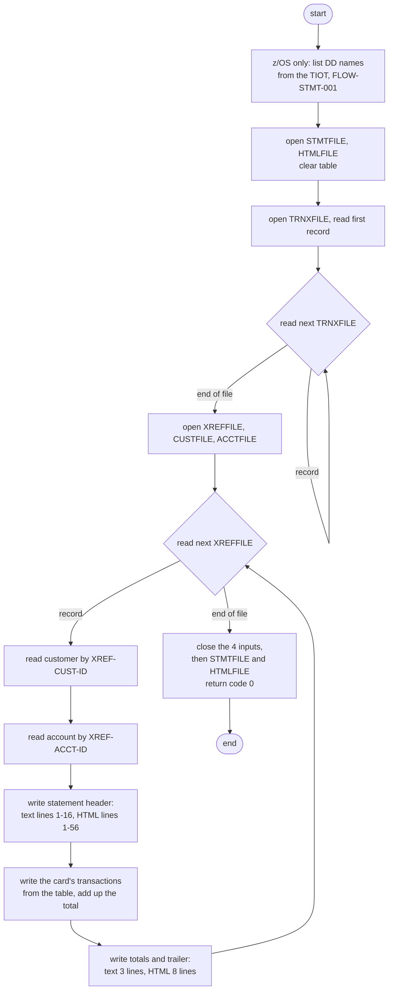
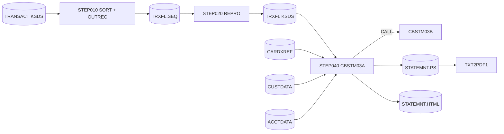

# CBSTM03A: Account statements in text and HTML (CREASTMT)

## 1. Summary

The statement job prints one account statement for every card in the card cross-reference, in card-number order, in two files at once: a plain-text file of 80-byte lines and an HTML file of 100-byte lines. Each statement shows the customer's name and address, the account number, the account's current balance and the customer's FICO score, followed by every transaction on file for that card and the sum of their amounts (`Total EXP`). Before it prints anything, the program loads the whole card-ordered transaction work file (built by the job's SORT step) into an in-memory table of at most 51 cards with 10 transactions each. It then reads the cross-reference sequentially and looks up the customer and the account by key for each card. All file access goes through the subprogram CBSTM03B. The program updates no data. It starts by walking z/OS control blocks to list the step's DD names on the console, so it does not run outside z/OS. The program's header comment says it was written to exercise modernization tooling: control-block addressing, ALTER and GO TO, COMP and COMP-3 fields, a two-dimensional table and a subroutine call. It ends with return code 0, or abends through `CEE3ABD` on any unexpected file status.

## 2. Rules at a glance

| ID | Rule |
| :-- | :-- |
| BR-STMT-001 | One statement per cross-reference record, in card-number order, including cards with no transactions. |
| BR-STMT-002 | A statement lists the transactions whose card number equals the cross-reference card, in transaction-ID order. |
| BR-STMT-003 | `Total EXP` is the signed sum of the listed transaction amounts, not the account balance. |
| BR-STMT-004 | Customer and account are read by the cross-reference's customer ID and account ID; a missing one abends the job. |
| BR-STMT-005 | Text name line: first word of the first, middle and last name, each followed by one space. |
| BR-STMT-006 | Text address: lines 1 and 2 as stored; line 3 = first word of city, state, country and ZIP, each followed by one space. |
| BR-STMT-007 | Basic details: account ID, current balance (9 integer digits, trailing sign) and FICO score. |
| BR-STMT-008 | HTML name and address lines end at the first double space of the text lines. |
| BR-STMT-009 | Transactions whose card is not in the cross-reference appear on no statement. |
| BR-STMT-010 | Transaction line: ID, first 49 characters of the description, amount. |

## 3. Actors and triggers

- **Trigger:** JCL job `CREASTMT`, step `STEP040` (`app/jcl/CREASTMT.JCL:79-96`). In the CA-7 listing CREASTMT is triggered by CLOSEFIL and itself triggers TXT2PDF1 (`app/scheduler/CardDemo.ca7:465-476, 494-495`). The batch-cycle runbook places it at step 7, after COMBTRAN and before TRANIDX (`docs/runbooks/batch-cycle-restart.md:19`).
- **Earlier steps of the same job** (`app/jcl/CREASTMT.JCL:22-75`): `DELDEF01` deletes `TRXFL.SEQ` and the `TRXFL` KSDS and defines the KSDS again with a 32-byte key; `STEP010` sorts TRANSACT by card number and transaction ID and reformats it (ENT-STMT-TRAN); `STEP020` loads the sorted file into the KSDS with `REPRO`; `STEP030` (IEFBR14) deletes the previous `STATEMNT.HTML` and `STATEMNT.PS`. `STEP020`, `STEP030` and `STEP040` carry `COND=(0,NE)`: each is skipped when any earlier step ended with a return code other than 0. The job itself is specified by the jobs area; this spec covers STEP040 and the TRXFL layout it depends on.
- **Preconditions:** TRXFL holds at least one record (DEF-STMT-010), at most 51 distinct cards and at most 10 transactions per card (DEF-STMT-001); every cross-reference record has its customer and its account (ERR-STMT-004); `STATEMNT.PS` and `STATEMNT.HTML` do not exist (they are allocated `NEW`).
- **No parameters**, no control cards, and no use of the clock or the business date: the statement carries no date (DEF-STMT-005).

## 4. Interfaces

### 4.1 Files

| DD | Entity | Organisation | Open | Access | Key | Record | Source |
| :-- | :-- | :-- | :-- | :-- | :-- | --: | :-- |
| `TRNXFILE` | ENT-STMT-TRAN | indexed (KSDS) | INPUT (by CBSTM03B) | read next, whole file at the start | card + transaction ID (32, offset 0) | 350 | `:730-762, 818-853` |
| `XREFFILE` | ENT-CARD-XREF | indexed | INPUT (by CBSTM03B) | read next, one per statement | `XREF-CARD-NUM` (16, offset 0) | 50 | `:345-366, 765-781` |
| `CUSTFILE` | ENT-CUSTOMER | indexed | INPUT (by CBSTM03B) | random read | `CUST-ID` (9, offset 0) | 500 | `:368-390, 783-799` |
| `ACCTFILE` | ENT-ACCOUNT | indexed | INPUT (by CBSTM03B) | random read | `ACCT-ID` (11, offset 0) | 300 | `:392-414, 801-816` |
| `STMTFILE` | text statements | sequential, fixed | OUTPUT (here) | write | - | 80 | `:39, 44-45, 293` |
| `HTMLFILE` | HTML statements | sequential, fixed | OUTPUT (here) | write | - | 100 | `:40, 46-47, 293` |

The organisation and access mode of the four input files are declared in CBSTM03B (`app/cbl/CBSTM03B.CBL:31-53`). The two output files have no `FILE STATUS` clause, and no write is checked (ERR-STMT-007). In STEP040 `STMTFILE` is allocated `DISP=(NEW,CATLG,DELETE)`, `DCB=(LRECL=80,BLKSIZE=8000,RECFM=FB)` and `HTMLFILE` `DISP=(NEW,CATLG,DELETE)`, `DCB=(LRECL=100,BLKSIZE=800,RECFM=FB)` (`app/jcl/CREASTMT.JCL:87-96`).

### 4.2 Call interface to CBSTM03B

Every file operation on the four input files is a `CALL 'CBSTM03B' USING WS-M03B-AREA` (13 call sites, for example `:351`). The area is ENT-STMT-REQUEST, 1,040 bytes, passed by reference and kept between calls (`:71-83`):

| Bytes | Field | PIC | Set by CBSTM03A | Returned by CBSTM03B |
| :-- | :-- | :-- | :-- | :-- |
| 1-8 | `WS-M03B-DD` | `X(08)` | DD name: `TRNXFILE`, `XREFFILE`, `CUSTFILE` or `ACCTFILE` | - |
| 9 | `WS-M03B-OPER` | `X(01)` | `O` open, `C` close, `R` read next, `K` read by key (`W` and `Z` are declared, never used) | - |
| 10-11 | `WS-M03B-RC` | `X(02)` | set to `00` before opens, closes and the cross-reference, customer and account reads | the file status of the operation |
| 12-36 | `WS-M03B-KEY` | `X(25)` | `K` only: `XREF-CUST-ID` (9 digits) or `XREF-ACCT-ID` (11 digits), left-aligned, rest spaces | - |
| 37-40 | `WS-M03B-KEY-LN` | `S9(4)` zoned, not binary | `K` only: 9 or 11 (`LENGTH OF` the key field) | - |
| 41-1040 | `WS-M03B-FLDT` | `X(1000)` | set to spaces before every read | the record read, left-aligned, padded with spaces |

CBSTM03B opens every file `INPUT`, reads `TRNXFILE` and `XREFFILE` sequentially and `CUSTFILE` and `ACCTFILE` by key, and returns the file status unchanged (`app/cbl/CBSTM03B.CBL:114-229`). Its behaviour is specified in its own spec (unit STIO); only the interface is described here. CBSTM03A copies the first 350, 50, 500 or 300 bytes of the data area into its record layout after each read (`:364, 388, 412, 756, 839`).

### 4.3 Console output (SYSOUT)

On z/OS a normal run prints only the DD list of FLOW-STMT-001; the program prints no counts. Error lines are listed in section 8 and section 10. All lines are `DISPLAY`, so they go to SYSOUT; the local `CEE3ABD` shim writes its own line to stderr.

### 4.4 Return code

0 at normal end: the program never sets `RETURN-CODE`, and CBSTM03B does not either (platform-inferred for z/OS; observed 0 with the harness). On any error the program calls `CEE3ABD` with no arguments (ERR-STMT-006).

### 4.5 Output layouts

The text statement is specified line by line in NUM-STMT-001, the HTML statement in NUM-STMT-005 and NUM-STMT-006. Record format and encoding are in NUM-STMT-007.

## 5. Data used

| Entity field | Read | Use |
| :-- | :-- | :-- |
| ENT-STMT-TRAN.TRNX-CARD-NUM | yes | groups the table by card; matched against `XREF-CARD-NUM` |
| ENT-STMT-TRAN.TRNX-ID | yes | transaction line (BR-STMT-010) |
| ENT-STMT-TRAN.TRNX-REST (318 bytes) | yes | stored in the table; only `TRNX-DESC` and `TRNX-AMT` are printed |
| ENT-CARD-XREF.XREF-CARD-NUM | yes | which card the statement is for; never printed |
| ENT-CARD-XREF.XREF-CUST-ID, XREF-ACCT-ID | yes | keys for the customer and account reads |
| ENT-CUSTOMER.CUST-FIRST-NAME, CUST-MIDDLE-NAME, CUST-LAST-NAME | yes | name line (BR-STMT-005) |
| ENT-CUSTOMER.CUST-ADDR-LINE-1, -2, -3, CUST-ADDR-STATE-CD, CUST-ADDR-COUNTRY-CD, CUST-ADDR-ZIP | yes | address lines (BR-STMT-006) |
| ENT-CUSTOMER.CUST-FICO-CREDIT-SCORE | yes | basic details (BR-STMT-007) |
| ENT-ACCOUNT.ACCT-ID, ACCT-CURR-BAL | yes | basic details (BR-STMT-007) |
| all other fields | read, not used | for example `CUST-SSN`, `CUST-DOB-YYYYMMDD` and `ACCT-CREDIT-LIMIT` are in the records read but never printed |

The program copies CUSTREC, so the date-of-birth field has the CUSTREC name `CUST-DOB-YYYYMMDD` (see ENT-CUSTOMER). CUSTREC is indented with tab characters, so CBSTM03A compiles locally only with `-ftab-width=4` (`tools/batch-programs.toml:17`, `cobol-lint.json:5`); the layout is unchanged.

Program-local data with behaviour (`:59-83, 225-233`):

| Field | Definition | Use |
| :-- | :-- | :-- |
| `CR-CNT`, `TR-CNT`, `CR-JMP`, `TR-JMP` | `S9(4) COMP` (2-byte binary) | card count and per-card transaction count while loading; card and transaction indexes while printing |
| `WS-TOTAL-AMT` | `S9(9)V99 COMP-3` (6-byte packed) | statement total (NUM-STMT-004) |
| `WS-TRN-AMT` | `S9(9)V99` zoned | copy of the total before editing |
| `WS-FL-DD` | `X(8)`, initial `TRNXFILE` | state of the start-up state machine (FLOW-STMT-002) |
| `WS-SAVE-CARD` | `X(16)`, initial spaces | card of the previous transaction while loading |
| `END-OF-FILE` | `X(01)`, initial `N` | `Y` at the end of the cross-reference |
| `WS-TRNX-TABLE` | 51 x (`WS-CARD-NUM` `X(16)` + 10 x (`WS-TRAN-NUM` `X(16)` + `WS-TRAN-REST` `X(318)`)) = 171,156 bytes | all transactions, by card (FLOW-STMT-003) |
| `WS-TRN-TBL-CNTR` | 51 x `WS-TRCT` `S9(4) COMP` | number of transactions stored per card |
| `STATEMENT-LINES`, `HTML-LINES` | line images | NUM-STMT-001, NUM-STMT-005, NUM-STMT-006 |

## 6. Processing flow



1. On z/OS, list the job name, step name and DD names from the TIOT on SYSOUT (FLOW-STMT-001).
2. Open `STMTFILE` and `HTMLFILE` for output; set the transaction table to spaces and the per-card counts to zero (`:293-294`).
3. Open `TRNXFILE`, read every record and store it in the table, grouped by card (FLOW-STMT-003).
4. Open `XREFFILE`, `CUSTFILE` and `ACCTFILE`, in that order (FLOW-STMT-002).
5. For each cross-reference record, in file order (FLOW-STMT-004): read the customer, read the account, write the statement header lines to both files, then the card's transactions, then the total and trailer lines.
6. At the end of the cross-reference, close `TRNXFILE`, `XREFFILE`, `CUSTFILE`, `ACCTFILE`, then `STMTFILE` and `HTMLFILE`, and end with return code 0 (FLOW-STMT-005).

Pseudocode of steps 3-6:

```text
table = empty; cards = 1; n = 0
open TRNXFILE; rec = read            # status 00 or 04, else abend
save = rec.card
loop:
    if rec.card == save: n += 1
    else: count[cards] = n; cards += 1; n = 1
    table[cards].card = rec.card; table[cards].tran[n] = rec.id + rec.rest   # no bounds check
    save = rec.card
    rec = read                       # 00: loop; 10: leave; else abend
count[cards] = n
open XREFFILE, CUSTFILE, ACCTFILE
while (x = read XREFFILE) is not end of file:
    cust = read CUSTFILE key x.cust_id; acct = read ACCTFILE key x.acct_id   # not 00: abend
    write header (text and HTML); total = 0
    for c in 1..cards while table[c].card <= x.card:
        if table[c].card == x.card:
            for t in 1..count[c]: write transaction lines; total += amount
    write totals and trailer
close inputs; close outputs; return 0
```

#### FLOW-STMT-001 · z/OS control-block prologue: DD names from the TIOT
- **What:** before any file is opened, the program follows the PSA at address 0 (the program relies on the pointer `PSAPTR`, which has no `VALUE` clause, being null, `:235, 266`) to a TCB through the word at PSA offset 536 (X'218', PSATNEW, the new-TCB pointer; the current-TCB field PSATOLD is at offset 540, X'21C'; the two normally hold the same TCB while the program runs, platform-inferred), from the TCB to the TIOT (pointer at TCB offset 12) and prints:
  1. `Running JCL : ` (14) + the 8-byte job name at TIOT offset 0 + ` Step ` (6) + the 8-byte step name at TIOT offset 8. For STEP040 this is expected to read `Running JCL : CREASTMT Step STEP040 ` (36 characters).
  2. `DD Names from TIOT: ` (20, trailing space).
  3. Starting at TIOT offset 24, one line per 20-byte DD entry: `: ` + the 8-byte DD name at entry offset 4 + ` -- valid UCB` when the 3 bytes at entry offset 17 are not all X'00', otherwise ` --  null UCB` (two spaces after the dashes). The loop stops before printing an entry when its first byte is X'00' or when the 4 bytes after it (the first 4 bytes of the next entry) are X'00000000'.
  4. After the loop, the current entry once more with different texts: `: ` + DD name + ` -- valid UCB`, or ` -- null  UCB` (two spaces before `UCB`). With a normal TIOT this is the last DD of the step, so the last DD is the only one printed by this statement.
- Every line is 23 characters for a DD line. The offsets assume a 4-byte pointer and the fixed 20-byte DD entry; DEF-STMT-012 lists the consequences.
- **Locally:** GnuCOBOL has no PSA. The unmodified program fails with a segmentation fault in the prologue (the first dereference is the TCB pointer at address 536, `:267`) before it prints anything or opens a file (observed: `attempt to reference invalid memory address (signal)`, exit 139, no output files). The harness turns `:266-291` into comment lines so the rest can run.
- **Source:** `:235-260, 266-291`
- **Fidelity:** incidental (diagnostic output of the platform) · **Confidence:** platform-inferred (control-block offsets and the expected texts); the local crash is runtime-verified

#### FLOW-STMT-002 · Start-up order: an ALTER and GO TO state machine
- **What:** after the prologue, the program opens `STMTFILE` and `HTMLFILE` with one `OPEN OUTPUT` (`:293`), clears the table (`:294`) and falls into `0000-START`. That paragraph dispatches on `WS-FL-DD`: for each file name it `ALTER`s the `GO TO` in `8100-FILE-OPEN` to the matching open paragraph and jumps to `8100-FILE-OPEN`; for `READTRNX` it jumps to the load loop. Each open paragraph sets the next state and jumps back to `0000-START`. The resulting fixed order is:

| `WS-FL-DD` | Action | Next state |
| :-- | :-- | :-- |
| `TRNXFILE` (initial value) | open TRNXFILE, read the first record | `READTRNX` |
| `READTRNX` | load the rest of TRNXFILE (FLOW-STMT-003) | `XREFFILE` |
| `XREFFILE` | open XREFFILE | `CUSTFILE` |
| `CUSTFILE` | open CUSTFILE | `ACCTFILE` |
| `ACCTFILE` | open ACCTFILE, then go to `1000-MAINLINE` | - |
| any other value | go to `9999-GOBACK` (unreachable) | - |

- A reimplementation needs only the order: outputs opened, then TRNXFILE opened and read to the end, then XREFFILE, CUSTFILE, ACCTFILE opened. TRNXFILE stays open, unused, until the end.
- **Source:** `:293-294, 296-314, 726-728, 760-761, 779-780, 797-798, 815`
- **Fidelity:** must-preserve (order of opens and of the error that is reported first); the mechanism is incidental · **Confidence:** runtime-verified with the TIOT prologue removed

#### FLOW-STMT-003 · Load the whole transaction work file into the table
- **What:** TRNXFILE is read from the first to the last record before the cross-reference is opened. The records arrive in key order (card number, then transaction ID). Consecutive records with the same card number go into the same card slot, in order: card slot 1 gets the first card, and each change of card number starts the next slot. Each transaction slot holds `TRNX-ID` (16) and `TRNX-REST` (318). When the card changes, and at end of file, the number of transactions of the finished card is stored in `WS-TRCT` for that slot.
- First record: read with status `00` or `04` accepted (`:744-754`). Following records: `00` continues, `10` ends the load, anything else abends (`:837-847`). ERR-STMT-002.
- There is no check on the 51 card slots or the 10 transaction slots per card (DEF-STMT-001).
- **Source:** `:225-233, 730-762, 818-853`
- **Fidelity:** must-preserve (the grouping decides what each statement lists) · **Confidence:** runtime-verified with the TIOT prologue removed

#### FLOW-STMT-004 · Main loop: one statement per cross-reference record
- **What:** repeat until the end of the cross-reference: read the next cross-reference record (status `10` sets the end flag and nothing else is done for it); otherwise read the customer (BR-STMT-004), read the account, write the header part of the statement (`5000-CREATE-STATEMENT`), set the total to zero and write the transactions and the trailer part (`4000-TRNXFILE-GET`).
- The statement is written only after both lookups succeeded, so the output files only ever contain whole statements (ERR-STMT-008).
- `MOVE 1 TO CR-JMP` before the transaction step has no effect: the loop sets the index itself (`:324, 417`).
- **Source:** `:316-329`
- **Fidelity:** must-preserve · **Confidence:** runtime-verified with the TIOT prologue removed

#### FLOW-STMT-005 · End of run
- **What:** after the loop, close TRNXFILE, XREFFILE, CUSTFILE, ACCTFILE (each through CBSTM03B, ERR-STMT-005), then `CLOSE STMT-FILE HTML-FILE`, then fall into `9999-GOBACK` and `GOBACK` with return code 0. Nothing is printed at the end.
- **Source:** `:331-342`
- **Fidelity:** must-preserve · **Confidence:** runtime-verified with the TIOT prologue removed (rc 0)

## 7. Business rules

#### BR-STMT-001 · One statement per card in the cross-reference
- **When:** a cross-reference record is read (status `00`).
- **Then:** exactly one statement is written to each output file for it, in the order of the cross-reference file, which is ascending `XREF-CARD-NUM` (key order of a sequential read). A card with no transactions still gets a statement, with no transaction lines and the total `.00` (BR-STMT-003).
- **Edge cases:** an account with several cards gets several statements, each with the same account number and balance and only that card's transactions (DEF-STMT-005). A customer with several cards also gets several statements.
- **Sample:** 50 cross-reference records, 50 statements; the first is for account `00000000050`, whose card number is the lowest.
- **Source:** `:316-329, 345-366`
- **Fidelity:** must-preserve · **Confidence:** runtime-verified with the TIOT prologue removed (sample, and a card with no transactions)

#### BR-STMT-002 · Which transactions a statement lists
- **When:** the statement for card `XREF-CARD-NUM` is written.
- **Then:** the table is scanned from card slot 1 while the slot number is at most the number of loaded cards and the slot's card number is not greater than `XREF-CARD-NUM` (byte comparison). For the slot whose card number equals `XREF-CARD-NUM`, every stored transaction is printed, in stored order, which is ascending `TRNX-ID`. Because the table is in card order and each card occupies one slot, at most one slot matches.
- There is no date or period filter: every transaction in TRXFL for the card is listed, whatever its date (DEF-STMT-005).
- **Source:** `:416-432`
- **Fidelity:** must-preserve · **Confidence:** runtime-verified with the TIOT prologue removed

#### BR-STMT-003 · Statement total
- **When:** a statement is written.
- **Then:** the total starts at zero (`:325`) and each listed transaction's `TRNX-AMT` is added to it, with its sign, so returns and payments (negative amounts) reduce it. The total line `Total EXP:` shows that sum (NUM-STMT-003, NUM-STMT-004). It is not the account balance and is not compared with it: in the sample, account `00000000050` shows a balance of `000001945.87` and a total of `1453.87`.
- **Source:** `:325, 429, 433-434, 436`
- **Fidelity:** must-preserve · **Confidence:** runtime-verified with the TIOT prologue removed (sample, all-negative and empty statements)

#### BR-STMT-004 · Customer and account lookups
- **When:** a cross-reference record has been read.
- **Then:** read ENT-CUSTOMER by `XREF-CUST-ID` (9 digits) and then ENT-ACCOUNT by `XREF-ACCT-ID` (11 digits), each through CBSTM03B operation `K`. Only status `00` is accepted; anything else, including `23` (not found), prints the error and abends before anything of this statement is written (ERR-STMT-004).
- **Source:** `:368-414`, `app/cbl/CBSTM03B.CBL:188-193, 213-218`
- **Fidelity:** must-preserve · **Confidence:** runtime-verified with the TIOT prologue removed (status `23` for both)

#### BR-STMT-005 · Text name line
- **When:** a statement header is built.
- **Then:** the 75-byte name field is cleared to spaces and filled with: the characters of `CUST-FIRST-NAME` up to its first space, one space, `CUST-MIDDLE-NAME` up to its first space, one space, `CUST-LAST-NAME` up to its first space, one space. Characters that do not fit in 75 are dropped. Examples: `Aniya Alba Von `; first name `Mary Ann`, last name `Van Dyke` give `Mary Henri Van `; a blank middle name gives `Aniya  Von ` (two spaces); three 25-character names give 25 + 1 + 25 + 1 + the first 23 characters of the last name.
- **Source:** `:459, 462-469`
- **Fidelity:** must-preserve (defect-decide for the truncation, DEF-STMT-002) · **Confidence:** runtime-verified with the TIOT prologue removed

#### BR-STMT-006 · Text address lines
- **When:** a statement header is built.
- **Then:** address line 1 = `CUST-ADDR-LINE-1` (50) and address line 2 = `CUST-ADDR-LINE-2` (50), unchanged. Address line 3 (80) = `CUST-ADDR-LINE-3` up to its first space, one space, `CUST-ADDR-STATE-CD` up to its first space, one space, `CUST-ADDR-COUNTRY-CD` up to its first space, one space, `CUST-ADDR-ZIP` up to its first space, one space; the rest spaces. The longest possible content (69 characters) always fits.
- **Examples:** `New OR USA 04257 ` for the city `New Aricchester` (24 of the 50 sample cities have more than one word and lose all but the first); `Port GU USA 07923-8822 `; a blank state gives `New  USA 04257 `; a ZIP `12345 6789` prints as `12345`.
- **Source:** `:470-481`
- **Fidelity:** must-preserve (defect-decide, DEF-STMT-002) · **Confidence:** runtime-verified with the TIOT prologue removed

#### BR-STMT-007 · Basic details
- **When:** a statement header is built.
- **Then:** account ID = `ACCT-ID` as 11 digits, left-aligned in 20 characters; current balance = `ACCT-CURR-BAL` edited as 9 integer digits with leading zeros, a point, 2 decimals and a trailing sign (NUM-STMT-002); FICO score = `CUST-FICO-CREDIT-SCORE` as 3 digits, left-aligned in 20. The balance is the account record as read at this point of the batch cycle; it is not recomputed from the transactions.
- **Source:** `:483-485`
- **Fidelity:** must-preserve · **Confidence:** runtime-verified with the TIOT prologue removed

#### BR-STMT-008 · HTML name and address lines end at the first double space
- **When:** the HTML name and address lines are built.
- **Then:**
  - Name: the first 50 characters of the 75-byte text name field (BR-STMT-005), up to but not including the first two consecutive spaces (the whole 50 when there are none), then two spaces and `</p>`.
  - Address lines 1, 2 and 3: the text address fields (50, 50 and 80 bytes), each up to but not including its first two consecutive spaces, then two spaces and `</p>`.
- **Consequences:** a blank middle name, whose text line has two spaces after the first name, leaves only the first name in HTML (`<p style="font-size:16px">Aniya  </p>`). An address `12  Main St` prints in full in the text file but as `<p>12  </p>` in HTML. A blank state leaves only the city in HTML. DEF-STMT-003.
- **Source:** `:560-592`
- **Fidelity:** must-preserve (defect-decide, DEF-STMT-003) · **Confidence:** runtime-verified with the TIOT prologue removed

#### BR-STMT-009 · Transactions on cards outside the cross-reference
- **When:** TRXFL holds transactions for a card number that is not in the cross-reference.
- **Then:** they are loaded into the table (and take one of the 51 card slots) but no statement prints them, and nothing reports them.
- **Source:** `:417-420`
- **Fidelity:** must-preserve · **Confidence:** runtime-verified with the TIOT prologue removed (two such cards added to the sample)

#### BR-STMT-010 · Transaction line content
- **When:** a stored transaction is printed.
- **Then:** text: `TRNX-ID` (16), one space, the first 49 of the 100 characters of `TRNX-DESC`, `$`, `TRNX-AMT` edited (NUM-STMT-003). HTML: three cells with the same three values (NUM-STMT-006). No other transaction field (date, type, merchant) is printed.
- **Source:** `:676-679, 686-716`
- **Fidelity:** must-preserve · **Confidence:** runtime-verified with the TIOT prologue removed

## 8. Validations

None. The program validates no input data; a missing customer or account and every unexpected file status are handled as errors (section 10), and the data printed is not checked.

Message catalog (all on SYSOUT through `DISPLAY`; exact text, lengths in parentheses):

| Text | When | Source |
| :-- | :-- | :-- |
| `Running JCL : ` (14) + job name (8) + ` Step ` (6) + step name (8) | z/OS only, start | `:270` |
| `DD Names from TIOT: ` (20) | z/OS only, start | `:275` |
| `: ` + DD name (8) + ` -- valid UCB` (13) | z/OS only, per DD, in the loop and after it | `:279, 288` |
| `: ` + DD name (8) + ` --  null UCB` (13) | z/OS only, per DD in the loop | `:281` |
| `: ` + DD name (8) + ` -- null  UCB` (13) | z/OS only, after the loop | `:290` |
| `ERROR OPENING TRNXFILE`, `ERROR OPENING XREFFILE`, `ERROR OPENING CUSTFILE`, `ERROR OPENING ACCTFILE` (22 each) | open failure (ERR-STMT-001) | `:739, 774, 792, 810` |
| `ERROR READING TRNXFILE` (22) | first or later TRNXFILE read failure (ERR-STMT-002) | `:751, 844` |
| `ERROR READING XREFFILE` (22) | ERR-STMT-003 | `:359` |
| `ERROR READING CUSTFILE`, `ERROR READING ACCTFILE` (22 each) | ERR-STMT-004 | `:383, 407` |
| `ERROR CLOSING TRNXFILE`, `ERROR CLOSING XREFFILE`, `ERROR CLOSING CUSTFILE`, `ERROR CLOSING ACCTFILE` (22 each) | ERR-STMT-005 | `:865, 882, 898, 914` |
| `RETURN CODE: ` (13) + the 2-character file status | after each `ERROR ...` line | `:360, 384, 408, 740, 752, 775, 793, 811, 845, 866, 883, 899, 915` |
| `ABENDING PROGRAM` (16) | ERR-STMT-006 | `:922` |

## 9. Side effects

The program changes no data store. Its only effects are the two output files and console lines. Writes go to the two files interleaved, and each file receives its lines in the order below.

#### SE-STMT-001 · Text statement file
- STMTFILE, opened OUTPUT at the start (`:293`). Per statement, in this order: row 1 of NUM-STMT-001 (`ST-LINE0`, `:460`, written before any HTML line of the statement); rows 2-16 of NUM-STMT-001 (15 records, `:488-502`, written after the HTML header and name and address block); one transaction line per listed transaction (`:679`); then the separator, total and end lines (`:435-437`). Closed at the end (`:339`).
- Lines per statement: 19 + number of transactions. Sample: 50 statements, 262 transactions, 1,212 records of 80 bytes.
- **Source:** `:460, 488-502, 679, 435-437`
- **Fidelity:** must-preserve · **Confidence:** runtime-verified with the TIOT prologue removed

#### SE-STMT-002 · HTML statement file
- HTMLFILE, opened OUTPUT at the start. Per statement, in this order: header lines 1-22 (`5100-WRITE-HTML-HEADER`), lines 23-56 (`5200-WRITE-HTML-NMADBS`), 11 lines per listed transaction (`6000-WRITE-TRANS`), 8 trailer lines (`:439-454`). Each statement is a complete HTML document from `<!DOCTYPE html>` to `</html>`; the file is the concatenation of these documents (DEF-STMT-006).
- Lines per statement: 64 + 11 x number of transactions. Sample: 6,082 records of 100 bytes.
- **Source:** `:461, 486, 506-552, 558-669, 681-721, 439-454`
- **Fidelity:** must-preserve · **Confidence:** runtime-verified with the TIOT prologue removed

#### SE-STMT-003 · Reads only
- TRNXFILE and XREFFILE are read sequentially, CUSTFILE and ACCTFILE by key, all opened INPUT by CBSTM03B (`app/cbl/CBSTM03B.CBL:135-136, 159-160, 183-184, 208-209`). No record is written, rewritten, deleted or locked, so the job can be rerun on the same inputs and produces the same statements.
- **Source:** `:345-414, 730-853`
- **Fidelity:** must-preserve · **Confidence:** reviewed

## 10. Error handling

Decision table for the file statuses returned by CBSTM03B (`WS-M03B-RC`):

| Operation | `00` | `04` | `10` | anything else |
| :-- | :-- | :-- | :-- | :-- |
| open, any of the 4 inputs | continue | continue | abend | abend |
| TRNXFILE first read | continue | continue | abend (empty file, DEF-STMT-010) | abend |
| TRNXFILE later reads | continue | abend | end of load | abend |
| XREFFILE read | continue | abend | end of run | abend |
| CUSTFILE, ACCTFILE read | continue | abend | abend | abend |
| close, any of the 4 inputs | continue | continue | abend | abend |

#### ERR-STMT-001 · Open failures of the input files
- Status other than `00` or `04` on the open of TRNXFILE, XREFFILE, CUSTFILE or ACCTFILE: `ERROR OPENING <DD>`, `RETURN CODE: ` + status, abend (ERR-STMT-006). TRNXFILE is opened first, so its failure leaves both output files open and empty; an XREFFILE, CUSTFILE or ACCTFILE failure happens after the table load, also before any output.
- **Source:** `:736-742, 771-777, 789-795, 807-813`
- **Fidelity:** incidental (message text) / must-preserve (abend, no output) · **Confidence:** reviewed

#### ERR-STMT-002 · Transaction work file reads
- First read: status `00` or `04` continues, anything else (including `10` for an empty file) prints `ERROR READING TRNXFILE` and the status, and abends. Later reads: `00` continues, `10` ends the load, anything else (including `04`) prints the same message and abends. Observed with an empty file: `ERROR READING TRNXFILE`, `RETURN CODE: 10`, `ABENDING PROGRAM`, no output records.
- With status `04` on the first read the data area is still copied into the record and stored.
- **Source:** `:748-756, 837-847`
- **Fidelity:** must-preserve · **Confidence:** runtime-verified with the TIOT prologue removed (empty file)

#### ERR-STMT-003 · Cross-reference read
- `00` continues; `10` sets the end flag; anything else prints `ERROR READING XREFFILE` and the status, and abends. In every case the data area is then copied into the cross-reference record (at end of file it holds the spaces set before the read; it is not used again).
- **Source:** `:353-364`
- **Fidelity:** must-preserve · **Confidence:** reviewed

#### ERR-STMT-004 · Customer and account reads
- Any status other than `00` prints `ERROR READING CUSTFILE` or `ERROR READING ACCTFILE` and `RETURN CODE: ` + status, then abends. Observed for a customer ID and an account ID missing from their files: `RETURN CODE: 23`. The statements already written stay in the files; nothing of the failing statement is written (it is built after both reads).
- **Source:** `:379-386, 403-410`
- **Fidelity:** must-preserve · **Confidence:** runtime-verified with the TIOT prologue removed

#### ERR-STMT-005 · Close failures
- Status other than `00` or `04` on the close of an input file: `ERROR CLOSING <DD>`, `RETURN CODE: ` + status, abend. By then every statement has been written, but `STMTFILE` and `HTMLFILE` have not been closed.
- **Source:** `:862-868, 879-885, 895-901, 911-917`
- **Fidelity:** must-preserve · **Confidence:** reviewed

#### ERR-STMT-006 · Abend routine
- Prints `ABENDING PROGRAM` and executes `CALL 'CEE3ABD'` with no arguments. The LE service expects an abend code and a timing argument, so on z/OS the abend code and the form of termination depend on whatever the missing parameter list points to (DEF-STMT-009, Q-STMT-006). If the call returned, control would go back to the statement after the `PERFORM` of the caller, because the routine is the last paragraph.
- **Locally:** the shim finds no argument and prints `CEE3ABD: USER ABEND U0000` on stderr, then ends the run with return code 16 (`tools/shims/CEE3ABD.cbl:17-23`). Observed in the empty-file, missing-customer and missing-account runs.
- **Source:** `:921-923`
- **Fidelity:** must-preserve (the job step must fail) · **Confidence:** runtime-verified locally; platform-inferred for z/OS

#### ERR-STMT-007 · Output file errors are not checked
- `STMT-FILE` and `HTML-FILE` have no `FILE STATUS` and no declaratives, and no `WRITE` or `CLOSE` result is tested. A failing open or write is handled by the runtime: on z/OS the step abends with a runtime message (platform-inferred); locally GnuCOBOL stops at the open with `libcob: error: permission denied (status = 37) for file STMT-FILE ...` and exit code 1 (observed with an output path that is a directory).
- **Source:** `:39-40, 293, 339`
- **Fidelity:** incidental · **Confidence:** runtime-verified locally; platform-inferred for z/OS

#### ERR-STMT-008 · What exists after an abend
- Only whole statements are ever in the output files: table-load and open errors happen before the first statement, lookup errors before the failing statement is started, close errors after the last one.
- On z/OS both outputs are allocated `DISP=(NEW,CATLG,DELETE)`, so an abend deletes `STATEMNT.PS` and `STATEMNT.HTML` with the statements already written; `TRXFL` and `TRXFL.SEQ` stay (`app/jcl/CREASTMT.JCL:48-49, 87-96`). Locally the run unit's end closes the files implicitly (`libcob: warning: implicit CLOSE of ...`) and the records written so far stay: 3 complete statements (75 text and 390 HTML records) when the fourth cross-reference record has an unknown customer.
- There is no restart point; the runbook reruns the job from the top (`docs/runbooks/batch-cycle-restart.md:152-157`).
- **Source:** `:316-329`, `app/jcl/CREASTMT.JCL:87-96`
- **Fidelity:** must-preserve · **Confidence:** platform-inferred (z/OS dispositions); local behaviour runtime-verified

## 11. Interactions



- **Calls:** `CBSTM03B` for every input-file operation (section 4.2, ENT-STMT-REQUEST; unit STIO); `CEE3ABD` with no arguments on error (ERR-STMT-006).
- **Upstream:** `TRANSACT` as left by POSTTRAN and the following jobs of the cycle (`docs/runbooks/batch-cycle-restart.md:15-19`); the account balances printed are those after POSTTRAN and INTCALC. `CARDXREF`, `CUSTDATA`, `ACCTDATA` are read only.
- **Downstream:** TXT2PDF1 converts `STATEMNT.PS` to PDF (`app/jcl/TXT2PDF1.JCL:33-39`); it is the job CA-7 triggers after CREASTMT. No job in the repository reads `STATEMNT.HTML`.
- **Shared data with online programs:** the master files are closed in CICS during the batch cycle; CBSTM03A only reads them.
- **Invariants it relies on:** TRXFL is in ascending card-number order in the collating sequence the table scan compares with (NUM-STMT-009); the cross-reference order only sets the order of the statements; every cross-reference record has a customer and an account.

## 12. Numeric, date and format details

#### NUM-STMT-001 · Text statement lines (80 bytes each)
- Every record is 80 bytes, padded with spaces. The `FILLER` texts are fixed; `INITIALIZE STATEMENT-LINES` at the start of each statement resets only the named fields (`:459`). In order:

| # | Line image | Bytes |
| --: | :-- | :-- |
| 1 | `ST-LINE0` | 1-31 `*`, 32-49 `START OF STATEMENT`, 50-80 `*` |
| 2 | `ST-LINE1` | 1-75 name (BR-STMT-005), 76-80 spaces |
| 3 | `ST-LINE2` | 1-50 `CUST-ADDR-LINE-1`, 51-80 spaces |
| 4 | `ST-LINE3` | 1-50 `CUST-ADDR-LINE-2`, 51-80 spaces |
| 5 | `ST-LINE4` | 1-80 address line 3 (BR-STMT-006) |
| 6 | `ST-LINE5` | 1-80 `-` |
| 7 | `ST-LINE6` | 1-33 spaces, 34-46 `Basic Details`, 47-80 spaces |
| 8 | `ST-LINE5` | 1-80 `-` |
| 9 | `ST-LINE7` | 1-20 `Account ID         :` (9 spaces before the colon), 21-31 `ACCT-ID`, 32-80 spaces |
| 10 | `ST-LINE8` | 1-20 `Current Balance    :` (4 spaces), 21-33 balance (NUM-STMT-002), 34-80 spaces |
| 11 | `ST-LINE9` | 1-20 `FICO Score         :` (9 spaces), 21-23 FICO score, 24-80 spaces |
| 12 | `ST-LINE10` | 1-80 `-` |
| 13 | `ST-LINE11` | 1-30 spaces, 31-49 `TRANSACTION SUMMARY`, 50-80 spaces |
| 14 | `ST-LINE12` | 1-80 `-` |
| 15 | `ST-LINE13` | 1-7 `Tran ID`, 8-16 spaces, 17-28 `Tran Details`, 29-69 spaces, 70-80 `Tran Amount` |
| 16 | `ST-LINE12` | 1-80 `-` |
| 16+k | `ST-LINE14` (per transaction k) | 1-16 `TRNX-ID`, 17 space, 18-66 `TRNX-DESC` bytes 1-49, 67 `$`, 68-80 amount (NUM-STMT-003) |
| n+17 | `ST-LINE12` | 1-80 `-` |
| n+18 | `ST-LINE14A` | 1-10 `Total EXP:`, 11-66 spaces, 67 `$`, 68-80 total (NUM-STMT-003) |
| n+19 | `ST-LINE15` | 1-32 `*`, 33-48 `END OF STATEMENT`, 49-80 `*` |

- Sample statement (account `00000000050`, 6 transactions): `Aniya Alba Von`, `1588 Nienow Cape`, `Suite 187`, `New OR USA 04257`, `Account ID         :00000000050`, `Current Balance    :000001945.87`, `FICO Score         :623`, first transaction `0000000058866561 Purchase at Blick-Rippin                         $      183.88 `, total `Total EXP:` + 56 spaces + `$     1453.87 `.
- **Source:** `:85-146, 459-502, 676-679, 433-437`
- **Confidence:** runtime-verified with the TIOT prologue removed

#### NUM-STMT-002 · Current balance edit
- `ACCT-CURR-BAL` is decimal(12,2), `PIC S9(10)V99`. It is moved to `PIC 9(9).99-` (13 characters): 9 integer digits with leading zeros (no zero suppression), `.`, 2 decimals, then `-` for a negative value or a space otherwise. The highest of the 10 integer digits is dropped without warning: 1,234,567,890.12 prints as `234567890.12 ` (DEF-STMT-004). Examples: `000000158.00 `, `000000125.88-` (3 sample balances are negative).
- The HTML line carries the same 13 characters (NUM-STMT-006).
- **Source:** `:113, 484`
- **Confidence:** runtime-verified with the TIOT prologue removed (including the dropped digit)

#### NUM-STMT-003 · Transaction amount and total edit
- `TRNX-AMT` is decimal(11,2), `PIC S9(09)V99` zoned (sign overpunched in the last byte; the local build reads the ASCII overpunch with `-fsign=EBCDIC`). Amounts and the total are edited with `PIC Z(9).99-` (13 characters): leading zeros of the integer part become spaces, the point and the 2 decimals always print, then `-` or a space. Examples: `      183.88 `, `       47.88-`, `         .99 ` (0.99), `         .00 ` (zero, the total of a statement with no transactions).
- **Source:** `:137, 142, 678, 433-434`
- **Confidence:** runtime-verified with the TIOT prologue removed

#### NUM-STMT-004 · Total accumulator
- `WS-TOTAL-AMT` is `PIC S9(9)V99 COMP-3`: packed decimal, 6 bytes, 11 digits and a sign nibble. Each `ADD` of a decimal(11,2) amount is exact; there is no `ON SIZE ERROR`, so a total beyond 999,999,999.99 in magnitude would keep only its low-order digits (not reachable with realistic data; not tested). The total is moved to the zoned `WS-TRN-AMT` (same picture) and then edited (NUM-STMT-003).
- A transaction amount made of spaces (only possible after a table overflow, DEF-STMT-001) adds zero on GnuCOBOL; on z/OS invalid packed data in an `ADD` can raise a data exception (S0C7) (platform-inferred).
- **Source:** `:64-65, 68, 325, 429, 433`
- **Confidence:** reviewed (overflow); runtime-verified for normal sums

#### NUM-STMT-005 · HTML fixed lines (100 bytes each, padded with spaces)
- Every HTML record is 100 bytes: the text below, then spaces. Fixed lines come from the 88-level values of `HTML-FIXED-LN`; a continued literal joins its two source lines with nothing in between. Per statement, in this order (`#` is the line number within the statement, length in characters):

| # | Text | Len |
| --: | :-- | --: |
| 1 | `<!DOCTYPE html>` | 15 |
| 2 | `<html lang="en">` | 16 |
| 3 | `<head>` | 6 |
| 4 | `<meta charset="utf-8">` | 22 |
| 5 | `<title>HTML Table Layout</title>` | 32 |
| 6 | `</head>` | 7 |
| 7 | `<body style="margin:0px;">` | 26 |
| 8 | `<table  align="center" frame="box" style="width:70%; font:12px Segoe UI,sans-serif;">` (two spaces after `<table`) | 85 |
| 9 | `<tr>` | 4 |
| 10 | `<td colspan="3" style="padding:0px 5px;background-color:#1d1d96b3;">` | 68 |
| 11 | account heading (NUM-STMT-006) | 59 |
| 12, 13 | `</td>`, `</tr>` | 5, 5 |
| 14 | `<tr>` | 4 |
| 15 | `<td colspan="3" style="padding:0px 5px;background-color:#FFAF33;">` | 66 |
| 16 | `<p style="font-size:16px">Bank of XYZ</p>` | 41 |
| 17 | `<p>410 Terry Ave N</p>` | 22 |
| 18 | `<p>Seattle WA 99999</p>` | 23 |
| 19, 20 | `</td>`, `</tr>` | 5, 5 |
| 21 | `<tr>` | 4 |
| 22 | `<td colspan="3" style="padding:0px 5px;background-color:#f2f2f2;">` | 66 |
| 23-26 | name and address lines 1-3 (NUM-STMT-006) | var |
| 27, 28, 29 | `</td>`, `</tr>`, `<tr>` | 5, 5, 4 |
| 30 | `<td colspan="3" style="padding:0px 5px;background-color:#33FFD1; text-align:center;">` | 85 |
| 31 | `<p style="font-size:16px">Basic Details</p>` | 43 |
| 32, 33, 34 | `</td>`, `</tr>`, `<tr>` | 5, 5, 4 |
| 35 | same as line 22 | 66 |
| 36-38 | account ID, current balance, FICO score (NUM-STMT-006) | 48, 41, 48 |
| 39, 40, 41 | `</td>`, `</tr>`, `<tr>` | 5, 5, 4 |
| 42 | same as line 30 | 85 |
| 43 | `<p style="font-size:16px">Transaction Summary</p>` | 49 |
| 44, 45, 46 | `</td>`, `</tr>`, `<tr>` | 5, 5, 4 |
| 47 | `<td style="width:25%; padding:0px 5px; background-color:#33FF5E; text-align:left;">` | 83 |
| 48 | `<p style="font-size:16px">Tran ID</p>` | 37 |
| 49 | `</td>` | 5 |
| 50 | `<td style="width:55%; padding:0px 5px; background-color:#33FF5E; text-align:left;">` | 83 |
| 51 | `<p style="font-size:16px">Tran Details</p>` | 42 |
| 52 | `</td>` | 5 |
| 53 | `<td style="width:20%; padding:0px 5px; background-color:#33FF5E; text-align:right;">` | 84 |
| 54 | `<p style="font-size:16px">Amount</p>` | 36 |
| 55, 56 | `</td>`, `</tr>` | 5, 5 |
| per transaction, 1 | `<tr>` | 4 |
| 2 | `<td style="width:25%; padding:0px 5px; background-color:#f2f2f2; text-align:left;">` | 83 |
| 3 | transaction ID (NUM-STMT-006) | 23 |
| 4 | `</td>` | 5 |
| 5 | `<td style="width:55%; padding:0px 5px; background-color:#f2f2f2; text-align:left;">` | 83 |
| 6 | description (NUM-STMT-006) | 56 |
| 7 | `</td>` | 5 |
| 8 | `<td style="width:20%; padding:0px 5px; background-color:#f2f2f2; text-align:right;">` | 84 |
| 9 | amount (NUM-STMT-006) | 20 |
| 10, 11 | `</td>`, `</tr>` | 5, 5 |
| trailer, 1 | `<tr>` | 4 |
| 2 | same as line 10 | 68 |
| 3 | `<h3>End of Statement</h3>` | 25 |
| 4, 5 | `</td>`, `</tr>` | 5, 5 |
| 6 | `</table>` | 8 |
| 7 | `</body>` | 7 |
| 8 | `</html>` | 7 |

- The 88-level `HTML-LTDS` (`<td>`) is declared and never used. The bank name and address are constants that appear only in the HTML statement.
- **Source:** `:148-211, 439-454, 506-552, 594-611, 634-669, 681-685, 693-697, 705-709, 717-721`
- **Confidence:** runtime-verified with the TIOT prologue removed (every line compared with the harness output)

#### NUM-STMT-006 · HTML variable lines
- Each is built in a 100-byte area cleared to spaces. Literal parts are copied whole; "cut at `*`" means the field is copied up to but not including its first `*`, or whole when it has none.

| Line | Content | Length (sample) |
| :-- | :-- | :-- |
| account heading | `<h3>Statement for Account Number: ` (34) + `ACCT-ID` (11 digits) + 9 spaces + `</h3>` | 59 |
| name | `<p style="font-size:16px">` (26) + name per BR-STMT-008 + `  </p>` | 26 + n + 6 |
| address 1, 2, 3 | `<p>` + address per BR-STMT-008 + `  </p>` | 3 + n + 6 |
| account ID | `<p>Account ID         : ` (24) + the 20-character account ID field (11 digits + 9 spaces), cut at `*` + `</p>` | 48 |
| current balance | `<p>Current Balance    : ` (24) + the 13-character balance (NUM-STMT-002), cut at `*` + `</p>` | 41 |
| FICO score | `<p>FICO Score         : ` (24) + the 20-character FICO field (3 digits + 17 spaces), cut at `*` + `</p>` | 48 |
| transaction ID | `<p>` + `TRNX-ID` (16), cut at `*` + `</p>` | 23 |
| description | `<p>` + the 49-character description field (trailing spaces included), cut at `*` + `</p>` | 56 |
| amount | `<p>` + the 13-character edited amount, cut at `*` + `</p>` | 20 |

- Examples from the sample: `<h3>Statement for Account Number: 00000000050         </h3>`, `<p style="font-size:16px">Aniya Alba Von  </p>`, `<p>New OR USA 04257  </p>`, `<p>Current Balance    : 000001945.87 </p>`, `<p>FICO Score         : 623                 </p>`, `<p>      183.88 </p>`. A description `Purchase at A*B Store` prints as `<p>Purchase at A</p>` and a transaction ID `00000000000000*1` as `<p>00000000000000</p>`, while the text file shows both in full.
- None of the lengths can exceed 100 (the longest is the address line 3: 3 + 80 + 6 = 89).
- **Source:** `:212-223, 529-530, 558-592, 613-633, 686-716`
- **Confidence:** runtime-verified with the TIOT prologue removed

#### NUM-STMT-007 · Record format and encoding
- Both outputs are sequential files of fixed-length records with no separators: 80 bytes (`STMTFILE`) and 100 bytes (`HTMLFILE`), `RECFM=FB` on z/OS (`app/jcl/CREASTMT.JCL:89, 94`). On z/OS the content is EBCDIC; locally it is ASCII and the files have no line terminators (sample: 96,960 and 608,200 bytes). A target that writes text files with line ends must state how it maps these records.
- **Source:** `:39-40, 44-47`
- **Confidence:** runtime-verified locally; platform-inferred for the z/OS encoding

#### NUM-STMT-008 · TRXFL record and key
- TRXFL is ENT-STMT-TRAN: TRANSACT records sorted by card number then transaction ID (`SORT FIELDS=(263,16,CH,A,1,16,CH,A)`) and reformatted with `OUTREC FIELDS=(1:263,16,17:1,262,279:279,50)` (`app/jcl/CREASTMT.JCL:53-54`), loaded into a KSDS with `KEYS(32 0)` (`app/jcl/CREASTMT.JCL:29-30`). Only `TRNX-CARD-NUM`, `TRNX-ID`, `TRNX-DESC` and `TRNX-AMT` affect the output, so the truncated `TRNX-PROC-TS` and the padding byte in positions 329-350 do not matter for equivalence.
- **Source:** `app/jcl/CREASTMT.JCL:44-62`
- **Confidence:** platform-inferred (DFSORT and IDCAMS); the harness reproduces the layout with space padding

#### NUM-STMT-009 · Card order and collating sequence
- The match between the table and the cross-reference (BR-STMT-002) compares 16-byte card numbers as bytes, and stops at the first table card greater than the cross-reference card. This works because the table is in ascending byte order (TRXFL sorted `CH` and keyed) and the comparison uses the same native byte order; the scan restarts at slot 1 for each statement (`:417`), so the cross-reference order affects only the order of the statements, not their content. All sample card numbers are 16 digits, for which EBCDIC and ASCII orders agree. Card numbers with letters or spaces would sort differently on z/OS (EBCDIC) and locally (ASCII), so outputs would still match each platform's own order, but not each other.
- **Source:** `:417-420`
- **Confidence:** reviewed; platform-inferred for EBCDIC

#### NUM-STMT-010 · Request area encodings
- `WS-M03B-KEY-LN` is `PIC S9(4)` zoned decimal (4 bytes, sign in the zone of the last digit), not binary; it holds 9 or 11. The key is the 9- or 11-digit ID followed by spaces to 25 bytes. Byte encodings are detailed in ENT-STMT-REQUEST.
- **Source:** `:71-83, 372-374, 396-398`
- **Confidence:** reviewed

## 13. Known defects and oddities

#### DEF-STMT-001 · The transaction table overflows without a check
- The table has 51 card slots of 10 transaction slots each (`:225-233`), and nothing checks either limit while loading (`:818-830`). Slot (card c, transaction 11) is the storage of card slot c+1, so:
  - **More than 10 transactions on a card:** the 11th is stored over the next card's card number and first transaction and then overwritten when that card is loaded. Observed with 11 transactions on the first card: its statement listed 10 correct transactions plus a line with the next card's number as ID, the next card's type, category and source at the start of the description (`0683586198171516 010001POS TERM  Purchase at Rogahn Group`) and amount `.00`; the real 11th transaction was lost and the total excluded it. The next card's statement was correct. On z/OS the space-filled amount may abend with S0C7 instead (NUM-STMT-004). When the card with more than 10 transactions is the last card loaded, the extra transactions land in the unused next slot and are not overwritten, and they print normally (observed in the independent review: 11 transactions on the last card all printed).
  - **More than 51 cards:** the 52nd card is stored past the table, over the per-card counters and other storage. Observed with 52 cards: the first statement printed more than a thousand garbage transaction lines (the count depends on the overwritten counters: 1,307 in one run, 1,287 in another) and the run ended with a segmentation fault (signal 11). On z/OS the result is an unpredictable storage overlay.
  - Cards in TRXFL that are not in the cross-reference also take slots (BR-STMT-009).
- The sample stays within the limits (50 cards, at most 6 transactions each). The local build has no subscript checking (`tools/batch-programs.toml:17`); whether the mainframe compile uses `SSRANGE` is not in the repository.
- **Source:** `:225-233, 818-830` · **Status:** open · **Fidelity:** defect-decide (Q-STMT-005) · **Confidence:** runtime-verified with the TIOT prologue removed; platform-inferred for z/OS

#### DEF-STMT-002 · Names, cities, ZIP codes and descriptions are truncated
- Each name part and the city keep only their first word (BR-STMT-005, BR-STMT-006): 24 of the 50 sample cities lose words (`New Aricchester` prints as `New`). The ZIP keeps only its first word, the name line at most 75 characters, the HTML name at most 50, and the description 49 of its 100 characters (no sample description is longer than 48).
- **Source:** `:462-481, 135, 220, 560, 677` · **Status:** open · **Fidelity:** defect-decide (Q-STMT-003)

#### DEF-STMT-003 · HTML lines are cut at a double space or a `*`
- A blank middle name leaves only the first name in the HTML statement; a double space inside an address line or a blank state cuts the HTML address there; a `*` in a transaction ID or description cuts that HTML field (BR-STMT-008, NUM-STMT-006). The text statement shows the full values, so the two formats can disagree. None of these occur in the sample.
- **Source:** `:562-592, 687-716` · **Status:** open · **Fidelity:** defect-decide (Q-STMT-003)

#### DEF-STMT-004 · Balances of 1,000,000,000.00 or more lose their highest digit
- See NUM-STMT-002: the balance picture has 9 integer digits for a 10-digit field.
- **Source:** `:113, 484` · **Status:** open · **Fidelity:** defect-decide

#### DEF-STMT-005 · What a statement covers
- A statement is per card, not per account: an account with two cards gets two statements with the same balance and different transactions (BR-STMT-001). It has no statement date, period, due date, credit limit or minimum payment; it lists every transaction on file for the card, whatever its date (BR-STMT-002). `Total EXP` is the net sum of those transactions and is not reconciled with the balance (BR-STMT-003). Transactions on cards missing from the cross-reference are silently left out (BR-STMT-009).
- **Source:** `:316-329, 416-437, 483-485` · **Status:** open · **Fidelity:** defect-decide (Q-STMT-001, Q-STMT-002)

#### DEF-STMT-006 · The HTML file is a concatenation of complete documents
- Each statement writes its own `<!DOCTYPE html>` ... `</html>` (SE-STMT-002), so `STATEMNT.HTML` holds 50 documents in one data set, in 100-byte records padded with spaces. A browser or parser reading the file as one document sees invalid HTML after the first `</html>`. Each document's last table row reuses the account heading style (line 10) for `End of Statement`.
- **Source:** `:439-454, 506-523` · **Status:** open (Q-STMT-007)

#### DEF-STMT-007 · [security] Customer and merchant text is written into HTML without escaping
- Names, address lines and transaction descriptions are copied into the HTML as they are, so a `<`, `>` or `&` in the data becomes markup (HTML injection if the statement is shown in a browser or sent by mail). The sample data contains apostrophes but none of these characters.
- **Source:** `:562-592, 699-703` · **Status:** open · **Fidelity:** defect-decide

#### DEF-STMT-008 · [security] Personal and credit data in the statements and in TRXFL
- Each statement holds the customer's full name, street address, account number, current balance and FICO credit score, in both formats; the FICO score is credit-bureau data that is unusual on a customer statement (Q-STMT-004). Card numbers, SSNs and dates of birth are read but not printed, and no console line contains personal data. The work files `TRXFL.VSAM.KSDS` and `TRXFL.SEQ`, built by the job and left catalogued, hold every full card number of TRANSACT (ENT-STMT-TRAN). See `docs/security/data-handling.md:96-99`.
- **Source:** `:483-485, 529-530, 613-633`, `app/jcl/CREASTMT.JCL:48-51` · **Status:** open (handled by procedure)

#### DEF-STMT-009 · `CEE3ABD` is called without arguments
- See ERR-STMT-006. The abend code on z/OS is undefined; locally the shim reports U0000.
- **Source:** `:923` · **Status:** open · **Confidence:** platform-inferred (Q-STMT-006)

#### DEF-STMT-010 · An empty transaction work file abends the job
- The first TRNXFILE read accepts only `00` and `04`, so a day with no transactions at all ends with `ERROR READING TRNXFILE`, `RETURN CODE: 10` and an abend instead of statements without transactions (ERR-STMT-002).
- **Source:** `:744-754` · **Status:** open · **Fidelity:** defect-decide · **Confidence:** runtime-verified with the TIOT prologue removed

#### DEF-STMT-011 · Inconsistent file-status handling
- `04` is accepted on opens, closes and the first TRNXFILE read, but abends every later read, including the cross-reference, customer and account reads. On z/OS a status `97` (open after an implicit verify) abends at the open. The output files are not checked at all (ERR-STMT-007).
- **Source:** `:353-362, 379-386, 403-410, 736, 748, 837-847` · **Status:** open · **Confidence:** reviewed; platform-inferred for z/OS statuses

#### DEF-STMT-012 · The TIOT walk is z/OS-only and approximate
- The prologue (FLOW-STMT-001) ties the program to z/OS: off z/OS it crashes before doing any work, which is why the local build does not run it (`tools/batch-programs.toml:70-73`). On z/OS it steps through the TIOT in fixed 20-byte entries instead of using each entry's length byte, so a DD with a longer entry would misalign the rest of the list. It prints the last entry outside the loop with a different text (`-- null  UCB` instead of `--  null UCB`), and when the loop ends on a zero length byte it prints the end marker as if it were a DD. The DD list is diagnostic only; nothing else depends on it. `ALIGN-PSA` and `TIOTPSTP` are declared and not used. It reads the TCB pointer from PSATNEW (X'218') rather than the current-TCB field PSATOLD (X'21C') (`:242-243`), and it assumes the uninitialised `PSAPTR` is null (`:235`).
- **Source:** `:240-260, 266-291` · **Status:** open · **Fidelity:** incidental · **Confidence:** platform-inferred

#### DEF-STMT-013 · ALTER, GO TO and dead code
- The start-up sequence is an `ALTER`ed `GO TO` (FLOW-STMT-002); `ALTER` is obsolete in the COBOL standard. Unreachable or unused code: the `WHEN OTHER` branch of `0000-START` (`:313-314`), the `EXIT` statements after `GO TO` (`:762, 781, 799, 816, 853`), the operations `W` and `Z` (`:78-79`), `HTML-LTDS` (`:161`), the group `HTML-L23` whose only used part is `L23-NAME` (`:217-220`), the redundant `MOVE 1 TO CR-JMP` (`:324`) and the outer end-of-file test (`:318`), which is always true inside the loop (the inner test at `:320` is needed). None change the output.
- **Source:** `:296-314, 726-728` · **Status:** open · **Fidelity:** incidental

#### DEF-STMT-014 · JCL oddities around STEP040
- Line 90 of the job reads `//         SPACE=(CYL,(1,1),RLSE), 00,RECFM=FB), ATA.VSAM.KSDS`: leftover text from an edit. JCL treats everything after the blank that follows `RLSE),` as a comment and continues the statement on the next line, so the DD is `SPACE=(CYL,(1,1),RLSE)` with `DSN=AWS.M2.CARDDEMO.STATEMNT.PS` and works.
- STEP030 deletes `STATEMNT.HTML` with `DCB=(LRECL=80,BLKSIZE=3200,RECFM=FB)` although STEP040 creates it with `LRECL=100`; the DCB of a delete-only DD has no effect. STEP030's `STMTFILE` DD has no `UNIT`, which matters only when the data set does not exist yet (`DISP=MOD` then allocates a new one).
- The OUTREC drops the last 2 bytes of the processing timestamp (ENT-STMT-TRAN); the program does not use it.
- **Source:** `app/jcl/CREASTMT.JCL:66-75, 87-91` · **Status:** open · **Confidence:** platform-inferred (JCL parsing and allocation) (Q-STMT-008)

## 14. Open questions

| ID | Question | For |
| :-- | :-- | :-- |
| Q-STMT-001 | Should the target produce one statement per account (all cards together) or keep one per card (DEF-STMT-005)? | business |
| Q-STMT-002 | Which transactions belong on a statement (a cycle or date range, or everything on file as now), and should the statement show a date, the period, the credit limit, a minimum payment, and a total reconciled with the balance? | business |
| Q-STMT-003 | Keep the truncation of multi-word names and cities, the 49-character descriptions and the HTML cuts at double spaces and `*` (DEF-STMT-002, DEF-STMT-003), or print the full values? Changing them changes 24 of the 50 sample statements. | business |
| Q-STMT-004 | Should the FICO credit score appear on customer statements at all (DEF-STMT-008)? | business, compliance |
| Q-STMT-005 | What are the real volumes (cards with activity per run, transactions per card)? The target must not keep the 51 x 10 limit; is any limit intended (DEF-STMT-001)? Does the mainframe compile use `SSRANGE`? | business, mainframe team |
| Q-STMT-006 | Confirm on z/OS what `CALL 'CEE3ABD'` with no arguments does: abend code, dump, and whether the step ends abnormally so that `STATEMNT.*` are deleted (ERR-STMT-006, ERR-STMT-008). | mainframe team |
| Q-STMT-007 | Who consumes `STATEMNT.HTML` (no job in the repository reads it)? Should the target write one HTML document per statement instead of a concatenated file (DEF-STMT-006)? | operations |
| Q-STMT-008 | Confirm on z/OS the console output of the prologue for STEP040 (which DDs show `null UCB`, which step name field is printed, whether PSATNEW at X'218' always equals the current TCB PSATOLD at X'21C' for a batch step, and that `PSAPTR` without a `VALUE` clause starts null), the byte DFSORT puts in TRXFL positions 329-350, and that line 90 of CREASTMT.JCL is accepted as a comment (FLOW-STMT-001, DEF-STMT-014). | mainframe team |

## 15. Equivalence contract

There is no spec-only reimplementation check for CBSTM03A, because the program cannot run unmodified off z/OS. A reimplementation is equivalent when, for the same TRANSACT, CARDXREF, CUSTDATA and ACCTDATA:

- the text statement file is byte-identical: same records in the same order, 80 bytes each (NUM-STMT-001 to NUM-STMT-003), compared as records (EBCDIC on z/OS, ASCII locally, NUM-STMT-007);
- the HTML statement file is byte-identical: 100-byte records (NUM-STMT-005, NUM-STMT-006), one complete document per statement;
- the return code is 0 at normal end, and the cases of section 10 end the step abnormally after the same number of complete statements;
- for inputs beyond the table limits (DEF-STMT-001) the as-is output is undefined; a reimplementation must make the business decision of Q-STMT-005 explicit rather than reproduce the overlay.

May differ: the z/OS-only DD list of FLOW-STMT-001 (incidental), the abend mechanism and code (ERR-STMT-006), runtime messages for output-file failures (ERR-STMT-007), and the TRXFL padding bytes (NUM-STMT-008).

**How to check:** after `make build`, `python3 docs/modernization/spec/checks/cbstm03a_harness/run_harness.py OUTDIR` runs the program with only the TIOT prologue (`:266-291`) turned into comments, on TRANSACT as left by POSTTRAN on the sample data, and writes `OUTDIR/STMTFILE`, `OUTDIR/HTMLFILE`, `OUTDIR/sysout.txt` and `OUTDIR/rc.txt`; `--data DIR` takes `TRANSACT.ps`, `CARDXREF.ps`, `CUSTDATA.ps` and `ACCTDATA.ps` (fixed records, no line ends) instead. Compare a reimplementation's two files with these byte for byte.

Sample result (harness default, TRANSACT as left by POSTTRAN alone; in the real cycle COMBTRAN adds INTCALC's interest transactions first, which the independent review simulated as 312 transactions, at most 7 per card, 1,262 text and 6,632 HTML records, still within the 10-per-card limit): return code 0, no console output, 50 statements, 262 transactions, `STMTFILE` 1,212 records x 80 bytes (19 per statement + 1 per transaction), `HTMLFILE` 6,082 records x 100 bytes (64 per statement + 11 per transaction). The first statement is for account `00000000050` (6 transactions, total 1453.87).

Scenarios run with `--data` on edited copies of the sample data while writing this spec, which give the runtime-verified items: a blank middle name, multi-word first and last names, double spaces in address lines, a blank state, a two-word ZIP, a 10-digit balance, a card with no transactions, a card with only negative amounts, descriptions longer than 49 characters, three 25-character names and a 50-character city, a `*` in a description and a transaction ID, two transaction cards missing from the cross-reference, 11 transactions on one card, 52 cards, an unknown customer, an unknown account, and an empty TRANSACT. The independent review of this spec is recorded in `docs/modernization/spec/evidence/d2-batch-utilities-review.md`.

## 16. Paragraph coverage

| Paragraph | Lines | Covered by |
| :-- | :-- | :-- |
| (environment and data division) | 36-260 | §4.1, §4.2, §5, NUM-STMT-001, NUM-STMT-005, NUM-STMT-010, FLOW-STMT-003 |
| (procedure division main line) | 266-294 | FLOW-STMT-001, FLOW-STMT-002, DEF-STMT-012 |
| `0000-START` | 296-314 | FLOW-STMT-002, DEF-STMT-013 |
| `1000-MAINLINE` | 316-339 | FLOW-STMT-004, FLOW-STMT-005, BR-STMT-001, BR-STMT-003 |
| `9999-GOBACK` | 341-342 | FLOW-STMT-005 |
| `1000-XREFFILE-GET-NEXT` | 345-366 | BR-STMT-001, ERR-STMT-003, SE-STMT-003 |
| `2000-CUSTFILE-GET` | 368-390 | BR-STMT-004, ERR-STMT-004 |
| `3000-ACCTFILE-GET` | 392-414 | BR-STMT-004, ERR-STMT-004 |
| `4000-TRNXFILE-GET` | 416-456 | BR-STMT-002, BR-STMT-003, BR-STMT-009, SE-STMT-001, SE-STMT-002, NUM-STMT-004, NUM-STMT-005 |
| `5000-CREATE-STATEMENT` | 458-504 | BR-STMT-005, BR-STMT-006, BR-STMT-007, SE-STMT-001, NUM-STMT-001, NUM-STMT-002 |
| `5100-WRITE-HTML-HEADER` | 506-552 | SE-STMT-002, NUM-STMT-005, NUM-STMT-006 |
| `5100-EXIT` | 554-555 | SE-STMT-002 |
| `5200-WRITE-HTML-NMADBS` | 558-669 | BR-STMT-008, SE-STMT-002, NUM-STMT-005, NUM-STMT-006 |
| `5200-EXIT` | 671-672 | SE-STMT-002 |
| `6000-WRITE-TRANS` | 675-723 | BR-STMT-010, SE-STMT-001, SE-STMT-002, NUM-STMT-003, NUM-STMT-006 |
| `8100-FILE-OPEN` | 726-728 | FLOW-STMT-002, DEF-STMT-013 |
| `8100-TRNXFILE-OPEN` | 730-762 | FLOW-STMT-003, ERR-STMT-001, ERR-STMT-002, DEF-STMT-010 |
| `8200-XREFFILE-OPEN` | 765-781 | FLOW-STMT-002, ERR-STMT-001 |
| `8300-CUSTFILE-OPEN` | 783-799 | FLOW-STMT-002, ERR-STMT-001 |
| `8400-ACCTFILE-OPEN` | 801-816 | FLOW-STMT-002, ERR-STMT-001 |
| `8500-READTRNX-READ` | 818-847 | FLOW-STMT-003, ERR-STMT-002, DEF-STMT-001 |
| `8599-EXIT` | 849-853 | FLOW-STMT-003 |
| `9100-TRNXFILE-CLOSE` | 856-870 | FLOW-STMT-005, ERR-STMT-005 |
| `9200-XREFFILE-CLOSE` | 873-887 | FLOW-STMT-005, ERR-STMT-005 |
| `9300-CUSTFILE-CLOSE` | 889-903 | FLOW-STMT-005, ERR-STMT-005 |
| `9400-ACCTFILE-CLOSE` | 905-919 | FLOW-STMT-005, ERR-STMT-005 |
| `9999-ABEND-PROGRAM` | 921-923 | ERR-STMT-006, DEF-STMT-009 |

25 of 25 named paragraphs plus the main line covered; no paragraph is unmapped.
