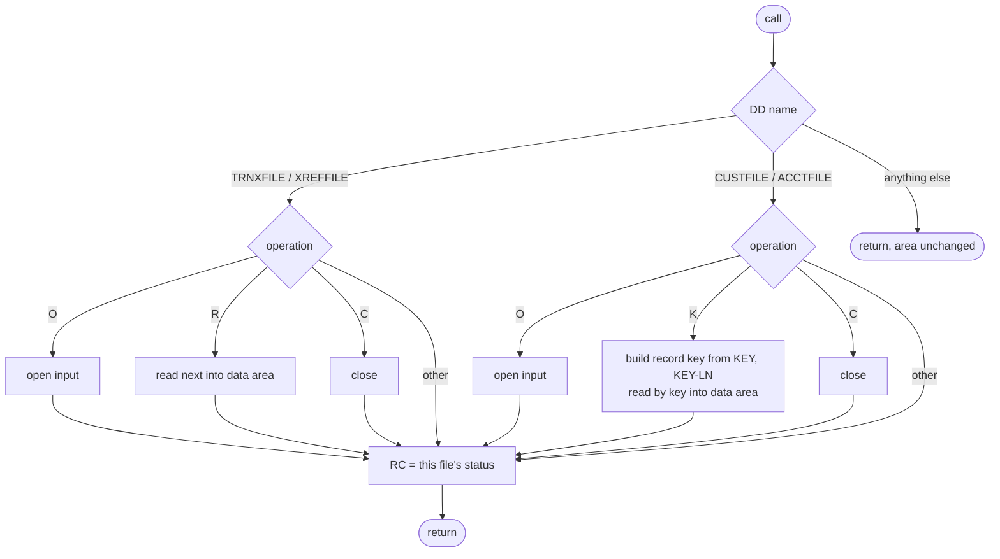
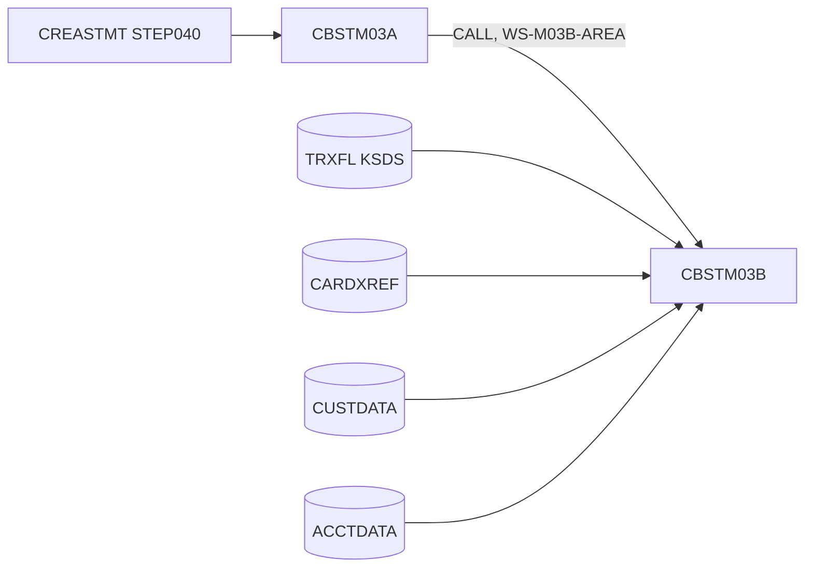

# CBSTM03B: Statement file-access subroutine

## 1. Summary

CBSTM03B is a called subroutine that does all file input for the statement program CBSTM03A (job CREASTMT). Each call passes one 1040-byte request area (ENT-STMT-REQUEST) that names a file by its DD name and an operation. The subroutine opens, reads or closes that one file, copies the record it read into the 1000-byte data area of the request, and returns the file's two-character file status as the return code. It serves four read-only files: the statement transaction file (`TRNXFILE`) and the card cross-reference (`XREFFILE`), read sequentially, and the customer (`CUSTFILE`) and account (`ACCTFILE`) files, read by key. It writes nothing, prints nothing and never abends; the caller decides what a status means. Files stay open, and statuses are remembered, from one call to the next.

## 2. Rules at a glance

| ID | Rule |
| :-- | :-- |
| BR-STIO-001 | After every call for one of the four DD names, the return code is that file's latest file status; requests that do no I/O return the status left by the file's previous operation. |
| BR-STIO-002 | A successful read puts the record into the data area, padded with spaces to 1000 bytes; any unsuccessful read, and every other request, leaves the data area unchanged. |
| BR-STIO-003 | The customer key is the first `KEY-LN` characters of the request key, left-aligned in 9 characters, padded with spaces or cut on the right. |
| BR-STIO-004 | The account key is the first `KEY-LN` characters of the request key converted to an 11-digit number (NUM-STIO-002): right-aligned, zero-filled, only the rightmost 11 digits kept. |

There are no validations of the request (section 8).

## 3. Actors and triggers

- **Caller:** CBSTM03A, the only program that calls it (`app/cbl/CBSTM03A.CBL:351, 377, 401, 734, 746, 769, 787, 805, 835, 860, 877, 893, 909`). CBSTM03A runs in step `STEP040` of job `CREASTMT` (`app/jcl/CREASTMT.JCL:79-86`), which provides the four DD statements.
- **Local:** CBSTM03B is built as a callable module (`tools/batch-programs.toml:75-79`). CBSTM03A does not run off z/OS (`tools/batch-programs.toml:70-73`), so CBSTM03B is exercised directly by the test driver `tests/unit/cobol/cbstm03b_test.cbl` and `tests/unit/test_cbstm03b.py`.
- **Preconditions:** none checked. The datasets are expected to exist; `TRNXFILE` is the copy of the transaction master sorted by card number and transaction ID that steps `STEP010` and `STEP020` build (`app/jcl/CREASTMT.JCL:29-36, 53-54, 61`).
- **No parameters** other than the request area; no clock, no SYSIN.

## 4. Interfaces

### 4.1 Call

`CALL 'CBSTM03B' USING <request area>`: one parameter, passed by reference, the 1040-byte request area ENT-STMT-REQUEST (`:99-114`). The subroutine reads `LK-M03B-DD`, `LK-M03B-OPER`, `LK-M03B-KEY` and `LK-M03B-KEY-LN`; it writes only `LK-M03B-RC` and `LK-M03B-FLDT`. It never changes the DD name, operation, key or key length.

| Bytes | Field | Direction | Use |
| :-- | :-- | :-- | :-- |
| 1-8 | `LK-M03B-DD` | in | file selector: `TRNXFILE`, `XREFFILE`, `CUSTFILE`, `ACCTFILE` (FLOW-STIO-001) |
| 9 | `LK-M03B-OPER` | in | `O` open, `R` read next, `K` read by key, `C` close; `W` and `Z` are declared but do nothing (FLOW-STIO-002) |
| 10-11 | `LK-M03B-RC` | out | file status (BR-STIO-001) |
| 12-36 | `LK-M03B-KEY` | in | key characters for `K` (BR-STIO-003, BR-STIO-004) |
| 37-40 | `LK-M03B-KEY-LN` | in | number of key characters to use, `PIC S9(4)` zoned (NUM-STIO-001) |
| 41-1040 | `LK-M03B-FLDT` | out | record read (BR-STIO-002) |

### 4.2 Files

| DD | Entity | Organisation | Open | Access | Record key | Record | Source |
| :-- | :-- | :-- | :-- | :-- | :-- | --: | :-- |
| `TRNXFILE` | ENT-STMT-TRAN | indexed (KSDS) | INPUT | sequential, read next | `FD-TRNXS-ID`: card number (16) + transaction ID (16), offset 0, 32 bytes | 350 | `:31-35, 58-63` |
| `XREFFILE` | ENT-CARD-XREF | indexed (KSDS) | INPUT | sequential, read next | `FD-XREF-CARD-NUM` (16, offset 0) | 50 | `:37-41, 65-68` |
| `CUSTFILE` | ENT-CUSTOMER | indexed (KSDS) | INPUT | random, read by key | `FD-CUST-ID` (`PIC X(09)`, offset 0) | 500 | `:43-47, 70-73` |
| `ACCTFILE` | ENT-ACCOUNT | indexed (KSDS) | INPUT | random, read by key | `FD-ACCT-ID` (`PIC 9(11)`, offset 0) | 300 | `:49-53, 75-78` |

Each file has its own two-character status field (`TRNXFILE-STATUS`, `XREFFILE-STATUS`, `CUSTFILE-STATUS`, `ACCTFILE-STATUS`, `:83-97`), with no initial value. Datasets in CREASTMT: `AWS.M2.CARDDEMO.TRXFL.VSAM.KSDS`, `...CARDXREF.VSAM.KSDS`, `...ACCTDATA.VSAM.KSDS`, `...CUSTDATA.VSAM.KSDS`, all `DISP=SHR` (`app/jcl/CREASTMT.JCL:83-86`). Locally the runner's datasets `TRXFL` (key offset 0, length 32, `tools/batch-programs.toml:250-253`), `CARDXREF`, `CUSTDATA` and `ACCTDATA` play these roles; GnuCOBOL finds each file through an environment variable such as `DD_<DD name>` (the runner and the tests set these); with none set it looks for a file named after the DD in the current directory.

The FD record areas are byte containers: the read record is copied whole into the data area (`READ ... INTO`), so the FD field names play no part, except the record key fields, which the keyed reads fill (BR-STIO-003, BR-STIO-004).

### 4.3 Console output

None. The program has no `DISPLAY`. Locally, when the run unit ends while a file opened by CBSTM03B is still open, the GnuCOBOL runtime (not the program) writes `libcob: warning: implicit CLOSE of <FD name> ('<DD name>')` to stderr, for example `libcob: warning: implicit CLOSE of ACCT-FILE ('ACCTFILE')` (ERR-STIO-003).

### 4.4 Return code

The result is the file status in `LK-M03B-RC` (BR-STIO-001, ERR-STIO-001). The program does not set `RETURN-CODE` and ends every call with `GOBACK` (`:130-131`).

## 5. Data used

| Entity field | Read | Written | Use |
| :-- | :-- | :-- | :-- |
| ENT-STMT-REQUEST.`LK-M03B-DD` | yes | - | file selector |
| ENT-STMT-REQUEST.`LK-M03B-OPER` | yes | - | operation |
| ENT-STMT-REQUEST.`LK-M03B-KEY`, `LK-M03B-KEY-LN` | yes (`K` on CUSTFILE and ACCTFILE only) | - | key |
| ENT-STMT-REQUEST.`LK-M03B-RC` | - | yes (known DD only) | file status |
| ENT-STMT-REQUEST.`LK-M03B-FLDT` | - | yes (successful read only) | record |
| ENT-STMT-TRAN (all 350 bytes) | yes | - | copied to the data area |
| ENT-CARD-XREF (all 50 bytes) | yes | - | copied to the data area |
| ENT-CUSTOMER (all 500 bytes); key `CUST-ID` | yes | - | copied to the data area |
| ENT-ACCOUNT (all 300 bytes); key `ACCT-ID` | yes | - | copied to the data area |

Program-local data with behaviour: the four file status fields (`:83-97`), which keep their value between calls (FLOW-STIO-003, NUM-STIO-003), and the open or closed state and read position of each file.

## 6. Processing flow

1. Compare the 8-character DD name with `TRNXFILE`, `XREFFILE`, `CUSTFILE` and `ACCTFILE` (FLOW-STIO-001). No match: return at once.
2. For the matching file, test the operation code: open, read (next or by key, depending on the file), close; at most one of them applies (FLOW-STIO-002).
3. In every case for a known DD, copy that file's status to the return code (BR-STIO-001) and return.

Decision table for one call. "Status" is the file status of the named file after the call; "last status" is the value that file's status field already had.

| DD | Operation | I/O | `LK-M03B-RC` | `LK-M03B-FLDT` |
| :-- | :-- | :-- | :-- | :-- |
| `TRNXFILE` or `XREFFILE` | `O` | open input | status | unchanged |
| `TRNXFILE` or `XREFFILE` | `R` | read next | status | record + spaces when the status is `00`, else unchanged |
| `TRNXFILE` or `XREFFILE` | `C` | close | status | unchanged |
| `TRNXFILE` or `XREFFILE` | any other byte (`K`, `W`, `Z`, lower case, space ...) | none | last status | unchanged |
| `CUSTFILE` or `ACCTFILE` | `O` | open input | status | unchanged |
| `CUSTFILE` or `ACCTFILE` | `K` | read by key | status | record + spaces when the status is `00`, else unchanged |
| `CUSTFILE` or `ACCTFILE` | `C` | close | status | unchanged |
| `CUSTFILE` or `ACCTFILE` | any other byte (`R`, `W`, `Z`, ...) | none | last status | unchanged |
| any other value | any | none | unchanged | unchanged |

#### FLOW-STIO-001 · Dispatch on the DD name
- **When:** a call arrives.
- **Then:** `LK-M03B-DD` is compared, all 8 bytes, case-sensitive, with `TRNXFILE`, `XREFFILE`, `CUSTFILE`, `ACCTFILE`; the matching file's handling runs (SE-STIO-001..004).
- **Otherwise:** any other value, including lower case (`trnxfile`), returns at once; no byte of the request area changes, so `LK-M03B-RC` keeps whatever the caller left in it.
- **Source:** `:116-131`
- **Fidelity:** must-preserve · **Confidence:** runtime-verified (`tests/unit/test_cbstm03b.py:75-80` and a scratch driver: an unknown DD after a call that returned `47` leaves `47`)

#### FLOW-STIO-002 · Operation dispatch per file
- **When:** the DD name matched.
- **Then:** the one-byte operation is tested in this order: open (`O`); read (`R` for `TRNXFILE` and `XREFFILE`, `K` for `CUSTFILE` and `ACCTFILE`); close (`C`). The first match does its I/O and goes to the status copy. Matching is exact and case-sensitive.
- **Otherwise:** any other byte, including `W` and `Z`, which the request area declares as write and rewrite, and the read code of the other access mode (`K` on a sequential file, `R` on a keyed file), does no I/O and goes straight to the status copy (DEF-STIO-003).
- **Source:** `:133-155, 157-179, 181-204, 206-229`
- **Fidelity:** must-preserve · **Confidence:** runtime-verified (scratch driver: `W` and `K` on `TRNXFILE`, `Z` on `XREFFILE`, `R` on `CUSTFILE`, `o` on `TRNXFILE`, `X` on `ACCTFILE`)

#### FLOW-STIO-003 · State kept between calls
- **When:** the subroutine is called repeatedly in one run unit.
- **Then:** nothing is reset on entry. Each file stays open or closed, keeps its read position, and keeps its last status from one call to the next; the program is not `INITIAL` and is never cancelled by CBSTM03A. Closing and opening a sequential file again starts reading from its first record.
- **Source:** `:1-2, 80-97, 130-131`
- **Fidelity:** must-preserve · **Confidence:** runtime-verified (scratch driver: open, read, close, open, read returns the first record again; an operation that does no I/O returns the status of the previous call on that file)

## 7. Business rules

#### BR-STIO-001 · Return code is the named file's status
- **When:** the DD name is one of the four known names.
- **Then:** after the operation (or none), the two bytes of that file's own status field are copied to `LK-M03B-RC`. The four files have separate status fields: an operation on one file never changes the status another file reports. Requests that do no I/O therefore return the status of the file's previous operation, which may be a failure (`46` after reading past the end, `41` after a second open), and before the file's first I/O they return the field's uninitialised content, two low-value bytes (X'0000') locally (NUM-STIO-003, DEF-STIO-004).
- **Source:** `:151-152, 175-176, 200-201, 225-226`
- **Fidelity:** must-preserve · **Confidence:** runtime-verified

#### BR-STIO-002 · Data area after a read
- **When:** a read (`R` on `TRNXFILE` or `XREFFILE`, `K` on `CUSTFILE` or `ACCTFILE`) ends with status `00`.
- **Then:** the whole record is copied to the start of `LK-M03B-FLDT` and the rest of the 1000 bytes is set to spaces: transaction 350 bytes + 650 spaces, cross-reference 50 + 950, customer 500 + 500, account 300 + 700. The bytes of the record are copied unchanged, whatever they are (the sample cross-reference records hold spaces in bytes 37-50, because the loader pads the 36-byte sample lines).
- **Otherwise:** a read that ends with any other status (`10`, `23`, `46`, `47`) leaves all 1000 bytes as they were, which may be the record of an earlier successful read of any file. Open, close and requests without I/O never touch the data area.
- **Source:** `:141-142, 165-166, 190-191, 215-216`
- **Fidelity:** must-preserve · **Confidence:** runtime-verified (scratch driver, byte comparison with the unloaded datasets for all four files; `tests/unit/test_cbstm03b.py:43-73`)

#### BR-STIO-003 · Customer key
- **When:** `K` on `CUSTFILE`.
- **Then:** the first `LK-M03B-KEY-LN` characters of `LK-M03B-KEY` are moved to the 9-character record key `FD-CUST-ID` as text: left-aligned, padded on the right with spaces when the length is below 9, cut on the right when it is above 9. No conversion: the key bytes are compared with the file's keys exactly. For example key `1` with length 1 looks up `1` followed by 8 spaces; `000000001EXTRA` with length 14 looks up `000000001`. The record is then read by that key.
- **Edge cases (outside 1..25):** DEF-STIO-001.
- **Source:** `:188-193`
- **Fidelity:** must-preserve · **Confidence:** runtime-verified (scratch driver with a customer file holding keys `1`, `12345`, `ABC` and `000000001`, each padded to 9 with spaces)

#### BR-STIO-004 · Account key
- **When:** `K` on `ACCTFILE`.
- **Then:** the first `LK-M03B-KEY-LN` characters of `LK-M03B-KEY` are moved to the 11-digit numeric record key `FD-ACCT-ID` (`PIC 9(11)`, unsigned, display). For a key of digits only this means: right-aligned, zero-filled on the left, and only the rightmost 11 digits kept, so `1` (length 1) looks up `00000000001`, `50` looks up `00000000050` and `100000000003` (length 12) looks up `00000000003`. Keys with other characters follow NUM-STIO-002. The record is then read by the 11 resulting bytes.
- **Edge cases (outside 1..25):** DEF-STIO-001.
- **Source:** `:213-218`
- **Fidelity:** must-preserve for digit keys; defect-decide for other keys (DEF-STIO-002) · **Confidence:** runtime-verified (GnuCOBOL); platform-inferred for z/OS

## 8. Validations

None. The subroutine checks neither the DD name (an unknown one is ignored, FLOW-STIO-001), nor the operation (an unsupported one does no I/O, FLOW-STIO-002), nor the key or its length (DEF-STIO-001). It has no messages.

## 9. Side effects

Each call does at most one I/O statement, on the file the DD name selects, then copies that file's status. All four files are opened for input only; nothing is written, rewritten or deleted.

#### SE-STIO-001 · TRNXFILE: open, read next, close
- `O`: open the statement transaction file for input. `R`: read the next record in key order (card number, then transaction ID) into the data area. `C`: close it.
- **Source:** `:133-155`
- **Fidelity:** must-preserve · **Confidence:** runtime-verified (`tests/unit/test_cbstm03b.py:43-52`)

#### SE-STIO-002 · XREFFILE: open, read next, close
- `O`: open the card cross-reference for input. `R`: read the next record in card-number order into the data area. `C`: close it.
- **Source:** `:157-179`
- **Fidelity:** must-preserve · **Confidence:** runtime-verified (`tests/unit/test_cbstm03b.py:54-59`)

#### SE-STIO-003 · CUSTFILE: open, read by key, close
- `O`: open the customer file for input. `K`: set the record key (BR-STIO-003) and read the record with that key into the data area. `C`: close it.
- **Source:** `:181-204`
- **Fidelity:** must-preserve · **Confidence:** runtime-verified (`tests/unit/test_cbstm03b.py:61-73`)

#### SE-STIO-004 · ACCTFILE: open, read by key, close
- `O`: open the account file for input. `K`: set the record key (BR-STIO-004) and read the record with that key into the data area. `C`: close it.
- **Source:** `:206-229`
- **Fidelity:** must-preserve · **Confidence:** runtime-verified (`tests/unit/test_cbstm03b.py:61-73`)

## 10. Error handling

#### ERR-STIO-001 · File status values
- Every outcome is reported only through the status (BR-STIO-001). Observed with GnuCOBOL 3.2 (BDB indexed files) for each of the four files:

| Situation | Status | Effect |
| :-- | :-- | :-- |
| `O`, dataset present, file closed | `00` | file open, positioned before the first record |
| `O`, file already open | `41` | file stays open, read position unchanged |
| `O`, dataset missing (DD variable points to no file, or no DD variable and no file named after the DD) | `35` | file stays closed |
| `R` or `K` on a file that is not open (never opened, closed, or open failed) | `47` | data area unchanged |
| `R`, next record exists | `00` | record in the data area |
| `R`, no more records | `10` | data area unchanged |
| `R` again after `10` (any number of times) | `46` | data area unchanged |
| `K`, key found | `00` | record in the data area |
| `K`, key not in the file | `23` | data area unchanged; the next `K` works normally |
| `C`, file open | `00` | file closed |
| `C`, file not open | `42` | nothing |

- **Source:** `:135-149, 159-173, 183-198, 208-223`
- **Fidelity:** must-preserve (CBSTM03A branches on `00`, `04`, `10`) · **Confidence:** runtime-verified locally (`tests/unit/test_cbstm03b.py:82-84` for `47`; the others with a scratch driver); platform-inferred for z/OS. These are the standard COBOL file status values, which Enterprise COBOL also returns for VSAM, but on z/OS other values can appear, for example `97` on an open after an implicit VSAM verify, and how a missing DD statement is reported depends on the system (Q-STIO-004).

#### ERR-STIO-002 · No error handling in the subroutine
- The subroutine never displays, abends or sets `RETURN-CODE`; there are no `INVALID KEY`, `AT END` or declaratives. The caller interprets the status: CBSTM03A accepts `00` or `04` on open and close, `00` or `04` on the first TRNXFILE read (so an empty TRNXFILE, status `10`, abends), `00` or `10` on the later TRNXFILE reads and the XREFFILE reads, `00` on keyed reads, and otherwise displays an error text with `RETURN CODE: ` and the status and abends (`app/cbl/CBSTM03A.CBL:353-362, 379-386, 736-742, 744-754, 837-847, 921-923`); those texts belong to the CBSTM03A spec.
- **Source:** `:116-229`
- **Fidelity:** must-preserve · **Confidence:** reviewed

#### ERR-STIO-003 · Files left open at the end of the run
- Nothing in CBSTM03B closes a file except an explicit `C` request. A file still open when the run unit ends is closed by the runtime; locally GnuCOBOL then writes `libcob: warning: implicit CLOSE of <FD name> ('<DD name>')` to stderr (FD names `TRNX-FILE`, `XREF-FILE`, `CUST-FILE`, `ACCT-FILE`). On z/OS the files are closed at step end without a message. CBSTM03A closes all four (`app/cbl/CBSTM03A.CBL:331-337`).
- **Source:** `:31-53, 147, 171, 196, 221`
- **Fidelity:** incidental · **Confidence:** runtime-verified locally; platform-inferred for z/OS

## 11. Interactions

- **Inbound:** CBSTM03A only, with its request area `WS-M03B-AREA` (`app/cbl/CBSTM03A.CBL:71-83`). The order of its calls, as an interface summary (the CBSTM03A spec owns the details):
  1. `TRNXFILE` `O`, then `R` until status `10`; CBSTM03A keeps all transactions in a table (`app/cbl/CBSTM03A.CBL:730-762, 818-853`).
  2. `XREFFILE` `O`, `CUSTFILE` `O`, `ACCTFILE` `O` (`app/cbl/CBSTM03A.CBL:765-816`).
  3. For each cross-reference record (`XREFFILE` `R` until `10`): `CUSTFILE` `K` with `XREF-CUST-ID` (9 digits, key length 9) and `ACCTFILE` `K` with `XREF-ACCT-ID` (11 digits, key length 11) (`app/cbl/CBSTM03A.CBL:345-414`).
  4. `C` for `TRNXFILE`, `XREFFILE`, `CUSTFILE`, `ACCTFILE` (`app/cbl/CBSTM03A.CBL:856-919`).
- CBSTM03A presets `WS-M03B-RC` to `00` before most calls and the data area to spaces before reads; CBSTM03B depends on neither. CBSTM03A never uses `W` or `Z`.
- **Test driver:** `tests/unit/cobol/cbstm03b_test.cbl:20-38` builds the same 1040-byte area, presets the return code to `..` and the data area to spaces on every request.
- **Outbound:** none. No `CALL`, no other program.
- **Shared data:** the four datasets are read-only here; CUSTDATA, ACCTDATA and CARDXREF are shared with the online programs and other batch jobs, which must not be updating them during CREASTMT (no locking is requested beyond `DISP=SHR`).

## 12. Numeric, date and format details

#### NUM-STIO-001 · Request area layout and key length encoding
- 1040 bytes in this order: DD 8, operation 1, return code 2, key 25, key length 4, data area 1000 (ENT-STMT-REQUEST). `LK-M03B-KEY-LN` is `PIC S9(4)`: 4 zoned-decimal digits with the sign folded into the last byte. A positive value moved into it is stored with `{`, `A`-`I` in the last byte locally (`-fsign=EBCDIC`): 9 is `000I`, 11 is `001A`, 0 is `000{`, 26 is `002F`; a plain digit in the last byte also reads as positive. Its bytes matter only when the key length exceeds 25 (DEF-STIO-001).
- **Source:** `:100-112`
- **Confidence:** runtime-verified (scratch driver, area dump)

#### NUM-STIO-002 · Account key conversion (GnuCOBOL)
- The text `S` = `LK-M03B-KEY(1:LK-M03B-KEY-LN)` becomes the 11 key bytes as follows; "white space" means X'09'-X'0D' and the space X'20':
  1. Skip leading white space. Then, if the next character is `+` or `-`, skip that one character (the sign is discarded; the key is unsigned).
  2. Cut the rest at its first `.`; the `.` and everything after it are ignored. Call the result `T`.
  3. Let `n` be the number of digits `0`-`9` in `T`. If `n` = 0, the key is `00000000000`.
  4. If `n` > 11, drop everything in `T` up to and including its (`n`-11)-th digit, without looking at it; the rest holds exactly 11 digits.
  5. Examine the remaining text from its start up to and including its last digit. If any character there is not a digit, white space or `,`, the key is `00000000000`. Characters after the last digit are never examined.
  6. Otherwise the key is the digits of that span, in order, right-aligned in 11 positions with leading `0`s.
- Examples (key, length = number of characters shown): `1` gives `00000000001`; `00000000050` gives `00000000050`; `100000000003` gives `00000000003`; `123456789012345` gives `56789012345`; `1 2` and `1,2` give `00000000012`; `  12 34 ` gives `00000001234`; `-3` and `+ 1` give `00000000003` and `00000000001`; `3.9` gives `00000000003`; `.1`, `ABC`, `A1`, `12A4`, `5+5`, `--1` and `1000000000A3` give `00000000000`; `12A` gives `00000000012`; `A100000000003` gives `00000000003`.
- This is GnuCOBOL's conversion of a text item moved to an unsigned numeric item. Enterprise COBOL on z/OS does not scan the text this way; it treats the sending characters as digits and moves them right-aligned and zero-filled, so a key with any non-digit character is expected to give different key bytes there (DEF-STIO-002, Q-STIO-003). For keys of digits only both give the same result.
- **Source:** `:77, 214`
- **Confidence:** runtime-verified on GnuCOBOL 3.2 `-std=ibm -fsign=EBCDIC`: the rule above matched the compiled move on 30,000 random keys of length 1 to 25 (digits, spaces, signs, `.`, `,`, letters and arbitrary bytes), and keyed reads on a test account file confirmed it for `1 2`, `  12 34 `, `12A4`, `ABC`, `-3`, `3.9`; platform-inferred for z/OS.

#### NUM-STIO-003 · Status fields before the first I/O
- The four status fields have no `VALUE` clause. With GnuCOBOL `-std=ibm`, working storage without a value starts as low-values, so a request without I/O on a file that has had no I/O yet returns X'00' X'00' in `LK-M03B-RC`. On z/OS the initial content depends on the compiler and run-time storage options (Q-STIO-002).
- **Source:** `:83-97`
- **Confidence:** runtime-verified locally (`W` on `TRNXFILE`, `Z` on `XREFFILE`, `R` on `CUSTFILE`, `X` on `ACCTFILE` as first calls all return X'0000'); platform-inferred for z/OS

#### NUM-STIO-004 · Return code and data area are text
- `LK-M03B-RC` is the 2-character file status exactly as the runtime sets it (`00`, `10`, `23`, `35`, `41`, `42`, `46`, `47` in the local runs). `LK-M03B-FLDT` receives record bytes without conversion; signed amounts inside the records keep their zoned-decimal sign bytes.
- **Source:** `:109, 112, 141, 152`

## 13. Known defects and oddities

#### DEF-STIO-001 · Key length is not validated
- `LK-M03B-KEY-LN` is used as a reference-modification length without any check, and the build has no run-time bound checking.
- **0:** the customer key becomes 9 spaces and the account key `00000000000` (runtime-verified: key `1` with length 0 returned `23` on a customer file that holds `1`, and found the account with key `00000000000`).
- **26 to 1029:** the text taken runs past the 25-byte key into the key length's own 4 bytes (NUM-STIO-001) and then into the data area. The customer key is still the first 9 key characters; the account key is converted from the longer text (NUM-STIO-002), so the key length digits and data area bytes can become part of the account number (runtime-verified for 26 and 30). Above 1029 the text runs past the request area into the caller's storage.
- **Negative:** undefined; locally a length of -1 behaved like a very large length (customer key = first 9 key characters; account key `00000000000` in the probe).
- On z/OS, without the `SSRANGE` compiler option the result is likewise undefined; with it the program abends.
- **Source:** `:189, 214` · **Status:** open · **Fidelity:** defect-decide · **Confidence:** runtime-verified locally (scratch driver and a probe program); platform-inferred for z/OS

#### DEF-STIO-002 · Account keys with non-digits or more than 11 digits
- The account key is not checked: more than 11 digits are silently cut to the rightmost 11 (`100000000003` reads account 3), and on GnuCOBOL non-digit characters are interpreted (NUM-STIO-002), which can turn a malformed key into a valid account number (`-3`, `3.9`, `1 2`) or into `00000000000`. On z/OS the same keys give other key bytes and normally `23`.
- **Source:** `:214` · **Status:** open · **Fidelity:** defect-decide (Q-STIO-003)

#### DEF-STIO-003 · Unsupported requests look successful
- `W` and `Z` are declared in the request area (`:107-108`) but not implemented, and a read code of the wrong access mode is ignored; such requests do no I/O and return the file's last status, usually `00`. An unknown DD name returns the caller's preset value unchanged, which is `00` in CBSTM03A. A caller cannot tell an ignored request from a successful one.
- **Source:** `:127-128, 135-152, 183-201` · **Status:** open · **Fidelity:** defect-decide (Q-STIO-001)

#### DEF-STIO-004 · Status before the first I/O is uninitialised
- See NUM-STIO-003. The value returned by a no-I/O request before any I/O on that file is X'0000' locally and platform-dependent on z/OS.
- **Source:** `:83-97` · **Status:** open · **Fidelity:** defect-decide

#### DEF-STIO-005 · [security] Whole records with PII and card numbers pass through the data area
- The data area returns complete records with no field selection or masking: the card number (`XREF-CARD-NUM`, `TRNX-CARD-NUM` in ENT-STMT-TRAN) and the customer's `CUST-SSN`, `CUST-GOVT-ISSUED-ID`, `CUST-DOB-YYYYMMDD` and `CUST-EFT-ACCOUNT-ID` (ENT-CUSTOMER). CBSTM03B itself prints nothing; what the caller uses or prints is in the CBSTM03A spec. See `docs/security/data-handling.md`.
- **Source:** `:141, 165, 190, 215` · **Status:** open (by design of the interface)

#### DEF-STIO-006 · Misleading names
- In the transaction file description the 318 bytes after the 32-byte key are named `FD-ACCT-DATA` (`:63`), the same stem as the account record; the header comment calls the program file processing for the "Transact Report" (`:8`), while it serves the statement job. No behaviour depends on these names.
- **Status:** open · **Fidelity:** incidental

## 14. Open questions

| ID | Question | For |
| :-- | :-- | :-- |
| Q-STIO-001 | Should the target interface implement write and rewrite (`W`, `Z`), reject unsupported requests with an error status, or drop them? Today they are silently ignored (DEF-STIO-003). | architecture |
| Q-STIO-002 | On z/OS, what do the four status fields contain before the first I/O with the production compiler and LE options (low-values, spaces, or undefined)? | mainframe team |
| Q-STIO-003 | On z/OS, which key bytes does a non-digit account key produce (characters copied unchanged, as Enterprise COBOL documents), and should a target reject such keys instead (DEF-STIO-002)? | mainframe team, architecture |
| Q-STIO-004 | Which file status does CBSTM03B return on z/OS when a DD statement is missing or the cluster is empty, and when VSAM performs an implicit verify on open (`97`)? CBSTM03A treats anything but `00` and `04` as fatal. | mainframe team |

## 15. Equivalence contract

A reimplementation is equivalent when, for any sequence of calls with a persistent request area (any DD name, any operation byte, any key and key length 1 to 25, datasets present or missing), after each call:

- the two bytes of `LK-M03B-RC` are equal to GnuCOBOL's, including the unchanged caller value for an unknown DD name and X'0000' for a no-I/O request before a file's first I/O (NUM-STIO-003);
- all 1000 bytes of `LK-M03B-FLDT` are equal, including the bytes kept after an unsuccessful read;
- the DD name, operation, key and key length are unchanged;
- each file's open state, read position and status carry over to the next call (FLOW-STIO-003).

What may differ: the runtime's stderr warning for files left open at the end of the run (ERR-STIO-003). Key lengths outside 1 to 25 are not part of the contract (DEF-STIO-001); on z/OS, non-digit account keys and the initial status content are platform-dependent (NUM-STIO-002, NUM-STIO-003).

How to check: `python3 docs/modernization/spec/checks/cbstm03b_reimpl/run_check.py` runs a request sequence on the sample data against the GnuCOBOL module and a spec-only reimplementation and compares the return code and all 1000 data bytes after every call; `python3 docs/modernization/spec/checks/cbstm03b_reimpl/run_check.py --stress` does the same on edge-case sequences (unopened, missing and reopened files, reads past the end, unsupported operations, unknown DD names, short, long and non-digit keys). The existing unit tests (`tests/unit/test_cbstm03b.py:43-84`) pass on the local build. The independent review and the check results are recorded in `docs/modernization/spec/evidence/d2-batch-utilities-review.md`.

## 16. Paragraph coverage

| Paragraph | Lines | Covered by |
| :-- | :-- | :-- |
| (environment and data division) | 31-112 | §4.1, §4.2, §5, NUM-STIO-001, NUM-STIO-003, DEF-STIO-004, DEF-STIO-006 |
| (procedure division header) | 114 | §4.1, NUM-STIO-001 |
| `0000-START` | 116-128 | FLOW-STIO-001, DEF-STIO-003 |
| `9999-GOBACK` | 130-131 | FLOW-STIO-001, FLOW-STIO-003, §4.4 |
| `1000-TRNXFILE-PROC` | 133-149 | SE-STIO-001, FLOW-STIO-002, BR-STIO-002, ERR-STIO-001 |
| `1900-EXIT` | 151-152 | BR-STIO-001 |
| `1999-EXIT` | 154-155 | FLOW-STIO-002 |
| `2000-XREFFILE-PROC` | 157-173 | SE-STIO-002, FLOW-STIO-002, BR-STIO-002, ERR-STIO-001 |
| `2900-EXIT` | 175-176 | BR-STIO-001 |
| `2999-EXIT` | 178-179 | FLOW-STIO-002 |
| `3000-CUSTFILE-PROC` | 181-198 | SE-STIO-003, FLOW-STIO-002, BR-STIO-002, BR-STIO-003, ERR-STIO-001, DEF-STIO-001 |
| `3900-EXIT` | 200-201 | BR-STIO-001 |
| `3999-EXIT` | 203-204 | FLOW-STIO-002 |
| `4000-ACCTFILE-PROC` | 206-223 | SE-STIO-004, FLOW-STIO-002, BR-STIO-002, BR-STIO-004, NUM-STIO-002, ERR-STIO-001, DEF-STIO-001, DEF-STIO-002 |
| `4900-EXIT` | 225-226 | BR-STIO-001 |
| `4999-EXIT` | 228-229 | FLOW-STIO-002 |

14 of 14 named paragraphs covered; no paragraph is unmapped.
