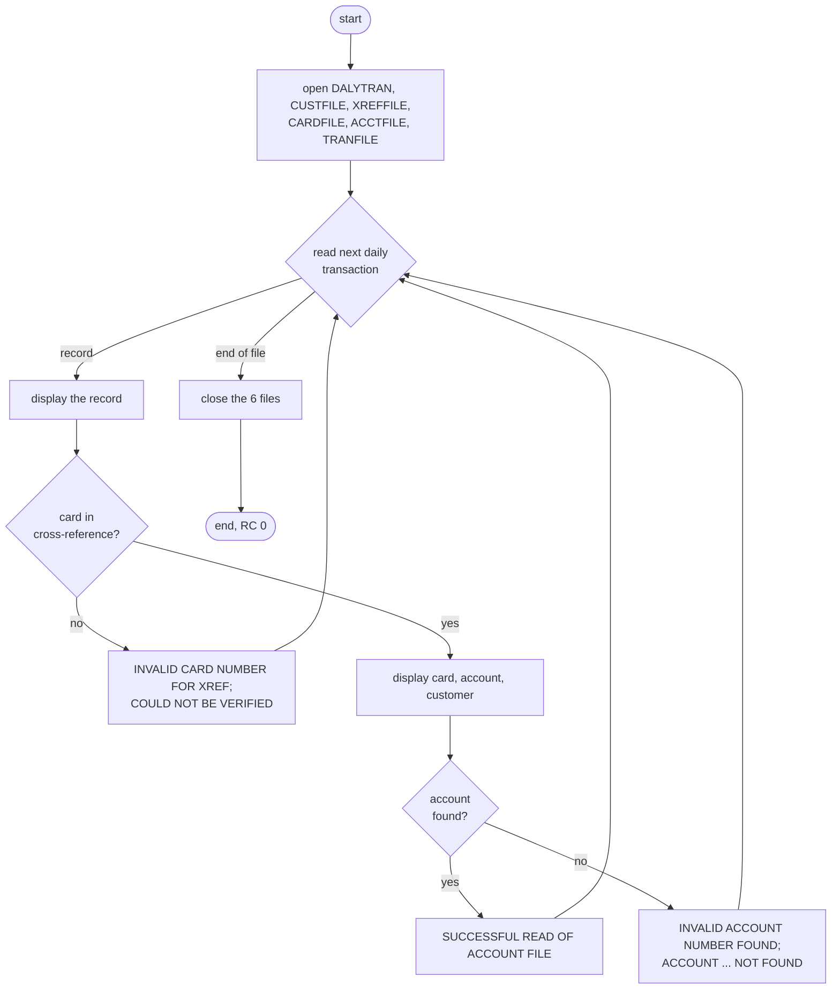
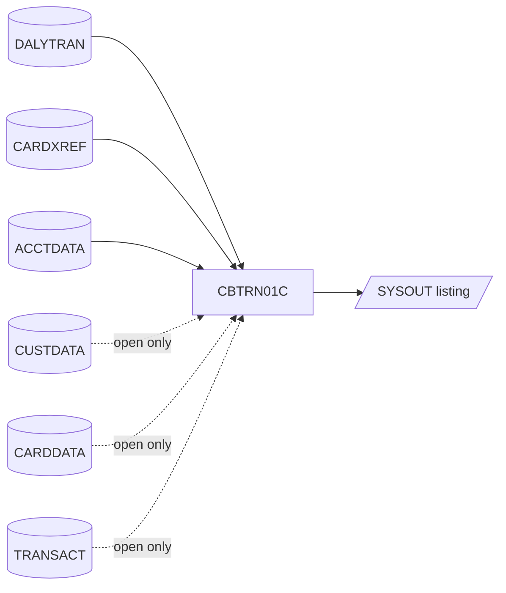

# CBTRN01C: Daily transaction verification (TRANVALD)

## 1. Summary

The daily transaction verification program reads the daily transaction file from start to end and, for each transaction, checks that its card number is in the card cross-reference file and that the cross-reference's account is in the account file. It reports each step on SYSOUT: the whole transaction record, the cross-reference it found (card, account and customer number) and whether the account was found. When the card or the account is not found it prints a message and goes on with the next transaction. It writes no file, changes no file and ends with return code 0 whatever it found, so the result of the verification exists only in the job log (DEF-TVAL-004). It also opens the customer, card and transaction master files but never reads them (DEF-TVAL-003). It abends (U0999) only on an open, close or daily-file read error. The repository has no JCL and no schedule entry for it; it repeats, as a dry run, the first two checks that POSTTRAN (CBTRN02C) makes when it posts.

## 2. Rules at a glance

| ID | Rule |
| :-- | :-- |
| BR-TVAL-001 | Every daily transaction is read in file order and displayed in full before it is checked. |
| BR-TVAL-002 | The card number of the transaction is looked up in the card cross-reference; when found, the card, account and customer numbers are displayed. |
| BR-TVAL-003 | When the card is found, the cross-reference's account number is looked up in the account file; a missing account is reported. |
| BR-TVAL-004 | When the card is not found, the transaction is reported as "could not be verified" and skipped; the account is not looked up. |
| BR-TVAL-005 | Nothing is written or updated, and the return code is 0 at normal end whatever was found. |

## 3. Actors and triggers

- **Trigger:** none in the repository. No JCL member runs CBTRN01C, no cataloged procedure names it and neither scheduler lists it (`app/scheduler/CardDemo.ca7`, `app/scheduler/CardDemo.controlm`). The local runner defines a job `TRANVALD` whose DD names are the program's `ASSIGN` names (`tools/carddemo.py:649-656`).
- **Preconditions:** the daily transaction file is present; the customer, cross-reference, card, account and transaction master files exist and can be opened for input (all six are opened, ERR-TVAL-001). On z/OS the online region must not hold the KSDS files in a way that prevents a batch `OPEN INPUT` (the program would abend at open).
- **Parameters:** none. The program does not use the date or the clock.

## 4. Interfaces

### 4.1 Files

| DD | Entity | Organisation | Open | Access | Key | Record | Source |
| :-- | :-- | :-- | :-- | :-- | :-- | --: | :-- |
| `DALYTRAN` | ENT-DAILY-TRAN | sequential | INPUT | read next | - | 350 | `:29-32, 66-69` |
| `CUSTFILE` | ENT-CUSTOMER | indexed, random | INPUT | none (opened and closed only) | `CUST-ID` (9) | 500 | `:34-38, 71-74` |
| `XREFFILE` | ENT-CARD-XREF | indexed, random | INPUT | random read | `XREF-CARD-NUM` (16) | 50 | `:40-44, 76-79` |
| `CARDFILE` | ENT-CARD | indexed, random | INPUT | none (opened and closed only) | `CARD-NUM` (16) | 150 | `:46-50, 81-84` |
| `ACCTFILE` | ENT-ACCOUNT | indexed, random | INPUT | random read | `ACCT-ID` (11) | 300 | `:52-56, 86-89` |
| `TRANFILE` | ENT-TRANSACTION | indexed, random | INPUT | none (opened and closed only) | `TRAN-ID` (16) | 350 | `:58-62, 91-94` |

The dataset names in the front matter are those the other jobs use for the same DD names (`app/jcl/POSTTRAN.jcl`, `app/jcl/READCUST.jcl`, `app/jcl/READCARD.jcl`); there is no JCL for this program to confirm them.

### 4.2 Console output (SYSOUT), in order

| Text (exact) | When | Source |
| :-- | :-- | :-- |
| `START OF EXECUTION OF PROGRAM CBTRN01C` | start | `:156` |
| the 350-byte daily transaction record as read, trailing spaces included | each transaction (BR-TVAL-001) | `:168` |
| `SUCCESSFUL READ OF XREF` | card found (BR-TVAL-002) | `:235` |
| `CARD NUMBER: ` + `XREF-CARD-NUM` (16) | card found | `:236` |
| `ACCOUNT ID : ` + `XREF-ACCT-ID` (11 digits) | card found | `:237` |
| `CUSTOMER ID: ` + `XREF-CUST-ID` (9 digits) | card found | `:238` |
| `SUCCESSFUL READ OF ACCOUNT FILE` | account found (BR-TVAL-003) | `:249` |
| `INVALID ACCOUNT NUMBER FOUND` | account not found | `:246` |
| `ACCOUNT ` + `ACCT-ID` (11 digits) + ` NOT FOUND` | account not found, right after the line above | `:177` |
| `INVALID CARD NUMBER FOR XREF` | card not found (BR-TVAL-004) | `:232` |
| `CARD NUMBER ` + `DALYTRAN-CARD-NUM` (16) + ` COULD NOT BE VERIFIED. SKIPPING TRANSACTION ID-` + `DALYTRAN-ID` (16) | card not found, right after the line above | `:180-182` |
| `END OF EXECUTION OF PROGRAM CBTRN01C` | normal end | `:195` |
| error lines of section 10 | on error | |

So each transaction produces exactly one of three line groups after its record line:

| Outcome | Lines after the record line |
| :-- | :-- |
| card and account found | `SUCCESSFUL READ OF XREF`, `CARD NUMBER: ...`, `ACCOUNT ID : ...`, `CUSTOMER ID: ...`, `SUCCESSFUL READ OF ACCOUNT FILE` |
| card found, account not found | `SUCCESSFUL READ OF XREF`, `CARD NUMBER: ...`, `ACCOUNT ID : ...`, `CUSTOMER ID: ...`, `INVALID ACCOUNT NUMBER FOUND`, `ACCOUNT ... NOT FOUND` |
| card not found | `INVALID CARD NUMBER FOR XREF`, `CARD NUMBER ... COULD NOT BE VERIFIED. SKIPPING TRANSACTION ID-...` |

### 4.3 Return code

0 at normal end, also when cards or accounts were not found (BR-TVAL-005); abend U0999 on error (ERR-TVAL-005).

## 5. Data used

| Entity field | Read | Use |
| :-- | :-- | :-- |
| ENT-DAILY-TRAN (whole record) | yes | displayed (BR-TVAL-001) |
| ENT-DAILY-TRAN.DALYTRAN-CARD-NUM | yes | cross-reference key; "could not be verified" message |
| ENT-DAILY-TRAN.DALYTRAN-ID | yes | "could not be verified" message |
| ENT-CARD-XREF.XREF-CARD-NUM, XREF-ACCT-ID, XREF-CUST-ID | yes | displayed; `XREF-ACCT-ID` is the account key |
| ENT-ACCOUNT | yes (existence only) | found or not found; no field is used |
| ENT-CUSTOMER, ENT-CARD, ENT-TRANSACTION | no | files opened and closed only (DEF-TVAL-003) |

No file is changed. Program-local data with behaviour (`:146-151`): `END-OF-DAILY-TRANS-FILE` (`'N'` until the daily file is at end); `WS-XREF-READ-STATUS`, `WS-ACCT-READ-STATUS` (`PIC 9(04)`, set to 0 before each lookup and to 4 when the key is not found).

## 6. Processing flow

1. Print the start line; open the six files for input in the order DALYTRAN, CUSTFILE, XREFFILE, CARDFILE, ACCTFILE, TRANFILE (`:156-162`). Any open failure abends (ERR-TVAL-001).
2. Repeat until the daily file is at end (`:164-186`): read the next record (ERR-TVAL-002); at end of file leave the loop; otherwise apply BR-TVAL-001 to BR-TVAL-004.
3. Close the six files in the same order (`:188-193`); print the end line (`:195`).

## 7. Business rules

#### BR-TVAL-001 · Read and display every daily transaction
- **When:** each pass of the main loop.
- **Then:** read the next ENT-DAILY-TRAN record. At end of file the loop ends and nothing more is displayed for it. Otherwise display the whole 350-byte record as one SYSOUT line, then verify it (BR-TVAL-002).
- Each record is processed once; the end-of-file read does not repeat the last record (DEF-TVAL-006, fixed).
- **Source:** `:164-168, 202-225`
- **Fidelity:** incidental (the record display, DEF-TVAL-002); must-preserve (one verification per record, in file order) · **Confidence:** runtime-verified (`tests/integration/test_reader_jobs.py:88-127`; sample: 300 records, 300 record lines)

#### BR-TVAL-002 · Card lookup
- **When:** each daily transaction.
- **Then:** read ENT-CARD-XREF by key `DALYTRAN-CARD-NUM`. Found: display `SUCCESSFUL READ OF XREF`, `CARD NUMBER: ` + card, `ACCOUNT ID : ` + `XREF-ACCT-ID`, `CUSTOMER ID: ` + `XREF-CUST-ID` (§4.2) and go on to the account lookup (BR-TVAL-003).
- **Otherwise:** not found ("invalid key"): BR-TVAL-004. Any other read failure is not detected (ERR-TVAL-003).
- **Source:** `:169-172, 227-239`
- **Fidelity:** must-preserve · **Confidence:** runtime-verified

#### BR-TVAL-003 · Account lookup
- **When:** the card was found (BR-TVAL-002).
- **Then:** read ENT-ACCOUNT by key `XREF-ACCT-ID`. Found: display `SUCCESSFUL READ OF ACCOUNT FILE`. Not found: display `INVALID ACCOUNT NUMBER FOUND`, then `ACCOUNT ` + the 11-digit account number + ` NOT FOUND`. In both cases go on with the next transaction. No account field is checked (status, expiry, credit limit).
- **Source:** `:172-178, 241-250`
- **Fidelity:** must-preserve · **Confidence:** runtime-verified (`tests/integration/test_reader_jobs.py:88-127` builds a cross-reference whose account does not exist)

#### BR-TVAL-004 · Card not verified
- **When:** the card number is not in the cross-reference.
- **Then:** display `INVALID CARD NUMBER FOR XREF`, then `CARD NUMBER ` + `DALYTRAN-CARD-NUM` + ` COULD NOT BE VERIFIED. SKIPPING TRANSACTION ID-` + `DALYTRAN-ID`. The account is not looked up. "Skipping" only means that the program goes on with the next transaction; nothing is written for the skipped one.
- **Source:** `:179-183, 231-233`
- **Fidelity:** must-preserve · **Confidence:** runtime-verified

#### BR-TVAL-005 · No output, return code 0
- **When:** normal end.
- **Then:** no file is written or updated and no count is printed; the return code is 0 even when cards or accounts were not found. The only result is the SYSOUT listing.
- **Source:** `:188-197`
- **Fidelity:** must-preserve (defect-decide, DEF-TVAL-004) · **Confidence:** runtime-verified

## 8. Validations

None besides the two existence checks of BR-TVAL-002 and BR-TVAL-003, which are the same as POSTTRAN's first two checks (CBTRN02C VAL-POST-001, VAL-POST-002). POSTTRAN's credit-limit and expiry checks (CBTRN02C BR-POST-001, BR-POST-002) are not made, and the card's own status and expiry date (ENT-CARD) are checked by neither program.

## 9. Side effects

None. All six files are opened for input; nothing is written.

## 10. Error handling

#### ERR-TVAL-001 · Open and close failures
- Any status other than `00` on OPEN or CLOSE prints the message below, the file status (ERR-TVAL-004) and abends (ERR-TVAL-005). The opens happen before any record is read, so an open failure leaves SYSOUT with only the start line and the error lines.

| File | Open message | Close message |
| :-- | :-- | :-- |
| DALYTRAN | `ERROR OPENING DAILY TRANSACTION FILE` | `ERROR CLOSING CUSTOMER FILE` with the customer file's status (DEF-TVAL-001) |
| CUSTFILE | `ERROR OPENING CUSTOMER FILE` | `ERROR CLOSING CUSTOMER FILE` |
| XREFFILE | `ERROR OPENING CROSS REF FILE` | `ERROR CLOSING CROSS REF FILE` |
| CARDFILE | `ERROR OPENING CARD FILE` | `ERROR CLOSING CARD FILE` |
| ACCTFILE | `ERROR OPENING ACCOUNT FILE` | `ERROR CLOSING ACCOUNT FILE` |
| TRANFILE | `ERROR OPENING TRANSACTION FILE` | `ERROR CLOSING TRANSACTION FILE` |

- **Source:** `:252-467`
- **Fidelity:** must-preserve (abend), incidental (texts) · **Confidence:** reviewed

#### ERR-TVAL-002 · Daily file read
- Status `00`: process the record; `10`: end of file; anything else: `ERROR READING DAILY TRANSACTION FILE`, the status, abend.
- **Source:** `:202-225`
- **Confidence:** reviewed

#### ERR-TVAL-003 · Lookup failures other than "not found"
- The two keyed reads only handle "invalid key" (status `23`). Any other failure (for example a hardware or lock status) runs neither branch: no line is displayed for that lookup, the read status stays 0, and the program continues as if the card (or account) had been found, using the previous cross-reference values for the account lookup. Not reachable in a local run.
- **Source:** `:227-250` · **Fidelity:** defect-decide (DEF-TVAL-005) · **Confidence:** reviewed

#### ERR-TVAL-004 · File status display
- `FILE STATUS IS: NNNN` + 4 characters: `00` + the two status characters when the status is numeric and does not start with `9`; otherwise the first character, then the binary value of the second character as 3 digits. The same routine as CBTRN02C (ERR-POST-007).
- **Source:** `:476-489` · **Fidelity:** incidental

#### ERR-TVAL-005 · Abend
- Prints `ABENDING PROGRAM` and calls `CEE3ABD` with code 999, timing 0: U0999 (locally return code 16 and `CEE3ABD: USER ABEND U0999` on stderr). No file is closed and the end line is not printed.
- **Source:** `:469-473` · **Confidence:** reviewed

## 11. Interactions

- **Upstream:** whatever produces the daily transaction file (outside the repository; the sample is `app/data/ASCII/dailytran.txt`).
- **Downstream:** none. POSTTRAN (`CBTRN02C`) reads the same daily file and repeats the card and account checks with rejects (CBTRN02C VAL-POST-001, VAL-POST-002); it does not depend on this program.
- **Shared data:** `CARDXREF` and `ACCTDATA` with POSTTRAN, INTCALC, TRANREPT and the online programs.
- **Calls:** `CEE3ABD` only.

## 12. Numeric, date and format details

#### NUM-TVAL-001 · Numbers in the messages
- `XREF-ACCT-ID` and `ACCT-ID` are `PIC 9(11)` and are displayed as 11 digits with leading zeros; `XREF-CUST-ID` is `PIC 9(09)`, 9 digits. Card numbers and transaction IDs are text, displayed as stored (16 characters). In the "not found" account line the number is the cross-reference's account number (it was moved to `ACCT-ID` before the read).
- **Source:** `:174-177, 236-238` · **Confidence:** runtime-verified

## 13. Known defects and oddities

#### DEF-TVAL-001 · The daily file close reports the wrong file
- When closing DALYTRAN fails, the message is `ERROR CLOSING CUSTOMER FILE` and the displayed status is the customer file's (`CUSTFILE-STATUS`), not the daily file's. Not reachable in a local run.
- **Source:** `:361-377` · **Status:** open · **Fidelity:** incidental

#### DEF-TVAL-002 · [security] Card numbers on SYSOUT
- Every daily record is displayed in full, including `DALYTRAN-CARD-NUM`, and the card number is displayed again for every lookup (`CARD NUMBER: ...` or `CARD NUMBER ... COULD NOT BE VERIFIED`). See `docs/security/data-handling.md`.
- **Source:** `:168, 180, 236` · **Status:** open

#### DEF-TVAL-003 · Three files are opened but never read
- CUSTFILE, CARDFILE and TRANFILE are opened and closed but never read. They add open failures (ERR-TVAL-001) without adding a check; the card's status and expiry in ENT-CARD are not verified.
- **Source:** `:158, 160, 162, 189, 191, 193` · **Status:** open

#### DEF-TVAL-004 · The verification result is only in the job log
- Not-found cards and accounts produce SYSOUT lines but no reject file, no count and no return code, so a scheduler or operator cannot tell a clean run from one where every transaction failed.
- **Status:** open · **Fidelity:** defect-decide (Q-TVAL-001)

#### DEF-TVAL-005 · Other lookup failures pass as found
- See ERR-TVAL-003.
- **Status:** open

#### DEF-TVAL-006 · The last record was verified twice (fixed in this branch)
- The verification used to sit outside the end-of-file test, so after the last record the end-of-file pass verified the last record again (one extra set of lookup lines). It now runs only for a record actually read (`:167-184`).
- **Status:** fixed in this branch, "batch: CBTRN01C (TRANVALD) stops after the last daily record" (`CHANGELOG.md:42`, commit aa42bdb, squashed into b5e0139).

#### DEF-TVAL-007 · No job and a misleading header
- No JCL runs the program, and its header comment says "Post the records from daily transaction file" (`:5`) although it posts nothing. Whether it is still used is open (Q-TVAL-002).
- **Status:** open

## 14. Open questions

| ID | Question | For |
| :-- | :-- | :-- |
| Q-TVAL-001 | Should the verification produce a result that a job can act on (reject file, counts, a non-zero return code), or is the listing enough (DEF-TVAL-004)? | business |
| Q-TVAL-002 | Is TRANVALD run anywhere (there is no JCL or schedule entry), or can it be retired in favour of the checks POSTTRAN already makes? | operations |
| Q-TVAL-003 | Should the verification also check the card (active, not expired) and the account (active, within limits), given that it opens the card file (DEF-TVAL-003)? | business |

## 15. Equivalence contract

A reimplementation is equivalent when, for the same DALYTRAN, CARDXREF and ACCTDATA (and any CUSTDATA, CARDDATA, TRANSACT that can be opened):

- SYSOUT has the same lines in the same order (§4.2), including the full record lines;
- the return code is equal (0, or the abend of section 10);
- no file is created or changed.

Sample check (`app/data/ASCII`): 300 transactions, every card and account found, 1,802 SYSOUT lines (start, 300 × 6, end), no `COULD NOT BE VERIFIED` and no `NOT FOUND` line, return code 0. The spec-only reimplementation and its comparison are in `docs/modernization/spec/checks/tranvald_reimpl/` and `docs/modernization/spec/evidence/d1-core-batch-review.md`.

## 16. Paragraph coverage

| Paragraph | Lines | Covered by |
| :-- | :-- | :-- |
| (file and data division) | 29-151 | §4.1, §5 |
| `MAIN-PARA` | 155-197 | §6, BR-TVAL-001, BR-TVAL-002, BR-TVAL-003, BR-TVAL-004, BR-TVAL-005 |
| `1000-DALYTRAN-GET-NEXT` | 202-225 | BR-TVAL-001, ERR-TVAL-002 |
| `2000-LOOKUP-XREF` | 227-239 | BR-TVAL-002, BR-TVAL-004, ERR-TVAL-003 |
| `3000-READ-ACCOUNT` | 241-250 | BR-TVAL-003, ERR-TVAL-003 |
| `0000-DALYTRAN-OPEN` | 252-268 | ERR-TVAL-001 |
| `0100-CUSTFILE-OPEN` | 271-287 | ERR-TVAL-001, DEF-TVAL-003 |
| `0200-XREFFILE-OPEN` | 289-305 | ERR-TVAL-001 |
| `0300-CARDFILE-OPEN` | 307-323 | ERR-TVAL-001, DEF-TVAL-003 |
| `0400-ACCTFILE-OPEN` | 325-341 | ERR-TVAL-001 |
| `0500-TRANFILE-OPEN` | 343-359 | ERR-TVAL-001, DEF-TVAL-003 |
| `9000-DALYTRAN-CLOSE` | 361-377 | ERR-TVAL-001, DEF-TVAL-001 |
| `9100-CUSTFILE-CLOSE` | 379-395 | ERR-TVAL-001 |
| `9200-XREFFILE-CLOSE` | 397-413 | ERR-TVAL-001 |
| `9300-CARDFILE-CLOSE` | 415-431 | ERR-TVAL-001 |
| `9400-ACCTFILE-CLOSE` | 433-449 | ERR-TVAL-001 |
| `9500-TRANFILE-CLOSE` | 451-467 | ERR-TVAL-001 |
| `Z-ABEND-PROGRAM` | 469-473 | ERR-TVAL-005 |
| `Z-DISPLAY-IO-STATUS` | 476-489 | ERR-TVAL-004 |

18 of 18 paragraphs covered.
