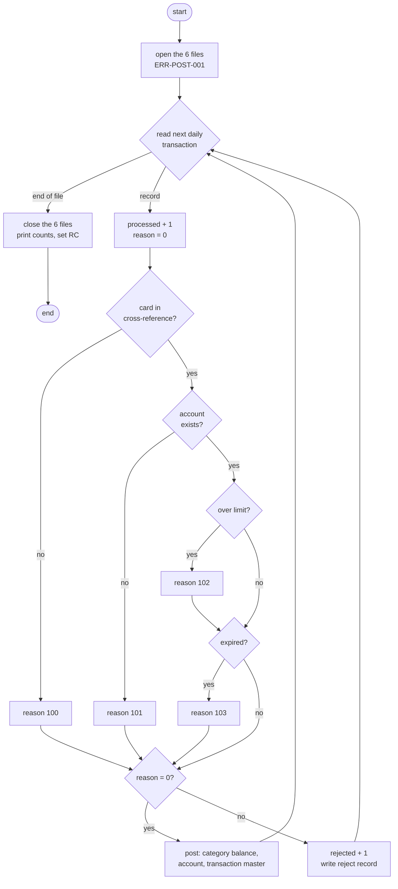
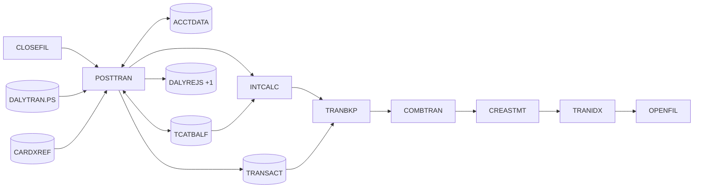

# CBTRN02C: Daily transaction posting (POSTTRAN)

## 1. Summary

The nightly posting job reads the day's card transactions one by one. For each it finds the card in the card cross-reference and the card's account, and checks that the account stays within its credit limit and has not expired. Valid transactions are **posted**: added to the account's current balance and to its cycle credit or cycle debit, added to the account's balance for that transaction type and category, and written to the transaction master file. Invalid transactions are written, with a reason code and text, to a **daily rejects** file. The job ends with return code 4 when anything was rejected, 0 otherwise, and abends (U0999) on any unexpected file error.

## 2. Rules at a glance

| ID | Rule |
| :-- | :-- |
| VAL-POST-001 | The card number must exist in the card cross-reference (reject 100). |
| VAL-POST-002 | The account linked to the card must exist (reject 101). |
| BR-POST-001 | Over-limit: reject 102 when cycle credit - cycle debit + amount is above the credit limit. |
| BR-POST-002 | Expired account: reject 103 when the transaction date is after the account expiration date. |
| BR-POST-003 | When both 102 and 103 apply, the reject carries 103. |
| BR-POST-004 | A valid transaction adds its amount to the category balance for (account, type, category), creating that balance if it is new. |
| BR-POST-005 | A valid transaction adds its amount to the account's current balance, and to the cycle credit (amount >= 0) or the cycle debit (amount < 0). |
| BR-POST-006 | A valid transaction is copied to the transaction master with a new processing timestamp. |
| BR-POST-007 | Each transaction sees the account as updated by the transactions before it in the same run. |
| BR-POST-008 | Return code 4 when at least one transaction was rejected, else 0. |

## 3. Actors and triggers

- **Trigger:** JCL job `POSTTRAN`, step `STEP15` (`app/jcl/POSTTRAN.jcl:23-42`), scheduled daily in CA-7 (`app/scheduler/CardDemo.ca7:70-78`). It is step 3 of the batch cycle, after CLOSEFIL has closed the CICS files and before INTCALC (`docs/runbooks/batch-cycle-restart.md:9-24`).
- **Preconditions:** the online files are closed in CICS; `TRANSACT` is empty (it is opened for output; on the mainframe the cluster is defined without `REUSE`, so a non-empty file makes the open fail; `docs/runbooks/batch-cycle-restart.md:34-35`); the `DALYREJS` generation data group exists.
- **No parameters**, no control cards. The only external input besides files is the system clock (NUM-POST-007).

## 4. Interfaces

### 4.1 Files

| DD | Entity | Organisation | Open | Access | Key | Record | Source |
| :-- | :-- | :-- | :-- | :-- | :-- | --: | :-- |
| `DALYTRAN` | ENT-DAILY-TRAN | sequential, fixed | INPUT | read next | - | 350 | `:29-32, 66-69` |
| `TRANFILE` | ENT-TRANSACTION | indexed (KSDS) | OUTPUT | random write | `TRAN-ID` (16, offset 0) | 350 | `:34-38, 71-74` |
| `XREFFILE` | ENT-CARD-XREF | indexed | INPUT | random read | `XREF-CARD-NUM` (16, offset 0) | 50 | `:40-44, 76-79` |
| `DALYREJS` | ENT-DAILY-REJECT | sequential, fixed | OUTPUT | write | - | 430 | `:46-49, 81-84` |
| `ACCTFILE` | ENT-ACCOUNT | indexed | I-O | random read, rewrite | `ACCT-ID` (11, offset 0) | 300 | `:51-55, 86-89` |
| `TCATBALF` | ENT-TCAT-BAL | indexed | I-O | random read, write, rewrite | account + type + category (17, offset 0) | 50 | `:57-61, 91-97` |

The program reads each record into the copybook layout (`READ ... INTO`) and writes from it (`WRITE/REWRITE ... FROM`); the FD record areas are only byte containers.

### 4.2 Reject record (DALYREJS, 430 bytes)

| Bytes | Content |
| :-- | :-- |
| 1-350 | The daily transaction record exactly as read |
| 351-354 | Reason code, 4 digits with leading zeros (`0100`...`0103`) |
| 355-430 | Reason text, left-aligned, padded with spaces to 76 |

Source: `:176-182, 447-452`.

### 4.3 Console output (SYSOUT), in order

| Text (exact) | When | Source |
| :-- | :-- | :-- |
| `START OF EXECUTION OF PROGRAM CBTRN02C` | start | `:194` |
| `TCATBAL record not found for key : <17-character key>.. Creating.` | each new category balance (BR-POST-004) | `:477-478` |
| `TRANSACTIONS PROCESSED :<9 digits>` | end | `:227` |
| `TRANSACTIONS REJECTED  :<9 digits>` (two spaces before the colon) | end | `:228` |
| `END OF EXECUTION OF PROGRAM CBTRN02C` | end | `:232` |
| error lines of section 10 | on error | (all `DISPLAY`, so SYSOUT; only the local CEE3ABD shim writes to stderr) |

Counts are zero-padded to 9 digits, for example `TRANSACTIONS PROCESSED :000000300`.

### 4.4 Return code

0 when no transaction was rejected, 4 otherwise (BR-POST-008); abend U0999 on error (ERR-POST-008).

## 5. Data used

| Entity field | Read | Written | Use |
| :-- | :-- | :-- | :-- |
| ENT-DAILY-TRAN (all) | yes | - | copied to TRANSACT or DALYREJS |
| ENT-DAILY-TRAN.DALYTRAN-CARD-NUM | yes | - | cross-reference key |
| ENT-DAILY-TRAN.DALYTRAN-AMT | yes | - | amount |
| ENT-DAILY-TRAN.DALYTRAN-ORIG-TS (first 10 characters) | yes | - | transaction date for BR-POST-002 |
| ENT-DAILY-TRAN.DALYTRAN-TYPE-CD, -CAT-CD | yes | - | category balance key |
| ENT-DAILY-TRAN.DALYTRAN-PROC-TS, FILLER | - | - | not used for posting (the transaction gets a new timestamp and blank FILLER); copied unchanged into reject records (§4.2) |
| ENT-CARD-XREF.XREF-ACCT-ID | yes | - | account key, category balance key |
| ENT-ACCOUNT.ACCT-CREDIT-LIMIT, ACCT-EXPIRAION-DATE | yes | - | BR-POST-001, BR-POST-002 |
| ENT-ACCOUNT.ACCT-CURR-BAL, ACCT-CURR-CYC-CREDIT, ACCT-CURR-CYC-DEBIT | yes | yes | BR-POST-001, BR-POST-005 |
| ENT-ACCOUNT (other fields) | yes | rewritten with the bytes read | |
| ENT-TCAT-BAL (all) | yes | yes | BR-POST-004 |
| ENT-TRANSACTION (all) | - | yes | BR-POST-006 |

Program-local data with behaviour: `WS-TRANSACTION-COUNT`, `WS-REJECT-COUNT` (`PIC 9(09)`, `:185-186`), `WS-TEMP-BAL` (`PIC S9(11)V99`, `:187`), `WS-VALIDATION-FAIL-REASON` (`PIC 9(04)`) and `-DESC` (`PIC X(76)`) (`:180-182`), `WS-CREATE-TRANCAT-REC` (`:190`), end-of-file flag (`:146`).

## 6. Processing flow

1. Print the start line; open DALYTRAN (input), TRANFILE (output), XREFFILE (input), DALYREJS (output), ACCTFILE (input-output), TCATBALF (input-output), in that order. Any open failure abends (`:194-200`).
2. Repeat until end of file (`:202-219`):
   1. Read the next daily transaction (`:345-369`). End of file stops the loop; any other non-OK status abends.
   2. Add 1 to the processed count; set the reason to 0 and the reason text to spaces (`:206-209`).
   3. Validate (section 7 and 8, `:370-422`).
   4. Reason 0: post (`:424-445`). Otherwise add 1 to the rejected count and write the reject record (`:447-466`).
3. Close the six files in the same order; any close failure abends (`:221-226`).
4. Print the two counts; set return code 4 if the rejected count is above 0; print the end line (`:227-234`).

## 7. Business rules

#### BR-POST-001 · Over-limit check (reason 102)
- **When:** the card and the account were found, and **`ACCT-CURR-CYC-CREDIT` - `ACCT-CURR-CYC-DEBIT` + `DALYTRAN-AMT`** is greater than `ACCT-CREDIT-LIMIT`. The values are those of the account record as just read, which includes the postings made earlier in this run (BR-POST-007).
- **Then:** reason 102, text `OVERLIMIT TRANSACTION`.
- **Otherwise:** no change to the reason.
- **Precision:** the sum is exact (all values have 2 decimals; no rounding) and is held in a work field large enough for every possible value (NUM-POST-002). The comparison is a signed decimal comparison; equal to the limit is accepted.
- **Note:** `ACCT-CURR-CYC-DEBIT` holds the sum of the negative amounts posted (BR-POST-005), so it is zero or negative and subtracting it *adds* the size of credits and payments to the figure (DEF-POST-005).
- **Source:** `app/cbl/CBTRN02C.cbl:403-413`
- **Fidelity:** must-preserve (defect-decide for the formula, Q-POST-001) · **Confidence:** runtime-verified

#### BR-POST-002 · Expired account (reason 103)
- **When:** the card and the account were found, and the account expiration date `ACCT-EXPIRAION-DATE` (10 characters, `YYYY-MM-DD`) is **less than** the first 10 characters of `DALYTRAN-ORIG-TS`, compared as text, character by character.
- **Then:** reason 103, text `TRANSACTION RECEIVED AFTER ACCT EXPIRATION`.
- **Otherwise:** no change to the reason. A transaction on the expiration date itself is accepted.
- **Edge cases:** a blank expiration date is lower than any date, so every transaction with a non-blank date is rejected 103; a blank origin timestamp is accepted (so a blank date on both sides is accepted, because the two values are equal).
- **Source:** `:414-420`
- **Fidelity:** must-preserve · **Confidence:** runtime-verified (`tests/integration/test_posttran.py:75-97`)

#### BR-POST-003 · Only the last failing check is recorded
- **When:** both BR-POST-001 and BR-POST-002 fail.
- **Then:** the reject record carries 103 (it is checked second and overwrites 102). 100 and 101 stop validation, so they are never combined with 102 or 103.
- **Source:** `:370-378, 407-420`
- **Fidelity:** must-preserve · **Confidence:** reviewed

#### BR-POST-004 · Category balance update
- **When:** a transaction is valid.
- **Then:** the category balance key is account ID from the cross-reference (11 digits) + `DALYTRAN-TYPE-CD` (2) + `DALYTRAN-CAT-CD` (4 digits). Read the ENT-TCAT-BAL record with that key.
  - **Found:** add `DALYTRAN-AMT` to `TRAN-CAT-BAL` and rewrite it.
  - **Not found (status 23):** print `TCATBAL record not found for key : <key>.. Creating.`; build a new record with the key, `TRAN-CAT-BAL` = `DALYTRAN-AMT`, and write it. Its 22-byte FILLER is not initialised (DEF-POST-010).
  - A rewrite re-encodes only `TRAN-CAT-BAL`; key and FILLER keep the bytes read. A not-found READ does not change the work record (`READ ... INTO` moves data only on success).
- **Source:** `:468-543`
- **Fidelity:** must-preserve · **Confidence:** runtime-verified

#### BR-POST-005 · Account update
- **When:** a transaction is valid (after BR-POST-004).
- **Then:** `ACCT-CURR-BAL` += `DALYTRAN-AMT`. If `DALYTRAN-AMT` >= 0 (zero included), `ACCT-CURR-CYC-CREDIT` += amount; otherwise `ACCT-CURR-CYC-DEBIT` += amount (the debit becomes more negative). Rewrite the whole account record. Only the fields changed here are re-encoded; every other byte, including the cycle field that did not change, is written back exactly as read.
- **Source:** `:546-561`
- **Fidelity:** must-preserve · **Confidence:** runtime-verified

#### BR-POST-006 · Transaction master record
- **When:** a transaction is valid (after BR-POST-005).
- **Then:** build a 350-byte ENT-TRANSACTION record: start from all spaces; copy ID, type, category, source, description, amount, merchant ID, name, city and ZIP, card number and origin timestamp from the daily record unchanged (same positions, same encoding); set `TRAN-PROC-TS` to the current time (NUM-POST-007); FILLER stays spaces. Write it with key `TRAN-ID`. In effect, bytes 1-304 equal the daily record's bytes 1-304, bytes 305-330 hold the new timestamp and 331-350 are spaces.
  - `TRAN-CAT-CD`, `TRAN-AMT` and `TRAN-MERCHANT-ID` are numeric moves (`:428, 431, 432`). They are byte-identical for clean data (all 262 sample records); on z/OS the compiler may rewrite a sign that is not in the preferred form, so byte identity of those fields is guaranteed only for clean data. **Confidence:** runtime-verified for the sample; platform-inferred otherwise.
- **Source:** `:424-440, 563-580`
- **Fidelity:** must-preserve · **Confidence:** runtime-verified

#### BR-POST-007 · Running balances within a run
- **When:** several transactions in one file hit the same account or category.
- **Then:** they are processed in file order, and each validation reads the account as rewritten by the previous postings. Rejected transactions change nothing.
- **Source:** `:395, 555`
- **Fidelity:** must-preserve (order matters for which transaction is rejected 102) · **Confidence:** runtime-verified

#### BR-POST-008 · Return code
- **When:** the run ends normally.
- **Then:** return code 4 if the rejected count is above 0, else 0.
- **Source:** `:229-231`
- **Fidelity:** must-preserve (the scheduler treats 4 as success) · **Confidence:** runtime-verified

## 8. Validations

Applied in this order to each daily transaction; reason codes are written to the reject record (section 4.2).

#### VAL-POST-001 · Card must be known (reason 100)
- **When:** no ENT-CARD-XREF record has `XREF-CARD-NUM` = `DALYTRAN-CARD-NUM` (read returns "invalid key").
- **Then:** reason 100, text `INVALID CARD NUMBER FOUND`; no further checks.
- **Source:** `:380-392`
- **Confidence:** runtime-verified

#### VAL-POST-002 · Account must exist (reason 101)
- **When:** the card is known but no ENT-ACCOUNT record has `ACCT-ID` = `XREF-ACCT-ID`.
- **Then:** reason 101, text `ACCOUNT RECORD NOT FOUND`; BR-POST-001 and BR-POST-002 are not evaluated.
- **Source:** `:393-399`
- **Confidence:** runtime-verified

Then BR-POST-001 and BR-POST-002, both evaluated (BR-POST-003).

| Card found | Account found | Over limit | Expired | Result |
| :-- | :-- | :-- | :-- | :-- |
| no | - | - | - | reject 100 |
| yes | no | - | - | reject 101 |
| yes | yes | no | no | post |
| yes | yes | yes | no | reject 102 |
| yes | yes | no | yes | reject 103 |
| yes | yes | yes | yes | reject 103 |

Reason texts are exact and padded with spaces to 76 characters: `INVALID CARD NUMBER FOUND`, `ACCOUNT RECORD NOT FOUND`, `OVERLIMIT TRANSACTION`, `TRANSACTION RECEIVED AFTER ACCT EXPIRATION`.

There are no other validations (DEF-POST-009).

## 9. Side effects

Per valid transaction, in this order (`:441-443`). There is no commit or rollback: each change is permanent as soon as it is made.

#### SE-POST-001 · Category balance write or rewrite
- TCATBALF: random READ by 17-byte key, then REWRITE (found) or WRITE (new). BR-POST-004.
- **Source:** `:468-543`

#### SE-POST-002 · Account rewrite
- ACCTFILE: REWRITE of the record read during validation, by `ACCT-ID`. BR-POST-005.
- **Source:** `:555-560`

#### SE-POST-003 · Transaction master write
- TRANFILE: WRITE, key `TRAN-ID` = `DALYTRAN-ID`. BR-POST-006.
- **Source:** `:563-580`

Per rejected transaction:

#### SE-POST-004 · Reject write
- DALYREJS: WRITE of the 430-byte reject record (section 4.2).
- **Source:** `:447-466`

Reads with no side effect: DALYTRAN (sequential), XREFFILE and ACCTFILE (random, by key).

## 10. Error handling

#### ERR-POST-001 · Open and close failures
- Any status other than `00` on OPEN or CLOSE prints the message below, the file status (ERR-POST-007) and abends (ERR-POST-008).

| File | Open message | Close message |
| :-- | :-- | :-- |
| DALYTRAN | `ERROR OPENING DALYTRAN` | `ERROR CLOSING DALYTRAN FILE` |
| TRANFILE | `ERROR OPENING TRANSACTION FILE` | `ERROR CLOSING TRANSACTION FILE` |
| XREFFILE | `ERROR OPENING CROSS REF FILE` | `ERROR CLOSING CROSS REF FILE` |
| DALYREJS | `ERROR OPENING DALY REJECTS FILE` | `ERROR CLOSING DAILY REJECTS FILE` (prints the wrong status, DEF-POST-004) |
| ACCTFILE | `ERROR OPENING ACCOUNT MASTER FILE` | `ERROR CLOSING ACCOUNT FILE` |
| TCATBALF | `ERROR OPENING TRANSACTION BALANCE FILE` | `ERROR CLOSING TRANSACTION BALANCE FILE` |

- **Source:** `:236-343, 583-691`

#### ERR-POST-002 · Daily read
- Status `00`: process; `10`: end of file; anything else: `ERROR READING DALYTRAN FILE`, file status, abend.
- **Source:** `:345-369`

#### ERR-POST-003 · Category balance I/O
- READ: status `00` or `23` continue; anything else `ERROR READING TRANSACTION BALANCE FILE` and abend. WRITE not `00`: `ERROR WRITING TRANSACTION BALANCE FILE`, abend. REWRITE not `00`: `ERROR REWRITING TRANSACTION BALANCE FILE`, abend.
- **Source:** `:482-494, 513-525, 531-543`

#### ERR-POST-004 · Transaction master write
- Status not `00` (for example `22`, duplicate `DALYTRAN-ID`): `ERROR WRITING TO TRANSACTION FILE`, file status, abend. By then SE-POST-001 and SE-POST-002 have already been applied for this record (DEF-POST-008).
- **Source:** `:563-580`

#### ERR-POST-005 · Reject write
- Status not `00`: `ERROR WRITING TO REJECTS FILE`, file status, abend.
- **Source:** `:452-465`

#### ERR-POST-006 · Account rewrite failure is not an error
- REWRITE "invalid key" sets reason 109 / `ACCOUNT RECORD NOT FOUND`, but nothing reads it: no reject record, no abend, the transaction is still written and the rejected count is unchanged (DEF-POST-003).
- Account rewrite errors other than "invalid key" are not detected at all: no reason, no abend (DEF-POST-012).
- **Source:** `:555-560`

#### ERR-POST-007 · File status display
- Prints `FILE STATUS IS: NNNN` followed by 4 characters. Numeric status not starting with `9`: `00` + the 2 status digits, for example `FILE STATUS IS: NNNN0035`. Non-numeric, or first character `9`: the first character, then the binary value of the second byte as 3 digits, for example status `9` + byte X'22' prints `FILE STATUS IS: NNNN9034`.
- **Source:** `:715-728` · **Fidelity:** incidental

#### ERR-POST-008 · Abend
- Prints `ABENDING PROGRAM` and calls `CEE3ABD` with code 999 and timing 0: user abend U0999. Locally the shim prints `CEE3ABD: USER ABEND U0999` on stderr and ends with return code 16 (`tools/shims/CEE3ABD.cbl:21-23`).
- The end-of-run lines (counts, `END OF EXECUTION ...`) are not printed. Every write and rewrite done before the abend stays in the files; there is no rollback (DEF-POST-008).
- **Source:** `:708-712` · **Confidence:** runtime-verified (`tests/integration/test_abends.py`)

## 11. Interactions

- **Upstream:** whatever produces `DALYTRAN.PS` (outside this repository; in the demo it is shipped sample data); CLOSEFIL; an empty `TRANSACT` (data refresh or TRANBKP).
- **Downstream:** INTCALC (`CBACT04C`) computes interest from `TCATBALF` and updates `ACCTDATA`; TRANBKP, COMBTRAN, CREASTMT, TRANIDX consume `TRANSACT`; TRANREPT (`CBTRN03C`) reports on it; the daily-rejects runbook reprocesses `DALYREJS` (`docs/runbooks/daily-rejects.md`).
- **Shared data with online programs:** `ACCTDATA` (bill payment `COBIL00C`, account update `COACTUPC`), `CARDXREF`, `TRANSACT` (bill payment and transaction add write it during the day). Online transaction IDs come from "highest + 1"; batch IDs come from the daily file. Nothing coordinates the two (see `COBIL00C.md` DEF-BILL-003).
- **Calls:** `CEE3ABD` (LE abend service) only.

## 12. Numeric, date and format details

#### NUM-POST-001 · Amounts and signs
- `DALYTRAN-AMT`, `TRAN-AMT`, `TRAN-CAT-BAL`: decimal(11,2), `PIC S9(09)V99`, zoned decimal, sign in the last byte. Account amounts: decimal(12,2), `PIC S9(10)V99`. In the ASCII sample data the last byte is `{`, `A`-`I` for +0..+9 and `}`, `J`-`R` for -0..-9 (the build uses `-fsign=EBCDIC` to read them). A negative zero is treated as zero.
- **Reading:** a negative zero (`}` in the last byte) compares equal to zero, so it counts as >= 0 in BR-POST-005 (cycle credit). A plain digit in the sign byte reads as positive.
- **Writing:** every value the program computes is written with `{`, `A`-`I` when >= 0 and `}`, `J`-`R` when < 0; an arithmetic zero (for example 5.00 + -5.00) is written as `{`. Fields the program does not compute keep their input bytes (BR-POST-004, BR-POST-005).
- **Confidence:** runtime-verified on GnuCOBOL 3.2 `-std=ibm -fsign=EBCDIC` (test program and output in `docs/modernization/spec/evidence/nl-pilot-check.md`).

#### NUM-POST-002 · Over-limit work field
- `WS-TEMP-BAL` is decimal(13,2) (`PIC S9(11)V99`): every possible value of credit - debit + amount fits (each term is below 10^10). No rounding.
- **Source:** `:187, 403-405`

#### NUM-POST-003 · Overflow on additions
- The additions in BR-POST-004 and BR-POST-005 have no size-error handling: a result that does not fit keeps only its low-order digits (`TRAN-CAT-BAL` above 999,999,999.99; account fields above 9,999,999,999.99) and keeps its sign: 999,999,999.99 + 0.02 is stored as +0.01, -999,999,999.99 + -0.02 as -0.01. A negative result that truncates to zero is stored as a negative zero (`}`): -999,999,999.99 + -0.01 gives `0000000000}`. Not reachable with the sample data; `TRAN-CAT-BAL` can reach it over many runs because nothing resets it here.
- **Confidence:** runtime-verified on GnuCOBOL 3.2 (same test as NUM-POST-001); the z/OS result is platform-inferred.
- **Source:** `:509, 528, 548-553`

#### NUM-POST-004 · Date comparison
- BR-POST-002 compares 10-character strings. Both are `YYYY-MM-DD` in the data, so text order equals date order.

#### NUM-POST-005 · Category key
- 17 characters: `XREF-ACCT-ID` as 11 digits, `DALYTRAN-TYPE-CD` as 2 characters, `DALYTRAN-CAT-CD` as 4 digits. Example `00000000020030001`.

#### NUM-POST-006 · Counters
- Processed and rejected counts are 9-digit unsigned, displayed with leading zeros.

#### NUM-POST-007 · Processing timestamp
- `TRAN-PROC-TS` (26 characters) is `YYYY-MM-DD-HH.MM.SS.hh0000`: date with `-`, a `-`, time with `.`, then a `.`, the hundredths of a second (2 digits) and `0000`. It is taken from the system clock separately for each posted transaction. Example from the local run: `2022-07-06-12.00.00.770000`. Locally the date is pinned to the business date 2022-07-06 (`CARDDEMO_BUSINESS_DATE`).
- **Source:** `:150-174, 438-439, 693-706`

## 13. Known defects and oddities

#### DEF-POST-001 · Over-limit work field was too small (fixed in this branch)
- `WS-TEMP-BAL` was `S9(09)V99`, so a sum of 1,000,000,000.00 or more lost its high-order digits and the over-limit check compared the wrong value. Now `S9(11)V99`.
- **Status:** fixed in this branch, "batch: CBTRN02C overlimit check and blank FILLER" (`CHANGELOG.md:47`, commit 37cea4e, squashed into b5e0139). The test oracle models the field size (`tests/oracle.py:154-165`).

#### DEF-POST-002 · Transaction FILLER was not blanked (fixed in this branch)
- The record built in BR-POST-006 was not cleared first, so its 20-byte FILLER kept the initial working-storage content (low-values on GnuCOBOL with `-std=ibm`; undefined on z/OS) instead of spaces. Now cleared to spaces (`:425`).
- **Status:** fixed in this branch (same commit).

#### DEF-POST-003 · Reason 109 is set and ignored
- See ERR-POST-006. A failed account rewrite leaves the account unchanged but the category balance and the transaction master updated, with no reject and no abend.
- **Status:** open · **Fidelity:** defect-decide (Q-POST-003)

#### DEF-POST-004 · Wrong status on the rejects close error
- The DALYREJS close error prints the cross-reference file's status instead of the rejects file's.
- **Source:** `:650` · **Status:** open (diagnostic only)

#### DEF-POST-005 · Over-limit measures cycle activity, not balance
- Cycle debit accumulates negative amounts, so credit - debit = total positive amounts + size of total negative amounts. Payments and refunds therefore *increase* the figure used for later transactions, and the current balance `ACCT-CURR-BAL` and cash limit `ACCT-CASH-CREDIT-LIMIT` play no part. A refund on an account already over the figure is itself rejected 102.
- **Status:** open · **Fidelity:** defect-decide (Q-POST-001)

#### DEF-POST-006 · One reason per reject
- Only one reason is stored; 103 hides 102 (BR-POST-003).
- **Status:** open (Q-POST-002)

#### DEF-POST-007 · Lookup I/O errors other than "not found" are not checked
- The cross-reference and account reads only handle "invalid key"; neither branch runs on any other failure, and no reason is set.
- **Cross-reference read error:** the work area keeps the previous transaction's cross-reference, so the transaction is validated and posted against the previous card's account.
- **Account read error:** the over-limit and expiry checks (BR-POST-001, BR-POST-002) sit in the "not invalid key" branch, so neither runs and the transaction is posted. The amount is added to the stale account record left from the previous transaction, and the rewrite uses that record's own account number, so it updates the previous transaction's account, while the category balance (BR-POST-004) uses the current cross-reference account.
- **Source:** `:383-391, 395-421, 470, 548-555` · **Status:** open · **Confidence:** reviewed (not reachable in a local run)

#### DEF-POST-008 · Partial updates and no restart
- Changes are applied one by one with no checkpoint. An abend in the middle (for example a duplicate `DALYTRAN-ID`) leaves earlier postings applied, plus the category and account updates of the failing record without its transaction record. The runbook's restart procedure restores `ACCTDATA` and `TCATBALF` from backups (`docs/runbooks/batch-cycle-restart.md:67-85`).
- **Status:** open (architecture: Q-POST-004)

#### DEF-POST-009 · Missing validations
- Not checked: account active status, card status or expiry, that the type and category exist in the reference tables, duplicate IDs (only by abend on write), zero amounts.
- **Status:** open (business)

#### DEF-POST-010 · New category balance FILLER is inherited
- INITIALIZE does not reset FILLER (verified on GnuCOBOL 3.2 `-std=ibm`, evidence file). A new category balance record gets the FILLER of the last category balance record read or written in the run; before any, the initial working-storage content (low-values on GnuCOBOL with `-std=ibm`, undefined on z/OS). With the sample data every category FILLER is 22 zeros, so new records get 22 zeros too.
- **Source:** `:505-511` · **Status:** open

#### DEF-POST-011 · [security] Rejects hold full card numbers
- The reject record is the full daily record, including `DALYTRAN-CARD-NUM`. See `docs/security/data-handling.md`.
- **Status:** open (handled by procedure)

#### DEF-POST-012 · Account rewrite errors other than "invalid key" are ignored
- The REWRITE at `:555` has only an INVALID KEY clause and its file status is never tested. Any other failure loses the account update silently while the category balance and the transaction record are written.
- **Source:** `:555-560` · **Status:** open · **Fidelity:** defect-decide (Q-POST-003)

#### DEF-POST-013 · Rejects are lost on abend
- `DALYREJS` is allocated `DISP=(NEW,CATLG,DELETE)`, so an abend deletes the new generation and every reject written before it. The abend also leaves the other files unclosed, including `TRANSACT`, which was opened for output.
- **Source:** `app/jcl/POSTTRAN.jcl:34-38`, `:708-712` · **Status:** open · **Confidence:** platform-inferred (z/OS disposition processing)

#### DEF-POST-014 · Only status `00` counts as success
- Every open, close, read and write check accepts only `00` (plus `10` at end of file and `23` on the category read). A successful but non-zero status abends the job, for example `97` when VSAM opens a file after an implicit verify.
- **Source:** `:236-343, 345-369, 482, 583-691` · **Status:** open · **Confidence:** platform-inferred

## 14. Open questions

| ID | Question | For |
| :-- | :-- | :-- |
| Q-POST-001 | Keep the over-limit formula (DEF-POST-005), or change to a balance-based check (for example current balance + amount > credit limit)? Changing it changes which of the 300 sample transactions are rejected. | business |
| Q-POST-002 | Record all failing reasons, or keep one? | business, operations |
| Q-POST-003 | On a failed account rewrite: reject, abend, or keep the current behaviour? | business |
| Q-POST-004 | Target transaction boundary: one database transaction per daily record (no partial record), per chunk with restart (Spring Batch), or per file? | architecture |
| Q-POST-005 | Confirm on the mainframe that opening a non-empty `TRANSACT` for output fails (cluster without `REUSE`), as the runbook states. | mainframe team |

## 15. Equivalence contract

A reimplementation is equivalent when, for the same input files and clock date:

- the processed and rejected counts and the return code are equal;
- the reject file is byte-identical (record order = input order);
- the transaction master has the same keys and is byte-identical (for input with preferred signs, see BR-POST-006) except bytes 305-330 (`TRAN-PROC-TS`), which must match `YYYY-MM-DD-HH.MM.SS.hh0000` with the run date;
- the account and category balance files are byte-identical after the run (including new category records and their FILLER);
- the number of `TCATBAL record not found ...` lines equals the number of new category records.

Sample day (`app/data/ASCII`, business date 2022-07-06): 300 processed, 262 posted, 38 rejected (all reason 102), return code 4, 50 new category balance records (100 in total). Verified against the GnuCOBOL runner by a reimplementation written from this spec alone, on this sample day and on a blind stress data set that reaches reasons 100-103 (302 processed, 232 posted, 70 rejected); both byte-identical. See `docs/modernization/spec/evidence/nl-pilot-check.md`.

## 16. Paragraph coverage

| Paragraph | Lines | Covered by |
| :-- | :-- | :-- |
| (file and data division) | 29-190 | §4.1, §4.2, §5, NUM-POST-001, NUM-POST-002 |
| (procedure division main line) | 193-234 | §6 steps 1-4, BR-POST-007, BR-POST-008, §4.3 |
| `0000-DALYTRAN-OPEN` | 236-252 | ERR-POST-001 |
| `0100-TRANFILE-OPEN` | 254-270 | ERR-POST-001, §3 preconditions |
| `0200-XREFFILE-OPEN` | 273-289 | ERR-POST-001 |
| `0300-DALYREJS-OPEN` | 291-307 | ERR-POST-001 |
| `0400-ACCTFILE-OPEN` | 309-325 | ERR-POST-001 |
| `0500-TCATBALF-OPEN` | 327-343 | ERR-POST-001 |
| `1000-DALYTRAN-GET-NEXT` | 345-369 | ERR-POST-002, §6 step 2.1 |
| `1500-VALIDATE-TRAN` | 370-378 | §8 order, BR-POST-003 |
| `1500-A-LOOKUP-XREF` | 380-392 | VAL-POST-001, DEF-POST-007 |
| `1500-B-LOOKUP-ACCT` | 393-422 | VAL-POST-002, BR-POST-001, BR-POST-002, BR-POST-003, DEF-POST-007 |
| `2000-POST-TRANSACTION` | 424-445 | BR-POST-006, §9 order |
| `2500-WRITE-REJECT-REC` | 447-466 | SE-POST-004, §4.2, ERR-POST-005 |
| `2700-UPDATE-TCATBAL` | 468-502 | BR-POST-004, SE-POST-001, ERR-POST-003 |
| `2700-A-CREATE-TCATBAL-REC` | 504-525 | BR-POST-004, DEF-POST-010, ERR-POST-003 |
| `2700-B-UPDATE-TCATBAL-REC` | 527-543 | BR-POST-004, ERR-POST-003 |
| `2800-UPDATE-ACCOUNT-REC` | 546-561 | BR-POST-005, SE-POST-002, ERR-POST-006, DEF-POST-012 |
| `2900-WRITE-TRANSACTION-FILE` | 563-580 | SE-POST-003, ERR-POST-004 |
| `9000-DALYTRAN-CLOSE` | 583-599 | ERR-POST-001 |
| `9100-TRANFILE-CLOSE` | 601-617 | ERR-POST-001 |
| `9200-XREFFILE-CLOSE` | 620-636 | ERR-POST-001 |
| `9300-DALYREJS-CLOSE` | 638-654 | ERR-POST-001, DEF-POST-004 |
| `9400-ACCTFILE-CLOSE` | 656-672 | ERR-POST-001 |
| `9500-TCATBALF-CLOSE` | 675-691 | ERR-POST-001 |
| `Z-GET-DB2-FORMAT-TIMESTAMP` | 693-706 | NUM-POST-007 |
| `9999-ABEND-PROGRAM` | 708-712 | ERR-POST-008, DEF-POST-013 |
| `9910-DISPLAY-IO-STATUS` | 715-728 | ERR-POST-007 |

26 of 26 named paragraphs plus the main line covered; no paragraph is unmapped.
