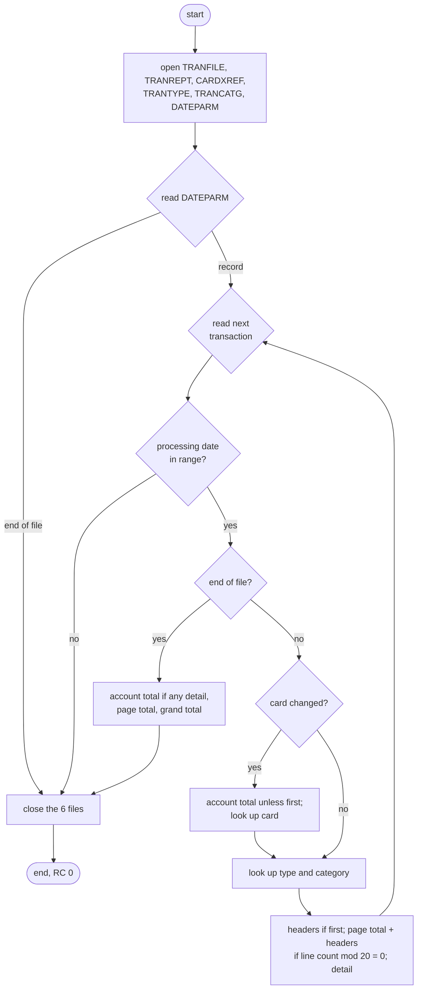
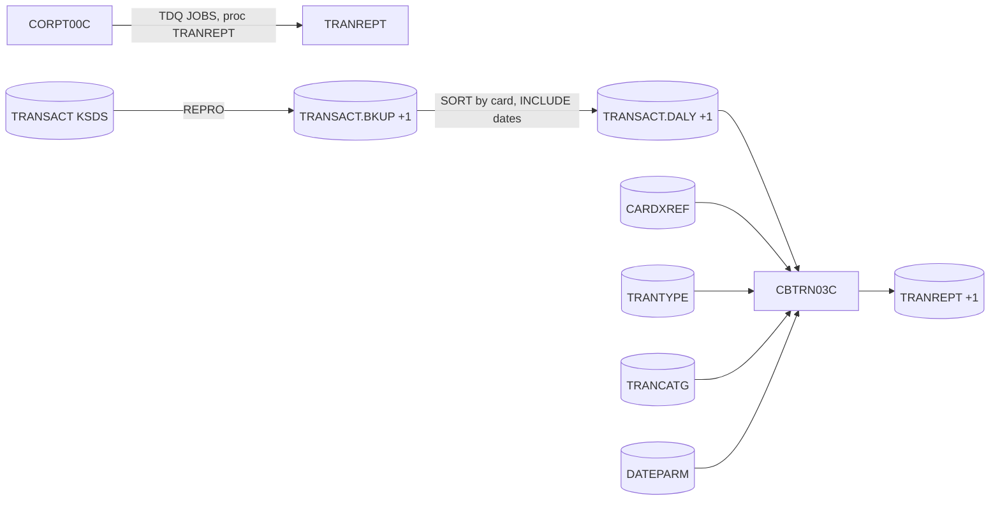

# CBTRN03C: Transaction detail report (TRANREPT)

## 1. Summary

The transaction report program prints the posted transactions of a date range as a 133-column report. Its input is a sequential copy of the transaction master that the job's SORT step has already filtered to the date range and sorted by card number. For each transaction it prints one detail line with the account number (looked up from the card), the transaction type and category with their descriptions (looked up in the reference files), the source and the amount. It prints a total line whenever the card number changes ("Account Total"), a page total and new headers every 20 lines or so, and a page total and grand total at the end. It stops at the first transaction whose processing date is outside the range given in the DATEPARM file, even if more follow (DEF-TRPT-001). It abends (U0999) when a card, type or category is not found.

## 2. Rules at a glance

| ID | Rule |
| :-- | :-- |
| BR-TRPT-001 | The date range is read from the first DATEPARM record: start date in columns 1-10, end date in columns 12-21. |
| BR-TRPT-002 | Transactions are reported while their processing date (`TRAN-PROC-TS` columns 1-10) is within the range, both ends included; the first one outside the range ends the report without any totals. |
| BR-TRPT-003 | Each reported transaction gives one detail line with account, type, category, descriptions, source and amount. |
| BR-TRPT-004 | When the card number changes, an "Account Total" line with the previous card's sum is printed before the new card's first line. |
| BR-TRPT-005 | A page total and a new set of headers are printed before a detail line whenever the line count is a multiple of 20. |
| BR-TRPT-006 | At end of file: account total, page total and grand total. The grand total is the sum of all page totals. |
| BR-TRPT-007 | The account number, type description and category description come from lookups; a missing card, type or category abends the job. |

## 3. Actors and triggers

- **Trigger:** JCL job `TRANREPT`, step `STEP10R` (`app/jcl/TRANREPT.jcl:59-80`), after a REPRO of the transaction master to `TRANSACT.BKUP(+1)` and a SORT that keeps the processing dates 2022-01-01 to 2022-07-06 and sorts by card number (`app/jcl/TRANREPT.jcl:23-55`). The online report request `CORPT00C` submits the cataloged procedure `TRANREPT` (`app/proc/TRANREPT.prc:21-72`) through the `JOBS` transient data queue with the chosen dates written into both the SORT symbols and an in-stream DATEPARM record (`app/cbl/CORPT00C.cbl:94-121`). Neither scheduler lists the job.
- **Preconditions:** the transaction master has been posted (POSTTRAN, and on a full cycle COMBTRAN); the SORT output is in card-number order; the reference files `CARDXREF`, `TRANTYPE`, `TRANCATG` hold every card, type and category that occurs.
- **Parameters:** the DATEPARM record (BR-TRPT-001). The SORT step's date range is set separately in the JCL symbols; the program does not see it (DEF-TRPT-002).
- Locally the job runs POSTTRAN first, then a Python stand-in for the REPRO and SORT steps (`tools/carddemo.py:621-629`).

## 4. Interfaces

### 4.1 Files

| DD | Entity | Organisation | Open | Access | Key | Record | Source |
| :-- | :-- | :-- | :-- | :-- | :-- | --: | :-- |
| `TRANFILE` | ENT-TRANSACTION | sequential, fixed | INPUT | read next | - | 350 | `:29-31, 61-65` |
| `CARDXREF` | ENT-CARD-XREF | indexed | INPUT | random read | `XREF-CARD-NUM` (16) | 50 | `:33-37, 67-70` |
| `TRANTYPE` | ENT-TRAN-TYPE | indexed | INPUT | random read | type (2) | 60 | `:39-43, 72-75` |
| `TRANCATG` | ENT-TRAN-CATEGORY | indexed | INPUT | random read | type (2) + category (4 digits) | 60 | `:45-49, 77-82` |
| `DATEPARM` | ENT-DATE-PARM | sequential | INPUT | one read | - | 80 | `:55-57, 87-88` |
| `TRANREPT` | ENT-TRAN-REPORT | sequential, fixed | OUTPUT | write | - | 133 | `:51-53, 84-85` |

`TRANREPT` is allocated `AWS.M2.CARDDEMO.TRANREPT(+1)`, `DISP=(NEW,CATLG,DELETE)`, `RECFM=FB,LRECL=133` (`app/jcl/TRANREPT.jcl:76-80`). Every report line is 133 characters, padded with spaces on the right.

### 4.2 Report lines

Column numbers are 1-based. Every line is 133 characters; the parts not listed are spaces.

| Line | Columns: content |
| :-- | :-- |
| Name header | 1-38 `DALYREPT`; 39-79 `Daily Transaction Report`; 80-91 `Date Range: `; 92-101 start date; 102-105 ` to `; 106-115 end date |
| Blank | 133 spaces |
| Column header | 1-17 `Transaction ID`; 18-29 `Account ID`; 30-48 `Transaction Type`; 49-83 `Tran Category`; 84-97 `Tran Source`; 98 space; 99-114 `        Amount` (8 spaces + `Amount`) |
| Rule | 133 hyphens `-` |
| Detail | 1-16 `TRAN-ID`; 17 space; 18-28 account ID (11 digits); 29 space; 30-31 type code; 32 `-`; 33-47 type description (first 15 characters); 48 space; 49-52 category code (4 digits); 53 `-`; 54-82 category description (first 29 characters); 83 space; 84-93 `TRAN-SOURCE`; 94-97 spaces; 98-112 amount, edit pattern `-ZZZ,ZZZ,ZZZ.ZZ` (NUM-TRPT-002); 113-114 spaces |
| Account total | 1-13 `Account Total`; 14-97 84 dots `.`; 98-112 amount, edit pattern `+ZZZ,ZZZ,ZZZ.ZZ` |
| Page total | 1-11 `Page Total` + 1 space; 12-97 86 dots; 98-112 amount `+ZZZ,ZZZ,ZZZ.ZZ` |
| Grand total | 1-11 `Grand Total`; 12-97 86 dots; 98-112 amount `+ZZZ,ZZZ,ZZZ.ZZ` |

A **header block** is: name header, blank, column header, rule (4 lines). A **page total block** is: page total, rule. An **account total block** is: account total, rule. Source: `app/cpy/CVTRA07Y.cpy:4-66`, `:294-342, 362-375`.

Example detail and totals from the sample run:

```
0000000577826814 00000000050 03-Credit          0001-Credit to Account             OPERATOR      -         47.88
Account Total....................................................................................+      1,453.87
Page Total ......................................................................................+      4,665.52
```

### 4.3 Console output (SYSOUT), in order

| Text (exact) | When | Source |
| :-- | :-- | :-- |
| `START OF EXECUTION OF PROGRAM CBTRN03C` | start | `:160` |
| `Reporting from <start> to <end>` | DATEPARM record read | `:233-234` |
| the 350-byte transaction record as read | each reported transaction (DEF-TRPT-006) | `:180` |
| `TRAN-AMT ` + the last transaction's amount, then `WS-PAGE-TOTAL` + the last page total (no space) | end of file reached (BR-TRPT-006) | `:198-199` |
| `END OF EXECUTION OF PROGRAM CBTRN03C` | normal end | `:216` |
| error lines of section 10 | on error | |

The two end-of-file numbers are displayed as signed numbers; GnuCOBOL prints 11 digits and a trailing sign (`TRAN-AMT 00000076566+`, `WS-PAGE-TOTAL00000095999+`), z/OS prints 11 digits with the sign folded into the last one. **Fidelity:** incidental.

### 4.4 Return code

0 at normal end; abend U0999 on error (ERR-TRPT-006).

## 5. Data used

| Entity field | Read | Use |
| :-- | :-- | :-- |
| ENT-DATE-PARM start and end date | yes | range (BR-TRPT-001), name header |
| ENT-TRANSACTION.TRAN-PROC-TS (columns 1-10) | yes | range check (BR-TRPT-002) |
| ENT-TRANSACTION.TRAN-CARD-NUM | yes | card break (BR-TRPT-004), cross-reference key |
| ENT-TRANSACTION.TRAN-ID, TRAN-TYPE-CD, TRAN-CAT-CD, TRAN-SOURCE, TRAN-AMT | yes | detail line, lookups, totals |
| ENT-TRANSACTION (other fields) | yes | displayed only |
| ENT-CARD-XREF.XREF-ACCT-ID | yes | account column |
| ENT-TRAN-TYPE.TRAN-TYPE-DESC | yes | type description (first 15 characters) |
| ENT-TRAN-CATEGORY.TRAN-CAT-TYPE-DESC | yes | category description (first 29 characters) |

No input file is changed. Program-local data with behaviour (`:122-137`): `WS-START-DATE`, `WS-END-DATE` (`PIC X(10)`); `WS-FIRST-TIME` (`'Y'` until the first detail); `WS-LINE-COUNTER` (`PIC 9(09)` packed, starts at 0); `WS-PAGE-SIZE` (20); `WS-PAGE-TOTAL`, `WS-ACCOUNT-TOTAL`, `WS-GRAND-TOTAL` (`PIC S9(09)V99`, start at 0); `WS-CURR-CARD-NUM` (`PIC X(16)`, starts as spaces).

## 6. Processing flow



1. Print the start line; open TRANFILE, TRANREPT (output), CARDXREF, TRANTYPE, TRANCATG, DATEPARM, in that order (`:160-166`).
2. Read the DATEPARM record (BR-TRPT-001). At end of file the loop below does not run: the report is empty.
3. Repeat until end of file (`:170-207`), FLOW-TRPT-001:
   1. Read the next transaction. At end of file the work record keeps the last transaction read.
   2. If the processing date of the record in the work area is outside the range, leave the loop at once (BR-TRPT-002).
   3. Not end of file: display the record; on a card change print the account total block (except before the first detail) and look up the card; look up the type and the category; write the detail (`1100`, BR-TRPT-005).
   4. End of file: display the two diagnostic lines; print the account total block (if a detail was printed), the page total block and the grand total (BR-TRPT-006); the loop ends.
4. Close the six files in the order they were opened; print the end line (`:209-216`).

#### FLOW-TRPT-001 · Main loop and the range exit
- **When:** each pass of the loop.
- **Then:** the range test sits in the same sentence as the loop, and its "outside" branch is `NEXT SENTENCE`, which continues after the end of the whole loop. So an out-of-range record (or, at end of file, a last record that is out of range) ends the loop without displaying the record, without the end-of-file lines and without any total. The files are then closed normally and the return code is 0.
- The test is applied to the work record **after** each read, including the read that hits end of file (the work record still holds the last transaction). An empty TRANFILE leaves the work record at its initial content (spaces locally), which is below any start date, so an empty input gives an empty report with no totals.
- **Source:** `:170-207`
- **Fidelity:** must-preserve (defect-decide, DEF-TRPT-001) · **Confidence:** runtime-verified (a record out of range in the middle of the file ends the report after the lines before it; a range that excludes the first record gives a 0-line report; an empty input gives a 0-line report)

## 7. Business rules

#### BR-TRPT-001 · Date range parameter
- **When:** start of the run.
- **Then:** read the first DATEPARM record; columns 1-10 are the start date, column 11 is ignored, columns 12-21 are the end date (`YYYY-MM-DD` in practice; any text is accepted). Print `Reporting from <start> to <end>`. Later records are not read.
- **Otherwise:** an empty DATEPARM: no message, no report lines, return code 0. A read error abends (ERR-TRPT-002).
- **Source:** `:122-125, 168, 221-244`
- **Fidelity:** must-preserve · **Confidence:** runtime-verified

#### BR-TRPT-002 · Processing date range
- **When:** each transaction (FLOW-TRPT-001).
- **Then:** the transaction is in range when columns 1-10 of `TRAN-PROC-TS` are ≥ the start date and ≤ the end date, compared as text, character by character. In range: reported. Out of range: the report ends at once (FLOW-TRPT-001).
- The filter repeats the SORT step's INCLUDE, so with matching dates it never ends the report early; it does when the SORT range is wider than the DATEPARM range (DEF-TRPT-002).
- **Source:** `:173-178`
- **Fidelity:** must-preserve · **Confidence:** runtime-verified

#### BR-TRPT-003 · Detail line
- **When:** each transaction in range, not at end of file.
- **Then:** write a detail line (§4.2) with: `TRAN-ID`; `XREF-ACCT-ID` of the card's cross-reference (BR-TRPT-007); `TRAN-TYPE-CD`, `-`, the first 15 characters of `TRAN-TYPE-DESC`; `TRAN-CAT-CD` as 4 digits, `-`, the first 29 characters of `TRAN-CAT-TYPE-DESC`; `TRAN-SOURCE`; `TRAN-AMT` edited (NUM-TRPT-002). Add `TRAN-AMT` to the page total and to the account total. The line counter goes up by 1.
- **Source:** `:288-290, 362-375`
- **Fidelity:** must-preserve · **Confidence:** runtime-verified

#### BR-TRPT-004 · Card break ("Account Total")
- **When:** a transaction in range has a `TRAN-CARD-NUM` different from the previous transaction's (the first transaction always differs, since the saved card starts as spaces).
- **Then:** if a detail has already been printed, write the account total block: `Account Total` with the account total, then a rule; set the account total to 0; the line counter goes up by 2. Then remember the card and look it up (BR-TRPT-007). This happens before the page check of BR-TRPT-005 for the new card's first detail.
- The total is per **card**, labelled "Account Total": an account with two cards gets two totals, and the account number on the detail lines is the card's account (DEF-TRPT-004).
- **Source:** `:181-188, 307-317`
- **Fidelity:** must-preserve · **Confidence:** runtime-verified

#### BR-TRPT-005 · Headers and page breaks
- **When:** before each detail line (`1100-WRITE-TRANSACTION-REPORT`).
- **Then:**
  1. First detail of the run: write the header block with the DATEPARM dates in the name header (line counter + 4).
  2. Then, if the line counter is a multiple of 20 (`MOD(counter, 20) = 0`): write the page total block (`Page Total` with the page total, then a rule; the page total is added to the grand total and set to 0; line counter + 2), then the header block (line counter + 4).
  3. Then the detail (BR-TRPT-003).
- The line counter counts every line written except the grand total line: header block 4, detail 1, account total block 2, page total block 2. It is never reset, so a page is not exactly 20 lines; when an account total block moves the counter across a multiple of 20 (for example from 19 to 21), no break happens until the next multiple. On the sample, the first page has 4 header lines, 12 details and 2 account total blocks (20 lines), then the page total block.
- **Source:** `:275-305, 325-342`
- **Fidelity:** must-preserve · **Confidence:** runtime-verified

#### BR-TRPT-006 · End of report
- **When:** the read hits end of file and the last transaction was in range (FLOW-TRPT-001).
- **Then:** display `TRAN-AMT ...` and `WS-PAGE-TOTAL...` (§4.3); if at least one detail was printed, write the account total block for the last card; write the page total block (page total added to the grand total); write the grand total line `Grand Total` with the grand total.
- The grand total is the sum of the page totals, which is the sum of all reported amounts.
- **Source:** `:197-205, 294-305, 319-323`
- **Fidelity:** must-preserve · **Confidence:** runtime-verified (sample: 453 lines, grand total 77,954.70)

#### BR-TRPT-007 · Lookups
- **When:** the cross-reference read on each card change (BR-TRPT-004); the type and category reads for every transaction in range.
- **Then:** read ENT-CARD-XREF by `TRAN-CARD-NUM`; ENT-TRAN-TYPE by `TRAN-TYPE-CD`; ENT-TRAN-CATEGORY by `TRAN-TYPE-CD` + `TRAN-CAT-CD`. Found: the detail uses `XREF-ACCT-ID`, `TRAN-TYPE-DESC`, `TRAN-CAT-TYPE-DESC`.
- **Otherwise:** not found ("invalid key") abends the job (ERR-TRPT-004). Any other read failure is not detected and the previous record's values are used (DEF-TRPT-005).
- **Source:** `:186-195, 485-513`
- **Fidelity:** must-preserve · **Confidence:** runtime-verified (found); reviewed (not found)

## 8. Validations

None besides the lookups of BR-TRPT-007, which abend. The dates are not validated (DEF-TRPT-003).

## 9. Side effects

#### SE-TRPT-001 · Report write
- TRANREPT: sequential WRITE of 133-byte lines in the order of sections 6 and 7. Nothing else is written; all other files are read only.
- **Source:** `:344-360`

## 10. Error handling

#### ERR-TRPT-001 · Open and close failures
- Any status other than `00` on OPEN or CLOSE prints the message below, the file status (ERR-TRPT-005) and abends (ERR-TRPT-006).

| File | Open message | Close message |
| :-- | :-- | :-- |
| TRANFILE | `ERROR OPENING TRANFILE` | `ERROR CLOSING POSTED TRANSACTION FILE` |
| TRANREPT | `ERROR OPENING REPTFILE` | `ERROR CLOSING REPORT FILE` |
| CARDXREF | `ERROR OPENING CROSS REF FILE` | `ERROR CLOSING CROSS REF FILE` |
| TRANTYPE | `ERROR OPENING TRANSACTION TYPE FILE` | `ERROR CLOSING TRANSACTION TYPE FILE` |
| TRANCATG | `ERROR OPENING TRANSACTION CATG FILE` | `ERROR CLOSING TRANSACTION CATG FILE` |
| DATEPARM | `ERROR OPENING DATE PARM FILE` | `ERROR CLOSING DATE PARM FILE` |

- **Source:** `:377-483, 515-622`
- **Confidence:** runtime-verified for the TRANFILE open (`tests/integration/test_abends.py:7-30`)

#### ERR-TRPT-002 · DATEPARM read
- Status `00`: use the record; `10`: empty report (BR-TRPT-001); anything else: `ERROR READING DATEPARM FILE`, status, abend.
- **Source:** `:221-244`

#### ERR-TRPT-003 · Transaction read
- Status `00`: process; `10`: end of file; anything else: `ERROR READING TRANSACTION FILE`, status, abend.
- **Source:** `:249-273`

#### ERR-TRPT-004 · Lookup not found
- Card: `INVALID CARD NUMBER : ` + the 16-character card number; type: `INVALID TRANSACTION TYPE : ` + the 2-character type; category: `INVALID TRAN CATG KEY : ` + the 6-character key (type + 4-digit category). Each is followed by `FILE STATUS IS: NNNN0023` (the program sets the status to 23 itself) and the abend.
- The report lines written so far stay in the file locally; on z/OS the abend deletes `TRANREPT(+1)` (`DISP=(NEW,CATLG,DELETE)`).
- **Source:** `:485-513`
- **Confidence:** reviewed

#### ERR-TRPT-005 · File status display
- `FILE STATUS IS: NNNN` + 4 characters, the same routine as CBTRN02C (ERR-POST-007).
- **Source:** `:634-647` · **Fidelity:** incidental

#### ERR-TRPT-006 · Abend
- Prints `ABENDING PROGRAM` and calls `CEE3ABD` with code 999, timing 0: U0999 (locally return code 16 and `CEE3ABD: USER ABEND U0999` on stderr). No file is closed and the end line is not printed.
- **Source:** `:627-631` · **Confidence:** runtime-verified (`tests/integration/test_abends.py:20-30`)

#### ERR-TRPT-007 · Report write
- Status not `00`: `ERROR WRITING REPTFILE`, status, abend.
- **Source:** `:344-360`

## 11. Interactions



- **Upstream:** POSTTRAN (`CBTRN02C`) and the online programs write the transaction master; the job's REPRO and SORT steps produce the input. The SORT step's dates and the DATEPARM dates are two copies of the same range (DEF-TRPT-002).
- **Online:** `CORPT00C` (area c-transactions) builds the job from the procedure with the dates the user typed (`app/cbl/CORPT00C.cbl:94-121`).
- **Shared data:** `CARDXREF` with POSTTRAN, INTCALC and the online programs; the reference files `TRANTYPE`, `TRANCATG` with the transaction type maintenance module.
- **Calls:** `CEE3ABD` only.

## 12. Numeric, date and format details

#### NUM-TRPT-001 · Totals
- `WS-PAGE-TOTAL`, `WS-ACCOUNT-TOTAL`, `WS-GRAND-TOTAL`: decimal(11,2), `PIC S9(09)V99`, start at 0, exact additions. No size-error handling: a total above 999,999,999.99 keeps its low-order digits and sign (as NUM-POST-003). Not reachable with the sample data.
- **Source:** `:134-136, 288-289, 298`

#### NUM-TRPT-002 · Edited amounts
- Detail amount, pattern `-ZZZ,ZZZ,ZZZ.ZZ` (15 characters): column 1 is `-` for a negative amount and a space otherwise; the 9 integer digits are printed with leading zeros replaced by spaces, and a comma is replaced by a space when no digit is printed to its left; the decimal point and both decimals are printed. Examples: 183.88 → `         183.88`; -47.88 → `-         47.88`; 1,453.87 → `       1,453.87`; 0.05 → `            .05`.
- Total amounts, pattern `+ZZZ,ZZZ,ZZZ.ZZ`: the same, but column 1 is `+` for zero or positive and `-` for negative: 4,665.52 → `+      4,665.52`.
- **Zero:** with either pattern a zero value prints as 15 spaces (no sign, no decimal point), for example an all-zero page total.
- **Source:** `app/cpy/CVTRA07Y.cpy:30, 54, 60, 66` · **Confidence:** runtime-verified on GnuCOBOL 3.2

#### NUM-TRPT-003 · Codes and IDs on the detail line
- The account ID is the 11 digits of `XREF-ACCT-ID`; the category code is 4 digits with leading zeros; `TRAN-ID` and `TRAN-SOURCE` are copied as text. Descriptions are cut to 15 and 29 characters without any marker.
- **Source:** `:364-370`

#### NUM-TRPT-004 · Date comparison
- BR-TRPT-002 compares 10-character strings. POSTTRAN, INTCALC and the bill payment program write `TRAN-PROC-TS` starting with `YYYY-MM-DD` (ENT-TRANSACTION), so text order equals date order.

## 13. Known defects and oddities

#### DEF-TRPT-001 · An out-of-range transaction ends the report silently
- See FLOW-TRPT-001. Because the input is sorted by card, not date, one out-of-range transaction in the middle drops every later card from the report and suppresses all totals, with return code 0 and no message. The grand total is then missing rather than wrong.
- **Source:** `:173-178` · **Status:** open · **Fidelity:** defect-decide (Q-TRPT-001)

#### DEF-TRPT-002 · The date range is given twice
- The SORT step's INCLUDE uses JCL symbols (`app/jcl/TRANREPT.jcl:40-48`) and the program uses DATEPARM, a separate dataset in the job (`app/jcl/TRANREPT.jcl:73-74`). In the batch job they are maintained separately (the SYMNAMES are hard-coded to 2022-01-01 .. 2022-07-06); only the online submission fills both from the same input. If the SORT range is wider than DATEPARM, DEF-TRPT-001 applies.
- **Status:** open (operations)

#### DEF-TRPT-003 · Dates are not validated
- Any text is accepted as start and end date. A start date after the end date, or blank dates, give an empty report (the first record fails the test) without a message.
- **Status:** open

#### DEF-TRPT-004 · "Account Total" is a card total
- The break is on card number (BR-TRPT-004); with several cards per account the report shows several "Account Total" lines for one account, each covering one card, and the account's lines are not necessarily adjacent (the input is in card order).
- **Status:** open · **Fidelity:** defect-decide (Q-TRPT-002)

#### DEF-TRPT-005 · Lookup errors other than "not found" are ignored
- The three lookups only handle "invalid key"; any other failure leaves the previous card's account number or the previous type or category description in the detail line. Not reachable in a local run.
- **Source:** `:485-513` · **Status:** open · **Confidence:** reviewed

#### DEF-TRPT-006 · [security] Full transaction records on SYSOUT
- Every reported transaction is displayed in full, including the card number `TRAN-CARD-NUM`, and a card number is displayed when it is not found. See `docs/security/data-handling.md`.
- **Source:** `:180, 488` · **Status:** open

#### DEF-TRPT-007 · Pages are not fixed-size
- The page check counts all lines including totals and only tests at detail lines, so pages vary in length (BR-TRPT-005), and there are no page numbers or form feeds; the 20-line "page" is a block of the sequential file.
- **Status:** open (cosmetic)

#### DEF-TRPT-008 · The last total was counted twice (fixed in this branch)
- At end of file the program used to add the last transaction's amount to the page and account totals a second time, so the last account total, the last page total and the grand total were too high by that amount. It now only writes the totals (`:200-202`).
- **Status:** fixed in this branch, "batch: CBTRN03C totals the last account once and prints it" (`CHANGELOG.md:48`, commit c5bb790, squashed into b5e0139).

## 14. Open questions

| ID | Question | For |
| :-- | :-- | :-- |
| Q-TRPT-001 | Should a transaction outside the range be skipped (as the SORT does) instead of ending the report (DEF-TRPT-001)? | business |
| Q-TRPT-002 | Should totals be per account (sorted by account) or per card as now? | business |
| Q-TRPT-003 | Is the report printed on a printer with page control, or only viewed? This decides whether the variable page length matters (DEF-TRPT-007). | operations |

## 15. Equivalence contract

A reimplementation is equivalent when, for the same TRANFILE, CARDXREF, TRANTYPE, TRANCATG and DATEPARM:

- the report file is byte-identical (same lines, same order, 133 bytes each);
- the return code is equal (0, or the abend of section 10);
- SYSOUT has the same lines in the same order. The two end-of-file numbers (§4.3) follow the GnuCOBOL layout locally; on z/OS they differ, so a target may print them differently.

Sample check (`app/data/ASCII` after the sample POSTTRAN day, DATEPARM `2022-01-01 2022-07-06`): 262 transactions reported, 453 report lines, grand total `+     77,954.70`, return code 0. The spec-only reimplementation and its comparison are in `docs/modernization/spec/checks/tranrept_reimpl/` and `docs/modernization/spec/evidence/d1-core-batch-review.md`.

## 16. Paragraph coverage

| Paragraph | Lines | Covered by |
| :-- | :-- | :-- |
| (file and data division) | 29-156 | §4.1, §4.2, §5, NUM-TRPT-001 |
| (procedure division main line) | 159-218 | §6, FLOW-TRPT-001, BR-TRPT-002, BR-TRPT-004, BR-TRPT-006, BR-TRPT-007 |
| `0550-DATEPARM-READ` | 221-244 | BR-TRPT-001, ERR-TRPT-002 |
| `1000-TRANFILE-GET-NEXT` | 249-273 | ERR-TRPT-003 |
| `1100-WRITE-TRANSACTION-REPORT` | 275-291 | BR-TRPT-005, BR-TRPT-003 |
| `1110-WRITE-PAGE-TOTALS` | 294-305 | BR-TRPT-005, BR-TRPT-006 |
| `1120-WRITE-ACCOUNT-TOTALS` | 307-317 | BR-TRPT-004 |
| `1110-WRITE-GRAND-TOTALS` | 319-323 | BR-TRPT-006 |
| `1120-WRITE-HEADERS` | 325-342 | BR-TRPT-005, §4.2 |
| `1111-WRITE-REPORT-REC` | 344-360 | SE-TRPT-001, ERR-TRPT-007 |
| `1120-WRITE-DETAIL` | 362-375 | BR-TRPT-003, NUM-TRPT-002, NUM-TRPT-003 |
| `0000-TRANFILE-OPEN` | 377-393 | ERR-TRPT-001 |
| `0100-REPTFILE-OPEN` | 395-411 | ERR-TRPT-001 |
| `0200-CARDXREF-OPEN` | 413-429 | ERR-TRPT-001 |
| `0300-TRANTYPE-OPEN` | 431-447 | ERR-TRPT-001 |
| `0400-TRANCATG-OPEN` | 449-465 | ERR-TRPT-001 |
| `0500-DATEPARM-OPEN` | 467-483 | ERR-TRPT-001 |
| `1500-A-LOOKUP-XREF` | 485-493 | BR-TRPT-007, ERR-TRPT-004, DEF-TRPT-005 |
| `1500-B-LOOKUP-TRANTYPE` | 495-503 | BR-TRPT-007, ERR-TRPT-004 |
| `1500-C-LOOKUP-TRANCATG` | 505-513 | BR-TRPT-007, ERR-TRPT-004 |
| `9000-TRANFILE-CLOSE` | 515-531 | ERR-TRPT-001 |
| `9100-REPTFILE-CLOSE` | 533-549 | ERR-TRPT-001 |
| `9200-CARDXREF-CLOSE` | 552-568 | ERR-TRPT-001 |
| `9300-TRANTYPE-CLOSE` | 570-586 | ERR-TRPT-001 |
| `9400-TRANCATG-CLOSE` | 588-604 | ERR-TRPT-001 |
| `9500-DATEPARM-CLOSE` | 606-622 | ERR-TRPT-001 |
| `9999-ABEND-PROGRAM` | 627-631 | ERR-TRPT-006 |
| `9910-DISPLAY-IO-STATUS` | 634-647 | ERR-TRPT-005 |

26 of 26 named paragraphs plus the main line covered. Two paragraph names are used twice with different numbers (`1110-...`, `1120-...`); each is a separate paragraph.
