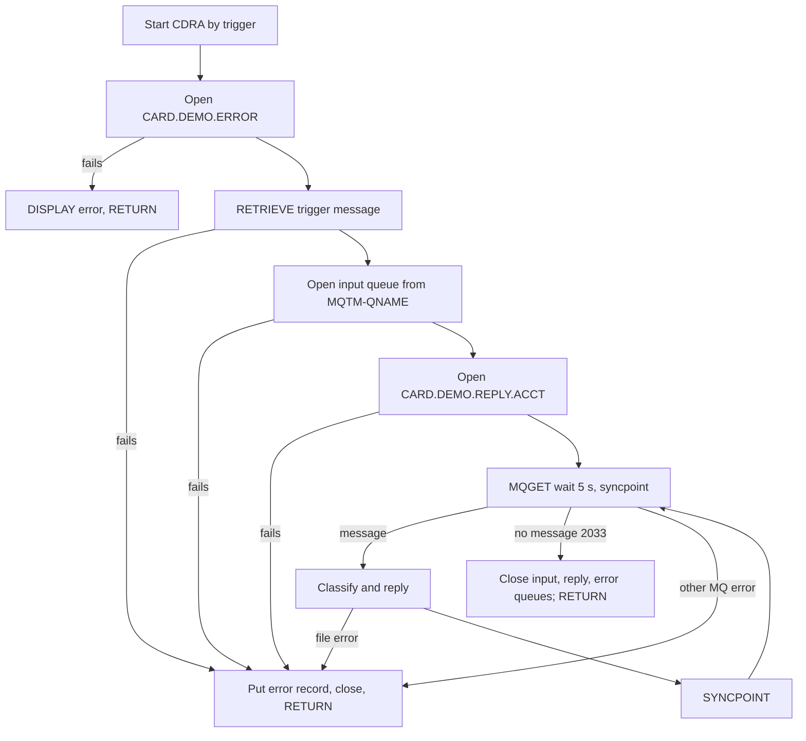
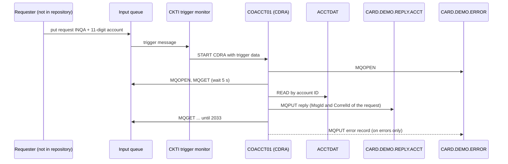

# COACCT01: Account inquiry over IBM MQ (CDRA)

## 1. Summary

COACCT01 is a CICS program (transaction `CDRA`) that serves account inquiries arriving as IBM MQ messages. It is meant to be started by the CICS-MQ trigger monitor when a request arrives on a queue: it reads the trigger message to learn the input queue's name, opens that queue, the fixed reply queue `CARD.DEMO.REPLY.ACCT` and the fixed error queue `CARD.DEMO.ERROR`, and then drains the input queue. For every request whose first four bytes are `INQA` and whose next eleven bytes are an account number above zero, it reads the account from the CICS file `ACCTDAT` and puts a 1000-byte text reply with eleven labelled account fields; for an unknown account or any other request it puts a 1000-byte "invalid request" text. It stops when no message arrives for 5 seconds. Any MQ or file error is written as a 1000-byte record to the error queue and ends the task. The program is a *server*; the module README describes it as the requester and documents different message layouts and queue names (DEF-MQAC-001). There is no authentication or authorisation of requesters (DEF-MQAC-004).

## 2. Rules at a glance

| ID | Rule |
| :-- | :-- |
| BR-MQAC-001 | A request is an account inquiry only when bytes 1-4 are exactly `INQA` and bytes 5-15 (account number) are greater than zero. |
| BR-MQAC-002 | For a found account the reply is a 252-character labelled text with the account's ID, status, balance, credit limit, cash limit, open/expiry/reissue dates, cycle credit and debit and group ID, padded with spaces to 1000 bytes. |
| BR-MQAC-003 | For an account that is not on file the reply is `INVALID REQUEST PARAMETERS ACCT ID : ` followed by the 11 key bytes. |
| BR-MQAC-004 | Any other request gets `INVALID REQUEST PARAMETERS ACCT ID : `, the 11 key bytes, `FUNCTION : ` and the 4 function bytes. |
| BR-MQAC-005 | The reply carries the request's message ID and correlation ID in its MQ descriptor; the reply body has no request identifier. |
| BR-MQAC-006 | Every reply goes to `CARD.DEMO.REPLY.ACCT`, whatever reply-to queue the request names. |
| BR-MQAC-007 | Exactly one reply per request processed, in input order; no reply when the task ends on an error. |
| VAL-MQAC-001 | Request classification (decision table: function code, key value, file response). |

## 3. Actors and triggers

- **Actor:** any application that can put a message on the input queue. The program does not look at the requester's identity (MQMD user ID or put application), so every requester is treated alike (DEF-MQAC-004).
- **Trigger (platform-inferred):** the CICS-MQ trigger monitor (CKTI) starts transaction `CDRA` with the trigger message as start data when the input queue's trigger condition is met. The program issues `EXEC CICS RETRIEVE INTO(MQTM)` and takes the input queue name from `MQTM-QNAME` (`:191-197`). The queue, its process definition (APPLICID `CDRA`) and the trigger type are not defined anywhere in the repository (Q-MQAC-001).
- **CICS definitions:** program `COACCT01` with `TRANSID(CDRA)` and transaction `CDRA` with `PROGRAM(COACCT01)`, profile `DFHCICST`, `RESSEC(NO) CMDSEC(NO)`, `ACTION(BACKOUT)` (`CRDDEMOM.csd:1-8, 17-26`). The file `ACCTDAT` comes from the base application's CSD (`app/csd/CARDDEMO.CSD:1-2`), not from this module's CSD.
- **Direct start:** typing `CDRA` on a terminal starts the program without start data; the RETRIEVE then fails and the task ends after writing an error record (ERR-MQAC-001).
- **Preconditions:** the CICS-MQ connection is active; `CARD.DEMO.ERROR`, `CARD.DEMO.REPLY.ACCT` and the input queue exist; `ACCTDAT` is open in CICS (it is closed during the base batch window).

## 4. Interfaces

### 4.1 MQ queues

| Queue | How the name is obtained | Open options | Use | Lines |
| :-- | :-- | :-- | :-- | :-- |
| Input queue | `MQTM-QNAME` of the trigger message | `MQOO-INPUT-SHARED + MQOO-SAVE-ALL-CONTEXT + MQOO-FAIL-IF-QUIESCING` | MQGET of requests, ENT-MQ-ACCT-REQUEST | 197, 222-253 |
| `CARD.DEMO.REPLY.ACCT` | literal | `MQOO-OUTPUT + MQOO-PASS-ALL-CONTEXT + MQOO-FAIL-IF-QUIESCING` | MQPUT of replies, ENT-MQ-ACCT-REPLY | 198, 255-287 |
| `CARD.DEMO.ERROR` | literal | `MQOO-OUTPUT + MQOO-PASS-ALL-CONTEXT + MQOO-FAIL-IF-QUIESCING` | MQPUT of error records, ENT-MQ-ERROR-MSG | 294, 289-322 |

All three opens use the queue manager connection handle `QMGR-HANDLE-CONN` = 0 and a blank queue manager name; MQGET, MQPUT and MQCLOSE use `MQ-HCONN` = 0 (`:44, 104, 226, 233, 260, 267, 295, 302, 352, 479, 516, 557, 579, 602`). Under CICS the handle is the task's default connection (platform-inferred).

### 4.2 Request message (ENT-MQ-ACCT-REQUEST)

| Bytes | Field | PIC | Meaning |
| :-- | :-- | :-- | :-- |
| 1-4 | `WS-FUNC` | X(4) | Function code; only `INQA` (upper case) is recognised |
| 5-15 | `WS-KEY` | 9(11) | Account number, 11 digits with leading zeros |
| 16-1000 | `WS-FILLER` | X(985) | Ignored |

The request is received into a 1000-byte buffer and copied whole into this layout (`:109-112, 342, 369, 373`). The MQMD of the request is used for its message ID and correlation ID (BR-MQAC-005); its reply-to queue is saved but not used (DEF-MQAC-002).

### 4.3 Reply message (ENT-MQ-ACCT-REPLY)

Always 1000 bytes, format `MQFMT-STRING`, character set of the queue manager (NUM-MQAC-003). The body is one of three texts:

| Case | Body (bytes 1-n, the rest spaces) | n | Item |
| :-- | :-- | --: | :-- |
| Account found | the labelled layout of NUM-MQAC-002 | 252 | BR-MQAC-002 |
| Account not found | `INVALID REQUEST PARAMETERS ACCT ID : ` + `WS-KEY` | 48 | BR-MQAC-003 |
| Not an inquiry | `INVALID REQUEST PARAMETERS ACCT ID : ` + `WS-KEY` + `FUNCTION : ` + `WS-FUNC` | 63 | BR-MQAC-004 |

### 4.4 Error record (ENT-MQ-ERROR-MSG)

`MQ-ERR-DISPLAY` (113 bytes, `:58-67`) padded with spaces to 1000 bytes and put on `CARD.DEMO.ERROR` (`:505-523`). Layout in NUM-MQAC-004, texts in section 8.2.

### 4.5 File

| CICS file | Entity | Operation | Key | Lines |
| :-- | :-- | :-- | :-- | :-- |
| `ACCTDAT` (literal `LIT-ACCTFILENAME` = `ACCTDAT ` with a trailing space, 8 bytes) | ENT-ACCOUNT | READ (no UPDATE, so no lock) into the 300-byte `ACCOUNT-RECORD` | `ACCT-ID`, 11 bytes, from `WS-KEY` | 115-116, 394-404 |

### 4.6 Console output

`DISPLAY MQ-ERR-DISPLAY` when the error queue cannot be opened (`:320`) or an error record cannot be put (`:534`). Under CICS a DISPLAY goes to the region's job log / LE output (platform-inferred). Incidental.

## 5. Data used

| Entity field | Read | Written | How |
| :-- | :-- | :-- | :-- |
| ENT-ACCOUNT.ACCT-ID | key, yes | no | key from `WS-KEY`; value copied to the reply |
| ENT-ACCOUNT.ACCT-ACTIVE-STATUS | yes | no | copied to the reply |
| ENT-ACCOUNT.ACCT-CURR-BAL | yes | no | copied to the reply, zoned with overpunch sign |
| ENT-ACCOUNT.ACCT-CREDIT-LIMIT | yes | no | copied to the reply |
| ENT-ACCOUNT.ACCT-CASH-CREDIT-LIMIT | yes | no | copied to the reply |
| ENT-ACCOUNT.ACCT-OPEN-DATE | yes | no | copied to the reply |
| ENT-ACCOUNT.ACCT-EXPIRAION-DATE | yes | no | copied to the reply |
| ENT-ACCOUNT.ACCT-REISSUE-DATE | yes | no | copied to the reply |
| ENT-ACCOUNT.ACCT-CURR-CYC-CREDIT | yes | no | copied to the reply |
| ENT-ACCOUNT.ACCT-CURR-CYC-DEBIT | yes | no | copied to the reply |
| ENT-ACCOUNT.ACCT-GROUP-ID | yes | no | copied to the reply |
| ENT-ACCOUNT.ACCT-ADDR-ZIP, FILLER | read with the record | no | not used |
| ENT-MQ-ACCT-REQUEST (all) | yes | no | section 4.2 |
| ENT-MQ-ACCT-REPLY (all) | no | yes | section 4.3 |
| ENT-MQ-ERROR-MSG (all) | no | yes | section 4.4 |

Program-local data with behaviour (`:13-169`):

- `PROGRAM-ID. COACCT01 IS INITIAL` (`:2`): working storage is set to its initial state on each entry; items without VALUE (`MQ-MSG-COUNT`, `MQ-BUFFER`) have no defined initial content, and the transaction is defined with `STORAGECLEAR(NO)` (`app/app-vsam-mq/csd/CRDDEMOM.csd:19`) (Q-MQAC-005; platform-inferred).
- `WS-MQ-MSG-FLAG` / `NO-MORE-MSGS` (`:13-14`): ends the drain loop.
- Queue-open flags (`:16-23`): `ERR-QUEUE-OPEN` for the error queue, `RESP-QUEUE-OPEN` for the reply queue and, by its name misleadingly, `REPLY-QUEUE-OPEN` for the **input** queue (`:245, 279, 314`; DEF-MQAC-009). They are never reset.
- `SAVE-MSGID`, `SAVE-CORELID` (`:55-56`): request IDs reused in the reply.
- `MQ-ERR-DISPLAY` (`:58-67`): the error record; its fields keep the values of the last MQ call between errors.
- `REQUEST-MSG-COPY` (`:109-112`), `WS-ACCT-RESPONSE` (`:130-169`), `WS-CARD-RID-ACCT-ID` / `-X` (`:126-128`).
- Declared but without effect: `WS-DATE-TIME` (`:35-38`, only initialised at `:392`), `QMGR-NAME`, `QUEUE-MESSAGE` (only blanked at `:180-183`), `MQ-QUEUE` (set, never passed to MQ), `MQ-QUEUE-REPLY`/`SAVE-REPLY2Q` (saved, never used), `MQ-MSG-COUNT` (incremented, never read; DEF-MQAC-011), `WS-CARD-RID-CARDNUM` and `WS-CARD-RID-CUST-ID` (`:122-125`), `WS-CICS-RESP2-CD-D` (always zero, DEF-MQAC-009).

## 6. Processing flow



Steps (`1000-CONTROL`, `:178-220`):

1. Blank the input queue name, queue manager name and `QUEUE-MESSAGE`; initialise the error record (`:180-185`).
2. Open the error queue `CARD.DEMO.ERROR` (`:187`, FLOW-MQAC-002).
3. Retrieve the trigger message; take the input queue name and set the reply queue name to `CARD.DEMO.REPLY.ACCT` (`:191-198`, FLOW-MQAC-001). On failure: ERR-MQAC-001.
4. Open the input queue, then the reply queue (`:212-213`).
5. Get the first request (`:214`, `3000-GET-REQUEST`), and process it if one arrived.
6. Repeat until no message arrives: `SYNCPOINT`, get the next request and process it (`:215-216`, `4000-MAIN-PROCESS` `:325-331`, FLOW-MQAC-003).
7. Terminate: close the input, reply and error queues and return to CICS (`:218`, FLOW-MQAC-004).

Per request (`3000-GET-REQUEST` `:334-388`, then `4000-PROCESS-REQUEST-REPLY` `:390-460`):

```
get next message (wait up to 5000 ms, under syncpoint, with conversion, buffer 1000)
if got a message:
    save its MsgId and CorrelId; copy the 1000-byte buffer into the request layout
    blank the reply
    if function = 'INQA' and key > 0:
        READ ACCTDAT with key
        NORMAL -> reply = labelled account text            (BR-MQAC-002)
        NOTFND -> reply = 'INVALID REQUEST PARAMETERS ACCT ID : ' + key   (BR-MQAC-003)
        other  -> error record 'ERROR WHILE READING ACCTF', end task     (ERR-MQAC-005)
    else:
        reply = 'INVALID REQUEST PARAMETERS ACCT ID : ' + key + 'FUNCTION : ' + function (BR-MQAC-004)
    put reply (1000 bytes) on CARD.DEMO.REPLY.ACCT
elif reason = 2033 (no message): stop the loop
else: error record 'INP MQGET ERR:', end task
```

## 7. Business rules

#### BR-MQAC-001 · What counts as an account inquiry
- **When:** a request message has been received; bytes 1-4 (`ENT-MQ-ACCT-REQUEST.WS-FUNC`) equal `INQA` exactly (upper case) and bytes 5-15 (`WS-KEY`, `9(11)`) compare greater than zero.
- **Then:** the account with that number is read (SE-MQAC-002) and the reply depends on the file response (BR-MQAC-002, BR-MQAC-003, ERR-MQAC-005).
- **Otherwise:** the request is answered with the invalid-request text of BR-MQAC-004; nothing is read.
- **Source:** `:393-404, 448-456`
- **Fidelity:** must-preserve · **Confidence:** reviewed

#### BR-MQAC-002 · Reply for a found account
- **When:** the account READ returns `NORMAL`.
- **Then:** the eleven account fields are copied unchanged into the reply layout (`ACCT-ID`, `ACCT-ACTIVE-STATUS`, `ACCT-CURR-BAL`, `ACCT-CREDIT-LIMIT`, `ACCT-CASH-CREDIT-LIMIT`, `ACCT-OPEN-DATE`, `ACCT-EXPIRAION-DATE`, `ACCT-REISSUE-DATE`, `ACCT-CURR-CYC-CREDIT`, `ACCT-CURR-CYC-DEBIT`, `ACCT-GROUP-ID`), each after its fixed label, with no separator after a value (NUM-MQAC-002). The 252-byte text is placed in the blanked 1000-byte reply and put (SE-MQAC-003). The ZIP code and the record's FILLER are not sent.
- **Source:** `:130-169, 407-427`
- **Fidelity:** must-preserve · **Confidence:** reviewed

#### BR-MQAC-003 · Reply for an unknown account
- **When:** the account READ returns `NOTFND`.
- **Then:** the reply is `INVALID REQUEST PARAMETERS ACCT ID : ` (37 characters) followed by the 11 bytes of `WS-KEY` as received, 48 characters, then spaces to 1000 bytes. Put as in SE-MQAC-003.
- **Source:** `:391, 428-435`
- **Fidelity:** must-preserve · **Confidence:** reviewed

#### BR-MQAC-004 · Reply for a request that is not an inquiry
- **When:** bytes 1-4 are not `INQA`, or the key is not greater than zero.
- **Then:** the reply is `INVALID REQUEST PARAMETERS ACCT ID : ` (37), the 11 key bytes as received, `FUNCTION : ` (11) and the 4 function bytes as received: 63 characters with no space between the key and `FUNCTION`, then spaces to 1000 bytes. Example for function `INQB`, key `00000000001`: `INVALID REQUEST PARAMETERS ACCT ID : 00000000001FUNCTION : INQB`.
- **Source:** `:391, 448-456`
- **Fidelity:** must-preserve · **Confidence:** reviewed

#### BR-MQAC-005 · Reply correlation
- **When:** a reply is put.
- **Then:** the reply's MQMD message ID is set to the **request's message ID** and its correlation ID to the **request's correlation ID** (both 24 bytes, saved at get time). The reply body contains no request identifier, so a requester can match a reply only through these descriptor fields. All other MQMD fields except Format (`MQFMT-STRING`, `:471`) and CodedCharSetId (`MQCCSI-Q-MGR`, `:473`) keep the values they had after the MQGET of the request (DEF-MQAC-003).
- **Source:** `:364-365, 370, 372, 469-473`
- **Fidelity:** must-preserve (the requester depends on it) · **Confidence:** platform-inferred (MQMD semantics)

#### BR-MQAC-006 · Fixed reply queue
- **When:** the program starts successfully.
- **Then:** all replies are put on `CARD.DEMO.REPLY.ACCT`. The request's reply-to queue (`MQMD-REPLYTOQ`) is saved in `SAVE-REPLY2Q` but never used (DEF-MQAC-002).
- **Source:** `:198, 261, 366, 371, 479-480`
- **Fidelity:** must-preserve (or change by decision, Q-MQAC-002) · **Confidence:** reviewed

#### BR-MQAC-007 · One reply per request, in arrival order
- **When:** the drain loop runs.
- **Then:** requests are taken one at a time in queue order (any message ID, any correlation ID) and each gets exactly one reply before the next is read. The loop ends when a get waits 5 seconds without a message. If any error ends the task (section 10), the request being processed gets no reply and later requests stay on the queue.
- **Source:** `:214-216, 325-331, 337, 343-344, 374`
- **Fidelity:** must-preserve · **Confidence:** reviewed

## 8. Validations and messages

#### VAL-MQAC-001 · Request classification (decision table)

| Bytes 1-4 | Bytes 5-15 | `ACCTDAT` READ | Reply / effect | Item |
| :-- | :-- | :-- | :-- | :-- |
| `INQA` | > 0 | NORMAL | labelled account text | BR-MQAC-002 |
| `INQA` | > 0 | NOTFND | `INVALID REQUEST PARAMETERS ACCT ID : <key>` | BR-MQAC-003 |
| `INQA` | > 0 | any other response | no reply; error record `ERROR WHILE READING ACCTF`; task ends | ERR-MQAC-005 |
| `INQA` | zero (`00000000000`) | not read | `INVALID REQUEST PARAMETERS ACCT ID : 00000000000FUNCTION : INQA` | BR-MQAC-004 |
| anything else (including `inqa`, spaces) | any | not read | `INVALID REQUEST PARAMETERS ACCT ID : <key>FUNCTION : <func>` | BR-MQAC-004 |
| any | not numeric | (see DEF-MQAC-005) | undefined: the comparison with zero may raise a data exception | DEF-MQAC-005 |

- **When:** each request received.
- **Then:** as in the table. No other check is made: the key is not tested for numeric content, the request length (`MQ-DATA-LENGTH`) is not tested (DEF-MQAC-006), and the requester is not identified.
- **Source:** `:393-456`
- **Fidelity:** must-preserve · **Confidence:** reviewed

### 8.1 Reply texts (to `CARD.DEMO.REPLY.ACCT`)

| Text (exact) | Length | Cause |
| :-- | --: | :-- |
| `ACCOUNT ID : ` | 13 | label, found account |
| `ACCOUNT STATUS : ` | 17 | label |
| `BALANCE : ` | 10 | label |
| `CREDIT LIMIT : ` | 15 | label |
| `CASH LIMIT : ` | 13 | label |
| `OPEN DATE : ` | 12 | label |
| `EXPR DATE : ` | 12 | label |
| `REIS DATE : ` | 12 | label |
| `CREDIT BAL : ` | 13 | label |
| `DEBIT BAL : ` | 12 | label |
| `GROUP ID : ` | 11 | label |
| `INVALID REQUEST PARAMETERS ` | 27 | not found and not an inquiry |
| `ACCT ID : ` | 10 | not found and not an inquiry |
| `FUNCTION : ` | 11 | not an inquiry |

Every label ends with a space after the colon; values follow immediately and the next label follows the value immediately.

### 8.2 Error record texts (to `CARD.DEMO.ERROR`, field `MQ-APPL-RETURN-MESSAGE`, 25 bytes)

| Text in the record (exact) | Paragraph field (25) | Queue name field (48) | Cause | Item |
| :-- | :-- | :-- | :-- | :-- |
| `RESP: ` + 8-digit RESP + `00000000` + `END` (25 bytes) | `CICS RETREIVE` (sic) | spaces | RETRIEVE failed | ERR-MQAC-001 |
| `ERR MQOPEN ERR` | spaces | `CARD.DEMO.ERROR` | error queue open failed (DISPLAY only, not put) | ERR-MQAC-002 |
| `INP MQOPEN ERR` | spaces | input queue name | input queue open failed | ERR-MQAC-003 |
| `OUT MQOPEN ERR` | spaces | `CARD.DEMO.REPLY.ACCT` | reply queue open failed | ERR-MQAC-003 |
| `INP MQGET ERR:` | spaces | input queue name | MQGET failed, reason not 2033 | ERR-MQAC-004 |
| `ERROR WHILE READING ACCTF` (the 28-character literal `ERROR WHILE READING ACCTFILE` truncated to 25) | spaces | input queue name | READ response other than NORMAL/NOTFND | ERR-MQAC-005 |
| `MQPUT ERR` | spaces | `CARD.DEMO.REPLY.ACCT` | reply put failed | ERR-MQAC-006 |
| `MQPUT ERR` | spaces | `CARD.DEMO.ERROR` | error put failed (DISPLAY only) | ERR-MQAC-007 |
| `MQCLOSE ERR` | spaces | `CARD.DEMO.ERROR` | error queue close failed (put, then loop) | ERR-MQAC-008 |
| `MQCLOSE ERR` | spaces | input queue name | input or reply queue close failed (not put; loop) | ERR-MQAC-008 |

"spaces" in the paragraph field: `MQ-ERROR-PARA` is set only by the RETRIEVE failure path (`:200`); otherwise it keeps the spaces from the INITIALIZE at `:185`.

### 8.3 Flow

#### FLOW-MQAC-001 · Start from the trigger message
- **When:** the task starts.
- **Then:** after opening the error queue, the program retrieves the CICS start data into the MQ trigger message structure `MQTM` (from IBM copybook `CMQTML`, not in the repository) and takes `MQTM-QNAME` (48 bytes) as the input queue name. The reply queue name is set to `CARD.DEMO.REPLY.ACCT`. The trigger message's other fields (process name, user data, trigger data) are not used.
- **Otherwise:** RETRIEVE response not NORMAL: ERR-MQAC-001.
- **Source:** `:178-198`
- **Fidelity:** must-preserve (start mechanism) · **Confidence:** platform-inferred (CKTI passes the character form MQTMC2, whose queue name is at the same offset 9-56 as in MQTM; Q-MQAC-004)

#### FLOW-MQAC-002 · Open order
- **When:** the task starts.
- **Then:** open `CARD.DEMO.ERROR` for output (before the RETRIEVE), then the input queue for shared input, then `CARD.DEMO.REPLY.ACCT` for output. Each successful open stores its object handle and sets its open flag; any failure ends the task (ERR-MQAC-002, ERR-MQAC-003).
- **Source:** `:187, 212-213, 222-253, 255-287, 289-322`
- **Fidelity:** incidental (order) · **Confidence:** reviewed

#### FLOW-MQAC-003 · Drain loop
- **When:** the three queues are open.
- **Then:** get one request; while the "no more messages" flag is not set: commit (`EXEC CICS SYNCPOINT`), get the next request. Each get waits up to 5000 ms; reason `MQRC-NO-MSG-AVAILABLE` (2033) sets the flag and ends the loop. A successful get is processed immediately inside the get paragraph (BR-MQAC-001) and adds 1 to `MQ-MSG-COUNT`. The commit for the last processed request happens at the next loop iteration's SYNCPOINT, or at task end.
- **Source:** `:214-216, 325-331, 334-388`
- **Fidelity:** must-preserve (one task drains the queue; 5-second idle limit) · **Confidence:** platform-inferred (wait and reason-code semantics)

#### FLOW-MQAC-004 · Termination
- **When:** the loop ends, or any error path calls it.
- **Then:** if the input queue is open (flag `REPLY-QUEUE-OPEN`) close it; if the reply queue is open (`RESP-QUEUE-OPEN`) close it; if the error queue is open (`ERR-QUEUE-OPEN`) close it; all with `MQCO-NONE`; then `EXEC CICS RETURN`. The `GOBACK` after it is never reached. A normal CICS RETURN ends the task and commits its unit of work (SE-MQAC-005).
- **Source:** `:218, 538-550`
- **Fidelity:** must-preserve (commit at end) · **Confidence:** platform-inferred (commit on RETURN)

## 9. Side effects

In execution order for one request. Everything is in one CICS unit of work per loop iteration; MQ gets and puts are under syncpoint, the file read takes no lock.

#### SE-MQAC-001 · Get the request
- **What:** MQGET on the input queue with `MQGMO-SYNCPOINT + MQGMO-FAIL-IF-QUIESCING + MQGMO-CONVERT + MQGMO-WAIT`, wait interval 5000 ms, buffer length 1000, message ID `MQMI-NONE` and correlation ID `MQCI-NONE` (next message, no selection). The message is removed from the queue when the unit of work commits; on a task abend it is backed out to the queue. The 1000-byte buffer is copied whole into the request layout; the returned data length is ignored (DEF-MQAC-006).
- **Source:** `:337-373`
- **Fidelity:** must-preserve · **Confidence:** platform-inferred

#### SE-MQAC-002 · Read the account
- **What:** `EXEC CICS READ` file `ACCTDAT `, key `WS-CARD-RID-ACCT-ID-X` (11 bytes, from `WS-KEY`), `KEYLENGTH` 11, into `ACCOUNT-RECORD`, length 300; response in `WS-RESP-CD`, `WS-REAS-CD`. No UPDATE, so no record lock and nothing to release. Only for an inquiry (BR-MQAC-001).
- **Source:** `:394-404`
- **Fidelity:** must-preserve · **Confidence:** reviewed

#### SE-MQAC-003 · Put the reply
- **What:** MQPUT on the reply queue handle: buffer = 1000-byte reply, length 1000, MQMD message ID and correlation ID from the request (BR-MQAC-005), `MQMD-FORMAT` = `MQFMT-STRING`, `MQMD-CODEDCHARSETID` = `MQCCSI-Q-MGR`, options `MQPMO-SYNCPOINT + MQPMO-DEFAULT-CONTEXT + MQPMO-FAIL-IF-QUIESCING`. The reply becomes visible when the unit of work commits.
- **Source:** `:462-499`
- **Fidelity:** must-preserve · **Confidence:** platform-inferred

#### SE-MQAC-004 · Put an error record
- **What:** MQPUT on the error queue handle: `MQ-ERR-DISPLAY` padded with spaces to 1000 bytes, length 1000, `MQFMT-STRING`, CCSID of the queue manager, the same put options as SE-MQAC-003. Message ID and correlation ID are not set: they are whatever the shared MQMD holds (the current request's IDs after a get, DEF-MQAC-003; before the first get, the initial descriptor values, so the queue manager generates a message ID, platform-inferred). Committed by the CICS RETURN that follows, unless termination loops on a failed close (DEF-MQAC-008).
- **Source:** `:501-523`
- **Fidelity:** must-preserve (operations rely on the error queue) · **Confidence:** platform-inferred

#### SE-MQAC-005 · Commit points
- **What:** `EXEC CICS SYNCPOINT` at the start of each loop iteration commits the previous request's get and its reply; the CICS RETURN at the end commits the rest, including, on an error path, the get of the failed request and the error record. The transaction definition has `ACTION(BACKOUT)`; an abend backs out the uncommitted get and puts (platform-inferred).
- **Source:** `:326-328, 549`; `CRDDEMOM.csd:23`
- **Fidelity:** must-preserve · **Confidence:** platform-inferred

## 10. Error handling

#### ERR-MQAC-001 · Trigger data cannot be retrieved
- **When:** `EXEC CICS RETRIEVE` returns a response other than NORMAL (for example when `CDRA` is started from a terminal or by a START without data).
- **Then:** paragraph field = `CICS RETREIVE`; the RESP value is moved to the 8-digit display field; RESP2 is moved to itself, so its display field stays zero (DEF-MQAC-009); the return-message field gets `RESP: ` + 8 digits + `00000000` + `END`, exactly 25 bytes. The record is put on the error queue (ERR-MQAC-007 if that fails), then termination closes the error queue and returns. Condition and reason code fields hold the values of the error queue open (normally `00` and `00000`); the queue name field is spaces.
- **Source:** `:196-210`
- **Fidelity:** incidental (texts), must-preserve (task ends, no queue touched) · **Confidence:** reviewed; RESP values platform-inferred

#### ERR-MQAC-002 · Error queue cannot be opened
- **When:** MQOPEN of `CARD.DEMO.ERROR` returns a condition code other than `MQCC-OK`.
- **Then:** condition code, reason code, queue name `CARD.DEMO.ERROR` and `ERR MQOPEN ERR` go into the error record, which is only written to the console (DISPLAY), then termination: no queue is open, so the task returns at once. Nothing is put anywhere.
- **Source:** `:309-321`
- **Fidelity:** incidental · **Confidence:** reviewed

#### ERR-MQAC-003 · Input or reply queue cannot be opened
- **When:** MQOPEN of the input queue (`INP MQOPEN ERR`, queue name = input queue) or of `CARD.DEMO.REPLY.ACCT` (`OUT MQOPEN ERR`, queue name = reply queue) fails.
- **Then:** the error record (condition code, reason code, queue name, text) is put on the error queue, then termination closes whatever is open and returns. No request is read.
- **Source:** `:240-253, 274-287`
- **Fidelity:** must-preserve (error record) · **Confidence:** reviewed

#### ERR-MQAC-004 · Get fails
- **When:** MQGET returns a condition code other than OK and a reason other than 2033 (for example 2080, message longer than 1000 bytes; DEF-MQAC-012).
- **Then:** error record `INP MQGET ERR:` with the input queue name, put; termination; return. The previous request was already committed by the SYNCPOINT before the get (`:326-328`). The RETURN commits the error record, and also the failed get if the queue manager removed the message (for example a warning such as a data-conversion failure: the request is then consumed with no reply). For 2080 the message stays on the queue (DEF-MQAC-012).
- **Source:** `:326-330, 376-388`
- **Fidelity:** must-preserve · **Confidence:** platform-inferred (reason codes)

#### ERR-MQAC-005 · Account file error
- **When:** the account READ returns a response other than NORMAL and NOTFND (for example NOTOPEN or DISABLED during the batch window, LENGERR, IOERR).
- **Then:** the error record's condition-code field (2 digits) gets the CICS RESP value and the reason-code field (5 digits) the RESP2 value, both as unsigned values truncated to their field sizes; the queue name field gets the **input** queue name; the text is `ERROR WHILE READING ACCTF`. The record is put on the error queue and the task terminates. **No reply is sent** for this request; the request is consumed (the RETURN commits the get), and the remaining requests stay on the queue (DEF-MQAC-007).
- **Source:** `:437-447`
- **Fidelity:** defect-decide (Q-MQAC-006) · **Confidence:** reviewed; commit platform-inferred

#### ERR-MQAC-006 · Reply cannot be put
- **When:** MQPUT of a reply fails.
- **Then:** error record `MQPUT ERR` with queue name `CARD.DEMO.REPLY.ACCT`, put on the error queue; termination; return. The request is consumed without a reply.
- **Source:** `:488-499`
- **Fidelity:** must-preserve · **Confidence:** reviewed

#### ERR-MQAC-007 · Error record cannot be put
- **When:** MQPUT on the error queue fails.
- **Then:** the record is rewritten with the new condition and reason codes, queue name `CARD.DEMO.ERROR` and `MQPUT ERR`, written to the console (DISPLAY) and termination runs. The original error text is lost (the return-message field is overwritten).
- **Source:** `:525-536`
- **Fidelity:** incidental · **Confidence:** reviewed

#### ERR-MQAC-008 · Close fails

| Close of | Error record | Put? | Next |
| :-- | :-- | :-- | :-- |
| Input queue (`5000-CLOSE-INPUT-QUEUE`) | `MQCLOSE ERR`, input queue name | no | termination again (DEF-MQAC-008) |
| Reply queue (`5100-CLOSE-OUTPUT-QUEUE`) | `MQCLOSE ERR`, **input** queue name (DEF-MQAC-009) | no | termination again |
| Error queue (`5200-CLOSE-ERROR-QUEUE`) | `MQCLOSE ERR`, `CARD.DEMO.ERROR` | yes, on the queue whose close failed | termination again |

- **Source:** `:552-573, 574-595, 597-619`
- **Fidelity:** defect-decide · **Confidence:** reviewed; loop outcome platform-inferred

#### ERR-MQAC-009 · Unhandled conditions
- **What:** no `HANDLE ABEND` or `HANDLE CONDITION`. The READ and RETRIEVE use RESP, so their conditions do not abend; a data exception (DEF-MQAC-005, DEF-MQAC-011) or a CICS SYNCPOINT failure abends the task, and CICS backs out the uncommitted get and puts (`ACTION(BACKOUT)`).
- **Source:** `:191-195, 326-328, 396-404`
- **Fidelity:** incidental · **Confidence:** platform-inferred

## 11. Interactions



- **Inbound:** a trigger on the input queue (platform-inferred); no program in the repository puts requests on it. The requester described by the README is not in the repository (DEF-MQAC-001).
- **Outbound:** none (no LINK, XCTL or CALL other than the MQ API).
- **Shared data:** `ACCTDAT` (ENT-ACCOUNT) is read and updated online by `COACTUPC` and `COBIL00C` and in batch by POSTTRAN (`CBTRN02C`) and INTCALC (`CBACT04C`). COACCT01 reads without a lock, so a reply can show a balance that is being changed. During the batch window the file is closed in CICS and every inquiry ends the task with ERR-MQAC-005.
- **Shared queue:** `CARD.DEMO.ERROR` is shared with CODATE01 ; records from both programs have the same layout and cannot be told apart except by the queue name field and the texts (SE-MQDT-003).

### Module extraction notes

| Boundary | Contract |
| :-- | :-- |
| Request | 1000-byte (or shorter) text message; bytes 1-4 function `INQA`, bytes 5-15 account number. |
| Reply | 1000-byte `MQSTR` on `CARD.DEMO.REPLY.ACCT`; MsgId and CorrelId copied from the request; three body formats (section 4.3). |
| Errors | 1000-byte record on `CARD.DEMO.ERROR` (NUM-MQAC-004). |
| Account data | Read-only access to ENT-ACCOUNT by `ACCT-ID`. A replacement service can read the target account store directly; it changes no data. |
| Availability | Fails (no reply) while `ACCTDAT` is closed for batch. |

## 12. Numeric, date and format details

#### NUM-MQAC-001 · Request layout
- 1-4 function `X(4)`, 5-15 key `9(11)` unsigned zoned decimal (digits only expected), 16-1000 ignored. The key is moved to the numeric `WS-CARD-RID-ACCT-ID` (`9(11)`) and the read uses its character redefinition, so the 11 key bytes go to CICS as received (a numeric-to-numeric move of an unsigned field may force the zone of the last byte on the mainframe; platform-inferred).
- **Source:** `:109-112, 126-128, 394, 398-399`

#### NUM-MQAC-002 · Found-account reply layout
| Bytes | Content | PIC | Notes |
| :-- | :-- | :-- | :-- |
| 1-13 | `ACCOUNT ID : ` | X(13) | |
| 14-24 | `ACCT-ID` | 9(11) | digits |
| 25-41 | `ACCOUNT STATUS : ` | X(17) | |
| 42 | `ACCT-ACTIVE-STATUS` | X(1) | |
| 43-52 | `BALANCE : ` | X(10) | |
| 53-64 | `ACCT-CURR-BAL` | S9(10)V99 | 12 digits, implied 2 decimals, sign overpunched on the last digit |
| 65-79 | `CREDIT LIMIT : ` | X(15) | |
| 80-91 | `ACCT-CREDIT-LIMIT` | S9(10)V99 | as above |
| 92-104 | `CASH LIMIT : ` | X(13) | |
| 105-116 | `ACCT-CASH-CREDIT-LIMIT` | S9(10)V99 | as above |
| 117-128 | `OPEN DATE : ` | X(12) | |
| 129-138 | `ACCT-OPEN-DATE` | X(10) | as stored (`YYYY-MM-DD` in the sample data) |
| 139-150 | `EXPR DATE : ` | X(12) | |
| 151-160 | `ACCT-EXPIRAION-DATE` | X(10) | |
| 161-172 | `REIS DATE : ` | X(12) | |
| 173-182 | `ACCT-REISSUE-DATE` | X(10) | |
| 183-195 | `CREDIT BAL : ` | X(13) | |
| 196-207 | `ACCT-CURR-CYC-CREDIT` | S9(10)V99 | as above |
| 208-219 | `DEBIT BAL : ` | X(12) | |
| 220-231 | `ACCT-CURR-CYC-DEBIT` | S9(10)V99 | as above |
| 232-242 | `GROUP ID : ` | X(11) | |
| 243-252 | `ACCT-GROUP-ID` | X(10) | |
| 253-1000 | spaces | | from the blanked reply |

- Amounts are **not edited**: no decimal point, no separate sign; for example 194.00 is `00000001940{` in the ASCII form of the sample data (`{` = positive 0). After queue-manager conversion of an EBCDIC overpunch (x'C0') to ASCII the receiver sees `{`; the receiver has to decode the overpunch itself.
- **Source:** `:130-169, 407-426`

#### NUM-MQAC-003 · Message size and format
- Reply and error records are always put with length 1000, `MQFMT-STRING`, `MQCCSI-Q-MGR`; the unused tail is spaces. Requests are read into a 1000-byte buffer; a longer request fails the get (DEF-MQAC-012). The get asks for conversion (`MQGMO-CONVERT`) to the CCSID and encoding currently in the shared MQMD (platform-inferred).
- **Source:** `:342, 347-350, 467-473, 505-510`

#### NUM-MQAC-004 · Error record layout
| Bytes | Field | PIC | Content |
| :-- | :-- | :-- | :-- |
| 1-25 | `MQ-ERROR-PARA` | X(25) | `CICS RETREIVE` on the RETRIEVE path, otherwise spaces |
| 26-27 | FILLER | X(2) | spaces |
| 28-52 | `MQ-APPL-RETURN-MESSAGE` | X(25) | text, section 8.2 |
| 53-54 | FILLER | X(2) | spaces |
| 55-56 | `MQ-APPL-CONDITION-CODE` | 9(2) | MQ condition code (`00`, `01`, `02`) or, for ERR-MQAC-005, the CICS RESP value modulo 100 |
| 57-58 | FILLER | X(2) | spaces |
| 59-63 | `MQ-APPL-REASON-CODE` | 9(5) | MQ reason code (for example `02085`) or, for ERR-MQAC-005, RESP2 modulo 100000 |
| 64-65 | FILLER | X(2) | spaces |
| 66-113 | `MQ-APPL-QUEUE-NAME` | X(48) | queue name, section 8.2 |
| 114-1000 | | | spaces |

- Numeric fields are unsigned display: a negative value loses its sign, a value too large loses its leading digits.
- **Source:** `:58-67, 505-507`

## 13. Known defects and oddities

#### DEF-MQAC-001 · The README describes a different program
- The module README says CDRA is run "in CICS with an account number", sends a request to `CARDDEMO.REQUEST.QUEUE` and displays the response, with request `ACCT-REQUEST-MSG` (`REQUEST-TYPE` `ACCT`, `REQUEST-ID` X(8), `ACCOUNT-NUMBER` X(11)) and response `ACCT-RESPONSE-MSG` (`RESPONSE-TYPE` `ACCT`, `RESPONSE-ID` X(8), `ACCOUNT-DATA` X(300)), and lists the queue definitions `CARDDEMO.REQUEST.QUEUE` / `CARDDEMO.RESPONSE.QUEUE`. The code is a trigger-started server: it uses function `INQA` + 11-digit key, the queues `CARD.DEMO.REPLY.ACCT` and `CARD.DEMO.ERROR`, and a 1000-byte labelled text reply; it has no terminal interaction. The README gives the serving role to an unnamed "listener program" (README `:83, 92`), which is what COACCT01 actually does.
- **Source:** `app/app-vsam-mq/README.md:50-55, 67-73, 83, 86-93, 114-128`; code `:191-198, 109-112, 130-169`
- **Status:** open · **Fidelity:** defect-decide (Q-MQAC-007) · **Confidence:** reviewed

#### DEF-MQAC-002 · Request's reply-to queue is ignored
- `MQMD-REPLYTOQ` (and the reply-to queue manager) of the request are not used; every reply goes to `CARD.DEMO.REPLY.ACCT`. Several requesters sharing that queue must filter by message or correlation ID.
- **Source:** `:198, 366, 371`
- **Status:** open · **Fidelity:** defect-decide (Q-MQAC-002) · **Confidence:** reviewed

#### DEF-MQAC-003 · Reply descriptor copied from the request
- The same MQMD structure is used for the get and the put. The reply gets the request's message ID (instead of a new one) and the request's correlation ID (instead of the usual "correlation ID = request message ID"), and inherits the request's message type, persistence, priority, expiry, report options and reply-to fields. Error records also inherit the current request's IDs. A requester that waits for `CorrelId = its MsgId` finds the reply only if it set the request's correlation ID to the same value itself.
- **Source:** `:343-344, 364-365, 469-473, 505-510`
- **Status:** open · **Fidelity:** defect-decide (Q-MQAC-002) · **Confidence:** platform-inferred

#### DEF-MQAC-004 · [security] No authentication or authorisation
- Any application that can put on the input queue can read the balance, limits, dates and group of any account by number; the requester's identity is not checked and the CICS transaction has `RESSEC(NO) CMDSEC(NO)`. Replies for all requesters land on one shared queue, so any reader of `CARD.DEMO.REPLY.ACCT` sees everyone's replies. Protection depends entirely on MQ queue security outside the repository.
- **Source:** `:393-427, 198`; `CRDDEMOM.csd:24`
- **Status:** open · **Fidelity:** defect-decide (Q-MQAC-003) · **Confidence:** reviewed

#### DEF-MQAC-005 · Account key is not validated
- `WS-KEY > ZEROES` is a numeric comparison on data that came from a message. Spaces or letters in bytes 5-15 make the comparison undefined: on the mainframe it can raise a data exception (abend ASRA, the request is backed out and retried with the next trigger), or it can pass and send the raw bytes as the key (then normally NOTFND). Only an 11-digit key with leading zeros finds an account; `INQA1` followed by spaces is not padded.
- **Source:** `:111, 393-394`
- **Status:** open · **Confidence:** platform-inferred

#### DEF-MQAC-006 · Request length is ignored
- The returned data length is not used and the 1000-byte buffer is not cleared before the get. A request shorter than 15 bytes leaves its missing function or key bytes as whatever the buffer held before: after the first reply, that is the previous reply's text (`MQ-BUFFER` = last reply); for the first request, the buffer's initial storage. The `INITIALIZE REQUEST-MSG-COPY REPLACING NUMERIC BY ZEROES` before each get (`:345`) and the blanking of `MQ-CORRELID`/`MQ-MSG-ID` (`:338-339`) have no effect: `:373` overwrites the whole layout from the uncleared buffer.
- **Source:** `:50-51, 338-339, 342, 345, 352-360, 369, 373, 467`
- **Status:** open · **Confidence:** platform-inferred

#### DEF-MQAC-007 · A file error loses the request and stops the server
- On a READ response other than NORMAL/NOTFND the task writes an error record and returns. The return commits the get, so the request disappears with no reply; the requester waits forever. Later requests stay on the queue until the next trigger, and while `ACCTDAT` is closed every trigger loses one more request. The error record holds a CICS RESP in a field named condition code and the input queue name instead of the file name, and the text is truncated to `ERROR WHILE READING ACCTF`. The commented-out `PERFORM SEND-LONG-TEXT` (`:446`) suggests a terminal reply was planned.
- **Source:** `:437-447`
- **Status:** open · **Fidelity:** defect-decide (Q-MQAC-006) · **Confidence:** reviewed; commit platform-inferred

#### DEF-MQAC-008 · Close failure can loop
- The open flags are never reset. When a close fails, the close paragraph performs termination again, which tries the same close again (and, for the error queue, first puts an error record on the queue it could not close). If the failure repeats, the task loops through termination without reaching the RETURN, until CICS purges it (runaway or operator action).
- **Source:** `:540-548, 567-572, 589-594, 612-618`
- **Status:** open · **Fidelity:** defect-decide · **Confidence:** platform-inferred

#### DEF-MQAC-009 · Copy-paste and naming slips
- The input queue's open flag is `REPLY-QUEUE-OPEN` (works, because termination tests the same flag, `:245, 540`). The reply-queue close error reports the input queue name (`:592`). The RETRIEVE error spells the paragraph field `CICS RETREIVE` (`:200`). RESP2 is moved to itself instead of to its display field (`:202`), so the error record always shows `00000000` for RESP2.
- **Source:** `:200-202, 245, 592`
- **Status:** open · **Fidelity:** incidental · **Confidence:** reviewed

#### DEF-MQAC-010 · Context options have no effect
- The input queue is opened with `MQOO-SAVE-ALL-CONTEXT` and the output queues with `MQOO-PASS-ALL-CONTEXT`, but every put uses `MQPMO-DEFAULT-CONTEXT`, so the queue manager sets the reply's identity and origin context to the CICS task's; the requester's context is not passed.
- **Source:** `:229-231, 263-265, 298-300, 475-477, 512-514`
- **Status:** open · **Fidelity:** incidental · **Confidence:** platform-inferred

#### DEF-MQAC-011 · Message counter has no initial value
- `MQ-MSG-COUNT PIC 9(09)` has no VALUE clause and is incremented after each processed request (`:375`) but never read. If its initial storage is not valid zoned decimal (binary zeros or spaces), the ADD can raise a data exception after the reply was put, which backs out the get and the reply and makes the request reappear (Q-MQAC-005).
- **Source:** `:54, 375`
- **Status:** open · **Confidence:** platform-inferred

#### DEF-MQAC-012 · Requests longer than 1000 bytes block the queue
- The get does not accept truncated messages. A request longer than 1000 bytes fails with a warning (reason 2080) and stays on the queue; the task writes `INP MQGET ERR:` and ends. Every later trigger meets the same message first, so the queue is blocked until it is removed by hand.
- **Source:** `:342, 347-350, 376-386`
- **Status:** open · **Confidence:** platform-inferred

#### DEF-MQAC-013 · CICS definitions copied from another module
- Both program definitions in `CRDDEMOM.csd` carry `DESCRIPTION(LIST CARDS)`. The CSD defines no MQ connection, queue, process or file; the `ACCTDAT` file and the trigger setup must come from elsewhere.
- **Source:** `CRDDEMOM.csd:1-2, 9-10`
- **Status:** open · **Fidelity:** incidental · **Confidence:** reviewed

#### DEF-MQAC-014 · Reply has no status field
- The three reply bodies are free text; a requester must recognise `ACCOUNT ID : ` or `INVALID REQUEST PARAMETERS ` at the start to know which case it got. "Account not found" and "not an inquiry" share the same prefix.
- **Source:** `:426, 429-430, 449-451`
- **Status:** open · **Fidelity:** defect-decide (Q-MQAC-008) · **Confidence:** reviewed

## 14. Open questions

| ID | Question | For |
| :-- | :-- | :-- |
| Q-MQAC-001 | Which queue triggers `CDRA` (name, trigger type FIRST or EVERY, process definition), and where are these MQ definitions kept? | mainframe team |
| Q-MQAC-002 | Should the target reply to the request's reply-to queue and follow the usual "CorrelId = request MsgId" convention (DEF-MQAC-002, DEF-MQAC-003), or must existing requesters keep the current descriptor behaviour? | architecture, integration owners |
| Q-MQAC-003 | Who may request account data, and must the target authenticate and authorise requesters (DEF-MQAC-004)? | security, business |
| Q-MQAC-004 | Does the CKTI trigger monitor in the target region pass MQTMC2 to `CDRA`, and does `CMQTML` define `MQTM` so that `MQTM-QNAME` lines up with its queue name? | mainframe team |
| Q-MQAC-005 | What is the initial content of working-storage items without VALUE (`MQ-MSG-COUNT`) in this region and compile, and does the ADD abend (DEF-MQAC-011)? | mainframe team |
| Q-MQAC-006 | On a file error, should the requester receive an error reply and should the request be kept for retry instead of being consumed (DEF-MQAC-007)? | business, operations |
| Q-MQAC-007 | Which message contract is authoritative for existing requesters: the code (`INQA`, labelled text) or the README (`ACCT` + request ID, 300-byte account data)? | business, integration owners |
| Q-MQAC-008 | Must the target keep the labelled text reply with unedited overpunched amounts, or may it send a structured reply? | architecture |

## 15. Equivalence contract

The independent review of this spec is recorded in `docs/modernization/spec/evidence/f-trantype-vsam-mq-review.md`.

A reimplementation must reproduce, for each request: which queue receives a message, the exact 1000 bytes of the reply or error record, the reply's message ID and correlation ID (BR-MQAC-005), the order of replies, and whether the request is consumed. It may differ in: console (DISPLAY) output, MQ context fields, the loop mechanics (5-second idle wait) as long as each request gets the same single reply, and the error records for platform failures (open, close, put) that the target replaces. These scenarios cannot run locally (no CICS, MQ or trigger monitor); they become acceptance tests for the target.

Notation: `+n spaces` pads to 1000 bytes. Account `00000000001` is the first record of the sample data (`app/data/ASCII/acctdata.txt:1`): status `Y`, balance 194.00, credit limit 2020.00, cash limit 1020.00, open date 2014-11-20, expiry and reissue 2025-05-20, cycle credit and debit 0, group ID spaces.

| # | Request bytes 1-15 (MQMD MsgId / CorrelId) | Account file | Expected |
| --: | :-- | :-- | :-- |
| S1 | `INQA00000000001` (M1 / C1) | sample | reply on `CARD.DEMO.REPLY.ACCT`, MsgId M1, CorrelId C1: `ACCOUNT ID : 00000000001ACCOUNT STATUS : YBALANCE : 00000001940{CREDIT LIMIT : 00000020200{CASH LIMIT : 00000010200{OPEN DATE : 2014-11-20EXPR DATE : 2025-05-20REIS DATE : 2025-05-20CREDIT BAL : 00000000000{DEBIT BAL : 00000000000{GROUP ID : ` + 10 spaces + 748 spaces |
| S2 | `INQA99999999999` | sample (no such account) | `INVALID REQUEST PARAMETERS ACCT ID : 99999999999` + 952 spaces |
| S3 | `INQA00000000000` | any | `INVALID REQUEST PARAMETERS ACCT ID : 00000000000FUNCTION : INQA` + 937 spaces |
| S4 | `INQB00000000001` | any | `INVALID REQUEST PARAMETERS ACCT ID : 00000000001FUNCTION : INQB` + 937 spaces |
| S5 | `inqa00000000001` | any | `INVALID REQUEST PARAMETERS ACCT ID : 00000000001FUNCTION : inqa` + 937 spaces |
| S6 | S1, then S2, then S4 on the queue | sample | three replies in that order, each with its request's MsgId/CorrelId; task ends 5 s after the last |
| S7 | `INQA00000000001` | `ACCTDAT` closed | no reply; one error record on `CARD.DEMO.ERROR`: 25 spaces, 2 spaces, `ERROR WHILE READING ACCTF`, 2 spaces, RESP mod 100 (2 digits), 2 spaces, RESP2 (5 digits), 2 spaces, input queue name (48), spaces to 1000; request consumed |
| S8 | `CDRA` started from a terminal | any | one error record: `CICS RETREIVE` + 12 spaces, 2 spaces, `RESP: nnnnnnnn00000000END`, then condition/reason of the error-queue open (`00`, `00000`), queue name spaces |
| S9 | request of 1001 bytes | any | no reply; error record `INP MQGET ERR:` with condition `01`, reason `02080`; request stays on the queue (DEF-MQAC-012) |

Evidence: none yet (draft; the scenarios need a CICS region with MQ).

## 16. Paragraph coverage

| Paragraph | Lines | Covered by |
| :-- | :-- | :-- |
| (data division) | 13-171 | §4.2, §4.3, §5, NUM-MQAC-001, NUM-MQAC-002, NUM-MQAC-004, DEF-MQAC-011 |
| `1000-CONTROL` | 178-220 | FLOW-MQAC-001, FLOW-MQAC-002, FLOW-MQAC-003, ERR-MQAC-001, DEF-MQAC-009, §6 |
| `2300-OPEN-INPUT-QUEUE` | 222-253 | FLOW-MQAC-002, ERR-MQAC-003, DEF-MQAC-009, DEF-MQAC-010 |
| `2400-OPEN-OUTPUT-QUEUE` | 255-287 | FLOW-MQAC-002, BR-MQAC-006, ERR-MQAC-003, DEF-MQAC-010 |
| `2100-OPEN-ERROR-QUEUE` | 289-322 | FLOW-MQAC-002, ERR-MQAC-002, DEF-MQAC-010 |
| `4000-MAIN-PROCESS` | 325-331 | FLOW-MQAC-003, SE-MQAC-005 |
| `3000-GET-REQUEST` | 334-388 | SE-MQAC-001, FLOW-MQAC-003, BR-MQAC-007, ERR-MQAC-004, DEF-MQAC-006, DEF-MQAC-011, DEF-MQAC-012 |
| `4000-PROCESS-REQUEST-REPLY` | 390-460 | BR-MQAC-001..004, VAL-MQAC-001, SE-MQAC-002, ERR-MQAC-005, DEF-MQAC-005, DEF-MQAC-007, DEF-MQAC-014 |
| `4100-PUT-REPLY` | 462-499 | SE-MQAC-003, BR-MQAC-005, BR-MQAC-006, ERR-MQAC-006, DEF-MQAC-003, NUM-MQAC-003 |
| `9000-ERROR` | 501-537 | SE-MQAC-004, ERR-MQAC-007, NUM-MQAC-004 |
| `8000-TERMINATION` | 538-550 | FLOW-MQAC-004, SE-MQAC-005, DEF-MQAC-008 |
| `5000-CLOSE-INPUT-QUEUE` | 552-573 | ERR-MQAC-008, DEF-MQAC-008 |
| `5100-CLOSE-OUTPUT-QUEUE` | 574-595 | ERR-MQAC-008, DEF-MQAC-008, DEF-MQAC-009 |
| `5200-CLOSE-ERROR-QUEUE` | 597-619 | ERR-MQAC-008, DEF-MQAC-008 |

13 of 13 paragraphs covered (plus the data division row). Two paragraphs share the `4000-` prefix (`4000-MAIN-PROCESS` and `4000-PROCESS-REQUEST-REPLY`); they are different paragraphs.
