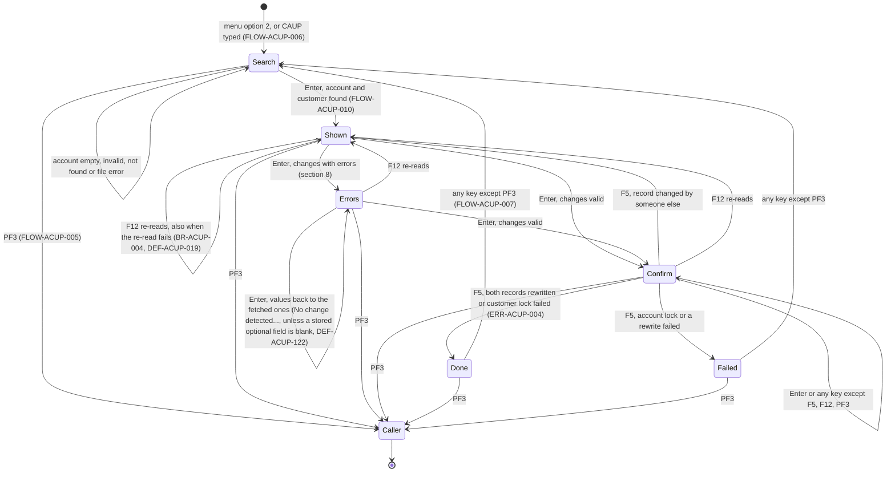
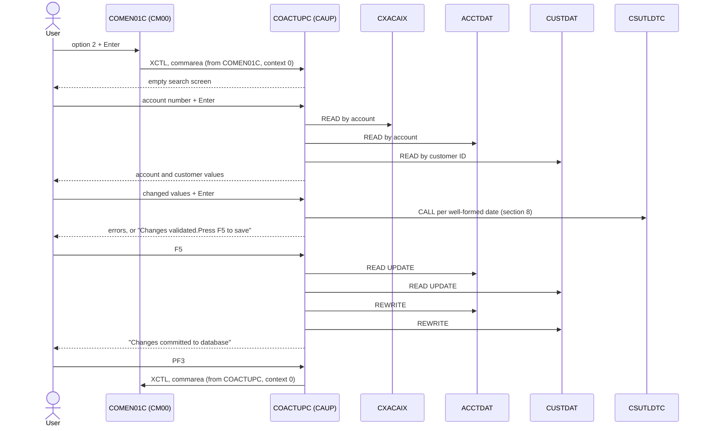

# COACTUPC: Online account update

## 1. Summary

A CardDemo user changes the details of one credit card account and of the customer who owns it. The user types an 11-digit account number and presses Enter. The program finds the account's customer through the card cross-reference (alternate index `CXACAIX`, keyed by account), reads the account master `ACCTDAT` and the customer master `CUSTDAT`, and shows 15 account values (status, limits, balance, cycle totals, open, expiry and reissue dates, group) and 23 customer values (name, address, phones, SSN, government ID, date of birth, EFT account, primary card holder flag, FICO score). The user overtypes values and presses Enter. The program compares the screen with the values it fetched; when something changed it validates the whole record (section 8). When every edit passes it asks for confirmation (`Changes validated.Press F5 to save`). F5 locks both records, checks that nobody changed them since they were fetched, and rewrites the account record and then the customer record with every value from the screen. F12 discards the changes and re-reads the account. PF3 returns to the caller (normally the main menu). The program runs as transaction `CAUP` and is reached from main menu option 2 "Account Update".

## 2. Rules at a glance

| ID | Rule |
| :-- | :-- |
| BR-ACUP-001 | The account number leads to the customer through the card cross-reference; the account and the customer are then read by their keys. |
| BR-ACUP-002 | A successful fetch shows the account and customer values in fixed display formats (amounts edited with sign and commas, dates split, phones and SSN in parts). |
| BR-ACUP-003 | Changes are saved in two steps: Enter validates, F5 saves. Nothing is written until F5 is pressed on the confirmation screen. |
| BR-ACUP-004 | F12 on a shown account discards the changes and re-reads the account and customer. |
| BR-ACUP-005 | Before saving, the program re-reads both records with a lock and refuses the save if any compared value differs from the values it fetched. |
| BR-ACUP-006 | The save replaces every field of the account record and of the customer record with the screen values, including balance and cycle totals. |
| BR-ACUP-007 | The information line tells the user what to do next; its text depends only on the update state. |
| BR-ACUP-008 | The account number can be typed only while no account is shown; customer ID and country are never typed in. |
| BR-ACUP-009 | After a save attempt (successful or not), the next key starts a new, empty search. |
| BR-ACUP-010 | A successful fetch writes the account, customer, names, status and first card number into the session commarea. |
| BR-ACUP-101 | Before an account is shown, only the account number is edited; nothing else on the screen is read. |
| BR-ACUP-102 | Received values are compared with the fetched values; some fields ignore case and surrounding spaces. If nothing changed, the user is told so and nothing is edited. A field that is blank in the file always counts as changed. |
| BR-ACUP-103 | Field edits run only when something changed and the program is not already waiting for F5. |
| BR-ACUP-104 | Every field is edited; follow-on checks run only after the field's basic check passed; each wrong field is flagged; only the first message is shown; the cursor goes to the first wrong field. |
| BR-ACUP-105 | A field that is spaces or `*` counts as empty. |
| BR-ACUP-106 | Five generic edit kinds (required, alphabetic, numeric with non-zero, yes/no, signed amount) define what "valid" means. |
| BR-ACUP-107 | When every edit passes, the program waits for F5 and shows `Changes validated.Press F5 to save`. |
| BR-ACUP-108 | Group ID, customer ID, government ID and address line 2 are not validated. |
| BR-ACUP-109 | Amounts are converted to numbers (2 decimals) as they are received, before they are edited. |
| BR-ACUP-110 | The whole account and customer record is validated on every change, not just the fields that changed. |
| VAL-ACUP-001 | The account number must be entered. |
| VAL-ACUP-002 | The account number must be 11 digits and not zero. |
| VAL-ACUP-003 | The account status must be entered. |
| VAL-ACUP-004 | The account status must be `Y` or `N` (upper case). |
| VAL-ACUP-005 | Each date's year must be 4 digits from 1900 to 2099. |
| VAL-ACUP-006 | Each date's month must be 1 to 12. |
| VAL-ACUP-007 | Each date's day must be 1 to 31. |
| VAL-ACUP-008 | The day must exist in the month, including the leap-year rule for 29 February. |
| VAL-ACUP-009 | A date that passed the field checks is also checked by CSUTLDTC. |
| VAL-ACUP-010 | The date of birth must be before today. |
| VAL-ACUP-011 | Credit limit, cash limit, balance and cycle amounts must be entered. |
| VAL-ACUP-012 | Each amount must be a valid number; no range is enforced. |
| VAL-ACUP-013 | SSN part 1 must be 3 digits and not 000. |
| VAL-ACUP-014 | SSN part 1 must not be 666 or 900-999. |
| VAL-ACUP-015 | SSN part 2 must be 2 digits and not 00. |
| VAL-ACUP-016 | SSN part 3 must be 4 digits and not 0000. |
| VAL-ACUP-017 | The FICO score must be 3 digits and not 000. |
| VAL-ACUP-018 | The FICO score must be from 300 to 850. |
| VAL-ACUP-019 | The first name must be entered and contain only letters and spaces. |
| VAL-ACUP-020 | The middle name is optional; when entered, only letters and spaces. |
| VAL-ACUP-021 | The last name must be entered and contain only letters and spaces. |
| VAL-ACUP-022 | Address line 1 must be entered. |
| VAL-ACUP-023 | The state must be entered and contain only letters (and spaces). |
| VAL-ACUP-024 | The state must be one of 56 US state and territory codes. |
| VAL-ACUP-025 | The ZIP code must be 5 digits and not 00000. |
| VAL-ACUP-026 | The city must be entered and contain only letters and spaces. |
| VAL-ACUP-027 | The country code must be entered and contain only letters (and spaces). |
| VAL-ACUP-028 | A phone number may be left completely empty. |
| VAL-ACUP-029 | A phone area code must be a valid North American general-purpose area code. |
| VAL-ACUP-030 | A phone prefix must be 3 digits and not 000. |
| VAL-ACUP-031 | A phone line number must be 4 digits and not 0000. |
| VAL-ACUP-032 | The EFT account ID must be 10 digits and not zero. |
| VAL-ACUP-033 | The primary card holder flag must be `Y` or `N` (upper case). |
| VAL-ACUP-034 | The ZIP code must belong to the state (first two digits). |

## 3. Actors and triggers

- **Actor:** a CardDemo user at a 3270 terminal. The main menu offers the option to regular users (user type `U`, `app/cpy/COMEN02Y.cpy:31-35`). The program itself checks neither the user ID nor the user type, and it accepts a start without a commarea (DEF-ACUP-001).
- **From the main menu:** `COMEN01C` option 2 "Account Update" transfers control (XCTL) to `COACTUPC` with its 160-byte commarea, `CDEMO-FROM-PROGRAM` = `COMEN01C`, `CDEMO-FROM-TRANID` = `CM00`, `CDEMO-PGM-CONTEXT` = 0 (`app/cbl/COMEN01C.cbl:177-187`, `app/cbl/COMEN01C.cbl:36-37`). No other program transfers to `COACTUPC`.
- **Re-entry:** every screen ends with "return, next transaction `CAUP`" (FLOW-ACUP-011). The next key the user presses starts transaction `CAUP` (`app/csd/CARDDEMO.CSD:306-316`), program `COACTUPC` (`app/csd/CARDDEMO.CSD:173-180`), with the program's 2000-byte commarea.
- **Direct start:** typing `CAUP` on a cleared terminal starts the program with no commarea; it shows the empty search screen (FLOW-ACUP-006).
- **Preconditions:** the CICS files `CXACAIX`, `ACCTDAT` and `CUSTDAT` are open. The jobs that reload these files close them in CICS while they run (`app/jcl/CLOSEFIL.jcl:28-29`, `app/jcl/CUSTFILE.jcl:26`, `app/jcl/TRANFILE.jcl:27`); a read during that window gets a file error (ERR-ACUP-001, ERR-ACUP-002, ERR-ACUP-003).
- **Transaction definition:** `CAUP` has `DUMP(YES)` and `ACTION(BACKOUT)` (`app/csd/CARDDEMO.CSD:312-313`), but all three files are `RECOVERY(NONE)` (`app/csd/CARDDEMO.CSD:9, 59, 72`), so a backout restores nothing (DEF-ACUP-005).

## 4. Interfaces

### 4.1 Screen CACTUPA (mapset COACTUP), 24 x 80

Source: `app/bms/COACTUP.bms:20-509`; symbolic map `app/cpy-bms/COACTUP.CPY:17-668` (input `CACTUPAI` at `:17`, output `CACTUPAO` at `:343`, sharing storage). The map has `CTRL=(FREEKB)` and extended attributes (`app/bms/COACTUP.bms:25-28`). "Row,Col" is the BMS `POS`, the position of the attribute byte; the data starts one column later. "BMS" gives the attributes as defined; the program overrides the protection of every input field on each send (FLOW-ACUP-014).

| Row,Col | Field | Len | Content | BMS |
| :-- | :-- | --: | :-- | :-- |
| 1,1 | (label) | 5 | `Tran:` | protected, blue |
| 1,7 | `TRNNAME` | 4 | `CAUP` | protected, FSET, blue |
| 1,21 | `TITLE01` | 40 | `      AWS Mainframe Modernization       ` (`COTTL01Y.cpy:18-19`) | protected, yellow |
| 1,65 / 1,71 | (label) / `CURDATE` | 5 / 8 | `Date:` / today `mm/dd/yy` (NUM-ACUP-006) | protected, blue |
| 2,1 / 2,7 | (label) / `PGMNAME` | 5 / 8 | `Prog:` / `COACTUPC` | protected, blue |
| 2,21 | `TITLE02` | 40 | `              CardDemo                  ` (`COTTL01Y.cpy:20-22`) | protected, yellow |
| 2,65 / 2,71 | (label) / `CURTIME` | 5 / 8 | `Time:` / now `hh:mm:ss` | protected, blue |
| 4,33 | (label) | 14 | `Update Account` | neutral |
| 5,19 | (label) | 16 | `Account Number :` | turquoise |
| 5,38 | `ACCTSID` | 11 | account number | unprotected, initial cursor, underlined |
| 5,57 / 5,70 | (label) / `ACSTTUS` | 12 / 1 | `Active Y/N: ` / account status | unprotected, underlined |
| 6,8 | (label) | 8 | `Opened :` | turquoise |
| 6,17, 6,24, 6,29 | `OPNYEAR`, `OPNMON`, `OPNDAY` | 4, 2, 2 | open date, with `-` constants at 6,22 and 6,27 | unprotected, right-justified; `OPNYEAR` FSET |
| 6,39 / 6,61 | (label) / `ACRDLIM` | 21 / 15 | `Credit Limit        :` / credit limit | unprotected, FSET |
| 7,8 | (label) | 8 | `Expiry :` | turquoise |
| 7,17, 7,24, 7,29 | `EXPYEAR`, `EXPMON`, `EXPDAY` | 4, 2, 2 | expiry date | unprotected, right-justified |
| 7,39 / 7,61 | (label) / `ACSHLIM` | 21 / 15 | `Cash credit Limit   :` / cash credit limit | unprotected, FSET |
| 8,8 | (label) | 8 | `Reissue:` | turquoise |
| 8,17, 8,24, 8,29 | `RISYEAR`, `RISMON`, `RISDAY` | 4, 2, 2 | reissue date | unprotected, right-justified |
| 8,39 / 8,61 | (label) / `ACURBAL` | 21 / 15 | `Current Balance     :` / current balance | unprotected, FSET |
| 9,39 / 9,61 | (label) / `ACRCYCR` | 21 / 15 | `Current Cycle Credit:` / cycle credit | unprotected, FSET |
| 10,8 / 10,23 | (label) / `AADDGRP` | 14 / 10 | `Account Group:` / group ID | unprotected |
| 10,39 / 10,61 | (label) / `ACRCYDB` | 21 / 15 | `Current Cycle Debit :` / cycle debit | unprotected, FSET |
| 11,32 | (label) | 16 | `Customer Details` | neutral |
| 12,8 / 12,23 | (label) / `ACSTNUM` | 14 / 9 | `Customer id  :` / customer ID | unprotected (the program always protects it) |
| 12,49 | (label) | 4 | `SSN:` | turquoise |
| 12,55, 12,61, 12,66 | `ACTSSN1`, `ACTSSN2`, `ACTSSN3` | 3, 2, 4 | SSN parts; BMS initial values `999`, `99`, `9999`; `-` at 12,59 and 12,64 | unprotected |
| 13,8 | (label) | 14 | `Date of birth:` | turquoise |
| 13,23, 13,30, 13,35 | `DOBYEAR`, `DOBMON`, `DOBDAY` | 4, 2, 2 | date of birth | unprotected, right-justified |
| 13,49 / 13,62 | (label) / `ACSTFCO` | 11 / 3 | `FICO Score:` / FICO score | unprotected |
| 14,1, 14,28, 14,55 | (labels) | 10, 13, 12 | `First Name`, `Middle Name: `, `Last Name : ` | turquoise |
| 15,1, 15,28, 15,55 | `ACSFNAM`, `ACSMNAM`, `ACSLNAM` | 25 each | first, middle, last name | unprotected |
| 16,1 / 16,10 | (label) / `ACSADL1` | 8 / 50 | `Address:` / address line 1 | unprotected |
| 16,63 / 16,73 | (label) / `ACSSTTE` | 6 / 2 | `State ` / state code | unprotected |
| 17,10 | `ACSADL2` | 50 | address line 2 | unprotected |
| 17,63 / 17,73 | (label) / `ACSZIPC` | 3 / 5 | `Zip` / ZIP code (5 of the stored 10 characters, NUM-ACUP-005) | unprotected |
| 18,1 / 18,10 | (label) / `ACSCITY` | 5 / 50 | `City ` / city (address line 3) | unprotected |
| 18,63 / 18,73 | (label) / `ACSCTRY` | 7 / 3 | `Country` / country code | unprotected (the program always protects it) |
| 19,1 | (label) | 8 | `Phone 1:` | turquoise |
| 19,10, 19,14, 19,18 | `ACSPH1A`, `ACSPH1B`, `ACSPH1C` | 3, 3, 4 | phone 1 area code, prefix, line number | unprotected, right-justified |
| 19,24 / 19,58 | (label) / `ACSGOVT` | 30 / 20 | `Government Issued Id Ref    : ` / government ID | unprotected |
| 20,1 | (label) | 8 | `Phone 2:` | turquoise |
| 20,10, 20,14, 20,18 | `ACSPH2A`, `ACSPH2B`, `ACSPH2C` | 3, 3, 4 | phone 2 parts | unprotected, right-justified |
| 20,24 / 20,41 | (label) / `ACSEFTC` | 16 / 10 | `EFT Account Id: ` / EFT account ID | unprotected |
| 20,53 / 20,78 | (label) / `ACSPFLG` | 24 / 1 | `Primary Card Holder Y/N:` / primary card holder flag | unprotected |
| 22,23 | `INFOMSG` | 45 | information line (BR-ACUP-007) | protected, neutral, no highlight |
| 23,1 | `ERRMSG` | 78 | error message | protected, bright, FSET, red |
| 24,1 | `FKEYS` | 21 | `ENTER=Process F3=Exit` | protected, yellow |
| 24,23 | `FKEY05` | 7 | `F5=Save` | protected, dark (made bright by FLOW-ACUP-017) |
| 24,31 | `FKEY12` | 10 | `F12=Cancel` | protected, dark (made bright by FLOW-ACUP-017) |

The message work field `WS-RETURN-MSG` is 75 characters (`:479`) and goes into the 78-character `ERRMSG`; the information work field `WS-INFO-MSG` is 40 characters (`:463`) and goes into the 45-character `INFOMSG`. No text is cut on the way to the screen; texts built longer than 75 characters are cut when they are built (NUM-ACUP-007, NUM-ACUP-008). Map oddities: DEF-ACUP-017.

### 4.2 Files

| CICS file | Entity | Operation | Key | Lines |
| :-- | :-- | :-- | :-- | :-- |
| `CXACAIX` | ENT-CARD-XREF (through the alternate index on `XREF-ACCT-ID`) | READ into `CARD-XREF-RECORD` (50 bytes) | account ID, 11 characters | 3654-3662 |
| `ACCTDAT` | ENT-ACCOUNT | READ into `ACCOUNT-RECORD` (300 bytes) | account ID, 11 characters | 3703-3711 |
| `ACCTDAT` | ENT-ACCOUNT | READ with UPDATE, then REWRITE from `ACCT-UPDATE-RECORD` (300 bytes, NUM-ACUP-010) | account ID | 3894-3903, 4065-4071 |
| `CUSTDAT` | ENT-CUSTOMER | READ into `CUSTOMER-RECORD` (500 bytes) | customer ID, 9 characters | 3753-3761 |
| `CUSTDAT` | ENT-CUSTOMER | READ with UPDATE, then REWRITE from `CUST-UPDATE-RECORD` (500 bytes) | customer ID | 3921-3930, 4085-4091 |

`ACCTDAT` is `AWS.M2.CARDDEMO.ACCTDATA.VSAM.KSDS`, `CUSTDAT` is `AWS.M2.CARDDEMO.CUSTDATA.VSAM.KSDS` and `CXACAIX` is the path `AWS.M2.CARDDEMO.CARDXREF.VSAM.AIX.PATH`; all three are `UPDATEMODEL(LOCKING)`, `READINTEG(UNCOMMITTED)` and `RECOVERY(NONE)` (`app/csd/CARDDEMO.CSD:1-12, 50-75`). The alternate index has `KEYS(11,25)` and `NONUNIQUEKEY` (`app/jcl/XREFFILE.jcl:73-75`), so an account may have several cross-reference records (DEF-ACUP-012).

The literals for the card file (`CARDDAT`), its account path (`CARDAIX`) and the card programs are declared but never used (DEF-ACUP-018).

### 4.3 Commarea

The program receives and returns a 2000-byte commarea (`WS-COMMAREA`, `:850`):

| Pos | Len | Content | Source |
| --: | --: | :-- | :-- |
| 1 | 160 | `CARDDEMO-COMMAREA` (`COCOM01Y`) | `:650` |
| 161 | 1 | `ACUP-CHANGE-ACTION`, the update state (FLOW-ACUP-001) | `:654-668` |
| 162 | 106 | `ACUP-OLD-ACCT-DATA`: account values as fetched | `:669-708` |
| 268 | 330 | `ACUP-OLD-CUST-DATA`: customer values as fetched | `:709-756` |
| 598 | 106 | `ACUP-NEW-ACCT-DATA`: account values as received from the screen | `:757-796` |
| 704 | 330 | `ACUP-NEW-CUST-DATA`: customer values as received | `:797-849` |
| 1034 | 967 | spaces (from the initialisation of the work field) | `:866-868` |

The "old" values are the reference for change detection (section 8) and for the concurrency check (BR-ACUP-005). They are carried only in the commarea, so the screen and the commarea together hold the whole conversation state. On PF3 only the 160-byte `CARDDEMO-COMMAREA` is passed on (`:956-959`).

`CARDDEMO-COMMAREA` fields the program uses:

| Field | Read | Written | Use |
| :-- | :-- | :-- | :-- |
| `CDEMO-PGM-CONTEXT` | yes | yes | 0 = enter, 1 = re-enter. Set to 1 after the first screen (`:971, 987`) and to 0 on PF3 and after a save attempt (`:948, 984`). |
| `CDEMO-FROM-PROGRAM` | yes | yes (PF3) | `COMEN01C` with context 0 means a fresh start from the menu (FLOW-ACUP-002, FLOW-ACUP-004); PF3 target; set to `COACTUPC` on PF3. |
| `CDEMO-FROM-TRANID` | yes | yes (PF3) | copied to `CDEMO-TO-TRANID` on PF3, then set to `CAUP`. Also tested in an unreachable branch (DEF-ACUP-018). |
| `CDEMO-TO-PROGRAM`, `CDEMO-TO-TRANID` | no | yes (PF3) | XCTL target; the TRANID is set but not used by XCTL |
| `CDEMO-USER-TYPE` | no | yes (PF3) | forced to `U` (DEF-ACUP-009) |
| `CDEMO-LAST-MAPSET`, `CDEMO-LAST-MAP` | yes | yes (PF3) | set to `COACTUP` and `CACTUPA` on PF3 (the 8-character literal `COACTUP ` is cut to the 7-character mapset field, `COCOM01Y.cpy:44`); the mapset is compared with `COCRDLI` for the account field colour (FLOW-ACUP-016) |
| `CDEMO-ACCT-ID` | no | yes | set by the account edit (zero when missing or invalid, section 8), by a fetch (BR-ACUP-010), and cleared after a save attempt (FLOW-ACUP-007) |
| `CDEMO-CUST-ID` | yes | yes | set from the cross-reference (SE-ACUP-001), then used as the customer key for the read and the lock (SE-ACUP-003, SE-ACUP-005) |
| `CDEMO-CARD-NUM` | no | yes | set from the cross-reference record (BR-ACUP-010) |
| `CDEMO-CUST-FNAME`, `-MNAME`, `-LNAME`, `CDEMO-ACCT-STATUS` | no | yes | set from the fetched records (BR-ACUP-010) |

All other fields, including `CDEMO-USER-ID`, pass through unchanged. On a direct start the commarea is created blank (FLOW-ACUP-002).

### 4.4 Calls

`CSUTLDTC` is called (static `CALL`) from the shared date routine `CSUTLDPY.cpy:293-296`, which is copied into this program at `:4232`, to check each well-formed date. The caller passes the 8-character date `WS-EDIT-DATE-CCYYMMDD`, the 8-character format `WS-DATE-FORMAT` with value `YYYYMMDD`, and the 80-character result area `WS-DATE-VALIDATION-RESULT` (`CSUTLDWY.cpy:60-85`). It uses only the severity and the message number of the result; a non-zero severity gives the message `<field name> validation error Sev code: <severity> Message code: <message number>` (`CSUTLDPY.cpy:298-316`). The called program declares its first two parameters as 10 characters (`CSUTLDTC.cbl:84-88`), so it reads 2 bytes beyond each of the caller's 8-character fields. For the behaviour of the called program see the CSUTLDTC spec; for the edits that use it see section 8. The CSUTLDTC fix "CSUTLDTC reports the date it was given" (`CHANGELOG.md:50`, commit 8122736 on the agent-readiness branch, part of b5e0139 in this branch) changed only the date echoed back in the result text (`CSUTLDTC.cbl:122`), which this program does not show, so it does not affect any message of this program.

### 4.5 Console output

None. The program has no `DISPLAY` statement. File errors are shown on the screen.

## 5. Data used

| Entity field | Read | Written | How |
| :-- | :-- | :-- | :-- |
| ENT-CARD-XREF.XREF-ACCT-ID | key | no | alternate key of the cross-reference read |
| ENT-CARD-XREF.XREF-CUST-ID | yes | no | copied to `CDEMO-CUST-ID`, the customer key |
| ENT-CARD-XREF.XREF-CARD-NUM | yes | no | copied to `CDEMO-CARD-NUM` |
| ENT-ACCOUNT.ACCT-ID | key, shown | rewritten from the screen value (protected field) | NUM-ACUP-010, DEF-ACUP-013 |
| ENT-ACCOUNT.ACCT-ACTIVE-STATUS, ACCT-CURR-BAL, ACCT-CREDIT-LIMIT, ACCT-CASH-CREDIT-LIMIT, ACCT-CURR-CYC-CREDIT, ACCT-CURR-CYC-DEBIT | shown, compared | yes | BR-ACUP-002, BR-ACUP-005, BR-ACUP-006 |
| ENT-ACCOUNT.ACCT-OPEN-DATE, ACCT-EXPIRAION-DATE, ACCT-REISSUE-DATE | shown in parts, compared | yes, rebuilt as `YYYY-MM-DD` | NUM-ACUP-002 |
| ENT-ACCOUNT.ACCT-GROUP-ID (position 113) | shown, compared | **overwritten with the unset FILLER bytes of the update layout** (content not defined by the program) | DEF-ACUP-002, DEF-ACUP-020 |
| ENT-ACCOUNT.ACCT-ADDR-ZIP (position 103) | no | **overwritten with the group ID** | DEF-ACUP-002 |
| ENT-CUSTOMER.CUST-ID | key, shown | rewritten from the screen value (protected field) | DEF-ACUP-013 |
| ENT-CUSTOMER.CUST-FIRST-NAME, CUST-MIDDLE-NAME, CUST-LAST-NAME, CUST-ADDR-LINE-1, -2, -3, CUST-ADDR-STATE-CD, CUST-ADDR-COUNTRY-CD, CUST-GOVT-ISSUED-ID, CUST-EFT-ACCOUNT-ID, CUST-PRI-CARD-HOLDER-IND, CUST-FICO-CREDIT-SCORE, CUST-SSN | shown, compared | yes | BR-ACUP-002, BR-ACUP-006 |
| ENT-CUSTOMER.CUST-ADDR-ZIP | 5 of 10 characters shown; all 10 compared | 5 characters plus spaces | NUM-ACUP-005, DEF-ACUP-003 |
| ENT-CUSTOMER.CUST-PHONE-NUM-1, -2 | shown in 3 parts, compared | rebuilt as `(aaa)bbb-cccc` | NUM-ACUP-003 |
| ENT-CUSTOMER.CUST-DOB-YYYY-MM-DD | shown in parts, compared | rebuilt as `YYYY-MM-DD` | NUM-ACUP-002 |
| ENT-CUSTOMER.CUST-FILLER, ENT-ACCOUNT.FILLER | no | overwritten with the unset FILLER bytes of the update layouts (account 113-300, customer 333-500) | SE-ACUP-006, SE-ACUP-007, DEF-ACUP-020 |
| ENT-COMMAREA | yes | yes | section 4.3 |

Program-local data with behaviour (validation work areas are listed with section 8):

- Update state `ACUP-CHANGE-ACTION` (FLOW-ACUP-001).
- Key flag `WS-PFK-FLAG` (`:178-180`), AID code `CCARD-AID` (`CVCRD01Y.cpy`, FLOW-ACUP-019).
- Account and customer key flags `WS-EDIT-ACCT-FLAG`, `WS-EDIT-CUST-FLAG` (`:183-190`): `1` valid, `0` not OK, space blank. After the initialisation of `WS-MISC-STORAGE` (`:866-868`) the account flag holds a space, which counts as "blank"; this decides the cursor on screens that skip the edits (FLOW-ACUP-015).
- "Found" flags `FOUND-ACCT-IN-MASTER`, `FOUND-CUST-IN-MASTER` (`:384-388`).
- Read keys `WS-CARD-RID-ACCT-ID` (9(11)) and `WS-CARD-RID-CUST-ID` (9(9)) with text redefinitions (`:376-383`).
- Messages `WS-INFO-MSG` (40, `:463-477`) and `WS-RETURN-MSG` (75, `:479-528`) with their 88-level texts; file error template `WS-FILE-ERROR-MESSAGE` (`:389-408`, NUM-ACUP-008).
- Amount display picture `WS-EDIT-CURRENCY-9-2-F` (`:371`, NUM-ACUP-001).
- Rewrite layouts `ACCT-UPDATE-RECORD` (`:418-433`) and `CUST-UPDATE-RECORD` (`:434-456`).
- Abend data `ABEND-DATA` (`CSMSG02Y.cpy`), 134 bytes.

Declared without effect: DEF-ACUP-018.

### 5.1 Fields as the edits use them

Entity fields as the edits use them. "Old" means the value fetched when the account was shown (used by BR-ACUP-102); writing happens only on F5 (save section).

| Entity field | Read | Written | How |
| :-- | :-- | :-- | :-- |
| ENT-ACCOUNT.ACCT-ID | old value | no | compared exactly; the search key is edited by VAL-ACUP-001/002 |
| ENT-ACCOUNT.ACCT-ACTIVE-STATUS | old value | on F5 | VAL-ACUP-003, VAL-ACUP-004; compared ignoring case |
| ENT-ACCOUNT.ACCT-CURR-BAL, ACCT-CREDIT-LIMIT, ACCT-CASH-CREDIT-LIMIT, ACCT-CURR-CYC-CREDIT, ACCT-CURR-CYC-DEBIT | old value | on F5 | VAL-ACUP-011, VAL-ACUP-012, NUM-ACUP-101; compared as numbers |
| ENT-ACCOUNT.ACCT-OPEN-DATE, ACCT-EXPIRAION-DATE, ACCT-REISSUE-DATE | old value | on F5 | VAL-ACUP-005 to VAL-ACUP-009; entered as year, month, day |
| ENT-ACCOUNT.ACCT-GROUP-ID | old value | on F5 | not validated (BR-ACUP-108); compared ignoring case and spaces |
| ENT-CUSTOMER.CUST-ID | old value | no | not validated; compared ignoring case and spaces |
| ENT-CUSTOMER.CUST-FIRST-NAME, CUST-MIDDLE-NAME, CUST-LAST-NAME | old value | on F5 | VAL-ACUP-019 to VAL-ACUP-021 |
| ENT-CUSTOMER.CUST-ADDR-LINE-1, CUST-ADDR-LINE-2, CUST-ADDR-LINE-3 (city) | old value | on F5 | VAL-ACUP-022, VAL-ACUP-026; line 2 not validated |
| ENT-CUSTOMER.CUST-ADDR-STATE-CD, CUST-ADDR-ZIP | old value | on F5 | VAL-ACUP-023 to VAL-ACUP-025, VAL-ACUP-034 |
| ENT-CUSTOMER.CUST-ADDR-COUNTRY-CD | old value | on F5 | VAL-ACUP-027 |
| ENT-CUSTOMER.CUST-PHONE-NUM-1, CUST-PHONE-NUM-2 | old value (3 parts) | on F5 | VAL-ACUP-028 to VAL-ACUP-031 |
| ENT-CUSTOMER.CUST-SSN | old value | on F5 | VAL-ACUP-013 to VAL-ACUP-016 |
| ENT-CUSTOMER.CUST-GOVT-ISSUED-ID | old value | on F5 | not validated |
| ENT-CUSTOMER.CUST-DOB-YYYY-MM-DD | old value | on F5 | VAL-ACUP-005 to VAL-ACUP-010 |
| ENT-CUSTOMER.CUST-EFT-ACCOUNT-ID | old value | on F5 | VAL-ACUP-032 |
| ENT-CUSTOMER.CUST-PRI-CARD-HOLDER-IND | old value | on F5 | VAL-ACUP-033 |
| ENT-CUSTOMER.CUST-FICO-CREDIT-SCORE | old value | on F5 | VAL-ACUP-017, VAL-ACUP-018 |

Program-local data with behaviour: the label `WS-EDIT-VARIABLE-NAME` (25, `:53`); the amount work field `WS-EDIT-SIGNED-NUMBER-9V2-X` (15, `:55`); the generic work area `WS-EDIT-ALPHANUM-ONLY` (256) with its length (`:61-62`); the per-edit result flags (`:56-80`); the phone and SSN work areas and flags (`:82-146`); the per-field flags that drive the cursor (`:191` onward, in `WS-NON-KEY-FLAGS`); the change flag and the input-error flag (`:168-174`); the message area `WS-RETURN-MSG` (75, `:479-480`); the amount text fields (15 each, `:411-416`); the date work area and result layout from `CSUTLDWY.cpy` (`:166`); the letter lists for the alphabetic edit (`:584-611`); and the lookup lists in `CSLKPCDY.cpy`.

## 6. Processing flow



Each arrow is one CICS task: map the key, act, send the screen, end with "next transaction `CAUP`". The state names map to `ACUP-CHANGE-ACTION` values: Search = low-values or space, Shown = `S`, Errors = `E`, Confirm = `N`, Done = `C`, Failed = `L` or `F` (FLOW-ACUP-001).

**Entry (0000-MAIN, lines 859-1005)**

1. Register `ABEND-ROUTINE` as the abend exit (862-864, ERR-ACUP-006).
2. Clear the work areas and the 2000-byte commarea work field (866-868); clear the error message (876).
3. Commarea intake (880-893, FLOW-ACUP-002).
4. Map the AID key (898-899, FLOW-ACUP-019); keep only the keys valid in the current state and treat every other key as Enter (905-916, FLOW-ACUP-003).
5. Decide (921-1004, FLOW-ACUP-004): PF3 leaves; a fresh start shows the empty search screen; the screen after a save attempt is replaced by a fresh search screen; everything else receives the screen, edits it, decides the action and sends the result.
6. Return to CICS with next transaction `CAUP` and the 2000-byte commarea (1007-1020, FLOW-ACUP-011).

**Re-entry (FLOW-ACUP-008)**

```text
receive map CACTUPA, copy the fields to the "new" values          (section 8)
if no account shown yet: edit the account number                  (section 8)
else: compare new with old; if changed and not waiting for F5,
      edit every field; state := E, or N when no error            (section 8)
decide (FLOW-ACUP-009):
  no account shown, or F12:  if the account number is valid, fetch (FLOW-ACUP-010);
                             if FOUND-CUST-IN-MASTER (always true on F12) -> state S
  state N and F5:            save (SE-ACUP-004..SE-ACUP-007) -> state C, L, F or S
  otherwise:                 keep the state
send the screen (FLOW-ACUP-012..FLOW-ACUP-018)
```

**Screen build (3000-SEND-MAP, lines 2649-2662)**: header (3100), field values (3200, FLOW-ACUP-013), information and error lines (3250, BR-ACUP-007), protection, cursor and colours (3300, FLOW-ACUP-014..FLOW-ACUP-016), information line and key legend attributes (3390, FLOW-ACUP-017), send (3400, FLOW-ACUP-018).

### 6.1 Flow items

#### FLOW-ACUP-001 · Update states
- **Then:** the one-byte `ACUP-CHANGE-ACTION` in the commarea extension holds the conversation state:

| Value | Name in the code | Meaning | Set by |
| :-- | :-- | :-- | :-- |
| low-values or space | `ACUP-DETAILS-NOT-FETCHED` | search screen, no account shown | start, restart (FLOW-ACUP-006, FLOW-ACUP-007) |
| `S` | `ACUP-SHOW-DETAILS` | account shown, no pending change | fetch (FLOW-ACUP-009), concurrent change (ERR-ACUP-004) |
| `E` | `ACUP-CHANGES-NOT-OK` | changes entered, edits found errors | edits (section 8) |
| `N` | `ACUP-CHANGES-OK-NOT-CONFIRMED` | changes valid, waiting for F5 | edits (section 8) |
| `C` | `ACUP-CHANGES-OKAYED-AND-DONE` | save completed (or customer lock failed, DEF-ACUP-004) | FLOW-ACUP-009 |
| `L` | `ACUP-CHANGES-OKAYED-LOCK-ERROR` | account could not be locked | FLOW-ACUP-009 |
| `F` | `ACUP-CHANGES-OKAYED-BUT-FAILED` | a rewrite failed | FLOW-ACUP-009 |

`E`, `N`, `C`, `L` and `F` together form "changes made" (`ACUP-CHANGES-MADE`); `L` and `F` form "changes failed" (`ACUP-CHANGES-FAILED`).
- **Source:** `:654-668`
- **Fidelity:** must-preserve (states and transitions); incidental (codes)
- **Confidence:** reviewed

#### FLOW-ACUP-002 · Commarea intake (decision table)

The tests read the program's own working-storage copy `CARDDEMO-COMMAREA` before anything has been copied into it; that copy is not part of the initialisation at `:866-868`.

| Condition | Action |
| :-- | :-- |
| `EIBCALEN` = 0 (no commarea) | reset `CARDDEMO-COMMAREA` and the extension (text to spaces, numbers to zero); context := enter; state := not fetched |
| working-storage `CDEMO-FROM-PROGRAM` = `COMEN01C` and context not re-enter | the same reset. Not expected to be true: nothing has put `COMEN01C` into working storage yet (DEF-ACUP-008) |
| otherwise (every call with a commarea, including the call from the menu) | copy the first 160 bytes into `CARDDEMO-COMMAREA` and bytes 161-1033 into the extension, whatever the length received (DEF-ACUP-008) |

Effect for the menu call: the menu's commarea is kept (user ID, user type and the rest), and the main decision then recognises the menu call and starts a fresh search (FLOW-ACUP-004 row 2), which also clears the extension.
- **Source:** `:866-868, 880-893`
- **Fidelity:** must-preserve (session data kept, fresh start from the menu)
- **Confidence:** reviewed; working-storage content before the copy is platform-inferred

#### FLOW-ACUP-003 · Valid keys
- **When:** any key, after FLOW-ACUP-019.
- **Then:**

| Key | Accepted when | Otherwise |
| :-- | :-- | :-- |
| Enter | always | - |
| PF3 (or PF15) | always | - |
| PF5 (or PF17) | state `N` at the start of the task | treated as Enter |
| PF12 (or PF24) | an account has been fetched (state not "not fetched") | treated as Enter |
| any other key (PF1, PF2, PF4, PF6-PF11, PF13, PF14, PF16, PF18-PF23, PA1, PA2, PA3, Clear) | never | treated as Enter, with no message (DEF-ACUP-010) |

For PA1, PA2 and Clear the terminal sends no field data, so the receive finds nothing (ERR-ACUP-101 in section 8).
- **Source:** `:905-916`
- **Fidelity:** must-preserve (target may reject unsupported keys, Q-ACUP-009)
- **Confidence:** reviewed; the 3270 short read for PA keys and Clear is platform-inferred

#### FLOW-ACUP-004 · Main decision (decision table)

Evaluated in order; the first true row applies.

| # | Condition | Action | Lines |
| --: | :-- | :-- | :-- |
| 1 | key is PF3 | FLOW-ACUP-005 (leave) | 927-959 |
| 2 | state "not fetched" and context enter, or (`CDEMO-FROM-PROGRAM` = `COMEN01C` and context not re-enter) | FLOW-ACUP-006 (fresh search screen) | 964-973 |
| 3 | state `C`, `L` or `F` | FLOW-ACUP-007 (restart after a save attempt) | 979-989 |
| 4 | otherwise | FLOW-ACUP-008 (receive, edit, decide, send) | 996-1003 |

Rows 2 to 4 end with a jump to the common return (FLOW-ACUP-011).
- **Source:** `:921-1005`
- **Fidelity:** must-preserve
- **Confidence:** reviewed

#### FLOW-ACUP-005 · PF3, back to the caller
- **Then:**
  1. Target transaction: `CDEMO-FROM-TRANID`, or `CM00` when it is spaces or low-values.
  2. Target program: `CDEMO-FROM-PROGRAM`, or `COMEN01C` when it is spaces or low-values. From the menu this is `COMEN01C`; after a direct start both are spaces, so the defaults apply.
  3. Set `CDEMO-FROM-TRANID` = `CAUP`, `CDEMO-FROM-PROGRAM` = `COACTUPC`, `CDEMO-USER-TYPE` = `U` (DEF-ACUP-009), context := enter, `CDEMO-LAST-MAPSET` = `COACTUP` (7 characters: the 8-character literal `COACTUP ` is cut to the 7-character field), `CDEMO-LAST-MAP` = `CACTUPA`.
  4. Take a syncpoint (SE-ACUP-008), then transfer control (XCTL) to the target with the 160-byte commarea. The screen is not received first, so anything typed, including validated but unsaved changes, is discarded without a warning.
- **Source:** `:927-959`; `COCOM01Y.cpy:43-44`
- **Fidelity:** must-preserve
- **Confidence:** reviewed

#### FLOW-ACUP-006 · Fresh search screen
- **When:** FLOW-ACUP-004 row 2 (direct start, or call from the menu).
- **Then:** clear the extension (state "not fetched", old and new values cleared), send the screen with context still "enter", then set context := re-enter and state := not fetched. The screen shows the header, an empty unprotected account field with the cursor on it, all other data fields empty and protected (the SSN shows its BMS initial values `999`-`99`-`9999`), no error message, information line `Enter or update id of account to update`. No file is read.
- **Source:** `:964-973, 2700-2701, 2958-2959, 2993-2996`
- **Fidelity:** must-preserve
- **Confidence:** reviewed; the display of BMS initial values for fields left as low-values is platform-inferred

#### FLOW-ACUP-007 · Restart after a save attempt
- **When:** state `C`, `L` or `F` and the key is not PF3.
- **Then:** the screen is not received. Clear the extension, the work storage and `CDEMO-ACCT-ID`; context := enter; send the same empty search screen as FLOW-ACUP-006 (information line `Enter or update id of account to update`, no error); context := re-enter; state := not fetched. Any key, including Enter with a new account number typed in the unprotected account field of the failure screen, only produces this empty screen (DEF-ACUP-015).
- **Source:** `:979-989`
- **Fidelity:** must-preserve
- **Confidence:** reviewed

#### FLOW-ACUP-008 · Re-entry processing
- **Then:** receive the screen and edit it (section 8), then decide the action (FLOW-ACUP-009), then build and send the screen (FLOW-ACUP-012). The messages and next-program fields that `1000-PROCESS-INPUTS` stores in the card work area are never read (DEF-ACUP-018).
- **Source:** `:996-1003, 1025-1034`
- **Fidelity:** must-preserve
- **Confidence:** reviewed

#### FLOW-ACUP-009 · Decide the action (decision table)

Evaluated after the edits, in order; the state is the one the edits left.

| # | Condition | Action | Lines |
| --: | :-- | :-- | :-- |
| 1 | state "not fetched", or key PF12 | if the account number edit passed (flag valid): clear the message, fetch (FLOW-ACUP-010); if the flag `FOUND-CUST-IN-MASTER` is set, state := `S`. In the search stage this means the customer read succeeded; on PF12 the edit step already set the flag (and the valid flag) before the fetch (`:1454-1456`), so the state becomes `S` even when the re-read fails (BR-ACUP-004, DEF-ACUP-019). If the edit failed: nothing (the edit message stays). | 2568-2580, 1452-1457 |
| 2 | state `S` | if there is an input error or the message is `No change detected with respect to values fetched.`: nothing; otherwise state := `N` (normally not reached, because the edits move a changed screen to `E` or `N`) | 2585-2591 |
| 3 | state `E` | nothing; the state stays `E`. This includes Enter after the user restored every value, but only for a record with no blank group ID, middle name, address line 2 or government ID; otherwise the edits run again and the first edit message is shown (DEF-ACUP-122, `:1213-1215, 1697-1700`). Without a blank stored field the edit step finds no change and skips the edits (`:1463-1467`), so the screen shows the received values, information `Update account details presented above.`, message `No change detected with respect to values fetched.`, cursor on the account status and `F12=Cancel` bright | 2596-2597, 1463-1470, 3011-3012, 3573-3576 |
| 4 | state `N` and key PF5 | save (SE-ACUP-004 to SE-ACUP-007), then: account lock failed -> `L`; a rewrite failed -> `F`; record changed by someone else -> `S`; any other outcome -> `C` (ERR-ACUP-004) | 2602-2615 |
| 5 | state `N` | nothing (Enter on the confirmation screen redisplays it) | 2620-2621 |
| 6 | state `C` | state := `S`; if `CDEMO-FROM-TRANID` is blank, clear the account, card and status in the commarea. **Unreachable**: state `C` never gets here (FLOW-ACUP-004 row 3) | 2625-2632 |
| 7 | any other state | ERR-ACUP-005 (abend `0001`) | 2633-2640 |

Because PF12 is accepted only when an account has been fetched, row 1 with PF12 re-reads the account shown, using the account number received from the (protected) account field; this is BR-ACUP-004.
- **Source:** `:2562-2642, 1452-1470, 3011-3012, 3573-3576`
- **Fidelity:** must-preserve; row 6 is dead code (DEF-ACUP-018)
- **Confidence:** reviewed

#### FLOW-ACUP-010 · Fetch sequence
- **Then:**
  1. Clear the old values and the information message; use the account number (`CC-ACCT-ID`) as the account key.
  2. Read the cross-reference by account (SE-ACUP-001). If it fails (account flag "not OK"), stop.
  3. Read the account (SE-ACUP-002). The check meant to stop on "account not found" never fires (DEF-ACUP-007), so the sequence continues.
  4. Read the customer with `CDEMO-CUST-ID` from the cross-reference (SE-ACUP-003). The check meant to stop on "customer not found" never fires either.
  5. Store the fetched data (BR-ACUP-010 and the old values, BR-ACUP-002).
- In the search stage, the caller (FLOW-ACUP-009 row 1) moves to state `S` only if the customer read succeeded. On PF12 the found flags are already set before the fetch (`:1453-1456`) and the fetch never resets them (only successful reads set them, `:3715, 3765`), so the state becomes `S` regardless of the outcome (BR-ACUP-004, DEF-ACUP-019).
- **Source:** `:3608-3644, 3801-3884, 1453-1456, 2577, 3715, 3765`
- **Fidelity:** must-preserve (order and keys); the ineffective checks are DEF-ACUP-007
- **Confidence:** reviewed

#### FLOW-ACUP-011 · End of every interaction
- **Then:** build the 2000-byte commarea (160-byte `CARDDEMO-COMMAREA`, then the 873-byte extension, rest spaces) and return to CICS naming `CAUP` as the next transaction.
- **Source:** `:1007-1020`
- **Fidelity:** must-preserve (pseudo-conversational state); the 2000-byte size is incidental
- **Confidence:** reviewed

#### FLOW-ACUP-012 · Screen build order and header
- **Then:** clear the whole output area to low-values, then fill the header: titles, transaction `CAUP`, program `COACTUPC`, date `mm/dd/yy` and time `hh:mm:ss` (NUM-ACUP-006). Then FLOW-ACUP-013, BR-ACUP-007, FLOW-ACUP-014 to FLOW-ACUP-018 in that order. Fields left as low-values show their BMS initial value or nothing.
- **Source:** `:2649-2662, 2668-2692`
- **Fidelity:** must-preserve (content); incidental (clock values)
- **Confidence:** reviewed

#### FLOW-ACUP-013 · Field values by state (decision table)
- **Then:** on the first screen of a conversation (context enter) no field value is set. Otherwise the account number field shows the account number received (`CC-ACCT-ID`), or nothing when that number is zero and valid; then:

| Condition (first true) | Values shown | Lines |
| :-- | :-- | :-- |
| state "not fetched", or account number zero | all data fields empty (SSN shows the BMS initial `999`-`99`-`9999`) | 2731-2781 |
| state `S` | the fetched ("old") values, formatted as in BR-ACUP-002 | 2787-2865 |
| state `E`, `N`, `C`, `L` or `F` | the received ("new") values. An amount that passed its edit is shown formatted (NUM-ACUP-001); an amount that failed is shown as typed. All other fields are shown as received. | 2870-2949 |
| any other | the fetched values | 2721-2723 |

Showing the fetched values also clears all field error flags and sets the information text to the change prompt, which the next step replaces anyway (BR-ACUP-007).
- **Source:** `:2698-2726, 2731-2781, 2787-2865, 2870-2949`
- **Fidelity:** must-preserve
- **Confidence:** reviewed

#### FLOW-ACUP-014 · Protection by state
- **Then:** every input field is first set to protected with the modified flag on, including `INFOMSG`. Then:

| State | Unprotected (with modified flag on) | Lines |
| :-- | :-- | :-- |
| not fetched | account number only | 2994-2996 |
| `S`, `E` | every account and customer field except account number, customer ID and country | 2997-3000, 3500-3561 |
| `N`, `C` | none | 3001-3003 |
| `L`, `F` (and any other) | account number only (but see DEF-ACUP-015) | 3004-3005 |

Because every field is sent with the modified flag on (protected or not), every field is returned on each Enter, and the edits can treat the received screen as complete. A field the user clears comes back as spaces or nulls rather than missing.
- **Source:** `:2986-3006, 3441-3495, 3500-3564`
- **Fidelity:** must-preserve (which fields can be changed in which state); incidental (attribute bytes)
- **Confidence:** reviewed; the meaning of `DFHBMPRF` (protected, modified) and `DFHBMFSE` (unprotected, modified) is platform-inferred

#### FLOW-ACUP-015 · Cursor placement
- **Then:** the cursor goes to the first field in this list whose condition holds (screen order); the list is evaluated after the information line has been set (BR-ACUP-007).

| # | Condition | Cursor |
| --: | :-- | :-- |
| 1 | information text is `Details of selected account shown above`, or message is `No change detected with respect to values fetched.` | account status. The first half never holds: the information text is always replaced before this point (BR-ACUP-007). |
| 2 | account number not OK or blank | account number |
| 3 | account status, open year, month, day, credit limit, expiry year, month, day, cash credit limit, reissue year, month, day, current balance, cycle credit, cycle debit, SSN parts 1 to 3, date of birth year, month, day, FICO score, first name, middle name (not OK only), last name, address line 1, state, ZIP, city, country, phone 1 parts, phone 2 parts, EFT account ID, primary card holder: the first that is not OK or blank | that field |
| 4 | otherwise | account number |

Group ID, customer ID, address line 2 and government ID have no entry. On the first screen and after a restart the account flag holds its initial "blank" value, so row 2 applies. On a shown account with no error, row 4 puts the cursor on the protected account number field.
- **Source:** `:3009-3167`
- **Fidelity:** must-preserve (first wrong field gets the cursor); incidental (cursor on a protected field)
- **Confidence:** reviewed

#### FLOW-ACUP-016 · Colours and asterisks
- **Then:**
  1. If `CDEMO-LAST-MAPSET` is `COCRDLI` (the card list mapset), the account number gets the default colour. The condition is true when the user reached the menu from the card list, which leaves `COCRDLI` in the commarea that the menu passes on unchanged. The field then gets the default colour, which it already has because the output area was cleared to low-values (FLOW-ACUP-012), so there is no visible effect.
  2. Account number not OK: red. Account number blank on re-entry: shows `*` in red.
  3. If no account is shown, or the account number is blank or not OK, stop here.
  4. For each of the 39 edited data fields (status, the 12 date parts of the open, expiry, reissue and birth dates, the 5 amounts, the 3 SSN parts, FICO, 3 names, address line 1 and 2, state, ZIP, city, country, the 6 phone parts, primary card holder, EFT account ID): if its flag is not OK or blank and the context is re-enter, it is red; if blank, it also shows `*`.
- Group ID, customer ID and government ID are never coloured. Address line 2 is in the list but its flag is never set (section 8).
- **Source:** `:3171-3192, 3208-3435, 2669`; `CSSETATY.cpy:18-27`; `app/cbl/COCRDLIC.cbl:323`; `app/cbl/COMEN01C.cbl:177-187`
- **Fidelity:** must-preserve (red and `*`); incidental (the `COCRDLI` test)
- **Confidence:** reviewed; the absence of a visible effect of the default colour is platform-inferred

#### FLOW-ACUP-017 · Information line and key legend attributes
- **Then:** `INFOMSG` is protected and bright (the "dark when empty" branch is not reached, because the information text is never empty). `F12=Cancel` is made bright in states `E`, `N`, `L` and `F`; `F5=Save` is made bright when the information text is the confirmation prompt (state `N`). Otherwise both stay dark.
- **Source:** `:3566-3583`
- **Fidelity:** must-preserve (F5 offered only in state `N`); incidental (F12 shown in `L`/`F`, where it has no effect; F12 hidden in `S`, where it works)
- **Confidence:** reviewed

#### FLOW-ACUP-018 · Send the screen
- **Then:** send map `CACTUPA` of mapset `COACTUP` with erase, keyboard unlocked and the cursor at the field chosen in FLOW-ACUP-015. The response is stored but not checked (ERR-ACUP-007).
- **Source:** `:3589-3602`
- **Fidelity:** must-preserve
- **Confidence:** reviewed

#### FLOW-ACUP-019 · Key mapping (shared copybook)
- **Then:** the AID of the key pressed is translated into `CCARD-AID`: Enter, Clear, PA1, PA2, PF1-PF12 to their own codes; PF13-PF24 to PF1-PF12 (so PF15 acts as PF3, PF17 as PF5, PF24 as PF12). PA3 and any other AID leave `CCARD-AID` as spaces, which FLOW-ACUP-003 treats as Enter.
- **Source:** `CSSTRPFY.cpy:17-82`, performed at `:898-899`
- **Fidelity:** must-preserve
- **Confidence:** reviewed

#### FLOW-ACUP-020 · Exit paragraphs
- **Then:** each `-EXIT` paragraph contains only an exit; every performed paragraph is performed "through" its exit, and `GO TO ... -EXIT` statements end a paragraph early (`9700-CHECK-CHANGE-IN-REC` jumps straight to `9600-WRITE-PROCESSING-EXIT`, which is legal only because 9700 is performed from inside the 9600 range). `0000-MAIN-EXIT` is never reached because the common return ends the task. The `COPY 'CSSTRPFY'` statement and its full stop sit after `9700-CHECK-CHANGE-IN-REC-EXIT` (`:4199-4200`); the copied text forms the paragraphs `YYYY-STORE-PFKEY` and `YYYY-STORE-PFKEY-EXIT`. `ABEND-ROUTINE-EXIT` is never reached: the routine always ends the task with an abend (`:4222-4224`), whether it is performed or entered as the abend exit.
- **Source:** `:1021-1023, 1036-1038, 2643-2645, 2664-2666, 2694-2696, 2727-2729, 2783-2785, 2867-2869, 2951-2953, 2983-2985, 3437-3439, 3496-3498, 3562-3564, 3584-3586, 3603-3605, 3647-3649, 3698-3700, 3748-3750, 3797-3799, 3885-3887, 4105-4107, 4144, 4190, 4193-4200, 4222-4224, 4226-4233`
- **Fidelity:** incidental
- **Confidence:** reviewed

### 6.2 Receive and edit flow items

#### FLOW-ACUP-101 · Receive and prepare the input
- **Steps:** the map is received into the input area without checking the response (ERR-ACUP-101). The "new values" area is cleared. Each screen field is copied to its new-value field, except that spaces or `*` become empty (low-values) (BR-ACUP-105). The account number goes to both the search field and the new account ID. In the search stage the copying stops after the account number. Amounts are copied as text to 15-character work fields and, when the text is a valid number, also converted into the 12-byte numeric new-value field (BR-ACUP-109). Dates are received as separate year, month and day parts; phone numbers as area code, prefix and line number placed in the positions of a `(aaa)bbb-cccc` layout; the SSN as three parts.
- **Source:** `:1039-1425`
- **Fidelity:** must-preserve · **Confidence:** reviewed

#### FLOW-ACUP-102 · Order of the edits
- **Steps:** in the change stage the edits run in this fixed order. The order decides which message the user sees when several fields are wrong.

| # | Field (label in messages) | Item | Lines |
| --: | :-- | :-- | :-- |
| 1 | Account status (`Account Status`) | VAL-ACUP-003, VAL-ACUP-004 | 1472-1476 |
| 2 | Open date (`Open Date`) | VAL-ACUP-005 to VAL-ACUP-009 | 1478-1482 |
| 3 | Credit limit (`Credit Limit`) | VAL-ACUP-011, VAL-ACUP-012 | 1484-1488 |
| 4 | Expiry date (`Expiry Date`) | VAL-ACUP-005 to VAL-ACUP-009 | 1490-1494 |
| 5 | Cash credit limit (`Cash Credit Limit`) | VAL-ACUP-011, VAL-ACUP-012 | 1496-1501 |
| 6 | Reissue date (`Reissue Date`) | VAL-ACUP-005 to VAL-ACUP-009 | 1503-1507 |
| 7 | Current balance (`Current Balance`) | VAL-ACUP-011, VAL-ACUP-012 | 1509-1513 |
| 8 | Current cycle credit (`Current Cycle Credit Limi`) | VAL-ACUP-011, VAL-ACUP-012 | 1515-1520 |
| 9 | Current cycle debit (`Current Cycle Debit Limit`) | VAL-ACUP-011, VAL-ACUP-012 | 1522-1527 |
| 10 | SSN, three parts | VAL-ACUP-013 to VAL-ACUP-016 | 1529-1531 |
| 11 | Date of birth (`Date of Birth`) | VAL-ACUP-005 to VAL-ACUP-010 | 1533-1543 |
| 12 | FICO score (`FICO Score`) | VAL-ACUP-017, VAL-ACUP-018 | 1545-1556 |
| 13 | First name | VAL-ACUP-019 | 1560-1566 |
| 14 | Middle name | VAL-ACUP-020 | 1568-1574 |
| 15 | Last name | VAL-ACUP-021 | 1576-1582 |
| 16 | Address line 1 | VAL-ACUP-022 | 1584-1590 |
| 17 | State | VAL-ACUP-023, VAL-ACUP-024 | 1592-1602 |
| 18 | ZIP (`Zip`) | VAL-ACUP-025 | 1605-1611 |
| 19 | City | VAL-ACUP-026 | 1615-1621 |
| 20 | Country | VAL-ACUP-027 | 1623-1630 |
| 21 | Phone number 1 | VAL-ACUP-028 to VAL-ACUP-031 | 1632-1638 |
| 22 | Phone number 2 | VAL-ACUP-028 to VAL-ACUP-031 | 1640-1646 |
| 23 | EFT account ID (`EFT Account Id`) | VAL-ACUP-032 | 1648-1655 |
| 24 | Primary card holder | VAL-ACUP-033 | 1657-1662 |
| 25 | State and ZIP together | VAL-ACUP-034 | 1664-1669 |

- Then: if no edit failed, the state becomes "changes validated, waiting for F5" (BR-ACUP-107).
- **Source:** `:1429-1676`
- **Fidelity:** must-preserve (the order determines the message shown) · **Confidence:** reviewed

#### FLOW-ACUP-103 · Inside the shared date routine
- **Steps:** (1) mark the date as not valid; (2) year checks; (3) month checks; (4) day checks; each of these ends early on its first failure but always continues with the next step; (5) combination checks (VAL-ACUP-008), which end the routine on failure; (6) if any of year, month or day is not valid, end; (7) call CSUTLDTC (VAL-ACUP-009); (8) mark the whole date valid (this also runs after a CSUTLDTC failure, DEF-ACUP-104). The caller copies the three resulting flags (year, month, day) to the field's own flags, which drive the cursor.
- **Source:** `CSUTLDPY.cpy:18-331`
- **Fidelity:** incidental (the target only needs the same results) · **Confidence:** reviewed

#### FLOW-ACUP-104 · Exit paragraphs
- **Steps:** each edit paragraph has an exit paragraph that only returns to the caller; early exits within a paragraph go there. In the phone edit, each part's early exit goes to the next part's paragraph, not to the end.
- **Source:** `:1426-1428, 1678-1680, 2259, 2330, 2424-2429`
- **Fidelity:** incidental · **Confidence:** reviewed

## 7. Business rules

#### BR-ACUP-001 · Account found through the card cross-reference
- **When:** the account number passed its edit (section 8) and no account is shown, or F12 is pressed.
- **Then:** the cross-reference is read through the alternate index `CXACAIX` with the 11-digit account number; it gives the customer ID and a card number. The account master is then read by account number and the customer master by the customer ID from the cross-reference. An account without a cross-reference record cannot be shown, even if the account record exists (ERR-ACUP-001). The account record's own data does not name the customer; the cross-reference is the only link.
- **Source:** `:3608-3644, 3654-3667, 3703-3711, 3631, 3753-3761`
- **Fidelity:** must-preserve
- **Confidence:** reviewed

#### BR-ACUP-002 · Values shown after a successful fetch
- **When:** state `S` (after a fetch, after F12, after "no change", or after a concurrent change).
- **Then:**

| Screen field | Value |
| :-- | :-- |
| `ACCTSID` | the account number as typed (11 digits) |
| `ACSTTUS` | `ACCT-ACTIVE-STATUS` |
| `ACRDLIM`, `ACSHLIM`, `ACURBAL`, `ACRCYCR`, `ACRCYDB` | credit limit, cash credit limit, current balance, cycle credit, cycle debit, each as `+ZZZ,ZZZ,ZZZ.99` (NUM-ACUP-001) |
| `OPNYEAR`/`OPNMON`/`OPNDAY`, `EXPYEAR`/..., `RISYEAR`/... | characters 1-4, 6-7 and 9-10 of the open, expiry and reissue dates (NUM-ACUP-002) |
| `AADDGRP` | `ACCT-GROUP-ID` (10, from position 113 of the account record) |
| `ACSTNUM` | `CUST-ID` (9 digits) |
| `ACTSSN1`/`2`/`3` | `CUST-SSN` digits 1-3, 4-5, 6-9 (NUM-ACUP-004) |
| `ACSTFCO` | `CUST-FICO-CREDIT-SCORE` (3 digits) |
| `DOBYEAR`/`DOBMON`/`DOBDAY` | parts of `CUST-DOB-YYYY-MM-DD` |
| `ACSFNAM`, `ACSMNAM`, `ACSLNAM` | first, middle, last name (25 each) |
| `ACSADL1`, `ACSADL2`, `ACSCITY` | address lines 1, 2, 3 (50 each; line 3 is labelled City) |
| `ACSSTTE`, `ACSCTRY` | state (2), country (3) |
| `ACSZIPC` | first 5 of the 10 characters of `CUST-ADDR-ZIP` (NUM-ACUP-005) |
| `ACSPH1A`/`B`/`C`, `ACSPH2A`/`B`/`C` | characters 2-4, 6-8 and 10-13 of each 15-character phone number (NUM-ACUP-003) |
| `ACSGOVT` | `CUST-GOVT-ISSUED-ID` (20) |
| `ACSEFTC` | `CUST-EFT-ACCOUNT-ID` (10) |
| `ACSPFLG` | `CUST-PRI-CARD-HOLDER-IND` |
| `INFOMSG` | `Update account details presented above.` |

The account part is shown when either record was found, the customer part only when the customer was found. The values are stored as "old" values in the commarea at the same time, so the screen and the reference values match.
- **Source:** `:2787-2865, 3813-3883`
- **Fidelity:** must-preserve (content); formats per NUM items
- **Confidence:** reviewed

#### BR-ACUP-003 · Two-step save: validate with Enter, save with F5
- **When:** the user changes values on a shown account.
- **Then:** Enter runs the edits (section 8). With errors the state is `E`: the screen keeps the values typed, marks the wrong fields, and the user corrects them. Without errors the state is `N`: every field is protected, the information line says `Changes validated.Press F5 to save` and `F5=Save` and `F12=Cancel` are shown. In state `N`, Enter redisplays the same screen, F12 re-reads the account (BR-ACUP-004), PF3 leaves without saving, and F5 saves (BR-ACUP-005, BR-ACUP-006). F5 in any other state is treated as Enter. At F5 the values saved are the ones received from the protected fields in that same interaction; they are not edited again (DEF-ACUP-013).
- **Source:** `:908, 1463-1470, 1671-1675, 2602-2621, 2966-2967, 3001-3003, 3578-3581`
- **Fidelity:** must-preserve
- **Confidence:** reviewed

#### BR-ACUP-004 · F12 discards changes and re-reads
- **When:** key PF12 and an account has been fetched (states `S`, `E`, `N`; in `C`, `L`, `F` the restart of FLOW-ACUP-007 applies first).
- **Then:** the screen is received and edited as usual, then the message is cleared and the account is fetched again from the files (FLOW-ACUP-010). The screen shows the current file values in state `S`. If the re-read fails, the error message is shown, but the state still becomes `S`: the edit step set the found flags before the fetch (`:1453-1456`) and the fetch never resets them. The fetch has already cleared the old values (`:3610`), so the screen shows cleared (or partly refilled) values as if they were the fetched account, editable, and they become the reference for the next change check (DEF-ACUP-019).
- **Source:** `:910, 1452-1457, 2572-2580, 3610`
- **Fidelity:** must-preserve; the behaviour after a failed re-read is defect-decide (DEF-ACUP-019)
- **Confidence:** reviewed

#### BR-ACUP-005 · Check for changes by others before saving
- **When:** F5 in state `N`, after both records are locked (SE-ACUP-004, SE-ACUP-005).
- **Then:** the locked records are compared with the "old" values kept in the commarea:

| Record | Compared exactly | Compared ignoring case | Not compared |
| :-- | :-- | :-- | :-- |
| account | status, current balance, credit limit, cash credit limit, cycle credit, cycle debit, the year, month and day of the open, expiry and reissue dates | group ID | account ID, the account ZIP slot, filler |
| customer | ZIP (all 10 characters), both phone numbers, SSN, date of birth parts, EFT account ID, primary card holder flag, FICO score | first, middle and last name, address lines 1 to 3, state, country, government ID | customer ID, filler |

Any difference sets the message `Record changed by some one else. Please review` and stops the save; nothing is written. The state goes back to `S` (DEF-ACUP-006 for what is then shown). A batch posting or a bill payment that changed the balance or the cycle totals since the fetch therefore blocks the save.
- **Source:** `:3947-3952, 4109-4192`
- **Fidelity:** must-preserve
- **Confidence:** reviewed

#### BR-ACUP-006 · Save replaces every field of both records
- **When:** F5 in state `N`, both records locked and unchanged.
- **Then:** a new account record and a new customer record are built entirely from the received screen values (not merged with the stored records) and rewritten, account first:
  - Account: ID, status, current balance, credit limit, cash credit limit, open, expiry and reissue dates as `YYYY-MM-DD`, cycle credit, cycle debit, group ID (written at positions 103-112, DEF-ACUP-002). Positions 113-300 are the FILLER of the update layout, which the program never sets: `INITIALIZE` skips it and no statement moves anything to it, so it holds the task's initial working-storage content (not defined by the program; spaces under GnuCOBOL, often X'00' on z/OS; NUM-ACUP-010, DEF-ACUP-020).
  - Customer: ID, first, middle, last name, address lines 1 to 3, state, country, ZIP (5 characters, DEF-ACUP-003), both phones as `(aaa)bbb-cccc`, SSN, government ID, date of birth as `YYYY-MM-DD`, EFT account ID, primary card holder flag, FICO score. Positions 333-500 are the unset FILLER of the update layout, with the same undefined content (DEF-ACUP-020).
  - A field left empty (blank or `*`) is received as low-values (BR-ACUP-105) and written as low-values, not spaces: an empty middle name, address line 2, government ID or group ID becomes X'00' bytes in the record (DEF-ACUP-122). An empty phone number (VAL-ACUP-028) is written as `(`, three X'00', `)`, three X'00', `-`, four X'00', then 2 spaces (NUM-ACUP-003).
  - Even a change to a single field rewrites both records. Balance and cycle totals are written from the screen, so they can be changed here like any other value (section 8 for the edits).
- **Source:** `:3956-4002, 4007-4059, 4065-4103, 433, 456, 1213-1215, 1357-1359`
- **Fidelity:** must-preserve (which fields are saved); defect-decide for the account layout (DEF-ACUP-002), the FILLER content (DEF-ACUP-020), the low-values of empty fields (DEF-ACUP-122) and ZIP length (DEF-ACUP-003)
- **Confidence:** reviewed; platform-inferred for the FILLER content and for the value received from an untouched empty field

#### BR-ACUP-007 · Information line by state (decision table)
- **When:** each screen is built, after the field values.
- **Then:** the first true row sets the information text; then `INFOMSG` gets it and `ERRMSG` gets the current error message (blank when none).

| # | Condition | Information text (exact) |
| --: | :-- | :-- |
| 1 | context enter (first screen, restart) | `Enter or update id of account to update` |
| 2 | state "not fetched" | `Enter or update id of account to update` |
| 3 | state `S` | `Update account details presented above.` |
| 4 | state `E` | `Update account details presented above.` |
| 5 | state `N` | `Changes validated.Press F5 to save` |
| 6 | state `C` | `Changes committed to database` |
| 7 | state `L` or `F` | `Changes unsuccessful. Please try again` |
| 8 | no information text yet | `Enter or update id of account to update` (not reached: rows 1 to 7 cover every state) |

The texts `Details of selected account shown above` (set by the edits) and the prompt set while showing the fetched values are always replaced here.
- **Source:** `:2955-2982, 463-477`
- **Fidelity:** must-preserve
- **Confidence:** reviewed

#### BR-ACUP-008 · Which fields can be typed in
- **Then:** while no account is shown, only the account number can be typed. While an account is shown (states `S`, `E`), every account and customer value can be typed except the account number, the customer ID and the country code, which are shown protected. In states `N` and `C` nothing can be typed. To work on another account the user presses PF3 and starts again from the menu, or completes or abandons the save and gets a new search screen (FLOW-ACUP-007); there is no way to change the account number on a shown account.
- **Source:** `:2993-3006, 3500-3561`
- **Fidelity:** must-preserve
- **Confidence:** reviewed

#### BR-ACUP-009 · After a save attempt the next key starts a new search
- **When:** the screen shows the result of a save attempt (state `C`, `L` or `F`).
- **Then:** the next key except PF3 shows the empty search screen without reading the screen (FLOW-ACUP-007). The user has to type the account number again to see the saved values or to retry.
- **Source:** `:979-989`
- **Fidelity:** must-preserve
- **Confidence:** reviewed

#### BR-ACUP-010 · Session data updated by a fetch
- **When:** a fetch reaches the store step (FLOW-ACUP-010 step 5).
- **Then:** the commarea gets `CDEMO-ACCT-ID` = account ID, `CDEMO-CUST-ID` = customer ID, `CDEMO-CUST-FNAME`, `-MNAME`, `-LNAME` = the customer's names, `CDEMO-ACCT-STATUS` = account status, `CDEMO-CARD-NUM` = the card number from the cross-reference record (one of the account's cards). These values travel back to the menu on PF3 and on to any program the user picks next. The save does not refresh them.
- **Source:** `:3801-3811, 3666-3667`
- **Fidelity:** must-preserve (session contract, section 11)
- **Confidence:** reviewed

#### BR-ACUP-101 · Search stage edits only the account number
- **Rule:** while no account is shown, the received screen is used only for the account number: VAL-ACUP-001 and VAL-ACUP-002 apply and the stored "old" account values are cleared. All other fields are ignored.
- **Source:** `:1060-1062, 1433-1446`
- **Fidelity:** must-preserve · **Confidence:** reviewed

#### BR-ACUP-102 · Change detection
- **Rule:** the received values are compared with the values fetched for the account and customer. If all are equal, the message `No change detected with respect to values fetched.` (50 characters) replaces any other message, no edit runs and all field flags are cleared. Comparison rules:

| Compared ignoring upper/lower case and leading/trailing spaces | Compared exactly |
| :-- | :-- |
| account status (case only, not spaces), group ID, customer ID, first, middle and last name, address lines 1 to 3, state, country, ZIP, government ID, primary card holder flag | account ID, current balance, credit limit, cash limit, open, expiry and reissue dates, cycle credit and debit, the 6 phone parts, SSN, date of birth, EFT account ID, FICO score |

- Amounts are compared as stored numbers, so `2020.00`, `2,020.00` and `+2020` all equal 2020.00. An amount whose text is not a valid number never equals the old value, so it counts as a change and is then rejected by VAL-ACUP-012. A change that only alters case or surrounding spaces of a name or address counts as "no change" and can never be saved (DEF-ACUP-110).
- An optional text field that is blank in the file never compares equal. The received value of a blank or `*` field is turned into low-values (BR-ACUP-105, for example `:1213-1215, 1297-1299, 1322-1324, 1401-1403`), while the old value is kept as read from the file, with spaces (`:3847, 3865, 3870, 3879`). Trimming removes spaces but not low-values, so low-values never equal the trimmed spaces (`:1697-1700, 1716-1719, 1728-1731, 1755-1758`). An account or customer with a blank group ID, middle name, address line 2 or government ID therefore always counts as changed, and all edits run (DEF-ACUP-122). In the sample data all 50 accounts have a blank group ID (`acctdata.txt:1-50`), so for them `No change detected with respect to values fetched.` never appears.
- **Source:** `:1681-1775, 1463-1468, 491-492, 3847-3879`
- **Fidelity:** must-preserve (case-insensitivity is defect-decide, DEF-ACUP-110; the blank-field effect is defect-decide, DEF-ACUP-122) · **Confidence:** reviewed (platform-inferred for the value received from an untouched blank field)

#### BR-ACUP-103 · When the field edits run
- **Rule:** after the comparison, the field edits are skipped (and all field flags cleared) when nothing changed, when the changes are already validated and waiting for F5, or when the update has just been completed. Otherwise the state becomes "changes have errors" and all edits run; if none fails the state becomes "validated, waiting for F5" (BR-ACUP-107). While waiting for F5 the screen fields are protected (screen section), so re-editing is not needed.
- **Source:** `:1452-1470, 1671-1675, 2986-3006`
- **Fidelity:** must-preserve · **Confidence:** reviewed

#### BR-ACUP-104 · Error collection: all edits, first message, flag per field
- **Rule:** see the section 8 introduction. Every field is edited, even after an earlier field failed; a field's follow-on checks run only when its own basic check passed, and within the date and phone routines each part stops at its first failure. Each edit sets the general error flag and its own field flag (blank or not valid), and writes its message only if no message exists yet. The cursor is placed on the first field (in screen order) whose flag is blank or not valid.
- **Source:** `:1470-1675` (each message is guarded, for example `:1866, 1883, 1912, 1938`; follow-on checks guarded at `:1539, 1553, 1599, 1665-1666, 2448`), `CSUTLDPY.cpy:274-278`, `:3009-3167`
- **Fidelity:** must-preserve · **Confidence:** reviewed

#### BR-ACUP-105 · Spaces or an asterisk mean "empty"
- **Rule:** for every input field, a value of all spaces, or `*` followed only by spaces, is turned into "empty" (low-values) before any comparison or edit. A required field entered as `*` therefore gives the "must be supplied" message. Note: since `*` and spaces become empty and empty differs from the fetched value, blanking out a field is a change (BR-ACUP-102) and is then rejected by the required edits.
- **Source:** `:1051-1424`
- **Fidelity:** must-preserve · **Confidence:** reviewed

#### BR-ACUP-106 · Generic edit kinds

| Edit kind | Empty input | Other failure | Passes when | Used for | Source |
| :-- | :-- | :-- | :-- | :-- | :-- |
| required (any text) | `<label> must be supplied.` | none | at least one non-space character | address line 1 | 1824-1851 |
| yes/no | `<label> must be supplied.` (also for `0`) | `<label> must be Y or N.` | exactly `Y` or `N` | account status, primary holder | 1856-1893 |
| alphabetic, required | `<label> must be supplied.` | `<label> can have alphabets only.` | only A-Z, a-z, spaces in the checked length | first and last name, state, city, country | 1898-1950 |
| alphabetic, optional | accepted | `<label> can have alphabets only.` | as above, or empty | middle name | 2012-2056 |
| numeric, required, non-zero | `<label> must be supplied.` | `<label> must be all numeric.`, then `<label> must not be zero.` | every position of the checked length is a digit and the value is not 0 | SSN parts, FICO, ZIP (5), EFT ID (10) | 2109-2175 |
| signed amount | `<label> must be supplied.` | `<label> is not valid` | valid for `NUMVAL-C` | the five amounts | 2180-2219 |

- The checked length is set by the caller (25 for names, 50 for address line 1 and city, 2 for state, 3 for country and FICO, 5 for ZIP, 10 for EFT). Leading or embedded spaces fail the numeric kind (for example ZIP ` 1234`).
- Two further kinds, "alphanumeric required" and "alphanumeric optional" (message `<label> can have numbers or alphabets only.`), exist but are never used (DEF-ACUP-116).
- **Source:** `:1824-2219`
- **Fidelity:** must-preserve · **Confidence:** reviewed

#### BR-ACUP-107 · Validated changes wait for F5
- **Rule:** when all edits pass, the state becomes "changes validated, not confirmed" and the information line shows `Changes validated.Press F5 to save` (34 characters, field `INFOMSG` 45). The data is saved only on F5 (save section).
- **Source:** `:1671-1675, 2966-2967, 472-473`
- **Fidelity:** must-preserve · **Confidence:** reviewed

#### BR-ACUP-108 · Fields not validated
- **Rule:** the account group ID (10), the customer ID (9, shown but described in the code as not editable), the government-issued ID (20) and address line 2 (50) are received and compared but never edited. Any text, including empty, is accepted and saved (DEF-ACUP-115).
- **Source:** `:1211-1229, 1399-1406, 1322-1327, 1613-1614`
- **Fidelity:** must-preserve · **Confidence:** reviewed

#### BR-ACUP-109 · Amount conversion on receipt
- **Rule:** each amount is converted when it is received, before change detection and before the edits: when `TEST-NUMVAL-C` accepts the text, its value (NUM-ACUP-101) is stored in the numeric new-value field. Otherwise the numeric field keeps its cleared content and only the text is kept for the edit.
- **Source:** `:1072-1140, 411-416, 763-771, 790-795`
- **Fidelity:** must-preserve · **Confidence:** reviewed

#### BR-ACUP-110 · The whole record is validated
- **Rule:** any change, however small, runs every edit on every field of the account and the customer. A record that already holds values the edits reject (for example a FICO score of 274) cannot be updated at all until those values are also corrected on the same screen (DEF-ACUP-112).
- **Source:** `:1470-1675`
- **Fidelity:** must-preserve · **Confidence:** reviewed

## 8. Validations and messages

The edits in this section run in `1200-EDIT-MAP-INPUTS` on the input received by `1100-RECEIVE-MAP`. They have two stages.

1. **Search stage** (no account shown yet): only the account number is edited (VAL-ACUP-001, VAL-ACUP-002). Nothing else on the screen is looked at; `1100-RECEIVE-MAP` stops after copying the account number (`:1060-1062`).
2. **Change stage** (account and customer shown): the received values are first compared with the values fetched from the files (BR-ACUP-102). Only when something changed, and the program is not already waiting for the F5 confirmation, are all field edits run (BR-ACUP-103).

How errors are collected (BR-ACUP-104):

- Every field is edited, in the fixed order of FLOW-ACUP-102, even after an earlier field failed. There is no stop at the first error. A field's follow-on checks run only when its own basic check passed: the state list (VAL-ACUP-024), the SSN part 1 range and SSN parts 2 and 3 (VAL-ACUP-014 to VAL-ACUP-016), the FICO range (VAL-ACUP-018), the birth date not in the future (VAL-ACUP-010), the state with ZIP check (VAL-ACUP-034) and the CSUTLDTC check (VAL-ACUP-009). Within the date routine and the phone routine each part stops at its first failure, but the next part is still checked.
- Each failing edit marks its own field as wrong (blank or not valid) and sets the overall error flag.
- Only one message is shown: the first one produced. Every message is written only while the message area `WS-RETURN-MSG` (75 characters) is still empty, so later failures leave it alone.
- The message appears in the red message line `ERRMSG` (row 23, 78 characters, `COACTUP.bms:489-492`), moved there by `:2981`.
- The cursor goes to the first wrong field in screen order (the cursor list in `:3009-3167`, described with the screen). The cursor list has the same order as the edits, so the cursor lands on the field the message names. There are two exceptions: VAL-ACUP-034, whose message names no field and whose cursor goes to the State field (which may also come after an earlier wrong field), and DEF-ACUP-104, where a date rejected by CSUTLDTC is not flagged.
- When every edit passes, the program moves to "changes validated, waiting for F5" and shows the information message `Changes validated.Press F5 to save` (BR-ACUP-107).

Two input conventions apply to every field (BR-ACUP-105). A field that holds only spaces, or whose first character is `*` and the rest spaces, counts as empty. The edits apply the field label shown in the message, held in `WS-EDIT-VARIABLE-NAME` (25 characters, NUM-ACUP-102).

Generic edit kinds used below (BR-ACUP-106): **required** (empty, spaces or blank after trimming fails), **alphabetic** (only the letters A-Z, a-z and spaces), **numeric** (every position of the stated length is a digit 0-9), **non-zero** (numeric value not 0), **yes/no** (exactly `Y` or `N`, upper case), **signed amount** (a number in the free format accepted by the COBOL function `NUMVAL-C`).

### 8.1 Account number (search stage)

#### VAL-ACUP-001 · Account number required
- **When:** the account details are not yet fetched and the account number field (`ACCTSID`, 11 characters) is empty, spaces or `*`.
- **Then:** the input is in error, the account filter is marked blank, `CDEMO-ACCT-ID` is set to zero, the cursor goes to the account number. The edit stores `Account number not provided`, but the caller then replaces it with `No input received` (DEF-ACUP-101), so the user sees `No input received`.
- **Source:** `:1051-1054, 1433-1446, 1786-1797, 483-484, 489-490`
- **Fidelity:** must-preserve (the rejection); the visible text is defect-decide (DEF-ACUP-101) · **Confidence:** reviewed

#### VAL-ACUP-002 · Account number must be 11 digits and not zero
- **When:** the account number is not empty but is not entirely numeric over all 11 positions, or its value is zero. Short input such as `123` (followed by spaces) is not numeric and fails.
- **Then:** the input is in error, message `Account Number if supplied must be a 11 digit Non-Zero Number` (61 characters), `CDEMO-ACCT-ID` set to zero, cursor on the account number. Otherwise the number is copied to `CDEMO-ACCT-ID` and the filter is marked valid; the account is then read (outside this section).
- **Source:** `:1799-1817`
- **Fidelity:** must-preserve · **Confidence:** reviewed

| Account number input | Message | Filter flag |
| :-- | :-- | :-- |
| empty, spaces or `*` | `No input received` | blank |
| non-numeric, partly filled, or `00000000000` | `Account Number if supplied must be a 11 digit Non-Zero Number` | not valid |
| 11 digits, not all zero | none (account is looked up) | valid |

### 8.2 Account status

#### VAL-ACUP-003 · Account status required
- **When:** the change stage edits run and the account status (`ACSTTUS`, 1 character) is empty, spaces, `*` or `0`.
- **Then:** error, message `Account Status must be supplied.` (32 characters), field marked blank.
- **Source:** `:1472-1476, 1861-1875`
- **Fidelity:** must-preserve · **Confidence:** reviewed

#### VAL-ACUP-004 · Account status must be Y or N
- **When:** the account status is present but is not exactly `Y` or `N`. Lower case `y` and `n` are rejected (DEF-ACUP-109).
- **Then:** error, message `Account Status must be Y or N.` (30 characters), field marked not valid.
- **Source:** `:1878-1892, 76-80`
- **Fidelity:** must-preserve (the upper-case-only rule is defect-decide, DEF-ACUP-109) · **Confidence:** reviewed

| Status input | Result |
| :-- | :-- |
| empty, spaces, `*`, `0` | `Account Status must be supplied.` |
| `Y` or `N` | valid |
| anything else (including `y`, `n`) | `Account Status must be Y or N.` |

### 8.3 Dates (open, expiry, reissue, date of birth)

Four dates are edited by the shared date routine of `CSUTLDPY.cpy`, each entered as three screen fields (year 4, month 2, day 2). The labels used in the messages are `Open Date`, `Expiry Date`, `Reissue Date` and `Date of Birth` (`:1478-1482, 1490-1494, 1503-1507, 1533-1543`). The routine checks year, month and day one after the other, without stopping between them, then the combinations, then calls CSUTLDTC (FLOW-ACUP-103). In the messages below `<date>` stands for one of the four labels. Note the inconsistent spacing before the colon; it is exactly as coded (DEF-ACUP-119).

#### VAL-ACUP-005 · Year: required, 4 digits, century 19 or 20
- **When / Then:**

| Year input | Message | Year flag |
| :-- | :-- | :-- |
| empty, spaces or `*` | `<date> : Year must be supplied.` | blank |
| not 4 digits (for example `199` shown as ` 199`, or letters) | `<date> must be 4 digit number.` | not valid |
| 4 digits, first two not `19` or `20` | `<date> : Century is not valid.` | not valid |
| 1900 to 2099 | none | valid |

- **Source:** `CSUTLDPY.cpy:25-87`, `CSUTLDWY.cpy:5-15`
- **Fidelity:** must-preserve (the 1900-2099 window is defect-decide, DEF-ACUP-120) · **Confidence:** reviewed

#### VAL-ACUP-006 · Month: required, 1 to 12
- **When / Then:**

| Month input | Message | Month flag |
| :-- | :-- | :-- |
| empty, spaces or `*` | `<date> : Month must be supplied.` | blank |
| not a number from 1 to 12 | `<date>: Month must be a number between 1 and 12.` | not valid |
| 1 to 12 | none | valid |

- **Note:** the range test is applied to the numeric view of the two characters before the "is it a number" test. A single digit typed into the right-justified field arrives as space plus digit (DEF-ACUP-107).
- **Source:** `CSUTLDPY.cpy:91-144`, `CSUTLDWY.cpy:16-24`
- **Fidelity:** must-preserve · **Confidence:** reviewed (platform-inferred for input that is not two digits)

#### VAL-ACUP-007 · Day: required, 1 to 31
- **When / Then:**

| Day input | Message | Day flag |
| :-- | :-- | :-- |
| empty, spaces or `*` | `<date> : Day must be supplied.` | blank |
| not a number, or not from 1 to 31 | `<date>:day must be a number between 1 and 31.` | not valid |
| 1 to 31 | none | valid |

- **Note:** "a number" means accepted by the COBOL function `TEST-NUMVAL`, and the value is then taken with `NUMVAL` into an unsigned 2-digit field. So ` 5`, `-5`, `+5` and `5.` are all accepted as 5, while `.5` becomes 0 and is rejected as not from 1 to 31. The same applies to the month after its range test (VAL-ACUP-006). The date saved on F5 is rebuilt from the typed text, not from the number (DEF-ACUP-107).
- **Source:** `CSUTLDPY.cpy:126-129, 150-204`, `CSUTLDWY.cpy:25-32`, `:3976-4052`
- **Fidelity:** must-preserve · **Confidence:** reviewed (platform-inferred for the `TEST-NUMVAL` details)

#### VAL-ACUP-008 · Day must exist in the month
- **When:** (run even if year, month or day already failed, DEF-ACUP-106) the month is not one of 1, 3, 5, 7, 8, 10, 12 and the day is 31; or the month is 2 and the day is 30; or the month is 2, the day is 29 and the year is not a leap year (NUM-ACUP-104).
- **Then:** in that order of checks, the first that applies gives `<date>:Cannot have 31 days in this month.`, `<date>:Cannot have 30 days in this month.` or `<date>:Not a leap year.Cannot have 29 days in this month.`. Day and month (and for the leap-year case also year) are marked not valid and the date routine ends here.
- **Source:** `CSUTLDPY.cpy:209-272`
- **Fidelity:** must-preserve · **Confidence:** reviewed

#### VAL-ACUP-009 · Calendar check by CSUTLDTC
- **When:** year, month and day each passed VAL-ACUP-005 to VAL-ACUP-007 and VAL-ACUP-008 found nothing (all three subfield flags valid).
- **Then:** the program calls `CSUTLDTC` (see the CSUTLDTC spec) with three parameters: the 8-character date `CCYYMMDD`, the format `YYYYMMDD` and an 80-character result area. CSUTLDTC returns in the first 4 characters of the result a 4-digit severity, in characters 16-19 a 4-digit message number. Severity `0000` means valid. Any other severity is an error with the message `<date> validation error Sev code: <severity> Message code: <message number>`, for example `Open Date validation error Sev code: 0003 Message code: 2520` (64 characters at most, for `Date of Birth`). The rest of the result, including the "TstDate" part that commit 8122736 corrected, is not used by this program, so that commit changes no message this program shows. Two defects affect this step: the parameter lengths do not match (DEF-ACUP-105) and a failure here leaves the date's flags marked valid (DEF-ACUP-104).
- **Source:** `CSUTLDPY.cpy:274-327`, `CSUTLDWY.cpy:58-85`, `CSUTLDTC.cbl:83-124`
- **Fidelity:** must-preserve (a real calendar check); the interface details are incidental · **Confidence:** platform-inferred (CEEDAYS results)

#### VAL-ACUP-010 · Date of birth must be before today
- **When:** the date of birth passed the date routine with all three flags valid.
- **Then:** the date is compared with the system date (not the CardDemo business date) as day numbers. If it is not strictly earlier than today, the message is `Date of Birth:cannot be in the future ` (38 characters, ending in a space) and year, month and day are marked not valid. A birth date of today is rejected (DEF-ACUP-120).
- **Source:** `:1539-1543`, `CSUTLDPY.cpy:341-369`
- **Fidelity:** must-preserve · **Confidence:** reviewed

Open, expiry and reissue dates have no rule relating them to each other or to today (Q-ACUP-104).

### 8.4 Money amounts

Five amounts are edited the same way: `Credit Limit`, `Cash Credit Limit`, `Current Balance`, `Current Cycle Credit Limit` (shown truncated as `Current Cycle Credit Limi`, NUM-ACUP-102) and `Current Cycle Debit Limit`. Each screen field is 15 characters.

#### VAL-ACUP-011 · Amount required
- **When:** the amount field is empty, spaces or `*`.
- **Then:** error, message `<label> must be supplied.` (for example `Credit Limit must be supplied.`), field marked blank.
- **Source:** `:1484-1527, 2180-2199`
- **Fidelity:** must-preserve · **Confidence:** reviewed

#### VAL-ACUP-012 · Amount must be a valid number
- **When:** the text is not a valid number for `NUMVAL-C`: optional leading or trailing sign (`+`, `-`, `CR`, `DB`), optional currency sign, digits with optional thousands commas and at most one decimal point, surrounding spaces allowed.
- **Then:** error, message `<label> is not valid` (no full stop; for example `Credit Limit is not valid`), field marked not valid. There is no range, sign or decimal-places check (DEF-ACUP-113); conversion is described in NUM-ACUP-101.
- **Source:** `:2201-2218, 1072-1140`
- **Fidelity:** must-preserve · **Confidence:** platform-inferred (exact `NUMVAL-C` acceptance rules are the IBM compiler's)

### 8.5 Social security number

The SSN is three screen fields (3, 2 and 4 characters). The SSN step changes the label for each part.

#### VAL-ACUP-013 · SSN part 1: required, 3 digits, not zero
- **When / Then:** the first part is checked as required, numeric over 3 positions and non-zero, with the label `SSN: First 3 chars`: `SSN: First 3 chars must be supplied.`, `SSN: First 3 chars must be all numeric.`, `SSN: First 3 chars must not be zero.` (so `000` gets this message, not the one of VAL-ACUP-014).
- **Source:** `:2439-2445, 2109-2175`
- **Fidelity:** must-preserve · **Confidence:** reviewed

#### VAL-ACUP-014 · SSN part 1: not 666 and not 900-999
- **When:** part 1 passed VAL-ACUP-013 and its value is 666 or from 900 to 999 (0 is also listed but is already caught by VAL-ACUP-013).
- **Then:** error, message `SSN: First 3 chars: should not be 000, 666, or between 900 and 999` (66 characters), part 1 marked not valid.
- **Source:** `:2448-2464, 117-123`
- **Fidelity:** must-preserve · **Confidence:** reviewed

#### VAL-ACUP-015 · SSN part 2: required, 2 digits, not zero
- **When / Then:** label `SSN 4th & 5th chars`: `SSN 4th & 5th chars must be supplied.`, `SSN 4th & 5th chars must be all numeric.`, `SSN 4th & 5th chars must not be zero.`. Only checked when part 1 passed VAL-ACUP-013 (DEF-ACUP-103).
- **Source:** `:2469-2475, 2109-2175`
- **Fidelity:** must-preserve (the skip has no visible effect, DEF-ACUP-103) · **Confidence:** reviewed

#### VAL-ACUP-016 · SSN part 3: required, 4 digits, not zero
- **When / Then:** label `SSN Last 4 chars`: `SSN Last 4 chars must be supplied.`, `SSN Last 4 chars must be all numeric.`, `SSN Last 4 chars must not be zero.`. Only checked when part 1 passed VAL-ACUP-013 (DEF-ACUP-103).
- **Source:** `:2481-2487, 2109-2175`
- **Fidelity:** must-preserve (the skip has no visible effect, DEF-ACUP-103) · **Confidence:** reviewed

| SSN input | First message |
| :-- | :-- |
| part 1 empty | `SSN: First 3 chars must be supplied.` (parts 2 and 3 not checked) |
| part 1 `12a` | `SSN: First 3 chars must be all numeric.` (parts 2 and 3 not checked) |
| part 1 `000` | `SSN: First 3 chars must not be zero.` (parts 2 and 3 not checked) |
| part 1 `666` or `900`-`999` | `SSN: First 3 chars: should not be 000, 666, or between 900 and 999` |
| part 2 empty, `00` or not numeric | `SSN 4th & 5th chars ...` as above |
| part 3 empty, `0000` or not numeric | `SSN Last 4 chars ...` as above |

### 8.6 FICO score

#### VAL-ACUP-017 · FICO score: required, 3 digits, not zero
- **When / Then:** the 3-character field is required, numeric over 3 positions and non-zero: `FICO Score must be supplied.`, `FICO Score must be all numeric.`, `FICO Score must not be zero.`. A 2-digit score such as `95` followed by a space is not numeric.
- **Source:** `:1545-1552, 2109-2175`
- **Fidelity:** must-preserve · **Confidence:** reviewed

#### VAL-ACUP-018 · FICO score from 300 to 850
- **When:** the score passed VAL-ACUP-017 and is below 300 or above 850.
- **Then:** error, message `FICO Score: should be between 300 and 850` (41 characters), field marked not valid.
- **Source:** `:1553-1556, 2514-2530, 845-849`
- **Fidelity:** must-preserve · **Confidence:** reviewed

### 8.7 Names

#### VAL-ACUP-019 · First name: required, letters and spaces only
- **When / Then:** the 25-character first name is required (`First Name must be supplied.`) and may contain only letters and spaces (`First Name can have alphabets only.`). Hyphens, apostrophes, full stops and digits are rejected (DEF-ACUP-111).
- **Source:** `:1560-1566, 1898-1950, 586-591`
- **Fidelity:** must-preserve (the character set is defect-decide, DEF-ACUP-111) · **Confidence:** reviewed

#### VAL-ACUP-020 · Middle name: optional, letters and spaces only
- **When / Then:** an empty middle name is accepted. When present it may contain only letters and spaces: `Middle Name can have alphabets only.`.
- **Source:** `:1568-1574, 2012-2056`
- **Fidelity:** must-preserve · **Confidence:** reviewed

#### VAL-ACUP-021 · Last name: required, letters and spaces only
- **When / Then:** as VAL-ACUP-019 with the label `Last Name`: `Last Name must be supplied.`, `Last Name can have alphabets only.`.
- **Source:** `:1576-1582, 1898-1950`
- **Fidelity:** must-preserve (the character set is defect-decide, DEF-ACUP-111) · **Confidence:** reviewed

### 8.8 Address

#### VAL-ACUP-022 · Address line 1 required
- **When / Then:** the 50-character first address line must not be empty: `Address Line 1 must be supplied.`. Any characters are allowed.
- **Source:** `:1584-1590, 1824-1851`
- **Fidelity:** must-preserve · **Confidence:** reviewed

#### VAL-ACUP-023 · State: required, letters and spaces only
- **When / Then:** the 2-character state is required (`State must be supplied.`) and may contain only letters and spaces (`State can have alphabets only.`). A one-letter entry such as `N` passes here and fails VAL-ACUP-024.
- **Source:** `:1592-1598, 1898-1950`
- **Fidelity:** must-preserve · **Confidence:** reviewed

#### VAL-ACUP-024 · State must be a US state code
- **When:** the state passed VAL-ACUP-023 and is not in the list of 56 codes (50 states, `DC`, `AS`, `GU`, `MP`, `PR`, `VI`), upper case only.
- **Then:** error, message `State: is not a valid state code` (32 characters), state marked not valid. Lower case `nc` passes VAL-ACUP-023 but fails here (DEF-ACUP-109).
- **Source:** `:1599-1602, 2493-2510`, `CSLKPCDY.cpy:1012-1069`
- **Fidelity:** must-preserve · **Confidence:** reviewed

#### VAL-ACUP-025 · ZIP code: required, 5 digits, not zero
- **When / Then:** the first 5 characters of the ZIP code (screen field 5 characters, stored 10) are required, numeric and non-zero: `Zip must be supplied.`, `Zip must be all numeric.`, `Zip must not be zero.`.
- **Source:** `:1605-1611, 2109-2175`
- **Fidelity:** must-preserve · **Confidence:** reviewed

#### VAL-ACUP-026 · City: required, letters and spaces only
- **When / Then:** the 50-character city (stored in customer address line 3) is required and alphabetic: `City must be supplied.`, `City can have alphabets only.`. Names such as `St. Louis` or `Winston-Salem` are rejected (DEF-ACUP-111).
- **Source:** `:1615-1621, 1898-1950`
- **Fidelity:** must-preserve (the character set is defect-decide, DEF-ACUP-111) · **Confidence:** reviewed

#### VAL-ACUP-027 · Country: required, letters and spaces only
- **When / Then:** the 3-character country code is required and may contain only letters and spaces: `Country must be supplied.`, `Country can have alphabets only.`. For example `US` or `U A` is accepted. It is not checked against any list; `XYZ` is accepted (DEF-ACUP-115).
- **Source:** `:1623-1630, 1898-1950`
- **Fidelity:** must-preserve · **Confidence:** reviewed

#### VAL-ACUP-034 · State and ZIP code must match
- **When:** both the state and the ZIP code passed their own edits (VAL-ACUP-023 to VAL-ACUP-025) and the state followed by the first two ZIP digits is not one of the 240 allowed combinations (for example `NC` with ZIP `27xxx` or `28xxx` is allowed, `NC` with `12546` is not).
- **Then:** error, message `Invalid zip code for state` (26 characters, no field label), both state and ZIP marked not valid; the cursor goes to the State field.
- **Source:** `:1664-1669, 2536-2557`, `CSLKPCDY.cpy:1071-1313`
- **Fidelity:** must-preserve · **Confidence:** reviewed

### 8.9 Phone numbers

Two phone numbers, each entered as three right-justified screen fields: area code (3), prefix (3) and line number (4) (`COACTUP.bms:412-426, 443-457`). The labels are `Phone Number 1` and `Phone Number 2`. In the messages below `<phone>` stands for one of them.

#### VAL-ACUP-028 · Phone number optional when completely empty
- **When:** area code, prefix and line number are all empty (spaces or `*`).
- **Then:** the number is valid and nothing else is checked. If any part is filled, all three parts are checked (VAL-ACUP-029 to VAL-ACUP-031). The coded empty test checks the area code twice and the line number only for empty (low-values); with the input as prepared by `1100-RECEIVE-MAP` this gives the result described (DEF-ACUP-102).
- **Source:** `:1632-1646, 2225-2245, 1357-1397`
- **Fidelity:** must-preserve · **Confidence:** reviewed

#### VAL-ACUP-029 · Area code
- **When / Then:** first matching row applies; checks continue with the prefix in every case.

| Area code input | Message |
| :-- | :-- |
| empty | `<phone>: Area code must be supplied.` |
| not 3 digits (including a 1- or 2-digit entry padded with spaces) | `<phone>: Area code must be A 3 digit number.` |
| `000` | `<phone>: Area code cannot be zero` |
| not one of the 410 North American general-purpose area codes | `<phone>: Not valid North America general purpose area code` (65 characters for `Phone Number 1`) |
| otherwise | valid |

- **Source:** `:2246-2315`, `CSLKPCDY.cpy:521-930`
- **Fidelity:** must-preserve · **Confidence:** reviewed

#### VAL-ACUP-030 · Prefix
- **When / Then:** `<phone>: Prefix code must be supplied.` when empty, `<phone>: Prefix code must be A 3 digit number.` when not 3 digits, `<phone>: Prefix code cannot be zero` for `000`. No other rule (DEF-ACUP-118). Checks continue with the line number.
- **Source:** `:2316-2368`
- **Fidelity:** must-preserve · **Confidence:** reviewed

#### VAL-ACUP-031 · Line number
- **When / Then:** `<phone>: Line number code must be supplied.` when empty, `<phone>: Line number code must be A 4 digit number.` when not 4 digits, `<phone>: Line number code cannot be zero` for `0000`.
- **Source:** `:2370-2422`
- **Fidelity:** must-preserve · **Confidence:** reviewed

### 8.10 EFT account and primary card holder

#### VAL-ACUP-032 · EFT account ID: required, 10 digits, not zero
- **When / Then:** the 10-character EFT account ID is required, numeric over all 10 positions and non-zero: `EFT Account Id must be supplied.`, `EFT Account Id must be all numeric.`, `EFT Account Id must not be zero.`.
- **Source:** `:1648-1655, 2109-2175`
- **Fidelity:** must-preserve · **Confidence:** reviewed

#### VAL-ACUP-033 · Primary card holder: Y or N
- **When / Then:** as VAL-ACUP-003 and VAL-ACUP-004 with the label `Primary Card Holder`: empty, `*` or `0` gives `Primary Card Holder must be supplied.`; anything other than upper case `Y` or `N` gives `Primary Card Holder must be Y or N.`.
- **Source:** `:1657-1662, 1856-1893`
- **Fidelity:** must-preserve (upper-case-only is defect-decide, DEF-ACUP-109) · **Confidence:** reviewed

### 8.11 Fields without validation

Account group ID, customer ID, government-issued ID and address line 2 are never edited (BR-ACUP-108).

### 8.12 Message catalog (validations)

All texts go to `WS-RETURN-MSG` (75 characters) and are shown in `ERRMSG` (78 characters). `<label>` means the field label listed in the Item column. No text is longer than 66 characters, so none is cut (NUM-ACUP-103).

| Text exact | Cause | Item |
| :-- | :-- | :-- |
| `No input received` | account number empty in the search stage | VAL-ACUP-001, DEF-ACUP-101 |
| `Account number not provided` | stored by the account edit, always replaced by the text above | VAL-ACUP-001, DEF-ACUP-101 |
| `Account Number if supplied must be a 11 digit Non-Zero Number` | account number not 11 digits or zero | VAL-ACUP-002 |
| `No change detected with respect to values fetched.` | nothing changed compared with the fetched values | BR-ACUP-102 |
| `<label> must be supplied.` | required field empty; labels `Account Status`, `Credit Limit`, `Cash Credit Limit`, `Current Balance`, `Current Cycle Credit Limi`, `Current Cycle Debit Limit`, `SSN: First 3 chars`, `SSN 4th & 5th chars`, `SSN Last 4 chars`, `FICO Score`, `First Name`, `Last Name`, `Address Line 1`, `State`, `Zip`, `City`, `Country`, `EFT Account Id`, `Primary Card Holder` | VAL-ACUP-003, 011, 013, 015, 016, 017, 019, 021, 022, 023, 025, 026, 027, 032, 033 |
| `<label> must be Y or N.` | not `Y`/`N`; labels `Account Status`, `Primary Card Holder` | VAL-ACUP-004, VAL-ACUP-033 |
| `<label> can have alphabets only.` | character other than a letter or space; labels `First Name`, `Middle Name`, `Last Name`, `State`, `City`, `Country` | VAL-ACUP-019 to VAL-ACUP-021, VAL-ACUP-023, VAL-ACUP-026, VAL-ACUP-027 |
| `<label> must be all numeric.` | non-digit in the checked length; labels `SSN: First 3 chars`, `SSN 4th & 5th chars`, `SSN Last 4 chars`, `FICO Score`, `Zip`, `EFT Account Id` | VAL-ACUP-013, 015, 016, 017, 025, 032 |
| `<label> must not be zero.` | numeric value 0; same labels as the line above | VAL-ACUP-013, 015, 016, 017, 025, 032 |
| `<label> is not valid` | amount not a valid number; labels `Credit Limit`, `Cash Credit Limit`, `Current Balance`, `Current Cycle Credit Limi`, `Current Cycle Debit Limit` | VAL-ACUP-012 |
| `<date> : Year must be supplied.` | year empty; `<date>` is `Open Date`, `Expiry Date`, `Reissue Date` or `Date of Birth` (same for all date rows) | VAL-ACUP-005 |
| `<date> must be 4 digit number.` | year not 4 digits | VAL-ACUP-005 |
| `<date> : Century is not valid.` | year not 19xx or 20xx | VAL-ACUP-005 |
| `<date> : Month must be supplied.` | month empty | VAL-ACUP-006 |
| `<date>: Month must be a number between 1 and 12.` | month not 1-12 | VAL-ACUP-006 |
| `<date> : Day must be supplied.` | day empty | VAL-ACUP-007 |
| `<date>:day must be a number between 1 and 31.` | day not 1-31 | VAL-ACUP-007 |
| `<date>:Cannot have 31 days in this month.` | day 31 in a 30-day month or February | VAL-ACUP-008 |
| `<date>:Cannot have 30 days in this month.` | 30 February | VAL-ACUP-008 |
| `<date>:Not a leap year.Cannot have 29 days in this month.` | 29 February in a non-leap year | VAL-ACUP-008 |
| `<date> validation error Sev code: <4 digits> Message code: <4 digits>` | CSUTLDTC returned a non-zero severity | VAL-ACUP-009 |
| `Date of Birth:cannot be in the future ` | birth date today or later (ends with a space) | VAL-ACUP-010 |
| `SSN: First 3 chars: should not be 000, 666, or between 900 and 999` | SSN part 1 is 666 or 900-999 | VAL-ACUP-014 |
| `FICO Score: should be between 300 and 850` | score outside 300-850 | VAL-ACUP-018 |
| `State: is not a valid state code` | state not in the list | VAL-ACUP-024 |
| `Invalid zip code for state` | state and first two ZIP digits do not match | VAL-ACUP-034 |
| `<phone>: Area code must be supplied.` | area code empty, other parts not; `<phone>` is `Phone Number 1` or `Phone Number 2` (same for all phone rows) | VAL-ACUP-029 |
| `<phone>: Area code must be A 3 digit number.` | area code not 3 digits | VAL-ACUP-029 |
| `<phone>: Area code cannot be zero` | area code `000` | VAL-ACUP-029 |
| `<phone>: Not valid North America general purpose area code` | area code not in the list | VAL-ACUP-029 |
| `<phone>: Prefix code must be supplied.` | prefix empty | VAL-ACUP-030 |
| `<phone>: Prefix code must be A 3 digit number.` | prefix not 3 digits | VAL-ACUP-030 |
| `<phone>: Prefix code cannot be zero` | prefix `000` | VAL-ACUP-030 |
| `<phone>: Line number code must be supplied.` | line number empty | VAL-ACUP-031 |
| `<phone>: Line number code must be A 4 digit number.` | line number not 4 digits | VAL-ACUP-031 |
| `<phone>: Line number code cannot be zero` | line number `0000` | VAL-ACUP-031 |
| `Changes validated.Press F5 to save` (information line `INFOMSG`, 45 characters) | all edits passed | BR-ACUP-107 |

### 8.13 Message catalog (flow, fetch and update)

Error messages appear in `ERRMSG` (row 23, 78 characters, red, from the 75-character `WS-RETURN-MSG`). Each one is written only while no other message is set in this interaction, except where noted. The information line is `INFOMSG` (row 22, 45 characters, from the 40-character `WS-INFO-MSG`).

| Text (exact) | Field | Cause | Item |
| :-- | :-- | :-- | :-- |
| `Account:<11 digits> not found in Cross ref file.  Resp:<RESP 10> Reas:<first 4 characters of RESP2>` (75 characters, cut) | ERRMSG | no cross-reference record for the account | ERR-ACUP-001, NUM-ACUP-007 |
| `Account:<11 digits> not found in Acct Master file.Resp:<RESP 10> Reas:<first 4 characters of RESP2>` (75, cut) | ERRMSG | account record missing | ERR-ACUP-002, NUM-ACUP-007 |
| `CustId:<9 digits> not found in customer master.Resp: <RESP 10> REAS:<first 7 characters of RESP2>` (75, cut) | ERRMSG | customer record missing | ERR-ACUP-003, NUM-ACUP-007 |
| `File Error: READ     on <file 9> returned RESP <RESP 10>,RESP2 <RESP2 10>` (75; always replaces any other message) | ERRMSG | other read response | ERR-ACUP-001..ERR-ACUP-003, NUM-ACUP-008 |
| `Could not lock account record for update` | ERRMSG | account lock failed | ERR-ACUP-004 |
| `Could not lock customer record for update` | ERRMSG | customer lock failed (shown with the success line, DEF-ACUP-004) | ERR-ACUP-004 |
| `Record changed by some one else. Please review` | ERRMSG | concurrent change (always replaces) | BR-ACUP-005 |
| `Update of record failed` | ERRMSG | a rewrite failed (always replaces) | ERR-ACUP-004 |
| `Enter or update id of account to update` | INFOMSG | search screen | BR-ACUP-007 |
| `Update account details presented above.` | INFOMSG | account shown, or changes with errors | BR-ACUP-007 |
| `Changes validated.Press F5 to save` | INFOMSG | waiting for F5 | BR-ACUP-007 |
| `Changes committed to database` | INFOMSG | save done (or customer lock failed) | BR-ACUP-007 |
| `Changes unsuccessful. Please try again` | INFOMSG | account lock or rewrite failed | BR-ACUP-007 |
| `COACTUPC` and `UNEXPECTED DATA SCENARIO` in a 134-byte block | raw terminal output | unexpected state | ERR-ACUP-005 |
| `COACTUPC` in a 134-byte block of spaces | raw terminal output | abend | ERR-ACUP-006 |

Declared texts never shown: `PF03 pressed.Exiting              `, `Last name not provided`, `Name can only contain alphabets and spaces`, `Account number must be a non zero 11 digit number` (two 88-levels), `Did not find this account in account card xref file`, `Did not find this account in account master file`, `Did not find associated customer in master file` (tested but never set, DEF-ACUP-007), `Account Active Status must be Y or N`, `Credit Limit must be supplied`, `Credit Limit is not valid`, `Card expiry month must be between 1 and 12`, `Invalid card expiry year`, `Did not find this account in cards database`, `Did not find cards for this search condition`, `Error reading Card Data File`, `Looks Good.... so far`, `UNEXPECTED ABEND OCCURRED.` (DEF-ACUP-014), and `Details of selected account shown above` (always replaced, BR-ACUP-007). See DEF-ACUP-018.

## 9. Side effects

#### SE-ACUP-001 · Read the cross-reference by account
- **What:** READ file `CXACAIX` (the alternate index path of the cross-reference) with the 11-character account number as key, into the 50-byte `CARD-XREF-RECORD`, without UPDATE. On NORMAL the customer ID and card number go to `CDEMO-CUST-ID` and `CDEMO-CARD-NUM`. Responses: ERR-ACUP-001.
- **Source:** `:3650-3697`
- **Fidelity:** must-preserve
- **Confidence:** reviewed

#### SE-ACUP-002 · Read the account
- **What:** READ file `ACCTDAT` by the 11-character account number, into the 300-byte `ACCOUNT-RECORD`, without UPDATE. Responses: ERR-ACUP-002.
- **Source:** `:3701-3747`
- **Fidelity:** must-preserve
- **Confidence:** reviewed

#### SE-ACUP-003 · Read the customer
- **What:** READ file `CUSTDAT` by the 9-character customer ID taken from `CDEMO-CUST-ID`, into the 500-byte `CUSTOMER-RECORD`, without UPDATE. Responses: ERR-ACUP-003.
- **Source:** `:3631, 3752-3796`
- **Fidelity:** must-preserve
- **Confidence:** reviewed

#### SE-ACUP-004 · Lock the account
- **What:** on F5 in state `N`, READ file `ACCTDAT` with UPDATE by the account number received from the screen (`CC-ACCT-ID`), into `ACCOUNT-RECORD`. The record stays locked until the rewrite, the end of the task or a syncpoint. Any response other than NORMAL: input error, message `Could not lock account record for update` (if no message yet), save stopped (ERR-ACUP-004).
- **Source:** `:3892-3915`
- **Fidelity:** must-preserve
- **Confidence:** reviewed; lock duration is platform-inferred

#### SE-ACUP-005 · Lock the customer
- **What:** READ file `CUSTDAT` with UPDATE by `CDEMO-CUST-ID` (from the last fetch), into `CUSTOMER-RECORD`. Any response other than NORMAL: input error, message `Could not lock customer record for update` (if no message yet), save stopped; the account lock is released at the end of the task (ERR-ACUP-004, DEF-ACUP-004).
- **Source:** `:3919-3942`
- **Fidelity:** must-preserve
- **Confidence:** reviewed

#### SE-ACUP-006 · Rewrite the account
- **What:** after BR-ACUP-005 passes, REWRITE file `ACCTDAT` from the 300-byte `ACCT-UPDATE-RECORD` (NUM-ACUP-010). The record is built from scratch: `INITIALIZE` first clears the named fields (numbers zero, text spaces) but skips the 188-byte FILLER at positions 113-300, which keeps the task's initial working-storage content (DEF-ACUP-020); then the named fields are filled from the "new" values; the reissue date is first copied from the locked record and then overwritten by the received date. Response not NORMAL: message `Update of record failed`, save stopped, nothing rolled back (ERR-ACUP-004).
- **Source:** `:3956-4002, 4065-4081, 433`
- **Fidelity:** must-preserve (rewrite of the account); defect-decide (layout, DEF-ACUP-002; FILLER content, DEF-ACUP-020)
- **Confidence:** reviewed; platform-inferred for the FILLER content

#### SE-ACUP-007 · Rewrite the customer
- **What:** REWRITE file `CUSTDAT` from the 500-byte `CUST-UPDATE-RECORD`, built from scratch from the "new" values (BR-ACUP-006). `INITIALIZE` skips the 168-byte FILLER at positions 333-500, which keeps the task's initial working-storage content (DEF-ACUP-020); fields received as low-values (left empty) are written as low-values. Response not NORMAL: message `Update of record failed`, then a syncpoint with rollback (SE-ACUP-008), save stopped. Because the files are not recoverable, the account rewrite already done stays (DEF-ACUP-005).
- **Source:** `:4007-4059, 4085-4103, 456`
- **Fidelity:** must-preserve; defect-decide (FILLER content, DEF-ACUP-020)
- **Confidence:** reviewed; the effect of a rollback on `RECOVERY(NONE)` files and the FILLER content are platform-inferred

#### SE-ACUP-008 · Syncpoints
- **What:** PF3 takes a syncpoint before the transfer (`:952-954`), committing nothing in practice because PF3 never follows an update in the same task. A failed customer rewrite takes a syncpoint with rollback (`:4099-4101`), which releases the locks. A successful save is committed when the task ends at the return (FLOW-ACUP-011).
- **Source:** `:952-954, 4099-4101, 1015-1019`
- **Fidelity:** must-preserve (unit of work ends with the task); incidental (the PF3 syncpoint)
- **Confidence:** platform-inferred

## 10. Error handling

#### ERR-ACUP-001 · Cross-reference read responses

| RESP | Effect | Message |
| :-- | :-- | :-- |
| NORMAL | customer ID and card number taken; fetch continues | none |
| NOTFND | input error; account flag "not OK" (account field red, cursor on it); fetch stops | `Account:<acct> not found in Cross ref file.  Resp:...` (NUM-ACUP-007), if no message yet |
| any other (NOTOPEN while the file is closed for a reload, DISABLED, IOERR, DUPKEY for an account with several cards, DEF-ACUP-012) | the same flags; fetch stops | `File Error: READ     on CXACAIX   returned RESP ...` (NUM-ACUP-008), always |

In the search stage the state stays "not fetched", so the search screen is shown again with the account number as typed. On F12 (BR-ACUP-004) the state becomes `S` instead, and the screen shows the cleared old values as an editable account, with the account number red and the cursor on it (DEF-ACUP-019).
- **Source:** `:3664-3696, 3620-3622, 1453-1456, 2577`
- **Fidelity:** must-preserve (NORMAL, NOTFND); incidental (wording)
- **Confidence:** reviewed; the DUPKEY response is platform-inferred

#### ERR-ACUP-002 · Account read responses

| RESP | Effect | Message |
| :-- | :-- | :-- |
| NORMAL | account found | none |
| NOTFND | input error; account flag "not OK"; **the fetch continues** (DEF-ACUP-007) | `Account:<acct> not found in Acct Master file.Resp:...`, if no message yet |
| any other | the same; the fetch continues | `File Error: READ     on ACCTDAT   returned RESP ...`, always |

If the customer is then found, the state becomes `S` and the screen shows the customer with account values from storage that was never filled by this read (DEF-ACUP-007).
- **Source:** `:3713-3746, 3627-3629`
- **Fidelity:** must-preserve (NORMAL, NOTFND message); defect-decide (continuing)
- **Confidence:** reviewed

#### ERR-ACUP-003 · Customer read responses

| RESP | Effect | Message |
| :-- | :-- | :-- |
| NORMAL | customer found; caller sets state `S` | none |
| NOTFND | input error; customer flag "not OK"; the store step still runs (DEF-ACUP-007); state stays "not fetched" in the search stage (on F12 it becomes `S`, BR-ACUP-004, DEF-ACUP-019) | `CustId:<cust> not found in customer master.Resp: ...`, if no message yet |
| any other | the same | `File Error: READ     on CUSTDAT   returned RESP ...`, always |

The customer flag has no cursor or colour effect; the cursor goes to the account number by FLOW-ACUP-015 row 4.
- **Source:** `:3763-3795, 3636-3638, 1456, 2577`
- **Fidelity:** must-preserve (NORMAL, NOTFND message)
- **Confidence:** reviewed

#### ERR-ACUP-004 · Save outcomes (decision table)

| # | Outcome | Records written | Error message | New state | Information line |
| --: | :-- | :-- | :-- | :-- | :-- |
| 1 | account lock fails | none | `Could not lock account record for update` | `L` | `Changes unsuccessful. Please try again` |
| 2 | customer lock fails | none | `Could not lock customer record for update` | `C` (DEF-ACUP-004) | `Changes committed to database` |
| 3 | a compared value changed (BR-ACUP-005) | none | `Record changed by some one else. Please review` | `S` | `Update account details presented above.` |
| 4 | account rewrite fails | none | `Update of record failed` | `F` | `Changes unsuccessful. Please try again` |
| 5 | customer rewrite fails | account (DEF-ACUP-005) | `Update of record failed` | `F` | `Changes unsuccessful. Please try again` |
| 6 | both rewrites succeed | both | none | `C` | `Changes committed to database` |

Rows 1, 2, 4, 5 and 6 show the received values with every field protected (except the account number in `L` and `F`); the next key restarts (BR-ACUP-009). Row 3 shows the fetched values again for editing.
- **Source:** `:2602-2615, 3907-3915, 3934-3942, 3950-3952, 4076-4081, 4095-4103`
- **Fidelity:** must-preserve (rows 1, 3, 4, 6); defect-decide (rows 2 and 5)
- **Confidence:** reviewed

#### ERR-ACUP-005 · Unexpected state
- **What:** if the decision step (FLOW-ACUP-009) meets a state value it does not know (only possible with a damaged or foreign commarea extension), it sets abend code `0001`, culprit `COACTUPC`, reason spaces and message `UNEXPECTED DATA SCENARIO`, and performs the abend routine (ERR-ACUP-006). The user sees the 134-byte abend block with this message, and the task abends with code `9999`.
- **Source:** `:2633-2640`
- **Fidelity:** must-preserve (the conversation ends with an error)
- **Confidence:** reviewed

#### ERR-ACUP-006 · Abend exit
- **What:** at the start of every task the program registers `ABEND-ROUTINE` as its abend exit. Any abend of the task (a program check, or a CICS condition raised by a command without RESP such as the XCTL on PF3 to a program that does not exist, or the syncpoints) passes control there. The routine:
  1. Sets the abend message to `UNEXPECTED ABEND OCCURRED.` only if it is low-values; on a real abend it is spaces, so it stays spaces (DEF-ACUP-014).
  2. Sets the culprit to `COACTUPC`.
  3. Sends the 134-byte `ABEND-DATA` (code 4, culprit 8, reason 50, message 72) to the terminal as raw data after erasing the screen, ignoring any error.
  4. Cancels the abend exit and abends the task with code `9999`. CICS backs out (no effect on these files, DEF-ACUP-005), may take a dump (`DUMP(YES)`), and the conversation ends without a next transaction.
- **Source:** `:862-864, 4203-4225`; `CSMSG02Y.cpy`
- **Fidelity:** incidental (abend presentation); "the conversation ends with an error" is must-preserve
- **Confidence:** platform-inferred

#### ERR-ACUP-007 · Screen send not checked
- **What:** the response of the SEND MAP is stored and never tested. The response of the RECEIVE MAP is not checked either (ERR-ACUP-101 in section 8).
- **Source:** `:3594-3601`
- **Fidelity:** incidental
- **Confidence:** reviewed

#### ERR-ACUP-101 · Response of the map receive not checked
- **What:** the response and reason codes of the map receive are stored but never tested. If the receive fails (for example no input data), the edits run on whatever is in the input area.
- **Source:** `:1040-1045`
- **Fidelity:** incidental · **Confidence:** platform-inferred

#### ERR-ACUP-102 · Possible data exception in the date checks
- **What:** the combination checks (VAL-ACUP-008) use the numeric views of year, month and day even when those failed their own checks (DEF-ACUP-106). For 29 February with an empty or non-numeric year (for example year `20X4`, month `02`, day `29`), the leap-year division is done on a year that is not a number. On z/OS this can raise a data exception and abend the transaction, instead of showing the year message. The month range test is also made on the numeric view before the "is it a number" test. The month and day conditions in the combination checks (31-day month, February, day 30 or 31) are also tested on parts that were empty (low-values) or not numeric (`CSUTLDPY.cpy:213-245`), which is a more common way to reach the same exposure.
- **Source:** `CSUTLDPY.cpy:111, 213-254`
- **Fidelity:** defect-decide (Q-ACUP-109) · **Confidence:** platform-inferred

#### ERR-ACUP-103 · CSUTLDTC result handling
- **What:** the only error signal used from CSUTLDTC is the 4-digit severity at the start of the result; any non-zero value is a validation error with the message of VAL-ACUP-009. A failure of the call itself (for example program not found) is not handled and ends the transaction.
- **Source:** `CSUTLDPY.cpy:290-316`
- **Fidelity:** must-preserve · **Confidence:** platform-inferred

## 11. Interactions



- **Inbound:** `COMEN01C` (option 2, `app/cbl/COMEN01C.cbl:177-187`, option table `app/cpy/COMEN02Y.cpy:31-35`) and terminal input `CAUP`. No other program transfers to `COACTUPC`.
- **Outbound:** XCTL to `CDEMO-FROM-PROGRAM` (normally `COMEN01C`) or `COMEN01C` on PF3. `CALL 'CSUTLDTC'` from the copied date routine (section 4.4). No LINK.
- **Declared but unused targets:** the literals name the card update (`COCRDUPC`, `CCUP`), card list (`COCRDLIC`, `CCLI`) and card detail (`COCRDSLC`, `CCDL`) programs and the menu map; none is used for a transfer. `LIT-CCLISTMAPSET` (`COCRDLI`) is only compared with `CDEMO-LAST-MAPSET` for a colour (FLOW-ACUP-016), and `LIT-CCLISTMAP` holds `CCRDSLA`, the card detail map name.
- **Shared data:** `ACCTDAT` is also read by account view `COACTVWC` and bill payment `COBIL00C` (which updates the balance), and updated by the batch posting `CBTRN02C` (balance and cycle totals) and interest calculation `CBACT04C`; `CUSTDAT` is read by `COACTVWC` and the statement and export jobs; `CXACAIX` is read by `COACTVWC`, `COBIL00C` and others. See `components.md`.
- **Shared contracts:**
  1. The concurrency check (BR-ACUP-005) compares balance and cycle totals, so a posting run or a bill payment between fetch and F5 blocks the save with `Record changed by some one else. Please review`.
  2. The account rewrite writes the group ID where `CVACT01Y` has `ACCT-ADDR-ZIP` and fills `ACCT-GROUP-ID` (positions 113-122) with the unset FILLER bytes of the update layout (DEF-ACUP-002, DEF-ACUP-020). Interest calculation reads `ACCT-GROUP-ID` to choose the disclosure group and falls back to `DEFAULT` only when no rate record exists for it (status 23, `app/cbl/CBACT04C.cbl:210, 434-440`). After an update here, the account's group ID holds those bytes (blank under GnuCOBOL, not defined on z/OS), so unless they match a disclosure group, interest uses `DEFAULT`.
  3. A fetch sets `CDEMO-ACCT-ID`, `CDEMO-CUST-ID`, the names, the status and `CDEMO-CARD-NUM` in the commarea (BR-ACUP-010), which PF3 passes back to the menu and on to the next program the user chooses.
  4. Date checks depend on `CSUTLDTC` and the LE service it calls (section 4.4, section 8).
- **Menu and sign-on (area a):** the program does not send the user to sign-on when there is no commarea and never checks the user type, although the menu lists the option for regular users (DEF-ACUP-001). It keeps the menu's commarea but forces `CDEMO-USER-TYPE` = `U` on PF3 (DEF-ACUP-009). After a direct start, PF3 reaches the menu with a blank commarea.

### Module extraction notes (selective conversion of account update)

| Boundary | Contract |
| :-- | :-- |
| Entry | From the menu with the session commarea; starts with an empty search form. |
| Lookup | Account number -> cross-reference by account (first card's customer ID and card number) -> account by ID -> customer by ID. |
| Edit | Whole-record validation of account and customer values (section 8), with change detection against the fetched values. |
| Save | Confirmation step; optimistic check of the fields in BR-ACUP-005 under record locks; rewrite of account then customer. Today not atomic (DEF-ACUP-005): a converted module should update both in one transaction (Q-ACUP-002). |
| Data contracts | ENT-ACCOUNT layout including the ZIP slot and group ID position (Q-ACUP-001); content of the trailing record positions the update layouts never set (Q-ACUP-010); ENT-CUSTOMER ZIP length (Q-ACUP-005); dates `YYYY-MM-DD`; phones `(aaa)bbb-cccc`. |
| Dependencies | Date validation service (CSUTLDTC); state and area-code lookup tables (section 8). |
| Exit | Returns to the caller with the session commarea updated by the last fetch (BR-ACUP-010). |
| Availability | Unavailable (file error) while any of the three files is closed for reload. |

## 12. Numeric, date and format details

#### NUM-ACUP-001 · Amounts on the screen
- The five amounts are signed `S9(10)V99` values. They are shown through the picture `+ZZZ,ZZZ,ZZZ.99` (15 characters): a sign `+` or `-` in the first position, up to 9 integer digits with comma separators and leading zeros replaced by spaces, a point and 2 decimals. The integer part is cut to its last 9 digits, so a value of 1,000,000,000.00 or more is shown without its leading digit. Examples: 2020.00 is shown as `+      2,020.00`, 194.00 as `+        194.00`, 0 as `+           .00`.
- On re-entry an amount that passed its edit is shown again in this format; one that failed is shown as typed (FLOW-ACUP-013).
- **Source:** `:371, 2797-2811, 2874-2909`
- **Fidelity:** must-preserve (value, 2 decimals, sign); incidental (exact editing)
- **Confidence:** reviewed; the rendering of zero is platform-inferred (no `BLANK WHEN ZERO`)

#### NUM-ACUP-002 · Dates
- Stored dates are 10 characters `YYYY-MM-DD`. For display, characters 1-4, 6-7 and 9-10 go into the year, month and day fields; the separators come from the map. No check is made on display. For the save, the received year, month and day are joined with `-` into a 10-character `YYYY-MM-DD` value. All four dates (open, expiry, reissue and birth) are kept in the commarea as 8 characters `YYYYMMDD` without separators.
- **Source:** `:3832-3845, 3857-3859, 3976-4000, 4047-4052, 684-701, 772-789`
- **Fidelity:** must-preserve
- **Confidence:** reviewed

#### NUM-ACUP-003 · Phone numbers
- Stored phone numbers are 15 characters, in the sample data `(aaa)bbb-cccc` followed by 2 spaces. Characters 2-4, 6-8 and 10-13 are shown as area code, prefix and line number. The save rebuilds `(` + area code + `)` + prefix + `-` + line number (13 characters, then 2 spaces). A stored number in any other layout is shown as the characters at those positions and, if saved, comes back in the `(aaa)bbb-cccc` layout. A phone number left completely empty (VAL-ACUP-028) is received as low-values and saved as `(`, three X'00', `)`, three X'00', `-`, four X'00', then 2 spaces (DEF-ACUP-122).
- **Source:** `:2846-2857, 4027-4041, 1357-1359`
- **Fidelity:** must-preserve; defect-decide for the low-values of an empty phone (DEF-ACUP-122)
- **Confidence:** reviewed; platform-inferred for the value received from an untouched empty field

#### NUM-ACUP-004 · Social security number
- `CUST-SSN` is 9 digits, shown as parts of 3, 2 and 4 digits, and saved as the 9 digits of the three received parts joined. The BMS initial values `999`, `99`, `9999` appear whenever the program leaves the parts empty (search screen).
- **Source:** `:2829-2831, 4044`; `app/bms/COACTUP.bms:264-284`
- **Fidelity:** must-preserve
- **Confidence:** reviewed

#### NUM-ACUP-005 · ZIP code
- `CUST-ADDR-ZIP` is 10 characters; the screen field is 5. Only the first 5 characters are shown, and the save writes the 5 received characters followed by 5 spaces. Sample customer 3 has `19852-6716`; it is shown as `19852`, and any save of that customer stores `19852` (DEF-ACUP-003). The change comparison (section 8) and the concurrency check use all 10 characters of the stored value.
- **Source:** `:2843, 4025, 4168`; `app/cpy-bms/COACTUP.CPY:246`
- **Fidelity:** defect-decide (Q-ACUP-005)
- **Confidence:** reviewed

#### NUM-ACUP-006 · Header date and time
- From the system clock: date `mm/dd/yy` (two-digit year), time `hh:mm:ss`.
- **Source:** `:2671-2690`; `CSDAT01Y.cpy`
- **Fidelity:** incidental (clock)
- **Confidence:** reviewed

#### NUM-ACUP-007 · Not-found message layouts
- Built by joining fixed parts into the 75-character message; text beyond 75 characters is dropped. RESP and RESP2 are binary fullwords moved to 10-character text fields: 9 digits with leading zeros, no sign, then a space.
  - Cross-reference: `Account:` (8) + account (11) + ` not found in` (13) + ` Cross ref file.  Resp:` (23, two spaces before `Resp`) + RESP (10) + ` Reas:` (6) + the first 4 characters of RESP2. Example: `Account:00000000099 not found in Cross ref file.  Resp:000000013  Reas:0000`.
  - Account: the same with ` Acct Master file.Resp:` (23). Example: `Account:00000000099 not found in Acct Master file.Resp:000000013  Reas:0000`.
  - Customer: `CustId:` (7) + customer ID (9) + ` not found` (10) + ` in customer master.Resp: ` (26) + RESP (10) + ` REAS:` (6) + the first 7 characters of RESP2.
- **Source:** `:3674-3684, 3723-3733, 3773-3783`
- **Fidelity:** incidental (wording); must-preserve (a not-found message naming the account or customer)
- **Confidence:** reviewed (layout); RESP 13 for NOTFND and the digit rendering are platform-inferred

#### NUM-ACUP-008 · File error message layout
- `File Error: ` + operation `READ` padded to 8 + ` on ` + file name padded to 9 + ` returned RESP ` + RESP (10) + `,RESP2 ` + RESP2 (10) + 5 spaces = 80 characters, cut to 75 (the final 5 spaces are dropped). Example for a closed file (RESP 19, RESP2 60 assumed): `File Error: READ     on ACCTDAT   returned RESP 000000019 ,RESP2 000000060 `. Only reads use this layout; lock and rewrite failures have their own fixed texts.
- **Source:** `:389-408, 3689-3693, 3739-3743, 3788-3792`
- **Fidelity:** incidental
- **Confidence:** reviewed (layout); RESP values platform-inferred

#### NUM-ACUP-009 · Commarea sizes
- Received and returned: 2000 bytes (160 + 873 + 967 spaces). Passed on PF3: 160 bytes. The extension layout is in section 4.3.
- **Source:** `:850, 1010-1018, 956-959, 652-849`
- **Fidelity:** incidental
- **Confidence:** reviewed

#### NUM-ACUP-010 · Account update record layout
- The 300-byte record written to `ACCTDAT`:

| Pos | Len | `ACCT-UPDATE-RECORD` field | `CVACT01Y` field at the same position |
| --: | --: | :-- | :-- |
| 1 | 11 | ID | `ACCT-ID` |
| 12 | 1 | active status | `ACCT-ACTIVE-STATUS` |
| 13 | 12 | current balance | `ACCT-CURR-BAL` |
| 25 | 12 | credit limit | `ACCT-CREDIT-LIMIT` |
| 37 | 12 | cash credit limit | `ACCT-CASH-CREDIT-LIMIT` |
| 49 | 10 | open date | `ACCT-OPEN-DATE` |
| 59 | 10 | expiry date | `ACCT-EXPIRAION-DATE` |
| 69 | 10 | reissue date | `ACCT-REISSUE-DATE` |
| 79 | 12 | cycle credit | `ACCT-CURR-CYC-CREDIT` |
| 91 | 12 | cycle debit | `ACCT-CURR-CYC-DEBIT` |
| 103 | 10 | **group ID** | `ACCT-ADDR-ZIP` |
| 113 | 188 | FILLER, not set by the program (initial working-storage content, DEF-ACUP-020) | `ACCT-GROUP-ID` (10) and `FILLER` (178) |

The update layout has no ZIP field, so the group ID lands in the ZIP slot and the real group ID position receives the unset FILLER bytes, while the screen reads the group ID from position 113 (DEF-ACUP-002). The 50 sample accounts hold `A000000000` at position 103 and spaces at 113.
- **Source:** `:418-433, 3956-4002, 3847, 866-868`; `CVACT01Y.cpy`; `app/data/ASCII/acctdata.txt:1`
- **Fidelity:** defect-decide (Q-ACUP-001, Q-ACUP-010)
- **Confidence:** reviewed; platform-inferred for the FILLER bytes

#### NUM-ACUP-101 · Amount conversion
- **Rule:** amounts are typed as up to 15 characters of free text and converted with `NUMVAL-C` into a signed number with 10 integer digits and 2 decimals (12-byte zoned field). Decimals beyond the second are dropped (truncated, not rounded), and integer digits beyond 10 are lost from the left without any message. Negative values are accepted. Example: `1,234.567` becomes 1234.56; `-50` becomes -50.00.
- **Source:** `:1078-1080, 1092-1094, 1106-1108, 1120-1122, 1134-1136, 763-771, 790-795`
- **Fidelity:** must-preserve (value semantics); the silent truncation is defect-decide (DEF-ACUP-113) · **Confidence:** platform-inferred

#### NUM-ACUP-102 · Field labels are cut to 25 characters
- **Rule:** the label used in messages is held in 25 characters. `Current Cycle Credit Limit` (26 characters) becomes `Current Cycle Credit Limi`; all other labels fit (`Current Cycle Debit Limit` is exactly 25).
- **Source:** `:53, 1515, 1522`
- **Fidelity:** incidental (DEF-ACUP-108) · **Confidence:** reviewed

#### NUM-ACUP-103 · Message length
- **Rule:** the message area holds 75 characters and the screen line 78. The longest validation message is `SSN: First 3 chars: should not be 000, 666, or between 900 and 999` (66 characters), followed by the area-code list message for a phone (65) and two 64-character date-of-birth messages (`Date of Birth validation error Sev code: nnnn Message code: nnnn` and `Date of Birth:Not a leap year.Cannot have 29 days in this month.`). Nothing is cut.
- **Source:** `:479, 2439, 2457, 1632, 2306, 1533`, `CSUTLDPY.cpy:266, 306-313`, `COACTUP.bms:489-492`
- **Fidelity:** incidental · **Confidence:** reviewed

#### NUM-ACUP-104 · Leap-year rule
- **Rule:** for 29 February the year is divided by 400 when its last two digits are `00`, otherwise by 4; a remainder other than zero means not a leap year. Within the allowed years 1900-2099 this is the Gregorian rule (1900 not leap, 2000 leap).
- **Source:** `CSUTLDPY.cpy:243-271`
- **Fidelity:** must-preserve · **Confidence:** reviewed

#### NUM-ACUP-105 · Date of birth compared with the system clock
- **Rule:** the date of birth and the current date from the system clock are converted to day numbers (days since a fixed origin) and compared. The CardDemo business date is not used.
- **Source:** `CSUTLDPY.cpy:343-350`, `CSUTLDWY.cpy:35-42`
- **Fidelity:** must-preserve · **Confidence:** reviewed

#### NUM-ACUP-106 · Lookup lists
- **Rule:** the lists come from `CSLKPCDY.cpy`: 56 state codes (`:1013-1069` of that file), 240 state plus 2-digit ZIP prefix combinations (`:1073-1313`), 410 general-purpose area codes (used, `:521-930`). Two further lists exist but are not used: all 490 area codes (`:30-520`) and the 80 "easily recognisable" codes such as `800` and `911` (`:931-1010`). The combination list also contains `AA`, `AE`, `AP` (military), `FM`, `MH` and `PW`, which can never be reached because those are not in the state list. The sample data uses `FM`, `AP`, `MH` and `PW` as customer states (5 customers), and they fail VAL-ACUP-024.
- **Source:** `CSLKPCDY.cpy:24-1313`
- **Fidelity:** must-preserve (list contents) · **Confidence:** reviewed

## 13. Known defects and oddities

None of these were changed in this branch: `COACTUPC.cbl`, its BMS and symbolic map and the copybooks it uses are not touched by commit b5e0139; `git log` for them shows only fb78417, a71da67 and 8c797e2. All are **open**.

#### DEF-ACUP-001 · [security] No sign-on, role or ownership check
- The program accepts a start without a commarea (typing `CAUP`) and shows the search screen instead of sending the user to sign-on. It never looks at `CDEMO-USER-ID` or `CDEMO-USER-TYPE`, the menu offers it to regular users, and it does not restrict the account to any user. Any terminal user can change any account and customer, including credit limits, balance and cycle totals, SSN and EFT account. Nothing records who changed what. PF3 then transfers to the main menu `COMEN01C`, because the fresh commarea names no calling program (`:927-959`); the start leaves the user ID and the user type blank (the INITIALIZE at `:883`), and PF3 itself sets the type to `U` just before the transfer (`:947`, DEF-ACUP-009), and the menu accepts it, so the main menu is reached without a sign-on. Area A records the same path from the menu and sign-on side: DEF-SGN-012, DEF-MENU-003 and INV-006.
- **Source:** `:880-886, 964-973`; `app/cpy/COMEN02Y.cpy:31-35`, `:927-959`; `app/cbl/COMEN01C.cbl:82-91`
- **Status:** open
- **Fidelity:** defect-decide (Q-ACUP-004)
- **Confidence:** reviewed

#### DEF-ACUP-002 · Group ID written into the account ZIP slot
- The account update record has no ZIP field, so the group ID typed on the screen is written at positions 103-112, where `CVACT01Y` has `ACCT-ADDR-ZIP`, and positions 113-122 (`ACCT-GROUP-ID`) receive the unset FILLER bytes of the update layout (NUM-ACUP-010, DEF-ACUP-020); no statement of the program writes spaces there. The screen shows the group ID from position 113. Consequences: after any save, the account's group ID holds those FILLER bytes (blank under GnuCOBOL, not defined on z/OS) and its "ZIP" holds whatever was in the group ID field; unless those bytes match a disclosure group, the interest job uses the default group. With the sample data (group ID blank, ZIP slot `A000000000`), the blank group ID field is received as low-values (DEF-ACUP-122), so the first save writes low-values (X'00') over `A000000000` at positions 103-112. The concurrency check compares only position 113, so it does not notice. Whether position 103 is really a ZIP or the intended group ID is an entity question (Q-ACUP-001).
- **Source:** `:418-433, 4002, 3847, 4139-4140, 1213-1215`; `CVACT01Y.cpy`
- **Status:** open
- **Fidelity:** defect-decide (Q-ACUP-001)
- **Confidence:** reviewed; platform-inferred for the FILLER bytes

#### DEF-ACUP-003 · Customer ZIP+4 cut to 5 characters
- The ZIP screen field is 5 characters, the stored ZIP is 10. A stored `19852-6716` is shown as `19852`. Because the change comparison uses the stored 10 characters, the received `19852` never equals it, so for such a customer every Enter on an unchanged screen counts as a change and runs the edits; any save stores `19852` and loses the `+4` part.
- **Source:** `:2843, 4025`; `app/cpy-bms/COACTUP.CPY:246`; `app/data/ASCII/custdata.txt:3`
- **Status:** open
- **Fidelity:** defect-decide (Q-ACUP-005)
- **Confidence:** reviewed

#### DEF-ACUP-004 · Customer lock failure reported as success
- When the customer record cannot be locked, the save stops with nothing written, but the outcome table has no row for that message, so the state becomes `C`. The screen shows `Changes committed to database` on the information line next to the error `Could not lock customer record for update`, and the next key restarts as if the save had succeeded.
- **Source:** `:3937-3941, 2606-2615`
- **Status:** open
- **Fidelity:** defect-decide (Q-ACUP-008)
- **Confidence:** reviewed

#### DEF-ACUP-005 · Partial update when the customer rewrite fails
- The account is rewritten first. If the customer rewrite then fails, the program rolls back, but `ACCTDAT` is defined `RECOVERY(NONE)`, so the account change stays while the customer change is lost. The user sees `Update of record failed` and `Changes unsuccessful. Please try again` and cannot tell that the account part was saved. A failed account rewrite takes no rollback at all (nothing was written, so no harm). An abend between the two rewrites has the same effect as a failed customer rewrite.
- **Source:** `:4065-4103`; `app/csd/CARDDEMO.CSD:9, 59`
- **Status:** open
- **Fidelity:** defect-decide (Q-ACUP-002)
- **Confidence:** platform-inferred (rollback with non-recoverable files)

#### DEF-ACUP-006 · Change by another user leaves stale values
- When the concurrency check fails (BR-ACUP-005), the state returns to `S` but the "old" values in the commarea are not refreshed. The screen shows those stale values again (the user's changes are gone) with `Record changed by some one else. Please review`. If the user types the changes again, the next F5 fails the same check, and so on, until the user presses F12 (re-read) or leaves. The user is not told to press F12, and F12 is not shown in the key legend in state `S`.
- **Source:** `:2611-2612, 4143-4144, 4189-4190, 2787-2865, 3573-3581`
- **Status:** open
- **Fidelity:** defect-decide (Q-ACUP-003)
- **Confidence:** reviewed

#### DEF-ACUP-007 · Not-found checks after the reads are ineffective
- After the account read and after the customer read, the fetch tests the 88-level texts `Did not find this account in account master file` and `Did not find associated customer in master file`, but the reads never set these texts (they build their own messages, ERR-ACUP-002, ERR-ACUP-003). So the fetch continues after a missing account (reads the customer, stores data) and stores data after a missing customer. Consequences: (a) after a missing customer, the commarea session fields (BR-ACUP-010) receive values from a customer record area that was never read in this task; (b) if the cross-reference and customer exist but the account does not (inconsistent data), the state becomes `S` and the customer is shown with account values from an unread record area, editable; F5 then fails to lock the account (state `L`). The content of the unread record areas is not initialised by the program.
- **Source:** `:3627-3629, 3636-3638, 499-502, 3642-3643`
- **Status:** open
- **Fidelity:** defect-decide
- **Confidence:** reviewed (logic); the content of the unread areas is platform-inferred

#### DEF-ACUP-008 · Intake menu test and commarea extension read
- (a) The intake tests "called from the menu, first entry" on the program's own working-storage copy before the received commarea is copied (FLOW-ACUP-002), so that row is not expected to be true; the main decision repeats the test after the copy (FLOW-ACUP-004 row 2) and achieves the intended fresh start. (b) On every call with a commarea the program copies bytes 161-1033 of the received commarea into its extension. From the menu only 160 bytes are passed, so 873 bytes outside the data passed are read; they are then cleared by the fresh start, so the visible effect is normally none, but with storage protection the move could fail.
- **Source:** `:880-893, 964-968`
- **Status:** open
- **Fidelity:** incidental
- **Confidence:** platform-inferred (Q-ACUP-007)

#### DEF-ACUP-009 · PF3 forces the user type to "regular user"
- PF3 sets `CDEMO-USER-TYPE` to `U` whatever it was. An administrator who reached this screen through a commarea would continue as a regular user. The same overwrite is recorded from the session side in DEF-SGN-012 and INV-006.
- **Source:** `:947`
- **Status:** open
- **Fidelity:** defect-decide (Q-ACUP-006)
- **Confidence:** reviewed

#### DEF-ACUP-010 · Unsupported keys act as Enter without a message
- Any key not accepted in the current state (FLOW-ACUP-003) is processed as Enter. F5 pressed on a screen with errors, or F12 on the search screen, silently validates or searches instead. The common message `Invalid key pressed. Please see below...` (`CSMSG01Y.cpy`) is copied but not used.
- **Source:** `:905-916`
- **Status:** open
- **Fidelity:** defect-decide (Q-ACUP-009)
- **Confidence:** reviewed

#### DEF-ACUP-011 · Not-found messages are cut and show raw response codes
- The three not-found messages are longer than the 75-character message field and lose the end of the RESP2 value (NUM-ACUP-007). They also show internal CICS response codes to the user (for example RESP 13 as `000000013`), and their spacing and casing are inconsistent (`Resp:`, `Resp: `, `REAS:`).
- **Source:** `:3674-3684, 3723-3733, 3773-3783`
- **Status:** open (cosmetic)
- **Fidelity:** incidental
- **Confidence:** reviewed

#### DEF-ACUP-012 · Accounts with several cards fail the cross-reference read
- `CXACAIX` is a path over a non-unique alternate index. For an account with more than one card, the keyed read returns the first record with the DUPKEY condition instead of NORMAL. The program treats every response other than NORMAL and NOTFND as a file error, so such an account cannot be shown or updated (`File Error: READ     on CXACAIX   returned RESP 000000015 ...`). The sample data has one card per account, so the problem does not appear with it.
- **Source:** `:3664-3696`; `app/jcl/XREFFILE.jcl:73-75`
- **Status:** open
- **Fidelity:** defect-decide (Q-ACUP-007)
- **Confidence:** platform-inferred (DUPKEY on a path read)

#### DEF-ACUP-013 · [security] Saved values come from protected fields without re-validation
- At F5 the program receives the screen again and saves the values received in that interaction; the edits are skipped in state `N`. The account number and customer ID written into the records also come from protected screen fields (account number, customer ID). A standard 3270 cannot change protected fields, but an emulator or a client that sends its own data stream can, so unvalidated values, or a different key, could be saved. A changed key in a rewrite would be rejected by CICS and end as `Update of record failed`, possibly after the account was already rewritten (DEF-ACUP-005).
- **Source:** `:1463-1467, 2602-2605, 3892, 3960, 4009`
- **Status:** open
- **Fidelity:** defect-decide (Q-ACUP-004)
- **Confidence:** platform-inferred (behaviour of modified data streams and of a key change on rewrite)

#### DEF-ACUP-014 · Abend message never shown, original abend code lost
- `ABEND-ROUTINE` sets `UNEXPECTED ABEND OCCURRED.` only when the message is low-values, but it starts as spaces, so on a real abend the user sees only `COACTUPC` in a block of spaces. The original abend code is not captured; every abend is re-issued as `9999`. Only the "unexpected state" path (ERR-ACUP-005) shows a message.
- **Source:** `:4205-4207, 4222-4224`; `CSMSG02Y.cpy`
- **Status:** open
- **Fidelity:** incidental
- **Confidence:** reviewed

#### DEF-ACUP-015 · Screen after a failed save offers an account field that is ignored
- After a lock or rewrite failure (state `L` or `F`) the account number field is unprotected and the cursor rules allow typing in it, but the next key restarts without reading the screen (FLOW-ACUP-007), so a typed account number is ignored. `F12=Cancel` is also shown bright although it has the same effect as any other key.
- **Source:** `:3004-3005, 979-989, 3573-3576`
- **Status:** open (cosmetic)
- **Fidelity:** incidental
- **Confidence:** reviewed

#### DEF-ACUP-016 · [security] Sensitive customer data shown in clear
- The full SSN, government ID, date of birth, EFT account ID and phone numbers are shown and typed in clear, with no masking, and nothing records who viewed or changed them.
- **Source:** `:2829-2863`
- **Status:** open
- **Fidelity:** defect-decide (Q-ACUP-004)
- **Confidence:** reviewed

#### DEF-ACUP-017 · Map definition oddities
- The map ends with an unnamed 9-character field at row 1, column 1, defined after the message line and overlapping the `Tran:` label (`app/bms/COACTUP.bms:487-488`); how BMS and the terminal treat it is not known. The labels `First Name`, `Middle Name: ` and `Last Name : ` have no colon or a trailing one inconsistently; the account status label is `Active Y/N: `. `INFOMSG` is 45 characters but is filled from a 40-character field.
- **Source:** `app/bms/COACTUP.bms:327-335, 480-488`
- **Status:** open (cosmetic)
- **Fidelity:** incidental
- **Confidence:** platform-inferred (effect of the overlapping field)

#### DEF-ACUP-018 · Dead code and unused declarations
- Never executed: the `C` branch of the decision step (`:2625-2632`), the "no information text" row (`:2975-2976`), the "dark information line" branch (`:3567-3568`), and the first half of the first cursor row (`:3010`). Assigned but never read: `WS-TRANID` (`:872`), `CCARD-ERROR-MSG`, `CCARD-NEXT-PROG`, `-MAPSET`, `-MAP` (`:1008, 1030-1033`; the mapset and map are read only by the send at `:3594-3595`, which sets them itself). The reissue date move before the reissue date build (`:3993`) is overwritten at once. Never used: `WS-UCTRANS`, `WS-RETURN-FLAG`, `INPUT-PENDING`, `WS-LONG-MSG`, the unused 88-level texts listed in section 8.12, the literals for the card update, card list (except `LIT-CCLISTMAPSET`, used by FLOW-ACUP-016) and card detail programs, maps and transactions, the menu mapset and map (`LIT-MENUMAPSET`, `LIT-MENUMAP`, `:561-564`), and `CARDDAT` and `CARDAIX` (`:541-580`; the menu program and transaction literals are used by PF3 and the fresh start, `:881, 932, 939, 966`), and the copybooks `CSMSG01Y` and `CSUSR01Y`. `DID-NOT-FIND-ACCT-IN-CARDXREF` is declared twice with different texts (`:497-498`, `:513-514`).
- **Source:** `:44-47, 175-177, 462, 481-528, 541-580, 872, 1008, 1030-1033, 2625-2632, 2975-2976, 3010, 3567-3568, 3993`
- **Status:** open (no runtime effect)
- **Fidelity:** incidental
- **Confidence:** reviewed

#### DEF-ACUP-019 · F12 after a failed re-read shows cleared values as a fetched account
- On F12 the edit step sets `FOUND-ACCT-IN-MASTER` and `FOUND-CUST-IN-MASTER` before the fetch (`:1453-1456`), and the fetch never resets them (only successful reads set them, `:3715, 3765`). The fetch first clears the old values (`:3610`). If the cross-reference read then fails (for example the account's cards were removed, or `CXACAIX` is closed), the fetch stops with the error message, but the decision step still sets state `S` (`:2577-2578`). The screen then shows the cleared old values as if they were the fetched account: text fields empty, the account number kept, and the five amounts taken from spaces in their numeric redefinitions and edited for display (`:2797-2811`; on z/OS this can raise a data exception). The fields are unprotected for editing, the account number is red with the cursor on it, and the information line is `Update account details presented above.`. The cleared values become the reference for change detection (BR-ACUP-102) and for the check before saving (BR-ACUP-005). When the account or customer read fails instead, the shown values come from record areas not read in this task (DEF-ACUP-007).
- **Source:** `:1452-1457, 2572-2580, 3608-3622, 3715, 3765, 2787-2811, 2993-3000, 3176-3189`
- **Status:** open
- **Fidelity:** defect-decide
- **Confidence:** reviewed (logic); the display of the cleared amounts is platform-inferred

#### DEF-ACUP-020 · Unset FILLER of the update layouts written to the files
- `ACCT-UPDATE-RECORD` and `CUST-UPDATE-RECORD` are working storage (in `WS-MISC-STORAGE`, `:35, 418-456`), not copies of the stored records. Their trailing FILLER (account positions 113-300, 188 bytes, which include the real `ACCT-GROUP-ID` slot 113-122; customer positions 333-500, 168 bytes) has no VALUE clause, is skipped by every `INITIALIZE` (`:866-868, 3956, 4007`) and is never the target of a move. Every save therefore writes the task's initial working-storage content into those positions, replacing what the stored record held there. That content is not defined by the program: GnuCOBOL gives spaces, and on z/OS it depends on how the compiler and the runtime initialise working storage (often X'00').
- **Source:** `:35, 418-456, 866-868, 3956, 4007, 4065-4103`
- **Status:** open
- **Fidelity:** defect-decide (Q-ACUP-010)
- **Confidence:** reviewed (the program never sets the bytes); platform-inferred (their content)

None of these is changed on this branch: `COACTUPC.cbl`, `CSUTLDPY.cpy`, `CSUTLDWY.cpy`, `CSLKPCDY.cpy` and `COACTUP.bms` are not touched by commit b5e0139 (their history is fb78417, a71da67, 8c797e2). The CSUTLDTC fix "CSUTLDTC reports the date it was given" (`CHANGELOG.md:50`, commit 8122736 on the agent-readiness branch, part of b5e0139 in this branch) does not change any message of this program (VAL-ACUP-009).

#### DEF-ACUP-101 · Empty account number shows "No input received"
- The account edit stores `Account number not provided`, but the caller then sets `No input received`, which overwrites it, so the more helpful text is never shown.
- **Source:** `:1791-1793, 1441-1443`
- **Status:** open · **Fidelity:** defect-decide (Q-ACUP-110) · **Confidence:** reviewed

#### DEF-ACUP-102 · Empty-phone test checks the area code twice
- The test for "phone completely empty" checks the area code in its first and third conditions; the third should check the line number for spaces. Because the input preparation turns spaces into low-values, the visible result is the intended one; the code would misbehave only if spaces reached it (for example if the preparation were changed).
- **Source:** `:2234-2239`
- **Status:** open · **Fidelity:** incidental · **Confidence:** reviewed

#### DEF-ACUP-103 · SSN parts 2 and 3 are skipped when part 1 fails its basic check
- A missing scope terminator puts the checks of parts 2 and 3 inside the condition "part 1 passed its basic check". When part 1 is empty, not numeric or `000`, parts 2 and 3 are not checked and their flags are not set in this round (the flags have no initial value, `:139-146`). There is no visible effect: part 1's message comes first, and the cursor list tests part 1 before parts 2 and 3 (`:3078-3088`). When part 1 is 666 or in the 900-999 range (VAL-ACUP-014), parts 2 and 3 are still checked.
- **Source:** `:2448-2488, 139-146, 3078-3088`
- **Status:** open · **Fidelity:** incidental · **Confidence:** reviewed

#### DEF-ACUP-104 · A date rejected by CSUTLDTC is still marked valid
- After a non-zero severity, the routine sets the error, the message and the three "not valid" flags, then jumps to the exit of the CSUTLDTC step. The statement after that exit ("all edits cleared") marks the whole date valid again. Effects: the update is still blocked and the message is shown, but the cursor is not placed on the date; and for the date of birth the "not in the future" check then runs on a date CEEDAYS rejected.
- **Source:** `CSUTLDPY.cpy:298-327`, `:1538-1543`
- **Status:** open · **Fidelity:** defect-decide · **Confidence:** reviewed

#### DEF-ACUP-105 · CSUTLDTC receives 10-character parameters from 8-character fields
- The date (8 characters) and the format (8 characters) are passed to parameters CSUTLDTC declares as 10 characters, and CSUTLDTC passes all 10 to CEEDAYS. The two extra date characters are the first two bytes of the next field (a binary day number); the two extra format characters are the first two characters of the result area (spaces after it is cleared). Whether CEEDAYS accepts every valid date with these trailing characters is not certain; if it does not, every changed record fails at the open date with a "validation error Sev code" message.
- **Source:** `CSUTLDPY.cpy:290-296`, `CSUTLDWY.cpy:4-37, 58-61`, `CSUTLDTC.cbl:84-88, 105-120`
- **Status:** open · **Fidelity:** defect-decide (Q-ACUP-109) · **Confidence:** platform-inferred

#### DEF-ACUP-106 · Date combination checks run on invalid parts
- The combination checks of VAL-ACUP-008 run even after the year, month or day failed. They can set extra "not valid" flags on parts that were blank, and can raise a data exception (ERR-ACUP-102).
- **Source:** `CSUTLDPY.cpy:209-272`
- **Status:** open · **Fidelity:** defect-decide · **Confidence:** reviewed

#### DEF-ACUP-107 · Short entries in right-justified fields are handled inconsistently
- Date year, month and day and the phone parts are right-justified on input, so a short entry arrives with leading spaces: a single digit typed into the day field arrives as a space followed by the digit (` 5`), a 2-digit area code as a space followed by two digits. The effect depends on the field:
  - Day: the "is it a number" test uses `TEST-NUMVAL`, which accepts ` 5`, so the day is accepted as 5 (VAL-ACUP-007).
  - Month: the 1 to 12 range test is made on the numeric view of the raw two characters before the `TEST-NUMVAL` test (`CSUTLDPY.cpy:111`). Whether ` 5` passes it depends on how the platform reads a space in a zoned digit, so the result for a one-digit month is platform-dependent.
  - When a date passes, CSUTLDTC receives the normalised value (`05`), because `NUMVAL` stores its result in the numeric view of the passed field. The date saved on F5, however, is rebuilt from the screen text and keeps the space, for example `2024- 5- 7` (`:3976-4000, 4047-4052`; save section).
  - Year and phone parts must be all digits, so short entries fail (`<date> must be 4 digit number.`, `<phone>: Area code must be A 3 digit number.`).
- **Source:** `COACTUP.bms:104-124, 412-426`, `CSUTLDPY.cpy:48-57, 111-141, 170-173`, `:2264-2272, 3976-4000, 4047-4052`
- **Status:** open · **Fidelity:** defect-decide · **Confidence:** platform-inferred

#### DEF-ACUP-108 · Truncated label "Current Cycle Credit Limi"
- The cycle credit label is longer than the 25-character label field, so messages say `Current Cycle Credit Limi must be supplied.`. The labels also call the cycle amounts "Limit" although they are cycle totals.
- **Source:** `:53, 1515, 1522`
- **Status:** open · **Fidelity:** incidental · **Confidence:** reviewed

#### DEF-ACUP-109 · Upper case is required although the comparison ignores case
- Account status and primary card holder accept only `Y` and `N`, and the state list only upper-case codes, but change detection ignores case. A user who types `y` gets `Account Status must be Y or N.`; one who types `nc` gets `State: is not a valid state code`. Nothing is converted to upper case before the edits.
- **Source:** `:76-80, 1878-1892, 2494-2495, 1685-1688`
- **Status:** open · **Fidelity:** defect-decide (Q-ACUP-106) · **Confidence:** reviewed

#### DEF-ACUP-110 · Case-only or spacing-only corrections cannot be saved
- Names, address lines, state, country, ZIP, group ID, government ID and the primary holder flag are compared ignoring case and surrounding spaces. When no other field differs, correcting `kessler` to `Kessler` gives `No change detected with respect to values fetched.` and cannot be saved. With a stored blank group ID, middle name, address line 2 or government ID the record always counts as changed (BR-ACUP-102, DEF-ACUP-122), so the correction runs all edits instead; for sample account `00000000001` it shows `FICO Score: should be between 300 and 850`.
- **Source:** `:1697-1700, 1708-1747, 1755-1758, 1763-1766`
- **Status:** open · **Fidelity:** defect-decide (Q-ACUP-105) · **Confidence:** reviewed

#### DEF-ACUP-111 · Names and city reject common characters
- First, middle and last name and city allow only letters and spaces. Real names and places such as `O'Brien`, `Smith-Jones`, `St. Louis` or `Winston-Salem` are rejected. The sample data contains such a last name (`O'Connell`, the only customer that fails the last-name edit).
- **Source:** `:1925-1947, 2031-2053, 586-591`, `custdata.txt:1-50`
- **Status:** open · **Fidelity:** defect-decide (Q-ACUP-102) · **Confidence:** reviewed

#### DEF-ACUP-112 · Existing data blocks every update
- Because the whole record is validated (BR-ACUP-110), values loaded by batch that the online edits reject make the account impossible to update until those values are corrected too. In the bundled sample data none of the 50 customers passes all edits: state and ZIP do not match for 44, phone 1 has an area code outside the list for 26 and phone 2 for 25, the FICO score is below 300 for 21, the state code is not in the list for 5 (`FM`, `AP`, `MH`, `PW`), SSN part 1 is 666 or in the 900-999 range for 4, and one last name (`O'Connell`) contains an apostrophe. Example: account `00000000001` belongs to customer `000000001` (Immanuel Madeline Kessler, FICO 274, state `NC` with ZIP `12546`, phone 2 area code `373`).
- **Source:** `:1470-1675`, `custdata.txt:1-50`, `cardxref.txt:49`, `acctdata.txt:1`
- **Status:** open · **Fidelity:** defect-decide (Q-ACUP-101) · **Confidence:** reviewed

#### DEF-ACUP-113 · Amounts have no range or consistency checks
- Credit limit, cash limit, balance and cycle totals accept any value `NUMVAL-C` can read: negative limits, a cash limit above the credit limit, more than two decimals (truncated) and more than 10 integer digits (high-order digits lost without a message, NUM-ACUP-101).
- **Source:** `:2180-2219, 1078-1080`
- **Status:** open · **Fidelity:** defect-decide (Q-ACUP-103) · **Confidence:** reviewed

#### DEF-ACUP-114 · [security] Balance and cycle totals can be edited directly
- The current balance and the cycle credit and debit totals are ordinary input fields with only the "valid number" check. Anyone who can use the account update screen can set an account's balance to any value, with no transaction recorded and no role or limit check in the validation.
- **Source:** `:1100-1140, 1509-1527`
- **Status:** open · **Fidelity:** defect-decide (Q-ACUP-103) · **Confidence:** reviewed

#### DEF-ACUP-115 · Some fields are not validated at all
- Group ID, government ID and address line 2 accept any text (BR-ACUP-108). The country code is checked only for letters, while state, ZIP and phone edits assume a US address; a non-US customer can never pass them.
- **Source:** `:1211-1218, 1399-1406, 1613-1614, 1623-1630`
- **Status:** open · **Fidelity:** defect-decide (Q-ACUP-107) · **Confidence:** reviewed

#### DEF-ACUP-116 · Unused edits, messages and flags
- The alphanumeric edits (`1230-EDIT-ALPHANUM-REQD`, `1240-EDIT-ALPHANUM-OPT`) are never performed. Message texts declared but never used: `Last name not provided`, `Name can only contain alphabets and spaces`, `Account number must be a non zero 11 digit number` (two names), `Account Active Status must be Y or N`, `Credit Limit must be supplied`, `Credit Limit is not valid`, `Card expiry month must be between 1 and 12`, `Invalid card expiry year`, `Did not find cards for this search condition`, `PF03 pressed.Exiting` (padded), `Error reading Card Data File`, `Looks Good.... so far`. The condition name `DID-NOT-FIND-ACCT-IN-CARDXREF` is declared twice under `WS-RETURN-MSG` with different texts (`:497-498`, `:513-514`) and is never used; a reference to it would be ambiguous. Unused data: the digit list, the "1 to 28" February day condition, the numeric view of the whole SSN.
- **Source:** `:1955-2107, 481-516, 525-528, 592-593`, `CSUTLDWY.cpy:33-34`, `:130-131`
- **Status:** open · **Fidelity:** incidental · **Confidence:** reviewed

#### DEF-ACUP-117 · State and ZIP match uses only two digits
- The state/ZIP check uses only the first two ZIP digits, so any ZIP starting with an allowed prefix matches (for example `NC` with `27000`). The ZIP field holds 10 characters but only 5 are entered and checked; ZIP+4 is not supported.
- **Source:** `:2536-2542, 1605-1611`, `CSLKPCDY.cpy:1071-1313`
- **Status:** open · **Fidelity:** incidental · **Confidence:** reviewed

#### DEF-ACUP-118 · Phone rules are partial
- The prefix and line number are only checked for digits and non-zero; North American rules such as "prefix may not start with 0 or 1" are not applied. Toll-free and service codes (for example `800`, `911`) are rejected as area codes because only the general-purpose list is used.
- **Source:** `:2296-2312, 2335-2365`, `CSLKPCDY.cpy:931-1010`
- **Status:** open · **Fidelity:** defect-decide (Q-ACUP-107) · **Confidence:** reviewed

#### DEF-ACUP-119 · Inconsistent message punctuation
- Message texts are inconsistent: ` : Year must be supplied.`, ` : Century is not valid.`, ` : Month must be supplied.` and ` : Day must be supplied.` have a space before the colon, `: Month must be a number between 1 and 12.` does not; `:day`, `:Cannot`, `:Not a leap year` and `:cannot be in the future` have no space after the colon. The date messages end with a full stop, but `is not valid`, `cannot be zero` and the FICO and SSN range messages do not; `must be A 3 digit number.` has a capital `A`, and the birth-date message ends in a space. These are kept exactly in this spec.
- **Source:** `CSUTLDPY.cpy:37, 79, 101, 119, 136, 161, 180, 221, 266, 363`, `:2209, 2272, 2286, 2457, 2523`
- **Status:** open · **Fidelity:** incidental · **Confidence:** reviewed

#### DEF-ACUP-120 · Date range and date rules
- Years are limited to 1900-2099 for every date, including card expiry. A birth date of today is rejected as "in the future". There is no rule that the expiry date is after the open date, that the reissue date lies between them, or that the open date is not in the future.
- **Source:** `CSUTLDPY.cpy:70-84, 350`, `:1478-1507`
- **Status:** open · **Fidelity:** defect-decide (Q-ACUP-104, Q-ACUP-108) · **Confidence:** reviewed

#### DEF-ACUP-121 · Misleading comments in the date copybook
- The header of `CSUTLDPY.cpy` names its working-storage copybook `CSUTLDTR` (it is `CSUTLDWY`) and lists `EDIT-DATE-OF-BIRTH` twice.
- **Source:** `CSUTLDPY.cpy:5-15`
- **Status:** open · **Fidelity:** incidental · **Confidence:** reviewed

#### DEF-ACUP-122 · A blank stored field always counts as a change
- Change detection (BR-ACUP-102) compares the received value, in which a blank or `*` field has been turned into low-values, with the trimmed old value read from the file, which is spaces. The two never match, so a record with a blank group ID, middle name, address line 2 or government ID always counts as changed, even when the user changed nothing. The user then gets the first edit message instead of `No change detected with respect to values fetched.`.
- Sample impact: all 50 sample accounts have a blank group ID (bytes 113-122 of `acctdata.txt`), so for every sample account pressing Enter without a change runs all edits; for account `00000000001` (assuming CEEDAYS accepts valid dates, Q-ACUP-109) the message is `FICO Score: should be between 300 and 850` (DEF-ACUP-112). The sample customers have no blank middle name, address line 2 or government ID.
- If all edits pass, the F5 save writes the low-values of such a field into the record instead of spaces (`:4002, 4012-4018, 4045-4046`; save section).
- **Source:** `:1213-1215, 1297-1299, 1322-1324, 1401-1403, 1697-1700, 1716-1719, 1728-1731, 1755-1758, 3847, 3865, 3870, 3879`, `acctdata.txt:1-50`
- **Status:** open · **Fidelity:** defect-decide · **Confidence:** reviewed (platform-inferred for the value received from an untouched blank field)

## 14. Open questions

| ID | Question | For |
| :-- | :-- | :-- |
| Q-ACUP-001 | In the account record, is position 103-112 the account ZIP code (`CVACT01Y`) or the group ID (this program's update layout)? Which layout should the target use, and should the group ID be saved where interest calculation reads it (DEF-ACUP-002, NUM-ACUP-010)? | business, data migration |
| Q-ACUP-002 | Must the account and customer changes be saved together or not at all (one transaction, recoverable files), and how should a partial save be reported (DEF-ACUP-005)? | architecture, business |
| Q-ACUP-003 | When the record changed since it was fetched, should the target refresh the shown values automatically and keep the user's changes for review (DEF-ACUP-006)? | business |
| Q-ACUP-004 | Who may update accounts and customer data (role, ownership), should protected values be re-checked on save, should sensitive fields be masked, and should every change be audited (DEF-ACUP-001, DEF-ACUP-013, DEF-ACUP-016)? | business, security |
| Q-ACUP-005 | Should the target keep and edit the full 10-character ZIP (ZIP+4) (DEF-ACUP-003)? | business |
| Q-ACUP-006 | Should the target keep the user's session data (user type) on PF3 instead of forcing `U` (DEF-ACUP-009)? | architecture, business |
| Q-ACUP-007 | On the mainframe: does a read of `CXACAIX` for an account with several cards return DUPKEY (DEF-ACUP-012)? What does the move of bytes 161-1033 from a 160-byte commarea return (DEF-ACUP-008)? What do the unread record areas contain in a fresh task (DEF-ACUP-007)? | mainframe team |
| Q-ACUP-008 | When the customer cannot be locked, should the target report a failure and allow a retry, as for the account (DEF-ACUP-004)? | business |
| Q-ACUP-009 | Should unsupported keys produce an "invalid key" message instead of acting as Enter (DEF-ACUP-010)? | business |
| Q-ACUP-010 | On the mainframe, what does the FILLER of the update layouts contain when it is written (no VALUE clause, skipped by INITIALIZE)? What should the target write at account positions 113-300 and customer positions 333-500: keep the stored bytes, write spaces, or put the group ID at 113 (DEF-ACUP-020, DEF-ACUP-002)? | mainframe team, data migration |
| Q-ACUP-101 | Should the target validate only the fields that changed, or keep whole-record validation (BR-ACUP-110), given that no sample customer passes today (DEF-ACUP-112)? If whole-record validation stays, how will existing data be cleaned? | business, data migration |
| Q-ACUP-102 | Which characters must names and city allow (hyphen, apostrophe, full stop, accented letters, digits for city)? (DEF-ACUP-111) | business |
| Q-ACUP-103 | Should credit and cash limits have ranges (not negative, cash limit at most the credit limit, maximum value), and should the balance and cycle totals be editable on this screen at all? (DEF-ACUP-113, DEF-ACUP-114) | business, security |
| Q-ACUP-104 | Should the target add date rules: expiry after open, reissue between open and expiry, open date not in the future, years after 2099? (DEF-ACUP-120) | business |
| Q-ACUP-105 | Should a change that only alters upper/lower case or spacing of names and address be saved? (DEF-ACUP-110) | business |
| Q-ACUP-106 | Should `y`/`n` and lower-case state codes be accepted (converted to upper case) instead of rejected? (DEF-ACUP-109) | business |
| Q-ACUP-107 | Must the target support non-US customers (country other than USA), and should toll-free or service area codes and stricter prefix rules apply? (DEF-ACUP-115, DEF-ACUP-118) | business |
| Q-ACUP-108 | Is a date of birth of today (or a minimum age) a business rule? (DEF-ACUP-120) | business |
| Q-ACUP-109 | On the mainframe: does CEEDAYS accept valid dates given the 10-character parameters (DEF-ACUP-105), and does a 29 February entry with a non-numeric year abend (ERR-ACUP-102)? | mainframe team |
| Q-ACUP-110 | For an empty account number, should the target show `Account number not provided` (apparently intended) or keep `No input received`? (DEF-ACUP-101) | business |

## 15. Equivalence contract

A reimplementation must reproduce, for each scenario: which values are shown and in which format, the error and information texts, which fields are protected, red or show `*`, where the cursor is, which records are written with which content, and where control goes. It may differ in: screen technology, header clock values, the wording and layout of file error and not-found messages (NUM-ACUP-007, NUM-ACUP-008) and abend presentation.

Sample values: account `00000000001` (`app/data/ASCII/acctdata.txt:1`): status `Y`, balance 194.00, credit limit 2020.00, cash credit limit 1020.00, opened `2014-11-20`, expiry `2025-05-20`, reissue `2025-05-20`, cycle credit and debit 0, group ID blank. Cross-reference (`app/data/ASCII/cardxref.txt:49`): card `9680294154603697`, customer `000000001`. Customer `000000001` (`app/data/ASCII/custdata.txt:1`): `Immanuel` `Madeline` `Kessler`, `618 Deshaun Route`, `Apt. 802`, city `Altenwerthshire`, state `NC`, country `USA`, ZIP `12546`, phones `(908)119-8310` and `(373)693-8684`, SSN `020973888`, date of birth `1961-06-08`, EFT account `0053581756`, primary card holder `Y`, FICO 274. These scenarios assume the date service accepts valid dates (section 8).

| # | Start state | Input | Expected |
| --: | :-- | :-- | :-- |
| S1 | no commarea | type `CAUP` | empty search screen: account field unprotected with cursor, other fields protected and empty (SSN `999`-`99`-`9999`), info `Enter or update id of account to update`, no error |
| S2 | menu | option 2 + Enter | same as S1; commarea user ID kept |
| S3 | after S2 | Enter with account empty | `No input received` (section 8); account shows red `*`; cursor on account |
| S4 | after S2 | account `00000000001` + Enter | values as listed above: limits `+      2,020.00` and `+      1,020.00`, balance `+        194.00`, cycle totals `+           .00`, dates in parts, customer ID `000000001`, SSN `020`-`97`-`3888`, ZIP `12546`, phones `908` `119` `8310` and `373` `693` `8684`; info `Update account details presented above.`; account number, customer ID and country protected; cursor on the account number; commarea `CDEMO-CUST-ID` = 1, `CDEMO-CARD-NUM` = `9680294154603697` |
| S5 | after S2 | account `00000000099` + Enter | `Account:00000000099 not found in Cross ref file.  Resp:000000013  Reas:0000` (layout per NUM-ACUP-007); account red; still the search screen |
| S6 | after S4 | Enter without changes | the blank group ID is received as low-values and always counts as a change (DEF-ACUP-122), so the edits run: `FICO Score: should be between 300 and 850`, FICO red, cursor on it, state `E`. `No change detected with respect to values fetched.` (cursor on account status) needs a record with no blank optional field; the sample data has none |
| S7 | after S4 | credit limit `2500.00` + Enter | the edits run on the whole record; with the sample customer the first error is `FICO Score: should be between 300 and 850` (section 8); state `E`; info `Update account details presented above.`; `F12=Cancel` bright; FICO red, cursor on it |
| S8 | after S7 | FICO `700`, phone 2 area code `908`, ZIP `27601`, Enter | `Changes validated.Press F5 to save`; every field protected; `F5=Save` and `F12=Cancel` bright |
| S9 | after S8 | Enter | same screen again; nothing written |
| S10 | after S8 | F5 | both records rewritten: account credit limit 2500.00, positions 103-112 get the received group ID, which is low-values because the blank field is received as low-values (DEF-ACUP-122, DEF-ACUP-002), over `A000000000`; positions 113-300 of the account and 333-500 of the customer are the update layouts' FILLER, which the program never sets (content platform-dependent, DEF-ACUP-020; the target must decide, Q-ACUP-001, Q-ACUP-010); customer FICO 700, phone 2 `(908)693-8684`, ZIP `27601` + 5 spaces; info `Changes committed to database`; all fields protected |
| S11 | after S10 | Enter | empty search screen as S1 (account must be typed again) |
| S12 | after S8 | F12 | values re-read from the files (unchanged), state `S`, info `Update account details presented above.` |
| S13 | after S8, balance changed by a posting run before F5 | F5 | `Record changed by some one else. Please review`; nothing written; stale fetched values shown (DEF-ACUP-006) |
| S14 | after S8, account record locked by another task that fails the lock | F5 | `Could not lock account record for update`; info `Changes unsuccessful. Please try again`; next Enter gives S1 |
| S15 | after S8, customer lock fails | F5 | `Could not lock customer record for update` with info `Changes committed to database`; nothing written (current behaviour, DEF-ACUP-004) |
| S16 | after S8, customer rewrite fails | F5 | `Update of record failed`; account already rewritten (current behaviour, DEF-ACUP-005) |
| S17 | after S4 | F5 | treated as Enter: same result as S6 |
| S18 | any screen | PF3 | XCTL to `COMEN01C` (or the calling program) with `CDEMO-FROM-PROGRAM` = `COACTUPC`, `CDEMO-USER-TYPE` = `U`, context 0; nothing saved |
| S19 | customer `000000003` shown (ZIP `19852-6716`) | Enter without changes | ZIP shows `19852`; the screen counts as changed (DEF-ACUP-003), so the edits run instead of `No change detected ...` |
| S20 | `ACCTDAT` closed | account `00000000001` + Enter | `File Error: READ     on ACCTDAT   returned RESP ...`; the customer is still read and, if found, shown (DEF-ACUP-007) |
| S21 | after S2 | account `123` + Enter | `Account Number if supplied must be a 11 digit Non-Zero Number`; account red; still the search screen (VAL-ACUP-002) |
| S22 | after S4 | credit limit `2500.00` and FICO `700`, Enter | `Phone Number 2: Not valid North America general purpose area code` (area code 373, VAL-ACUP-029) |
| S23 | after S22 | also phone 2 area code `908`, Enter | `Invalid zip code for state` (state `NC` with ZIP `12546`, VAL-ACUP-034); cursor on State |
| S24 | after S4 | account status `y`, Enter | `Account Status must be Y or N.` (VAL-ACUP-004) |
| S25 | after S4 | open month `13`, Enter | `Open Date: Month must be a number between 1 and 12.` (VAL-ACUP-006) |
| S26 | after S4 | expiry date `2023`-`02`-`29`, Enter | `Expiry Date:Not a leap year.Cannot have 29 days in this month.` (VAL-ACUP-008) |
| S27 | after S4 | date of birth = today, Enter | `Date of Birth:cannot be in the future ` (ends with a space, VAL-ACUP-010) |
| S28 | after S4 | SSN part 1 `987`, Enter | `SSN: First 3 chars: should not be 000, 666, or between 900 and 999` (VAL-ACUP-014) |

These scenarios cannot run locally (no CICS); they become acceptance tests for the target. Review evidence (independent reviewers, every item checked, all WRONG and IMPRECISE findings fixed): [evidence/b-accounts-cards-review.md](../evidence/b-accounts-cards-review.md).

## 16. Paragraph coverage

| Paragraph | Lines | Covered by |
| :-- | :-- | :-- |
| (data division) | 32-857 | §4.3, §5, FLOW-ACUP-001, NUM-ACUP-001, NUM-ACUP-008, NUM-ACUP-009, NUM-ACUP-010, DEF-ACUP-018, DEF-ACUP-020, BR-ACUP-106, NUM-ACUP-102, NUM-ACUP-103, NUM-ACUP-106, DEF-ACUP-116 |
| `0000-MAIN` | 859-1005 | FLOW-ACUP-002..FLOW-ACUP-008, ERR-ACUP-006, DEF-ACUP-001, DEF-ACUP-008, DEF-ACUP-009, DEF-ACUP-010, BR-ACUP-009, SE-ACUP-008 |
| `COMMON-RETURN` | 1007-1020 | FLOW-ACUP-011, NUM-ACUP-009 |
| `0000-MAIN-EXIT` | 1021-1023 | FLOW-ACUP-020 |
| `1000-PROCESS-INPUTS` | 1025-1034 | FLOW-ACUP-008, DEF-ACUP-018 |
| `1000-PROCESS-INPUTS-EXIT` | 1036-1038 | FLOW-ACUP-020 |
| `1100-RECEIVE-MAP` | 1039-1425 | FLOW-ACUP-101, BR-ACUP-105, BR-ACUP-109, ERR-ACUP-101, DEF-ACUP-122 |
| `1100-RECEIVE-MAP-EXIT` | 1426-1428 | FLOW-ACUP-104 |
| `1200-EDIT-MAP-INPUTS` | 1429-1676 | FLOW-ACUP-102, BR-ACUP-101, BR-ACUP-103, BR-ACUP-104, BR-ACUP-110, VAL-ACUP-001..034 |
| `1200-EDIT-MAP-INPUTS-EXIT` | 1678-1680 | FLOW-ACUP-104 |
| `1205-COMPARE-OLD-NEW` | 1681-1775 | BR-ACUP-102, DEF-ACUP-110, DEF-ACUP-122 |
| `1205-COMPARE-OLD-NEW-EXIT` | 1777-1779 | FLOW-ACUP-104 |
| `1210-EDIT-ACCOUNT` | 1783-1818 | VAL-ACUP-001, VAL-ACUP-002, DEF-ACUP-101 |
| `1210-EDIT-ACCOUNT-EXIT` | 1820-1822 | FLOW-ACUP-104 |
| `1215-EDIT-MANDATORY` | 1824-1851 | BR-ACUP-106, VAL-ACUP-022 |
| `1215-EDIT-MANDATORY-EXIT` | 1852-1854 | FLOW-ACUP-104 |
| `1220-EDIT-YESNO` | 1856-1893 | BR-ACUP-106, VAL-ACUP-003, VAL-ACUP-004, VAL-ACUP-033 |
| `1220-EDIT-YESNO-EXIT` | 1894-1896 | FLOW-ACUP-104 |
| `1225-EDIT-ALPHA-REQD` | 1898-1950 | BR-ACUP-106, VAL-ACUP-019, VAL-ACUP-021, VAL-ACUP-023, VAL-ACUP-026, VAL-ACUP-027 |
| `1225-EDIT-ALPHA-REQD-EXIT` | 1951-1953 | FLOW-ACUP-104 |
| `1230-EDIT-ALPHANUM-REQD` | 1955-2008 | DEF-ACUP-116 (never performed) |
| `1230-EDIT-ALPHANUM-REQD-EXIT` | 2009-2011 | DEF-ACUP-116 |
| `1235-EDIT-ALPHA-OPT` | 2012-2056 | BR-ACUP-106, VAL-ACUP-020 |
| `1235-EDIT-ALPHA-OPT-EXIT` | 2057-2059 | FLOW-ACUP-104 |
| `1240-EDIT-ALPHANUM-OPT` | 2061-2104 | DEF-ACUP-116 (never performed) |
| `1240-EDIT-ALPHANUM-OPT-EXIT` | 2105-2107 | DEF-ACUP-116 |
| `1245-EDIT-NUM-REQD` | 2109-2175 | BR-ACUP-106, VAL-ACUP-013, VAL-ACUP-015, VAL-ACUP-016, VAL-ACUP-017, VAL-ACUP-025, VAL-ACUP-032 |
| `1245-EDIT-NUM-REQD-EXIT` | 2176-2178 | FLOW-ACUP-104 |
| `1250-EDIT-SIGNED-9V2` | 2180-2219 | BR-ACUP-106, VAL-ACUP-011, VAL-ACUP-012, DEF-ACUP-113 |
| `1250-EDIT-SIGNED-9V2-EXIT` | 2221-2223 | FLOW-ACUP-104 |
| `1260-EDIT-US-PHONE-NUM` | 2225-2245 | VAL-ACUP-028, DEF-ACUP-102 |
| `EDIT-AREA-CODE` | 2246-2315 | VAL-ACUP-029, DEF-ACUP-118 |
| `EDIT-US-PHONE-PREFIX` | 2316-2368 | VAL-ACUP-030, DEF-ACUP-118 |
| `EDIT-US-PHONE-LINENUM` | 2370-2422 | VAL-ACUP-031 |
| `EDIT-US-PHONE-EXIT` | 2424-2426 | FLOW-ACUP-104 |
| `1260-EDIT-US-PHONE-NUM-EXIT` | 2427-2429 | FLOW-ACUP-104 |
| `1265-EDIT-US-SSN` | 2431-2488 | VAL-ACUP-013..016, DEF-ACUP-103 |
| `1265-EDIT-US-SSN-EXIT` | 2489-2491 | FLOW-ACUP-104 |
| `1270-EDIT-US-STATE-CD` | 2493-2510 | VAL-ACUP-024 |
| `1270-EDIT-US-STATE-CD-EXIT` | 2511-2513 | FLOW-ACUP-104 |
| `1275-EDIT-FICO-SCORE` | 2514-2530 | VAL-ACUP-018 |
| `1275-EDIT-FICO-SCORE-EXIT` | 2531-2533 | FLOW-ACUP-104 |
| `1280-EDIT-US-STATE-ZIP-CD` | 2536-2557 | VAL-ACUP-034, DEF-ACUP-117 |
| `1280-EDIT-US-STATE-ZIP-CD-EXIT` | 2558-2560 | FLOW-ACUP-104 |
| `2000-DECIDE-ACTION` | 2562-2642 | FLOW-ACUP-009, BR-ACUP-003, BR-ACUP-004, DEF-ACUP-019, ERR-ACUP-004, ERR-ACUP-005, DEF-ACUP-004, DEF-ACUP-018 |
| `2000-DECIDE-ACTION-EXIT` | 2643-2645 | FLOW-ACUP-020 |
| `3000-SEND-MAP` | 2649-2662 | FLOW-ACUP-012 |
| `3000-SEND-MAP-EXIT` | 2664-2666 | FLOW-ACUP-020 |
| `3100-SCREEN-INIT` | 2668-2692 | FLOW-ACUP-012, NUM-ACUP-006 |
| `3100-SCREEN-INIT-EXIT` | 2694-2696 | FLOW-ACUP-020 |
| `3200-SETUP-SCREEN-VARS` | 2698-2726 | FLOW-ACUP-013 |
| `3200-SETUP-SCREEN-VARS-EXIT` | 2727-2729 | FLOW-ACUP-020 |
| `3201-SHOW-INITIAL-VALUES` | 2731-2781 | FLOW-ACUP-013, FLOW-ACUP-006, NUM-ACUP-004 |
| `3201-SHOW-INITIAL-VALUES-EXIT` | 2783-2785 | FLOW-ACUP-020 |
| `3202-SHOW-ORIGINAL-VALUES` | 2787-2865 | BR-ACUP-002, DEF-ACUP-019, FLOW-ACUP-013, NUM-ACUP-001..NUM-ACUP-005, DEF-ACUP-003, DEF-ACUP-016 |
| `3202-SHOW-ORIGINAL-VALUES-EXIT` | 2867-2869 | FLOW-ACUP-020 |
| `3203-SHOW-UPDATED-VALUES` | 2870-2949 | FLOW-ACUP-013, NUM-ACUP-001 |
| `3203-SHOW-UPDATED-VALUES-EXIT` | 2951-2953 | FLOW-ACUP-020 |
| `3250-SETUP-INFOMSG` | 2955-2982 | BR-ACUP-007, DEF-ACUP-018 |
| `3250-SETUP-INFOMSG-EXIT` | 2983-2985 | FLOW-ACUP-020 |
| `3300-SETUP-SCREEN-ATTRS` | 2986-3436 | FLOW-ACUP-014, FLOW-ACUP-015, FLOW-ACUP-016, BR-ACUP-008, DEF-ACUP-015 |
| `3300-SETUP-SCREEN-ATTRS-EXIT` | 3437-3439 | FLOW-ACUP-020 |
| `3310-PROTECT-ALL-ATTRS` | 3441-3495 | FLOW-ACUP-014 |
| `3310-PROTECT-ALL-ATTRS-EXIT` | 3496-3498 | FLOW-ACUP-020 |
| `3320-UNPROTECT-FEW-ATTRS` | 3500-3561 | FLOW-ACUP-014, BR-ACUP-008 |
| `3320-UNPROTECT-FEW-ATTRS-EXIT` | 3562-3564 | FLOW-ACUP-020 |
| `3390-SETUP-INFOMSG-ATTRS` | 3566-3583 | FLOW-ACUP-017, DEF-ACUP-015 |
| `3390-SETUP-INFOMSG-ATTRS-EXIT` | 3584-3586 | FLOW-ACUP-020 |
| `3400-SEND-SCREEN` | 3589-3602 | FLOW-ACUP-018, ERR-ACUP-007 |
| `3400-SEND-SCREEN-EXIT` | 3603-3605 | FLOW-ACUP-020 |
| `9000-READ-ACCT` | 3608-3644 | FLOW-ACUP-010, BR-ACUP-001, DEF-ACUP-007, DEF-ACUP-019 |
| `9000-READ-ACCT-EXIT` | 3647-3649 | FLOW-ACUP-020 |
| `9200-GETCARDXREF-BYACCT` | 3650-3697 | SE-ACUP-001, ERR-ACUP-001, NUM-ACUP-007, NUM-ACUP-008, DEF-ACUP-011, DEF-ACUP-012 |
| `9200-GETCARDXREF-BYACCT-EXIT` | 3698-3700 | FLOW-ACUP-020 |
| `9300-GETACCTDATA-BYACCT` | 3701-3747 | SE-ACUP-002, ERR-ACUP-002, NUM-ACUP-007, NUM-ACUP-008 |
| `9300-GETACCTDATA-BYACCT-EXIT` | 3748-3750 | FLOW-ACUP-020 |
| `9400-GETCUSTDATA-BYCUST` | 3752-3796 | SE-ACUP-003, ERR-ACUP-003, NUM-ACUP-007, NUM-ACUP-008 |
| `9400-GETCUSTDATA-BYCUST-EXIT` | 3797-3799 | FLOW-ACUP-020 |
| `9500-STORE-FETCHED-DATA` | 3801-3884 | BR-ACUP-002, BR-ACUP-010, NUM-ACUP-002 |
| `9500-STORE-FETCHED-DATA-EXIT` | 3885-3887 | FLOW-ACUP-020 |
| `9600-WRITE-PROCESSING` | 3888-4104 | SE-ACUP-004..SE-ACUP-008, BR-ACUP-006, ERR-ACUP-004, NUM-ACUP-002..NUM-ACUP-005, NUM-ACUP-010, DEF-ACUP-002, DEF-ACUP-003, DEF-ACUP-004, DEF-ACUP-005, DEF-ACUP-013, DEF-ACUP-020 |
| `9600-WRITE-PROCESSING-EXIT` | 4105-4107 | FLOW-ACUP-020 |
| `9700-CHECK-CHANGE-IN-REC` | 4109-4192 | BR-ACUP-005, DEF-ACUP-006 |
| `9700-CHECK-CHANGE-IN-REC-EXIT` | 4193-4200 | FLOW-ACUP-020 (includes the `COPY 'CSSTRPFY'` statement at 4199-4200) |
| (CSSTRPFY.cpy YYYY-STORE-PFKEY) | 17-79 | FLOW-ACUP-019, FLOW-ACUP-003 |
| (CSSTRPFY.cpy YYYY-STORE-PFKEY-EXIT) | 80-82 | FLOW-ACUP-020 |
| `ABEND-ROUTINE` | 4203-4225 | ERR-ACUP-005, ERR-ACUP-006, DEF-ACUP-014 |
| `ABEND-ROUTINE-EXIT` | 4226-4233 | FLOW-ACUP-020 (includes the `COPY CSUTLDPY` statement at 4232-4233, section 8) |
| (CSUTLDPY.cpy EDIT-DATE-CCYYMMDD) | 18-20 | FLOW-ACUP-103 |
| (CSUTLDPY.cpy EDIT-YEAR-CCYY) | 25-87 | VAL-ACUP-005 |
| (CSUTLDPY.cpy EDIT-YEAR-CCYY-EXIT) | 88-90 | FLOW-ACUP-103 |
| (CSUTLDPY.cpy EDIT-MONTH) | 91-144 | VAL-ACUP-006, ERR-ACUP-102 |
| (CSUTLDPY.cpy EDIT-MONTH-EXIT) | 145-147 | FLOW-ACUP-103 |
| (CSUTLDPY.cpy EDIT-DAY) | 150-204 | VAL-ACUP-007 |
| (CSUTLDPY.cpy EDIT-DAY-EXIT) | 205-207 | FLOW-ACUP-103 |
| (CSUTLDPY.cpy EDIT-DAY-MONTH-YEAR) | 209-279 | VAL-ACUP-008, NUM-ACUP-104, DEF-ACUP-106, ERR-ACUP-102 |
| (CSUTLDPY.cpy EDIT-DAY-MONTH-YEAR-EXIT) | 280-282 | FLOW-ACUP-103 |
| (CSUTLDPY.cpy EDIT-DATE-LE) | 284-321 | VAL-ACUP-009, ERR-ACUP-103, DEF-ACUP-105 |
| (CSUTLDPY.cpy EDIT-DATE-LE-EXIT) | 323-328 | FLOW-ACUP-103, DEF-ACUP-104 (the statement after the exit) |
| (CSUTLDPY.cpy EDIT-DATE-CCYYMMDD-EXIT) | 329-331 | FLOW-ACUP-103 |
| (CSUTLDPY.cpy EDIT-DATE-OF-BIRTH) | 341-369 | VAL-ACUP-010, NUM-ACUP-105 |
| (CSUTLDPY.cpy EDIT-DATE-OF-BIRTH-EXIT) | 370-372 | FLOW-ACUP-103 |
