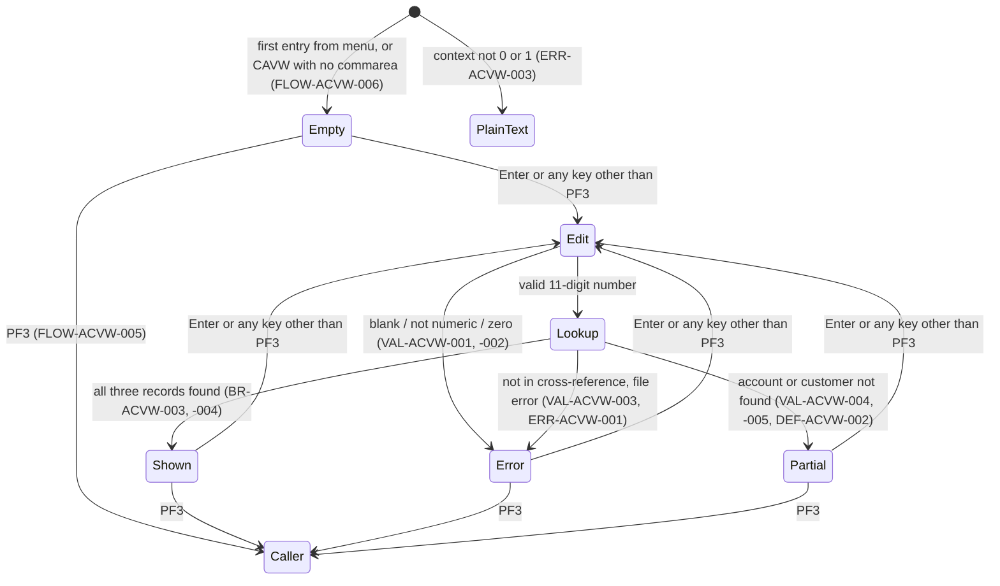
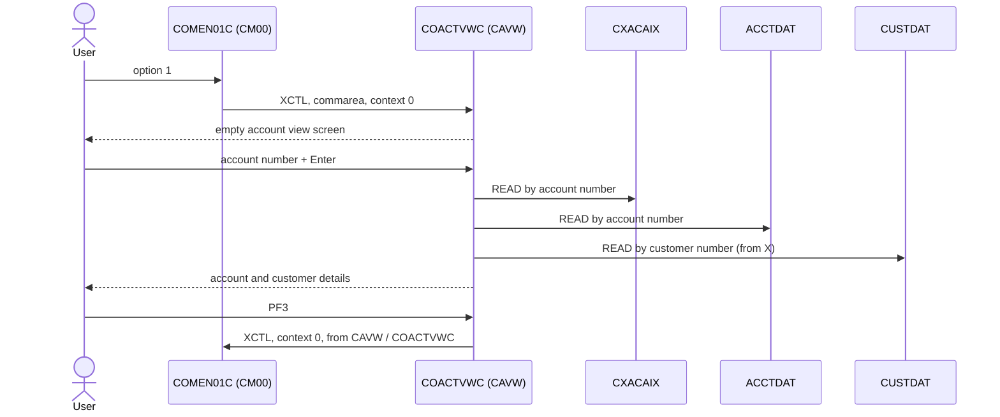

# COACTVWC: Online account view

## 1. Summary

A CardDemo user picks **Account View** (option 1) from the main menu, types an 11-digit account number and presses Enter. The program looks the account up in three files, in this order: the card cross-reference (through its alternate index by account), the account master and the customer master (using the customer number found in the cross-reference). It then shows the account's status, dates, limits, balance and cycle totals, and the customer's identity, address, phone numbers, SSN (formatted `nnn-nn-nnnn`), date of birth, FICO score and other personal data. The program only reads; it changes no file. It stores the account, customer and card numbers it found in the commarea, where later programs (the card list, view and update screens) pick them up. There is no check that the account belongs to the signed-on user, and the program also works when started without sign-on.

## 2. Rules at a glance

| ID | Rule |
| :-- | :-- |
| BR-ACVW-001 | The program is read-only: three keyed reads, no update, no lock. |
| BR-ACVW-002 | Lookup order is cross-reference, then account, then customer; the customer shown is the one on the cross-reference record found for the account. |
| BR-ACVW-003 | The account panel shows status, open, expiry and reissue dates, credit and cash limits, current balance, cycle credit and debit, and the account group. |
| BR-ACVW-004 | The customer panel shows customer number, SSN, date of birth, FICO score, three name parts, three address lines (the third under "City"), state, ZIP, country, two phones, government ID, EFT account and primary-holder flag. |
| BR-ACVW-005 | The commarea keeps the account number typed (or 0 when the input is invalid), and the customer and card numbers from the last successful cross-reference read. |
| VAL-ACVW-001 | The account number is required; an empty field (or `*`) gives `No input received`. |
| VAL-ACVW-002 | The account number must be 11 digits and not all zeros. |
| VAL-ACVW-003 | The account must be in the card cross-reference. |
| VAL-ACVW-004 | The account must be in the account master. |
| VAL-ACVW-005 | The account's customer must be in the customer master. |
| VAL-ACVW-006 | Only Enter and PF3 have their own meaning; every other key acts as Enter. |
| VAL-ACVW-007 | The screen definition asks the terminal for a completely filled, numeric account field. |

## 3. Actors and triggers

- **Actor:** a CardDemo user at a 3270 terminal. The program reads no user identity and checks no role (DEF-ACVW-008).
- **Normal trigger:** main menu `COMEN01C`, option 1 "Account View", marked for user type `U` (`app/cpy/COMEN02Y.cpy:25-29`). The menu sets `CDEMO-FROM-TRANID` = `CM00`, `CDEMO-FROM-PROGRAM` = `COMEN01C`, `CDEMO-PGM-CONTEXT` = 0 and transfers control (XCTL) with its 160-byte commarea (`app/cbl/COMEN01C.cbl:177-187`, values at `app/cbl/COMEN01C.cbl:36-37`).
- **Re-entry trigger:** every screen ends with "return, next transaction `CAVW`" (FLOW-ACVW-008), so the next key the user presses starts `CAVW` again with the commarea. `CAVW` runs program `COACTVWC` (`app/csd/CARDDEMO.CSD:317-326`), defined with `RESSEC(NO) CMDSEC(NO)`.
- **Direct start:** typing `CAVW` on a cleared terminal starts the program with no commarea. Unlike most CardDemo screens it does not send the user to sign-on; it shows the account view screen (FLOW-ACVW-002, DEF-ACVW-009).
- **Preconditions:** the CICS files `CXACAIX`, `ACCTDAT` and `CUSTDAT` are open. The batch cycle closes CICS files before it runs; during that window every lookup ends in a file error message (ERR-ACVW-001).

## 4. Interfaces

### 4.1 Screen CACTVWA (mapset COACTVW), 24 x 80

Source: `app/bms/COACTVW.bms:20-374`; symbolic map `app/cpy-bms/COACTVW.CPY:17-464`. Fields without an `ATTRB` operand get the BMS default (autoskip, normal intensity), so every field except the account number is protected. Data fields without `COLOR` use the terminal's default colour. The account number field and all account and customer data fields are underlined (`HILIGHT=UNDERLINE`); the header fields, `INFOMSG` (`HILIGHT=OFF`) and `ERRMSG` are not (`app/bms/COACTVW.bms:34-74, 356-368`).

| Row,Col | Field | Len | Direction | Attributes | Content |
| :-- | :-- | --: | :-- | :-- | :-- |
| 1,1 | (label) | 5 | out | protected, blue | `Tran:` |
| 1,7 | `TRNNAME` | 4 | out | protected, blue, FSET | `CAVW` |
| 1,21 | `TITLE01` | 40 | out | protected, yellow | `      AWS Mainframe Modernization       ` (`app/cpy/COTTL01Y.cpy:18-19`) |
| 1,65 | (label) | 5 | out | protected, blue | `Date:` |
| 1,71 | `CURDATE` | 8 | out | protected, blue | today `mm/dd/yy` (NUM-ACVW-006) |
| 2,1 | (label) | 5 | out | protected, blue | `Prog:` |
| 2,7 | `PGMNAME` | 8 | out | protected, blue | `COACTVWC` |
| 2,21 | `TITLE02` | 40 | out | protected, yellow | `              CardDemo                  ` (`app/cpy/COTTL01Y.cpy:20-22`) |
| 2,65 | (label) | 5 | out | protected, blue | `Time:` |
| 2,71 | `CURTIME` | 8 | out | protected, blue | now `hh:mm:ss` |
| 4,33 | (label) | 12 | out | neutral | `View Account` |
| 5,19 | (label) | 16 | out | protected, turquoise | `Account Number :` |
| 5,38 | `ACCTSID` | 11 | in/out | **unprotected**, green, underlined, FSET, initial cursor, `PICIN='99999999999'`, `VALIDN=(MUSTFILL)` | Account number (VAL-ACVW-001, -002, -007); red on error (FLOW-ACVW-010) |
| 5,57 | (label) | 12 | out | turquoise | `Active Y/N: ` |
| 5,70 | `ACSTTUS` | 1 | out | protected | `ACCT-ACTIVE-STATUS` |
| 6,8 | (label) | 7 | out | turquoise | `Opened:` |
| 6,17 | `ADTOPEN` | 10 | out | protected | `ACCT-OPEN-DATE` |
| 6,39 | (label) | 21 | out | protected, turquoise | `Credit Limit        :` |
| 6,61 | `ACRDLIM` | 15 | out | protected | `ACCT-CREDIT-LIMIT`, edited `+ZZZ,ZZZ,ZZZ.99` (NUM-ACVW-001) |
| 7,8 | (label) | 7 | out | turquoise | `Expiry:` |
| 7,17 | `AEXPDT` | 10 | out | protected | `ACCT-EXPIRAION-DATE` |
| 7,39 | (label) | 21 | out | protected, turquoise | `Cash credit Limit   :` |
| 7,61 | `ACSHLIM` | 15 | out | protected | `ACCT-CASH-CREDIT-LIMIT`, edited |
| 8,8 | (label) | 8 | out | turquoise | `Reissue:` |
| 8,17 | `AREISDT` | 10 | out | protected | `ACCT-REISSUE-DATE` |
| 8,39 | (label) | 21 | out | protected, turquoise | `Current Balance     :` |
| 8,61 | `ACURBAL` | 15 | out | protected | `ACCT-CURR-BAL`, edited |
| 9,39 | (label) | 21 | out | protected, turquoise | `Current Cycle Credit:` |
| 9,61 | `ACRCYCR` | 15 | out | protected | `ACCT-CURR-CYC-CREDIT`, edited |
| 10,8 | (label) | 14 | out | turquoise | `Account Group:` |
| 10,23 | `AADDGRP` | 10 | out | protected | `ACCT-GROUP-ID` |
| 10,39 | (label) | 21 | out | protected, turquoise | `Current Cycle Debit :` |
| 10,61 | `ACRCYDB` | 15 | out | protected | `ACCT-CURR-CYC-DEBIT`, edited |
| 11,32 | (label) | 16 | out | neutral | `Customer Details` |
| 12,8 | (label) | 14 | out | turquoise | `Customer id  :` |
| 12,23 | `ACSTNUM` | 9 | out | protected | `CUST-ID`, 9 digits |
| 12,49 | (label) | 4 | out | turquoise | `SSN:` |
| 12,54 | `ACSTSSN` | 12 | out | protected | `CUST-SSN` as `nnn-nn-nnnn` (NUM-ACVW-003) |
| 13,8 | (label) | 14 | out | turquoise | `Date of birth:` |
| 13,23 | `ACSTDOB` | 10 | out | protected | `CUST-DOB-YYYY-MM-DD` |
| 13,49 | (label) | 11 | out | turquoise | `FICO Score:` |
| 13,61 | `ACSTFCO` | 3 | out | protected | `CUST-FICO-CREDIT-SCORE`, 3 digits |
| 14,1 | (label) | 10 | out | turquoise | `First Name` |
| 14,28 | (label) | 13 | out | turquoise | `Middle Name: ` |
| 14,55 | (label) | 12 | out | turquoise | `Last Name : ` |
| 15,1 | `ACSFNAM` | 25 | out | protected | `CUST-FIRST-NAME` |
| 15,28 | `ACSMNAM` | 25 | out | protected | `CUST-MIDDLE-NAME` |
| 15,55 | `ACSLNAM` | 25 | out | protected | `CUST-LAST-NAME` |
| 16,1 | (label) | 8 | out | turquoise | `Address:` |
| 16,10 | `ACSADL1` | 50 | out | protected | `CUST-ADDR-LINE-1` |
| 16,63 | (label) | 6 | out | turquoise | `State ` |
| 16,73 | `ACSSTTE` | 2 | out | protected | `CUST-ADDR-STATE-CD` |
| 17,10 | `ACSADL2` | 50 | out | protected | `CUST-ADDR-LINE-2` |
| 17,63 | (label) | 3 | out | turquoise | `Zip` |
| 17,73 | `ACSZIPC` | 5 | out | protected | first 5 characters of `CUST-ADDR-ZIP` (NUM-ACVW-004) |
| 18,1 | (label) | 5 | out | turquoise | `City ` |
| 18,10 | `ACSCITY` | 50 | out | protected | `CUST-ADDR-LINE-3` |
| 18,63 | (label) | 7 | out | turquoise | `Country` |
| 18,73 | `ACSCTRY` | 3 | out | protected | `CUST-ADDR-COUNTRY-CD` |
| 19,1 | (label) | 8 | out | turquoise | `Phone 1:` |
| 19,10 | `ACSPHN1` | 13 | out | protected | first 13 characters of `CUST-PHONE-NUM-1` |
| 19,24 | (label) | 30 | out | turquoise | `Government Issued Id Ref    : ` |
| 19,58 | `ACSGOVT` | 20 | out | protected | `CUST-GOVT-ISSUED-ID` |
| 20,1 | (label) | 8 | out | turquoise | `Phone 2:` |
| 20,10 | `ACSPHN2` | 13 | out | protected | first 13 characters of `CUST-PHONE-NUM-2` |
| 20,24 | (label) | 16 | out | turquoise | `EFT Account Id: ` |
| 20,41 | `ACSEFTC` | 10 | out | protected | `CUST-EFT-ACCOUNT-ID` |
| 20,53 | (label) | 24 | out | turquoise | `Primary Card Holder Y/N:` |
| 20,78 | `ACSPFLG` | 1 | out | protected | `CUST-PRI-CARD-HOLDER-IND` |
| 22,23 | `INFOMSG` | 45 | out | protected, neutral, no highlight | Information message (FLOW-ACVW-011) |
| 1,1 | (unnamed) | 9 | out | default | Defined after row 22 in the macro source, overlapping `Tran:` (DEF-ACVW-017) |
| 23,1 | `ERRMSG` | 78 | out | protected, bright, **red**, FSET | Error message (section 8.3); always red |
| 24,1 | (label) | 60 | out | protected, turquoise | `  F3=Exit ` |

Length-0 fields (`POS=(5,50)` and similar) are stopper attributes that end the preceding field; they carry no data.

The program's message work fields are shorter than the screen fields: `WS-RETURN-MSG` is 75 characters (`ERRMSG` is 78) and `WS-INFO-MSG` is 40 (`INFOMSG` is 45), so a message never fills the screen field and is never cut by it (NUM-ACVW-007).

### 4.2 Files

| CICS file | Entity | Operation | Key | Lines |
| :-- | :-- | :-- | :-- | :-- |
| `CXACAIX` | ENT-CARD-XREF, through its alternate index on account number (non-unique) | READ | `XREF-ACCT-ID` (11) | 727-735 |
| `ACCTDAT` | ENT-ACCOUNT | READ (no UPDATE) | `ACCT-ID` (11) | 776-784 |
| `CUSTDAT` | ENT-CUSTOMER | READ (no UPDATE) | `CUST-ID` (9) | 826-834 |

The CICS definitions are at `app/csd/CARDDEMO.CSD:63-75` (`CXACAIX`), `app/csd/CARDDEMO.CSD:1-12` (`ACCTDAT`) and `app/csd/CARDDEMO.CSD:50-62` (`CUSTDAT`), all with `RLSACCESS(NO)`, `READINTEG(UNCOMMITTED)` and `RECOVERY(NONE)` (BR-ACVW-001). The program also defines constants for the card file `CARDDAT` and its account path `CARDAIX` (`:186-187, 190-191`) but never uses them.

### 4.3 Commarea

The program receives `ENT-COMMAREA` (160 bytes from `COCOM01Y`) plus its own 12-byte extension `WS-THIS-PROGCOMMAREA` (`:213-216`) and returns a 2000-byte area `WS-COMMAREA` (`:218`):

| Pos | Len | Content |
| --: | --: | :-- |
| 1 | 160 | `CARDDEMO-COMMAREA` (ENT-COMMAREA) |
| 161 | 8 | `CA-FROM-PROGRAM` (never set or read by the program; passed through) |
| 169 | 4 | `CA-FROM-TRANID` (never set or read; passed through) |
| 173 | 1828 | spaces |

PF3 passes only the 160-byte `CARDDEMO-COMMAREA` (FLOW-ACVW-005).

| Field | Read | Written | Use |
| :-- | :-- | :-- | :-- |
| `CDEMO-FROM-TRANID` | yes | yes (PF3) | PF3 target transaction; set to `CAVW` when leaving |
| `CDEMO-FROM-PROGRAM` | yes | yes (PF3) | first-entry test (DEF-ACVW-007), PF3 target; set to `COACTVWC` when leaving |
| `CDEMO-TO-TRANID`, `CDEMO-TO-PROGRAM` | no | yes (PF3) | XCTL target |
| `CDEMO-USER-TYPE` | no | yes (PF3) | forced to `U` (DEF-ACVW-011) |
| `CDEMO-PGM-CONTEXT` | yes | yes | 0 = first entry, 1 = re-entry (FLOW-ACVW-004); set to 1 before every screen, 0 on PF3 |
| `CDEMO-ACCT-ID` | yes (lookup key) | yes | account number typed, or 0 (BR-ACVW-005) |
| `CDEMO-CUST-ID` | yes (customer key) | yes | from `XREF-CUST-ID`; kept from the previous lookup when the input or the cross-reference read fails (DEF-ACVW-018) |
| `CDEMO-CARD-NUM` | no | yes | from `XREF-CARD-NUM`; kept from the previous lookup when the input or the cross-reference read fails (DEF-ACVW-018) |
| `CDEMO-LAST-MAP`, `CDEMO-LAST-MAPSET` | no | yes (PF3) | `CACTVWA`, `COACTVW` |

`CDEMO-USER-ID`, the customer name fields and `CDEMO-ACCT-STATUS` pass through unchanged. The incoming `CDEMO-ACCT-ID` is not used to pre-fill the account field.

### 4.4 Console and terminal text output

No CICS log output. Two paths write plain text to the terminal instead of the map: the unexpected-context path (ERR-ACVW-003) and the abend routine (ERR-ACVW-004).

## 5. Data used

| Entity field | Read | Written | How |
| :-- | :-- | :-- | :-- |
| ENT-CARD-XREF.XREF-ACCT-ID | key | no | account number typed |
| ENT-CARD-XREF.XREF-CUST-ID | yes | no | copied to `CDEMO-CUST-ID`; key for the customer read |
| ENT-CARD-XREF.XREF-CARD-NUM | yes | no | copied to `CDEMO-CARD-NUM`; not displayed |
| ENT-ACCOUNT.ACCT-ID | key | no | account number typed; the record's own `ACCT-ID` is not displayed |
| ENT-ACCOUNT.ACCT-ACTIVE-STATUS, -CURR-BAL, -CREDIT-LIMIT, -CASH-CREDIT-LIMIT, -OPEN-DATE, -EXPIRAION-DATE, -REISSUE-DATE, -CURR-CYC-CREDIT, -CURR-CYC-DEBIT, -GROUP-ID | yes | no | displayed (BR-ACVW-003) |
| ENT-ACCOUNT.ACCT-ADDR-ZIP | no | no | not displayed |
| ENT-CUSTOMER.CUST-ID | key and display | no | key from the cross-reference; displayed |
| ENT-CUSTOMER (all named fields) | yes | no | displayed (BR-ACVW-004) |
| ENT-COMMAREA | yes | yes | section 4.3 |

Program-local data with behaviour:

- Flags `WS-INPUT-FLAG` (`:50-53`), `WS-EDIT-ACCT-FLAG` (`:58-61`), `WS-EDIT-CUST-FLAG` (`:62-65`), `WS-ACCOUNT-MASTER-READ-FLAG` / `WS-CUST-MASTER-READ-FLAG` (`:81-85`). All are reset to spaces at the start of every task (`:268-270`), so a space in `WS-EDIT-ACCT-FLAG` means "blank account filter" (`FLG-ACCTFILTER-BLANK`) until the edit runs.
- Message fields `WS-RETURN-MSG` X(75) with its 88-level texts (`:117-138`), `WS-INFO-MSG` X(40) (`:110-116`), and the file error template `WS-FILE-ERROR-MESSAGE` (80 bytes, `:86-105`).
- Key areas `WS-CARD-RID-ACCT-ID` 9(11) / `-X` and `WS-CARD-RID-CUST-ID` 9(9) / `-X` (`:73-80`).
- Work area `CC-WORK-AREA` from `CVCRD01Y` (`app/cpy/CVCRD01Y.cpy:2-42`): the mapped key `CCARD-AID` and the account input `CC-ACCT-ID` X(11). `CCARD-ERROR-MSG` and `CCARD-NEXT-PROG` are filled (`:388, 395, 601-602`) but never read; `CCARD-NEXT-MAPSET` and `CCARD-NEXT-MAP` are filled (`:579-580, 603-604`) and name the map in the SEND (`:583-584`).
- Copied but unused: `CVACT02Y` (card record), `CSUSR01Y` (user record), `CSMSG01Y` (common messages, so there is no "invalid key" message), and `WS-LONG-MSG` (only for the unreachable `SEND-LONG-TEXT`).

## 6. Processing flow



Each arrow is one CICS task: receive, act, send the screen, return with next transaction `CAVW`.

**Entry (0000-MAIN, lines 262-393)**

1. Register `ABEND-ROUTINE` as the abend handler; reset the work areas, the flags, the messages and the 2000-byte output commarea (264-278).
2. Commarea intake (282-293, FLOW-ACVW-002): with no commarea, start from a blank commarea; otherwise copy the first 160 bytes into `CARDDEMO-COMMAREA` and the next 12 into the extension.
3. Map the key (299-300, FLOW-ACVW-003). Keys other than Enter and PF3 become Enter (306-314).
4. Dispatch (323-383, FLOW-ACVW-004):

```text
if key = PF3:                      leave to caller (FLOW-ACVW-005)
else if context = 0 (first entry): send screen; return
else if context = 1 (re-entry):
    receive screen; edit account number (VAL-ACVW-001, -002)
    if input error: send screen; return
    else: read cross-reference, account, customer (9000-READ-ACCT); send screen; return
else: send plain text 'UNEXPECTED DATA SCENARIO'; end conversation (ERR-ACVW-003)
```

5. Lines 387-392 (send the screen if an error slipped through) are never reached (DEF-ACVW-014).

**Lookup (9000-READ-ACCT, lines 687-718)**

1. Information message reset (689); key = `CDEMO-ACCT-ID` (691).
2. Read the cross-reference by account (SE-ACVW-001). On any failure stop the lookup (697-699).
3. Read the account (SE-ACVW-002). The test that should stop the lookup when the account is missing never fires (704-706, DEF-ACVW-002).
4. Key = `CDEMO-CUST-ID` from the cross-reference (708); read the customer (SE-ACVW-003). The test after it never fires either (713-715).

**Screen (1000-SEND-MAP, lines 416-425):** header (1100), data and messages (1200), attributes and cursor (1300), send with erase (1400). Then `COMMON-RETURN` (FLOW-ACVW-008).

## 7. Business rules

#### BR-ACVW-001 · Read-only inquiry
- **When:** any interaction.
- **Then:** the program issues at most three keyed READ commands without UPDATE (cross-reference, account, customer) and no WRITE, REWRITE or DELETE. Nothing is locked: a READ without UPDATE takes no record lock, and because the files are not RLS files (`RLSACCESS(NO)`), their `READINTEG(UNCOMMITTED)` has no effect, so a read can return a record that another task has just rewritten and not yet committed. The files are defined with `RECOVERY(NONE)`, so CICS never backs such a change out.
- **Source:** `:727-735, 776-784, 826-834`; `app/csd/CARDDEMO.CSD:2-3, 9, 52-53, 59, 65-66, 72`
- **Fidelity:** must-preserve
- **Confidence:** reviewed; read-integrity and recovery semantics platform-inferred

#### BR-ACVW-002 · Lookup chain: cross-reference, account, customer
- **When:** a valid account number was entered (VAL-ACVW-002 passed).
- **Then:**
  1. The card cross-reference is read through the account alternate index with the 11-digit account number. The single matching record supplies the customer number and the card number. When the account has several cards the read is an error and nothing is copied (DEF-ACVW-003).
  2. The account master is read with the **typed** account number (not with `XREF-ACCT-ID`; they are equal by construction of the index).
  3. The customer master is read with the customer number from step 1.
  The lookup stops only if step 1 fails. An account that exists in the account master but has no card in the cross-reference cannot be viewed (DEF-ACVW-004). The customer shown is the one linked to the card found, not a customer stored on the account (the account record has no customer field).
- **Source:** `:691-715, 738-740, 759-766, 697-699`
- **Fidelity:** must-preserve
- **Confidence:** reviewed

#### BR-ACVW-003 · Account panel
- **When:** the account read succeeded, or the customer read succeeded (DEF-ACVW-002: the condition is "account found **or** customer found").
- **Then:** these fields are shown:

| Screen field | From | Format |
| :-- | :-- | :-- |
| `ACSTTUS` (Active Y/N) | `ACCT-ACTIVE-STATUS` | as stored, 1 character |
| `ACURBAL` (Current Balance) | `ACCT-CURR-BAL` | `+ZZZ,ZZZ,ZZZ.99` (NUM-ACVW-001) |
| `ACRDLIM` (Credit Limit) | `ACCT-CREDIT-LIMIT` | same |
| `ACSHLIM` (Cash credit Limit) | `ACCT-CASH-CREDIT-LIMIT` | same |
| `ACRCYCR` (Current Cycle Credit) | `ACCT-CURR-CYC-CREDIT` | same |
| `ACRCYDB` (Current Cycle Debit) | `ACCT-CURR-CYC-DEBIT` | same |
| `ADTOPEN` (Opened) | `ACCT-OPEN-DATE` | as stored, 10 characters (NUM-ACVW-002) |
| `AEXPDT` (Expiry) | `ACCT-EXPIRAION-DATE` | as stored |
| `AREISDT` (Reissue) | `ACCT-REISSUE-DATE` | as stored |
| `AADDGRP` (Account Group) | `ACCT-GROUP-ID` | as stored, 10 characters |

The account number field shows the number as typed. `ACCT-ADDR-ZIP` is not shown.
- **Source:** `:468, 471-491`
- **Fidelity:** must-preserve
- **Confidence:** reviewed

#### BR-ACVW-004 · Customer panel
- **When:** the customer read succeeded.
- **Then:** these fields are shown:

| Screen field (label) | From | Format |
| :-- | :-- | :-- |
| `ACSTNUM` (Customer id) | `CUST-ID` | 9 digits with leading zeros |
| `ACSTSSN` (SSN) | `CUST-SSN` | `nnn-nn-nnnn`, full number, unmasked (NUM-ACVW-003, DEF-ACVW-010) |
| `ACSTFCO` (FICO Score) | `CUST-FICO-CREDIT-SCORE` | 3 digits with leading zeros |
| `ACSTDOB` (Date of birth) | `CUST-DOB-YYYY-MM-DD` | as stored, 10 characters |
| `ACSFNAM`, `ACSMNAM`, `ACSLNAM` (First, Middle, Last Name) | `CUST-FIRST-NAME`, `CUST-MIDDLE-NAME`, `CUST-LAST-NAME` | 25 characters each |
| `ACSADL1`, `ACSADL2` (Address) | `CUST-ADDR-LINE-1`, `CUST-ADDR-LINE-2` | 50 characters each |
| `ACSCITY` (City) | `CUST-ADDR-LINE-3` | 50 characters; the third address line is presented as the city |
| `ACSSTTE` (State) | `CUST-ADDR-STATE-CD` | 2 characters |
| `ACSZIPC` (Zip) | `CUST-ADDR-ZIP` | first 5 of 10 characters (NUM-ACVW-004) |
| `ACSCTRY` (Country) | `CUST-ADDR-COUNTRY-CD` | 3 characters |
| `ACSPHN1`, `ACSPHN2` (Phone 1, 2) | `CUST-PHONE-NUM-1`, `CUST-PHONE-NUM-2` | first 13 of 15 characters (NUM-ACVW-004) |
| `ACSGOVT` (Government Issued Id Ref) | `CUST-GOVT-ISSUED-ID` | 20 characters |
| `ACSEFTC` (EFT Account Id) | `CUST-EFT-ACCOUNT-ID` | 10 characters |
| `ACSPFLG` (Primary Card Holder Y/N) | `CUST-PRI-CARD-HOLDER-IND` | 1 character |

- **Source:** `:493-523`
- **Fidelity:** must-preserve
- **Confidence:** reviewed

#### BR-ACVW-005 · Selected account kept in the commarea
- **When:** the account number is edited and looked up.
- **Then:** `CDEMO-ACCT-ID` is set to the typed number when it passes VAL-ACVW-002, and to 0 when it is blank, not numeric or zero. When the cross-reference read succeeds, `CDEMO-CUST-ID` and `CDEMO-CARD-NUM` are set from it. After an input error or a failed cross-reference read they are not reset, so they keep the values of the previous successful lookup (DEF-ACVW-018). These values stay in the commarea for the rest of the session (they are not reset when a later lookup fails at the account or customer step either) and reach the menu on PF3. The card list reads `CDEMO-ACCT-ID` directly (`app/cbl/COCRDLIC.cbl:849-853`). Card view and card update read it only when they are entered from the card list (condition `CDEMO-FROM-PROGRAM = LIT-CCLISTPGM`, `app/cbl/COCRDSLC.cbl:339-342`, `app/cbl/COCRDUPC.cbl:482-490`).
- **Source:** `:660, 675, 678, 739-740`
- **Fidelity:** must-preserve (the cross-screen context is visible to the user)
- **Confidence:** reviewed

## 8. Validations and messages

#### VAL-ACVW-001 · Account number required
- **When:** on re-entry the received account field is `*` (followed by spaces), all spaces, or empty (low-values, for example after the user erased it).
- **Then:** input error; `CDEMO-ACCT-ID` = 0; message `No input received`; the account field shows `*` in red; cursor on the account field; no file is read. The program first sets `Account number not provided`, then overwrites it with `No input received` (DEF-ACVW-006), so only the second text is ever shown.
- **Source:** `:628-630, 653-661, 640-642, 561-565`
- **Fidelity:** must-preserve
- **Confidence:** reviewed; low-values for an erased field platform-inferred

#### VAL-ACVW-002 · Account number format
- **When:** the account field is not blank and either contains any character other than `0`-`9` in its 11 positions (letters, signs, embedded or trailing spaces, a short entry) or is `00000000000`.
- **Then:** input error; `CDEMO-ACCT-ID` = 0; message `Account Filter must  be a non-zero 11 digit number` (two spaces after "must"; 50 characters); the input is shown back in red; cursor on the account field; no file is read.
- **Otherwise:** `CDEMO-ACCT-ID` = the 11 digits; the lookup runs.
- **Note:** the 88-level texts `Account number must be a non zero 11 digit number` (`:125-128`) are never used. A short entry such as `123` fails because the rest of the field is not digits; the program does not pad with zeros.
- **Source:** `:666-680`
- **Fidelity:** must-preserve
- **Confidence:** reviewed

#### VAL-ACVW-003 · Account must be in the card cross-reference
- **When:** the cross-reference read by account returns NOTFND.
- **Then:** input error; message built from `Account:`, the 11-character account number, ` not found in Cross ref file.  Resp:`, the RESP as 9 digits plus a space, ` Reas:` and the RESP2, cut to 75 characters (NUM-ACVW-005); for the usual NOTFND codes it reads `Account:99999999999 not found in Cross ref file.  Resp:000000013  Reas:0000` (75 characters; two spaces before "Resp" and before "Reas"). The account field is shown back in red; no account or customer data is shown.
- **Source:** `:741-758`
- **Fidelity:** must-preserve (the condition); defect-decide (the text, DEF-ACVW-016)
- **Confidence:** reviewed; RESP 13 and RESP2 for NOTFND platform-inferred

#### VAL-ACVW-004 · Account must be in the account master
- **When:** the cross-reference was found but the account read returns NOTFND.
- **Then:** input error; message `Account:99999999999 not found in Acct Master file.Resp:000000013  Reas:0000` (75 characters; no space after "file."; the number is the one typed); the account field is red. The customer is still read (DEF-ACVW-002).
- **Source:** `:789-807`
- **Fidelity:** must-preserve (the condition); defect-decide (the continuation)
- **Confidence:** reviewed; RESP 13 and RESP2 for NOTFND platform-inferred

#### VAL-ACVW-005 · Customer must be in the customer master
- **When:** the customer read returns NOTFND.
- **Then:** input error, but the account filter stays valid, so the account field keeps the map colour (green, FLOW-ACVW-010) and the account panel is shown (if the account was found). If no earlier message was set: `CustId:<9-digit number> not found in customer master.Resp: 000000013  REAS:0000000` (75 characters; a space after "Resp:", "REAS" in capitals, the RESP2 cut to 7 characters). The customer panel stays empty.
- **Source:** `:839-857`
- **Fidelity:** must-preserve
- **Confidence:** reviewed; RESP 13 and RESP2 for NOTFND platform-inferred

#### VAL-ACVW-006 · Keys

| Key (after PF13-PF24 are folded onto PF1-PF12) | Effect | Source |
| :-- | :-- | :-- |
| Enter | Process the screen (first entry: show the empty screen) | 307, 353-374 |
| PF3 (or PF15) | Leave to the caller (FLOW-ACVW-005) | 308, 324-352 |
| PF1, PF2, PF4-PF12 (and PF13, PF14, PF16-PF24), PA1, PA2, Clear | Treated as Enter. No "invalid key" message (DEF-ACVW-012) | 306, 312-314 |
| PA3 or any AID not in the mapping table | `CCARD-AID` stays spaces, treated as Enter | `app/cpy/CSSTRPFY.cpy:21-78`, 312-314 |

For PA1, PA2, PA3 and Clear the terminal sends no field data, so the receive finds no input (MAPFAIL, not checked, ERR-ACVW-005). The account field then holds whatever the receive area contained, very likely low-values, which gives `No input received` (VAL-ACVW-001).
- **Source:** `:299-314`; `app/cpy/CSSTRPFY.cpy:17-79`
- **Fidelity:** must-preserve (Enter, PF3); defect-decide (other keys)
- **Confidence:** reviewed; MAPFAIL content platform-inferred

#### VAL-ACVW-007 · Terminal-level checks from the screen definition
- **When:** the user types in the account field.
- **Then:** the BMS map defines the field with `VALIDN=(MUSTFILL)` and `PICIN='99999999999'`. On terminals with the field-validation feature, MUSTFILL keeps the keyboard locked until all 11 positions are filled; PICIN only defines the COBOL picture of `ACCTSIDI` and does not validate. On terminals or emulators without field validation, nothing is checked before the program's own edit (VAL-ACVW-002).
- **Source:** `app/bms/COACTVW.bms:84-90`; `app/cpy-bms/COACTVW.CPY:60`
- **Fidelity:** incidental (the target validates in the program or the UI)
- **Confidence:** platform-inferred

### 8.1 Flow and keys

#### FLOW-ACVW-001 · Task start
- **Then:** register `ABEND-ROUTINE` for any abend in this task; reset `CC-WORK-AREA`, `WS-MISC-STORAGE` and `WS-COMMAREA` (alphanumeric fields to spaces, numeric to zeros; the literal parts of `WS-FILE-ERROR-MESSAGE` keep their values); set the error message to spaces.
- **Source:** `:264-278`
- **Fidelity:** incidental
- **Confidence:** reviewed

#### FLOW-ACVW-002 · Commarea intake
- **When:** no commarea (`EIBCALEN` = 0), or `CDEMO-FROM-PROGRAM` = `COMEN01C` and context not 1 (this second test looks at the commarea before it is copied, DEF-ACVW-007).
- **Then:** start from a blank commarea (`CDEMO-PGM-CONTEXT` = 0, all other fields spaces or zeros) and a blank extension.
- **Otherwise:** copy bytes 1-160 of the received commarea into `CARDDEMO-COMMAREA` and bytes 161-172 into the extension (DEF-ACVW-015).
- **Source:** `:282-293`
- **Fidelity:** must-preserve (a session can start without a commarea)
- **Confidence:** reviewed

#### FLOW-ACVW-003 · Key mapping
- **Then:** `YYYY-STORE-PFKEY` (copybook `CSSTRPFY`) converts `EIBAID` into `CCARD-AID`: Enter, Clear, PA1, PA2, PF1-PF12, and PF13-PF24 as PF1-PF12. Then any key other than Enter and PF3 is replaced by Enter (VAL-ACVW-006).
- **Source:** `:299-314`; `app/cpy/CSSTRPFY.cpy:17-79`
- **Fidelity:** must-preserve
- **Confidence:** reviewed

#### FLOW-ACVW-004 · Dispatch (decision table)

| Condition (first match wins) | Action | Lines |
| :-- | :-- | :-- |
| key = PF3 | FLOW-ACVW-005 | 324-352 |
| `CDEMO-PGM-CONTEXT` = 0 | FLOW-ACVW-006 | 353-360 |
| `CDEMO-PGM-CONTEXT` = 1 | FLOW-ACVW-007 | 361-374 |
| anything else | ERR-ACVW-003 | 375-382 |

PF3 is tested before the context, so a program that transferred here while its own key was PF3 would bounce straight back. No caller in the repository does this; the menu transfers on Enter.
- **Source:** `:323-383`
- **Fidelity:** must-preserve
- **Confidence:** reviewed

#### FLOW-ACVW-005 · PF3, back to the caller
- **Then:** target transaction = `CDEMO-FROM-TRANID`, or `CM00` when it is spaces or low-values; target program = `CDEMO-FROM-PROGRAM`, or `COMEN01C` when it is spaces or low-values. Then set `CDEMO-FROM-TRANID` = `CAVW`, `CDEMO-FROM-PROGRAM` = `COACTVWC`, `CDEMO-USER-TYPE` = `U` (DEF-ACVW-011), `CDEMO-PGM-CONTEXT` = 0, `CDEMO-LAST-MAPSET` = `COACTVW`, `CDEMO-LAST-MAP` = `CACTVWA`, and transfer control (XCTL) to the target program with the 160-byte commarea. The target transaction is stored but XCTL uses only the program. Coming from the menu, PF3 returns to the menu, which shows its screen afresh because the context is 0. If the target program does not exist, the XCTL fails with no RESP option and the task abends into ERR-ACVW-004.
- **Source:** `:324-352`
- **Fidelity:** must-preserve
- **Confidence:** reviewed; XCTL failure platform-inferred

#### FLOW-ACVW-006 · First entry
- **When:** context 0 and key not PF3 (normally from the menu, or a direct start with no commarea).
- **Then:** send the screen with an empty account field (map colour green, no `*`), empty panels, an empty error line and the information message `Enter or update id of account to display`; cursor on the account field; return (FLOW-ACVW-008). Any `CDEMO-ACCT-ID` already in the commarea is ignored.
- **Source:** `:353-360, 462-466, 528-534`
- **Fidelity:** must-preserve
- **Confidence:** reviewed

#### FLOW-ACVW-007 · Re-entry
- **When:** context 1 and key not PF3.
- **Then:** receive the map, edit the account number (VAL-ACVW-001, -002). With an input error, send the screen and return. Otherwise run the lookup (BR-ACVW-002), then send the screen whatever the lookup result, and return.
- **Source:** `:361-374, 596-605, 610-617`
- **Fidelity:** must-preserve
- **Confidence:** reviewed

#### FLOW-ACVW-008 · End of every interaction
- **Then:** build the 2000-byte output commarea (160-byte `CARDDEMO-COMMAREA`, 12-byte extension, spaces) and return to CICS naming `CAVW` as the next transaction. `CDEMO-PGM-CONTEXT` is 1 at this point because sending the screen sets it (FLOW-ACVW-009).
- **Source:** `:394-407, 581`
- **Fidelity:** must-preserve (context survives between screens); incidental (the 2000-byte length)
- **Confidence:** reviewed

#### FLOW-ACVW-009 · Screen build and header
- **Then:** every send starts from an all-low-values map (so a field the program does not fill is empty on the screen), fills the titles, `CAVW`, `COACTVWC`, the date and the time (NUM-ACVW-006), then the data and messages (BR-ACVW-003, -004, FLOW-ACVW-011), then the attributes (FLOW-ACVW-010), sets `CDEMO-PGM-CONTEXT` = 1 and sends map `CACTVWA` of mapset `COACTVW` with ERASE, FREEKB and symbolic cursor positioning.
- **Source:** `:416-425, 431-455, 577-591`
- **Fidelity:** must-preserve (content); incidental (3270 options)
- **Confidence:** reviewed

#### FLOW-ACVW-010 · Account field attributes, colour and cursor
- **Then:** the account field is made unprotected with its modified flag on (so it is always sent back); the cursor is always placed on it (both branches of the cursor decision do the same, DEF-ACVW-014). Its colour is first set to `DFHDFCOL`, which leaves the colour defined in the map (green, `app/bms/COACTVW.bms:84-90`), and then changed to red in the error cases:

| Situation | Content | Colour |
| :-- | :-- | :-- |
| first entry | empty | map colour (green; set through `DFHDFCOL`) |
| re-entry, blank input (VAL-ACVW-001) | `*` | red |
| invalid input (VAL-ACVW-002) | input as typed | red |
| not in cross-reference, cross-reference or account file error, account not found | number as typed | red |
| customer not found or customer file error | number as typed | map colour (green; set through `DFHDFCOL`) |
| all found | number as typed | map colour (green; set through `DFHDFCOL`) |

- **Source:** `:541-565, 465-468`; `app/bms/COACTVW.bms:84-90`
- **Fidelity:** must-preserve
- **Confidence:** reviewed; meaning of `DFHBMFSE` and `DFHDFCOL` platform-inferred

#### FLOW-ACVW-011 · Information message
- **Then:** the information line always shows `Enter or update id of account to display` (40 characters in the 45-character field), in neutral colour: before every send the program sets this prompt whenever no other information message is set, and no other one is ever set. `Displaying details of given Account` (`:115-116`) is never shown, even after a successful lookup. The "dark" colour branch for an empty information message is never taken (DEF-ACVW-014).
- **Source:** `:528-534, 567-571, 689`
- **Fidelity:** must-preserve (text)
- **Confidence:** reviewed

#### FLOW-ACVW-012 · Copied key-mapping paragraphs
- **Then:** `COPY 'CSSTRPFY'` at line 913 inserts `YYYY-STORE-PFKEY` and `YYYY-STORE-PFKEY-EXIT` between `SEND-LONG-TEXT-EXIT` and `ABEND-ROUTINE`. They are reached only through the PERFORM THRU at lines 299-300 (FLOW-ACVW-003). The full stop at line 914 closes the last sentence of the copied text.
- **Source:** `:913-914`; `app/cpy/CSSTRPFY.cpy:17-82`
- **Fidelity:** incidental
- **Confidence:** reviewed

#### FLOW-ACVW-013 · Exit paragraphs
- **Then:** every `-EXIT` paragraph contains only EXIT and ends the range of a PERFORM THRU: `1000-SEND-MAP-EXIT`, `1100-SCREEN-INIT-EXIT`, `1200-SETUP-SCREEN-VARS-EXIT`, `1300-SETUP-SCREEN-ATTRS-EXIT`, `1400-SEND-SCREEN-EXIT`, `2000-PROCESS-INPUTS-EXIT`, `2100-RECEIVE-MAP-EXIT`, `2200-EDIT-MAP-INPUTS-EXIT`, `2210-EDIT-ACCOUNT-EXIT` (also a GO TO target), `9000-READ-ACCT-EXIT` (also a GO TO target), `9200-...-EXIT`, `9300-...-EXIT`, `9400-...-EXIT`, `SEND-PLAIN-TEXT-EXIT`. `SEND-LONG-TEXT-EXIT` is not referenced, because its paragraph is never performed (ERR-ACVW-006). The two `0000-MAIN-EXIT` paragraphs are not referenced by any statement and are never reached (DEF-ACVW-001).
- **Source:** `:427-429, 457-459, 537-539, 574-576, 592-594, 607-609, 619-621, 645-647, 683-685, 720-722, 771-773, 821-823, 870-872, 888-890, 907-909, 408-413`
- **Fidelity:** incidental
- **Confidence:** reviewed

### 8.2 Decision table for the account field edit

| Received `ACCTSID` | `CC-ACCT-ID` | Result | Message | `CDEMO-ACCT-ID` |
| :-- | :-- | :-- | :-- | :-- |
| `*` (rest spaces) or all spaces | low-values | blank | `No input received` | 0 |
| empty (low-values) | low-values | blank | `No input received` | 0 |
| contains a non-digit | as typed | not OK | `Account Filter must  be a non-zero 11 digit number` | 0 |
| `00000000000` | as typed | not OK | same | 0 |
| 11 digits, not all zero | as typed | valid, lookup | depends on the lookup | the number |

Source: `:622-681`.

### 8.3 Message catalog

Error messages appear in `ERRMSG` (row 23, 78 characters, always bright red); the program's message field is 75 characters. The information message is in `INFOMSG` (row 22, 45 characters, neutral). Only one error message is kept per interaction (ERR-ACVW-002).

| Text (exact) | Len | Cause | Item |
| :-- | --: | :-- | :-- |
| `No input received` | 17 | account field blank or `*` | VAL-ACVW-001 |
| `Account Filter must  be a non-zero 11 digit number` | 50 | not 11 digits, or all zeros | VAL-ACVW-002 |
| `Account:nnnnnnnnnnn not found in Cross ref file.  Resp:000000013  Reas:0000` | 75 | cross-reference NOTFND (number as typed) | VAL-ACVW-003 |
| `Account:nnnnnnnnnnn not found in Acct Master file.Resp:000000013  Reas:0000` | 75 | account NOTFND | VAL-ACVW-004 |
| `CustId:nnnnnnnnn not found in customer master.Resp: 000000013  REAS:0000000` | 75 | customer NOTFND (customer number from the cross-reference) | VAL-ACVW-005 |
| `File Error: READ     on CXACAIX   returned RESP rrrrrrrrr ,RESP2 sssssssss ` | 75 | cross-reference read, any other response (includes DUPKEY) | ERR-ACVW-001 |
| `File Error: READ     on ACCTDAT   returned RESP rrrrrrrrr ,RESP2 sssssssss ` | 75 | account read, other response | ERR-ACVW-001 |
| `File Error: READ     on CUSTDAT   returned RESP rrrrrrrrr ,RESP2 sssssssss ` | 75 | customer read, other response | ERR-ACVW-001 |
| `Enter or update id of account to display` (information line) | 40 | always | FLOW-ACVW-011 |
| `UNEXPECTED DATA SCENARIO` (plain text, whole screen) | 24 | context not 0 or 1 | ERR-ACVW-003 |

In the "File Error" texts, `READ` is followed by five spaces, the file name by three spaces, `rrrrrrrrr` and `sssssssss` are the RESP and RESP2 values as 9 unsigned digits with leading zeros (NUM-ACVW-005), and the text ends with one space. `nnnnnnnnnnn` is the 11-character account number and `nnnnnnnnn` the 9-digit customer number.

Never shown although defined: `Account number not provided`, `Account number must be a non zero 11 digit number`, `Did not find this account in account card xref file`, `Did not find this account in account master file`, `Did not find associated customer in master file`, `Error reading account card xref File`, `Looks Good.... so far`, `PF03 pressed.Exiting              `, `Displaying details of given Account` (DEF-ACVW-006), and the abend default `UNEXPECTED ABEND OCCURRED.` (DEF-ACVW-013).

## 9. Side effects

The program changes no file. In execution order for a valid account number:

#### SE-ACVW-001 · Read the card cross-reference by account
- **What:** READ `CXACAIX` (the path over the cross-reference alternate index), key = the 11 characters of the account number, key length 11, into the 50-byte cross-reference record. No UPDATE, no lock. On success the customer and card numbers go to the commarea (BR-ACVW-005).
- **Source:** `:691, 727-740`; `app/csd/CARDDEMO.CSD:63-75`
- **Fidelity:** must-preserve
- **Confidence:** reviewed

#### SE-ACVW-002 · Read the account
- **What:** READ `ACCTDAT`, key = the same 11 characters, into the 300-byte account record. No UPDATE. Runs only when SE-ACVW-001 succeeded.
- **Source:** `:701-702, 776-788`; `app/csd/CARDDEMO.CSD:1-12`
- **Fidelity:** must-preserve
- **Confidence:** reviewed

#### SE-ACVW-003 · Read the customer
- **What:** READ `CUSTDAT`, key = the 9-digit `CDEMO-CUST-ID` from the cross-reference as characters, key length 9, into the 500-byte customer record. No UPDATE. Runs whenever SE-ACVW-001 succeeded, whatever the result of SE-ACVW-002 (DEF-ACVW-002).
- **Source:** `:708-711, 826-838`; `app/csd/CARDDEMO.CSD:50-62`
- **Fidelity:** must-preserve
- **Confidence:** reviewed

## 10. Error handling

#### ERR-ACVW-001 · File response codes

| Read | NORMAL | NOTFND | Any other response (DUPKEY, NOTOPEN, DISABLED, IOERR, ...) |
| :-- | :-- | :-- | :-- |
| Cross-reference (`CXACAIX`) | customer and card numbers to commarea; continue | VAL-ACVW-003; lookup stops | input error, account filter not OK, `File Error: READ     on CXACAIX   ...`; lookup stops |
| Account (`ACCTDAT`) | account found; continue | VAL-ACVW-004; **continues** to the customer read | input error, account filter not OK, `File Error: READ     on ACCTDAT   ...`; **continues** |
| Customer (`CUSTDAT`) | customer found | VAL-ACVW-005 | input error, customer filter not OK (account field colour unchanged), `File Error: READ     on CUSTDAT   ...` |

After the lookup the screen is always sent (FLOW-ACVW-007), showing whatever was found and the message. There is no rollback to consider; nothing was changed.
- **Source:** `:737-769, 786-819, 836-868, 697-715`
- **Fidelity:** must-preserve (which situations are errors); defect-decide (continuing after the account error, DEF-ACVW-002)
- **Confidence:** reviewed; the response names a real file returns are platform-inferred

#### ERR-ACVW-002 · Which message wins
- **Then:** a NOTFND message is stored only when no message is set yet; an "other response" message always overwrites. Consequence: after "account not found", a "customer not found" is not reported, but a customer file error replaces the account message. The blank-input message is always replaced by `No input received` (DEF-ACVW-006).
- **Source:** `:744, 793, 845, 759-766, 809-816, 858-865, 640-642`
- **Fidelity:** must-preserve
- **Confidence:** reviewed

#### ERR-ACVW-003 · Unexpected context
- **When:** the key is not PF3 and `CDEMO-PGM-CONTEXT` is neither 0 nor 1 (only possible with a commarea that this program or the menu did not build).
- **Then:** the abend fields are filled (`COACTVWC`, code `0001`) but not used; the text `UNEXPECTED DATA SCENARIO` followed by spaces (75 characters) is sent to the terminal as plain text with erase; the program returns to CICS **without** a next transaction, so the pseudo-conversation ends and the user must type a transaction code.
- **Source:** `:375-382, 877-887`
- **Fidelity:** must-preserve (the conversation ends); incidental (plain-text form)
- **Confidence:** reviewed

#### ERR-ACVW-004 · Abend handler
- **When:** any abend in the task (for example a failed XCTL on PF3, a failed plain-text SEND, or a data exception), because HANDLE ABEND is set at the start of every task.
- **Then:** if `ABEND-MSG` is low-values it would be set to `UNEXPECTED ABEND OCCURRED.`, but it is initialised to spaces, so it stays blank (DEF-ACVW-013). `ABEND-CULPRIT` = `COACTVWC`. The 134-byte `ABEND-DATA` (code 4, culprit 8, reason 50, message 72) is sent to the terminal with a plain terminal SEND (no map, no erase, errors ignored). The handler is then cancelled and the task abends with code `9999`; CICS backs out nothing because nothing was changed, and the terminal shows the CICS abend message.
- **Source:** `:264-266, 916-937`; `app/cpy/CSMSG02Y.cpy:21-29`
- **Fidelity:** incidental (the target has its own error page); must-preserve (the session ends on an abend)
- **Confidence:** reviewed; terminal appearance platform-inferred

#### ERR-ACVW-005 · Screen send and receive responses not checked
- **What:** SEND MAP and RECEIVE MAP store their response codes, but nothing tests them. A MAPFAIL on receive (no field data, for example after PA1 or Clear) leaves the input area as it was and the edit runs on it (VAL-ACVW-006).
- **Source:** `:583-590, 611-616`
- **Fidelity:** incidental
- **Confidence:** reviewed; MAPFAIL behaviour platform-inferred

#### ERR-ACVW-006 · Debug text exit not reachable
- **What:** `SEND-LONG-TEXT` sends the 500-byte `WS-LONG-MSG` as plain text and ends the conversation. It is only referenced in comments (`:768, 818, 867`), so it never runs.
- **Source:** `:896-906`
- **Fidelity:** incidental
- **Confidence:** reviewed

## 11. Interactions



- **Inbound:** `COMEN01C` (menu option 1, `app/cpy/COMEN02Y.cpy:25-29`, `app/cbl/COMEN01C.cbl:177-187`). The CSD job `app/jcl/CBADMCDJ.jcl:103, 112` also defines the program. No other program transfers to `COACTVWC`. A direct `CAVW` start also works (DEF-ACVW-009).
- **Outbound:** XCTL to `CDEMO-FROM-PROGRAM`, or `COMEN01C` (FLOW-ACVW-005). RETURN TRANSID `CAVW` to itself between screens.
- **Shared data:** reads `CXACAIX`, `ACCTDAT`, `CUSTDAT`. `ACCTDAT` is updated online by bill payment `COBIL00C` and account update `COACTUPC`, and in batch by POSTTRAN and INTCALC; `CUSTDAT` is updated by `COACTUPC`. Leaves `CDEMO-ACCT-ID`, `CDEMO-CUST-ID` and `CDEMO-CARD-NUM` in the commarea for the card programs (BR-ACVW-005).
- **No call** to `CSUTLDTC` or any other subprogram. The CSUTLDTC fix "CSUTLDTC reports the date it was given" (`CHANGELOG.md:50`, commit 8122736 on the agent-readiness branch, part of b5e0139 in this branch) does not affect any message of this program.

### Module extraction notes (selective conversion of account view)

| Boundary | Contract |
| :-- | :-- |
| Entry | Called from the main menu with the 160-byte commarea and context 0; returns to the caller named in `CDEMO-FROM-PROGRAM` with context 0, `CDEMO-FROM-PROGRAM` = `COACTVWC`, `CDEMO-FROM-TRANID` = `CAVW`. |
| Session context | Must write `CDEMO-ACCT-ID` (number or 0), `CDEMO-CUST-ID`, `CDEMO-CARD-NUM` as in BR-ACVW-005, because the card list, view and update screens read them. |
| Data | Read-only access to the cross-reference by account (exactly one card; several cards is an error, DEF-ACVW-003), the account by ID and the customer by ID. No locks. |
| Batch window | Lookups fail while the batch cycle has the files closed; the replacement needs an equivalent "unavailable" answer. |
| Security | The current program exposes full SSN and other PII to any user who reaches it (DEF-ACVW-008..010); a replacement must decide Q-ACVW-001 and Q-ACVW-002 before go-live. |

## 12. Numeric, date and format details

#### NUM-ACVW-001 · Money fields
- `ACCT-CURR-BAL`, `ACCT-CREDIT-LIMIT`, `ACCT-CASH-CREDIT-LIMIT`, `ACCT-CURR-CYC-CREDIT` and `ACCT-CURR-CYC-DEBIT` are decimal(12,2) (`S9(10)V99`) and are edited into 15-character fields with the picture `+ZZZ,ZZZ,ZZZ.99`: a sign in the first position (`+` for zero and positive values, `-` for negative), up to 9 integer digits with leading zeros replaced by spaces and thousands commas (a comma between suppressed zeros also becomes a space), a full stop and always 2 decimals. Examples (checked with GnuCOBOL 3.2 using the same picture): 194.00 is `+        194.00`; 2,020.00 is `+      2,020.00`; 0.00 is `+           .00`; 0.05 is `+           .05`; -25.50 is `-         25.50`. The tenth integer digit is dropped: 1,234,567,890.12 is shown as `+234,567,890.12` (DEF-ACVW-005). No rounding is involved.
- **Source:** `:475-485`; `app/cpy-bms/COACTVW.CPY:302, 314, 326, 332, 344`; `app/cpy/CVACT01Y.cpy:7-9, 13-14`
- **Fidelity:** must-preserve
- **Confidence:** reviewed

#### NUM-ACVW-002 · Dates
- `ACCT-OPEN-DATE`, `ACCT-EXPIRAION-DATE`, `ACCT-REISSUE-DATE` and `CUST-DOB-YYYY-MM-DD` are 10-character text fields shown exactly as stored (`YYYY-MM-DD` in the sample data). No validation or reformatting.
- **Source:** `:487-489, 507`
- **Fidelity:** must-preserve
- **Confidence:** reviewed

#### NUM-ACVW-003 · SSN format
- `CUST-SSN` (9 digits, `9(09)`) is shown as digits 1-3, `-`, digits 4-5, `-`, digits 6-9: `nnn-nn-nnnn`, 11 characters in the 12-character field (the 12th position stays empty). Leading zeros are kept: SSN 020973888 is shown as `020-97-3888`.
- **Source:** `:496-504`; `app/cpy/CVCUS01Y.cpy:17`
- **Fidelity:** must-preserve (format); see DEF-ACVW-010 for masking
- **Confidence:** reviewed

#### NUM-ACVW-004 · Other customer fields: lengths and truncation
- `CUST-ID` (`9(09)`) is shown as 9 digits with leading zeros; `CUST-FICO-CREDIT-SCORE` (`9(03)`) as 3 digits with leading zeros (for example `074`).
- `CUST-ADDR-ZIP` is 10 characters but the screen field is 5: only the first 5 are shown (`19852-6716` is shown as `19852`).
- `CUST-PHONE-NUM-1` and `-2` are 15 characters, the screen fields 13: characters 14-15 are cut. The sample data uses 13-character numbers such as `(908)119-8310`, so nothing is lost there.
- All other text fields have the same length on screen as in the record.
- **Source:** `:494, 505-506, 515, 517-518`; `app/cpy/CVCUS01Y.cpy:5, 14-16, 22`; `app/cpy-bms/COACTVW.CPY:350, 368, 410, 428, 440`
- **Fidelity:** defect-decide (truncation, DEF-ACVW-017); must-preserve (the rest)
- **Confidence:** reviewed

#### NUM-ACVW-005 · Response codes inside messages
- `WS-RESP-CD` and `WS-REAS-CD` (binary `S9(09)`) are moved into 10-character text fields: 9 digits with leading zeros, then a space; the sign is lost (checked with GnuCOBOL 3.2). In the NOTFND messages the text is cut at 75 characters, which leaves only the first 4 (cross-reference, account) or 7 (customer) characters of the RESP2 field, `0000` for any RESP2 below 100000 (cross-reference, account) and `0000000` for any RESP2 below 100 (customer); the RESP2 that CICS usually returns with NOTFND (80) gives both. In the "File Error" message both values appear in full.
- **Source:** `:745-746, 764-765, 794-795, 814-815, 843-844, 863-864, 86-105`
- **Fidelity:** incidental (code formatting); defect-decide (codes shown to users, DEF-ACVW-016)
- **Confidence:** reviewed; usual NOTFND RESP2 of 80 platform-inferred

#### NUM-ACVW-006 · Header date and time
- From `FUNCTION CURRENT-DATE` (read twice; the second reading is used): date `mm/dd/yy` (two-digit year), time `hh:mm:ss`.
- **Source:** `:434-453`; `app/cpy/CSDAT01Y.cpy:17-41`
- **Fidelity:** incidental (clock values)
- **Confidence:** reviewed

#### NUM-ACVW-007 · Message field lengths
- `WS-RETURN-MSG` is 75 characters and goes to the 78-character `ERRMSG` (3 trailing spaces); `WS-INFO-MSG` is 40 characters and goes to the 45-character `INFOMSG`. Messages built by STRING stop at 75 characters (no overflow handling).
- **Source:** `:109-117, 532-534`; `app/cpy-bms/COACTVW.CPY:458, 464`
- **Fidelity:** must-preserve
- **Confidence:** reviewed

## 13. Known defects and oddities

None of these were changed in this branch: `COACTVWC.cbl`, `COACTVW.bms`, `COACTVW.CPY` and the copybooks listed in the front matter are not touched by commit b5e0139 (their only commit is the original release), so every defect below is open.

#### DEF-ACVW-001 · Duplicate paragraph label `0000-MAIN-EXIT`
- The label `0000-MAIN-EXIT` appears twice in a row (lines 408 and 411), each with only EXIT. No PERFORM, PERFORM THRU or GO TO refers to it (0000-MAIN is the entry paragraph and is never performed), and control never reaches either copy because COMMON-RETURN ends the task first. A duplicate paragraph name is accepted as long as it is not referenced: GnuCOBOL 3.2 (`-std=ibm`) compiles a program with an unreferenced duplicate paragraph without a message, and rejects a reference to it as ambiguous. IBM Enterprise COBOL follows the same rule. No behaviour depends on it; a reimplementation drops both.
- **Source:** `:408-413`
- **Status:** open
- **Fidelity:** incidental
- **Confidence:** reviewed (duplicate and absence of references); platform-inferred (IBM compiler acceptance)

#### DEF-ACVW-002 · Lookup continues after "account not found"
- The tests that should stop the lookup after an account or customer failure check 88-level message values (`DID-NOT-FIND-ACCT-IN-ACCTDAT`, `DID-NOT-FIND-CUST-IN-CUSTDAT`) that are never set (the SET statements are commented out). So after account NOTFND or an account file error the customer is still read. If the customer is found, the screen shows the customer panel and also the account panel, because the account panel's condition is "account found **or** customer found". The account fields then come from an account record that was not read in this task (initial storage, probably low-values), so they show empty or unpredictable values, or the edit of the money fields abends with a data exception (ERR-ACVW-004). The message shown is the account error.
- **Source:** `:704-706, 713-715, 792, 842, 471-473`
- **Status:** open
- **Fidelity:** defect-decide (Q-ACVW-004)
- **Confidence:** reviewed; field content platform-inferred

#### DEF-ACVW-003 · Accounts with several cards cannot be viewed
- The cross-reference alternate index is non-unique. A CICS READ by a non-unique alternate key that has more than one record returns DUPKEY (with the first record). The program treats every response other than NORMAL and NOTFND as an error, so for an account with two or more cards it shows `File Error: READ     on CXACAIX   returned RESP 000000015 ,RESP2 ...` with the account field in red and no data. The sample data has one card per account, so this does not show with it.
- **Source:** `:737-768`; `app/jcl/XREFFILE.jcl:72-75`
- **Status:** open
- **Fidelity:** defect-decide (Q-ACVW-003)
- **Confidence:** platform-inferred

#### DEF-ACVW-004 · Accounts without a card cannot be viewed
- The cross-reference is read first and its failure stops the lookup. An account that exists in `ACCTDAT` but has no card yet gives `Account:... not found in Cross ref file. ...` and the account is never read.
- **Source:** `:693-699`
- **Status:** open
- **Fidelity:** defect-decide (Q-ACVW-005)
- **Confidence:** reviewed

#### DEF-ACVW-005 · Money fields lose the tenth digit
- The account amounts have 10 integer digits; the screen picture has 9. Amounts of 1,000,000,000.00 or more are shown without their leading digit (1,234,567,890.12 as `+234,567,890.12`), with no warning. The sample maximum is 9,750.00, so this does not show with the sample data.
- **Source:** `:475-485`; `app/cpy-bms/COACTVW.CPY:302, 314, 326, 332, 344`; `app/cpy/CVACT01Y.cpy:7-9, 13-14`
- **Status:** open
- **Fidelity:** defect-decide (Q-ACVW-006)
- **Confidence:** reviewed

#### DEF-ACVW-006 · Messages that are defined but never shown
- `Account number not provided` is set for a blank field and immediately replaced by `No input received` (`:640-642`). The 88-level messages `SEARCHED-ACCT-ZEROES`, `SEARCHED-ACCT-NOT-NUMERIC`, `DID-NOT-FIND-*`, `XREF-READ-ERROR`, `CODING-TO-BE-DONE`, `WS-EXIT-MESSAGE` and `WS-INFORM-OUTPUT` are never set, and the numeric-edit message is a different literal (`Account Filter must  be ...`) from the 88-level text (`Account number must be a non zero ...`). Effect: the user never sees a "details displayed" confirmation, and the format message has a double space.
- **Source:** `:111-138, 657-659, 640-642, 671-673`
- **Status:** open
- **Fidelity:** must-preserve (the texts actually shown); incidental (unused texts)
- **Confidence:** reviewed

#### DEF-ACVW-007 · Menu first-entry test reads the commarea before copying it
- The intake tests `CDEMO-FROM-PROGRAM = 'COMEN01C'` and the context in the program's own copy of the commarea before the received commarea has been copied into it. At that point the copy holds its initial storage (no VALUE clause), so the test is effectively always false and the received commarea is always copied when there is one. The visible behaviour is unaffected because the menu sends context 0, which gives the first-entry screen anyway; the only difference is that the 12-byte extension is copied from beyond the received commarea instead of being cleared (DEF-ACVW-015).
- **Source:** `:282-292`
- **Status:** open
- **Fidelity:** incidental
- **Confidence:** reviewed; initial storage content platform-inferred

#### DEF-ACVW-008 · [security] No ownership or authorisation check
- Any user who reaches the screen can view any account and its customer by typing the account number. The program ignores `CDEMO-USER-ID` and `CDEMO-USER-TYPE`; the transaction is defined without resource or command security (`RESSEC(NO) CMDSEC(NO)`).
- **Source:** `:687-718`; `app/csd/CARDDEMO.CSD:317-326`
- **Status:** open
- **Fidelity:** defect-decide (Q-ACVW-001)
- **Confidence:** reviewed

#### DEF-ACVW-009 · [security] Works without sign-on and leads into the main menu
- Started with no commarea (typing `CAVW`), the program does not send the user to sign-on (`COSGN00C`) as most CardDemo screens do; it shows the account view and performs lookups. PF3 then transfers to the main menu `COMEN01C` with a commarea whose user ID is blank and whose user type is `U` (DEF-ACVW-011), and the menu accepts it, so an unauthenticated terminal reaches the regular-user functions. Area A records the same path from the menu and sign-on side: DEF-SGN-012, DEF-MENU-003 and PINV-a-signon-admin-01.
- **Source:** `:282-286, 328-352, 353-360`; `app/cbl/COMEN01C.cbl:82-90`
- **Status:** open
- **Fidelity:** defect-decide (Q-ACVW-001)
- **Confidence:** reviewed

#### DEF-ACVW-010 · [security] Full SSN and other PII shown unmasked
- The customer panel shows the full SSN (`nnn-nn-nnnn`), date of birth, government-issued ID, EFT account ID, FICO score, home address and phone numbers of the customer behind any account, with no masking and no audit record of who looked. The card number from the cross-reference is not shown but is copied into the commarea (`CDEMO-CARD-NUM`), which travels to the menu and the next programs. A comment at line 495 shows that the raw SSN was displayed in an earlier version.
- **Source:** `:494-522, 740`
- **Status:** open
- **Fidelity:** defect-decide (Q-ACVW-002)
- **Confidence:** reviewed

#### DEF-ACVW-011 · PF3 sets the user type to regular user
- On PF3 the program sets `CDEMO-USER-TYPE` to `U` whatever it was. An administrator who reached this screen would continue as a regular user in the caller; a session without sign-on gets a user type it never had (DEF-ACVW-009). The same overwrite is recorded from the session side in DEF-SGN-012 and PINV-a-signon-admin-01.
- **Source:** `:344`
- **Status:** open
- **Fidelity:** defect-decide
- **Confidence:** reviewed

#### DEF-ACVW-012 · Invalid keys act as Enter
- Every key other than PF3 is processed as Enter, without the `Invalid key pressed. Please see below...` message that other CardDemo screens show. PF5, for example, repeats the lookup with the current field content. The screen footer only advertises `F3=Exit`.
- **Source:** `:306-314`
- **Status:** open
- **Fidelity:** defect-decide
- **Confidence:** reviewed

#### DEF-ACVW-013 · Abend message default never applies
- The abend routine sets `UNEXPECTED ABEND OCCURRED.` only when `ABEND-MSG` is low-values, but the field is initialised to spaces and nothing else sets it, so the message part of the abend text is always blank. The abend text is sent with a plain terminal SEND that has no erase or 3270 control characters, so its appearance on the screen depends on the terminal.
- **Source:** `:918-920, 924-928`; `app/cpy/CSMSG02Y.cpy:28-29`
- **Status:** open
- **Fidelity:** incidental
- **Confidence:** reviewed; terminal appearance platform-inferred

#### DEF-ACVW-014 · Unreachable and redundant code
- Lines 387-392 of 0000-MAIN are never reached (every branch before them ends with XCTL, RETURN or GO TO). `SEND-LONG-TEXT` is never performed (ERR-ACVW-006). The cursor decision has two branches with the same action (`:546-552`). The dark colour for an empty information message is never used, because the prompt is always set first (`:567-571`). The literals for the card list, card update and card detail programs (`:151-166, 176-183`), the menu mapset and map (`:172-175`), the card file names `CARDDAT` and `CARDAIX` (`:186-187, 190-191`) and the alphabet tables (`:194-202`) are unused. `WS-TRANID` is set to `CAVW` at the start of every task (`:274`) and never read. The condition name `INPUT-PENDING` is defined twice, under `WS-INPUT-FLAG` and under `WS-PFK-FLAG` (`:53, 57`), and never used; an unqualified reference to it would be ambiguous. Harmless; a reimplementation drops them.
- **Source:** `:387-392, 546-552, 567-571, 896-906, 151-166, 172-183, 186-187, 190-191, 194-202, 274, 53, 57`
- **Status:** open
- **Fidelity:** incidental
- **Confidence:** reviewed

#### DEF-ACVW-015 · Extension read beyond the received commarea
- When the caller sends a 160-byte commarea (the menu does), the program still copies bytes 161-172 of the received area into its extension. Those bytes are outside the commarea; their content is whatever follows it in storage. The extension is never interpreted, only passed back in the next RETURN, so there is no visible effect.
- **Source:** `:288-292`
- **Status:** open
- **Fidelity:** incidental
- **Confidence:** platform-inferred

#### DEF-ACVW-016 · Technical codes in user messages
- "Not found" and "File Error" messages show raw CICS RESP and RESP2 values as 9-digit numbers and, for NOTFND, a RESP2 cut to its first 4 or 7 digits (zeros for the usual NOTFND RESP2, NUM-ACVW-005). The file error text names internal CICS file names (`CXACAIX`, `ACCTDAT`, `CUSTDAT`). The customer message spells `REAS` in capitals and has a space after `Resp:`, unlike the other two.
- **Source:** `:747-757, 796-806, 846-856, 762-766, 812-816, 861-865`
- **Status:** open
- **Fidelity:** defect-decide (Q-ACVW-008)
- **Confidence:** reviewed

#### DEF-ACVW-017 · Screen definition oddities
- (a) An unnamed 9-character field at row 1, column 1 is defined after the row 22 field, out of screen order and on top of the `Tran:` label (`app/bms/COACTVW.bms:363-364`); what BMS does with it (reject, reorder or overlay) is a question for the mainframe team (Q-ACVW-007). (b) The ZIP field is 5 characters for a 10-character ZIP, and the phone fields 13 for 15-character numbers, so ZIP+4 values and longer phone numbers are cut (NUM-ACVW-004). (c) The ZIP and money fields have `JUSTIFY=(RIGHT)`, which affects only input mapping, so it has no effect on these output fields.
- **Source:** `app/bms/COACTVW.bms:117-121, 138-142, 159-163, 171-175, 192-196, 291-294, 319-321, 335-337, 363-364`
- **Status:** open
- **Fidelity:** defect-decide (b); incidental (a, c)
- **Confidence:** platform-inferred (a, c); reviewed (b)

#### DEF-ACVW-018 · Commarea keeps the previous card and customer after a failed lookup
- `CDEMO-CUST-ID` and `CDEMO-CARD-NUM` are written only when the cross-reference read succeeds (`:739-740`). An input error sets `CDEMO-ACCT-ID` to 0 (`:660, 675`); a cross-reference NOTFND or file error (`:741-768`) leaves `CDEMO-ACCT-ID` at the new number (`:678`). In both cases the customer and card numbers of the previous successful lookup stay in the commarea, so it pairs an account number (or 0) with a customer and a card of another account. That combination reaches the menu on PF3 and the programs that read these fields (BR-ACVW-005). Example: scenario S16.
- **Source:** `:660, 675, 678, 739-740, 741-768`
- **Status:** open
- **Fidelity:** defect-decide (Q-ACVW-004)
- **Confidence:** reviewed

## 14. Open questions

| ID | Question | For |
| :-- | :-- | :-- |
| Q-ACVW-001 | Restrict account view to signed-on users and to accounts linked to the user (or to administrators), and send a start without sign-on to the sign-on screen (DEF-ACVW-008, DEF-ACVW-009)? | business, security |
| Q-ACVW-002 | Mask the SSN (for example last 4 digits), government ID and EFT account, and log who viewed which customer (DEF-ACVW-010)? | business, security, compliance |
| Q-ACVW-003 | For an account with several cards, which customer should the view show (all, the primary card holder, the first)? On the mainframe: confirm that READ on `CXACAIX` returns DUPKEY for such accounts (DEF-ACVW-003). | business, mainframe team |
| Q-ACVW-004 | When the account or the customer is missing, should the view stop with the message only (no partial panels)? Expected yes (DEF-ACVW-002). Should a failed lookup also clear the customer and card numbers kept in the commarea (DEF-ACVW-018)? | business |
| Q-ACVW-005 | Should an account with no card be viewable (DEF-ACVW-004)? | business |
| Q-ACVW-006 | Do amounts of a billion or more occur? If yes, widen the display picture (DEF-ACVW-005). | business |
| Q-ACVW-007 | On the mainframe: how does the BMS assembler treat the out-of-order unnamed field at row 1, column 1 in `COACTVW`, and do the terminals in use enforce `MUSTFILL`? | mainframe team |
| Q-ACVW-008 | Keep RESP and RESP2 codes and file names in user-facing messages, or replace them with plain texts and log the codes (DEF-ACVW-016)? | business, operations |
| Q-ACVW-009 | Should keys other than Enter and PF3 give an "invalid key" message as on the other screens (DEF-ACVW-012), and should PF3 keep the caller's user type (DEF-ACVW-011)? | business |

## 15. Equivalence contract

A reimplementation must reproduce, for each scenario: which files are read and in which order, the fields shown and their formatting, the message texts, the account field content and colour, the cursor position, and the commarea values left for the next program. It may differ in: the clock values in the header, screen technology (React instead of 3270), the abend presentation, and the unreachable code in DEF-ACVW-014.

Sample data (synthetic): account `00000000001` (`app/data/ASCII/acctdata.txt:1`) is linked to card 9680294154603697 and customer `000000001` (`app/data/ASCII/cardxref.txt:49`, `app/data/ASCII/custdata.txt:1`). Account `00000000003` belongs to customer `000000003` (`app/data/ASCII/cardxref.txt:17`, `app/data/ASCII/custdata.txt:3`), whose ZIP is `19852-6716`.

| # | Start state | Input | Expected |
| --: | :-- | :-- | :-- |
| S1 | no commarea | type `CAVW` | account view screen, empty account field (green, the map colour), info `Enter or update id of account to display`, empty error line; next transaction `CAVW` |
| S2 | from menu option 1 | - | same as S1 |
| S3 | screen shown | Enter, account field empty | `No input received`; account field `*` in red; cursor on account; no file read; `CDEMO-ACCT-ID` = 0 |
| S4 | screen shown | Enter, `12345` or `0000000000A` | `Account Filter must  be a non-zero 11 digit number`; input shown back in red; no file read; `CDEMO-ACCT-ID` = 0 |
| S5 | screen shown | Enter, `00000000000` | same message as S4 |
| S6 | sample data | Enter, `00000000001` | Active `Y`; Opened `2014-11-20`; Expiry `2025-05-20`; Reissue `2025-05-20`; Credit Limit `+      2,020.00`; Cash credit Limit `+      1,020.00`; Current Balance `+        194.00`; Cycle Credit and Debit `+           .00`; Account Group blank; Customer id `000000001`; SSN `020-97-3888`; Date of birth `1961-06-08`; FICO `274`; names `Immanuel`, `Madeline`, `Kessler`; Address `618 Deshaun Route`, `Apt. 802`; City `Altenwerthshire`; State `NC`; Zip `12546`; Country `USA`; Phone 1 `(908)119-8310`; Phone 2 `(373)693-8684`; Government Id `00000000000049368437`; EFT `0053581756`; Primary `Y`; error line blank; info line is the prompt; commarea `CDEMO-ACCT-ID` 00000000001, `CDEMO-CUST-ID` 000000001, `CDEMO-CARD-NUM` 9680294154603697 |
| S7 | sample data | Enter, `00000000003` | customer 3 shown; Zip shows `19852` |
| S8 | sample data | Enter, `99999999999` | `Account:99999999999 not found in Cross ref file.  Resp:000000013  Reas:0000`; account field red; panels empty |
| S9 | test data: cross-reference record for an account missing from `ACCTDAT`, customer present | Enter, that account | message `Account:<id> not found in Acct Master file.Resp:000000013  Reas:0000`; account field red; customer panel shown; account panel shown with undefined content (DEF-ACVW-002, to be decided by Q-ACVW-004) |
| S10 | test data: account and cross-reference present, customer missing | Enter, that account | account panel shown; customer panel empty; `CustId:<9 digits> not found in customer master.Resp: 000000013  REAS:0000000`; account field green (map colour) |
| S11 | test data: account with two cards | Enter, that account | `File Error: READ     on CXACAIX   returned RESP 000000015 ,RESP2 <9 digits> `; red; panels empty (platform-inferred) |
| S12 | `ACCTDAT` closed | Enter, `00000000001` | `File Error: READ     on ACCTDAT   returned RESP <9 digits> ,RESP2 <9 digits> `; customer still read (DEF-ACVW-002) |
| S13 | any screen, came from the menu | PF3 (or PF15) | XCTL to `COMEN01C`; commarea context 0, from `CAVW` / `COACTVWC`, user type `U`, last map `CACTVWA` / `COACTVW` |
| S14 | any screen | PF5, PF7, PA1 or Clear | treated as Enter (PA1, PA2, Clear: `No input received`) |
| S15 | commarea with `CDEMO-PGM-CONTEXT` = 2 | Enter | plain text `UNEXPECTED DATA SCENARIO`; no next transaction |
| S16 | after S6 | Enter, `99999999999` | message as in S8; commarea `CDEMO-ACCT-ID` 99999999999, `CDEMO-CUST-ID` 000000001, `CDEMO-CARD-NUM` 9680294154603697 (DEF-ACVW-018) |

These scenarios cannot run locally (no CICS); they become acceptance tests for the target. Scenarios S9 to S12 need test data or file states that the sample data does not contain. Review evidence (independent reviewer, every item checked, all WRONG and IMPRECISE findings fixed): [evidence/b-accounts-cards-review.md](../evidence/b-accounts-cards-review.md).

## 16. Paragraph coverage

| Paragraph | Lines | Covered by |
| :-- | :-- | :-- |
| (data division) | 32-259 | §4.3, §5, NUM-ACVW-005, NUM-ACVW-007, DEF-ACVW-006, DEF-ACVW-014 |
| `0000-MAIN` | 262-393 | FLOW-ACVW-001..007, VAL-ACVW-006, ERR-ACVW-003, ERR-ACVW-004, DEF-ACVW-007, DEF-ACVW-009, DEF-ACVW-011, DEF-ACVW-012, DEF-ACVW-014, DEF-ACVW-015, §6 Entry |
| `COMMON-RETURN` | 394-407 | FLOW-ACVW-008 |
| `0000-MAIN-EXIT` | 408-410 | FLOW-ACVW-013, DEF-ACVW-001 |
| `0000-MAIN-EXIT` | 411-413 | FLOW-ACVW-013, DEF-ACVW-001 |
| `1000-SEND-MAP` | 416-425 | FLOW-ACVW-009 |
| `1000-SEND-MAP-EXIT` | 427-429 | FLOW-ACVW-013 |
| `1100-SCREEN-INIT` | 431-455 | FLOW-ACVW-009, NUM-ACVW-006 |
| `1100-SCREEN-INIT-EXIT` | 457-459 | FLOW-ACVW-013 |
| `1200-SETUP-SCREEN-VARS` | 460-535 | BR-ACVW-003, BR-ACVW-004, FLOW-ACVW-006, FLOW-ACVW-011, NUM-ACVW-001..004, NUM-ACVW-007, DEF-ACVW-002, DEF-ACVW-005, DEF-ACVW-010 |
| `1200-SETUP-SCREEN-VARS-EXIT` | 537-539 | FLOW-ACVW-013 |
| `1300-SETUP-SCREEN-ATTRS` | 541-572 | FLOW-ACVW-010, FLOW-ACVW-011, DEF-ACVW-014 |
| `1300-SETUP-SCREEN-ATTRS-EXIT` | 574-576 | FLOW-ACVW-013 |
| `1400-SEND-SCREEN` | 577-591 | FLOW-ACVW-009, ERR-ACVW-005 |
| `1400-SEND-SCREEN-EXIT` | 592-594 | FLOW-ACVW-013 |
| `2000-PROCESS-INPUTS` | 596-605 | FLOW-ACVW-007 |
| `2000-PROCESS-INPUTS-EXIT` | 607-609 | FLOW-ACVW-013 |
| `2100-RECEIVE-MAP` | 610-617 | FLOW-ACVW-007, ERR-ACVW-005, VAL-ACVW-006 |
| `2100-RECEIVE-MAP-EXIT` | 619-621 | FLOW-ACVW-013 |
| `2200-EDIT-MAP-INPUTS` | 622-643 | VAL-ACVW-001, ERR-ACVW-002, DEF-ACVW-006, §8.2 |
| `2200-EDIT-MAP-INPUTS-EXIT` | 645-647 | FLOW-ACVW-013 |
| `2210-EDIT-ACCOUNT` | 649-681 | VAL-ACVW-001, VAL-ACVW-002, BR-ACVW-005, DEF-ACVW-018, §8.2 |
| `2210-EDIT-ACCOUNT-EXIT` | 683-685 | FLOW-ACVW-013 |
| `9000-READ-ACCT` | 687-718 | BR-ACVW-002, FLOW-ACVW-011, DEF-ACVW-002, DEF-ACVW-004, DEF-ACVW-008, §6 Lookup |
| `9000-READ-ACCT-EXIT` | 720-722 | FLOW-ACVW-013 |
| `9200-GETCARDXREF-BYACCT` | 723-770 | SE-ACVW-001, VAL-ACVW-003, ERR-ACVW-001, ERR-ACVW-002, BR-ACVW-005, DEF-ACVW-003, DEF-ACVW-016, DEF-ACVW-018 |
| `9200-GETCARDXREF-BYACCT-EXIT` | 771-773 | FLOW-ACVW-013 |
| `9300-GETACCTDATA-BYACCT` | 774-820 | SE-ACVW-002, VAL-ACVW-004, ERR-ACVW-001, ERR-ACVW-002, DEF-ACVW-016 |
| `9300-GETACCTDATA-BYACCT-EXIT` | 821-823 | FLOW-ACVW-013 |
| `9400-GETCUSTDATA-BYCUST` | 825-869 | SE-ACVW-003, VAL-ACVW-005, ERR-ACVW-001, ERR-ACVW-002, DEF-ACVW-016 |
| `9400-GETCUSTDATA-BYCUST-EXIT` | 870-872 | FLOW-ACVW-013 |
| `SEND-PLAIN-TEXT` | 877-887 | ERR-ACVW-003 |
| `SEND-PLAIN-TEXT-EXIT` | 888-890 | FLOW-ACVW-013 |
| `SEND-LONG-TEXT` | 896-906 | ERR-ACVW-006, DEF-ACVW-014 |
| `SEND-LONG-TEXT-EXIT` | 907-914 | FLOW-ACVW-013, FLOW-ACVW-012 (COPY at 913-914) |
| (CSSTRPFY.cpy YYYY-STORE-PFKEY) | 17-79 | FLOW-ACVW-003, FLOW-ACVW-012, VAL-ACVW-006 |
| (CSSTRPFY.cpy YYYY-STORE-PFKEY-EXIT) | 80-82 | FLOW-ACVW-012 |
| `ABEND-ROUTINE` | 916-937 | ERR-ACVW-004, DEF-ACVW-013 |
| (end of source) | 938-941 | no behaviour: a blank line and the version comment |

35 of 35 PROCEDURE DIVISION paragraph occurrences of the primary source covered (34 distinct labels; `0000-MAIN-EXIT` occurs twice and has one row per occurrence, DEF-ACVW-001), plus the two copied `CSSTRPFY` paragraphs, the data division and the end of the source.
