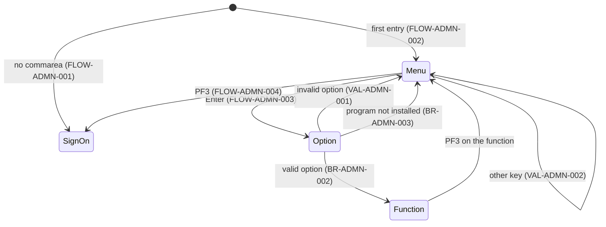
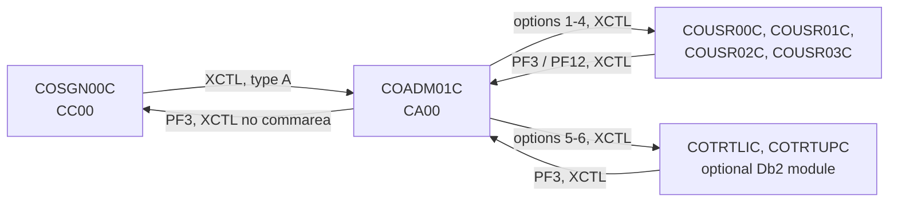

# COADM01C: Admin menu

## 1. Summary

COADM01C is the menu an administrator (user type `A`) reaches after sign-on. It lists the 6 functions of the admin menu table `COADM02Y`: user list, add, update and delete on the user security file, and the two transaction-type functions of the optional Db2 module. It reads the option number the user types and transfers control (XCTL) to the option's program with the commarea. If that program is not installed, CICS raises PGMIDERR and the program shows the green message `This option is not installed ...` instead. PF3 returns to the sign-on screen. The program reads no file and never checks that the user really is an administrator. Sign-on routes only type `A` users here, but with the Db2 module installed the transaction-type programs can bring anyone here without a sign-on (DEF-ADMN-001).

## 2. Rules at a glance

| ID | Rule |
| :-- | :-- |
| BR-ADMN-001 | The menu shows every option of the admin menu table, numbered `01`-`06`, in table order. |
| BR-ADMN-002 | A valid option transfers to the option's program with the commarea, as a first entry. |
| BR-ADMN-003 | If the option's program is not installed, the menu shows `This option is not installed ...` in green. |
| BR-ADMN-004 | An option whose program name starts with `DUMMY` shows the same "not installed" message; no shipped option does. |
| VAL-ADMN-001 | The option must be a number from 1 to the option count (6). |
| VAL-ADMN-002 | Only Enter and PF3 are valid keys. |

## 3. Actors and triggers

- **Actor:** a signed-on administrator. The program does not read `USRSEC` and does not test `CDEMO-USER-TYPE` (DEF-ADMN-001).
- **Normal trigger:** sign-on `COSGN00C` transfers here (XCTL) when the stored user type is `A`, with `CDEMO-PGM-CONTEXT` = 0 (`app/cbl/COSGN00C.cbl:230-234`; BR-SGN-004).
- **Return trigger:** the admin functions return here on PF3 (or PF12 in some of them) by XCTL with their commarea; for example `app/cbl/COUSR00C.cbl:125-127`, `app/cbl/COUSR01C.cbl:93-95`.
- **Re-entry trigger:** each interaction ends with "return, next transaction `CA00`" (`app/csd/CARDDEMO.CSD:327-336`, program `app/csd/CARDDEMO.CSD:189-195`), so the next key on the menu starts COADM01C again (FLOW-ADMN-006).
- **Direct start:** typing `CA00` on a blank terminal starts the program with no commarea; it sends the user to sign-on (FLOW-ADMN-001). The transaction has `RESSEC(NO) CMDSEC(NO)` like all CardDemo transactions.

## 4. Interfaces

### 4.1 Screen COADM1A (mapset COADM01), 24 x 80

Source: `app/bms/COADM01.bms:26-162`; symbolic map `app/cpy-bms/COADM01.CPY:17-260`. Mapset `CTRL=(ALARM,FREEKB)`, `EXTATT=YES`. The layout is identical to the main menu map `COMEN1A` (COMEN01C §4.1) except the title at row 4, which is `Admin Menu` (10 characters, `app/bms/COADM01.bms:75-79`).

| Row,Col | Field | Len | Direction | Attributes | Content |
| :-- | :-- | --: | :-- | :-- | :-- |
| 1,1 | (label) | 5 | out | protected, blue | `Tran:` |
| 1,7 | `TRNNAME` | 4 | out | protected, blue | `CA00` |
| 1,21 | `TITLE01` | 40 | out | protected, yellow | `      AWS Mainframe Modernization       ` |
| 1,65 | (label) | 5 | out | protected, blue | `Date:` |
| 1,71 | `CURDATE` | 8 | out | protected, blue | today `mm/dd/yy` |
| 2,1 | (label) | 5 | out | protected, blue | `Prog:` |
| 2,7 | `PGMNAME` | 8 | out | protected, blue | `COADM01C` |
| 2,21 | `TITLE02` | 40 | out | protected, yellow | `              CardDemo                  ` |
| 2,65 | (label) | 5 | out | protected, blue | `Time:` |
| 2,71 | `CURTIME` | 8 | out | protected, blue | now `hh:mm:ss` |
| 4,35 | (label) | 10 | out | protected, bright, neutral | `Admin Menu` |
| 6-17,20 | `OPTN001`-`OPTN012` | 40 each | out | protected, blue | option lines (BR-ADMN-001); rows 6-11 used, rows 12-17 always blank |
| 20,15 | (label) | 25 | out | protected, bright, turquoise | `Please select an option :` |
| 20,41 | `OPTION` | 2 | in/out | **unprotected**, numeric, underlined, right-justified and zero-filled (`JUSTIFY=(RIGHT,ZERO)`), initial cursor | option number |
| 23,1 | `ERRMSG` | 78 | out | protected, bright, red, or green when set by the program (§8.3) | message |
| 24,1 | (label) | 23 | out | protected, yellow | `ENTER=Continue  F3=Exit` |

### 4.2 Files

None. `USRSEC` is named in working storage (`:39`) and the user record layout is copied in (`:58`), but neither is used.

### 4.3 Commarea

ENT-COMMAREA, 160 bytes, no extension. A longer commarea from a returning function (`COUSR00C`, `COUSR02C` and `COUSR03C` pass 194 bytes, ENT-COMMAREA-USER-ADMIN-EXT; `COUSR01C`, `COTRTLIC` and `COTRTUPC` pass 160) is truncated to its first 160 bytes (`:90`), so the user-list paging state is lost on return here. The program uses:

| Field | Read | Written | Use |
| :-- | :-- | :-- | :-- |
| `CDEMO-PGM-CONTEXT` | yes | yes | 0 = first entry, 1 = re-entry; set to 0 before transferring to an option |
| `CDEMO-FROM-TRANID`, `CDEMO-FROM-PROGRAM` | no | yes | set to `CA00` / `COADM01C` before transferring to an option (`COSGN00C` when started without a commarea) |
| `CDEMO-TO-PROGRAM` | yes | yes | PF3 target, set to `COSGN00C` |

All other fields, including `CDEMO-USER-ID` and `CDEMO-USER-TYPE`, pass through unchanged and unread.

### 4.4 Console output

None.

## 5. Data used

| Data | Read | Written | How |
| :-- | :-- | :-- | :-- |
| ENT-ADMIN-MENU-OPTIONS (`COADM02Y`, compiled into the program) | yes | no | option count, number, name, program |
| ENT-COMMAREA | yes | yes | §4.3 |

Program-local data with behaviour: `WS-OPTION-X PIC X(02) JUST RIGHT` and `WS-OPTION PIC 9(02)` (`:45-46`) for the typed option, `WS-IDX` (`:47`), `WS-ADMIN-OPT-TXT PIC X(40)` (`:48`) for an option line, error flag `WS-ERR-FLG` (`:40-42`).

## 6. Processing flow

**Entry (MAIN-PARA, lines 75-114)**

1. Register the PGMIDERR handler for the rest of the task (77-79, ERR-ADMN-002).
2. Clear the error flag and the message (81-84).
3. No commarea: go to sign-on (86-88, FLOW-ADMN-001).
4. Copy the received commarea (first 160 bytes) into the work commarea (90).
5. First entry (`CDEMO-PGM-CONTEXT` not 1): mark re-entry, blank the screen, send the menu (91-94).
6. Re-entry: receive the screen, then act on the key: Enter, PF3 or other (95-107).
7. Return to CICS with next transaction `CA00` and the commarea (111-114).

**Enter (PROCESS-ENTER-KEY, lines 119-158)**

1. Normalise the typed option to two digits (121-129, NUM-ADMN-001) and echo it into the option field.
2. Not numeric, 0 or above 6: VAL-ADMN-001 (131-138).
3. No error and the program name does not start with `DUMMY`: transfer (140-148, BR-ADMN-002). If the program is not installed, CICS passes control to the PGMIDERR handler (BR-ADMN-003).
4. No error and the program name starts with `DUMMY`: green `This option is not installed ...`, menu sent (150-157, BR-ADMN-004).

## 7. Business rules

#### BR-ADMN-001 · Menu content
- **When:** the menu is sent.
- **Then:** for each option 1 to `CDEMO-ADMIN-OPT-COUNT` (6), the line `NN. <name>` is built from the option number (2 digits with a leading zero), `. ` and the 35-character name, and put in option line `OPTN0NN` (40 characters). Only lines 1-10 can be filled (DEF-ADMN-004). The shipped options are:

| No. | Line shown (trailing spaces omitted) | Program | Area / spec |
| --: | :-- | :-- | :-- |
| 1 | `01. User List (Security)` | `COUSR00C` | a (USRL) |
| 2 | `02. User Add (Security)` | `COUSR01C` | a (USRA) |
| 3 | `03. User Update (Security)` | `COUSR02C` | a (USRU) |
| 4 | `04. User Delete (Security)` | `COUSR03C` | a (USRD) |
| 5 | `05. Transaction Type List/Update (Db2)` | `COTRTLIC` | f, optional Db2 module |
| 6 | `06. Transaction Type Maintenance (Db2)` | `COTRTUPC` | f, optional Db2 module |

The admin table has no user-type column (unlike the main menu table), so no option can be restricted.
- **Source:** `:229-266`; table `app/cpy/COADM02Y.cpy:19-59`
- **Fidelity:** must-preserve (option list and numbering) · **Confidence:** reviewed; line format runtime-verified on the main menu's identical code (COMEN01C BR-MENU-001)

#### BR-ADMN-002 · Transfer to the chosen function
- **When:** the option is valid and its program name does not start with `DUMMY`.
- **Then:** `CDEMO-FROM-TRANID` = `CA00`, `CDEMO-FROM-PROGRAM` = `COADM01C`, `CDEMO-PGM-CONTEXT` = 0, and XCTL to the option's program with the 160-byte commarea. The function starts as a first entry; what it does is in its own spec (FLOW-USRL-001, FLOW-USRA-001, FLOW-USRU-001, FLOW-USRD-001). There is no check of the user type before the transfer (DEF-ADMN-001).
- **Source:** `:140-148`
- **Fidelity:** must-preserve · **Confidence:** reviewed

#### BR-ADMN-003 · Function not installed
- **When:** the XCTL of BR-ADMN-002 fails because CICS does not know the program (PGMIDERR), typically options 5 and 6 when the optional Db2 module is not installed.
- **Then:** the PGMIDERR handler sets the message colour to green, builds `This option is not installed ...` (the option name is commented out of the text, DEF-ADMN-002), sends the menu and returns with next transaction `CA00` and the commarea. `CDEMO-FROM-TRANID`, `CDEMO-FROM-PROGRAM` and `CDEMO-PGM-CONTEXT` = 0 were already set for the transfer, so the next interaction is a **first entry** again: the menu is sent blank, and the key pressed is not acted on (DEF-ADMN-006).
- **Source:** `:77-79, 145-148, 270-283`
- **Fidelity:** must-preserve (message), defect-decide (lost key, DEF-ADMN-006) · **Confidence:** platform-inferred (HANDLE CONDITION on XCTL)

#### BR-ADMN-004 · Placeholder options
- **When:** the option is valid and its program name starts with `DUMMY`.
- **Then:** no transfer; green `This option is not installed ...`, menu sent. No shipped option has such a name, so this is dead code. (The same message text is also reached if an XCTL ever returned, which CICS does not do.)
- **Source:** `:141, 149-157`
- **Fidelity:** incidental · **Confidence:** reviewed

## 8. Validations and messages

#### VAL-ADMN-001 · Option number
- **When:** Enter is processed and the normalised option (NUM-ADMN-001) is not numeric, is 0, or is greater than `CDEMO-ADMIN-OPT-COUNT` (6).
- **Then:** message `Please enter a valid option number...` (red), menu sent with the option field showing the normalised value; no transfer. Unlike the main menu, nothing else is evaluated after the error, so the table is never read outside its 6 entries.
- **Source:** `:131-138, 140`
- **Fidelity:** must-preserve · **Confidence:** reviewed

#### VAL-ADMN-002 · Valid keys
- **When:** re-entry with a key other than Enter or PF3.
- **Then:** message `Invalid key pressed. Please see below...` (red), menu sent.
- **Source:** `:103-106`
- **Fidelity:** must-preserve · **Confidence:** reviewed

### 8.1 Flow and keys

#### FLOW-ADMN-001 · No commarea
- **When:** the program starts with no commarea (`EIBCALEN` = 0).
- **Then:** `CDEMO-FROM-PROGRAM` = `COSGN00C`, then XCTL without commarea to `CDEMO-TO-PROGRAM`, which is not initialised in this path; when it is low-values or spaces the target is `COSGN00C` (DEF-ADMN-005). Sign-on shows an empty sign-on screen (FLOW-SGN-001).
- **Source:** `:86-88, 163-170`

#### FLOW-ADMN-002 · First entry
- **When:** commarea present and `CDEMO-PGM-CONTEXT` is not 1 (sign-on and the returning functions pass 0).
- **Then:** set it to 1, blank the output map, send the menu. No message.
- **Source:** `:90-94`

#### FLOW-ADMN-003 · Enter
- **Then:** section 6 "Enter".
- **Source:** `:98-99`

#### FLOW-ADMN-004 · PF3, back to sign-on
- **Then:** `CDEMO-TO-PROGRAM` = `COSGN00C`; XCTL to it **without a commarea**. Sign-on starts as on a blank terminal; the session is dropped without a goodbye message.
- **Source:** `:100-102, 163-170`

#### FLOW-ADMN-005 · Other keys
- **Then:** VAL-ADMN-002.
- **Source:** `:103-106`

#### FLOW-ADMN-006 · End of every interaction
- **Then:** return to CICS naming `CA00` as the next transaction, with the 160-byte commarea. Not reached after a successful transfer; the PGMIDERR handler issues its own identical return.
- **Source:** `:111-114, 280-283`

#### FLOW-ADMN-007 · Header on every screen
- **Then:** titles, `CA00`, `COADM01C`, date `mm/dd/yy`, time `hh:mm:ss`, the option lines (BR-ADMN-001) and the current message are filled in before each send; the screen is sent with erase. The cursor goes to the option field (its `IC` attribute); the program sets no cursor position.
- **Source:** `:175-187, 205-224`

### 8.2 Decision table for Enter

| Normalised option | Option's program | Installed in CICS | Result |
| :-- | :-- | :-- | :-- |
| not numeric, `00`, or `07`-`99` | - | - | VAL-ADMN-001 |
| `01`-`06` | starts with `DUMMY` | - | green `This option is not installed ...` (BR-ADMN-004) |
| `01`-`06` | other | yes | XCTL to the program (BR-ADMN-002) |
| `01`-`06` | other | no (PGMIDERR) | green `This option is not installed ...`, next input treated as first entry (BR-ADMN-003) |

### 8.3 Message catalog

Messages appear in `ERRMSG` (row 23, 78 characters). Colour is the map's red unless noted.

| Text (exact) | Cause | Item |
| :-- | :-- | :-- |
| `Please enter a valid option number...` | option invalid | VAL-ADMN-001 |
| `This option is not installed ...` (green) | program not installed, or `DUMMY` placeholder | BR-ADMN-003, BR-ADMN-004 |
| `Invalid key pressed. Please see below...` | wrong key | VAL-ADMN-002 |

## 9. Side effects

None. The program reads and writes no data store; its only effects are the screen and the transfer of control.

## 10. Error handling

#### ERR-ADMN-001 · Screen receive not checked
- **What:** the response of RECEIVE MAP is stored but never tested.
- **Source:** `:194-200`
- **Fidelity:** incidental · **Confidence:** reviewed

#### ERR-ADMN-002 · PGMIDERR handler covers every transfer
- **What:** `HANDLE CONDITION PGMIDERR` is issued at the start of every task, so it also covers the PF3 and no-commarea XCTL to `COSGN00C`: if sign-on were not installed, the user would get the admin menu with `This option is not installed ...` instead of an abend. Other XCTL failures (for example INVREQ) are not handled and abend the task. The handler's RETURN ends the task, so control never comes back to the failing statement.
- **Source:** `:77-79, 163-170, 270-283`
- **Fidelity:** incidental · **Confidence:** platform-inferred

## 11. Interactions

- **Inbound:** `COSGN00C` (BR-SGN-004); the PF3 return of the user functions and of the transaction-type functions (`app/app-transaction-type-db2/cbl/COTRTLIC.cbl:47` names `COADM01C` as its admin program).
- **Outbound:** the option programs (XCTL, 160-byte commarea, `CDEMO-PGM-CONTEXT` = 0, `CDEMO-FROM-PROGRAM` = `COADM01C`); `COSGN00C` without commarea.
- **Cross-module:** options 5 and 6 reach into the optional transaction-type module (`app/app-transaction-type-db2`, area f). The base admin menu depends on it only by program name and degrades to a message when it is absent (BR-ADMN-003); unlike the main menu it does not ask CICS first.
- **Shared data:** the commarea; no files.

### Module extraction notes

| Boundary | Contract |
| :-- | :-- |
| Entry | XCTL from sign-on (type `A`) or a returning function, 160-byte commarea (longer ones truncated). |
| Exit | XCTL to the option's program with `CDEMO-FROM-TRANID` = `CA00`, `CDEMO-FROM-PROGRAM` = `COADM01C`, `CDEMO-PGM-CONTEXT` = 0, every other field unchanged. The user functions use `COADM01C` as their fixed return target. |
| Authorisation | None in the program. A rewrite that exposes the admin functions as services must add an administrator check, because today there is no check at all: sign-on routing is bypassed by the Db2 transaction-type programs (DEF-ADMN-001, Q-ADMN-001). |
| Menu table | 6 options from `COADM02Y`, compiled in. |

## 12. Numeric, date and format details

#### NUM-ADMN-001 · Option normalisation
- Same code as the main menu (NUM-MENU-001): the 2-character field arrives right-justified and zero-filled by BMS; the program takes the characters up to the last non-space, right-justifies them, replaces spaces with `0`, moves the result to the 2-digit `WS-OPTION` and echoes it. `05`, ` 5` and `5 ` give 5; low-values give 0 (rejected). Non-digit results depend on the compiler (Q-MENU-002).
- **Source:** `:121-129`; `app/bms/COADM01.bms:145-149`
- **Confidence:** runtime-verified on the identical main menu code (GnuCOBOL), platform-inferred (BMS, z/OS)

#### NUM-ADMN-002 · Header date and time
- Date `mm/dd/yy`, time `hh:mm:ss`, from `FUNCTION CURRENT-DATE`.
- **Source:** `:205-224`

## 13. Known defects and oddities

None of these were changed in this branch (`COADM01C.cbl` and `COADM02Y.cpy` are not touched after the original import; `CHANGELOG.md` "Fixed" lists only batch and JCL fixes).

#### DEF-ADMN-001 · [security] The admin menu does not check that the user is an administrator
- The program never tests `CDEMO-USER-TYPE`; any commarea with `CDEMO-PGM-CONTEXT` set reaches the menu and every admin function. Sign-on sends only type `A` users here (BR-SGN-004), but it is not the only way in. With the Db2 module installed, `COTRTLIC` (`CTLI`) and `COTRTUPC` treat "no commarea" as a first run and initialise the commarea (user ID blank; `COTRTLIC` sets type `A` at once); their PF3 sets type `A` and transfers here. Typing `CTLI` on a blank terminal and pressing PF3 therefore opens the admin menu, and with it user add, update and delete, without a password; an outsider can create an administrator (DEF-USRA-005). The identity exists only in the commarea (DEF-SGN-006, DEF-SGN-012). The user functions do not check either (DEF-USRL-008).
- **Source:** `:86-107, 140-148`; `app/app-transaction-type-db2/cbl/COTRTLIC.cbl:515-525, 591-623`; `app/app-transaction-type-db2/cbl/COTRTUPC.cbl:366-374, 438-449`
- **Status:** open · **Fidelity:** defect-decide (Q-ADMN-001) · **Confidence:** reviewed

#### DEF-ADMN-002 · "Not installed" message is green and does not name the option
- The option name was commented out of the message, so all failures read `This option is not installed ...`, in green (the colour of success messages elsewhere). The main menu shows the name and uses red for the same case (DEF-MENU-006).
- **Source:** `:150-156, 271-277`
- **Status:** open (cosmetic) · **Fidelity:** incidental · **Confidence:** reviewed

#### DEF-ADMN-003 · Table redefinition is larger than the table
- `CDEMO-ADMIN-OPT` is declared with 9 occurrences (405 bytes) over 6 defined entries (270 bytes). Entries 7-9 would overlay the storage after the table. The option check (VAL-ADMN-001) prevents any access beyond entry 6, so there is no visible effect.
- **Source:** `app/cpy/COADM02Y.cpy:22, 55-59`
- **Status:** open (latent) · **Fidelity:** incidental · **Confidence:** reviewed

#### DEF-ADMN-004 · Only 10 option lines can be filled
- The line-building loop fills `OPTN001`-`OPTN010` and ignores options 11 and 12 although the map has 12 lines. No effect with 6 options.
- **Source:** `:241-264`
- **Status:** open (latent) · **Fidelity:** incidental · **Confidence:** reviewed

#### DEF-ADMN-005 · Start without commarea uses an uninitialised target
- With no commarea, `CDEMO-TO-PROGRAM` is not set before the transfer; the code relies on it being low-values or spaces to fall back to `COSGN00C` (same as DEF-MENU-005). With other storage contents the XCTL names garbage, which the PGMIDERR handler turns into the admin menu with `This option is not installed ...` and a commarea of uninitialised storage.
- **Source:** `:86-88, 165-170`
- **Status:** open · **Confidence:** platform-inferred

#### DEF-ADMN-006 · After "not installed" the next key is ignored
- When the PGMIDERR handler runs, `CDEMO-PGM-CONTEXT` has already been set to 0 for the transfer, and the handler returns with that commarea. The next key the user presses (for example Enter with another option) is treated as a first entry: the menu is sent again, blank, and the option is not processed. The user has to type the option a second time.
- **Source:** `:144, 270-283, 91-94`
- **Status:** open · **Fidelity:** defect-decide · **Confidence:** platform-inferred

## 14. Open questions

| ID | Question | For |
| :-- | :-- | :-- |
| Q-ADMN-001 | Should the admin menu and each user function verify that the signed-on user is an administrator (type `A`)? Today nothing checks after sign-on. | security |
| Q-ADMN-002 | When the optional transaction-type module is not installed, should options 5 and 6 be hidden, or keep showing and fail with a message as today? | business |
| Q-ADMN-003 | Should the "not installed" message name the option and be shown as an error (red), as on the main menu? | business |

## 15. Equivalence contract

A reimplementation must reproduce the option list (numbers, names, order), the program reached for each option with the commarea fields of BR-ADMN-002, the messages and their colours. It may differ in screen technology and clock values.

| # | Start state | Input | Expected |
| --: | :-- | :-- | :-- |
| S1 | no commarea | `CA00` | sign-on screen |
| S2 | from sign-on, type `A` | - | menu with lines `01. User List (Security)` ... `06. Transaction Type Maintenance (Db2)` |
| S3 | menu | Enter, option `1` | XCTL `COUSR00C`, context 0, from `CA00`/`COADM01C` |
| S4 | menu | Enter, option `04` | XCTL `COUSR03C` |
| S5 | menu | Enter, option blank, `00`, `07` or `99` | `Please enter a valid option number...` |
| S6 | menu, Db2 module not installed | Enter, option `5` | green `This option is not installed ...`; next Enter shows a blank menu |
| S7 | menu, Db2 module installed | Enter, option `6` | XCTL `COTRTUPC` |
| S8 | menu | PF3 | empty sign-on screen, no commarea |
| S9 | menu | PF8 | `Invalid key pressed. Please see below...` |

These scenarios cannot run locally (no CICS); they become acceptance tests for the target. Review evidence: `evidence/a-signon-admin-review.md`.

## 16. Paragraph coverage

| Paragraph | Lines | Covered by |
| :-- | :-- | :-- |
| (data division) | 33-69 | §4.3, §5, DEF-ADMN-003 |
| `MAIN-PARA` | 75-114 | FLOW-ADMN-001..006, VAL-ADMN-002, ERR-ADMN-002 |
| `PROCESS-ENTER-KEY` | 119-158 | NUM-ADMN-001, VAL-ADMN-001, BR-ADMN-002, BR-ADMN-004, DEF-ADMN-006 |
| `RETURN-TO-SIGNON-SCREEN` | 163-170 | FLOW-ADMN-004, DEF-ADMN-005 |
| `SEND-MENU-SCREEN` | 175-187 | FLOW-ADMN-007 |
| `RECEIVE-MENU-SCREEN` | 192-200 | ERR-ADMN-001 |
| `POPULATE-HEADER-INFO` | 205-224 | FLOW-ADMN-007, NUM-ADMN-002 |
| `BUILD-MENU-OPTIONS` | 229-266 | BR-ADMN-001, DEF-ADMN-004 |
| `PGMIDERR-ERR-PARA` | 270-284 | BR-ADMN-003, DEF-ADMN-002 |

8 of 8 paragraphs covered (plus the data division row).
