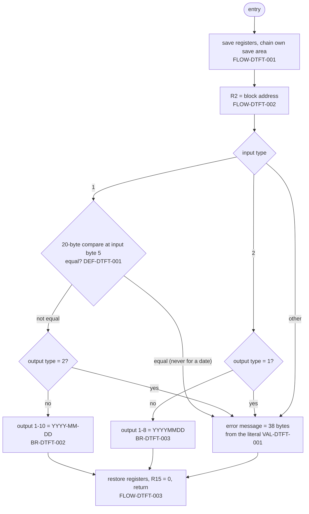

# COBDATFT: Date format conversion subroutine

## 1. Summary

COBDATFT is a z/OS assembler subroutine that rearranges a date between two text layouts inside an 80-byte parameter block (ENT-DATE-CONV-PARM). Input type `1` converts `YYYYMMDD` to `YYYY-MM-DD`; input type `2` converts `YYYY-MM-DD` to `YYYYMMDD`. A request with an unknown input type, or whose output type contradicts the input type, gets the text `INVALID INPUT` in the block's error message field. It moves bytes only: it never checks that the date holds digits or is a real date. It always returns 0 in register 15. Its only caller is CBACT01C (job READACCT), which converts each account's reissue date from `YYYY-MM-DD` to `YYYYMMDD`. Locally the assembler is replaced by a COBOL shim, which differs from it in two edge cases (FLOW-DTFT-004).

## 2. Rules at a glance

| ID | Rule |
| :-- | :-- |
| BR-DTFT-001 | The input type selects the conversion: `1` = from `YYYYMMDD`, `2` = from `YYYY-MM-DD`, any other value is an error. |
| BR-DTFT-002 | Type `1` with an output type other than `2`: output bytes 1-10 = `YYYY-MM-DD` built from input bytes 1-8. |
| BR-DTFT-003 | Type `2` with an output type other than `1`: output bytes 1-8 = `YYYYMMDD` taken from input bytes 1-4, 6-7 and 9-10. |
| VAL-DTFT-001 | Unknown input type, type `1` with output type `2`, or type `2` with output type `1`: the error message field is set to `INVALID INPUT` and the output date is unchanged. |

## 3. Actors and triggers

- **Caller:** CBACT01C, paragraph `1300-POPUL-ACCT-RECORD`, once per account record read (`app/cbl/CBACT01C.cbl:223-234`). CBACT01C is specified by area d1; section 11 gives the interface only. No other program calls COBDATFT (`docs/inventory.md:61`).
- **Linkage:** standard z/OS (OS) linkage: register 1 points to a one-word parameter list whose word is the address of the 80-byte block; 13 points to the caller's save area, 14 holds the return address and 15 the entry point address.
- **Preconditions:** none; every input is accepted without a check of its content.

## 4. Interfaces

### 4.1 Parameter block

One parameter, ENT-DATE-CONV-PARM (80 bytes), passed by reference. The COBOL caller uses copybook `CODATECN` (`app/cpy/CODATECN.cpy:17-52`); the assembler maps the same bytes with the DSECT `COCDATFT` (`app/maclib/COCDATFT.mac:17-23`), copied at `:66`.

| Pos | Len | COBOL name | DSECT name | Read / written |
| --: | --: | :-- | :-- | :-- |
| 1 | 1 | `CODATECN-TYPE` | `COINTYPE` | read |
| 2-21 | 20 | `CODATECN-INP-DATE` | `COINPDT` | read |
| 22 | 1 | `CODATECN-OUTTYPE` | `COOUTYPE` | read |
| 23-42 | 20 | `CODATECN-0UT-DATE` | `COOUTDT` | bytes 1-10 (type 1) or 1-8 (type 2) written on success |
| 43-80 | 38 | `CODATECN-ERROR-MSG` | `COERMSG` | written (38 bytes) on error only |

### 4.2 Registers on return

| Register | Value | Source |
| :-- | :-- | :-- |
| R0-R12, R14 | as on entry (reloaded from the caller's save area) | `:59-60` |
| R13 | caller's save area address (restored from `SAVE+4`) | `:59` |
| R15 | 0 for every input | `:61` |

### 4.3 Console output

None.

## 5. Data used

| Entity field | Read | Written | Use |
| :-- | :-- | :-- | :-- |
| ENT-DATE-CONV-PARM.CODATECN-TYPE | yes | - | selects the conversion (BR-DTFT-001) |
| ENT-DATE-CONV-PARM.CODATECN-INP-DATE | yes | - | bytes 1-8 (type 1) or 1-10 (type 2) are copied; for type 1 bytes 5-20 are also compared (DEF-DTFT-001) |
| ENT-DATE-CONV-PARM.CODATECN-OUTTYPE | yes | - | consistency check (VAL-DTFT-001); for type 1 also part of the compared bytes |
| ENT-DATE-CONV-PARM.CODATECN-0UT-DATE | type 1 only, bytes 1-3, in the comparison | bytes 1-10 or 1-8 | result (BR-DTFT-002, BR-DTFT-003) |
| ENT-DATE-CONV-PARM.CODATECN-ERROR-MSG | - | all 38 bytes, on error | VAL-DTFT-001 |

Local storage: `SAVE`, 18 fullwords (72 bytes), the routine's own save area inside the control section (`:64`); the literal pool, which holds `=C'-'` (1 byte) and `=C'INVALID INPUT'` (13 bytes) (`:36, 56`). There is no `LTORG`, so the assembler places the pool at the end of the first control section, after `SAVE` (platform-inferred).

## 6. Processing flow

| Lines | Instructions | Effect |
| --: | :-- | :-- |
| 17-26 | `CSECT`, `USING`, `STM`, `LA`, `ST`, `ST`, `DROP`, `LR`, `LR`, `USING` | Standard entry linkage with an own static save area; base register 12 (FLOW-DTFT-001). |
| 27, 29 | `L R2,0(R1)`, `USING COREC,R2` | R2 = address of the block; the DSECT fields address it (FLOW-DTFT-002). |
| 30-34 | `CLI`, `BE`, `CLI`, `BE`, `B` | Dispatch on the input type (BR-DTFT-001). |
| 35-45 | `VALIDIN1` | Type 1 checks and conversion (BR-DTFT-002, DEF-DTFT-001). |
| 46-54 | `VALIDIN2` | Type 2 check and conversion (BR-DTFT-003). Lines 47-48 are comments: the separator check is disabled (DEF-DTFT-003). |
| 55-56 | `GOTOERR` | Error message (VAL-DTFT-001, DEF-DTFT-002). |
| 57-62 | `EXITL` | Restore and return with R15 = 0 (FLOW-DTFT-003). |
| 64-84 | `SAVE DS 18F`, `COPY COCDATFT`, register equates, `END` | Storage, the DSECT, `R0`-`R15` = 0-15. |

#### FLOW-DTFT-001 · Entry linkage and static save area
- **When:** the routine is entered.
- **Then:** under base register 15 it stores registers 14 through 12 in the caller's save area (offsets 12-71); loads the address of its own save area `SAVE` into register 12; stores the caller's save-area address in `SAVE+4` (back chain) and its own save-area address at offset 8 of the caller's save area (forward chain); points register 13 at `SAVE`; copies the entry address from register 15 to register 12 and makes 12 the base register for the rest of the routine. The own save area is never used by a call (the routine calls nothing); it only makes the save-area chain standard.
- **Source:** `:17-26, 64`
- **Fidelity:** incidental · **Confidence:** platform-inferred

#### FLOW-DTFT-002 · Parameter fetch and mapping
- **When:** after the entry linkage.
- **Then:** register 2 is loaded with the first word of the parameter list, the address of the 80-byte block, and the DSECT `COCDATFT` is based on it, so `COINTYPE`, `COINPDT`, `COOUTYPE`, `COOUTDT` and `COERMSG` are offsets 0, 1, 21, 22 and 42 of the block. The word includes the end-of-list high-order bit that COBOL sets; it is used as an address unchanged, which works in 24-bit and 31-bit addressing mode. The DSECT field lengths (1, 20, 1, 20, 38) match the copybook (ENT-DATE-CONV-PARM).
- **Source:** `:27, 29`, `app/maclib/COCDATFT.mac:17-23`
- **Fidelity:** must-preserve (the layout) · **Confidence:** reviewed

#### FLOW-DTFT-003 · Return
- **When:** after the conversion or the error message.
- **Then:** register 13 is reloaded from `SAVE+4`, registers 14 through 12 from the caller's save area, register 15 is set to 0 and control returns through register 14. Unlike MVSWAIT, the routine does not set the X'FF' return flag in the caller's save area.
- **Source:** `:57-62`
- **Fidelity:** must-preserve for the return code · **Confidence:** platform-inferred

#### FLOW-DTFT-004 · Local GnuCOBOL shim and how it differs
- **When:** a local build (`tools/batch-programs.toml:125-128`) links callers with the COBOL program `tools/shims/COBDATFT.cbl` instead of the assembler.
- **Then:** the shim receives the same block (`COPY CODATECN` in its linkage section) and evaluates the input type with the copybook's condition names:
  - type `1`: if input byte 5 is `-` or the output type is `2`, it moves `INVALID INPUT` to the error message; otherwise it builds output bytes 1-10 as in BR-DTFT-002;
  - type `2`: if the output type is `1`, error; otherwise output bytes 1-8 as in BR-DTFT-003;
  - any other type: error.
  - It then sets `RETURN-CODE` to 0 and returns with `GOBACK`.
- **Same as the assembler:** the type and output-type rules, the bytes written on success, the bytes left unchanged (the rest of the output date, the input, both types and, on success, the error message), return code 0.
- **Differences from the assembler:**
  1. **Type 1 separator check.** The shim compares one byte (input byte 5 = `-`), so type `1` with a `YYYY-MM-DD` date is rejected. The assembler compares 20 bytes against the literal pool and in practice never rejects, so it converts the date into garbage (DEF-DTFT-001). Example: type `1`, input `2022-07-06`, output type `1`: shim error `INVALID INPUT`, output date unchanged; assembler output bytes 1-10 `2022--0-7-`.
  2. **Error message bytes 14-38.** The shim's `MOVE` pads `INVALID INPUT` with 25 spaces; the assembler copies 25 bytes that follow the literal in storage (DEF-DTFT-002).
  3. No save areas; nothing stored inside the module (DEF-DTFT-005 does not apply).
- **Source:** `tools/shims/COBDATFT.cbl:13-45`
- **Fidelity:** incidental (the shim is a test stand-in); differences 1 and 2 are defect-decide · **Confidence:** runtime-verified for the shim (`tests/unit/test_date_routines.py:112-129` and the author's driver runs in §15); the assembler side is platform-inferred

## 7. Business rules

#### BR-DTFT-001 · Input type selects the conversion
- **When:** `CODATECN-TYPE` (block byte 1) is `1` (`YYYYMMDD-IN`).
- **Then:** BR-DTFT-002.
- **When:** it is `2` (`YYYY-MM-DD-IN`).
- **Then:** BR-DTFT-003.
- **Otherwise:** any other byte, including space and low-value: error (VAL-DTFT-001).
- **Source:** `:30-34`
- **Fidelity:** must-preserve · **Confidence:** reviewed (shim equivalent runtime-verified)

#### BR-DTFT-002 · Type 1: YYYYMMDD to YYYY-MM-DD
- **When:** input type `1`, the 20-byte comparison of DEF-DTFT-001 is not equal (always, for a date) and `CODATECN-OUTTYPE` is not `2`. Any output type other than `2` is accepted, including `1`, space and other values.
- **Then:** output date bytes 1-4 = input bytes 1-4; byte 5 = `-`; bytes 6-7 = input bytes 5-6; byte 8 = `-`; bytes 9-10 = input bytes 7-8. Output bytes 11-20 are not changed. Example: `20220706` gives `2022-07-06`.
- **Source:** `:35-45`
- **Fidelity:** must-preserve · **Confidence:** reviewed (the shim's identical conversion is runtime-verified, `tests/unit/test_date_routines.py:112-118`)

#### BR-DTFT-003 · Type 2: YYYY-MM-DD to YYYYMMDD
- **When:** input type `2` and `CODATECN-OUTTYPE` is not `1`.
- **Then:** output date bytes 1-4 = input bytes 1-4; bytes 5-6 = input bytes 6-7; bytes 7-8 = input bytes 9-10. Output bytes 9-20 are not changed. Input bytes 5 and 8 (the separators) are not looked at. Example: `2022-07-06` gives `20220706`.
- **Source:** `:46-54`
- **Fidelity:** must-preserve · **Confidence:** reviewed (the shim's identical conversion is runtime-verified through CBACT01C, where all 50 sample reissue dates were converted as described, and by `tests/unit/test_date_routines.py:112-119`)

## 8. Validations and messages

#### VAL-DTFT-001 · Invalid request
- **When:** the input type is neither `1` nor `2`; or it is `1` and the output type is `2`; or it is `2` and the output type is `1`; or (assembler, type 1) the 20-byte comparison of DEF-DTFT-001 is equal, which a date never satisfies.
- **Then:** the 38-byte error message field is overwritten: bytes 1-13 are `INVALID INPUT` (13 characters); bytes 14-38 are copied from the storage after the literal (DEF-DTFT-002). The output date and every other byte of the block are not changed. Register 15 is still 0 (ERR-DTFT-001).
- **Source:** `:30-39, 49-50, 55-56`
- **Fidelity:** must-preserve (text and trigger); defect-decide for bytes 14-38 · **Confidence:** reviewed (the shim's equivalent is runtime-verified, `tests/unit/test_date_routines.py:121-129`)

Decision table (assembler; the shim differs only where marked):

| Input type | Output type | Input byte 5 | Result |
| :-- | :-- | :-- | :-- |
| `1` | `2` | any | error |
| `1` | not `2` | not `-` | output 1-10 = `YYYY-MM-DD` (BR-DTFT-002) |
| `1` | not `2` | `-` | assembler: converted anyway (DEF-DTFT-001); **shim: error** |
| `2` | `1` | any | error |
| `2` | not `1` | any | output 1-8 = `YYYYMMDD` (BR-DTFT-003) |
| other | any | any | error |

Message catalog:

| Text (exact) | Field | Length | When |
| :-- | :-- | --: | :-- |
| `INVALID INPUT` | `CODATECN-ERROR-MSG` (38) | 13, then 25 bytes of storage (assembler) or 25 spaces (shim) | VAL-DTFT-001 |

## 9. Side effects

#### SE-DTFT-001 · Only the caller's block is changed
- The routine writes only into the caller's parameter block: output date bytes 1-10 (type 1) or 1-8 (type 2) on success, all 38 bytes of the error message on error, never both. It stores into its own save area (`SAVE+4`) and the caller's save area (registers, forward chain at offset 8). It opens no files.
- **Source:** `:19-22, 40-44, 51-53, 56`
- **Fidelity:** must-preserve · **Confidence:** reviewed (the shim's identical byte footprint is runtime-verified in §15)

## 10. Error handling

#### ERR-DTFT-001 · Errors are reported only in the message field
- Register 15 is 0 for every request, valid or not, so the caller's `RETURN-CODE` is 0 after the call. The only error signal is the message field, which is never cleared: after a successful call it still holds whatever it held before (a previous error message or the caller's initial value). On error the output date is left as it was. The caller must clear and test the message field itself; CBACT01C does neither (section 11).
- **Source:** `:55-62`
- **Fidelity:** must-preserve · **Confidence:** reviewed (the shim behaves the same: `tools/shims/COBDATFT.cbl:44`, and the message bytes `#` were preserved on success in the author's driver run, §15)

## 11. Interactions

- **Inbound:** CBACT01C, `1300-POPUL-ACCT-RECORD` (`app/cbl/CBACT01C.cbl:223-234`), with the block in its working storage (`app/cbl/CBACT01C.cbl:90`). Before the call it moves `ENT-ACCOUNT.ACCT-REISSUE-DATE` (10 characters, `YYYY-MM-DD`) to the 20-byte input date (so input bytes 11-20 are spaces), moves `2` to the input type and `2` to the output type, and moves spaces to the 20-byte output date. It does not set or test the error message and does not test `RETURN-CODE`. After the call it moves the output date to `OUT-ACCT-REISSUE-DATE` (`PIC X(10)`, `app/cbl/CBACT01C.cbl:65`), which keeps the first 10 bytes: `YYYYMMDD` followed by 2 spaces. Example: `2025-05-20` becomes `20250520` and 2 spaces. Every call from CBACT01C takes the type 2 path (BR-DTFT-003), so neither shim difference of FLOW-DTFT-004 affects it. CBACT01C's own behaviour is specified by area d1.
- **Outbound:** none.
- **Local stand-in:** `tools/shims/COBDATFT.cbl`, same name and block (FLOW-DTFT-004).

## 12. Numeric, date and format details

#### NUM-DTFT-001 · Byte moves only
- The conversion copies characters by position and inserts `-`; it does not check digits, month or day ranges, or the separators of a type 2 input (DEF-DTFT-003). A blank input gives a blank-and-dash output (type 1: 4 spaces, `-`, 2 spaces, `-`, 2 spaces). A type 2 request with an 8-character date `20220706` gives `202270` and 2 spaces (input bytes 1-4, 6-7 = `70`, 9-10 = spaces).
- **Source:** `:40-44, 51-53`
- **Confidence:** reviewed (the type 2 example was observed with the shim, whose code path is the same for that input)

#### NUM-DTFT-002 · Implicit lengths in the assembler
- `CLC COINPDT+4,=C'-'` has no explicit length, so the assembler uses the length attribute of the first operand's leftmost term, `COINPDT`, which is 20: the instruction compares block positions 6-25 (input bytes 5-20, the output type, output bytes 1-3) with the 20 bytes that start at the literal `-` (`:36`).
- `MVC COERMSG,=C'INVALID INPUT'` takes its length from `COERMSG`, 38: it copies the 13-byte literal and the 25 bytes that follow it (`:56`).
- The other moves have explicit lengths (4, 2, 2) or are single-byte `MVI`s (`:40-44, 51-53`).
- **Source:** `:36, 40-44, 51-53, 56`
- **Confidence:** reviewed (assembler language rules); the bytes that follow the literals are platform-inferred

## 13. Known defects and oddities

#### DEF-DTFT-001 · Type 1 separator check compares 20 bytes and never fires
- The check meant to reject a `YYYY-MM-DD` date sent as type 1 compares 20 bytes, not 1 (NUM-DTFT-002). With HLASM's literal-pool order (both literals have odd lengths, so they are in the same group, in order of first use) the comparison text is `-INVALID INPUT` followed by 6 bytes beyond the pool; in the other order it would be `INVALID INPUT-` and 6 more bytes. Either way no date can match, so the branch to the error is not taken and a dashed date is "converted": `2022-07-06` with type 1 gives output bytes 1-10 `2022--0-7-`. The local shim compares one byte and rejects it (FLOW-DTFT-004), so local runs and tests do not show this behaviour. No caller in the repository sends type 1.
- **Source:** `:36-37, 40-44`
- **Status:** open · **Fidelity:** defect-decide (Q-DTFT-001) · **Confidence:** platform-inferred

#### DEF-DTFT-002 · Error message carries 25 bytes of unrelated storage
- The error `MVC` copies 38 bytes from a 13-byte literal (NUM-DTFT-002). Bytes 14-38 of the message are whatever follows the literal: with the order of DEF-DTFT-001, `INVALID INPUT` is the last literal, so these bytes lie past the end of the control section and are set by the binder or by whatever is loaded next; they are not necessarily spaces and not predictable from the source. A caller that displays or compares the whole 38-byte field sees them. The shim gives 25 spaces. No caller in the repository reads the message.
- **Source:** `:56`
- **Status:** open · **Fidelity:** defect-decide (Q-DTFT-001) · **Confidence:** platform-inferred

#### DEF-DTFT-003 · No content validation; type 2 separator check disabled
- The type 2 path once checked the separator, but the two lines are comments (`:47-48`). Re-enabled as written they would not work either: `C'-'` without `=` is a self-defining term (X'60' = 96 in EBCDIC), not a literal, so the instruction would compare 20 bytes at absolute address 96 instead of a dash. As written, neither path validates anything but the type bytes (NUM-DTFT-001).
- **Source:** `:46-53`
- **Status:** open · **Fidelity:** defect-decide

#### DEF-DTFT-004 · Errors not visible to the caller
- Register 15 is 0 even on error, the message field is not cleared on success and the output date is not cleared on error (ERR-DTFT-001). CBACT01C neither clears nor tests the message, so an error (impossible with its fixed types `2`/`2`) would leave the output date as the spaces it set and write a blank reissue date.
- **Source:** `:55-62`, `app/cbl/CBACT01C.cbl:225-234`
- **Status:** open

#### DEF-DTFT-005 · Not reentrant
- The save area `SAVE` is inside the control section and is written on every call (`:21, 64`). If the module were bound reentrant and loaded into read-only storage, the store would cause a protection exception (abend S0C4); two tasks sharing one copy would overwrite each other's back chain. Batch use from CBACT01C is single-task, so this has no effect there.
- **Status:** open · **Confidence:** platform-inferred

#### DEF-DTFT-006 · Naming oddities in the interface
- In `CODATECN` the output date is `CODATECN-0UT-DATE` with a zero; `CODATECN-1MM` and `CODATECN-1O-YYYY` are each declared twice, so they need qualification; `CODATECN-2YY` holds the day of a `YYYY-MM-DD` date; the condition names say which output layout each output type means (`YYYY-MM-DD-OP` = `1`, `YYYYMMDD-OP` = `2`), while the assembler only rejects the contradicting value. In the DSECT the comment of `COINTYPE` names the wrong COBOL field (`app/maclib/COCDATFT.mac:19`). Documentation only; details in ENT-DATE-CONV-PARM.
- **Source:** `app/cpy/CODATECN.cpy:19-52`
- **Status:** open

## 14. Open questions

| ID | Question | For |
| :-- | :-- | :-- |
| Q-DTFT-001 | Confirm on z/OS, with the production assembly and binder listing, the literal-pool layout and the actual result of a type 1 request with a dashed date and of an invalid request (bytes 14-38 of the message). Should the target reproduce the assembler (dashed type 1 accepted, message tail undefined) or the shim (dashed type 1 rejected, message padded with spaces)? Evidence: `docs/modernization/spec/evidence/d2-batch-utilities-review.md` sections 3 and 5. | mainframe team, architecture |
| Q-DTFT-002 | Is COBDATFT needed at all in the target? Its only caller removes two dashes from a date; a target can do this in place. | architecture |

## 15. Equivalence contract

A reimplementation is equivalent when, for every block, it changes the same bytes as the table below and nothing else, and returns 0. "out" is the 20-byte output date (block positions 23-42), "msg" the 38-byte error message (43-80), "in" the input date (2-21); byte numbers are 1-based within the field.

| Input type | Output type | Bytes changed | New content |
| :-- | :-- | :-- | :-- |
| `1` | not `2` | out 1-10 | in 1-4, `-`, in 5-6, `-`, in 7-8 (assembler: whatever in 5 is; shim: error instead when in 5 is `-`) |
| `1` | `2` | msg 1-38 | `INVALID INPUT` + 25 bytes (assembler: storage; shim: spaces) |
| `2` | not `1` | out 1-8 | in 1-4, in 6-7, in 9-10 |
| `2` | `1` | msg 1-38 | as above |
| other | any | msg 1-38 | as above |

For the behaviour that matters to the application (type 2 to 2, the only request CBACT01C makes) the assembler and the shim agree, and a reimplementation must match it byte for byte: CBACT01C's output field gets `YYYYMMDD` and 2 spaces.

Runtime evidence:
- `tests/unit/test_date_routines.py:112-129` through the driver `tests/unit/cobol/cobdatft_test.cbl:14-23`: both conversions with only the converted bytes changed, and four rejected requests with the output date unchanged.
- Author's driver run of the shim, the record before and after (output date pre-filled with `*`, message with `#`): type 1 / out 1 / `20220706` gives out `2022-07-06` + 10 `*`, msg unchanged; type 1 / out space gives the same; type 1 / out 2 gives msg `INVALID INPUT` + 25 spaces; type 1 / out 1 / `2022-07-06` gives the same error; type 2 / out 2 / `2022-07-06` gives out `20220706` + 12 `*`; type 2 / out space gives the same; type 2 / out 1 gives the error; type 2 / out 2 / `20220706` gives out `202270` + 2 spaces + 12 `*`; types `3` and space give the error. Scratch files in `build/d2/util/` (not committed).
- CBACT01C local run (`python3 tools/carddemo.py run CBACT01C`, job READACCT): for all 50 sample accounts `OUT-ACCT-REISSUE-DATE` (bytes 69-78 of the 107-byte output record) equals the reissue date without dashes followed by 2 spaces.

The assembler cannot run locally; its two differences from the shim (DEF-DTFT-001, DEF-DTFT-002) are platform-inferred. No spec-only reimplementation is required. The independent review is recorded in `docs/modernization/spec/evidence/d2-batch-utilities-review.md`.

## 16. Paragraph coverage

The primary source is assembler, so the rows are free rows by code range.

| Unit | Lines | Covered by |
| :-- | :-- | :-- |
| (CSECT entry and linkage) | 17-26 | FLOW-DTFT-001 |
| (parameter fetch and type dispatch) | 27-34 | FLOW-DTFT-002, BR-DTFT-001, VAL-DTFT-001 |
| (VALIDIN1: YYYYMMDD to YYYY-MM-DD) | 35-45 | BR-DTFT-002, VAL-DTFT-001, DEF-DTFT-001, NUM-DTFT-001, NUM-DTFT-002, SE-DTFT-001 |
| (VALIDIN2: YYYY-MM-DD to YYYYMMDD) | 46-54 | BR-DTFT-003, VAL-DTFT-001, DEF-DTFT-003, NUM-DTFT-001, SE-DTFT-001 |
| (GOTOERR: error message) | 55-56 | VAL-DTFT-001, DEF-DTFT-002, NUM-DTFT-002, ERR-DTFT-001 |
| (EXITL: restore and return) | 57-62 | FLOW-DTFT-003, ERR-DTFT-001, DEF-DTFT-004 |
| (save area, DSECT copy, register equates, end) | 64-84 | FLOW-DTFT-001, FLOW-DTFT-002, DEF-DTFT-005, DEF-DTFT-006 |
