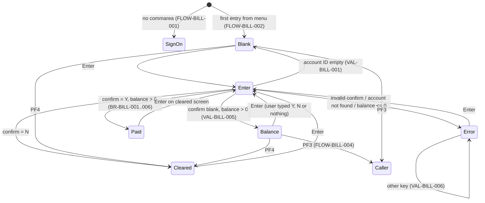
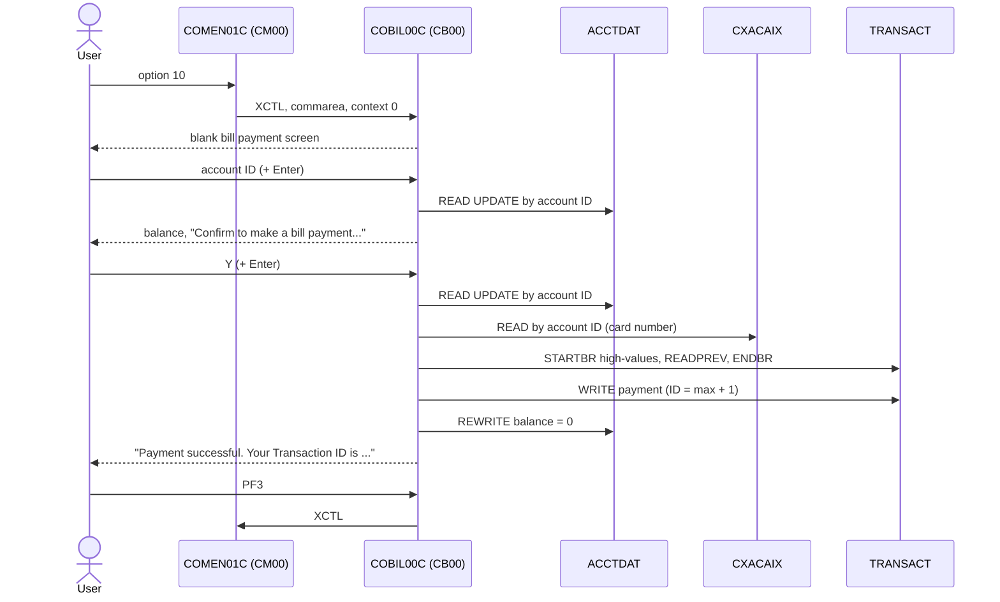

# COBIL00C: Online bill payment

## 1. Summary

A signed-on cardholder (regular user) picks **Bill Payment** from the main menu, types an account ID and sees the account's current balance. If the balance is above zero and the user confirms with `Y`, the program pays the **whole balance**: it writes one payment transaction (type `02`, category `0002`) to the transaction master file, sets the account's current balance to zero and shows the new transaction ID. There is no partial payment, no payment amount field and no check that the account belongs to the signed-on user.

## 2. Rules at a glance

| ID | Rule |
| :-- | :-- |
| BR-BILL-001 | A payment always pays the full current balance, read again at the moment of confirmation. |
| BR-BILL-002 | A payment is only possible when the current balance is above zero. |
| BR-BILL-003 | The payment is recorded as a new transaction with fixed values (type 02, category 2, "BILL PAYMENT - ONLINE"). |
| BR-BILL-004 | The new transaction ID is the highest existing transaction ID plus one. |
| BR-BILL-005 | The payment is charged to the first card linked to the account in the card cross-reference. |
| BR-BILL-006 | After the payment, the account's current balance is reduced by the payment amount (to zero); nothing else on the account changes. |
| BR-BILL-007 | Confirmation is a field on the same screen: account ID plus `Y` in one interaction pays immediately, even if the balance was never displayed. |
| VAL-BILL-001 | The account ID is required. |
| VAL-BILL-002 | The confirmation must be `Y`, `y`, `N`, `n` or blank. |
| VAL-BILL-003 | The account must exist. |
| VAL-BILL-004 | Nothing is paid when the balance is zero or negative. |
| VAL-BILL-005 | Without confirmation, the balance is shown and the user is asked to confirm. |
| VAL-BILL-006 | Only Enter, PF3 and PF4 are valid keys. |

## 3. Actors and triggers

- **Actor:** a signed-on CardDemo user. The program reads no user identity; any user who reaches it can pay any account (DEF-BILL-009).
- **Normal trigger:** main menu `COMEN01C`, option 10 "Bill Payment" (user type `U`, `app/cpy/COMEN02Y.cpy:80-84`). The menu transfers control (XCTL) with the commarea and `CDEMO-PGM-CONTEXT` = 0 (`app/cbl/COMEN01C.cbl:177-187`).
- **Re-entry trigger:** CICS starts transaction `CB00` again (`app/csd/CARDDEMO.CSD:337-346`) when the user presses a key on the bill payment screen, because every interaction ends with "return, next transaction CB00" (FLOW-BILL-007).
- **Direct start:** typing `CB00` on a blank terminal starts the program with no commarea; it sends the user to sign-on (FLOW-BILL-001).

## 4. Interfaces

### 4.1 Screen COBIL0A (mapset COBIL00), 24 x 80

Source: `app/bms/COBIL00.bms:26-135`; symbolic map `app/cpy-bms/COBIL00.CPY:17-140`. All named fields have `FSET`, so they are always sent back to the program.

| Row,Col | Field | Len | Direction | Attributes | Content |
| :-- | :-- | --: | :-- | :-- | :-- |
| 1,1 | (label) | 5 | out | protected, blue | `Tran:` |
| 1,7 | `TRNNAME` | 4 | out | protected, blue | `CB00` |
| 1,21 | `TITLE01` | 40 | out | protected, yellow | `      AWS Mainframe Modernization       ` (`COTTL01Y.cpy:18-19`) |
| 1,65 | (label) | 5 | out | protected, blue | `Date:` |
| 1,71 | `CURDATE` | 8 | out | protected, blue | today `mm/dd/yy` (NUM-BILL-004) |
| 2,1 | (label) | 5 | out | protected, blue | `Prog:` |
| 2,7 | `PGMNAME` | 8 | out | protected, blue | `COBIL00C` |
| 2,21 | `TITLE02` | 40 | out | protected, yellow | `              CardDemo                  ` (`COTTL01Y.cpy:20-22`) |
| 2,65 | (label) | 5 | out | protected, blue | `Time:` |
| 2,71 | `CURTIME` | 8 | out | protected, blue | now `hh:mm:ss` |
| 4,35 | (label) | 12 | out | protected, bright | `Bill Payment` |
| 6,6 | (label) | 14 | out | protected, green | `Enter Acct ID:` |
| 6,21 | `ACTIDIN` | 11 | in/out | **unprotected**, green, underlined, initial cursor | Account ID |
| 8,6 | (label) | 70 | out | yellow | a line of dashes |
| 11,6 | (label) | 25 | out | protected, turquoise | `Your current balance is: ` |
| 11,32 | `CURBAL` | 14 | out | protected, blue | Balance, edited `+9999999999.99` (NUM-BILL-001) |
| 15,6 | (label) | 53 | out | protected, turquoise | `Do you want to pay your balance now. Please confirm: ` |
| 15,60 | `CONFIRM` | 1 | in/out | **unprotected**, green, underlined | `Y`/`N` |
| 15,63 | (label) | 5 | out | protected | `(Y/N)` |
| 23,1 | `ERRMSG` | 78 | out | protected, bright, **red** (green on success) | Message (section 8.3) |
| 24,1 | (label) | 33 | out | protected, yellow | `ENTER=Continue  F3=Back  F4=Clear` |

The program's message work field is 80 characters (`COBIL00C.cbl:39`); only the first 78 reach the screen. No current message is longer than 78.

### 4.2 Files

| CICS file | Entity | Operation | Key | Lines |
| :-- | :-- | :-- | :-- | :-- |
| `ACCTDAT` | ENT-ACCOUNT | READ with UPDATE, then REWRITE | `ACCT-ID` (11) | 343-354, 377-385 |
| `CXACAIX` | ENT-CARD-XREF (through its alternate index on account ID, non-unique) | READ | `XREF-ACCT-ID` (11) | 408-418 |
| `TRANSACT` | ENT-TRANSACTION | STARTBR, READPREV, ENDBR, WRITE | `TRAN-ID` (16) | 441-449, 472-482, 501-505, 510-520 |

All three CICS file definitions use `RECOVERY(NONE)` (`CARDDEMO.CSD:9, 72, 84`): CICS does not back out their updates if the task fails.

### 4.3 Commarea

`ENT-COMMAREA` (160 bytes from `COCOM01Y`) plus a 58-byte bill-payment extension `CDEMO-CB00-INFO` (`COBIL00C.cbl:64-72`), 218 bytes in total. See `entities.md`. The program uses:

| Field | Read | Written | Use |
| :-- | :-- | :-- | :-- |
| `CDEMO-PGM-CONTEXT` | yes | yes | 0 = first entry, 1 = re-entry (FLOW-BILL-002) |
| `CDEMO-FROM-PROGRAM` | yes | yes | PF3 target; set to `COBIL00C` when leaving |
| `CDEMO-FROM-TRANID` | no | yes | set to `CB00` when leaving |
| `CDEMO-TO-PROGRAM` | yes | yes | XCTL target |
| `CDEMO-CB00-TRN-SELECTED` | yes | no | optional pre-filled account ID (DEF-BILL-008) |

All other commarea fields pass through unchanged.

### 4.4 Console output

Unexpected file response codes are written to the CICS log as `RESP:<code>REAS:<code>` (lines 366, 397, 430, 461, 490, 541). Incidental; not user-facing.

## 5. Data used

| Entity field | Read | Written | How |
| :-- | :-- | :-- | :-- |
| ENT-ACCOUNT.ACCT-ID | key | (unchanged) | from screen `ACTIDIN` |
| ENT-ACCOUNT.ACCT-CURR-BAL | yes | yes | displayed; payment amount; set to balance - amount |
| ENT-ACCOUNT (all other fields) | yes | rewritten unchanged | whole 300-byte record is rewritten |
| ENT-CARD-XREF.XREF-ACCT-ID | key | no | from screen `ACTIDIN` |
| ENT-CARD-XREF.XREF-CARD-NUM | yes | no | becomes the payment's card number |
| ENT-TRANSACTION.TRAN-ID | yes (highest) | yes | next ID |
| ENT-TRANSACTION (all fields) | (FILLER only, see DEF-BILL-006) | yes | new record, BR-BILL-003 |

Program-local data with behaviour: error flag `WS-ERR-FLG` (`:43-45`), confirmation flag `WS-CONF-PAY-FLG` (`:51-53`), balance edit field `WS-CURR-BAL PIC +9999999999.99` (`:56`), next-ID work field `WS-TRAN-ID-NUM PIC 9(16)` (`:57`). `WS-USR-MODIFIED`, `WS-TRAN-AMT`, `WS-TRAN-DATE` and `CDEMO-CB00-TRNID-FIRST/LAST`, `-PAGE-NUM`, `-NEXT-PAGE-FLG`, `-TRN-SEL-FLG` are declared but have no effect.

## 6. Processing flow

Each arrow is one CICS task: receive the screen, act, send the screen, end with "next transaction CB00".

**Entry (MAIN-PARA, lines 99-149)**

1. Clear the error flag and the message (101-105).
2. No commarea: transfer to sign-on (107-109).
3. Copy the received commarea into the 218-byte work commarea (111). A shorter commarea (the menu sends 160 bytes) leaves the extension blank (space-padded group move).
4. First entry (`CDEMO-PGM-CONTEXT` not 1): mark re-entry, blank the screen, cursor on the account ID; if a pre-selected account is in the commarea, run the Enter logic; send the screen (112-122).
5. Re-entry: receive the screen, then act on the key (124-142, FLOW-BILL-003..006).
6. Return to CICS with next transaction `CB00` and the commarea (146-149).

**Enter (PROCESS-ENTER-KEY, lines 154-244)**

1. Reset "payment confirmed" (156).
2. Account ID blank: VAL-BILL-001, stop (158-167).
3. Use the screen account ID as the key for both the account and the cross-reference (170-171).
4. Act on the confirmation field (VAL-BILL-002 decision table, 173-191).
5. Put the account's current balance into the balance field (193-194). This runs even when step 4 reported an error; it then has no visible effect because the error screen was already sent and nothing is sent afterwards.
6. Balance zero or negative: VAL-BILL-004, stop (197-206).
7. Not confirmed: VAL-BILL-005 (236-240), send.
8. Confirmed: pay (210-235, BR-BILL-001..006, SE-BILL-002..005), then send (242).

## 7. Business rules

#### BR-BILL-001 · Pay the full balance
- **When:** the user confirms with `Y`/`y` and the account has a balance above zero.
- **Then:** the payment amount is the account's current balance as read (with update) in this same interaction. The balance shown on the previous screen is not used; if it changed in between, the new value is paid. There is no amount field.
- **Source:** `app/cbl/COBIL00C.cbl:174-177, 224`
- **Fidelity:** must-preserve · **Confidence:** reviewed

#### BR-BILL-002 · Only positive balances can be paid
- **When:** the account's current balance is zero or negative.
- **Then:** nothing is written; message VAL-BILL-004.
- **Source:** `:197-206`
- **Fidelity:** must-preserve · **Confidence:** reviewed

#### BR-BILL-003 · Content of the payment transaction
- **When:** a confirmed payment is made.
- **Then:** a new ENT-TRANSACTION record is built. All named fields start blank/zero (INITIALIZE); then:

| Field | Value |
| :-- | :-- |
| `TRAN-ID` | next ID (BR-BILL-004), 16 digits with leading zeros |
| `TRAN-TYPE-CD` | `02` (Payment in the transaction type table) |
| `TRAN-CAT-CD` | `0002` (type 02 / category 0002 is "Electronic payment" in the category table) |
| `TRAN-SOURCE` | `POS TERM` |
| `TRAN-DESC` | `BILL PAYMENT - ONLINE` |
| `TRAN-AMT` | the account's current balance (positive; NUM-BILL-002) |
| `TRAN-CARD-NUM` | card number from the cross-reference (BR-BILL-005) |
| `TRAN-MERCHANT-ID` | `999999999` |
| `TRAN-MERCHANT-NAME` | `BILL PAYMENT` |
| `TRAN-MERCHANT-CITY` | `N/A` |
| `TRAN-MERCHANT-ZIP` | `N/A` |
| `TRAN-ORIG-TS`, `TRAN-PROC-TS` | both the current CICS time, `YYYY-MM-DD HH:MM:SS.000000` (NUM-BILL-003) |
| FILLER (20 bytes) | not initialised: keeps the FILLER of the highest-key record read in BR-BILL-004 (DEF-BILL-006) |

Text fields are left-aligned and padded with spaces.
- **Source:** `:218-232`
- **Fidelity:** must-preserve · **Confidence:** reviewed

#### BR-BILL-004 · Next transaction ID
- **When:** a confirmed payment is made.
- **Then:** read the transaction with the highest `TRAN-ID` (browse from the end of the file backwards, one record), interpret its 16 characters as a number, add 1, and use the result with leading zeros as the new `TRAN-ID`. If the backward read reports end of file, the highest ID is taken as 0, so the first ID is `0000000000000001`.
- **Source:** `:212-219, 484-488`
- **Fidelity:** must-preserve (the target needs an ID scheme that cannot collide with IDs written by POSTTRAN, INTCALC and transaction add `COTRN02C`, which uses the same scheme at `app/cbl/COTRN02C.cbl:444-446`) · **Confidence:** reviewed; empty-file behaviour platform-inferred (Q-BILL-005)

#### BR-BILL-005 · Card charged
- **When:** a confirmed payment is made.
- **Then:** read the card cross-reference through its alternate index by account ID; the card number of the record returned becomes `TRAN-CARD-NUM`. The alternate index is non-unique (`app/jcl/XREFFILE.jcl:72-75`); when an account has several cards, CICS returns the first one in the alternate index and raises DUPKEY (DEF-BILL-002).
- **Source:** `:211, 408-418, 225`
- **Fidelity:** must-preserve · **Confidence:** reviewed; DUPKEY platform-inferred

#### BR-BILL-006 · Account update
- **When:** the payment transaction has been written (or its write failed; see DEF-BILL-001).
- **Then:** new `ACCT-CURR-BAL` = `ACCT-CURR-BAL` - `TRAN-AMT` (normally 0.00), and the whole account record is rewritten. The cycle credit and debit, the transaction category balance file (`TCATBALF`) and every other account field are not changed.
- **Source:** `:234-235, 377-385`
- **Fidelity:** must-preserve; the missing cycle/category update is Q-BILL-002 · **Confidence:** reviewed

#### BR-BILL-007 · One-step payment is possible
- **When:** the user types an account ID and `Y` and presses Enter in the same interaction (for example on the first screen).
- **Then:** the payment is made immediately; the balance is never shown (the success screen clears the fields).
- **Source:** `:173-177, 208-235`
- **Fidelity:** must-preserve (or change by decision, Q-BILL-001) · **Confidence:** reviewed

## 8. Validations and messages

#### VAL-BILL-001 · Account ID required
- **When:** Enter is processed and the account ID field is spaces or empty (low-values).
- **Then:** message `Acct ID can NOT be empty...`, cursor on the account ID, screen sent; nothing else happens.
- **Source:** `:158-167`
- **Fidelity:** must-preserve · **Confidence:** reviewed

#### VAL-BILL-002 · Confirmation value (decision table)

| `CONFIRM` value | Effect | Source |
| :-- | :-- | :-- |
| `Y` or `y` | Mark payment confirmed; read the account with update (SE-BILL-001); continue | 174-177 |
| `N` or `n` | Clear the screen fields (account ID, balance, confirmation, message), cursor on account ID, send; stop. No message. | 178-181, 552-566 |
| space or empty | Read the account with update; continue (shows the balance) | 182-184 |
| anything else | Message `Invalid value. Valid values are (Y/N)...`, cursor on confirmation, send; stop | 185-190 |

- **Source:** `:173-191, 552-566`
- **Fidelity:** must-preserve · **Confidence:** reviewed

#### VAL-BILL-003 · Account must exist
- **When:** the account read (with update) returns NOTFND.
- **Then:** message `Account ID NOT found...`, cursor on account ID, send; stop. Any other response: `Unable to lookup Account...`, same handling.
- **Source:** `:356-372`
- **Note:** the account ID is used exactly as typed, with no numeric check and no zero padding; only the full 11-digit ID with leading zeros is found (DEF-BILL-004).
- **Fidelity:** must-preserve · **Confidence:** reviewed

#### VAL-BILL-004 · Nothing to pay
- **When:** the account was found and `ACCT-CURR-BAL` <= 0.
- **Then:** message `You have nothing to pay...`, cursor on account ID, balance shown, send; stop. Applies whether or not the user typed `Y`.
- **Source:** `:197-206`
- **Fidelity:** must-preserve · **Confidence:** reviewed

#### VAL-BILL-005 · Ask for confirmation
- **When:** the account was found, the balance is above zero and the confirmation field is blank.
- **Then:** the balance is shown, message `Confirm to make a bill payment...` (red), cursor on the confirmation field.
- **Source:** `:236-242`
- **Fidelity:** must-preserve · **Confidence:** reviewed

#### VAL-BILL-006 · Valid keys
- **When:** a key other than Enter, PF3 or PF4 is pressed (including PA keys and Clear).
- **Then:** message `Invalid key pressed. Please see below...` (the 50-character common message, `CSMSG01Y.cpy:20-21`), screen re-sent with the user's input; no explicit cursor position. PA1-PA3 and Clear transmit no data (the RECEIVE gets MAPFAIL, which is not tested, ERR-BILL-002), so for those keys the screen comes back without the user's input.
- **Source:** `:138-141`
- **Fidelity:** must-preserve (text), incidental (cursor) · **Confidence:** reviewed

### 8.1 Flow and keys

#### FLOW-BILL-001 · No commarea
- **When:** the program starts with no commarea (`EIBCALEN` = 0).
- **Then:** transfer control to `COSGN00C` (sign-on) through FLOW-BILL-008.
- **Source:** `:107-109`

#### FLOW-BILL-002 · First entry
- **When:** commarea present and `CDEMO-PGM-CONTEXT` is not 1.
- **Then:** set it to 1; send a blank screen with the cursor on the account ID. If `CDEMO-CB00-TRN-SELECTED` is neither spaces nor low-values, its first 11 characters are put in the account ID field and the Enter logic runs first (the screen may then be sent twice; the user sees the last one).
- **Source:** `:112-122`

#### FLOW-BILL-003 · Enter
- **Then:** process the screen (section 6, Enter).
- **Source:** `:126-127`

#### FLOW-BILL-004 · PF3, back
- **Then:** transfer to `CDEMO-FROM-PROGRAM`, or to the main menu `COMEN01C` when it is blank. From the menu, `CDEMO-FROM-PROGRAM` is `COMEN01C`, so PF3 returns to the menu.
- **Source:** `:128-135`

#### FLOW-BILL-005 · PF4, clear
- **Then:** blank the account ID, balance and confirmation fields and the message, cursor on account ID, send.
- **Source:** `:136-137, 552-566`

#### FLOW-BILL-006 · Other keys
- **Then:** VAL-BILL-006.
- **Source:** `:138-141`

#### FLOW-BILL-007 · End of every interaction
- **Then:** return to CICS naming `CB00` as the next transaction and passing the 218-byte commarea.
- **Source:** `:146-149`

#### FLOW-BILL-008 · Leaving the program
- **Then:** if the target program is blank, use `COSGN00C`; set `CDEMO-FROM-TRANID` = `CB00`, `CDEMO-FROM-PROGRAM` = `COBIL00C`, `CDEMO-PGM-CONTEXT` = 0; transfer control (XCTL) with the commarea. The program does not get control back.
- **Source:** `:273-284`

### 8.2 Header

#### FLOW-BILL-009 · Header on every screen
- **Then:** titles, `CB00`, `COBIL00C`, the date `mm/dd/yy` and time `hh:mm:ss` from the system clock, and the current message are filled in before each send. The screen is sent with erase.
- **Source:** `:289-301, 319-338`

### 8.3 Message catalog

Messages appear in `ERRMSG` (row 23, 78 characters). Colour is red unless noted.

| Text (exact) | Cause | Cursor | Item |
| :-- | :-- | :-- | :-- |
| `Acct ID can NOT be empty...` | account ID blank | account ID | VAL-BILL-001 |
| `Invalid value. Valid values are (Y/N)...` | bad confirmation | confirmation | VAL-BILL-002 |
| `Account ID NOT found...` | account read NOTFND, account rewrite NOTFND, or cross-reference read NOTFND | account ID | VAL-BILL-003, ERR-BILL-001 |
| `Unable to lookup Account...` | account read, other response | account ID | ERR-BILL-001 |
| `Unable to Update Account...` | account rewrite, other response | account ID | ERR-BILL-001 |
| `Unable to lookup XREF AIX file...` | cross-reference read, other response (includes DUPKEY) | account ID | ERR-BILL-001 |
| `Transaction ID NOT found...` | browse start NOTFND | account ID | ERR-BILL-001 |
| `Unable to lookup Transaction...` | browse start or backward read, other response | account ID | ERR-BILL-001 |
| `Tran ID already exist...` | transaction write DUPKEY or DUPREC | account ID | ERR-BILL-001 |
| `Unable to Add Bill pay Transaction...` | transaction write, other response | account ID | ERR-BILL-001 |
| `You have nothing to pay...` | balance <= 0 | account ID | VAL-BILL-004 |
| `Confirm to make a bill payment...` | confirmation blank | confirmation | VAL-BILL-005 |
| `Invalid key pressed. Please see below...` | wrong key | not set | VAL-BILL-006 |
| `Payment successful.  Your Transaction ID is 0000000000000301.` (green; two spaces after the first full stop; the 16-digit ID varies) | payment written | account ID | SE-BILL-004 |

## 9. Side effects

In execution order for a confirmed payment. Nothing is rolled back if a later step fails (no SYNCPOINT ROLLBACK, files are `RECOVERY(NONE)`).

#### SE-BILL-001 · Read and lock the account
- **What:** READ `ACCTDAT` by `ACCT-ID` with UPDATE, for both "confirm Y" and "confirm blank". On the payment path the REWRITE (SE-BILL-005) releases the lock. On the "confirm blank" and "nothing to pay" paths the lock is held until the task ends (end of this interaction).
- **Source:** `:343-354`

#### SE-BILL-002 · Read the card cross-reference
- **What:** READ `CXACAIX` (alternate index path) by `XREF-ACCT-ID`, no lock.
- **Source:** `:408-418`

#### SE-BILL-003 · Find the highest transaction ID
- **What:** STARTBR `TRANSACT` with a key of all high-values (positions at the end of the file), one READPREV into the transaction record, ENDBR.
- **Source:** `:212-215, 441-505`

#### SE-BILL-004 · Write the payment transaction
- **What:** WRITE `TRANSACT`, key `TRAN-ID`, the 350-byte record of BR-BILL-003. On success: clear the account ID, balance and confirmation fields, set the message colour to green and show the success message (section 8.3).
- **Source:** `:233, 510-532`

#### SE-BILL-005 · Rewrite the account
- **What:** REWRITE `ACCTDAT` with the reduced balance (BR-BILL-006).
- **Source:** `:234-235, 377-403`

## 10. Error handling

#### ERR-BILL-001 · File response codes

| Operation | NORMAL | NOTFND | ENDFILE | DUPKEY / DUPREC | Other |
| :-- | :-- | :-- | :-- | :-- | :-- |
| Account READ UPDATE | continue | `Account ID NOT found...` | - | - | `Unable to lookup Account...` |
| Cross-ref READ | continue | `Account ID NOT found...` | - | (DUPKEY falls under Other) | `Unable to lookup XREF AIX file...` |
| STARTBR | continue | `Transaction ID NOT found...` | - | - | `Unable to lookup Transaction...` |
| READPREV | continue | (Other) | highest ID taken as 0 | - | `Unable to lookup Transaction...` |
| ENDBR | no response checked (ERR-BILL-003) | | | | |
| WRITE | success message | - | - | `Tran ID already exist...` | `Unable to Add Bill pay Transaction...` |
| REWRITE | continue | `Account ID NOT found...` | - | - | `Unable to Update Account...` |

Every error sets the error flag, sets the message, puts the cursor on the account ID and sends the screen. "Other" also writes `RESP:..REAS:..` to the CICS log. Inside the payment steps, the error flag is not checked again, so the next steps still run (DEF-BILL-001).
- **Source:** `:356-372, 387-403, 420-436, 451-467, 484-496, 522-547`
- **Confidence:** reviewed

#### ERR-BILL-002 · Screen receive not checked
- **What:** the response of RECEIVE MAP is stored but never tested; a MAPFAIL is ignored and the program goes on with whatever is in the input area.
- **Source:** `:306-314`
- **Confidence:** reviewed

#### ERR-BILL-003 · Browse end without response check
- **What:** ENDBR has no RESP option. If STARTBR failed, there is no browse to end; CICS raises INVREQ and, with no handler, abends the task (code AEIP). Effect: a failure to start the browse ends in an abend before the transaction is written; the error screen sent before it stays on the terminal with the CICS abend message.
- **Source:** `:501-505`
- **Confidence:** platform-inferred (Q-BILL-005)

#### ERR-BILL-004 · No abend handler
- **What:** no HANDLE ABEND or HANDLE CONDITION; any CICS condition not covered by RESP abends the task.
- **Source:** whole program (no `HANDLE` command in `app/cbl/COBIL00C.cbl`)

## 11. Interactions

- **Inbound:** `COMEN01C` (menu option 10). No other program in the repository transfers to `COBIL00C` or sets `CDEMO-CB00-TRN-SELECTED`.
- **Outbound:** `COSGN00C`, `COMEN01C` or `CDEMO-FROM-PROGRAM`, by XCTL.
- **Shared data:** `ACCTDAT` is also read and updated online by account update `COACTUPC` and in batch by POSTTRAN `CBTRN02C` and INTCALC `CBACT04C`. `TRANSACT` is written by POSTTRAN, transaction add `COTRN02C` and the batch cycle (TRANBKP, COMBTRAN), and read by transaction list/view (`COTRN00C`, `COTRN01C`), reports and statements. See `components.md`.
- **Shared invariants:** (1) `TRAN-ID` is unique across all writers; online writers use "highest + 1". (2) The batch cycle closes `ACCTDAT`, `CXACAIX` and `TRANSACT` in CICS (CLOSEFIL) before POSTTRAN, so bill payment is unavailable during the batch window.

### Module extraction notes (selective conversion of bill payment)

What a standalone Bill Payment service must honour to replace `COBIL00C` while the rest of CardDemo stays as it is:

| Boundary | Contract |
| :-- | :-- |
| Entry | Called from the main menu with the commarea; must accept and return the commarea fields of section 4.3 unchanged when control goes back to CICS programs (PF3 returns to the menu). |
| Account | Reads `ACCT-ID`, `ACCT-CURR-BAL`; rewrites `ACCT-CURR-BAL` only. Must lock the account between read and update (the old program relies on READ UPDATE). |
| Card cross-reference | Lookup by account ID; first card. |
| Transactions | Appends one 350-byte ENT-TRANSACTION record per payment with the values of BR-BILL-003; IDs must stay unique against POSTTRAN, INTCALC and `COTRN02C`. A shared sequence, or a reserved ID range, replaces "highest + 1". |
| Batch window | Must be unavailable (or queue) while the batch cycle owns the files. |
| Downstream | Payments reach statements and reports through `TRANSACT`. They do not reach `TCATBALF` or the cycle totals (Q-BILL-002). |

## 12. Numeric, date and format details

#### NUM-BILL-001 · Balance display
- `ACCT-CURR-BAL` (decimal(12,2), `S9(10)V99`) is edited with `+9999999999.99`: sign always shown (`+` or `-`), 10 integer digits with leading zeros, a full stop, 2 decimals, 14 characters. Examples: 194.00 is shown as `+0000000194.00`; -25.50 as `-0000000025.50`.
- **Source:** `:56, 193-194`

#### NUM-BILL-002 · Payment amount precision
- `TRAN-AMT` is decimal(11,2) (`S9(09)V99`), one integer digit shorter than the balance. A balance of 1,000,000,000.00 or more loses its leading digit when copied (no size check), and the account keeps the dropped part: for example a balance of 1,234,567,890.12 is paid as 234,567,890.12 and leaves 1,000,000,000.00. No rounding is involved; all values have 2 decimals.
- **Source:** `:224, 234`

#### NUM-BILL-003 · Timestamps
- Transaction timestamps come from CICS ASKTIME/FORMATTIME (region local time): `YYYY-MM-DD HH:MM:SS.000000`: date with `-`, a space, time with `:`, then `.000000` (the fraction is always zero). 26 characters. POSTTRAN writes a different layout (`YYYY-MM-DD-HH.MM.SS.hh0000`); see DEF-BILL-007.
- **Source:** `:249-267`, layout `app/cpy/CSDAT01Y.cpy:42-55`

#### NUM-BILL-004 · Header date and time
- From `FUNCTION CURRENT-DATE`: date `mm/dd/yy` (two-digit year), time `hh:mm:ss`.
- **Source:** `:319-338`

#### NUM-BILL-005 · Transaction ID arithmetic
- `TRAN-ID` (16 characters) is read as a 16-digit unsigned number. After `9999999999999999` the next value wraps to `0000000000000000` (no size check). A non-numeric highest ID gives an undefined result.
- **Source:** `:216-219`

## 13. Known defects and oddities

None of these were changed in this branch (`COBIL00C.cbl` is not touched by commit b5e0139; see `CHANGELOG.md` "Fixed").

#### DEF-BILL-001 · Payment steps continue after an error
- After "confirm Y", the cross-reference read, browse, transaction write and account rewrite run one after another without checking the error flag. Consequences: (a) if the transaction write fails with a duplicate key (two users paying at the same moment get the same "highest + 1"), the account balance is still set to zero and rewritten, but **no payment transaction exists**; the screen shows `Tran ID already exist...`. (b) If the cross-reference read fails, the payment is written with whatever card number is left in working storage. (c) If the account rewrite fails after a successful write, the payment exists but the balance is unchanged.
- **Source:** `:210-235`
- **Status:** open · **Fidelity:** defect-decide (Q-BILL-003) · **Confidence:** reviewed

#### DEF-BILL-002 · Accounts with several cards report an error and pay anyway
- The cross-reference alternate index is non-unique. CICS answers a READ by a non-unique alternate key with DUPKEY when more records share the key; the program treats it as an error (`Unable to lookup XREF AIX file...`) but, because of DEF-BILL-001, carries on with the first card and completes the payment. The user finally sees the success message. The sample data has one card per account, so this does not show locally.
- **Source:** `:420-436`; index definition `app/jcl/XREFFILE.jcl:72-75`
- **Status:** open · **Confidence:** platform-inferred

#### DEF-BILL-003 · Transaction ID by "highest + 1" is not safe under concurrency
- Two simultaneous payments (or a payment and a transaction add) can compute the same ID; the second write fails (then DEF-BILL-001 applies).
- **Source:** `:212-219`
- **Status:** open

#### DEF-BILL-004 · Account ID is not checked or padded
- The 11-character input is used directly as the 11-digit key. `123` is not found; the user must type all 11 digits including leading zeros. Non-numeric input is not rejected with a specific message; it ends in `Account ID NOT found...`.
- **Source:** `:170-171`
- **Status:** open

#### DEF-BILL-005 · Message colour after a failed account rewrite
- A successful write turns the message colour green; if the account rewrite then fails, `Unable to Update Account...` is shown in green.
- **Source:** `:526, 399-402`
- **Status:** open (cosmetic)

#### DEF-BILL-006 · Payment record FILLER is inherited
- INITIALIZE does not reset FILLER, so the payment record's last 20 bytes are copied from the highest-key transaction read just before (normally spaces). Verified for INITIALIZE semantics on GnuCOBOL 3.2 with `-std=ibm` (evidence file).
- **Source:** `:214, 218`
- **Status:** open (harmless with clean data)

#### DEF-BILL-007 · Two timestamp layouts in one file
- Online payments store `YYYY-MM-DD HH:MM:SS.000000` in both `TRAN-ORIG-TS` and `TRAN-PROC-TS`. POSTTRAN writes `YYYY-MM-DD-HH.MM.SS.hh0000` only in `TRAN-PROC-TS` (`CBTRN02C.cbl:438-439`); its `TRAN-ORIG-TS` is copied from the daily file (`CBTRN02C.cbl:437`), which in the sample data uses the same layout as online payments. The transaction alternate index is on `TRAN-PROC-TS` (`app/jcl/TRANFILE.jcl:82-85`), so on the same day all online payments sort before all batch postings (space sorts before `-`), whatever the time.
- **Source:** `:230-232, 249-267`
- **Status:** open

#### DEF-BILL-008 · Leftover list-screen fields in the commarea extension
- `CDEMO-CB00-*` was copied from a list program: page numbers and first/last IDs are unused. `CDEMO-CB00-TRN-SELECTED` (16 characters, a transaction ID by name) is used as a pre-filled account ID (first 11 characters), but no program sets it, so the path never runs in this application.
- **Source:** `:64-72, 116-121`
- **Status:** open (dead code)

#### DEF-BILL-009 · [security] No ownership or authorisation check
- The program does not compare the account with the signed-on user (`CDEMO-USER-ID`, `CDEMO-ACCT-ID` are ignored); any user who reaches the screen can pay any account by typing its ID. The payment record does not identify the user.
- **Status:** open · **Fidelity:** defect-decide (Q-BILL-004)

#### DEF-BILL-010 · Payment does not touch the cycle totals or category balances
- POSTTRAN updates `ACCT-CURR-CYC-CREDIT`/`-DEBIT` and `TCATBALF` for every posted transaction. A bill payment changes only `ACCT-CURR-BAL`, and stores a **positive** amount for a payment that reduces the balance (POSTTRAN's convention is that positive amounts increase the balance). Interest (INTCALC) is computed from `TCATBALF`, which a bill payment does not reduce.
- **Status:** open · **Fidelity:** defect-decide (Q-BILL-002) · **Confidence:** reviewed for this program; INTCALC behaviour to be confirmed when `CBACT04C` is decomposed

#### DEF-BILL-011 · Several screens sent in one interaction
- A successful payment sends the screen with the success message (`:532`) and then again at `:242`; each error inside the payment steps (DEF-BILL-001) sends one more. The user sees only the last screen and its message.
- **Source:** `:204, 242, 532` and the error branches of `:343-547` · **Status:** open · **Fidelity:** incidental (the target sends one response)

#### DEF-BILL-012 · Failed READPREV after a good STARTBR
- If READPREV fails after a successful STARTBR, `TRAN-ID` keeps its high-values. Moving it to the numeric `WS-TRAN-ID-NUM` and adding 1 (`:216-217`) very likely abends the task with a data exception (ASRA) before the write.
- **Source:** `:212-217, 472-496` · **Status:** open · **Confidence:** platform-inferred

#### DEF-BILL-013 · Balance edited without a successful account read
- `:193-194` moves `ACCT-CURR-BAL` to the screen on every path that passes the account ID check, including `N`, an invalid confirmation value and account not found, when no account record was read in this task. The field then holds uninitialised storage, which may show garbage or raise a data exception depending on its content.
- **Source:** `:173-194` · **Status:** open · **Confidence:** platform-inferred (low)

#### DEF-BILL-014 · Account can be changed on the confirmation screen
- On the confirmation screen the account ID field stays editable. A user who changes it and types `Y` pays the new account in full without ever seeing its balance (a case of BR-BILL-007).
- **Source:** `:170-177, 208-235` · **Status:** open · **Fidelity:** defect-decide (Q-BILL-001)

#### DEF-BILL-015 · PF3 passes the 218-byte commarea
- The return transfer on PF3 (`XCTL ... COMMAREA(CARDDEMO-COMMAREA)`) passes the full 218 bytes, because the extension is declared inside the `CARDDEMO-COMMAREA` group (`:63-72`) (`ENT-COMMAREA` plus the bill-payment extension); the menu keeps only the first 160.
- **Source:** `:273-284` · **Status:** open · **Fidelity:** incidental

## 14. Open questions

| ID | Question | For |
| :-- | :-- | :-- |
| Q-BILL-001 | Keep "pay the full balance only" and one-step payment (BR-BILL-007), or add an amount field and a mandatory confirmation step? | business |
| Q-BILL-002 | Should an online payment also update the cycle credit/debit and the category balance (`TCATBALF`) so that interest and statements reflect it, and which sign should the payment amount carry? | business |
| Q-BILL-003 | Fix DEF-BILL-001 in the target (stop at the first error, all-or-nothing update)? Expected yes; confirm that no reconciliation process relies on the current behaviour. | business, operations |
| Q-BILL-004 | Restrict payments to accounts linked to the signed-on user (DEF-BILL-009)? | business, security |
| Q-BILL-005 | On the mainframe: what do STARTBR with high-values and READPREV return on an empty `TRANSACT` file, and is DUPKEY returned for multi-card accounts on `CXACAIX`? | mainframe team |
| Q-BILL-006 | Keep two timestamp layouts in `TRANSACT`, or normalise to one in the target database? | architecture |

## 15. Equivalence contract

A reimplementation must reproduce, for each scenario: the data changes (records and fields), the message text and colour, which fields are cleared, and where the cursor is. It may differ in: the CICS log lines, screen technology (React instead of 3270), and the clock values.

| # | Start state | Input | Expected |
| --: | :-- | :-- | :-- |
| S1 | no commarea | start CB00 | transfer to sign-on |
| S2 | from menu | - | blank screen, cursor on account ID |
| S3 | any | Enter, account blank | `Acct ID can NOT be empty...` |
| S4 | any | Enter, `99999999999`, confirm blank | `Account ID NOT found...` |
| S5 | account `00000000001`, balance 194.00 (sample data) | Enter, confirm blank | balance `+0000000194.00`, `Confirm to make a bill payment...`, cursor on confirmation, account unchanged |
| S6 | balance 0.00 or negative | Enter, confirm blank or `Y` | balance shown, `You have nothing to pay...`, no writes |
| S7 | any | Enter, confirm `N` | all input fields and message blank, cursor on account ID, no writes |
| S8 | any | Enter, confirm `X` | `Invalid value. Valid values are (Y/N)...`, cursor on confirmation |
| S9 | balance 194.00, highest TRAN-ID `n` | Enter, confirm `Y` | new transaction `n+1` per BR-BILL-003 with amount 194.00; account balance 0.00, other account fields unchanged; fields cleared; green `Payment successful.  Your Transaction ID is <n+1>.` |
| S10 | any | PF3 | transfer to the calling program (menu) |
| S11 | any | PF4 | fields and message cleared |
| S12 | any | PF5 | `Invalid key pressed. Please see below...` |

These scenarios cannot run locally (no CICS); they become acceptance tests for the target.

## 16. Paragraph coverage

| Paragraph | Lines | Covered by |
| :-- | :-- | :-- |
| (data division) | 36-93 | §4.3, §5, NUM-BILL-001, NUM-BILL-005, DEF-BILL-008 |
| `MAIN-PARA` | 99-149 | FLOW-BILL-001..007, VAL-BILL-006, §6 Entry |
| `PROCESS-ENTER-KEY` | 154-244 | VAL-BILL-001..005, BR-BILL-001..007, SE-BILL-001..005, DEF-BILL-001, DEF-BILL-011..014, §6 Enter |
| `GET-CURRENT-TIMESTAMP` | 249-267 | NUM-BILL-003 |
| `RETURN-TO-PREV-SCREEN` | 273-284 | FLOW-BILL-008, DEF-BILL-015 |
| `SEND-BILLPAY-SCREEN` | 289-301 | FLOW-BILL-009, §8.3 |
| `RECEIVE-BILLPAY-SCREEN` | 306-314 | ERR-BILL-002 |
| `POPULATE-HEADER-INFO` | 319-338 | FLOW-BILL-009, NUM-BILL-004 |
| `READ-ACCTDAT-FILE` | 343-372 | SE-BILL-001, VAL-BILL-003, ERR-BILL-001 |
| `UPDATE-ACCTDAT-FILE` | 377-403 | SE-BILL-005, ERR-BILL-001, DEF-BILL-005 |
| `READ-CXACAIX-FILE` | 408-436 | SE-BILL-002, BR-BILL-005, ERR-BILL-001, DEF-BILL-002 |
| `STARTBR-TRANSACT-FILE` | 441-467 | SE-BILL-003, ERR-BILL-001 |
| `READPREV-TRANSACT-FILE` | 472-496 | SE-BILL-003, BR-BILL-004, ERR-BILL-001 |
| `ENDBR-TRANSACT-FILE` | 501-505 | SE-BILL-003, ERR-BILL-003 |
| `WRITE-TRANSACT-FILE` | 510-547 | SE-BILL-004, ERR-BILL-001, §8.3 success message |
| `CLEAR-CURRENT-SCREEN` | 552-555 | FLOW-BILL-005, VAL-BILL-002 (`N`) |
| `INITIALIZE-ALL-FIELDS` | 560-566 | FLOW-BILL-005, SE-BILL-004 |

16 of 16 paragraphs covered (plus the data division row); no paragraph is unmapped.
