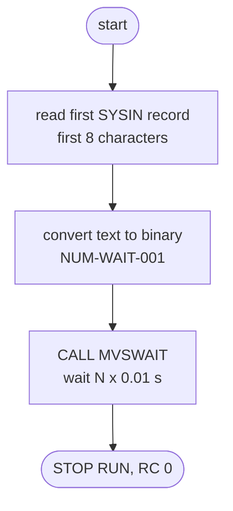
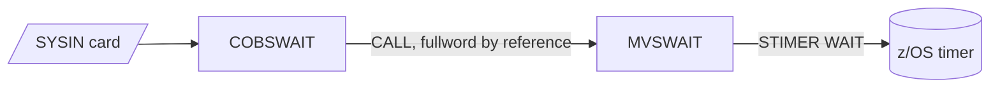

# COBSWAIT: Batch wait utility (WAITSTEP)

## 1. Summary

COBSWAIT is a one-step batch utility that pauses the batch stream for a fixed time. It reads one control card from SYSIN, takes its first 8 characters as a number of hundredths of a second (centiseconds), and calls the assembler routine MVSWAIT, which suspends the job step for that interval. It writes nothing, reads no files other than SYSIN and ends with return code 0. The only shipped use is the job `WAITSTEP`, whose control card `00003600` asks for a 36-second wait. Locally, MVSWAIT is replaced by a COBOL shim that sleeps for the same interval.

## 2. Rules at a glance

| ID | Rule |
| :-- | :-- |
| BR-WAIT-001 | The wait time is the first 8 characters of the first SYSIN record, read as an unsigned whole number of hundredths of a second (0 to 99,999,999). |
| BR-WAIT-002 | The step always ends with return code 0; there is no output and no error path in the program. |

There are no validations (section 8).

## 3. Actors and triggers

- **Trigger:** JCL job `WAITSTEP`, step `WAIT`, `EXEC PGM=COBSWAIT` (`app/jcl/WAITSTEP.jcl:22-27`). CA-7 triggers `WAITSTEP` after seven jobs: POSTTRAN (`app/scheduler/CardDemo.ca7:96-97`), TRANTYPE (`app/scheduler/CardDemo.ca7:188-189`), TRANCATG (`app/scheduler/CardDemo.ca7:297-298`), TCATBALF (`app/scheduler/CardDemo.ca7:329-330`), READXREF (`app/scheduler/CardDemo.ca7:447-448`), TXT2PDF1 (`app/scheduler/CardDemo.ca7:521-522`) and PRTCATBL (`app/scheduler/CardDemo.ca7:563-564`). Control-M runs it after TRANBKP (`app/scheduler/CardDemo.controlm:14-19`), after DISCGRP in the weekly folder (`app/scheduler/CardDemo.controlm:44-49`) and after COMBTRAN in the monthly folder (`app/scheduler/CardDemo.controlm:81-86`), each time followed by OPENFIL. What WAITSTEP triggers next in CA-7 depends on the schedule ID; the job and both schedules are specified in `jobs/WAITSTEP.md` §3 (area G). This spec covers the program.
- **Input:** one in-stream SYSIN record. The JCL record is `00003600      VALUE IN CENTISECONDS` (`app/jcl/WAITSTEP.jcl:26`); only its first 8 characters are used.
- **Not a PARM:** the program comment says "PARM IN CENTISECONDS" (`:5`) and the JCL comment says "IN THE PARM" (`app/jcl/WAITSTEP.jcl:20`), but the value is read from SYSIN; the EXEC statement has no `PARM=` (DEF-WAIT-002).
- **Preconditions:** a SYSIN DD; the load module MVSWAIT in the STEPLIB (`app/jcl/WAITSTEP.jcl:23`).

## 4. Interfaces

### 4.1 Input

| DD | Content | Use | Source |
| :-- | :-- | :-- | :-- |
| `SYSIN` | in-stream card(s), 80 bytes on z/OS | the first record is read once; bytes 1-8 go into `PARM-VALUE` (`PIC X(8)`) | `:31, 36` |
| `SYSOUT` | allocated by the JCL | not written by the program | `app/jcl/WAITSTEP.jcl:24` |

No files are opened.

### 4.2 Call

`CALL 'MVSWAIT' USING MVSWAIT-TIME`: one parameter, passed by reference, a 4-byte unsigned binary fullword (`PIC 9(8) COMP`) holding the delay in hundredths of a second (`:30, 38`). The callee is specified in `MVSWAIT.md`; it returns 0 in register 15.

### 4.3 Console output

None. The program has no `DISPLAY`.

### 4.4 Return code

0 (BR-WAIT-002).

## 5. Data used

No entity is read or written. Program-local data:

| Field | PIC | Bytes | Use | Source |
| :-- | :-- | --: | :-- | :-- |
| `PARM-VALUE` | `X(8)` | 8 | first 8 characters of the SYSIN record | `:31` |
| `MVSWAIT-TIME` | `9(8) COMP` | 4 | unsigned big-endian binary, the delay in centiseconds passed to MVSWAIT | `:30` |

## 6. Processing flow

1. Read the first SYSIN record into `PARM-VALUE` (FLOW-WAIT-001).
2. Convert the 8 characters to the binary fullword `MVSWAIT-TIME` (NUM-WAIT-001).
3. Call MVSWAIT with it; the step is suspended for that many hundredths of a second (BR-WAIT-001).
4. Stop the run with the return code left by MVSWAIT, which is 0 (BR-WAIT-002).

#### FLOW-WAIT-001 · Single pass, no loop
- **When:** the step starts.
- **Then:** exactly one ACCEPT, one MOVE, one CALL and STOP RUN, in that order. Further SYSIN records are ignored. There is no file open, no loop and no `DISPLAY`.
- **Source:** `:36-40`
- **Fidelity:** must-preserve · **Confidence:** runtime-verified (`tests/integration/test_waitstep.py:18-26`)

## 7. Business rules

#### BR-WAIT-001 · Wait for the SYSIN interval
- **When:** the step runs.
- **Then:** the step is suspended for the number of hundredths of a second given by the first 8 characters of the first SYSIN record. `00003600` waits 36 seconds, `00000050` half a second, `00000000` returns at once. The largest value that 8 digits allow is 99,999,999, about 11.6 days.
- **Input with non-digits:** the text is converted with an alphanumeric-to-numeric move, which does not check the content; the result for spaces, signs, letters or a decimal point depends on the compiler (NUM-WAIT-001, DEF-WAIT-001).
- **Source:** `:36-38`, `app/jcl/WAITSTEP.jcl:25-26`
- **Fidelity:** must-preserve (the duration; the mechanism is incidental) · **Confidence:** runtime-verified (local shim: `tests/integration/test_waitstep.py:18-26`; the z/OS wait itself is platform-inferred, see `MVSWAIT.md`)

#### BR-WAIT-002 · Return code 0
- **When:** the call to MVSWAIT returns.
- **Then:** `STOP RUN` ends the step with the `RETURN-CODE` special register, which the call has set from MVSWAIT's register 15 (always 0 in the assembler, set to 0 explicitly by the local shim). COBSWAIT never sets a return code itself, so the step return code is 0 for every input.
- **Source:** `:38-40`, `tools/shims/MVSWAIT.cbl:16`
- **Fidelity:** must-preserve (the schedulers treat 0 as success) · **Confidence:** runtime-verified (local runs of WAITSTEP and of `COBSWAIT` with blank, empty and non-numeric SYSIN all ended with 0)

## 8. Validations and messages

None. The SYSIN value is not checked for digits, range or presence, and the program issues no message (DEF-WAIT-001).

## 9. Side effects

None. The program reads SYSIN only and writes nothing; its only effect is elapsed time.

## 10. Error handling

#### ERR-WAIT-001 · No error handling
- The program checks nothing: no SYSIN status, no conversion check, no return code test after the call. A missing or empty SYSIN locally leaves `PARM-VALUE` blank and the wait is 0 (observed: return code 0, about 0.03 s). On z/OS, the behaviour of `ACCEPT ... FROM SYSIN` with no SYSIN DD or no record is a Language Environment runtime matter and was not determined here (Q-WAIT-001).
- **Source:** `:36-40`
- **Fidelity:** incidental · **Confidence:** runtime-verified locally; platform-inferred for z/OS

## 11. Interactions

- **Calls:** MVSWAIT (assembler, `app/asm/MVSWAIT.asm`; locally `tools/shims/MVSWAIT.cbl`). Interface: one fullword, unsigned binary centiseconds; return code 0 in register 15. Details in `MVSWAIT.md`.
- **Invoked by:** job `WAITSTEP` (`app/jcl/WAITSTEP.jcl:22`), scheduled between batch jobs (section 3). No data is shared with any other program; the job's purpose in the cycle is only the delay (Q-WAIT-002).
- **Local runner:** the job `WAITSTEP` is defined with SYSIN `00000050` (0.5 s) instead of the JCL's `00003600` (36 s) and no DDs (`tools/carddemo.py:689-690`).

## 12. Numeric, date and format details

#### NUM-WAIT-001 · SYSIN text to binary
- `PARM-VALUE` (`PIC X(8)`) is moved to `MVSWAIT-TIME` (`PIC 9(8) COMP`, 4-byte binary, big-endian on both platforms). By the COBOL rules the 8 characters are treated as an unsigned 8-digit integer; for 8 digits the result is exact (`00003600` gives 3600).
- **SYSIN shorter or longer than 8:** locally (GnuCOBOL `ACCEPT` reads one line) a shorter line is padded with spaces and a longer one is cut to its first 8 characters; on z/OS the first 8 bytes of the 80-byte card are used.
- **Observed on GnuCOBOL 3.2** (`-std=ibm -fsign=EBCDIC`, probe `docs/modernization/spec/checks/cobswait_probe/waitprob.cbl`, which has the same data items and statements as `:30-37`):

| SYSIN first 8 characters | Value passed (centiseconds) |
| :-- | --: |
| `00003600` | 3600 |
| `00003600      VALUE IN CENTISECONDS` (the JCL card) | 3600 |
| `50` followed by 6 spaces | 50 |
| 4 spaces then `0050` | 50 |
| ` 1 2 3 4` | 1234 |
| `-0000050` | 50 |
| `+0000050` | 50 |
| `ABCDEFGH` | 0 |
| `0000005A` | 0 |
| `00000.50` | 0 |
| 8 spaces, or no SYSIN line at all | 0 |
| `123456789` | 12345678 |
| `99999999` | 99999999 |

- **On z/OS** the move is compiled to machine instructions that convert each byte's low-order half-byte as a digit (zone bits ignored), with code that depends on the compiler release and options (`NUMPROC`, `TRUNC`). Spaces would then likely count as zeros, so `50` followed by spaces would be 50,000,000 centiseconds (about 5.8 days) instead of 50, and a byte whose low-order half is not 0-9 (for example `.`) can raise a data exception (abend S0C7). These results differ from the local table above (Q-WAIT-001).
- **Source:** `:30-31, 36-37`
- **Fidelity:** must-preserve for 8-digit input; defect-decide otherwise (DEF-WAIT-001) · **Confidence:** runtime-verified (GnuCOBOL table); platform-inferred (z/OS)

#### NUM-WAIT-002 · Units
- One unit is 0.01 second. Wait in seconds = value / 100. There is no rounding: the value is passed unchanged to MVSWAIT. The local shim converts it to nanoseconds by multiplying by 10,000,000 (`tools/shims/MVSWAIT.cbl:14`).
- **Source:** `:38`, `tools/shims/MVSWAIT.cbl:14-15`
- **Confidence:** runtime-verified (100 gave 1.09 s, 50 gave 0.52 s, 5 gave 0.11 s, 0 gave 0.05 s of process time, startup included)

## 13. Known defects and oddities

#### DEF-WAIT-001 · SYSIN value not validated; platform-dependent result
- Anything that is not 8 digits gives a value that differs between GnuCOBOL and z/OS (NUM-WAIT-001): `50` with trailing spaces waits 0.5 s locally but likely about 5.8 days on z/OS, and some characters can abend the step on z/OS. Nothing warns the operator.
- **Source:** `:36-37`
- **Status:** open · **Fidelity:** defect-decide (Q-WAIT-001)

#### DEF-WAIT-002 · Comments say PARM, the program reads SYSIN
- The program header (`:5`) and the JCL comment (`app/jcl/WAITSTEP.jcl:20`) describe the value as a PARM; the code reads SYSIN (`:36`) and the EXEC statement has no `PARM=` (`app/jcl/WAITSTEP.jcl:22`). The inventory repeats the header text (`docs/inventory.md:62`). Documentation only.
- **Status:** open

## 14. Open questions

| ID | Question | For |
| :-- | :-- | :-- |
| Q-WAIT-001 | On z/OS, what does the step do with a SYSIN card whose first 8 characters are not all digits (trailing spaces, sign, `.`), and with an empty or missing SYSIN? Should the target reject such input, or reproduce the z/OS value? | mainframe team, operations |
| Q-WAIT-002 | What does the 36-second wait protect in the batch cycle (for example, CICS file close or open completing before the next job)? Is a fixed delay still needed in the target, or should it become an explicit dependency? | operations, architecture |

## 15. Equivalence contract

A reimplementation is equivalent when, for a SYSIN record whose first 8 characters are digits:

- it waits at least value x 0.01 seconds (the exact elapsed time is a lower bound; process start and timer granularity may add to it);
- it writes no output, opens no files and ends with return code 0.

For other SYSIN content the result is platform-dependent (NUM-WAIT-001); a reimplementation must document which behaviour it chose (DEF-WAIT-001).

Runtime evidence: `tests/integration/test_waitstep.py:18-26` (50 centiseconds wait at least 0.5 s, 0 returns in under 0.45 s, return code 0), the probe `docs/modernization/spec/checks/cobswait_probe/waitprob.cbl` for the conversion table, and local runs of the job (`python3 tools/carddemo.py run WAITSTEP`: return code 0 in 0.52 s). No spec-only reimplementation is required for this utility. The independent review is recorded in `docs/modernization/spec/evidence/d2-batch-utilities-review.md`.

## 16. Paragraph coverage

COBSWAIT has no paragraphs; the procedure division is one sequence of statements.

| Paragraph | Lines | Covered by |
| :-- | :-- | :-- |
| (data division) | 26-31 | §5, NUM-WAIT-001 |
| (procedure division main line) | 34-40 | FLOW-WAIT-001, BR-WAIT-001, BR-WAIT-002, ERR-WAIT-001, NUM-WAIT-001, NUM-WAIT-002, DEF-WAIT-001 |

0 named paragraphs; the main line is covered.
