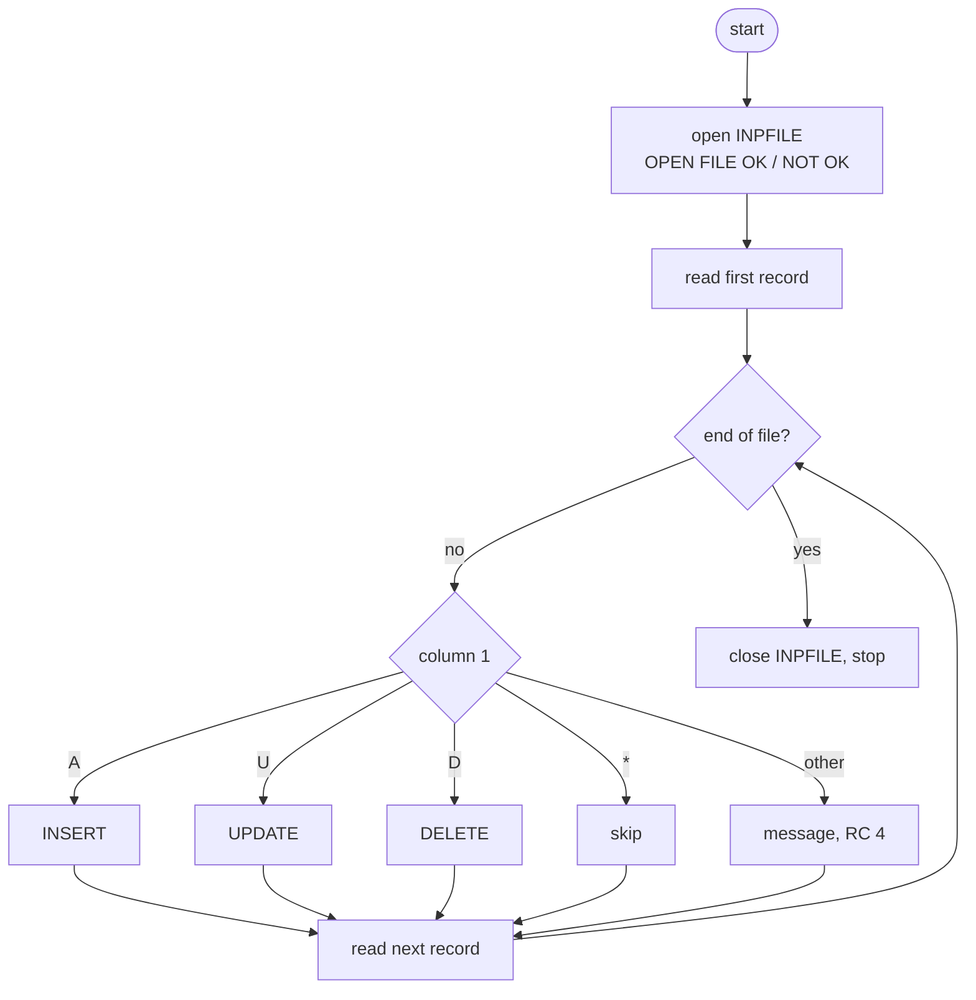
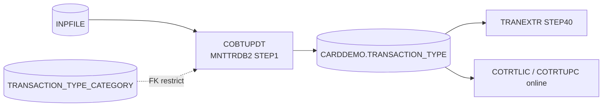

# COBTUPDT: Batch transaction type maintenance (MNTTRDB2)

## 1. Summary

Job MNTTRDB2 runs this program under the Db2 TSO attach to apply a file of changes to the Db2 table `CARDDEMO.TRANSACTION_TYPE`. Each 53-byte input record carries an action in column 1 (`A` add, `U` update, `D` delete, `*` comment), a two-character type code and a 50-character description. Records are applied one by one, in file order, with an INSERT, UPDATE or DELETE. A record that fails (unknown action, Db2 error, no row to update or delete) prints a message, sets return code 4 and processing goes on with the next record; nothing is rolled back and there is no explicit commit. The program does not validate the code or the description, so it can store values the online screen would refuse (DEF-TTBU-003). If the input file cannot be opened the program loops for ever (DEF-TTBU-001).

## 2. Rules at a glance

| ID | Rule |
| :-- | :-- |
| BR-TTBU-001 | Column 1 selects the action: `A` insert, `U` update, `D` delete, `*` skip; anything else is an error. |
| BR-TTBU-002 | Add inserts a row with the code and the 50-character description exactly as in the record. |
| BR-TTBU-003 | Update replaces the description of the row with the record's code; no row is an error. |
| BR-TTBU-004 | Delete removes the row with the record's code; no row is an error, and Db2 refuses a type that still has categories. |
| BR-TTBU-005 | A failed record sets return code 4 and the run goes on; the return code is never set back to 0. |
| BR-TTBU-006 | Records are applied in file order; a failed record changes nothing, except that a -911 rolls back every change made so far; nothing is committed before the program ends normally. |
| VAL-TTBU-001 | The action code must be `A`, `U`, `D` or `*`, upper case. |
| VAL-TTBU-002 | The code and description are not checked by the program; only Db2 constraints apply. |

## 3. Actors and triggers

- **Trigger:** JCL job `MNTTRDB2`, step `STEP1` (`app/app-transaction-type-db2/jcl/MNTTRDB2.jcl:21-30`): `IKJEFT01` runs the TSO command `DSN SYSTEM(DAZ1)` with subcommand `RUN PROGRAM(COBTUPDT) PLAN(CARDDEMO)`. See the MNTTRDB2 job spec.
- **Schedule:** Control-M job `MNTTRDB2` in folder `WEEKLY-TransactionTypesDBRefresh` (`app/scheduler/CardDemo.controlm:26-31`). Its OK end adds condition `WEEKLY-TransactionTypesDBRefresh-MNTTRDB2`, which TRANEXTR (`app/scheduler/CardDemo.controlm:58-61`) and the disclosure group refresh chain (CLOSEFIL, `app/scheduler/CardDemo.controlm:33-37`) wait for.
- **Actor:** an operator or administrator who prepares the input file. The program does no authorisation of its own; any user who can run plan `CARDDEMO` can change the table (DEF-TTBU-009).
- **Preconditions:** the Db2 objects of CREADB21 exist, plan `CARDDEMO` contains the COBTUPDT package, and the `INPFILE` DD names a real dataset (the JCL has the placeholder `DSN=INPFILE`).
- **No parameters**, no control cards.

## 4. Interfaces

### 4.1 Files and tables

| DD / object | Entity | Organisation | Open / access | Key | Record | Source |
| :-- | :-- | :-- | :-- | :-- | --: | :-- |
| `INPFILE` | ENT-TTYP-MAINT-INPUT | sequential, fixed (`RECORDING MODE F`) | INPUT, read next into `WS-INPUT-REC` | - | 53 | `:31-46, 71-77` |
| `CARDDEMO.TRANSACTION_TYPE` | ENT-DB2-TRAN-TYPE | Db2 table | INSERT, UPDATE, DELETE (static SQL) | `TR_TYPE` | - | `:137-148, 171-175, 201-204` |
| `CARDDEMO.TRANSACTION_TYPE_CATEGORY` | ENT-DB2-TRAN-TYPE-CAT | Db2 table | not accessed; its foreign key can refuse a delete | (`TRC_TYPE_CODE`, `TRC_TYPE_CATEGORY`) | - | `app/app-transaction-type-db2/ctl/DB2CREAT.ctl:96-99` |

The host variables are the record's own fields (`INPUT-REC-NUMBER` `PIC X(2)`, `INPUT-REC-DESC` `PIC X(50)`), not the DCLGEN fields of `DCLTRTYP`, which is included but unused (`:54`).

### 4.2 Console output, in order

The program writes only with DISPLAY. The JCL has no `SYSOUT` DD, so under the TSO attach the lines go to `SYSTSPRT` (platform-inferred).

| Text (exact) | When | Source |
| :-- | :-- | :-- |
| `OPEN FILE OK` or `OPEN FILE NOT OK` | after the open | `:84-88` |
| `PROCESSING   ` (three spaces) followed by the 53-byte record | each record read, comments included | `:104-106` |
| `ADDING RECORD`, `UPDATING RECORD`, `DELETING RECORD`, `IGNORING COMMENTED LINE` | after `PROCESSING`, by action | `:111-121` |
| `RECORD INSERTED SUCCESSFULLY`, `RECORD UPDATED SUCCESSFULLY`, `RECORD DELETED SUCCESSFULLY` | SQLCODE 0 | `:153, 179, 209` |
| the 80-byte message buffer `WS-RETURN-MSG` | each failure (ERR-TTBU-002, ERR-TTBU-003, VAL-TTBU-001) | `:231` |

There are no start, end or count lines.

### 4.3 Return code

0 when every record succeeded or was a comment; 4 as soon as one record failed (BR-TTBU-005). The program never abends on its own. How the TSO attach and `IKJEFT01` pass the program's return code to the step is platform behaviour (Q-TTBU-001).

## 5. Data used

| Entity field | Read | Written | Use |
| :-- | :-- | :-- | :-- |
| ENT-TTYP-MAINT-INPUT.INPUT-REC-TYPE | yes | - | action (BR-TTBU-001) |
| ENT-TTYP-MAINT-INPUT.INPUT-REC-NUMBER | yes | - | `TR_TYPE` value and WHERE key |
| ENT-TTYP-MAINT-INPUT.INPUT-REC-DESC | yes | - | `TR_DESCRIPTION` value for add and update |
| ENT-DB2-TRAN-TYPE.TR_TYPE | - | yes (insert, delete) | |
| ENT-DB2-TRAN-TYPE.TR_DESCRIPTION | - | yes (insert, update) | |

Program-local data with behaviour: `LASTREC` (end-of-file flag, `:58`), `WS-RETURN-MSG` `PIC X(80)` (`:61`, NUM-TTBU-003), `WS-VAR-SQLCODE` `PIC ----9` (`:65`, NUM-TTBU-002), `WS-INF-STATUS` (file status, `:67-69`). The FD record `WS-INPUT-VARS` (`:40-46`) is only the buffer; its VALUE clauses have no effect.

## 6. Processing flow

1. Open `INPFILE` for input and print whether status is `00` (FLOW-TTBU-001). A failed open does not stop the run.
2. Read the first record (FLOW-TTBU-002). Until end of file: apply the record (BR-TTBU-001), then read the next one.
3. Close the file and stop (FLOW-TTBU-003).

#### FLOW-TTBU-001 · Open, then fall into the loop
- **When:** the program starts.
- **Then:** `0001-OPEN-FILES` opens `INPFILE` for input and prints `OPEN FILE OK` (status `00`) or `OPEN FILE NOT OK` (any other status). It does not perform the read loop; control reaches `1001-READ-NEXT-RECORDS` only because it is the next paragraph in the source. The open result does not change the path (ERR-TTBU-001).
- **Source:** `:82-91`
- **Fidelity:** must-preserve (for the order of the output lines) · **Confidence:** reviewed

#### FLOW-TTBU-002 · Read loop
- **When:** after the open.
- **Then:** read one record (priming read), then repeat until the end-of-file flag `LASTREC` is `Y`: apply the record (BR-TTBU-001), read the next. Each read that is not end of file prints `PROCESSING   ` and the record. At end of file the work record keeps the last record read and nothing is printed. Only end of file sets the flag (ERR-TTBU-004).
- **Source:** `:91-96, 100-107`
- **Fidelity:** must-preserve · **Confidence:** reviewed

#### FLOW-TTBU-003 · End of run
- **When:** the loop ends.
- **Then:** `2001-CLOSE-STOP` closes the file (the close status is not checked), then STOP RUN ends the program with the current return code (BR-TTBU-005). `9999-ABEND` and `2001-CLOSE-STOP` follow the STOP RUN in the source and are reached only by PERFORM.
- **Source:** `:97-99, 234-236`
- **Fidelity:** must-preserve · **Confidence:** reviewed

## 7. Business rules

#### BR-TTBU-001 · Action selected by column 1
- **When:** a record has been read (not end of file).
- **Then:** by `INPUT-REC-TYPE`:

| Column 1 | Prints | Action |
| :-- | :-- | :-- |
| `A` | `ADDING RECORD` | BR-TTBU-002 |
| `U` | `UPDATING RECORD` | BR-TTBU-003 |
| `D` | `DELETING RECORD` | BR-TTBU-004 |
| `*` | `IGNORING COMMENTED LINE` | nothing |
| anything else, including a space and lower case | (ERR message) | VAL-TTBU-001 |

- **Source:** `:109-130`
- **Fidelity:** must-preserve · **Confidence:** reviewed

#### BR-TTBU-002 · Add a transaction type
- **When:** action `A`.
- **Then:** INSERT into `CARDDEMO.TRANSACTION_TYPE` a row with `TR_TYPE` = `INPUT-REC-NUMBER` (columns 2-3) and `TR_DESCRIPTION` = `INPUT-REC-DESC` (columns 4-53), both exactly as in the record: no trimming, no case change, no zero padding. SQLCODE 0 prints `RECORD INSERTED SUCCESSFULLY`; a negative SQLCODE is ERR-TTBU-002 (a code that already exists gives -803); a positive SQLCODE prints nothing (DEF-TTBU-004).
- **Source:** `:132-164`
- **Fidelity:** must-preserve · **Confidence:** reviewed

#### BR-TTBU-003 · Update a transaction type
- **When:** action `U`.
- **Then:** UPDATE `CARDDEMO.TRANSACTION_TYPE` set `TR_DESCRIPTION` = `INPUT-REC-DESC` where `TR_TYPE` = `INPUT-REC-NUMBER`. SQLCODE 0 prints `RECORD UPDATED SUCCESSFULLY`, also when the description was already the same. SQLCODE +100 (no row with that code) is ERR-TTBU-003. A negative SQLCODE is ERR-TTBU-002.
- **Source:** `:166-195`
- **Fidelity:** must-preserve · **Confidence:** reviewed

#### BR-TTBU-004 · Delete a transaction type
- **When:** action `D`.
- **Then:** DELETE from `CARDDEMO.TRANSACTION_TYPE` where `TR_TYPE` = `INPUT-REC-NUMBER`; the description columns of the record are ignored. SQLCODE 0 prints `RECORD DELETED SUCCESSFULLY`. +100 (no row) is ERR-TTBU-003. If categories of that type exist in `CARDDEMO.TRANSACTION_TYPE_CATEGORY`, the foreign key `ON DELETE RESTRICT` makes Db2 refuse the delete (SQLCODE -532), reported by ERR-TTBU-002.
- **Source:** `:196-226`, `app/app-transaction-type-db2/ctl/DB2CREAT.ctl:96-99`
- **Fidelity:** must-preserve · **Confidence:** reviewed (the -532 value is platform-inferred)

#### BR-TTBU-005 · Return code 4 on any failed record
- **When:** a record fails: VAL-TTBU-001, ERR-TTBU-002 or ERR-TTBU-003.
- **Then:** the message is printed, `RETURN-CODE` is set to 4 and the run continues with the next record. Nothing sets it back, so the run ends with 4 if any record failed, else 0.
- **Source:** `:128, 162, 184, 193, 214, 224, 230-233`
- **Fidelity:** must-preserve · **Confidence:** reviewed

#### BR-TTBU-006 · File order and independent records
- **When:** several records name the same code (for example `A01`, then `U01`, then `D01`).
- **Then:** they are applied in file order and each sees the effect of the earlier ones. A record that fails with an ordinary statement error (for example -803, -532) changes nothing and the earlier changes stay pending; a -911 (deadlock or timeout) rolls back every change made so far in the run, and later records are applied in a new unit of work. There is no COMMIT or ROLLBACK in the program, and nothing is committed until it ends normally (SE-TTBU-004).
- **Source:** `:91-99, 109-130`
- **Fidelity:** must-preserve · **Confidence:** reviewed

## 8. Validations

#### VAL-TTBU-001 · Action code must be A, U, D or *
- **When:** column 1 is not one of `A`, `U`, `D`, `*` (the test is case-sensitive; a blank line has a space there).
- **Then:** the message buffer receives `ERROR: TYPE NOT VALID` (21 characters, overwriting the start of the buffer only, NUM-TTBU-003), it is printed, return code 4, next record.
- **Source:** `:122-128, 230-233`
- **Confidence:** reviewed

#### VAL-TTBU-002 · No program checks on code or description
- **When:** an `A`, `U` or `D` record is applied.
- **Then:** the code is used as two raw characters: `1 `, ` 1`, `AB`, `  ` and `00` are all accepted and are different keys from `01`. The description may be blank, lower case or contain any character. Only Db2 rejects anything: a duplicate key on insert (-803), a delete refused by the foreign key (-532), or any other SQL error. Compare the online program, which normalises the code to two digits and accepts only letters, digits and spaces in the description (BR-TTUP-001, VAL-TTUP-006), and DEF-TTBU-003.
- **Source:** `:132-148, 166-175, 196-204`
- **Confidence:** reviewed

## 9. Side effects

In file order, one statement per record. Each is part of the single unit of work of the run (SE-TTBU-004).

#### SE-TTBU-001 · Insert a type row
- `INSERT INTO CARDDEMO.TRANSACTION_TYPE (TR_TYPE, TR_DESCRIPTION) VALUES (:INPUT-REC-NUMBER, :INPUT-REC-DESC)`. The description is passed as a fixed 50-byte value, so the stored VARCHAR is 50 long, with its trailing spaces (NUM-TTBU-004).
- **Source:** `:137-148`

#### SE-TTBU-002 · Update a type description
- `UPDATE CARDDEMO.TRANSACTION_TYPE SET TR_DESCRIPTION = :INPUT-REC-DESC WHERE TR_TYPE = :INPUT-REC-NUMBER`. At most one row (primary key).
- **Source:** `:171-175`

#### SE-TTBU-003 · Delete a type row
- `DELETE FROM CARDDEMO.TRANSACTION_TYPE WHERE TR_TYPE = :INPUT-REC-NUMBER`. At most one row. Categories are never deleted with it (the foreign key is RESTRICT, not CASCADE).
- **Source:** `:201-204`

#### SE-TTBU-004 · One unit of work, no explicit commit
- The program issues no COMMIT or ROLLBACK. Under the TSO attach, Db2 commits all changes of the run when the program ends normally and backs them all out if the step abends or is cancelled. A statement that fails with an ordinary error (-803, -532, ...) undoes only itself; the earlier changes stay pending in the same unit of work. A -911 rolls back the entire unit of work, so every earlier change of the run is lost while later records are still applied (and committed at the end). The table space has `LOCKSIZE TABLE`, so the first change locks the whole table until the run ends (DEF-TTBU-006).
- **Source:** `:80-99`, `app/app-transaction-type-db2/ctl/DB2CREAT.ctl:24-31`
- **Confidence:** platform-inferred

## 10. Error handling

#### ERR-TTBU-001 · Open failure is only reported
- **When:** the open returns a status other than `00`.
- **Then:** prints `OPEN FILE NOT OK` (the status itself is not printed) and goes on to the read loop as if the file were open. See DEF-TTBU-001 for what follows.
- **Source:** `:82-89`
- **Confidence:** reviewed

#### ERR-TTBU-002 · Negative SQLCODE
- **When:** the INSERT, UPDATE or DELETE returns a negative SQLCODE.
- **Then:** the message buffer receives `Error accessing: TRANSACTION_TYPE table. SQLCODE:` followed by the SQLCODE edited as 5 characters (NUM-TTBU-002), for example `Error accessing: TRANSACTION_TYPE table. SQLCODE: -803` (54 characters); it is printed, return code 4, next record. The same text is used for the three statements, so the message does not say which action failed (the preceding `ADDING`/`UPDATING`/`DELETING RECORD` line does). A -911 is reported like any other failure, but Db2 has already backed out every earlier change of the run (SE-TTBU-004).
- **Source:** `:154-162, 185-193, 216-224, 230-233`
- **Confidence:** reviewed

#### ERR-TTBU-003 · No row to update or delete
- **When:** the UPDATE or DELETE returns SQLCODE +100.
- **Then:** the message buffer receives `No records found.` (17 characters, overwriting only the start of the buffer, NUM-TTBU-003); it is printed, return code 4, next record.
- **Source:** `:180-184, 210-214, 230-233`
- **Confidence:** reviewed

#### ERR-TTBU-004 · Read errors are not detected
- **When:** a READ fails with anything other than end of file.
- **Then:** nothing tests the file status after a read. The work record keeps its previous content and is processed again (DEF-TTBU-001).
- **Source:** `:100-107`
- **Confidence:** runtime-verified (GnuCOBOL; see DEF-TTBU-001)

#### ERR-TTBU-005 · `9999-ABEND` does not abend
- The paragraph only prints the message buffer and sets return code 4 (`:230-233`). Its caller then falls through to the end of its own paragraph and the loop goes on.
- **Source:** `:230-233`
- **Confidence:** reviewed

## 11. Interactions

- **Upstream:** the operator who builds the `INPFILE` dataset (outside the repository); CREADB21 creates the table.
- **Downstream:** Control-M starts TRANEXTR after MNTTRDB2 ends OK (`app/scheduler/CardDemo.controlm:58-61`); TRANEXTR unloads the table to the `TRANTYPE.PS` sequential file. The VSAM file read by the base batch and online programs (ENT-TRAN-TYPE) changes only when the base `TRANTYPE` job reloads it from that file; until then the two copies differ (see the TRANEXTR job spec).
- **Shared data with online programs:** the same table is listed and changed by COTRTLIC and COTRTUPC. A batch run holds a table lock until it ends (SE-TTBU-004), so online access waits or times out during the run (platform-inferred).

## 12. Numeric, date and format details

#### NUM-TTBU-001 · Input record
- 53 bytes: column 1 action, columns 2-3 code, columns 4-53 description (ENT-TTYP-MAINT-INPUT). The JCL comment documents the same layout and calls the code "numeric" (`app/app-transaction-type-db2/jcl/MNTTRDB2.jcl:8-18`); the program does not check it. A dataset whose fixed record length is not 53 is a z/OS open error (status 39), which ends in DEF-TTBU-001 (platform-inferred).
- **Source:** `:39-46, 71-77`

#### NUM-TTBU-002 · SQLCODE display
- `WS-VAR-SQLCODE` is `PIC ----9`: 5 characters, right-aligned, a floating minus sign. `-803` prints ` -803`, `-532` ` -532`. A 5-digit SQLCODE loses its leading digit: GnuCOBOL prints `-10405` as `-0405`, while the standard truncate-then-edit result, expected on z/OS, is ` -405` (platform-inferred).
- **Source:** `:65, 149, 176, 205`
- **Confidence:** runtime-verified for 4-digit codes (GnuCOBOL 3.2 `-std=ibm`, evidence file); the 5-digit z/OS result is platform-inferred

#### NUM-TTBU-003 · Message buffer is never cleared
- `WS-RETURN-MSG` is `PIC X(80)`, spaces at start. Each message is put into it with STRING, which writes only the characters of the new message and leaves the rest of the buffer as it was. The first message prints cleanly; a later, shorter message prints followed by the tail of the longest earlier one. After `Error accessing: TRANSACTION_TYPE table. SQLCODE: -803`, a not-found record prints `No records found.TRANSACTION_TYPE table. SQLCODE: -803` and an invalid action prints `ERROR: TYPE NOT VALIDSACTION_TYPE table. SQLCODE: -803`. The full 80 bytes are printed.
- **Source:** `:61, 123-127, 155-161, 181-183, 211-213, 217-223, 231`
- **Confidence:** runtime-verified (GnuCOBOL 3.2 `-std=ibm`, evidence file)

#### NUM-TTBU-004 · Stored description length
- The description host variable is `PIC X(50)`, not the VARCHAR structure of the DCLGEN, so Db2 receives a 50-byte string and `TR_DESCRIPTION` is stored with its trailing spaces (length 50). The online programs also store 50 bytes (BR-TTUP-003), but after removing leading spaces (`FUNCTION TRIM`); COBTUPDT keeps leading spaces. Seed rows from CREADB21 keep the literal length (for example `PURCHASE` is 8). The content rules also differ (VAL-TTBU-002).
- **Source:** `:76, 146, 173`
- **Confidence:** platform-inferred

#### NUM-TTBU-005 · Codes and case
- `TR_TYPE` is `CHAR(2)`, compared byte for byte in the table's EBCDIC encoding. `01`, `1 ` and ` 1` are three different keys. The table is defined `CCSID EBCDIC` (`app/app-transaction-type-db2/ctl/DB2CREAT.ctl:35-40`).
- **Source:** `:145, 174, 203`

## 13. Known defects and oddities

#### DEF-TTBU-001 · A failed open loops for ever
- When the open fails with a file status (DD missing, conflicting record length; a missing dataset under MNTTRDB2 is a JCL error before the step starts and an authorisation failure is normally an S913 abend, platform-inferred), the program prints `OPEN FILE NOT OK` and reads anyway. A read on a file that is not open returns status 47, not end of file, so the end-of-file flag is never set. Each pass prints `PROCESSING   ` with the blank work record, then `ERROR: TYPE NOT VALID` and sets return code 4, without end. The job card has `TIME=1440` (no CPU limit, `app/app-transaction-type-db2/jcl/MNTTRDB2.jcl:1-2`), so the step runs until an operator cancels it or the output limit stops it. For a read error that is not end of file after at least one good record, the loop is the same but the work record keeps the last good record (READ INTO does not move on failure), so that record is printed and applied again on every pass.
- **Source:** `:82-107` · **Status:** open · **Fidelity:** defect-decide (Q-TTBU-004)
- **Confidence:** runtime-verified on GnuCOBOL 3.2 (open status 35, then read status 47 repeated with the end-of-file flag unset; evidence file); the z/OS statuses are platform-inferred.

#### DEF-TTBU-002 · Error messages carry text from earlier errors
- See NUM-TTBU-003. Operators reading the output can see a wrong SQLCODE next to `No records found.`.
- **Source:** `:61, 181-183, 211-213` · **Status:** open · **Fidelity:** incidental

#### DEF-TTBU-003 · Batch accepts codes and descriptions the online screen refuses
- No check that the code is two digits (the JCL comment says numeric), not zero, or upper case, and no check of the description content. A batch-added `1 ` is a different type from `01`; the list screen shows it and the online update screen cannot reach it, because it turns every code it is given into two digits (BR-TTUP-001).
- **Source:** `:109-148` · **Status:** open · **Fidelity:** defect-decide (Q-TTBU-002)

#### DEF-TTBU-004 · Positive SQLCODEs are silent
- On INSERT only 0 and negative values are handled; a positive SQLCODE (a warning) prints neither success nor an error and does not set the return code. On UPDATE and DELETE the same is true for positive values other than +100.
- **Source:** `:151-163, 177-194, 207-225` · **Status:** open · **Fidelity:** incidental

#### DEF-TTBU-005 · Not restartable
- A failed record does not stop the run, and a rerun of the same file after a partial failure repeats every record: the adds that worked the first time now fail with -803 and the deletes with +100, each setting return code 4. There is no checkpoint or restart position.
- **Source:** `:91-99` · **Status:** open (architecture, Q-TTBU-003)

#### DEF-TTBU-006 · One unit of work holding a table lock
- No COMMIT for the whole file (SE-TTBU-004): the table stays locked for the run and a cancel, including the cancel needed to stop DEF-TTBU-001, backs out every change of the run. Combined with DEF-TTBU-001, a run with a bad input dataset never ends and blocks the online type screens.
- **Source:** `:80-99`, `app/app-transaction-type-db2/ctl/DB2CREAT.ctl:28` · **Status:** open · **Confidence:** platform-inferred

#### DEF-TTBU-007 · No run summary
- No counts of records read, applied or failed, and no end-of-run line. The only evidence of what happened is the per-record output and the return code.
- **Source:** `:91-107` · **Status:** open · **Fidelity:** incidental

#### DEF-TTBU-008 · The open message omits the status
- `OPEN FILE NOT OK` does not show the file status, so the cause (missing dataset, wrong length) is not visible.
- **Source:** `:84-88` · **Status:** open · **Fidelity:** incidental

#### DEF-TTBU-009 · [security] No authorisation in the program
- Anyone who can submit the job and execute plan `CARDDEMO` can add, change or delete types. The setup grants table privileges to `PUBLIC` (`app/app-transaction-type-db2/ctl/DB2CREAT.ctl:52-59`).
- **Status:** open (security)

#### DEF-TTBU-010 · Misleading paragraph names and dead statements
- `9999-ABEND` does not abend (ERR-TTBU-005); `2001-CLOSE-STOP` only closes the file; the STOP RUN is in `1001-READ-NEXT-RECORDS` after an EXIT that does nothing (`:97-99`). The DCLGEN `DCLTRTYP` is included but not used (`:54`). The open paragraph does not perform the loop; the program reaches the loop only because it is the next paragraph in the source (FLOW-TTBU-001).
- **Source:** `:54, 82-99, 230-236` · **Status:** open · **Fidelity:** incidental

## 14. Open questions

| ID | Question | For |
| :-- | :-- | :-- |
| Q-TTBU-001 | Does the step end with the program's return code (0 or 4) through `DSN RUN` under `IKJEFT01`, and does Control-M treat 4 as OK, so that TRANEXTR runs after a partly failed maintenance? | mainframe team |
| Q-TTBU-002 | Should batch apply the online rules (two-digit code with leading zero, not zero, letters/digits/spaces description), or are other codes intended? | business |
| Q-TTBU-003 | Target transaction boundary: all-or-nothing per file, or commit per record with a report of failures? | architecture |
| Q-TTBU-004 | An unreadable input file should end the run with an error code; which code, and should it stop the schedule? | operations |
| Q-TTBU-005 | Which dataset is the real input (the JCL has the placeholder `DSN=INPFILE`), who produces it, and with what record length? | operations |

## 15. Equivalence contract

A reimplementation is equivalent when, for the same table content and input file:

- the table content after the run is the same, including descriptions stored with trailing spaces to 50 characters and codes stored byte for byte;
- the per-record output lines are the same, in the same order, including the residue in the message buffer (NUM-TTBU-003), unless the target replaces the console text (DEF-TTBU-002 is incidental);
- the return code is the same (0 or 4).

Worked example on the seed table (types `01`-`07`, categories for each, DB2LTTYP and DB2LTCAT): input records `A08Loyalty bonus`, `A01X`, `U09Y`, `D07`, `x01`, `*comment`. Expected: `08` inserted with `Loyalty bonus` padded to 50; `A01X` fails ` -803` (first message, clean); `U09Y` prints `No records found.TRANSACTION_TYPE table. SQLCODE: -803`; `D07` fails ` -532` because type 07 has categories (message clean, since it is as long as the first); `x01` prints `ERROR: TYPE NOT VALIDSACTION_TYPE table. SQLCODE: -532`; the comment prints `IGNORING COMMENTED LINE`. Return code 4; table has 8 types. These outcomes come from reading the source; nothing here runs locally (no Db2). The review is in `docs/modernization/spec/evidence/f-trantype-vsam-mq-review.md`.

## 16. Paragraph coverage

| Paragraph | Lines | Covered by |
| :-- | :-- | :-- |
| (file and data division) | 31-77 | §4.1, §5, NUM-TTBU-001, NUM-TTBU-002, NUM-TTBU-003 |
| `0001-OPEN-FILES` | 82-89 | FLOW-TTBU-001, ERR-TTBU-001, DEF-TTBU-001, DEF-TTBU-008 |
| `1001-READ-NEXT-RECORDS` | 91-99 | FLOW-TTBU-002, FLOW-TTBU-003, BR-TTBU-006, DEF-TTBU-010 |
| `1002-READ-RECORDS` | 100-107 | FLOW-TTBU-002, ERR-TTBU-004, DEF-TTBU-001 |
| `1003-TREAT-RECORD` | 109-130 | BR-TTBU-001, VAL-TTBU-001 |
| `10031-INSERT-DB` | 132-164 | BR-TTBU-002, SE-TTBU-001, ERR-TTBU-002, DEF-TTBU-004 |
| `10032-UPDATE-DB` | 166-195 | BR-TTBU-003, SE-TTBU-002, ERR-TTBU-002, ERR-TTBU-003 |
| `10033-DELETE-DB` | 196-226 | BR-TTBU-004, SE-TTBU-003, ERR-TTBU-002, ERR-TTBU-003 |
| `9999-ABEND` | 230-233 | BR-TTBU-005, ERR-TTBU-005 |
| `2001-CLOSE-STOP` | 234-236 | FLOW-TTBU-003 |

9 of 9 paragraphs covered.
