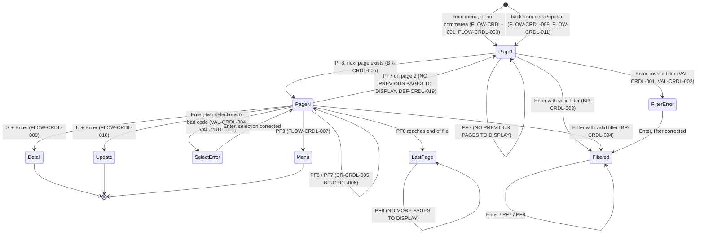
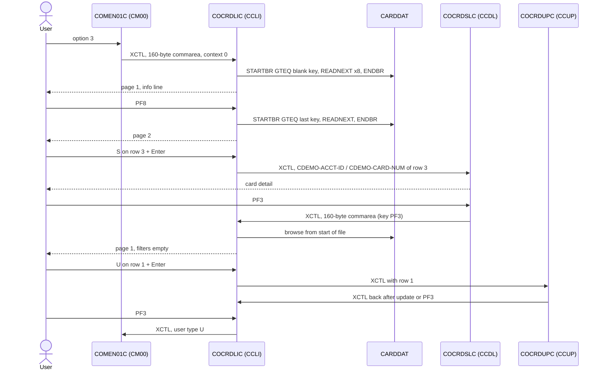

# COCRDLIC: Online credit card list

## 1. Summary

A CardDemo user picks **Credit Card List** (option 3) on the main menu and sees the cards of the card master file `CARDDAT`, seven per page, in ascending card number order. Each row shows the account number, the full card number and the active flag (`Y`/`N`). The user can type an 11-digit account number and/or a 16-digit card number as a filter and press Enter; only cards that match exactly are then listed. PF8 shows the next page and PF7 the previous one. Typing `S` next to one card and pressing Enter opens the card detail program `COCRDSLC`; `U` opens the card update program `COCRDUPC`. PF3 returns to the main menu. The program only reads; it writes nothing. Although the header comment says regular users should see only the cards of their own account, the program applies **no restriction by user type or ownership**: every user who reaches it can list every card (DEF-CRDL-001).

## 2. Rules at a glance

| ID | Rule |
| :-- | :-- |
| BR-CRDL-001 | Cards are listed in ascending card number order, at most 7 per page; each row shows account number, card number and active flag. |
| BR-CRDL-002 | There is no admin/user distinction: every user sees all cards, unless they filter. |
| BR-CRDL-003 | Optional filters on account number and card number, exact match; when both are given, both must match. |
| BR-CRDL-004 | The filter is applied record by record while reading, starting at the first card of the current page, not at the start of the file. |
| BR-CRDL-005 | PF8 shows the next page when one exists; the next page starts with the card read ahead after the last row. |
| BR-CRDL-006 | PF7 shows the previous page, read backwards from the first card of the current page; on page 1, and also when it arrives at page 1, it shows `NO PREVIOUS PAGES TO DISPLAY`. |
| BR-CRDL-007 | `S` on one row plus Enter opens card detail (`COCRDSLC`); `U` opens card update (`COCRDUPC`); the row's account and card number are passed. |
| BR-CRDL-008 | An information line `TYPE S FOR DETAIL, U TO UPDATE ANY RECORD` is shown on most screens. |
| VAL-CRDL-001 | The account filter, when given, must be 11 digits; blank, all zeros, or only zeros and blanks means "no filter". |
| VAL-CRDL-002 | The card filter, when given, must be 16 digits; blank, all zeros, or only zeros and blanks means "no filter". |
| VAL-CRDL-003 | After a filter error the list is not re-read and the selection fields are protected. |
| VAL-CRDL-004 | At most one row may carry `S` or `U`. |
| VAL-CRDL-005 | A selection code other than `S`, `U` or blank is rejected (`INVALID ACTION CODE`); lowercase is rejected. |
| VAL-CRDL-006 | Only Enter, PF3, PF7 and PF8 have a function; every other key acts as Enter, with no message. |
| VAL-CRDL-007 | Edits run in a fixed order and only the first message is kept; the PF7/PF8 end-of-list texts can still replace a selection message. |

## 3. Actors and triggers

- **Actor:** a CardDemo user at a 3270 terminal. The program reads `CDEMO-USER-TYPE` nowhere and `CDEMO-USER-ID` nowhere; it sets the user type to `U` on every transfer (DEF-CRDL-004).
- **Normal trigger:** main menu `COMEN01C`, option 3 "Credit Card List", user type `U` (`app/cpy/COMEN02Y.cpy:37-41`). The menu transfers control (XCTL) with its 160-byte commarea, `CDEMO-FROM-PROGRAM` = `COMEN01C` and `CDEMO-PGM-CONTEXT` = 0 (`app/cbl/COMEN01C.cbl:177-187`). Admin users sign on to the admin menu `COADM01C` (`app/cbl/COSGN00C.cbl:230-240`), whose options do not include the card list (`app/cpy/COADM02Y.cpy:22-54`).
- **Return from card detail or card update:** `COCRDSLC` on PF3 (`app/cbl/COCRDSLC.cbl:305-334`) and `COCRDUPC` on PF3 or when an update started from the list is finished or failed (`app/cbl/COCRDUPC.cbl:435-476`) transfer back to `COCRDLIC` with the 160-byte commarea and context 0. The EIB still carries the key pressed in that program (PF3 in most cases), which decides the path taken here (FLOW-CRDL-008).
- **Re-entry trigger:** CICS starts transaction `CCLI` (`app/csd/CARDDEMO.CSD:357-366`) when the user presses a key on the list, because every interaction ends with "return, next transaction CCLI" (FLOW-CRDL-012).
- **Direct start:** typing `CCLI` on a cleared terminal starts the program with no commarea. It does **not** send the user to sign-on; it lists the cards at once (FLOW-CRDL-001, DEF-CRDL-003).
- **Not used:** `CSUTLDTC` (date check) is not called; the program has no date input. No other subprogram is called.

## 4. Interfaces

### 4.1 Screen CCRDLIA (mapset COCRDLI), 24 x 80

Source: `app/bms/COCRDLI.bms:20-341`; symbolic map `app/cpy-bms/COCRDLI.CPY:17-560`. Row,Col is the BMS `POS` (the attribute byte); the data starts one column to the right.

| Row,Col | Field | Len | Direction | Attributes (BMS) | Content |
| :-- | :-- | --: | :-- | :-- | :-- |
| 1,1 | (label) | 5 | out | protected, blue | `Tran:` |
| 1,7 | `TRNNAME` | 4 | out | protected, FSET, blue | `CCLI` |
| 1,21 | `TITLE01` | 40 | out | protected, yellow | `      AWS Mainframe Modernization       ` (`app/cpy/COTTL01Y.cpy:18-19`) |
| 1,65 | (label) | 5 | out | protected, blue | `Date:` |
| 1,71 | `CURDATE` | 8 | out | protected, blue | today `mm/dd/yy` (NUM-CRDL-002) |
| 2,1 | (label) | 5 | out | protected, blue | `Prog:` |
| 2,7 | `PGMNAME` | 8 | out | protected, blue | `COCRDLIC` |
| 2,21 | `TITLE02` | 40 | out | protected, yellow | `              CardDemo                  ` (`app/cpy/COTTL01Y.cpy:20-22`) |
| 2,65 | (label) | 5 | out | protected, blue | `Time:` |
| 2,71 | `CURTIME` | 8 | out | protected, blue | now `hh:mm:ss` |
| 4,31 | (label) | 17 | out | neutral | `List Credit Cards` |
| 4,70 | (label) | 5 | out | default | `Page ` |
| 4,76 | `PAGENO` | 3 | out | default | page number, one digit, left-aligned (NUM-CRDL-001) |
| 6,22 | (label) | 19 | out | protected, turquoise | `Account Number    :` |
| 6,44 | `ACCTSID` | 11 | in/out | **unprotected**, green, underlined, FSET, initial cursor | account filter |
| 7,22 | (label) | 19 | out | protected, turquoise | `Credit Card Number:` |
| 7,44 | `CARDSID` | 16 | in/out | **unprotected**, green, underlined, FSET | card filter |
| 9,10 / 9,21 / 9,45 / 9,66 | (labels) | 10/14/13/7 | out | neutral | `Select    `, `Account Number`, ` Card Number `, `Active ` |
| 10,10 / 10,20 / 10,43 / 10,65 | (labels) | 6/15/15/8 | out | neutral | dashes |
| 11..17,12 | `CRDSEL1`..`CRDSEL7` | 1 | in/out | protected, FSET, underlined in the map; the program sets them per row (FLOW-CRDL-014) | selection code `S`/`U` |
| 12..17,14 | `CRDSTP2`..`CRDSTP7` | 1 | out | dark, FSET | never filled by the program (DEF-CRDL-016) |
| 11..17,22 | `ACCTNO1`..`ACCTNO7` | 11 | out | protected | `CARD-ACCT-ID` |
| 11..17,43 | `CRDNUM1`..`CRDNUM7` | 16 | out | protected | `CARD-NUM` |
| 11..17,67 | `CRDSTS1`..`CRDSTS7` | 1 | out | protected | `CARD-ACTIVE-STATUS` |
| 20,19 | `INFOMSG` | 45 | out | protected, neutral | information line (BR-CRDL-008) |
| 23,1 | `ERRMSG` | 78 | out | protected, bright, FSET, **red** | message (section 8.3) |
| 24,1 | (label) | 78 | out | protected, turquoise | `  F3=Exit F7=Backward  F8=Forward` |

The program never changes the colour of `ERRMSG`, so every message, including the end-of-list notices, is red. The message work field is 75 characters (`:117`); the longest message (the file error text, NUM-CRDL-006) is exactly 75, so nothing is cut on the screen.

### 4.2 Files

| CICS file | Entity | Operation | Key | Lines |
| :-- | :-- | :-- | :-- | :-- |
| `CARDDAT` | ENT-CARD | STARTBR (GTEQ), READNEXT, ENDBR | `CARD-NUM` (16, primary key) | 1129-1136, 1146-1154, 1197-1205, 1258-1259 |
| `CARDDAT` | ENT-CARD | STARTBR (GTEQ), READPREV, ENDBR | `CARD-NUM` (16) | 1273-1280, 1294-1302, 1322-1330, 1375-1377 |
| `CARDAIX` | ENT-CARD (alternate index by account) | none: only a literal (`:215-217`) | - | - |

`CARDDAT` is a KSDS with `KEYS(16 0)` and 150-byte records (`app/jcl/CARDFILE.jcl:50-55`). Its CICS definition has `READINTEG(UNCOMMITTED)` and `RECOVERY(NONE)` (`app/csd/CARDDEMO.CSD:25-36`); a browse takes no locks. The account filter is applied by reading every card, not through the alternate index `CARDAIX` (`app/csd/CARDDEMO.CSD:13-24`, `app/jcl/CARDFILE.jcl:83-88`).

### 4.3 Commarea

`ENT-COMMAREA` (160 bytes from `COCOM01Y`) followed by the list extension `WS-THIS-PROGCOMMAREA` (`:229-260`). The program returns a 2000-byte area (`:262, 604-619`): bytes 1-160 the base commarea, bytes 161-414 the extension (NUM-CRDL-005), bytes 415-2000 spaces. On XCTL to another program it passes only the 160-byte base, so the list state is not carried to card detail, card update or the menu.

| Field | Read | Written | Use |
| :-- | :-- | :-- | :-- |
| `CDEMO-FROM-PROGRAM` | yes | yes | `COCRDLIC` means "re-entry from my own screen" (FLOW-CRDL-004); set to `COCRDLIC` on every exit |
| `CDEMO-FROM-TRANID` | no | yes | set to `CCLI` |
| `CDEMO-PGM-CONTEXT` | yes | yes | always set to 0 (enter); the program never sets 1 (FLOW-CRDL-003) |
| `CDEMO-USER-TYPE` | no | yes | forced to `U` (DEF-CRDL-004) |
| `CDEMO-TO-PROGRAM` | no | yes | `COMEN01C` on PF3 only |
| `CDEMO-ACCT-ID` | yes | yes | set from the account filter (0 when blank or invalid); set from the selected row before XCTL; may prefill the filter (FLOW-CRDL-015) |
| `CDEMO-CARD-NUM` | yes | yes | the same for the card filter and the selected row |
| `CDEMO-LAST-MAP`, `CDEMO-LAST-MAPSET` | no | yes | `CCRDLIA` / `COCRDLI`; card detail and card update use the mapset to detect "called from the list" |
| all other fields | no | passed through, except on FLOW-CRDL-008 where the whole base commarea is cleared (DEF-CRDL-005) | |

| Extension field | Meaning |
| :-- | :-- |
| `WS-CA-FIRST-CARD-NUM` (and `-ACCT-ID`) | first card shown on the current page; start key for Enter, PF7 and refresh |
| `WS-CA-LAST-CARD-NUM` (and `-ACCT-ID`) | start key for PF8: after a full page, the card read ahead (the first card of the next page) |
| `WS-CA-SCREEN-NUM` | page number shown, one digit; value 1 = "first page" |
| `WS-CA-LAST-PAGE-DISPLAYED` | 0 = "end of list already reported on PF8", 9 = not yet |
| `WS-CA-NEXT-PAGE-IND` | `Y` = a next page exists, low-values = no next page |
| `WS-RETURN-FLAG` | declared, never used |
| `WS-SCREEN-DATA` | the 7 rows shown (account 11, card 16, status 1, per row); used to find the account and card of a selected row on the next interaction |

The account parts of the two keys are saved but never used as keys (the lines that would use them are comments, `:448-449, 475-476, 490-491, 506-507, 576-577`).

When the extension is cleared (start without commarea, arrival from another program, FLOW-CRDL-008), `WS-CA-NEXT-PAGE-IND` becomes a space, which means neither "next page exists" nor "no next page", and the rows become spaces rather than low-values. This has no visible effect, because every path that follows performs a read, which sets both (`:316-317, 338, 462-463, 242-244, 1124, 1141`).

### 4.4 Console output

None. The program has no `DISPLAY`. The paragraphs `SEND-PLAIN-TEXT` and `SEND-LONG-TEXT` would send a plain text and end the conversation, but nothing performs them (FLOW-CRDL-018).

## 5. Data used

| Entity field | Read | Written | How |
| :-- | :-- | :-- | :-- |
| ENT-CARD.CARD-NUM | yes, browse key | no | shown in `CRDNUMn`; compared with the card filter; saved as first/last key |
| ENT-CARD.CARD-ACCT-ID | yes | no | shown in `ACCTNOn`; compared with the account filter |
| ENT-CARD.CARD-ACTIVE-STATUS | yes | no | shown in `CRDSTSn` as stored (no translation) |
| ENT-CARD.CARD-CVV-CD, CARD-EMBOSSED-NAME, CARD-EXPIRAION-DATE | read into storage (whole record) | no | not shown, not used |
| ENT-COMMAREA | yes | yes | section 4.3 |

Program-local data with behaviour: page size `WS-MAX-SCREEN-LINES` = 7 (`:177-178`); input flags (`:56-68`); selection array and per-row error flags (`:72-88`); subscripts `I`, `I-SELECTED` (`:89-94`); messages (`:111-126`); file error message layout (`:153-171`); literals for programs, transactions, maps and files (`:179-217`). Declared and unused: `CARD-ACCT-ID-X`, `CARD-CVV-CD-X` (`:99-104`), `WS-LONG-MSG` (only in dead code), `WS-CONTEXT-FLAG` (`:130-132`), `CCARD-RETURN-MSG`, `CC-CUST-ID` (`app/cpy/CVCRD01Y.cpy:29-42`), and the copybooks `CSMSG01Y` and `CSUSR01Y` (`:281, 285`), none of whose fields are referenced.

## 6. Processing flow



Each arrow is one CICS task: receive the screen (on re-entry only), edit, read up to 8 cards, send the screen, end with "next transaction CCLI".

**Entry (0000-MAIN, lines 298-602)**

1. Clear the work areas and the message (300-311).
2. No commarea: build a fresh commarea, page 1 (315-325, FLOW-CRDL-001). Otherwise copy the base commarea and the extension (327-331, FLOW-CRDL-002).
3. Arrived from another program: forget the list state, page 1 (336-343, FLOW-CRDL-003).
4. Normalise the key (349-350, FLOW-CRDL-005).
5. Re-entry from the own screen: receive the screen and edit filters and selections (357-362, FLOW-CRDL-004, VAL-CRDL-001..007).
6. Treat unknown keys as Enter (370-380, VAL-CRDL-006).
7. PF3 on the own screen: transfer to the menu (384-406, FLOW-CRDL-007). This happens even when the edits found errors.
8. Any key except PF8: reset "end of list reported" (410-414).
9. Decide (418-583, FLOW-CRDL-006 decision table), read, send, return.

**Paging decision table (FLOW-CRDL-006 applied to paging)**

| Situation (in this order) | Read | Start key | Page number | Message (ERRMSG) | Info line |
| :-- | :-- | :-- | :-- | :-- | :-- |
| Filter error | none, previous rows redisplayed from the commarea, protected | - | unchanged | filter message | blank |
| Selection error | forward | blank key, so the first card of the file (DEF-CRDL-007) | unchanged | selection message | shown |
| PF7 on page 1 | forward | first card of the page | unchanged (1) | `NO PREVIOUS PAGES TO DISPLAY` | blank |
| PF8, next page exists | forward | card read ahead after the last row | +1 | blank, or `NO MORE RECORDS TO SHOW` if this page reaches the end | shown |
| PF7 from page 2 (new page 1) | backward | first card of the page (excluded) | 1 | `NO PREVIOUS PAGES TO DISPLAY`, which replaces any read message, including a file error (DEF-CRDL-019) | blank |
| PF7 from page 3 or higher | backward | first card of the page (excluded) | -1 | blank, or a file error (DEF-CRDL-009) | shown |
| Enter with `S` or `U` on one row | none, transfer | - | - | - | - |
| PF8, no next page, end not yet reported | forward (refresh) | first card of the page | unchanged | `NO MORE RECORDS TO SHOW` | shown |
| PF8, no next page, end already reported | forward (refresh) | first card of the page | unchanged | `NO MORE PAGES TO DISPLAY` | blank |
| Enter (no selection) and any other key | forward (refresh) | first card of the page | unchanged | blank, or `NO MORE RECORDS TO SHOW` / `NO RECORDS FOUND FOR THIS SEARCH CONDITION.` | shown (blank for "no records found") |

**Forward read (9000-READ-FORWARD, lines 1123-1260), pseudocode**

```
clear the 7 rows; start browse at start key, "key >= start key"
rows = 0; next-page = yes
loop
  read next card
  normal: if it passes the filter: rows += 1, store it in row "rows";
          if rows = 1: first key := this card; if page = 0 then page := 1
          if rows = 7: last key := this card; read one more card (read-ahead):
               found: next-page = yes, last key := that card
               end of file: next-page = no, message "NO MORE RECORDS TO SHOW" (if no message yet)
               other: file error message
             stop
  end of file: next-page = no; last key := last record read;
               message "NO MORE RECORDS TO SHOW" (if no message yet);
               if page = 1 and rows = 0: message "NO RECORDS FOUND FOR THIS SEARCH CONDITION."
               stop
  other: file error message; stop
end browse
```

**Backward read (9100-READ-BACKWARDS, lines 1264-1380), pseudocode**

```
clear the 7 rows; last key := first key; start browse at first key, "key >= first key"
slot = 8; next-page = yes
read previous once (returns the first card of the page itself): normal: slot = 7; other: file error, end browse, stop
loop
  read previous card
  normal: if it passes the filter: store it in row "slot"; slot -= 1;
          if slot = 0: first key := this card; stop
  other (including start of file): file error message; stop
end browse
```

## 7. Business rules

#### BR-CRDL-001 · List order and page content
- **When:** the list is read forward or backward.
- **Then:** cards come from `CARDDAT` in ascending `CARD-NUM` order (the file's primary key). A page holds at most 7 cards (`WS-MAX-SCREEN-LINES`). Each row shows `CARD-ACCT-ID` (11 digits), `CARD-NUM` (16 characters) and `CARD-ACTIVE-STATUS` (1 character, `Y` or `N` in the sample data). Rows without a card are blank and their selection field is protected (FLOW-CRDL-014). The card holder name, CVV and expiry date are not shown.
- **Source:** `:177-178, 1146-1171, 1338-1344, 678-743`
- **Fidelity:** must-preserve
- **Confidence:** reviewed

#### BR-CRDL-002 · No restriction by user type or account
- **When:** any user reaches the list (menu option 3, return from card detail or update, or by typing `CCLI`).
- **Then:** all cards in the file are listed, whatever `CDEMO-USER-TYPE`, `CDEMO-USER-ID` or the account in the commarea. Only the filters typed on the screen narrow the list. The header comment ("all cards if admin, only the cards of the account in the commarea if not admin") is not implemented: no statement reads the user type, and the account in the commarea is used only to prefill the filter field (FLOW-CRDL-015), never as a filter by itself. In practice only regular users reach the program from a menu (section 3).
- **Source:** `:1382-1407` (the only filter), `:837-868`; comment `:4-7`
- **Fidelity:** defect-decide (DEF-CRDL-001, Q-CRDL-001)
- **Confidence:** reviewed

#### BR-CRDL-003 · Filters
- **When:** on re-entry, the account filter is valid (VAL-CRDL-001) and/or the card filter is valid (VAL-CRDL-002).
- **Then:** a card is listed only if its `CARD-ACCT-ID` equals the account filter (when given) and its `CARD-NUM` equals the card filter (when given). Both filters together mean AND. A blank filter does not restrict. The filter values are not kept in the commarea extension; they survive from one interaction to the next only because the filter fields are on the screen with FSET and are sent back each time.
- **Source:** `:1382-1407, 1003-1067, 845-848, 857-860`
- **Fidelity:** must-preserve
- **Confidence:** reviewed; the FSET round trip is platform-inferred

#### BR-CRDL-004 · Where a filtered search starts
- **When:** the user changes a filter and presses Enter (or any key that refreshes, VAL-CRDL-006).
- **Then:** the read starts at the first card of the page currently shown (`WS-CA-FIRST-CARD-NUM`) and goes forward through the rest of the file until 7 matching cards are found or the file ends. Cards before the current page are not searched. The page number is not reset (DEF-CRDL-006). Only on page 1 does an empty result give `NO RECORDS FOUND FOR THIS SEARCH CONDITION.`; on a later page it gives `NO MORE RECORDS TO SHOW`. Because the read goes record by record, a filtered page can read most of the file.
- **Source:** `:572-582, 1123-1260, 1241-1245`
- **Fidelity:** defect-decide (Q-CRDL-003)
- **Confidence:** reviewed

#### BR-CRDL-005 · Next page (PF8)
- **When:** PF8 (or PF20) and the commarea says a next page exists.
- **Then:** the page number goes up by 1 and the list is read forward starting at the saved last key. After a full page, that key is the card read ahead after the 7th row, so the next page starts exactly with the card after the last one shown. "Next page exists" is decided by the read-ahead: one more card after the 7th row means yes; end of file means no and the message `NO MORE RECORDS TO SHOW`. A short page (fewer than 7 rows) always means no next page.
- **When:** PF8 and no next page exists.
- **Then:** the current page is read again from its first card, the page number stays, and the message is `NO MORE RECORDS TO SHOW` the first time and `NO MORE PAGES TO DISPLAY` from the second consecutive PF8 on (FLOW-CRDL-016). When the last page was itself reached with PF8, its arrival already counts as the first time, so the next PF8 shows `NO MORE PAGES TO DISPLAY`.
- **Source:** `:410-414, 486-497, 572-582, 1191-1232, 1233-1240, 905-916`
- **Fidelity:** must-preserve (end-of-list messages: incidental, DEF-CRDL-015)
- **Confidence:** reviewed

#### BR-CRDL-006 · Previous page (PF7)
- **When:** PF7 (or PF19) and the page number is not 1.
- **Then:** the page number goes down by 1. The browse starts at the first card of the current page; the first backward read returns that card and it is dropped; the next backward reads fill rows 7, 6, ... 1 with the cards before it that pass the filter. The card in row 1 becomes the new first key. The old first key becomes the last key and "next page exists" is set, so PF8 afterwards returns to the page the user came from. The message step tests the page number after it has been decreased: when the new page is 1 (PF7 from page 2), the message is `NO PREVIOUS PAGES TO DISPLAY` and the information line is blank, although the previous page was shown correctly; this text also replaces a file error from the backward read (DEF-CRDL-019).
- **When:** PF7 and the page number is 1.
- **Then:** the first page is read again forward from its first card; message `NO PREVIOUS PAGES TO DISPLAY`; the information line is blank.
- **Source:** `:439-454, 501-513, 1264-1380, 901-904, 926-930`
- **Fidelity:** must-preserve
- **Confidence:** reviewed; the first READPREV returning the start record is platform-inferred

#### BR-CRDL-007 · Select a card for view or update
- **When:** re-entry with Enter (or a key treated as Enter), no edit error, and exactly one row carrying `S` or `U`.
- **Then:** `S` transfers to card detail `COCRDSLC`, `U` to card update `COCRDUPC` (FLOW-CRDL-009, FLOW-CRDL-010). The account number and card number passed are those of the selected row as shown on the previous screen (kept in the commarea extension), not the filter values. A filter typed in the same interaction is edited (and must be valid) but has no further effect. PF7 or PF8 with a selection code pages instead and the code stays in the same screen row (DEF-CRDL-018).
- **Source:** `:517-569, 1097-1115, 531-534, 559-562`
- **Fidelity:** must-preserve
- **Confidence:** reviewed

#### BR-CRDL-008 · Information line
- **When:** the screen is sent.
- **Then:** `INFOMSG` shows `TYPE S FOR DETAIL, U TO UPDATE ANY RECORD` (neutral colour), except: after a filter error, after PF7 when the page number is 1 after the key is processed (PF7 on page 1, or PF7 from page 2, DEF-CRDL-019), after PF8 when the end of the list had already been reported, and when the message is `NO RECORDS FOUND FOR THIS SEARCH CONDITION.`. In those cases it is blank. The PF7 and PF8 cases apply even when a selection error occurred in the same interaction, whose message they replace (VAL-CRDL-007). The line is also shown when a later page has no rows (DEF-CRDL-015).
- **Source:** `:669-671, 895-930`
- **Fidelity:** must-preserve
- **Confidence:** reviewed

## 8. Validations and messages

#### VAL-CRDL-001 · Account filter
- **When:** re-entry (the screen is received).
- **Then:**

| `ACCTSID` value | Result | Message | Commarea |
| :-- | :-- | :-- | :-- |
| empty, spaces or all zeros | no account filter | none | `CDEMO-ACCT-ID` = 0 |
| only zeros and blanks (for example `0` or `000` followed by blanks) | no account filter: the zero test on the numeric view runs before the digit test and counts the blanks as zeros | none | `CDEMO-ACCT-ID` = 0 |
| not all 11 characters digits, and not only zeros and blanks (for example `123` followed by blanks, letters, embedded spaces) | error: input error, filter not-ok, rows protected | `ACCOUNT FILTER,IF SUPPLIED MUST BE A 11 DIGIT NUMBER` | `CDEMO-ACCT-ID` = 0 |
| 11 digits | filter valid | none | `CDEMO-ACCT-ID` = the value |

- **Source:** `:1003-1030, 1009, 1017`
- **Fidelity:** must-preserve
- **Confidence:** reviewed; how BMS pads a short entry (blanks) is platform-inferred; the zeros-and-blanks case is confirmed with GnuCOBOL 3.2 (`-std=ibm`) and platform-inferred for Enterprise COBOL, where the comparison of non-digit zoned data depends on the NUMPROC option (Q-CRDL-005)

#### VAL-CRDL-002 · Card filter
- **When:** re-entry, after VAL-CRDL-001.
- **Then:** the same table with 16 digits and `CDEMO-CARD-NUM`, including the row for an entry of only zeros and blanks, which is treated as no card filter because the zero test (`:1044`) runs before the digit test (`:1052`). The message is `CARD ID FILTER,IF SUPPLIED MUST BE A 16 DIGIT NUMBER`, but only when no message has been set yet; with both filters wrong, the account message is shown and both fields are red.
- **Source:** `:1036-1067, 1044, 1052`
- **Fidelity:** must-preserve
- **Confidence:** reviewed; the zeros-and-blanks case as in VAL-CRDL-001 (platform-inferred for Enterprise COBOL, Q-CRDL-005)

#### VAL-CRDL-003 · Effect of a filter error
- **When:** VAL-CRDL-001 or VAL-CRDL-002 reports an error.
- **Then:** selections are not edited; the list is **not** read again: the rows of the previous screen (kept in the commarea) are shown with the selection codes the user typed, and every selection field is protected. The filter in error is red and gets the cursor (FLOW-CRDL-015). The information line is blank. Paging keys have no effect in this state; PF3 still exits (FLOW-CRDL-007).
- **Source:** `:419-438, 1020, 1055, 751-831, 872-880, 898-900`
- **Fidelity:** must-preserve
- **Confidence:** reviewed

#### VAL-CRDL-004 · Only one selection
- **When:** re-entry, no filter error, and more than one of the 7 selection fields holds `S` or `U`.
- **Then:** input error, message `PLEASE SELECT ONLY ONE RECORD TO VIEW OR UPDATE`; every row with `S` or `U` is marked in error (red; rows 2-7 also get the cursor, FLOW-CRDL-014). No transfer.
- **Source:** `:1079-1095, 1099-1105`
- **Fidelity:** must-preserve
- **Confidence:** reviewed

#### VAL-CRDL-005 · Valid selection codes
- **When:** re-entry, no filter error.
- **Then:** each selection field must be `S`, `U`, space or empty. Any other value (including lowercase `s` and `u`) marks that row in error, sets input error and, if no message is set yet, gives `INVALID ACTION CODE`. When exactly one row has `S` or `U` and no row has an invalid code, that row is the selected row (BR-CRDL-007).
- **Source:** `:72-82, 1097-1115`
- **Fidelity:** must-preserve (lowercase: Q-CRDL-007)
- **Confidence:** reviewed; whether lowercase input arrives untranslated (terminal uppercase translation, UCTRAN) is platform-inferred, since the map fields have no `CASE` option (`app/bms/COCRDLI.bms:140-301`)

#### VAL-CRDL-006 · Valid keys
- **When:** any key.
- **Then:** after the PF13-PF24 mapping (FLOW-CRDL-005), Enter, PF3, PF7 and PF8 are processed. Every other key (PF1, PF2, PF4-PF6, PF9-PF12 and their shifted equivalents, PA1, PA2, PA3, Clear) is treated as Enter, silently: no "invalid key" message. For PA and Clear keys the screen sends no data, so the filters and selections arrive empty (ERR-CRDL-003) and the result is an unfiltered refresh from the first card of the page.
- **Source:** `:370-380`; `app/cpy/CSSTRPFY.cpy:17-79`
- **Fidelity:** must-preserve (Q-CRDL-009)
- **Confidence:** reviewed; the content received for PA/Clear is platform-inferred

#### VAL-CRDL-007 · Edit order and message priority (decision table)

| Step | Check | Message when it fails (only if no message yet) | Continues? |
| --: | :-- | :-- | :-- |
| 1 | account filter (VAL-CRDL-001) | `ACCOUNT FILTER,IF SUPPLIED MUST BE A 11 DIGIT NUMBER` (always set, it is the first) | yes, to step 2 |
| 2 | card filter (VAL-CRDL-002) | `CARD ID FILTER,IF SUPPLIED MUST BE A 16 DIGIT NUMBER` | stops before step 3 if step 1 or 2 failed |
| 3 | count of `S`/`U` greater than 1 (VAL-CRDL-004) | `PLEASE SELECT ONLY ONE RECORD TO VIEW OR UPDATE` | yes |
| 4 | each row's code (VAL-CRDL-005) | `INVALID ACTION CODE` | yes |

After the edits, a read can add `NO MORE RECORDS TO SHOW` only if no message is set; `NO RECORDS FOUND FOR THIS SEARCH CONDITION.` and a file error replace any message; `NO PREVIOUS PAGES TO DISPLAY` and `NO MORE PAGES TO DISPLAY` replace any message set so far (an edit message from steps 3-4 or the read's message); only the filter messages of steps 1-2 are kept (`:898-900`, FLOW-CRDL-016). So a selection error together with PF7 on page 1, or with PF8 when the re-read finds no next page and the end was already reported, loses its message (DEF-CRDL-007).
- **Source:** `:985-997, 1056-1060, 1075-1077, 1111-1113, 1218-1221, 1238-1245, 897-922`
- **Fidelity:** must-preserve
- **Confidence:** reviewed

### 8.1 Flow and keys

#### FLOW-CRDL-001 · Start without commarea
- **When:** `EIBCALEN` = 0 (transaction `CCLI` typed on a cleared screen).
- **Then:** the base commarea and the extension are cleared; `CDEMO-FROM-TRANID` = `CCLI`, `CDEMO-FROM-PROGRAM` = `COCRDLIC`, user type `U`, context 0, last map/mapset `CCRDLIA`/`COCRDLI`, page 1, end not reported. The screen is not received. With Enter or any key treated as Enter, the decision falls to "other": the list is read from a blank key, which is before the first card, so page 1 of all cards is shown. The filter fields are left empty. Because `CDEMO-FROM-PROGRAM` is already `COCRDLIC`, PF3 (or PF15) transfers straight to the menu with the made-up commarea, without showing the list (FLOW-CRDL-007), and PF7 shows page 1 with `NO PREVIOUS PAGES TO DISPLAY` (FLOW-CRDL-006 row 2). There is no redirect to sign-on (DEF-CRDL-003).
- **Source:** `:315-325, 357, 384-405, 439-454, 572-582, 839-842`
- **Fidelity:** defect-decide (Q-CRDL-008)
- **Confidence:** reviewed; the position of a blank key is platform-inferred

#### FLOW-CRDL-002 · Commarea intake
- **When:** `EIBCALEN` > 0.
- **Then:** the first 160 bytes are copied to `CARDDEMO-COMMAREA` and the next 254 bytes to the extension, whatever the received length. Callers other than the program itself send 160 bytes, so the extension copy reads storage past the commarea; FLOW-CRDL-003 then clears it (DEF-CRDL-012).
- **Source:** `:327-331`
- **Fidelity:** incidental
- **Confidence:** reviewed; reading past `EIBCALEN` is platform-inferred

#### FLOW-CRDL-003 · Arrival from another program resets the list state
- **When:** `CDEMO-PGM-CONTEXT` = 0 and `CDEMO-FROM-PROGRAM` is not `COCRDLIC`.
- **Then:** the extension is cleared (keys blank, rows blank), context stays 0, last map `CCRDLIA`, page 1, end not reported. Because the program itself never sets context 1 and always sets `CDEMO-FROM-PROGRAM` = `COCRDLIC` before returning, this test is true exactly on the first task after a transfer from the menu, card detail or card update. Consequence: every return from card detail or card update shows page 1 again, and the filter is lost.
- **Source:** `:336-343, 604-608`
- **Fidelity:** must-preserve
- **Confidence:** reviewed

#### FLOW-CRDL-004 · Receive and edit only on re-entry
- **When:** `EIBCALEN` > 0 and `CDEMO-FROM-PROGRAM` = `COCRDLIC`.
- **Then:** receive the map, copy the two filters and the 7 selection codes, and run the edits (VAL-CRDL-001..007). On the first task after a transfer from another program the screen is not received, the edit flags stay blank (no filter, no selection) and there are no edit messages.
- **Source:** `:357-362, 951-997`
- **Fidelity:** must-preserve
- **Confidence:** reviewed

#### FLOW-CRDL-005 · Key normalisation
- **Then:** the attention key is translated to a name: Enter, Clear, PA1, PA2, PF1-PF12; PF13-PF24 count as PF1-PF12 (so PF15 = PF3, PF19 = PF7, PF20 = PF8). PA3 is not translated and keeps the blank value set at the start of the task, which is then treated as Enter (VAL-CRDL-006).
- **Source:** `:349-350, 300`; `app/cpy/CSSTRPFY.cpy:17-82`
- **Fidelity:** must-preserve
- **Confidence:** reviewed

#### FLOW-CRDL-006 · Action decision table
Evaluated after FLOW-CRDL-007 (PF3 on the own screen has already left). First matching row wins.

| # | Condition | Action | Lines |
| --: | :-- | :-- | :-- |
| 1 | input error (any edit failed) | if no filter error: read forward from a blank key (DEF-CRDL-007); send; return | 419-438 |
| 2 | PF7 and page 1 | read forward from the first key; send (`NO PREVIOUS PAGES TO DISPLAY`) | 439-454 |
| 3 | PF3 (only reachable when arriving from another program), or context 1 and from another program | FLOW-CRDL-008 | 458-482 |
| 4 | PF8 and next page exists | page +1; read forward from the last key; send | 486-497 |
| 5 | PF7 and page not 1 | page -1; read backward from the first key; send | 501-513 |
| 6 | Enter and the selected row has `S` and from = `COCRDLIC` | FLOW-CRDL-009 | 517-541 |
| 7 | Enter and the selected row has `U` and from = `COCRDLIC` | FLOW-CRDL-010 | 545-569 |
| 8 | anything else (Enter without selection, PF8 without next page, first task from menu or no commarea) | read forward from the first key; send | 572-582 |

Rows 6 and 7 look at the selection code of row `I-SELECTED`, which is 0 when nothing is selected (DEF-CRDL-011).
- **Source:** `:418-583`
- **Fidelity:** must-preserve
- **Confidence:** reviewed

#### FLOW-CRDL-007 · PF3, back to the main menu
- **When:** PF3 (or PF15) and `CDEMO-FROM-PROGRAM` = `COCRDLIC` (that is, on the program's own screen).
- **Then:** set `CDEMO-FROM-TRANID` = `CCLI`, `CDEMO-FROM-PROGRAM` = `COCRDLIC`, user type `U`, context 0, last mapset/map `COCRDLI`/`CCRDLIA`, `CDEMO-TO-PROGRAM` = `COMEN01C`, and transfer control (XCTL) to `COMEN01C` with the 160-byte commarea. This is checked after the edits, so PF3 works even with invalid filters or selections. `CDEMO-ACCT-ID` and `CDEMO-CARD-NUM` carry the filter values just edited (0 when blank or invalid). The exit message `PF03 PRESSED.EXITING` is set but never shown.
- **Source:** `:384-406, 1011, 1024, 1027, 1046, 1061, 1064`
- **Fidelity:** must-preserve
- **Confidence:** reviewed

#### FLOW-CRDL-008 · Arrival with PF3 from card detail or card update
- **When:** the first task after a transfer from another program, with PF3 as the key the user pressed in that program (card detail always returns on PF3; card update returns on PF3 and, after an update started from the list, on the key that completed it). Also when context is 1 and the caller is another program; no program in the repository sends that.
- **Then:** the **whole base commarea** is cleared (user ID, customer, account and card fields included), then `CDEMO-FROM-TRANID` = `CCLI`, `CDEMO-FROM-PROGRAM` = `COCRDLIC`, user type `U`, context 0, last map/mapset `CCRDLIA`/`COCRDLI`, page 1; the list is read from a blank key (start of the file) and sent with empty filters (DEF-CRDL-005).
- **Source:** `:458-482`; callers `app/cbl/COCRDSLC.cbl:305-334`, `app/cbl/COCRDUPC.cbl:435-476`
- **Fidelity:** defect-decide (Q-CRDL-004)
- **Confidence:** reviewed; that the EIB key survives the XCTL is platform-inferred

#### FLOW-CRDL-009 · Transfer to card detail
- **When:** FLOW-CRDL-006 row 6.
- **Then:** set `CDEMO-FROM-TRANID` = `CCLI`, `CDEMO-FROM-PROGRAM` = `COCRDLIC`, user type `U`, context 0, last mapset/map `COCRDLI`/`CCRDLIA`, `CDEMO-ACCT-ID` = account of the selected row, `CDEMO-CARD-NUM` = card number of the selected row; XCTL to `COCRDSLC` with the 160-byte commarea. `CDEMO-TO-PROGRAM` is not set. Card detail shows that card at once with its search fields protected (see the COCRDSLC spec).
- **Source:** `:517-541`
- **Fidelity:** must-preserve
- **Confidence:** reviewed

#### FLOW-CRDL-010 · Transfer to card update
- **When:** FLOW-CRDL-006 row 7.
- **Then:** the same as FLOW-CRDL-009, with XCTL to `COCRDUPC`. When the update ends, `COCRDUPC` sets `CDEMO-ACCT-ID` and `CDEMO-CARD-NUM` to 0 (because the last mapset is `COCRDLI`), takes a SYNCPOINT and transfers back (`app/cbl/COCRDUPC.cbl:459-476`).
- **Source:** `:545-569`
- **Fidelity:** must-preserve
- **Confidence:** reviewed

#### FLOW-CRDL-011 · Refresh (Enter without selection and other cases)
- **When:** FLOW-CRDL-006 row 8.
- **Then:** read forward from the first card of the current page (blank on the first task, which means the start of the file) with the current filters; page number unchanged; send. This is how a new filter takes effect (BR-CRDL-004) and how a return from card update with a key other than PF3 shows page 1.
- **Source:** `:572-582`
- **Fidelity:** must-preserve
- **Confidence:** reviewed

#### FLOW-CRDL-012 · End of every interaction
- **Then:** set `CDEMO-FROM-TRANID` = `CCLI`, `CDEMO-FROM-PROGRAM` = `COCRDLIC`, last mapset/map `COCRDLI`/`CCRDLIA`; build the 2000-byte area (base commarea, extension, spaces) and return to CICS naming `CCLI` as the next transaction. The code after the decision (`:586-601`) is never reached because every branch ends with a transfer or a jump to this return.
- **Source:** `:604-620`
- **Fidelity:** must-preserve
- **Confidence:** reviewed

### 8.2 Screen build

#### FLOW-CRDL-013 · Header
- **Then:** the output map is cleared to low-values; titles, `CCLI`, `COCRDLIC`, the date `mm/dd/yy` and time `hh:mm:ss` from the system clock, and the page number are filled in; the information line starts blank with its colour byte set to the "dark" attribute constant `DFHBMDAR`, which BR-CRDL-008 may replace with the text in neutral colour.
- **Source:** `:642-672`
- **Fidelity:** must-preserve (content), incidental (colour byte, DEF-CRDL-016)
- **Confidence:** reviewed

#### FLOW-CRDL-014 · Rows and selection field attributes
- **Then:** for each of the 7 rows: if the row has a card, its selection code (as received, or blank), account, card number and status are moved to the screen; a row whose stored data is all low-values stays empty. The selection field is protected when the row is empty or when a filter error occurred; otherwise it is unprotected with "modified" set, so it is always sent back. A row in error is red; rows 2-7 in error also get the cursor (the first such row in screen order receives it). Row 1 differs: it is protected with "modified" set when protected (rows 2-7 without), and in error it is red without the cursor; a `*` would be put in an empty row-1 field in error, which cannot happen (DEF-CRDL-013).
- **Source:** `:678-743, 748-832`
- **Fidelity:** must-preserve (protection, red, cursor), incidental (row 1 differences)
- **Confidence:** reviewed; cursor choice among several flagged fields is platform-inferred

#### FLOW-CRDL-015 · Filter fields and cursor
- **Then:** on the first display from the menu and on a start without commarea the filter fields stay empty. Otherwise each filter shows the value typed when it was valid or in error; when it was blank it is empty if `CDEMO-ACCT-ID` (or `CDEMO-CARD-NUM`) is 0, else it shows the commarea value with leading zeros. The last case needs a caller other than the menu that passes a non-zero account or card with a key other than PF3; no caller in the repository does that, and the value would be shown without being applied. Cursor: on the account filter when there was no edit error; on the filter in error (red) otherwise; for selection errors as in FLOW-CRDL-014.
- **Source:** `:837-889`
- **Fidelity:** must-preserve
- **Confidence:** reviewed

#### FLOW-CRDL-016 · Message selection (decision table)
First matching row wins; "read message" is what the read left in the message field.

| # | Condition | ERRMSG | Info line |
| --: | :-- | :-- | :-- |
| 1 | filter error | the filter message | blank |
| 2 | PF7 and the page number is 1 after processing (PF7 on page 1, or PF7 from page 2, DEF-CRDL-019) | `NO PREVIOUS PAGES TO DISPLAY` | blank |
| 3 | PF8, no next page, end already reported | `NO MORE PAGES TO DISPLAY` | blank |
| 4 | PF8, no next page | read message (normally `NO MORE RECORDS TO SHOW`); mark "end reported" | `TYPE S FOR DETAIL, U TO UPDATE ANY RECORD` |
| 5 | all other cases (the "no information message" condition is always true at this point) | read message or edit message | `TYPE S FOR DETAIL, U TO UPDATE ANY RECORD`, blank when ERRMSG is `NO RECORDS FOUND FOR THIS SEARCH CONDITION.` |

"End reported" is cleared by every key except PF8 (`:410-414`). The final `WHEN OTHER` branch (`:920-921`) is unreachable.
- **Source:** `:895-932, 508`
- **Fidelity:** must-preserve
- **Confidence:** reviewed

#### FLOW-CRDL-017 · Send the screen
- **Then:** SEND MAP `CCRDLIA` of mapset `COCRDLI` with erase, symbolic cursor and keyboard unlock. The response is stored and not tested.
- **Source:** `:938-947`
- **Fidelity:** must-preserve
- **Confidence:** reviewed

#### FLOW-CRDL-018 · Exit paragraphs and code that never runs
- **Then:** every `-EXIT` paragraph only returns to its caller, except `9100-READ-BACKWARDS-EXIT`, which ends the backward browse (SE-CRDL-002). `SEND-PLAIN-TEXT` and `SEND-LONG-TEXT` (send a plain text, end the conversation without a next transaction) are never performed. The statements after the decision table (`:586-601`) are never reached.
- **Source:** `:621-623, 1374-1380, 1422-1454, 586-601`
- **Fidelity:** incidental
- **Confidence:** reviewed

### 8.3 Message catalog

Messages appear in `ERRMSG` (row 23, 78 characters, red) unless noted. The work field is 75 characters.

| Text (exact) | Len | Cause | Cursor | Item |
| :-- | --: | :-- | :-- | :-- |
| `ACCOUNT FILTER,IF SUPPLIED MUST BE A 11 DIGIT NUMBER` | 52 | account filter not 11 digits | account filter | VAL-CRDL-001 |
| `CARD ID FILTER,IF SUPPLIED MUST BE A 16 DIGIT NUMBER` | 52 | card filter not 16 digits (and account filter fine) | card filter | VAL-CRDL-002 |
| `PLEASE SELECT ONLY ONE RECORD TO VIEW OR UPDATE` | 47 | more than one `S`/`U` | first marked row among rows 2-7 | VAL-CRDL-004 |
| `INVALID ACTION CODE` | 19 | selection code not `S`, `U`, blank | the row, if 2-7 | VAL-CRDL-005 |
| `NO PREVIOUS PAGES TO DISPLAY` | 28 | PF7 on page 1, or PF7 that lands on page 1 (DEF-CRDL-019) | account filter | BR-CRDL-006 |
| `NO MORE RECORDS TO SHOW` | 23 | the read reached the end of the file | account filter | BR-CRDL-005 |
| `NO MORE PAGES TO DISPLAY` | 24 | PF8 again at the end | account filter | BR-CRDL-005 |
| `NO RECORDS FOUND FOR THIS SEARCH CONDITION.` | 43 | page 1 and no card passes the filter | account filter | BR-CRDL-004 |
| `File Error: READ     on CARDDAT   returned RESP 000000020 ,RESP2 000000090 ` (RESP and RESP2 vary) | 75 | a browse read returned an unexpected response (NUM-CRDL-006) | account filter | ERR-CRDL-001 |
| `TYPE S FOR DETAIL, U TO UPDATE ANY RECORD` (in `INFOMSG`, row 20, 45 characters, neutral) | 41 | most screens | - | BR-CRDL-008 |
| `PF03 PRESSED.EXITING` | 20 | set on PF3, never displayed (control goes to the menu) | - | FLOW-CRDL-007 |

## 9. Side effects

The program changes no file. Its only lasting effects are the browses and the commarea.

#### SE-CRDL-001 · Forward browse of CARDDAT
- **What:** STARTBR on `CARDDAT` with the 16-character card number as key and "greater or equal"; READNEXT into the card record until 7 rows are filled plus one read-ahead, the file ends, or an error occurs; ENDBR. Up to 8 records are read for an unfiltered page; a filtered page can read the whole file. No lock is taken.
- **Source:** `:1123-1260`
- **Fidelity:** must-preserve (result), incidental (number of reads)
- **Confidence:** reviewed

#### SE-CRDL-002 · Backward browse of CARDDAT
- **What:** STARTBR (greater or equal) at the first key of the page; READPREV once (the start card), then READPREV until 7 rows are filled or a non-normal response; ENDBR in the exit paragraph, on every path.
- **Source:** `:1264-1380`
- **Fidelity:** must-preserve (result), incidental (number of reads)
- **Confidence:** reviewed

#### SE-CRDL-003 · Commarea fields changed
- **What:** on every interaction: `CDEMO-FROM-TRANID`, `CDEMO-FROM-PROGRAM`, `CDEMO-LAST-MAP(SET)`; on re-entry `CDEMO-ACCT-ID` and `CDEMO-CARD-NUM` from the filter edits; before XCTL to detail/update they are replaced by the selected row; on every transfer `CDEMO-USER-TYPE` = `U` and context 0; on FLOW-CRDL-008 the whole base commarea is cleared. These values reach the menu, card detail and card update.
- **Source:** `:386-392, 520-534, 548-562, 462-469, 604-608, 1011, 1024, 1027, 1046, 1061, 1064`
- **Fidelity:** must-preserve (selected row passed), defect-decide (user type, clearing)
- **Confidence:** reviewed

## 10. Error handling

#### ERR-CRDL-001 · File response codes

| Operation | NORMAL / DUPREC | ENDFILE | Other |
| :-- | :-- | :-- | :-- |
| STARTBR (both directions) | not checked (ERR-CRDL-002) | not checked | not checked |
| READNEXT in the page loop | filter, add row | end of list: no next page, `NO MORE RECORDS TO SHOW` (if no message), `NO RECORDS FOUND FOR THIS SEARCH CONDITION.` on page 1 with no rows | file error message, stop |
| READNEXT read-ahead | next page exists | no next page, `NO MORE RECORDS TO SHOW` (if no message) | file error message |
| first READPREV | drop the start card | file error message, stop (ENDFILE falls under Other) | file error message, stop |
| READPREV in the page loop | filter, add row | file error message, stop (DEF-CRDL-009) | file error message, stop |
| ENDBR | no response checked | | |

After a file error the rows read so far are shown, the page number has already been changed by PF7/PF8, and "next page exists" stays as set at the start of the read (yes). When PF7 lands on page 1, the file error is replaced by `NO PREVIOUS PAGES TO DISPLAY` (DEF-CRDL-009). The operation name in the message is always `READ`, whatever the command.
- **Source:** `:1156-1255, 1304-1318, 1332-1370`
- **Fidelity:** must-preserve (end-of-list handling), incidental (error texts)
- **Confidence:** reviewed

#### ERR-CRDL-002 · Browse start and end without checks
- **What:** STARTBR stores its response but nothing tests it. If it fails (for example NOTFND on an empty file, or the file closed or disabled during the batch window), the following READNEXT/READPREV fails and the file error message is built from that command's response. ENDBR has no RESP option; after a failed STARTBR there is no browse to end, CICS raises INVREQ and, with no handler, the task abends (code AEIP) before the screen is sent.
- **Source:** `:1129-1136, 1258-1259, 1273-1280, 1375-1377`
- **Fidelity:** incidental
- **Confidence:** platform-inferred (Q-CRDL-005)

#### ERR-CRDL-003 · Screen receive and send not checked
- **What:** the RECEIVE MAP response is not tested. For Clear and the PA keys no data arrives (MAPFAIL) and the program continues with whatever is in the input map area, which in a new task is normally binary zeros (empty filters and selections). The SEND MAP response is not tested either.
- **Source:** `:962-979, 938-947`
- **Fidelity:** incidental
- **Confidence:** platform-inferred

#### ERR-CRDL-004 · No abend handler; transfers without response check
- **What:** there is no HANDLE ABEND or HANDLE CONDITION. The three XCTL commands have no RESP option; a missing target program (PGMIDERR) abends the task. The out-of-range subscript of DEF-CRDL-011 does not abend unless the program is compiled with subscript checking.
- **Source:** `:402-405, 538-541, 566-569` (no `HANDLE` command in `app/cbl/COCRDLIC.cbl`)
- **Fidelity:** incidental
- **Confidence:** platform-inferred

## 11. Interactions



- **Inbound:** `COMEN01C` (menu option 3), `COCRDSLC` (PF3), `COCRDUPC` (PF3 or end of an update started from the list), and the terminal (`CCLI` typed, no commarea).
- **Outbound:** `COMEN01C`, `COCRDSLC`, `COCRDUPC`, by XCTL with the 160-byte commarea.
- **Not used:** `CSUTLDTC`, sign-on `COSGN00C`, the admin menu `COADM01C`, and no transaction program.
- **Shared data:** `CARDDAT` is read by card detail `COCRDSLC`, read and rewritten by card update `COCRDUPC`, and used in batch (for example `app/jcl/READCARD.jcl:26`, `app/jcl/CBEXPORT.jcl:58`); the file is closed in CICS for reloads (`app/jcl/CARDFILE.jcl:26`). The list reads with `READINTEG(UNCOMMITTED)` and can show a card status being changed by an update in progress.
- **Shared invariants:** (1) The 160-byte base commarea is the only state passed between programs; the list's own state lives only in the 2000-byte area it returns to itself. (2) `CDEMO-FROM-PROGRAM` = `COCRDLIC` together with `CDEMO-LAST-MAPSET` = `COCRDLI` tells card detail and card update that they were called from the list.

### Module extraction notes (selective conversion of the card list)

| Boundary | Contract |
| :-- | :-- |
| Entry | Started from the menu with the 160-byte commarea, context 0; must also accept a start without session data (or reject it, Q-CRDL-008). |
| Card store | Ordered read by card number with "start at or after key", forward and backward, page size 7, plus one read-ahead to decide "next page". Filtering on account and/or card number with exact match. |
| Hand-off to detail/update | Pass `CDEMO-ACCT-ID`, `CDEMO-CARD-NUM` of the chosen row, `CDEMO-FROM-PROGRAM` = `COCRDLIC`, `CDEMO-FROM-TRANID` = `CCLI`, `CDEMO-LAST-MAPSET` = `COCRDLI`, context 0. The current detail and update programs rely on the last two values. |
| Return from detail/update | Restart on page 1 without filters (current behaviour), or keep the position (decision Q-CRDL-003). |
| Session data | Today the program overwrites the user type with `U` and, on return with PF3, clears the user ID; a target should keep the session (Q-CRDL-004). |
| Batch window | `CARDDAT` is closed during reloads; the target must show an error instead of abending (ERR-CRDL-002). |

## 12. Numeric, date and format details

#### NUM-CRDL-001 · Page number
- `WS-CA-SCREEN-NUM` is one unsigned digit. It is moved to the 3-character `PAGENO`, so page 1 is shown as `1` followed by two blanks. PF8 adds 1 without a size check: after page 9 the value becomes 0, and the forward read turns a 0 into 1 when it finds at least one card. So the tenth page is shown as page `1` and is then treated as the first page (PF7 there says `NO PREVIOUS PAGES TO DISPLAY`) (DEF-CRDL-010). PF7 subtracts 1 only when the page is not 1. When the page after page 9 is empty (for example the DEF-CRDL-008 case), no row turns the 0 into 1, so the page is shown as `0`; PF7 there subtracts 1 from the unsigned 0, which stores 1, reads backwards and treats the result as page 1 (`NO PREVIOUS PAGES TO DISPLAY`).
- **Source:** `:237-238, 492, 508, 667, 1177-1181, 901-904`
- **Fidelity:** defect-decide (Q-CRDL-006)
- **Confidence:** reviewed; truncation without SIZE ERROR is standard COBOL behaviour

#### NUM-CRDL-002 · Header date and time
- From `FUNCTION CURRENT-DATE`: date `mm/dd/yy` (two-digit year), time `hh:mm:ss`. The current date is taken twice in the same paragraph; only the second is used.
- **Source:** `:645-664`; layout `app/cpy/CSDAT01Y.cpy:17-41`
- **Fidelity:** must-preserve
- **Confidence:** reviewed

#### NUM-CRDL-003 · Row formats
- Account: `CARD-ACCT-ID` (11 digits) shown with leading zeros, for example `00000000050`. Card number: 16 characters as stored, unmasked. Status: 1 character as stored.
- **Source:** `:1165-1171, 684-686`; `app/cpy/CVACT02Y.cpy:5-10`
- **Fidelity:** must-preserve (masking: Q-CRDL-002)
- **Confidence:** reviewed

#### NUM-CRDL-004 · Filter values
- The account filter is compared as 11 characters with the stored account (both are 11 digits after VAL-CRDL-001); the card filter as 16 digits with the stored card number. `CDEMO-ACCT-ID` (11 digits) and `CDEMO-CARD-NUM` (16 digits) receive the filter values. The "all zeros" test treats `00000000000` as no filter.
- **Source:** `:1007-1009, 1027, 1044, 1064, 1386, 1397`
- **Fidelity:** must-preserve
- **Confidence:** reviewed

#### NUM-CRDL-005 · Commarea extension layout
Positions in the 2000-byte area returned to CICS.

| Field | Pos | Len |
| :-- | --: | --: |
| `WS-CA-LAST-CARD-NUM` | 161 | 16 |
| `WS-CA-LAST-CARD-ACCT-ID` | 177 | 11 |
| `WS-CA-FIRST-CARD-NUM` | 188 | 16 |
| `WS-CA-FIRST-CARD-ACCT-ID` | 204 | 11 |
| `WS-CA-SCREEN-NUM` | 215 | 1 |
| `WS-CA-LAST-PAGE-DISPLAYED` | 216 | 1 |
| `WS-CA-NEXT-PAGE-IND` | 217 | 1 |
| `WS-RETURN-FLAG` | 218 | 1 |
| `WS-SCREEN-DATA` (7 rows of account 11, card 16, status 1) | 219 | 196 |

Total 254 bytes (positions 161-414). `WS-SCREEN-DATA` is declared with level 05 after level-10 items inside the same 01 group, so it belongs to the extension; the selection transfer depends on it (BR-CRDL-007).
- **Source:** `:229-260, 604-619`
- **Fidelity:** incidental (the target keeps this state elsewhere)
- **Confidence:** platform-inferred (the group membership of the level-05 item; Q-CRDL-005)

#### NUM-CRDL-006 · File error message text
- Built from fixed parts: `File Error:` padded to 12, the operation `READ` padded to 8, ` on `, the file `CARDDAT ` padded to 9, ` returned RESP `, the response as 9 digits plus a blank (10), `,RESP2 `, the reason as 9 digits plus a blank (10), and 5 more bytes. That is 80 bytes; the 75-character message field keeps the first 75, which ends just after the RESP2 value. Example for end of file during a backward read (RESP 20): `File Error: READ     on CARDDAT   returned RESP 000000020 ,RESP2 000000090 `. The response codes are shown as unsigned digits.
- **Source:** `:153-171, 1226-1230, 1312-1316`
- **Fidelity:** incidental
- **Confidence:** reviewed for the layout; the RESP2 value and the digit form are platform-inferred

## 13. Known defects and oddities

None of these were changed in this branch: `COCRDLIC.cbl`, its BMS and symbolic map and the copybooks it uses are not touched by commit b5e0139 (their only commit is the original release, 8c797e2). All are **open**.

#### DEF-CRDL-001 · [security] No restriction by user type or account
- The header promises "all cards for an admin, only the account's cards for a regular user"; the code lists all cards for everybody (BR-CRDL-002). Any user who reaches the list sees every card of every customer and can open detail or update for any of them.
- **Source:** `:4-7, 1382-1407`
- **Status:** open
- **Fidelity:** defect-decide (Q-CRDL-001)
- **Confidence:** reviewed

#### DEF-CRDL-002 · [security] Full card numbers shown
- The list shows the full 16-digit card number of every card with its account number, unmasked, seven at a time, and lets the user page through the whole file.
- **Source:** `:1165-1168, 685`
- **Status:** open
- **Fidelity:** defect-decide (Q-CRDL-002)
- **Confidence:** reviewed

#### DEF-CRDL-003 · [security] List available without sign-on
- Typing `CCLI` without a commarea shows the card list at once with a made-up session (user type `U`, no user ID). The menu, bill-payment, transaction, report and user programs send such a start to sign-on (for example `app/cbl/COMEN01C.cbl:82-84`, `app/cbl/COADM01C.cbl:86-88`, `app/cbl/COBIL00C.cbl:107-109`); the card and account programs behave like this one and build a fresh commarea (`app/cbl/COCRDSLC.cbl:268-271`, `app/cbl/COCRDUPC.cbl:388-391`, `app/cbl/COACTVWC.cbl:282-285`, `app/cbl/COACTUPC.cbl:880-883`). PF3 on that list then transfers to the main menu `COMEN01C` with this commarea (`:384-405`), and the menu accepts it, so the main menu and every function on it are reached without a sign-on (DEF-CRDL-004 for the user type). Area A records the same path from the menu and sign-on side: DEF-SGN-012, DEF-MENU-003 and PINV-a-signon-admin-01.
- **Source:** `:315-325`, `:384-405`; `app/cbl/COMEN01C.cbl:82-91`
- **Status:** open
- **Fidelity:** defect-decide (Q-CRDL-008)
- **Confidence:** reviewed

#### DEF-CRDL-004 · [security] Session user type overwritten
- Every transfer out (PF3, `S`, `U`) and every fresh start sets `CDEMO-USER-TYPE` to `U`, whatever the signed-on user's type. A program that later trusts the commarea sees a regular user. The same overwrite is recorded from the session side in DEF-SGN-012 and PINV-a-signon-admin-01.
- **Source:** `:320, 388, 466, 522, 550`
- **Status:** open
- **Fidelity:** defect-decide (Q-CRDL-004)
- **Confidence:** reviewed

#### DEF-CRDL-005 · Returning with PF3 clears the session commarea
- On return from card detail or card update with PF3 (FLOW-CRDL-008), the whole 160-byte base commarea is cleared, including `CDEMO-USER-ID` and the customer fields. The list works, but the menu reached afterwards with PF3 receives a blank user ID.
- **Source:** `:458-469`
- **Status:** open
- **Fidelity:** defect-decide (Q-CRDL-004)
- **Confidence:** reviewed

#### DEF-CRDL-006 · Filter searches from the current page and keeps the page number
- A filter typed on page N is applied from the first card of page N onwards (BR-CRDL-004). Matching cards before that point are not found, the page number still says N, and an empty result says `NO MORE RECORDS TO SHOW` instead of `NO RECORDS FOUND FOR THIS SEARCH CONDITION.`. Example: on page 3 of the sample data (first card `3766281984155154`), the account filter `00000000002` finds nothing, although its card `0923877193247330` exists on page 1.
- **Source:** `:572-582, 1241-1245`; data `app/data/ASCII/carddata.txt:3, 15`
- **Status:** open
- **Fidelity:** defect-decide (Q-CRDL-003)
- **Confidence:** reviewed

#### DEF-CRDL-007 · Selection error re-lists from the start of the file
- After a selection error (two selections or an invalid code) the list is read from the record key work field, which was not set in that branch and is blank, so the first cards of the file (with the filter) are shown. The page number is not changed and the first key saved in the commarea moves to the start, so the user loses the position, and a following PF7 runs into DEF-CRDL-009. The typed selection codes are redisplayed in the same screen rows, next to different cards. When the selection error comes with PF7 on page 1, or with PF8 when the re-read finds no next page and the end was already reported, the PF7/PF8 text replaces the selection message: the rows stay red but no message explains why, and the information line is blank (VAL-CRDL-007).
- **Source:** `:419-438, 300-302, 137-141, 897-909`
- **Status:** open
- **Fidelity:** defect-decide
- **Confidence:** reviewed; the position of a blank key is platform-inferred

#### DEF-CRDL-008 · Read-ahead ignores the filter
- After the 7th row the read-ahead takes the next record without applying the filter. With a filter that has exactly 7 (or 14, ...) matches followed by other cards, "next page exists" is set although no further match exists. PF8 then shows an empty page with page number +1, `NO MORE RECORDS TO SHOW` and the information line; the first key is not updated, so a following PF7 reads backwards from the first card of the previous page. When at least 7 matches lie before that card, it shows the page before it under the wrong number; when fewer lie before it, the result is DEF-CRDL-009. When the filter matched exactly 7 cards, all on page 1, PF7 from the empty page 2 shows an empty page 1 with `NO PREVIOUS PAGES TO DISPLAY` and a blank information line; the first key is still unchanged, so Enter then shows page 1 again. The sample data has one card per account, so an account filter never matches 7 cards there.
- **Source:** `:1191-1214, 1173-1176, 1268, 1304-1369, 508, 901-904`
- **Status:** open
- **Fidelity:** defect-decide
- **Confidence:** reviewed

#### DEF-CRDL-009 · Backward paging to the start of the file shows a file error
- When fewer than 7 cards (that pass the filter) lie before the first card of the page, the backward read reaches the start of the file. End of file is not handled: when the new page number is above 1, the screen shows `File Error: READ     on CARDDAT   returned RESP 000000020 ,RESP2 ...`, the rows found are in the bottom rows with blank rows above, the first key is not updated and the page number is already decreased. When the new page number is 1 (PF7 from page 2), the message is `NO PREVIOUS PAGES TO DISPLAY` instead and the information line is blank (FLOW-CRDL-016 row 2, DEF-CRDL-019); if no earlier card passes the filter, all rows are empty, because the only card read is the discarded start card. This is the common case after DEF-CRDL-007 on page 2 and after DEF-CRDL-008 from page 1. This happens after DEF-CRDL-006, DEF-CRDL-007 or DEF-CRDL-008, or after the page counter wrapped (DEF-CRDL-010).
- **Source:** `:1304-1318, 1361-1369, 1347-1353, 901-904`
- **Status:** open
- **Fidelity:** defect-decide
- **Confidence:** reviewed; RESP2 value platform-inferred

#### DEF-CRDL-010 · Page number wraps after 9
- The one-digit page counter shows page 10 as `1`, page 11 as `2`, and so on (NUM-CRDL-001). On the page shown as `1` after a wrap, PF7 does not go back. An empty page after page 9 is shown as `0`; PF7 there stores 1 (unsigned subtraction from 0), reads backwards and calls the result page 1 (NUM-CRDL-001). The sample data (50 cards, 8 pages) does not reach page 10.
- **Source:** `:237-238, 492, 508, 1177-1181`
- **Status:** open
- **Fidelity:** defect-decide (Q-CRDL-006)
- **Confidence:** reviewed

#### DEF-CRDL-011 · Selection test with subscript 0
- When no row is selected, `I-SELECTED` is 0 and the decision still tests the selection code "at row 0", which is the byte before the selection array (the last byte of a packed counter). Without subscript checking this byte is never `S` or `U`, so the result is "no selection"; with subscript checking the task would abend on every Enter without a selection.
- **Source:** `:517-518, 545-546, 69-76, 1097`
- **Status:** open
- **Fidelity:** incidental (the target tests "a row was selected")
- **Confidence:** platform-inferred

#### DEF-CRDL-012 · Extension read past the received commarea
- When called by the menu, card detail or card update (160 bytes), the program copies 254 bytes from position 161 of the commarea, past its end. The data is discarded immediately by FLOW-CRDL-003, so there is no visible effect unless the storage is not addressable.
- **Source:** `:329-331, 336-343`
- **Status:** open
- **Fidelity:** incidental
- **Confidence:** platform-inferred

#### DEF-CRDL-013 · Row 1 selection field handled differently
- Row 1 uses "protected and modified" when protected, rows 2-7 "protected" only; in error, row 1 gets no cursor and a `*` marker that can never appear (an error row always holds a non-blank code), rows 2-7 get the cursor. Consequences: an error on row 1 only leaves the cursor where BMS puts it by default; after a filter error, a selection code typed on row 1 is sent back on the next Enter, codes on rows 2-7 are not.
- **Source:** `:751-762, 764-831`
- **Status:** open
- **Fidelity:** incidental
- **Confidence:** reviewed; default cursor position and modified-data behaviour platform-inferred (Q-CRDL-005)

#### DEF-CRDL-014 · Stray identifier in the attribute code
- Line 790 contains a lone `I` after the move of the protected attribute to row 4. The compiler reads it as a second receiving field, so the subscript `I` also receives the attribute character. `I` is not used again in the task, so there is no visible effect.
- **Source:** `:789-790`
- **Status:** open
- **Fidelity:** incidental
- **Confidence:** reviewed; the value stored in `I` is platform-inferred

#### DEF-CRDL-015 · End-of-list messages are inconsistent
- The end of the list is reported as `NO MORE RECORDS TO SHOW` by the read and as `NO MORE PAGES TO DISPLAY` only on a repeated PF8; both appear in red like errors. A last page with exactly 7 rows reached by Enter shows `NO MORE RECORDS TO SHOW` only because of the read-ahead; one reached by PF8 shows `NO MORE PAGES TO DISPLAY` at the next PF8. An empty page after page 1 shows the hint `TYPE S FOR DETAIL, U TO UPDATE ANY RECORD` although there is nothing to select.
- **Source:** `:905-919, 1215-1221, 1238-1245, 926-930`
- **Status:** open
- **Fidelity:** incidental
- **Confidence:** reviewed

#### DEF-CRDL-016 · Code oddities with no effect
- (a) The condition "PF7 and first page" is written twice as consecutive WHEN clauses (`:439-440`, `:444-445`). (b) Four PERFORMs name `1000-SEND-MAP` as their own end (`:436-437, 452-453, 480-481, 580-581`) instead of the exit paragraph; the effect is the same. (c) The information line colour byte receives an attribute constant (`DFHBMDAR`) instead of a colour; the field is blank in that case. (d) Unused: the `CARDAIX` literal, `WS-RETURN-FLAG`, `WS-CONTEXT-FLAG`, the `CRDSTP2`..`CRDSTP7` map fields (which share their position with the stopper fields before them), the `CSMSG01Y` and `CSUSR01Y` copybooks, the dead paragraphs of FLOW-CRDL-018.
- **Source:** `:439-445, 436-437, 452-453, 480-481, 580-581, 671, 215-217, 246-248, 130-132, 281, 285`; `app/bms/COCRDLI.bms:167-173`
- **Status:** open
- **Fidelity:** incidental
- **Confidence:** reviewed

#### DEF-CRDL-017 · CSD program definition names transaction CC00
- The PROGRAM definition of `COCRDLIC` carries `TRANSID(CC00)`, the sign-on transaction, instead of `CCLI`. The transaction `CCLI` points to the program correctly, and the program attribute has no effect on how `CCLI` starts it.
- **Source:** `app/csd/CARDDEMO.CSD:203-210, 357-358, 378-379`
- **Status:** open
- **Fidelity:** incidental
- **Confidence:** platform-inferred

#### DEF-CRDL-018 · Selection codes carried to another page
- With PF7 or PF8, a typed selection code is not cleared: the codes received are written back into the same screen rows of the new page. Pressing Enter afterwards selects the card now shown in that row, which is not the card the user marked.
- **Source:** `:972-978, 683, 692, 701, 710, 719, 729, 738, 486-513`
- **Status:** open
- **Fidelity:** defect-decide
- **Confidence:** reviewed

#### DEF-CRDL-019 · Misleading message when paging back to page 1
- PF7 from page 2 decreases the page number before the message step, which then sees "PF7 and page 1". The screen correctly shows page 1 (records 1-7 for the sample data), but with `NO PREVIOUS PAGES TO DISPLAY` in red and a blank information line, as if the key had been refused. The same text also hides a file error from the backward read (DEF-CRDL-009) when it lands on page 1.
- **Source:** `:501-513, 901-904, 926-930`
- **Status:** open
- **Fidelity:** defect-decide
- **Confidence:** reviewed

## 14. Open questions

| ID | Question | For |
| :-- | :-- | :-- |
| Q-CRDL-001 | Should the list be restricted for regular users to the cards of their own account(s), as the header comment intends (DEF-CRDL-001), and should admins get the list from the admin menu? | business, security |
| Q-CRDL-002 | Mask card numbers in the list (for example last four digits), and keep the full number only as an internal key? | security |
| Q-CRDL-003 | When the filter changes, should the search start at the beginning of the file and the page number reset to 1 (DEF-CRDL-006)? Should the position and filter be kept when returning from detail or update? | business |
| Q-CRDL-004 | Keep the session data (user type, user ID) unchanged through the list (DEF-CRDL-004, DEF-CRDL-005)? Expected yes; confirm no program relies on the forced `U`. | architecture, security |
| Q-CRDL-005 | On the mainframe: confirm with a compile listing that the commarea extension is 254 bytes (`WS-SCREEN-DATA` inside the group); that READPREV after STARTBR GTEQ returns the start record first; the RESP2 of ENDFILE on READPREV; where the cursor goes when no field has length -1; that ENDBR after a failed STARTBR abends with AEIP; and that a filter of only zeros and blanks compares equal to zero on the numeric view under the production NUMPROC option, as it does with GnuCOBOL (VAL-CRDL-001, VAL-CRDL-002). | mainframe team |
| Q-CRDL-006 | How should page numbers beyond 9 be shown (DEF-CRDL-010)? | business |
| Q-CRDL-007 | Accept lowercase `s` and `u` as selection codes? | business |
| Q-CRDL-008 | Require a signed-on session when `CCLI` is started without a commarea (DEF-CRDL-003)? | security |
| Q-CRDL-009 | Keep "unknown keys act as Enter" or show an invalid-key message like other CardDemo screens? | business |

## 15. Equivalence contract

A reimplementation must reproduce, for each scenario: the rows shown (account, card, status, in order), the page number, the message text, the information line, which fields are protected or red, the cursor position where stated, and the data passed on a transfer. It may differ in: the clock values, screen technology, and the number of file reads. Sample data: `app/data/ASCII/carddata.txt` (50 cards in card number order, one per account, all active).

| # | Start state | Input | Expected |
| --: | :-- | :-- | :-- |
| S1 | from menu option 3 | - | page `1`; rows = `carddata.txt` records 1-7 (first `00000000050` / `0500024453765740` / `Y`, last `00000000037` / `1142167692878931` / `Y`); info line shown; ERRMSG blank; filters empty; cursor on account filter |
| S2 | S1 | PF8 | page `2`; rows = records 8-14, first `1561409106491600` |
| S3 | page 2 | PF7 | page `1`; rows = records 1-7; `NO PREVIOUS PAGES TO DISPLAY`; info line blank (current behaviour, DEF-CRDL-019) |
| S4 | S1 | PF7 | page `1`, same rows; `NO PREVIOUS PAGES TO DISPLAY`; info line blank |
| S5 | page 7 (records 43-49) | PF8 | page `8`; one row `00000000040` / `9805583408996588`; `NO MORE RECORDS TO SHOW`; info line shown |
| S6 | S5 | PF8 | page `8`, same row; `NO MORE PAGES TO DISPLAY`; info line blank |
| S7 | S1 | account filter `00000000001`, Enter | page `1`; one row `00000000001` / `9680294154603697` (record 49); `NO MORE RECORDS TO SHOW` |
| S8 | S1 | account filter `99999999999`, Enter | page `1`; no rows; `NO RECORDS FOUND FOR THIS SEARCH CONDITION.`; info line blank |
| S9 | S1 | account filter `12345`, Enter | `ACCOUNT FILTER,IF SUPPLIED MUST BE A 11 DIGIT NUMBER`; account filter red with cursor; rows of S1 shown, selection fields protected; info line blank |
| S10 | S1 | card filter `ABC`, Enter | `CARD ID FILTER,IF SUPPLIED MUST BE A 16 DIGIT NUMBER`; card filter red with cursor |
| S11 | S1 | both filters invalid, Enter | account message; both filters red; cursor on account filter |
| S12 | S1 | card filter `0683586198171516`, Enter | page `1`; one row `00000000027` / `0683586198171516`; `NO MORE RECORDS TO SHOW` |
| S13 | S1 | `S` on row 1, Enter | XCTL to `COCRDSLC`; `CDEMO-ACCT-ID` = `00000000050`, `CDEMO-CARD-NUM` = `0500024453765740`, from `COCRDLIC`/`CCLI`, last mapset `COCRDLI`, context 0, user type `U` |
| S14 | S1 | `U` on row 2, Enter | XCTL to `COCRDUPC` with `00000000027` / `0683586198171516` |
| S15 | S1 | `S` on row 1 and `U` on row 3, Enter | `PLEASE SELECT ONLY ONE RECORD TO VIEW OR UPDATE`; rows 1 and 3 red; cursor on row 3 |
| S16 | S1 | `X` on row 2, Enter | `INVALID ACTION CODE`; row 2 red with cursor; info line shown |
| S17 | S1 | `s` on row 2, Enter | `INVALID ACTION CODE` (lowercase rejected; assumes the terminal does not translate input to uppercase, platform-inferred) |
| S18 | any | PF3 | XCTL to `COMEN01C`, user type `U`, context 0 |
| S19 | any | PF5 (or PF1, PF12) | same as Enter: the filters on the screen apply and an `S`/`U` selection transfers; no message |
| S20 | no commarea | type `CCLI` | page `1` of all cards, as S1 (no sign-on) |
| S21 | card detail shown from the list | PF3 there | list page `1`, all cards, filters empty; commarea user ID blank (DEF-CRDL-005) |
| S22 | page 3 (first record 15) | account filter `00000000002`, Enter | page `3`; no rows; `NO MORE RECORDS TO SHOW` (current behaviour, DEF-CRDL-006) |
| S23 | page 2 | `X` on row 2, Enter | page `2` shown with records 1-7 (current behaviour, DEF-CRDL-007); `INVALID ACTION CODE` |
| S24 | any | Clear (or PA1, PA2, PA3) | unfiltered refresh from the first card of the page, page number unchanged, no message (no screen data arrives; platform-inferred, ERR-CRDL-003) |

These scenarios cannot run locally (no CICS); they become acceptance tests for the target. S3 and S21-S23 describe current behaviour that the decisions in sections 13 and 14 may change. Review evidence (independent reviewer, every item checked, all WRONG and IMPRECISE findings fixed): [evidence/b-accounts-cards-review.md](../evidence/b-accounts-cards-review.md).

## 16. Paragraph coverage

| Paragraph | Lines | Covered by |
| :-- | :-- | :-- |
| (data division) | 36-295 | §4.3, §5, NUM-CRDL-005, NUM-CRDL-006, DEF-CRDL-016 |
| `0000-MAIN` | 298-602 | FLOW-CRDL-001..012, VAL-CRDL-006, BR-CRDL-002, BR-CRDL-004..007, DEF-CRDL-003..007, DEF-CRDL-011, DEF-CRDL-012, DEF-CRDL-016, DEF-CRDL-019, §6 |
| `COMMON-RETURN` | 604-620 | FLOW-CRDL-012, NUM-CRDL-005 |
| `0000-MAIN-EXIT` | 621-623 | FLOW-CRDL-018 |
| `1000-SEND-MAP` | 624-637 | FLOW-CRDL-013..017 |
| `1000-SEND-MAP-EXIT` | 639-641 | FLOW-CRDL-018 |
| `1100-SCREEN-INIT` | 642-672 | FLOW-CRDL-013, NUM-CRDL-001, NUM-CRDL-002 |
| `1100-SCREEN-INIT-EXIT` | 674-676 | FLOW-CRDL-018 |
| `1200-SCREEN-ARRAY-INIT` | 678-743 | FLOW-CRDL-014, BR-CRDL-001, NUM-CRDL-003, DEF-CRDL-018 |
| `1200-SCREEN-ARRAY-INIT-EXIT` | 745-747 | FLOW-CRDL-018 |
| `1250-SETUP-ARRAY-ATTRIBS` | 748-832 | FLOW-CRDL-014, VAL-CRDL-003, DEF-CRDL-013, DEF-CRDL-014 |
| `1250-SETUP-ARRAY-ATTRIBS-EXIT` | 834-836 | FLOW-CRDL-018 |
| `1300-SETUP-SCREEN-ATTRS` | 837-889 | FLOW-CRDL-015, VAL-CRDL-003 |
| `1300-SETUP-SCREEN-ATTRS-EXIT` | 890-892 | FLOW-CRDL-018 |
| `1400-SETUP-MESSAGE` | 895-932 | FLOW-CRDL-016, BR-CRDL-005, BR-CRDL-006, BR-CRDL-008, DEF-CRDL-015, DEF-CRDL-019 |
| `1400-SETUP-MESSAGE-EXIT` | 933-935 | FLOW-CRDL-018 |
| `1500-SEND-SCREEN` | 938-947 | FLOW-CRDL-017, ERR-CRDL-003 |
| `1500-SEND-SCREEN-EXIT` | 948-950 | FLOW-CRDL-018 |
| `2000-RECEIVE-MAP` | 951-957 | FLOW-CRDL-004 |
| `2000-RECEIVE-MAP-EXIT` | 959-961 | FLOW-CRDL-018 |
| `2100-RECEIVE-SCREEN` | 962-979 | FLOW-CRDL-004, ERR-CRDL-003 |
| `2100-RECEIVE-SCREEN-EXIT` | 981-983 | FLOW-CRDL-018 |
| `2200-EDIT-INPUTS` | 985-997 | VAL-CRDL-007 |
| `2200-EDIT-INPUTS-EXIT` | 999-1001 | FLOW-CRDL-018 |
| `2210-EDIT-ACCOUNT` | 1003-1030 | VAL-CRDL-001, NUM-CRDL-004, SE-CRDL-003 |
| `2210-EDIT-ACCOUNT-EXIT` | 1032-1034 | FLOW-CRDL-018 |
| `2220-EDIT-CARD` | 1036-1067 | VAL-CRDL-002, NUM-CRDL-004, SE-CRDL-003 |
| `2220-EDIT-CARD-EXIT` | 1069-1071 | FLOW-CRDL-018 |
| `2250-EDIT-ARRAY` | 1073-1117 | VAL-CRDL-004, VAL-CRDL-005, BR-CRDL-007 |
| `2250-EDIT-ARRAY-EXIT` | 1119-1121 | FLOW-CRDL-018 |
| `9000-READ-FORWARD` | 1123-1260 | SE-CRDL-001, BR-CRDL-001, BR-CRDL-003..005, ERR-CRDL-001, ERR-CRDL-002, NUM-CRDL-001, NUM-CRDL-006, DEF-CRDL-008 |
| `9000-READ-FORWARD-EXIT` | 1261-1263 | FLOW-CRDL-018 |
| `9100-READ-BACKWARDS` | 1264-1372 | SE-CRDL-002, BR-CRDL-006, ERR-CRDL-001, ERR-CRDL-002, DEF-CRDL-009 |
| `9100-READ-BACKWARDS-EXIT` | 1374-1380 | SE-CRDL-002, FLOW-CRDL-018 |
| `9500-FILTER-RECORDS` | 1382-1407 | BR-CRDL-003, NUM-CRDL-004, BR-CRDL-002 |
| `9500-FILTER-RECORDS-EXIT` | 1409-1417 | FLOW-CRDL-018 (includes the `COPY 'CSSTRPFY'` statement at 1416-1417) |
| (CSSTRPFY.cpy YYYY-STORE-PFKEY) | 17-79 | FLOW-CRDL-005, VAL-CRDL-006 |
| (CSSTRPFY.cpy YYYY-STORE-PFKEY-EXIT) | 80-82 | FLOW-CRDL-018 |
| `SEND-PLAIN-TEXT` | 1422-1432 | FLOW-CRDL-018 |
| `SEND-PLAIN-TEXT-EXIT` | 1433-1435 | FLOW-CRDL-018 |
| `SEND-LONG-TEXT` | 1441-1451 | FLOW-CRDL-018 |
| `SEND-LONG-TEXT-EXIT` | 1452-1454 | FLOW-CRDL-018 |
| (after SEND-LONG-TEXT-EXIT) | 1455-1459 | none: blank lines and a version comment, no code |

39 of 39 paragraphs of the primary source covered, plus the two copied paragraphs from `CSSTRPFY`, the data division and the trailer row; no paragraph is unmapped.
