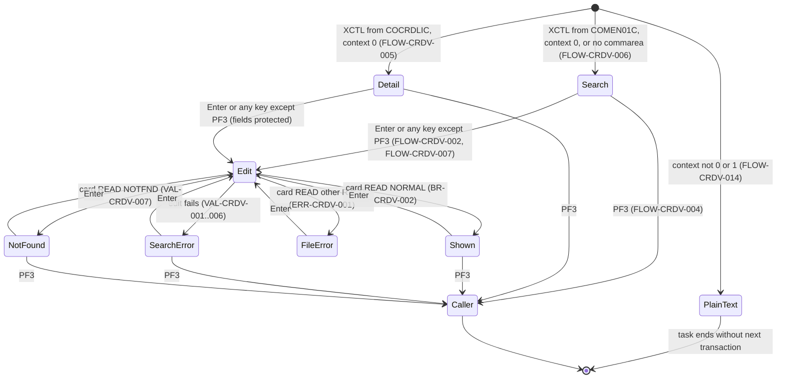
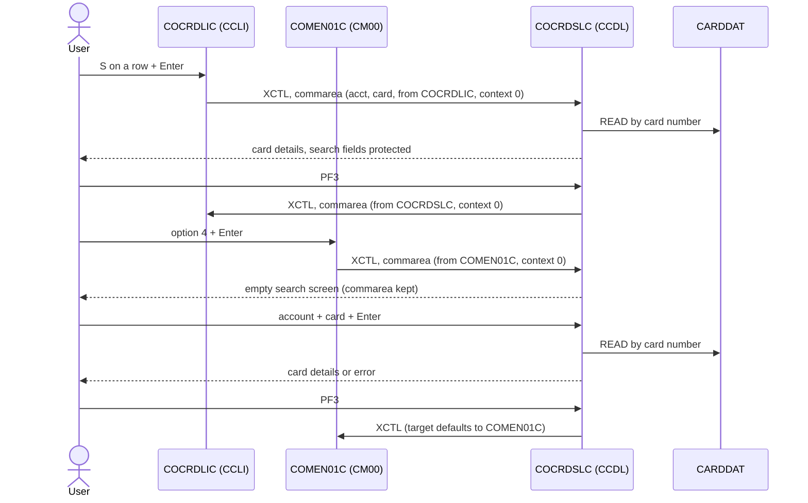

# COCRDSLC: Online credit card detail view

## 1. Summary

A CardDemo user sees the details of one credit card: the name embossed on the card, whether it is active, and its expiry month and year. The program is reached in two ways. From the **card list** (`COCRDLIC`, transaction `CCLI`) the user selects a card with `S`; the list passes the account and card number in the commarea, and the detail screen shows the card at once with both search fields protected. From the **main menu** (option 4 "Credit Card View") or by typing `CCDL`, the user gets an empty search screen, types an 11-digit account number and a 16-digit card number, and presses Enter. The card is read from the card master file `CARDDAT` **by card number only**: the account number is checked for format but never compared with the card's account. The program reads no customer, account or cross-reference record and changes no data. PF3 goes back to the caller (the list or the menu).

## 2. Rules at a glance

| ID | Rule |
| :-- | :-- |
| BR-CRDV-001 | The card is found by its card number alone; the account number typed or passed is not used in the lookup. |
| BR-CRDV-002 | A found card shows the embossed name, the active flag and the expiry month and year; nothing else from the card or from other files. |
| BR-CRDV-003 | When called from the card list, the selected card is shown at once and the search fields cannot be changed. |
| BR-CRDV-004 | The program only reads; it never writes, updates or locks a record. |
| BR-CRDV-005 | An information line says `   Displaying requested details` after a successful lookup and `Please enter Account and Card Number` otherwise. |
| VAL-CRDV-001 | The account number is required; blank, `*` or all zeros count as "not provided". |
| VAL-CRDV-002 | The account number must be exactly 11 digits. |
| VAL-CRDV-003 | The card number is required; blank, `*` or all zeros count as "not provided". |
| VAL-CRDV-004 | The card number must be exactly 16 digits. |
| VAL-CRDV-005 | When both fields are empty, the message is `No input received`. |
| VAL-CRDV-006 | Only the first error message is shown; the cursor goes to the first field in error. |
| VAL-CRDV-007 | The card must exist in the card master file. |
| VAL-CRDV-008 | Fields in error are shown in red; empty required fields are shown as a red `*`; a field with an invalid value is cleared. |

## 3. Actors and triggers

- **Actor:** a CardDemo user at a 3270 terminal. The program does not check who the user is, and it does not require a commarea, so a sign-on is not enforced (DEF-CRDV-002).
- **From the card list:** `COCRDLIC` transfers control (XCTL) when the user marks a row with `S` and presses Enter. It passes the 160-byte commarea with `CDEMO-FROM-PROGRAM` = `COCRDLIC`, `CDEMO-FROM-TRANID` = `CCLI`, `CDEMO-LAST-MAPSET` = `COCRDLI`, `CDEMO-PGM-CONTEXT` = 0, `CDEMO-ACCT-ID` and `CDEMO-CARD-NUM` of the selected row (`app/cbl/COCRDLIC.cbl:517-541`, literals `app/cbl/COCRDLIC.cbl:179-186, 195-202`).
- **From the main menu:** `COMEN01C` option 4 "Credit Card View", user type `U` (`app/cpy/COMEN02Y.cpy:43-47`). The menu transfers control with its commarea, `CDEMO-FROM-PROGRAM` = `COMEN01C`, `CDEMO-FROM-TRANID` = `CM00`, `CDEMO-PGM-CONTEXT` = 0 (`app/cbl/COMEN01C.cbl:177-187`, `app/cbl/COMEN01C.cbl:36-37`).
- **Re-entry:** every screen ends with "return, next transaction `CCDL`" (FLOW-CRDV-008), so the next key the user presses starts transaction `CCDL` (`app/csd/CARDDEMO.CSD:347-356`), program `COCRDSLC` (`app/csd/CARDDEMO.CSD:219-226`), with the program's 2000-byte commarea.
- **Direct start:** typing `CCDL` on a cleared terminal starts the program with no commarea; it shows the empty search screen (FLOW-CRDV-006).
- **Precondition:** the CICS file `CARDDAT` is open. The card file reload job closes `CARDDAT` and `CARDAIX` in CICS while it runs (`app/jcl/CARDFILE.jcl:26-27, 122-123`); a read during that window gets a non-NORMAL response (ERR-CRDV-001).

## 4. Interfaces

### 4.1 Screen CCRDSLA (mapset COCRDSL), 24 x 80

Source: `app/bms/COCRDSL.bms:20-153`; symbolic map `app/cpy-bms/COCRDSL.CPY:17-200` (input `CCRDSLAI` and output `CCRDSLAO` share the same storage). The map is defined with `CTRL=(FREEKB)` and extended attributes (colour, highlight) (`app/bms/COCRDSL.bms:25-28`). "Row,Col" is the BMS `POS` of each field, which is the position of its attribute byte: the field data starts one column after the listed position.

| Row,Col | Field | Len | Direction | Attributes (BMS) | Content |
| :-- | :-- | --: | :-- | :-- | :-- |
| 1,1 | (label) | 5 | out | protected, blue | `Tran:` |
| 1,7 | `TRNNAME` | 4 | out | protected, FSET, blue | `CCDL` |
| 1,21 | `TITLE01` | 40 | out | protected, yellow | `      AWS Mainframe Modernization       ` (`COTTL01Y.cpy:18-19`) |
| 1,65 | (label) | 5 | out | protected, blue | `Date:` |
| 1,71 | `CURDATE` | 8 | out | protected, blue | today `mm/dd/yy` (NUM-CRDV-002) |
| 2,1 | (label) | 5 | out | protected, blue | `Prog:` |
| 2,7 | `PGMNAME` | 8 | out | protected, blue | `COCRDSLC` |
| 2,21 | `TITLE02` | 40 | out | protected, yellow | `              CardDemo                  ` (`COTTL01Y.cpy:20-22`) |
| 2,65 | (label) | 5 | out | protected, blue | `Time:` |
| 2,71 | `CURTIME` | 8 | out | protected, blue | now `hh:mm:ss` |
| 4,30 | (label) | 23 | out | neutral (no ATTRB: BMS default) | `View Credit Card Detail` |
| 7,23 | (label) | 19 | out | protected, turquoise | `Account Number    :` |
| 7,45 | `ACCTSID` | 11 | in/out | **unprotected**, FSET, initial cursor, default colour, underlined. The program makes it protected when called from the list (FLOW-CRDV-010). | Account number |
| 8,23 | (label) | 19 | out | protected, turquoise | `Card Number       :` |
| 8,45 | `CARDSID` | 16 | in/out | **unprotected**, FSET, default colour, underlined; protected when called from the list | Card number |
| 11,4 | (label) | 20 | out | turquoise | `Name on card      :` |
| 11,25 | `CRDNAME` | 50 | out | underlined (no ATTRB: BMS default, protected) | `CARD-EMBOSSED-NAME` |
| 13,4 | (label) | 20 | out | turquoise | `Card Active Y/N   : ` |
| 13,25 | `CRDSTCD` | 1 | out | protected, underlined | `CARD-ACTIVE-STATUS` |
| 15,4 | (label) | 20 | out | turquoise | `Expiry Date       : ` |
| 15,25 | `EXPMON` | 2 | out | protected, underlined | expiry month (NUM-CRDV-001) |
| 15,28 | (label) | 1 | out | (default) | `/` |
| 15,30 | `EXPYEAR` | 4 | out | protected, underlined | expiry year |
| 20,25 | `INFOMSG` | 40 | out | protected, neutral, no highlight | information line (BR-CRDV-005) |
| 23,1 | `ERRMSG` | 80 | out | protected, bright, FSET, **red** | error message (section 8.3) |
| 24,1 | `FKEYS` | 75 | out | protected, yellow | `ENTER=Search Cards  F3=Exit` (two spaces before `F3`) |

Zero-length fields at 7,57, 8,62, 11,76, 13,27 and 15,35 are stoppers that end the preceding input or output area (`app/bms/COCRDSL.bms:89-90, 101-102, 110-111, 120-121, 137-138`).

Before each send the program clears the whole output area to low-values (`:428`), so every field the program does not fill shows its BMS initial value (labels, `mm/dd/yy` if the date were not set) or nothing (FLOW-CRDV-009).

The error message work field `WS-RETURN-MSG` is 75 characters (`:134`) and is moved into the 80-character `ERRMSG`; the information work field `WS-INFO-MSG` is 40 characters (`:126`), the length of `INFOMSG`. No message is truncated.

### 4.2 Files

| CICS file | Entity | Operation | Key | Lines |
| :-- | :-- | :-- | :-- | :-- |
| `CARDDAT` | ENT-CARD | READ (no UPDATE) into `CARD-RECORD` (150 bytes) | `CARD-NUM`, 16 characters, full key | 740-750 |
| `CARDAIX` | ENT-CARD through the alternate index on `CARD-ACCT-ID` | READ by 11-digit account; **in a paragraph that is never performed** (SE-CRDV-002) | `CARD-ACCT-ID` (11) | 783-791 |

`CARDDAT` is `AWS.M2.CARDDEMO.CARDDATA.VSAM.KSDS` and `CARDAIX` is the path `AWS.M2.CARDDEMO.CARDDATA.VSAM.AIX.PATH`, both `RECOVERY(NONE)`, `READINTEG(UNCOMMITTED)` (`app/csd/CARDDEMO.CSD:13-36`). The base cluster has `KEYS(16 0)`, `RECORDSIZE(150 150)`; the alternate index `KEYS(11 16)`, `NONUNIQUEKEY` (`app/jcl/CARDFILE.jcl:50-58, 83-88`).

No customer (`CUSTDAT`), account (`ACCTDAT`) or cross-reference (`CCXREF`, `CXACAIX`) file is read. The customer layout `CVCUS01Y` is copied into working storage (`:240`) but no command reads into it.

### 4.3 Commarea

On re-entry the program receives and returns a 2000-byte commarea (`WS-COMMAREA`, `:205`):

| Pos | Len | Content | Source |
| --: | --: | :-- | :-- |
| 1 | 160 | `ENT-COMMAREA` (`COCOM01Y`) | `:397` |
| 161 | 8 | `CA-FROM-PROGRAM` (program extension `WS-THIS-PROGCOMMAREA`) | `:200-203, 398-400` |
| 169 | 4 | `CA-FROM-TRANID` | `:200-203, 398-400` |
| 173 | 1828 | spaces (from INITIALIZE) | `:254-256` |

The extension fields are copied in and out but never set or tested; they have no effect (DEF-CRDV-006 for how they are read on first entry from the list or the menu). On PF3 only the 160-byte `CARDDEMO-COMMAREA` is passed on (`:331-334`).

`ENT-COMMAREA` fields the program uses:

| Field | Read | Written | Use |
| :-- | :-- | :-- | :-- |
| `CDEMO-PGM-CONTEXT` | yes | yes | 0 = first entry, 1 = re-entry; any other value is an error (FLOW-CRDV-003). Set to 1 before each screen (`:567`) and to 0 on PF3 (`:327`). |
| `CDEMO-FROM-PROGRAM` | yes | yes (PF3) | tested for `COMEN01C` before the commarea is copied, with no effect (FLOW-CRDV-001, DEF-CRDV-003); `COCRDLIC` means "called from the list" (FLOW-CRDV-005, FLOW-CRDV-010); PF3 target; set to `COCRDSLC` on PF3. |
| `CDEMO-FROM-TRANID` | yes | yes (PF3) | copied to `CDEMO-TO-TRANID` on PF3, then set to `CCDL` |
| `CDEMO-TO-PROGRAM`, `CDEMO-TO-TRANID` | no | yes (PF3) | XCTL target; the TRANID is set but not used by XCTL |
| `CDEMO-USER-TYPE` | no | yes (PF3) | forced to `U` (DEF-CRDV-004) |
| `CDEMO-LAST-MAPSET` | yes | yes (PF3) | `COCRDLI` (with `CDEMO-FROM-PROGRAM` = `COCRDLIC`) protects the search fields; set to `COCRDSL` on PF3 |
| `CDEMO-LAST-MAP` | no | yes (PF3) | set to `CCRDSLA` on PF3 |
| `CDEMO-ACCT-ID` | yes | yes | account passed by the list; set from the screen by the edits (0 when missing or invalid) |
| `CDEMO-CARD-NUM` | yes | yes | card passed by the list; set from the screen by the edits (0 when missing or invalid) |

All other fields pass through unchanged. On a direct start without a commarea, the commarea is created blank (FLOW-CRDV-001).

### 4.4 Console output

None. The program has no `DISPLAY` statement and writes nothing to the CICS log. File errors are shown on the screen (ERR-CRDV-001).

## 5. Data used

| Entity field | Read | Written | How |
| :-- | :-- | :-- | :-- |
| ENT-CARD.CARD-NUM | key | no | from the screen `CARDSID` or `CDEMO-CARD-NUM` |
| ENT-CARD.CARD-EMBOSSED-NAME | yes | no | shown in `CRDNAME` |
| ENT-CARD.CARD-ACTIVE-STATUS | yes | no | shown in `CRDSTCD` |
| ENT-CARD.CARD-EXPIRAION-DATE | yes | no | month and year shown in `EXPMON`, `EXPYEAR` |
| ENT-CARD.CARD-ACCT-ID | read into storage | no | **not used** (DEF-CRDV-001) |
| ENT-CARD.CARD-CVV-CD | read into storage | no | not shown, not used |
| ENT-COMMAREA | yes | yes | section 4.3 |

Program-local data with behaviour:

- Edit flags `WS-INPUT-FLAG`, `WS-EDIT-ACCT-FLAG`, `WS-EDIT-CARD-FLAG` (`:51-62`). After `INITIALIZE` (`:254-256`) they hold a space, which is the value of "blank" for the two field flags (`FLG-ACCTFILTER-BLANK`, `FLG-CARDFILTER-BLANK`). This matters for the cursor and colours on the paths that skip the edits (FLOW-CRDV-010).
- Search keys `CC-ACCT-ID` (X(11), redefined as 9(11)) and `CC-CARD-NUM` (X(16), redefined as 9(16)) (`CVCRD01Y.cpy:34-39`).
- AID code `CCARD-AID` (`CVCRD01Y.cpy:3-19`), set by FLOW-CRDV-012.
- Messages `WS-RETURN-MSG` (75) and `WS-INFO-MSG` (40) with their 88-level texts (`:125-158`); file error template `WS-FILE-ERROR-MESSAGE` (`:102-121`, NUM-CRDV-003).
- Expiry date split `CARD-EXPIRAION-DATE-X` with `CARD-EXPIRY-YEAR`, `-MONTH`, `-DAY` (`:84-92`).
- Abend data `ABEND-DATA` (`CSMSG02Y.cpy:21-29`), 134 bytes.

Declared but without effect: `WS-TRANID` (set at `:260`, never read), `WS-RETURN-FLAG`, `WS-LONG-MSG` (only in the dead `SEND-LONG-TEXT`), `CARD-ACCT-ID-X`, `CARD-CVV-CD-X`, `CARD-CARD-NUM-X`, `CARD-NAME-EMBOSSED-X`, `CARD-STATUS-X`, `CARD-EXPIRY-DAY`, `WS-CARD-RID-ACCT-ID` (only in dead code), `CCARD-NEXT-PROG`, `CCARD-NEXT-MAPSET`/`-MAP` as stored by `2000-PROCESS-INPUTS`, `CCARD-ERROR-MSG`, the `CC-CUST-ID` fields, `SEC-USER-DATA` (`CSUSR01Y`), `CUSTOMER-RECORD` (`CVCUS01Y`) and the common messages `CCDA-COMMON-MESSAGES` (`CSMSG01Y`). See DEF-CRDV-010.

## 6. Processing flow



Each arrow is one CICS task: map the key, act, send the screen, end with "next transaction `CCDL`". `Detail` and `Shown` are the same screen; when the program was called from the list, every later screen keeps the search fields protected.

**Entry (0000-MAIN, lines 248-392)**

1. Register `ABEND-ROUTINE` as the abend exit (250-252, ERR-CRDV-002).
2. Clear the work areas, the program's storage and the 2000-byte commarea work field (254-256); clear the error message (264).
3. Commarea intake (268-279, FLOW-CRDV-001): create it blank on a direct start; otherwise copy it in (the intended reset for calls from the menu never takes effect, DEF-CRDV-003).
4. Map the AID key (284-285, FLOW-CRDV-012). Keep only Enter and PF3; treat every other key as Enter (291-299, FLOW-CRDV-002).
5. Decide (304-381, FLOW-CRDV-003): PF3 leaves; first entry from the list shows the card; any other first entry shows the empty search screen; re-entry receives and edits the screen, reads the card when the edits pass and shows the result; an unknown context sends a plain-text message and ends.
6. Return to CICS with next transaction `CCDL` and the 2000-byte commarea (394-407, FLOW-CRDV-008).

**Re-entry (2000-PROCESS-INPUTS and 9000-READ-DATA)**

```text
receive map CCRDSLA                                  (RESP not checked, ERR-CRDV-004)
acct := screen account; if it is "*" or spaces then acct := low-values
card := screen card;    if it is "*" or spaces then card := low-values
edit account (VAL-CRDV-001, VAL-CRDV-002)
edit card    (VAL-CRDV-003, VAL-CRDV-004)
if both blank: message := "No input received"        (VAL-CRDV-005)
if any error: send screen with the error              (VAL-CRDV-006, VAL-CRDV-008)
else: READ CARDDAT by card number                     (SE-CRDV-001)
      NORMAL -> show name, status, expiry; info "   Displaying requested details"
      NOTFND -> "Did not find cards for this search condition"
      other  -> "File Error: READ ..." (NUM-CRDV-003)
      send screen
```

**Screen build (1000-SEND-MAP, lines 412-421)**: header (1100, FLOW-CRDV-009), field values and messages (1200, BR-CRDV-002, BR-CRDV-005), attributes, colours and cursor (1300, FLOW-CRDV-010), send (1400, FLOW-CRDV-011).

## 7. Business rules

#### BR-CRDV-001 · Card looked up by card number only
- **When:** the edits pass (re-entry) or the program is called from the list.
- **Then:** the card master file `CARDDAT` is read with the 16-character card number as the full primary key. The account number takes no part in the read: the key is `WS-CARD-RID-CARDNUM` alone, with a key length of 16 (`:744-745`). The commented-out line `:739` would only fill `WS-CARD-RID-ACCT-ID`, which is not part of that key, and the record's `CARD-ACCT-ID` is never compared with the account. On re-entry the account number must still pass VAL-CRDV-001 and VAL-CRDV-002, but any non-zero 11-digit value is accepted with any existing card (DEF-CRDV-001).
- **Source:** `:736-750`; the account is only edited at `:647-679`
- **Fidelity:** must-preserve (or change by decision, Q-CRDV-001)
- **Confidence:** reviewed

#### BR-CRDV-002 · Card details shown
- **When:** the card read returns NORMAL.
- **Then:** the screen shows:

| Screen field | Value |
| :-- | :-- |
| `ACCTSID` | the account number as entered, or as passed by the list (11 digits with leading zeros) |
| `CARDSID` | the card number as entered, or as passed by the list (16 digits with leading zeros) |
| `CRDNAME` | `CARD-EMBOSSED-NAME`, 50 characters, as stored |
| `CRDSTCD` | `CARD-ACTIVE-STATUS`, 1 character, as stored (all 50 sample cards hold `Y`) |
| `EXPMON` | characters 6-7 of `CARD-EXPIRAION-DATE` (NUM-CRDV-001) |
| `EXPYEAR` | characters 1-4 of `CARD-EXPIRAION-DATE` |
| `INFOMSG` | `   Displaying requested details` |
| `ERRMSG` | blank |

The day of the expiry date, the CVV, the card's own account number and any customer or account data are not shown. The status is not interpreted: a value other than `Y` or `N` is shown as it is.
- **Source:** `:465, 471, 474-485, 754, 129-130`
- **Fidelity:** must-preserve
- **Confidence:** reviewed

#### BR-CRDV-003 · Called from the card list
- **When:** first entry (`CDEMO-PGM-CONTEXT` = 0) with `CDEMO-FROM-PROGRAM` = `COCRDLIC`, and PF3 was not pressed.
- **Then:** no screen is received and no edit runs. The account and card number from the commarea (`CDEMO-ACCT-ID`, `CDEMO-CARD-NUM`) become the search keys, the card is read (BR-CRDV-001) and the screen is sent. Because `CDEMO-LAST-MAPSET` is `COCRDLI` and `CDEMO-FROM-PROGRAM` is `COCRDLIC`, both search fields are protected, on this screen and on every later screen until the user leaves (neither of these two commarea fields changes before PF3). Any key except PF3, PA1, PA2 and Clear re-reads and re-shows the same card, because the protected fields are sent with the modified flag on and come back unchanged; to view another card the user goes back to the list with PF3. After Clear, PA1 or PA2 the screen shows `No input received` with a red `*` in the protected fields, both commarea numbers are zero, and only PF3 leads out (ERR-CRDV-004, DEF-CRDV-014).
- **Source:** `:339-348, 505-512, 527-531, 297-299, 541-551`
- **Fidelity:** must-preserve
- **Confidence:** reviewed; the return of protected fields with the modified flag on, and the input content after MAPFAIL, are platform-inferred

#### BR-CRDV-004 · Read-only
- **Then:** the program issues no WRITE, REWRITE or DELETE and no READ with UPDATE; it changes no file. Its only lasting effect is the commarea it passes on.
- **Source:** `:742-750` (the only executed file command)
- **Fidelity:** must-preserve
- **Confidence:** reviewed

#### BR-CRDV-005 · Information line
- **When:** each screen is built.
- **Then:** `INFOMSG` shows `   Displaying requested details` (three leading spaces) when the card was found in this interaction; otherwise `Please enter Account and Card Number`, including on every error screen. It is shown in neutral colour (white) every time; the "dark" branch for an empty information line cannot be reached (DEF-CRDV-010).
- **Source:** `:459-460, 490-496, 553-557, 126-132`
- **Fidelity:** must-preserve
- **Confidence:** reviewed

## 8. Validations and messages

The edits run only on re-entry (`CDEMO-PGM-CONTEXT` = 1), after the screen is received. Each edit writes its message only if no message has been set yet in this interaction, except VAL-CRDV-005, which always overwrites.

#### VAL-CRDV-001 · Account number required
- **When:** the received account field is spaces, low-values (nothing typed), the single character `*` (put there by the program, VAL-CRDV-008), or a numeric value of zero (for example `00000000000`).
- **Then:** input error; the account is marked "blank"; message `Account number not provided` (27 characters) if none is set; `CDEMO-ACCT-ID` is set to zero. The card edit still runs.
- **Source:** `:615-620, 648-661, 138-139`
- **Fidelity:** must-preserve
- **Confidence:** reviewed; the zero test on non-numeric input is platform-inferred (DEF-CRDV-007)

#### VAL-CRDV-002 · Account number must be 11 digits
- **When:** the account field is not blank and its 11 characters are not all digits. Entering fewer than 11 digits leaves trailing spaces, so `123` fails this test.
- **Then:** input error; the account is marked "not OK"; message `ACCOUNT FILTER,IF SUPPLIED MUST BE A 11 DIGIT NUMBER` (52 characters, no space after the comma) if none is set; `CDEMO-ACCT-ID` is set to zero, so the field is shown empty (VAL-CRDV-008).
- **Otherwise:** the account is valid and is copied to `CDEMO-ACCT-ID`.
- **Source:** `:665-678`
- **Fidelity:** must-preserve
- **Confidence:** reviewed; padding of short input with spaces is platform-inferred (BMS input mapping)

#### VAL-CRDV-003 · Card number required
- **When:** the received card field is spaces, low-values, `*`, or a numeric value of zero.
- **Then:** input error; the card is marked "blank"; message `Card number not provided` (24 characters) if none is set; `CDEMO-CARD-NUM` is set to zero.
- **Source:** `:622-627, 688-702, 140-141`
- **Fidelity:** must-preserve
- **Confidence:** reviewed; zero test on non-numeric input platform-inferred (DEF-CRDV-007)

#### VAL-CRDV-004 · Card number must be 16 digits
- **When:** the card field is not blank and its 16 characters are not all digits.
- **Then:** input error; the card is marked "not OK"; message `CARD ID FILTER,IF SUPPLIED MUST BE A 16 DIGIT NUMBER` (52 characters) if none is set; `CDEMO-CARD-NUM` is set to zero, so the field is shown empty.
- **Otherwise:** the card is valid and is copied to `CDEMO-CARD-NUM`.
- **Source:** `:706-719`
- **Fidelity:** must-preserve
- **Confidence:** reviewed

#### VAL-CRDV-005 · No input at all
- **When:** both fields are "blank" (VAL-CRDV-001 and VAL-CRDV-003).
- **Then:** the message is replaced by `No input received` (17 characters).
- **Source:** `:637-640, 142-143`
- **Fidelity:** must-preserve
- **Confidence:** reviewed

#### VAL-CRDV-006 · Edit outcome (decision table)

Account state rows, card state columns. "Blank" = VAL-CRDV-001/003, "invalid" = VAL-CRDV-002/004.

| Account \ Card | blank | invalid | valid |
| :-- | :-- | :-- | :-- |
| **blank** | `No input received`; cursor account | `Account number not provided`; cursor account | `Account number not provided`; cursor account |
| **invalid** | `ACCOUNT FILTER,IF SUPPLIED MUST BE A 11 DIGIT NUMBER`; cursor account | same; cursor account | same; cursor account |
| **valid** | `Card number not provided`; cursor card | `CARD ID FILTER,IF SUPPLIED MUST BE A 16 DIGIT NUMBER`; cursor card | no error: read the card (BR-CRDV-001) |

In every error cell the screen is sent with no card details, the information line shows the prompt (BR-CRDV-005) and no file is read. The cursor rule: on the account field if the account is blank or not OK, else on the card field if the card is blank or not OK, else on the account field.
- **Source:** `:357-371, 515-524, 608-641`
- **Fidelity:** must-preserve
- **Confidence:** reviewed

#### VAL-CRDV-007 · Card must exist
- **When:** the edits passed (or the program was called from the list) and the card read returns NOTFND.
- **Then:** input error; both fields marked "not OK" (red); message `Did not find cards for this search condition` (44 characters); both search fields keep the values entered; no card details; information line `Please enter Account and Card Number`; cursor on the account field.
- **Source:** `:755-761, 153-154, 462-472`
- **Fidelity:** must-preserve
- **Confidence:** reviewed

#### VAL-CRDV-008 · Marking fields in error

| Field state (after this interaction) | Shown value | Colour |
| :-- | :-- | :-- |
| blank, on re-entry | `*` | red |
| first entry (no edits ran; the field flags keep their initial "blank" value) | from the list: the passed numbers (NUM-CRDV-004); from the menu or another program: empty when the commarea value is zero, spaces otherwise (FLOW-CRDV-006); direct start: empty | default (from the list `DFHDFCOL` is set explicitly); no `*`, because the context is 0 |
| invalid (VAL-CRDV-002/004) | empty: the value typed is not shown again | red |
| not found or file error (VAL-CRDV-007, ERR-CRDV-001) | the value entered | red (both fields for not found; account only for a file error) |
| valid | the value entered | default |

The `*` is recognised as "blank" when it comes back unchanged (VAL-CRDV-001). The "re-entry" test reads `CDEMO-PGM-CONTEXT` as received, before it is set to 1 for the next screen.
- **Source:** `:462-472, 533-551`
- **Fidelity:** must-preserve (red and `*`), defect-decide for the cleared value (DEF-CRDV-008)
- **Confidence:** reviewed

### 8.1 Flow and keys

#### FLOW-CRDV-001 · Commarea intake (decision table)

The tests read the program's own working-storage copy `CARDDEMO-COMMAREA`, before anything has been copied into it. That copy is not part of the `INITIALIZE` at `:254-256` and has no VALUE clauses.

| Condition | Action |
| :-- | :-- |
| `EIBCALEN` = 0 (no commarea) | reset `CARDDEMO-COMMAREA` and the extension: text fields to spaces, numeric fields to zero, so `CDEMO-PGM-CONTEXT` = 0 and `CDEMO-FROM-PROGRAM` = spaces |
| working-storage `CDEMO-FROM-PROGRAM` = `COMEN01C` and `CDEMO-PGM-CONTEXT` not 1 | the same reset. This row cannot be true in practice: working storage is fresh in each task and nothing has put `COMEN01C` there yet (DEF-CRDV-003) |
| otherwise (every call with a commarea, including the call from the menu) | copy the first 160 bytes into `CARDDEMO-COMMAREA` and the next 12 into the extension (DEF-CRDV-006) |

Effect for the menu call: the menu's commarea is kept (user ID, user type, customer, account, card), with `CDEMO-FROM-PROGRAM` = `COMEN01C`, `CDEMO-FROM-TRANID` = `CM00` and context 0, and the program shows the empty search screen (FLOW-CRDV-006).
- **Source:** `:254-256, 268-279`
- **Fidelity:** must-preserve (copy of the session data); the unreachable reset is DEF-CRDV-003
- **Confidence:** reviewed; that the working-storage copy never holds `COMEN01C` at this point is platform-inferred (a fresh copy of working storage per task, items without VALUE)

#### FLOW-CRDV-002 · Valid keys
- **When:** any key.
- **Then:** after FLOW-CRDV-012, only Enter and PF3 (PF3 or PF15) are accepted. Every other key (PF1, PF2, PF4-PF12, PF13, PF14, PF16-PF24, PA1, PA2, Clear) is treated exactly as Enter, with no message. For PA1, PA2 and Clear the terminal sends no field data, so the receive finds nothing (ERR-CRDV-004, DEF-CRDV-014).
- **Source:** `:291-299`
- **Fidelity:** must-preserve (the target may choose to reject other keys, Q-CRDV-004)
- **Confidence:** reviewed; that PA1, PA2 and Clear send no field data (3270 short read) is platform-inferred

#### FLOW-CRDV-003 · Main decision (decision table)

Evaluated in this order; the first true row applies.

| # | Condition | Action | Lines |
| --: | :-- | :-- | :-- |
| 1 | key is PF3 | FLOW-CRDV-004 (leave) | 305-334 |
| 2 | context 0 and `CDEMO-FROM-PROGRAM` = `COCRDLIC` | FLOW-CRDV-005 (show the selected card) | 339-348 |
| 3 | context 0 | FLOW-CRDV-006 (empty search screen) | 349-356 |
| 4 | context 1 | FLOW-CRDV-007 (receive, edit, read, show) | 357-371 |
| 5 | any other context value | FLOW-CRDV-014 (plain-text message, end) | 373-380 |

Rows 2 to 4 end with a jump to the common return (FLOW-CRDV-008). The check after the decision (`:386-391`) can never run, because every row either jumps, transfers control or ends the task (DEF-CRDV-010).
- **Source:** `:304-391`
- **Fidelity:** must-preserve
- **Confidence:** reviewed

#### FLOW-CRDV-004 · PF3, back to the caller
- **Then:**
  1. Target transaction: `CDEMO-FROM-TRANID`, or `CM00` when it is spaces or low-values.
  2. Target program: `CDEMO-FROM-PROGRAM`, or `COMEN01C` when it is spaces or low-values. From the list this is `COCRDLIC` (transaction `CCLI`); from the menu it is `COMEN01C` (`CM00`), copied from the menu's commarea; after a direct start both are spaces, so the defaults `COMEN01C` and `CM00` apply.
  3. Set `CDEMO-FROM-TRANID` = `CCDL`, `CDEMO-FROM-PROGRAM` = `COCRDSLC`, `CDEMO-USER-TYPE` = `U` (DEF-CRDV-004), `CDEMO-PGM-CONTEXT` = 0, `CDEMO-LAST-MAPSET` = `COCRDSL`, `CDEMO-LAST-MAP` = `CCRDSLA`.
  4. Transfer control (XCTL) to the target program with the 160-byte commarea. The screen is not received first, so anything typed is ignored.
- **Source:** `:305-334`
- **Fidelity:** must-preserve
- **Confidence:** reviewed

#### FLOW-CRDV-005 · First entry from the card list
- **Then:** BR-CRDV-003. The fields are shown in the default colour unless the read failed; the cursor is placed on the (protected) account field because the field flags hold their initial "blank" value.
- **Source:** `:339-348, 515-518`
- **Fidelity:** must-preserve (cursor incidental)
- **Confidence:** reviewed

#### FLOW-CRDV-006 · First entry from the menu, another program or a direct start
- **Then:** send the search screen with both fields empty and unprotected, no card details, no error message, information line `Please enter Account and Card Number`, cursor on the account field. No file is read.
  - With a commarea, the field values depend on `CDEMO-ACCT-ID` and `CDEMO-CARD-NUM`: zero gives an empty field. A non-zero value (for example an account and card left in the commarea by an earlier visit to the card list, which the menu passes on unchanged) shows the search keys `CC-ACCT-ID`/`CC-CARD-NUM` instead, which are still spaces at this point, so the field is filled with spaces rather than prefilled (DEF-CRDV-003).
  - Without a commarea (`CCDL` typed), the field values are not set at all and the prompt is set explicitly.
- **Source:** `:349-356, 459-472, 490-492`
- **Fidelity:** must-preserve
- **Confidence:** reviewed

#### FLOW-CRDV-007 · Re-entry
- **Then:** receive the screen, run the edits (section 8), and if there is no error read the card (BR-CRDV-001, VAL-CRDV-007, ERR-CRDV-001); send the screen with the result (section 6, Re-entry).
- **Source:** `:357-371, 582-591, 596-603, 726-730`
- **Fidelity:** must-preserve
- **Confidence:** reviewed

#### FLOW-CRDV-008 · End of every interaction
- **Then:** build the 2000-byte commarea (section 4.3) and return to CICS naming `CCDL` as the next transaction.
- **Source:** `:394-407`
- **Fidelity:** must-preserve (pseudo-conversational state); the 2000-byte size is incidental
- **Confidence:** reviewed

### 8.2 Screen building

#### FLOW-CRDV-009 · Header on every screen
- **Then:** the output area is cleared to low-values; titles from `COTTL01Y`, transaction `CCDL`, program `COCRDSLC`, today's date `mm/dd/yy` and the time `hh:mm:ss` (NUM-CRDV-002) are filled in.
- **Source:** `:427-451`
- **Fidelity:** must-preserve (titles, names), incidental (clock values)
- **Confidence:** reviewed

#### FLOW-CRDV-010 · Protection, colour and cursor of the search fields
- **Then:**

| Step | Condition | Effect | Lines |
| --: | :-- | :-- | :-- |
| 1 | `CDEMO-LAST-MAPSET` = `COCRDLI` and `CDEMO-FROM-PROGRAM` = `COCRDLIC` | both fields protected (with modified flag on, so they are sent back) | 505-508 |
| 1 | otherwise | both fields unprotected (with modified flag on) | 509-511 |
| 2 | cursor | VAL-CRDV-006 cursor rule | 515-524 |
| 3 | same condition as step 1 | both fields in default colour | 527-531 |
| 4 | account "not OK" / card "not OK" | that field red | 533-539 |
| 5 | account "blank" and re-entry / card "blank" and re-entry | that field shows `*` in red | 541-551 |
| 6 | information line empty (never true, see BR-CRDV-005) | dark; otherwise neutral colour | 553-557 |

- **Source:** `:502-558`
- **Fidelity:** must-preserve (protection, red, `*`), incidental (exact 3270 attribute bytes)
- **Confidence:** reviewed; the meaning of the attribute constants (`DFHBMPRF` protected with modified flag, `DFHBMFSE` unprotected with modified flag) is platform-inferred

#### FLOW-CRDV-011 · Send the screen
- **Then:** set `CDEMO-PGM-CONTEXT` = 1, then send map `CCRDSLA` of mapset `COCRDSL` with erase, keyboard unlocked and the cursor at the field chosen in FLOW-CRDV-010. The response is stored but not checked (ERR-CRDV-004).
- **Source:** `:563-577`
- **Fidelity:** must-preserve
- **Confidence:** reviewed

#### FLOW-CRDV-012 · Key mapping (shared copybook)
- **Then:** the AID of the key pressed is translated into `CCARD-AID`: Enter, Clear, PA1, PA2, PF1-PF12 to their own codes; PF13-PF24 to PF1-PF12 (so PF15 acts as PF3). PA3 and any other AID leave `CCARD-AID` as spaces, which is then treated as Enter (FLOW-CRDV-002).
- **Source:** `CSSTRPFY.cpy:17-82`, performed at `:284-285`
- **Fidelity:** must-preserve
- **Confidence:** reviewed

#### FLOW-CRDV-013 · Exit paragraphs
- **Then:** each `-EXIT` paragraph contains only an exit; every performed paragraph is performed "through" its exit (`ABEND-ROUTINE` is a HANDLE ABEND label and has no exit paragraph), and the `GO TO ... -EXIT` statements in the edits end an edit early. `0000-MAIN-EXIT` is never reached, because the common return ends the task. The `COPY 'CSSTRPFY'` statement and its closing full stop sit physically after `SEND-PLAIN-TEXT-EXIT` (`:855-856`); the copied text begins with its own paragraph label, so it forms the separate paragraphs `YYYY-STORE-PFKEY` and `YYYY-STORE-PFKEY-EXIT`, and the full stop at `:856` ends the latter.
- **Source:** `:408-410, 423-425, 453-455, 499-501, 559-560, 578-580, 593-595, 605-607, 643-645, 681-683, 722-724, 732-734, 775-777, 810-812, 831-833, 849-856`
- **Fidelity:** incidental
- **Confidence:** reviewed

#### FLOW-CRDV-014 · Unknown context
- **When:** `CDEMO-PGM-CONTEXT` is neither 0 nor 1 and the key is not PF3 (possible only with a commarea from some other program).
- **Then:** ERR-CRDV-003.
- **Source:** `:373-380`
- **Fidelity:** must-preserve
- **Confidence:** reviewed

### 8.3 Message catalog

Error messages appear in `ERRMSG` (row 23, 80 characters, red, from a 75-character work field). The information line is `INFOMSG` (row 20, 40 characters, neutral).

| Text (exact) | Field | Cause | Cursor | Item |
| :-- | :-- | :-- | :-- | :-- |
| `Account number not provided` | ERRMSG | account blank, `*` or zero | account | VAL-CRDV-001 |
| `ACCOUNT FILTER,IF SUPPLIED MUST BE A 11 DIGIT NUMBER` | ERRMSG | account not 11 digits | account | VAL-CRDV-002 |
| `Card number not provided` | ERRMSG | card blank, `*` or zero (account valid) | card | VAL-CRDV-003 |
| `CARD ID FILTER,IF SUPPLIED MUST BE A 16 DIGIT NUMBER` | ERRMSG | card not 16 digits (account valid) | card | VAL-CRDV-004 |
| `No input received` | ERRMSG | both blank | account | VAL-CRDV-005 |
| `Did not find cards for this search condition` | ERRMSG | card READ NOTFND | account | VAL-CRDV-007 |
| `File Error: READ     on CARDDAT   returned RESP nnnnnnnnn ,RESP2 nnnnnnnnn ` (75 characters; `nnnnnnnnn` = 9 digits, NUM-CRDV-003) | ERRMSG | card READ other response | account | ERR-CRDV-001 |
| `   Displaying requested details` | INFOMSG | card found | - | BR-CRDV-005 |
| `Please enter Account and Card Number` | INFOMSG | every other screen | - | BR-CRDV-005 |
| `UNEXPECTED DATA SCENARIO` | whole screen, plain text | unknown context | - | ERR-CRDV-003 |
| `COCRDSLC` inside a 134-byte block of spaces | raw terminal output | abend | - | ERR-CRDV-002 |

Declared texts that are never shown: `PF03 pressed.Exiting`, `Account number must be a non zero 11 digit number` (two 88-levels), `Card number if supplied must be a 16 digit number`, `Did not find this account in cards database` (only in dead code), `Error reading Card Data File`, `Looks Good.... so far`, `UNEXPECTED ABEND OCCURRED.` (DEF-CRDV-009), the common `Invalid key pressed. Please see below...` (`CSMSG01Y.cpy:20-21`) and `Thank you for using CardDemo application...      ` (`CCDA-MSG-THANK-YOU`, `CSMSG01Y.cpy:18-19`), and the title copybook's `Thank you for using CCDA application... ` (`CCDA-THANK-YOU`, `COTTL01Y.cpy:23-24`). See DEF-CRDV-010.

## 9. Side effects

#### SE-CRDV-001 · Read the card
- **What:** READ file `CARDDAT` by `CARD-NUM` (RIDFLD 16 characters, key length 16), into the 150-byte `CARD-RECORD`, without UPDATE, so no lock is taken. One read per interaction at most: on re-entry when the edits pass, and on first entry from the list. RESP and RESP2 are captured (ERR-CRDV-001).
- **Source:** `:740-750`
- **Fidelity:** must-preserve
- **Confidence:** reviewed

#### SE-CRDV-002 · Read by account through the alternate index (never executed)
- **What:** paragraph `9150-GETCARD-BYACCT` would READ the path `CARDAIX` by an 11-digit account number (`WS-CARD-RID-ACCT-ID`) and set `Did not find this account in cards database` on NOTFND. No statement performs it, and nothing sets its key. On a real call, an account with several cards would get the first card and a DUPKEY response, which this code would report as a file error.
- **Source:** `:779-809`
- **Fidelity:** incidental (dead code)
- **Confidence:** reviewed; DUPKEY behaviour platform-inferred

## 10. Error handling

#### ERR-CRDV-001 · Card read response codes

| RESP | Effect | Message | Field colours |
| :-- | :-- | :-- | :-- |
| NORMAL | details shown (BR-CRDV-002) | none; info `   Displaying requested details` | default |
| NOTFND | input error (VAL-CRDV-007) | `Did not find cards for this search condition` | both red |
| any other (for example NOTOPEN while the card file reload job has closed the file, DISABLED, IOERR) | input error | `File Error: READ     on CARDDAT   returned RESP nnnnnnnnn ,RESP2 nnnnnnnnn ` (NUM-CRDV-003) | account red |

The file error text always replaces the message (there is no "first message wins" check for it). Nothing is written to the CICS log.
- **Source:** `:752-772, 102-121`
- **Fidelity:** must-preserve (NORMAL, NOTFND); incidental (wording and layout of the file error)
- **Confidence:** reviewed

#### ERR-CRDV-002 · Abend exit
- **What:** at the start of every task the program registers `ABEND-ROUTINE` as its abend exit. Any abend of the task (for example a program check, or a CICS condition raised by a command without RESP such as an XCTL to a program that does not exist) passes control there. The routine:
  1. Would set the abend message to `UNEXPECTED ABEND OCCURRED.` if it were low-values; it is spaces (its initial value), so it stays spaces (DEF-CRDV-009).
  2. Sets the culprit to `COCRDSLC`.
  3. Sends the 134-byte `ABEND-DATA` (code 4, culprit 8, reason 50, message 72; all spaces except the culprit) to the terminal as raw data, without erasing the screen, ignoring any error.
  4. Cancels the abend exit and abends the task with code `9999`. CICS ends the task (transaction dump allowed, `DUMP(YES)` at `app/csd/CARDDEMO.CSD:352`); no next transaction is set, so the conversation ends.
- **Source:** `:250-252, 857-878`; `CSMSG02Y.cpy:21-29`
- **Fidelity:** incidental (the target replaces abend handling); "the user's conversation ends with an error" is must-preserve
- **Confidence:** platform-inferred (what a raw SEND shows on a 3270, abend exit semantics)

#### ERR-CRDV-003 · Unexpected context: plain text and end
- **What:** sets abend code `0001`, culprit `COCRDSLC`, reason spaces (none of them are used afterwards), puts `UNEXPECTED DATA SCENARIO` into the message, sends it as plain text (75 characters) after erasing the screen, and returns to CICS **without** a next transaction. The pseudo-conversation ends; the user's next input is not routed to CardDemo.
- **Source:** `:373-380, 838-848`
- **Fidelity:** must-preserve (the conversation ends with a message)
- **Confidence:** reviewed

#### ERR-CRDV-004 · Screen receive and send not checked
- **What:** the responses of RECEIVE MAP and SEND MAP are stored and never tested. For PA1, PA2 or Clear (treated as Enter, FLOW-CRDV-002) the terminal sends no field data, so RECEIVE gets MAPFAIL and the input area keeps its content, which in a fresh task is its initial content (expected to be low-values; the symbolic map is in working storage, `:215`). The edits treat that as blank: `No input received`, two red `*`, and `CDEMO-ACCT-ID` and `CDEMO-CARD-NUM` are set to zero. On the screen called from the list this loses the card (DEF-CRDV-014). Enter on an unchanged screen does not give MAPFAIL, because `TRNNAME` and `ERRMSG` are defined with FSET (`app/bms/COCRDSL.bms:34, 144`) and the search fields are sent with the modified flag on (`:505-511`); empty search fields arrive as low-values and give the same `No input received` result. After a Clear the whole screen is rebuilt by the send.
- **Source:** `:569-576, 596-603, 505-511, 615-627, 659, 700`; `app/bms/COCRDSL.bms:34, 144`
- **Fidelity:** incidental
- **Confidence:** platform-inferred
#### ERR-CRDV-005 · Long-text exit is never used
- **What:** `SEND-LONG-TEXT` sends the 500-character `WS-LONG-MSG` as plain text and ends the task without a next transaction. No statement performs it; the comment marks it as a debugging aid.
- **Source:** `:820-830`
- **Fidelity:** incidental (dead code)
- **Confidence:** reviewed

## 11. Interactions



- **Inbound:** `COCRDLIC` (selection `S`, `app/cbl/COCRDLIC.cbl:517-541`), `COMEN01C` (option 4, `app/cbl/COMEN01C.cbl:177-187`), terminal input `CCDL`. `COACTVWC`, `COACTUPC` and `COCRDUPC` declare the name `COCRDSLC` (`app/cbl/COACTVWC.cbl:176-177`, `app/cbl/COACTUPC.cbl:565-566`, `app/cbl/COCRDUPC.cbl:243-244`) but do not transfer to it.
- **Outbound:** XCTL to `CDEMO-FROM-PROGRAM` (normally `COCRDLIC`) or `COMEN01C` on PF3. No LINK or CALL.
- **CSUTLDTC:** not called; no date is validated. The CSUTLDTC fix "CSUTLDTC reports the date it was given" (`CHANGELOG.md:50`, commit 8122736 on the agent-readiness branch, part of b5e0139 in this branch) does not affect any message of this program.
- **Shared data:** `CARDDAT` is also read by the card list `COCRDLIC` and read and updated by card update `COCRDUPC`; the batch card reader `CBACT02C` and export/import read or load the same data set. See `components.md`.
- **Shared contracts:** (1) The list must set `CDEMO-FROM-PROGRAM` = `COCRDLIC`, `CDEMO-LAST-MAPSET` = `COCRDLI` and context 0 for the call to be treated as a list selection (BR-CRDV-003). (2) The list must pass the card number in `CDEMO-CARD-NUM`; the account in `CDEMO-ACCT-ID` is only displayed. (3) The card file reload job closes `CARDDAT` in CICS (`app/jcl/CARDFILE.jcl:26-27`), during which the view reports a file error. (4) PF3 hands `CDEMO-ACCT-ID` and `CDEMO-CARD-NUM` back as this program left them: unchanged from the list, or as set by the edits on re-entry, including zero for missing or invalid input (`:331-334, 659, 673, 676, 700, 714, 717`). The list shows non-zero values in its filter fields when it gets control back (`app/cbl/COCRDLIC.cbl:844-867`) and keeps them in the commarea it passes to the menu on PF3 (`app/cbl/COCRDLIC.cbl:384-405`); this is how they reach a later menu call (DEF-CRDV-003).
- **Menu and sign-on (area a):** the program does not send the user to sign-on when there is no commarea (DEF-CRDV-002). It keeps the menu's commarea (the intended reset never takes effect, DEF-CRDV-003) but forces `CDEMO-USER-TYPE` = `U` on PF3 (DEF-CRDV-004). After a direct start, PF3 reaches the menu with a blank commarea (no user ID). Today only the sign-on program sets `CDEMO-USER-ID` (`app/cbl/COSGN00C.cbl:132-134, 226`); no program reads it.

### Module extraction notes (selective conversion of card view)

| Boundary | Contract |
| :-- | :-- |
| Entry from the list | Accepts account and card number; shows the card immediately; search fields read-only. |
| Entry from the menu | Shows an empty search form and keeps the session data (Q-CRDV-003). |
| Card data | One keyed read of ENT-CARD by card number; fields `CARD-EMBOSSED-NAME`, `CARD-ACTIVE-STATUS`, `CARD-EXPIRAION-DATE`. No lock, no write. |
| Exit | Returns to the caller with `CDEMO-FROM-PROGRAM` = `COCRDSLC`, context 0, and `CDEMO-ACCT-ID` and `CDEMO-CARD-NUM` as last passed or edited, in the 160-byte commarea. The list shows them as its filters, so it does not start fresh (shared contract 4). |
| Availability | Unavailable (file error) while the card file is closed for reload. |

## 12. Numeric, date and format details

#### NUM-CRDV-001 · Expiry date split
- `CARD-EXPIRAION-DATE` is 10 characters, expected `YYYY-MM-DD`. Characters 1-4 go to `EXPYEAR`, characters 6-7 to `EXPMON`; characters 5, 8 and the day (9-10) are not shown. The screen shows `MM` `/` `YYYY` (the `/` is a BMS constant). There is no check: any content is split by position. Example: `2023-03-09` is shown as `03` / `2023`.
- **Source:** `:84-92, 477-482`; `app/bms/COCRDSL.bms:126-136`
- **Fidelity:** must-preserve
- **Confidence:** reviewed

#### NUM-CRDV-002 · Header date and time
- From the system clock (`FUNCTION CURRENT-DATE`, read twice): date `mm/dd/yy` (two-digit year), time `hh:mm:ss`.
- **Source:** `:430-449`; `CSDAT01Y.cpy:17-41`
- **Fidelity:** incidental (clock)
- **Confidence:** reviewed

#### NUM-CRDV-003 · File error message layout
- Built from fixed parts (80 characters) and cut to the 75-character message field, which drops the final 5 spaces: `File Error: ` + operation `READ` padded to 8 + ` on ` + file `CARDDAT` padded to 9 + ` returned RESP ` + RESP + `,RESP2 ` + RESP2. RESP and RESP2 are binary fullwords moved to 10-character text fields: they appear as 9 digits with leading zeros and no sign, followed by a space. Example for NOTOPEN (RESP 19, RESP2 60 assumed): `File Error: READ     on CARDDAT   returned RESP 000000019 ,RESP2 000000060 `.
- **Source:** `:102-121, 767-771`
- **Fidelity:** incidental
- **Confidence:** reviewed (layout); the digit rendering of a binary-to-text move and the example RESP values are platform-inferred

#### NUM-CRDV-004 · Account and card numbers on the screen
- From the list: `CDEMO-ACCT-ID` (9(11)) and `CDEMO-CARD-NUM` (9(16)) become 11 and 16 digits with leading zeros. On re-entry: the characters typed, exactly as entered (they are all digits when shown). A zero value is shown as an empty field (`:462-472`).
- **Source:** `:342-343, 462-472, 676, 717`
- **Fidelity:** must-preserve
- **Confidence:** reviewed

#### NUM-CRDV-005 · Commarea sizes
- Received and returned: 2000 bytes (160 + 12 + 1828 spaces). Passed on PF3: 160 bytes.
- **Source:** `:205, 394-406, 331-334`
- **Fidelity:** incidental
- **Confidence:** reviewed

## 13. Known defects and oddities

None of these were changed in this branch: `COCRDSLC.cbl`, its BMS and symbolic map and the copybooks it uses are not touched by commit b5e0139 (their only commit is the original release, 8c797e2). All are **open**.

#### DEF-CRDV-001 · [security] Account number is not checked against the card
- The screen asks for an account and a card number and insists that the account is a non-zero 11-digit number, but the card is read by card number only (BR-CRDV-001) and `CARD-ACCT-ID` is never compared with the account entered. Any account number shows any card. The commented-out key line and the unused account-path paragraph suggest a combined lookup was intended. Consequence: the account field gives a false sense of a match; a user who knows a card number sees its details with any account.
- **Source:** `:739-750, 779-809`
- **Status:** open
- **Fidelity:** defect-decide (Q-CRDV-001)
- **Confidence:** reviewed

#### DEF-CRDV-002 · [security] No sign-on or ownership check
- The program accepts a start without a commarea (typing `CCDL`) and shows the search screen instead of sending the user to sign-on. It never looks at `CDEMO-USER-ID` or `CDEMO-USER-TYPE`, and it does not restrict the card to the user's own accounts. Any terminal user who knows a card number sees the cardholder name, status and expiry.
- **Source:** `:268-272, 349-356`
- **Status:** open
- **Fidelity:** defect-decide (Q-CRDV-002)
- **Confidence:** reviewed

#### DEF-CRDV-003 · Intended reset on entry from the menu never takes effect
- The intake tests "called from the menu, first entry" to reset the commarea, but it tests the program's own working-storage copy before the received commarea is copied into it (FLOW-CRDV-001), so the test is never true and the menu's commarea is always copied. Consequences: (a) the session data (user ID, user type) is kept, which is probably the better outcome; (b) a non-zero account or card number left in the commarea (for example by an earlier visit to the card list, shared contract 4 in section 11) is kept too, and the first screen then shows that search field filled with spaces instead of empty or prefilled; each field is affected on its own (FLOW-CRDV-006); (c) the code suggests that the author expected a clean start from the menu, so a target that "fixes" the test would discard the user ID.
- **Source:** `:268-279, 462-472`
- **Status:** open
- **Fidelity:** defect-decide (Q-CRDV-003)
- **Confidence:** reviewed; working-storage initial content platform-inferred

#### DEF-CRDV-004 · PF3 forces the user type to "regular user"
- PF3 sets `CDEMO-USER-TYPE` to `U` whatever it was. An administrator who reached this screen would continue as a regular user. (The card list does the same before it calls this program.)
- **Source:** `:326`
- **Status:** open
- **Fidelity:** defect-decide (Q-CRDV-003)
- **Confidence:** reviewed

#### DEF-CRDV-005 · Unsupported keys act as Enter without a message
- Any key other than PF3 is processed as Enter (FLOW-CRDV-002); the user is not told that the key is not supported, and the common message `Invalid key pressed. Please see below...` is copied but not used. On the list-called screen, for example, PF7 or PF8 silently refresh the same card.
- **Source:** `:291-299`
- **Status:** open
- **Fidelity:** defect-decide (Q-CRDV-004)
- **Confidence:** reviewed

#### DEF-CRDV-006 · Commarea extension read beyond the data passed
- On first entry from the list or the menu, the caller passes 160 bytes (`EIBCALEN` = 160), but the copy branch also moves bytes 161-172 of the received commarea into `WS-THIS-PROGCOMMAREA` (`:276-278`). Those bytes are outside the data passed: their content is undefined, and with storage protection or subscript checking the move could fail. The extension is never used, so the visible effect is normally none; the undefined bytes are carried in every later commarea.
- **Source:** `:273-278`
- **Status:** open
- **Fidelity:** incidental
- **Confidence:** platform-inferred (Q-CRDV-005)

#### DEF-CRDV-007 · Zero test runs before the numeric test
- The "not provided" edit compares the numeric redefinition of the field with zero before the program has checked that the field is numeric (VAL-CRDV-001, VAL-CRDV-003). For input such as `123` followed by spaces, or letters, the comparison is made on invalid zoned-decimal data. On IBM Enterprise COBOL this can, depending on compiler options, either evaluate as "not zero" (then VAL-CRDV-002/004 applies, the intended outcome) or raise a data exception, which the abend exit turns into abend `9999` (ERR-CRDV-002).
- **Source:** `:651-653, 691-693`
- **Status:** open
- **Fidelity:** defect-decide
- **Confidence:** platform-inferred (Q-CRDV-005)

#### DEF-CRDV-008 · Invalid input is erased from the screen
- When the account or card number is rejected as not numeric, the program sets the commarea value to zero and then shows the field empty (in red). The user cannot see what was typed wrongly.
- **Source:** `:673, 714, 462-472`
- **Status:** open
- **Fidelity:** defect-decide
- **Confidence:** reviewed

#### DEF-CRDV-009 · Abend message never used, original abend code lost
- `ABEND-ROUTINE` sets the text `UNEXPECTED ABEND OCCURRED.` only when the message is low-values, but its initial value is spaces and nothing changes it, so the user sees only `COCRDSLC` in a block of spaces. The original abend code is not captured; every abend is re-issued as `9999`. The raw send does not erase the screen, so the block overlays the current screen.
- **Source:** `:859-877`; `CSMSG02Y.cpy:28-29`
- **Status:** open
- **Fidelity:** incidental
- **Confidence:** reviewed (logic); screen appearance platform-inferred

#### DEF-CRDV-010 · Dead code and unused declarations
- Never executed: `9150-GETCARD-BYACCT` (SE-CRDV-002), `SEND-LONG-TEXT` (ERR-CRDV-005), the error check after the main decision (`:386-391`), the dark colour for an empty information line (`:553-554`; it would also put an attribute value into a colour byte). Never used: the 88-level texts listed in section 8.3, `WS-TRANID` (set at `:260`, never read), `WS-RETURN-FLAG`, the output edit fields except the expiry split, `CC-CUST-ID`, the extension fields `CA-FROM-PROGRAM`/`CA-FROM-TRANID`, literals `LIT-CCLISTTRANID`, `LIT-CCLISTMAP` (which holds `CCRDSLA`, the detail map name, instead of the list map `CCRDLIA`), `LIT-MENUMAPSET`, `LIT-MENUMAP`, and the copybooks `CSMSG01Y`, `CSUSR01Y`, `CVCUS01Y` (customer data is never read). `2000-PROCESS-INPUTS` stores the next program, mapset, map and message in `CC-WORK-AREA` fields that are either never read or overwritten before use (`:565-566`).
- **Source:** `:45-46, 260, 63-65, 72-83, 125-158, 162-190, 200-203, 221, 227, 240, 386-391, 553-554, 587-590, 779-809, 820-830`
- **Status:** open (no runtime effect)
- **Fidelity:** incidental
- **Confidence:** reviewed

#### DEF-CRDV-011 · [security] Card data displayed without masking or audit
- The full 16-digit card number and the embossed cardholder name are shown in clear, and the card number is typed in clear. Nothing records who viewed which card. (The CVV is read into storage but not displayed.)
- **Source:** `:465, 471, 475-476`
- **Status:** open
- **Fidelity:** defect-decide (Q-CRDV-006)
- **Confidence:** reviewed

#### DEF-CRDV-012 · Messages call required fields optional "filters"
- Both fields are required (VAL-CRDV-001, VAL-CRDV-003), yet the format messages read `ACCOUNT FILTER,IF SUPPLIED MUST BE A 11 DIGIT NUMBER` and `CARD ID FILTER,IF SUPPLIED MUST BE A 16 DIGIT NUMBER` (copied from the card list, where the fields are optional filters). The key legend says `ENTER=Search Cards` on a single-card view.
- **Source:** `:669-671, 710-712`; `app/bms/COCRDSL.bms:148-152`
- **Status:** open (cosmetic)
- **Fidelity:** defect-decide
- **Confidence:** reviewed

#### DEF-CRDV-013 · File error highlights only the account field
- On a file error the account field is turned red but the card field is not, although the read used only the card number; the cursor also goes to the account field. (On NOTFND both fields are red.)
- **Source:** `:762-766, 515-524`
- **Status:** open (cosmetic)
- **Fidelity:** incidental
- **Confidence:** reviewed

#### DEF-CRDV-014 · Clear or PA key on the list-called screen loses the card
- On the screen reached from the card list (BR-CRDV-003), Clear, PA1 and PA2 are processed as Enter (FLOW-CRDV-002), but the receive finds no field data (ERR-CRDV-004). The edits see both search fields as blank, set `CDEMO-ACCT-ID` and `CDEMO-CARD-NUM` to zero and show `No input received`; the search fields stay protected (the protection test does not depend on the edits) but now show a red `*`, and no card details are shown. Every later Enter receives the `*` back, so the same error repeats and the card cannot be shown again. Only PF3 leads out, and it passes the zeros back to the list (FLOW-CRDV-004).
- **Source:** `:297-299, 357-363, 596-603, 615-627, 651-660, 691-701, 505-508, 541-551`
- **Status:** open
- **Fidelity:** defect-decide (Q-CRDV-004)
- **Confidence:** platform-inferred (no field data after Clear, PA1 or PA2, and the input area content after MAPFAIL, Q-CRDV-005)
## 14. Open questions

| ID | Question | For |
| :-- | :-- | :-- |
| Q-CRDV-001 | Should the view require the card to belong to the account entered (read by account and card, or check `CARD-ACCT-ID`), or should the account field be dropped (DEF-CRDV-001)? | business |
| Q-CRDV-002 | Should card view require a signed-on user, and limit the cards shown to the user's own accounts (DEF-CRDV-002)? | business, security |
| Q-CRDV-003 | Should the target keep the user's session data (user ID, user type) on entry from the menu and on PF3, rather than implement the reset the code seems to intend and the forced type `U` (DEF-CRDV-003, DEF-CRDV-004)? Expected: keep it, start the search form empty. | architecture, business |
| Q-CRDV-004 | Should unsupported keys produce an "invalid key" message, as in other CardDemo screens, instead of acting as Enter (DEF-CRDV-005)? | business |
| Q-CRDV-005 | On the mainframe, with the production compiler options: does the zero test on non-numeric input abend (DEF-CRDV-007), and what does the move of bytes 161-172 from a 160-byte commarea return (DEF-CRDV-006)? What does BMS put into an input field after MAPFAIL in a fresh task (ERR-CRDV-004)? Is working storage without VALUE clauses fresh in each task, so that the menu test in the commarea intake can never be true (FLOW-CRDV-001)? | mainframe team |
| Q-CRDV-006 | Should the target mask the card number and log card views; should it show more data (expiry day, account, customer name from the customer file) (DEF-CRDV-011)? | business, security |

## 15. Equivalence contract

A reimplementation must reproduce, for each scenario: which fields are shown and with which values, the error and information texts, which fields are red, show `*`, are protected or are cleared, where the cursor is, and where control goes. No data changes in any scenario. It may differ in: screen technology, header clock values, the exact file error wording (ERR-CRDV-001) and abend presentation (ERR-CRDV-002).

Sample values from `app/data/ASCII/carddata.txt:1` and `app/data/ASCII/cardxref.txt:1`: card `0500024453765740`, account `00000000050`, embossed name `Aniya Von`, expiry `2023-03-09`, status `Y`.

| # | Start state | Input | Expected |
| --: | :-- | :-- | :-- |
| S1 | no commarea | type `CCDL` | empty unprotected search screen, `Please enter Account and Card Number`, no error, cursor on account |
| S2 | menu, option 4, no card selected earlier | Enter on the menu | same as S1; commarea kept (user ID unchanged) |
| S3 | card list, row with card `0500024453765740`, account `00000000050`, `S` | Enter on the list | account `00000000050`, card `0500024453765740`, both protected; name `Aniya Von`, active `Y`, expiry `03` / `2023`; info `   Displaying requested details`; no error |
| S4 | after S3 | Enter (or PF5) | same screen as S3 again |
| S5 | after S3 | PF3 | XCTL to `COCRDLIC` with `CDEMO-FROM-PROGRAM` = `COCRDSLC`, context 0 |
| S6 | after S1 or S2 | PF3 | XCTL to `COMEN01C` |
| S7 | after S2 | Enter, both fields empty | `No input received`; both fields show red `*`; cursor on account; prompt line |
| S8 | after S2 | account empty, card `0500024453765740` | `Account number not provided`; account red `*`; card shown; cursor on account |
| S9 | after S2 | account `00000000000`, card `0500024453765740` | `Account number not provided`; account red `*` |
| S10 | after S2 | account `123`, card `0500024453765740` | `ACCOUNT FILTER,IF SUPPLIED MUST BE A 11 DIGIT NUMBER`; account empty and red; cursor on account (on the mainframe, see DEF-CRDV-007) |
| S11 | after S2 | account `00000000050`, card empty | `Card number not provided`; card red `*`; cursor on card |
| S12 | after S2 | account `00000000050`, card `ABCD` | `CARD ID FILTER,IF SUPPLIED MUST BE A 16 DIGIT NUMBER`; card empty and red; cursor on card |
| S13 | after S2 | account `00000000050`, card `0500024453765740` | details as S3, fields unprotected, default colour, cursor on account |
| S14 | after S2 | account `00000000001`, card `0500024453765740` | details as S13 (the account does not have to match, DEF-CRDV-001) |
| S15 | after S2 | account `00000000050`, card `9999999999999999` | `Did not find cards for this search condition`; both fields keep their values, red; no details; prompt line |
| S16 | `CARDDAT` closed | valid account and card | `File Error: READ     on CARDDAT   returned RESP ...`; account red |
| S17 | commarea with `CDEMO-PGM-CONTEXT` = 2 | Enter | screen erased, plain text `UNEXPECTED DATA SCENARIO`; no next transaction |
| S18 | after S3 | Clear, then Enter | both times: `No input received`; both protected fields show a red `*`; no details; prompt line; then PF3 returns to `COCRDLIC` with account and card zero (current behaviour, DEF-CRDV-014) |

These scenarios cannot run locally (no CICS); they become acceptance tests for the target. Review evidence (independent reviewer, every item checked, all WRONG and IMPRECISE findings fixed): [evidence/b-accounts-cards-review.md](../evidence/b-accounts-cards-review.md).

## 16. Paragraph coverage

| Paragraph | Lines | Covered by |
| :-- | :-- | :-- |
| (data division) | 33-245 | §4.3, §5, NUM-CRDV-003, DEF-CRDV-010 |
| `0000-MAIN` | 248-392 | FLOW-CRDV-001..005, FLOW-CRDV-006, FLOW-CRDV-007, FLOW-CRDV-014, ERR-CRDV-002, ERR-CRDV-003, BR-CRDV-003, DEF-CRDV-002..007, DEF-CRDV-010 |
| `COMMON-RETURN` | 394-407 | FLOW-CRDV-008, NUM-CRDV-005 |
| `0000-MAIN-EXIT` | 408-410 | FLOW-CRDV-013 |
| `1000-SEND-MAP` | 412-421 | FLOW-CRDV-009..011, §6 Screen build |
| `1000-SEND-MAP-EXIT` | 423-425 | FLOW-CRDV-013 |
| `1100-SCREEN-INIT` | 427-451 | FLOW-CRDV-009, NUM-CRDV-002 |
| `1100-SCREEN-INIT-EXIT` | 453-455 | FLOW-CRDV-013 |
| `1200-SETUP-SCREEN-VARS` | 457-497 | BR-CRDV-002, BR-CRDV-005, NUM-CRDV-001, NUM-CRDV-004, FLOW-CRDV-006, VAL-CRDV-008, DEF-CRDV-008 |
| `1200-SETUP-SCREEN-VARS-EXIT` | 499-501 | FLOW-CRDV-013 |
| `1300-SETUP-SCREEN-ATTRS` | 502-558 | FLOW-CRDV-010, VAL-CRDV-006, VAL-CRDV-008, BR-CRDV-003, DEF-CRDV-010, DEF-CRDV-013, DEF-CRDV-014 |
| `1300-SETUP-SCREEN-ATTRS-EXIT` | 559-560 | FLOW-CRDV-013 |
| `1400-SEND-SCREEN` | 563-577 | FLOW-CRDV-011, ERR-CRDV-004 |
| `1400-SEND-SCREEN-EXIT` | 578-580 | FLOW-CRDV-013 |
| `2000-PROCESS-INPUTS` | 582-591 | FLOW-CRDV-007, DEF-CRDV-010 |
| `2000-PROCESS-INPUTS-EXIT` | 593-595 | FLOW-CRDV-013 |
| `2100-RECEIVE-MAP` | 596-603 | FLOW-CRDV-007, ERR-CRDV-004, DEF-CRDV-014 |
| `2100-RECEIVE-MAP-EXIT` | 605-607 | FLOW-CRDV-013 |
| `2200-EDIT-MAP-INPUTS` | 608-641 | VAL-CRDV-001, VAL-CRDV-003, VAL-CRDV-005, VAL-CRDV-006 |
| `2200-EDIT-MAP-INPUTS-EXIT` | 643-645 | FLOW-CRDV-013 |
| `2210-EDIT-ACCOUNT` | 647-679 | VAL-CRDV-001, VAL-CRDV-002, DEF-CRDV-007, DEF-CRDV-008, DEF-CRDV-012 |
| `2210-EDIT-ACCOUNT-EXIT` | 681-683 | FLOW-CRDV-013 |
| `2220-EDIT-CARD` | 685-720 | VAL-CRDV-003, VAL-CRDV-004, DEF-CRDV-007, DEF-CRDV-008, DEF-CRDV-012 |
| `2220-EDIT-CARD-EXIT` | 722-724 | FLOW-CRDV-013 |
| `9000-READ-DATA` | 726-730 | FLOW-CRDV-007, BR-CRDV-001 |
| `9000-READ-DATA-EXIT` | 732-734 | FLOW-CRDV-013 |
| `9100-GETCARD-BYACCTCARD` | 736-773 | BR-CRDV-001, SE-CRDV-001, VAL-CRDV-007, ERR-CRDV-001, NUM-CRDV-003, DEF-CRDV-001, DEF-CRDV-013 |
| `9100-GETCARD-BYACCTCARD-EXIT` | 775-777 | FLOW-CRDV-013 |
| `9150-GETCARD-BYACCT` | 779-809 | SE-CRDV-002, DEF-CRDV-001, DEF-CRDV-010 |
| `9150-GETCARD-BYACCT-EXIT` | 810-812 | FLOW-CRDV-013, DEF-CRDV-010 |
| `SEND-LONG-TEXT` | 820-830 | ERR-CRDV-005, DEF-CRDV-010 |
| `SEND-LONG-TEXT-EXIT` | 831-833 | FLOW-CRDV-013, DEF-CRDV-010 |
| `SEND-PLAIN-TEXT` | 838-848 | ERR-CRDV-003 |
| `SEND-PLAIN-TEXT-EXIT` | 849-856 | FLOW-CRDV-013 (includes the `COPY 'CSSTRPFY'` statement at 855-856) |
| (CSSTRPFY.cpy YYYY-STORE-PFKEY) | 17-79 | FLOW-CRDV-012, FLOW-CRDV-002 |
| (CSSTRPFY.cpy YYYY-STORE-PFKEY-EXIT) | 80-82 | FLOW-CRDV-013 |
| `ABEND-ROUTINE` | 857-878 | ERR-CRDV-002, DEF-CRDV-009 |
| (after ABEND-ROUTINE) | 879-887 | none: blank lines and a version comment, no code |

34 of 34 paragraphs of the primary source covered, plus the two copied paragraphs from `CSSTRPFY`, the data division and the trailer rows; no paragraph is unmapped.
