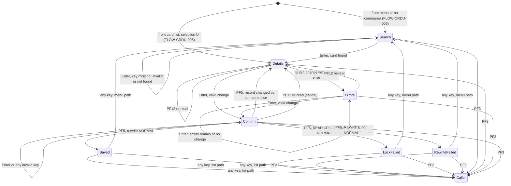
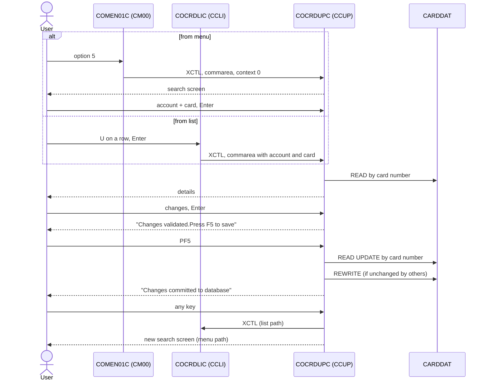

# COCRDUPC: Online credit card update

## 1. Summary

A signed-on user changes four attributes of one credit card: the name embossed on the card, the active status (`Y`/`N`) and the expiry month and year. The user reaches the screen either from the main menu (option 5 "Credit Card Update"), where an account number and a card number must be typed, or from the card list `COCRDLIC` (selection `U` on a row), which passes the account and card of the selected row. The program reads the card record from `CARDDAT` by card number, shows its current values, checks the changes, asks for confirmation (PF5), re-reads the record with a lock, verifies that nobody changed it in the meantime and rewrites it. The account number typed on the search screen is never checked against the card but is written into the card record (DEF-CRDU-001), and every save replaces the card's CVV code (DEF-CRDU-002).

## 2. Rules at a glance

| ID | Rule |
| :-- | :-- |
| BR-CRDU-001 | Only the embossed name, the active status and the expiry month and year can be changed; account, card number, CVV and expiry day cannot. |
| BR-CRDU-002 | The card is looked up by card number only; the account number is validated for format but not compared with the card. |
| BR-CRDU-003 | A change is saved only after it has been validated and then confirmed with PF5 on a separate screen. |
| BR-CRDU-004 | A change is detected by comparing name, expiry and status with the values read, ignoring upper/lower case. |
| BR-CRDU-005 | Before the rewrite the record is read again with a lock; if CVV, name, expiry or status differ from the values first read, nothing is written and the current values are shown. |
| BR-CRDU-006 | The rewritten record is built from the screen values, not from the record read. |
| BR-CRDU-007 | The account number written into the card record is the one on the screen (typed by the user on the menu path). |
| BR-CRDU-008 | The name is shown in upper case and saved exactly as it is on the screen when PF5 is pressed. |
| BR-CRDU-009 | After a save (success or failure) the next key returns to the card list (list path) or starts a new search (menu path). |
| VAL-CRDU-001 | The account number is required and must be 11 digits, not all zero. |
| VAL-CRDU-002 | The card number is required and must be 16 digits, not all zero. |
| VAL-CRDU-003 | With neither key given, the message is `No input received`. |
| VAL-CRDU-004 | The card number must exist in `CARDDAT`. |
| VAL-CRDU-005 | The embossed name is required and may contain only letters A-Z, a-z and spaces. |
| VAL-CRDU-006 | The active status must be upper-case `Y` or `N`. |
| VAL-CRDU-007 | The expiry month must be 1 to 12. |
| VAL-CRDU-008 | The expiry year must be 1950 to 2099. |
| VAL-CRDU-009 | All field edits run; the first error found sets the message, every faulty field is shown in red (blank ones with `*`), and the cursor goes to the first faulty field. |
| VAL-CRDU-010 | Pressing Enter without changing anything gives `No change detected with respect to values fetched.` |
| VAL-CRDU-011 | Valid keys are Enter, PF3, PF5 (only on the confirmation screen) and PF12 (only once a card was shown); any other key acts as Enter, without a message. |

## 3. Actors and triggers

- **Actor:** any user who reaches the screen. The program reads no user identity and checks no authority (DEF-CRDU-006).
- **Menu trigger:** main menu `COMEN01C`, option 5 "Credit Card Update", user type `U` (`app/cpy/COMEN02Y.cpy:49-53`). The menu sets `CDEMO-FROM-TRANID` = `CM00`, `CDEMO-FROM-PROGRAM` = `COMEN01C`, `CDEMO-PGM-CONTEXT` = 0 and transfers control (XCTL) with the 160-byte commarea (`app/cbl/COMEN01C.cbl:177-187`). The menu does not set `CDEMO-LAST-MAPSET`, so it keeps whatever the previous program left there (DEF-CRDU-010).
- **List trigger:** card list `COCRDLIC`, Enter with `U` in the selection column of a row. The list sets `CDEMO-FROM-TRANID` = `CCLI`, `CDEMO-FROM-PROGRAM` = `COCRDLIC`, `CDEMO-USER-TYPE` = `U`, `CDEMO-PGM-CONTEXT` = 0, `CDEMO-LAST-MAPSET` = `COCRDLI`, `CDEMO-LAST-MAP` = `CCRDLIA`, `CDEMO-ACCT-ID` and `CDEMO-CARD-NUM` = the selected row, and transfers control with the 160-byte commarea (`app/cbl/COCRDLIC.cbl:545-569`). See the COCRDLIC spec for how the row is selected.
- **Re-entry trigger:** every interaction ends with "return, next transaction `CCUP`" (FLOW-CRDU-019); CICS starts `CCUP` again (`app/csd/CARDDEMO.CSD:367-377`, program `COCRDUPC` at `app/csd/CARDDEMO.CSD:227-234`) when the user presses a key.
- **Direct start:** typing `CCUP` on a cleared terminal starts the program with no commarea. It shows the search screen; there is no redirect to sign-on (FLOW-CRDU-006, DEF-CRDU-006).
- `COACTUPC` and `COACTVWC` declare literals naming `COCRDUPC`/`CCUP` (`app/cbl/COACTUPC.cbl:541-547`, `app/cbl/COACTVWC.cbl:159-165`) but contain no transfer to it.

## 4. Interfaces

### 4.1 Screen CCRDUPA (mapset COCRDUP), 24 x 80

Source: `app/bms/COCRDUP.bms:20-168`; symbolic map `app/cpy-bms/COCRDUP.CPY:17-224`. Map control `FREEKB`; extended attributes colour, highlight, programmed symbols and validation (`app/bms/COCRDUP.bms:25-28`). The "BMS attributes" column is the physical map default; the program overrides the attribute byte of the six editable fields in every send (FLOW-CRDU-015). Fields with `LENGTH=0` after an input field are stopper fields (not listed).

| Row,Col | Field | Len | Direction | BMS attributes | Content |
| :-- | :-- | --: | :-- | :-- | :-- |
| 1,1 | (label) | 5 | out | autoskip, blue | `Tran:` |
| 1,7 | `TRNNAME` | 4 | out | autoskip, FSET, blue | `CCUP` |
| 1,21 | `TITLE01` | 40 | out | autoskip, yellow | `      AWS Mainframe Modernization       ` (`COTTL01Y.cpy:18-19`) |
| 1,65 | (label) | 5 | out | autoskip, blue | `Date:` |
| 1,71 | `CURDATE` | 8 | out | autoskip, blue | today `mm/dd/yy` (NUM-CRDU-006) |
| 2,1 | (label) | 5 | out | autoskip, blue | `Prog:` |
| 2,7 | `PGMNAME` | 8 | out | autoskip, blue | `COCRDUPC` |
| 2,21 | `TITLE02` | 40 | out | autoskip, yellow | `              CardDemo                  ` (`COTTL01Y.cpy:20-22`) |
| 2,65 | (label) | 5 | out | autoskip, blue | `Time:` |
| 2,71 | `CURTIME` | 8 | out | autoskip, blue | now `hh:mm:ss` |
| 4,30 | (label) | 26 | out | default (autoskip), neutral | `Update Credit Card Details` |
| 7,23 | (label) | 19 | out | autoskip, turquoise | `Account Number    :` |
| 7,45 | `ACCTSID` | 11 | in/out | protected, FSET, IC, default colour, underline | Account number |
| 8,23 | (label) | 19 | out | autoskip, turquoise | `Card Number       :` |
| 8,45 | `CARDSID` | 16 | in/out | unprotected, FSET, default colour, underline | Card number |
| 11,4 | (label) | 20 | out | default, turquoise | `Name on card      :` |
| 11,25 | `CRDNAME` | 50 | in/out | unprotected, underline | Embossed name |
| 13,4 | (label) | 20 | out | default, turquoise | `Card Active Y/N   : ` |
| 13,25 | `CRDSTCD` | 1 | in/out | unprotected, underline | Active status |
| 15,4 | (label) | 20 | out | default, turquoise | `Expiry Date       : ` |
| 15,25 | `EXPMON` | 2 | in/out | unprotected, underline, justify right | Expiry month |
| 15,28 | (label) | 1 | out | default | `/` |
| 15,30 | `EXPYEAR` | 4 | in/out | unprotected, underline, justify right | Expiry year |
| 15,36 | `EXPDAY` | 2 | in/out | **dark** (not displayed), FSET, protected, justify right | Expiry day, hidden; carried through the screen (BR-CRDU-001) |
| 20,25 | `INFOMSG` | 40 | out | protected, neutral | Information line (section 8.3) |
| 23,1 | `ERRMSG` | 80 | out | autoskip, bright, FSET, **red** | Error line (section 8.3); never recoloured |
| 24,1 | `FKEYS` | 21 | out | autoskip, yellow | `ENTER=Process F3=Exit` |
| 24,23 | `FKEYSC` | 18 | out | autoskip, **dark**, yellow | `F5=Save F12=Cancel`; made visible only on the confirmation screen (FLOW-CRDU-016) |

Source lines: header `app/bms/COCRDUP.bms:29-78`, keys and details `app/bms/COCRDUP.bms:79-148`, message and key lines `app/bms/COCRDUP.bms:149-167`.

### 4.2 Files

| CICS file | Entity | Operation | Key | Lines |
| :-- | :-- | :-- | :-- | :-- |
| `CARDDAT` | ENT-CARD | READ (no lock) | `CARD-NUM` (16) | 1380-1390 |
| `CARDDAT` | ENT-CARD | READ with UPDATE, then REWRITE (150 bytes) | `CARD-NUM` (16) | 1425-1436, 1477-1483 |

`CARDDAT` is the KSDS `AWS.M2.CARDDEMO.CARDDATA.VSAM.KSDS`, `KEYS(16 0)`, `RECORDSIZE(150 150)` (`app/jcl/CARDFILE.jcl:50-55`), defined in CICS with `UPDATEMODEL(LOCKING)`, `READINTEG(UNCOMMITTED)` and `RECOVERY(NONE)` (`app/csd/CARDDEMO.CSD:25-36`). The literal `LIT-CARDFILENAME-ACCT-PATH` = `CARDAIX` (`:253-254`) is declared but never used: the program never reads by account.

### 4.3 Commarea

The program receives `ENT-COMMAREA` (160 bytes, `COCOM01Y`) and keeps its own 329-byte extension `WS-THIS-PROGCOMMAREA` (`:274-321`) behind it. It always returns a 2000-byte commarea (`WS-COMMAREA`, `:324`, `:546-558`): bytes 1-160 `ENT-COMMAREA`, 161-489 the extension, 490-2000 spaces.

| Pos | Len | Field | Meaning |
| --: | --: | :-- | :-- |
| 161 | 1 | `CCUP-CHANGE-ACTION` | Conversation state (section 6.1): low-values or space = details not fetched, `S` details shown, `E` changes with errors, `N` changes valid and not confirmed, `C` saved, `L` lock (re-read) failed, `F` rewrite failed (`:276-290`) |
| 162 | 11 | `CCUP-OLD-ACCTID` | Account key used for the fetch |
| 173 | 16 | `CCUP-OLD-CARDID` | Card key used for the fetch |
| 189 | 3 | `CCUP-OLD-CVV-CD` | CVV as read (sensitive; DEF-CRDU-019) |
| 192 | 50 | `CCUP-OLD-CRDNAME` | Name as read, converted to upper case |
| 242 | 4 | `CCUP-OLD-EXPYEAR` | Expiry year as read |
| 246 | 2 | `CCUP-OLD-EXPMON` | Expiry month as read |
| 248 | 2 | `CCUP-OLD-EXPDAY` | Expiry day as read |
| 250 | 1 | `CCUP-OLD-CRDSTCD` | Active status as read |
| 251 | 89 | `CCUP-NEW-DETAILS` | Same layout with prefix `CCUP-NEW-`: the values received from the screen in the current task (`:303-313`) |
| 340 | 150 | `CARD-UPDATE-RECORD` | Work record in the layout of ENT-CARD, built just before the rewrite (`:314-321`); its 59-byte FILLER (pos 431-489) is never initialised (DEF-CRDU-003) |

`ENT-COMMAREA` fields used:

| Field | Read | Written | Use |
| :-- | :-- | :-- | :-- |
| `CDEMO-FROM-PROGRAM` | yes | yes (on exit) | Caller: `COCRDLIC` selects the list path, `COMEN01C` the menu path; exit target; set to `COCRDUPC` on exit |
| `CDEMO-FROM-TRANID` | yes | yes (on exit) | Copied to `CDEMO-TO-TRANID` on exit (default `CM00`); set to `CCUP` on exit |
| `CDEMO-TO-PROGRAM`, `CDEMO-TO-TRANID` | no | yes | Exit target (FLOW-CRDU-004) |
| `CDEMO-PGM-CONTEXT` | yes | yes | 0 = first entry, 1 = re-entry |
| `CDEMO-ACCT-ID`, `CDEMO-CARD-NUM` | yes (list path) | yes | Keys of the selected card; set from the screen; zeroed on exit to the list and after a save on the menu path |
| `CDEMO-ACCT-STATUS` | no | only in dead code (`:1017`) | - |
| `CDEMO-USER-TYPE` | no | yes | Forced to `U` on exit (DEF-CRDU-007) |
| `CDEMO-LAST-MAPSET`, `CDEMO-LAST-MAP` | `CDEMO-LAST-MAPSET` yes | yes (on exit) | `COCRDLI` (card list) changes behaviour (FLOW-CRDU-003, FLOW-CRDU-016); set to `COCRDUP` / `CCRDUPA` on exit |

All other commarea fields pass through unchanged.

### 4.4 Console and abend output

No CICS log output. An unexpected state or any abend sends the raw 134-byte `ABEND-DATA` block (`CSMSG02Y.cpy:21-29`) to the terminal and ends the task with abend code `9999` (ERR-CRDU-002, ERR-CRDU-003).

## 5. Data used

| Entity field | Read | Written | How |
| :-- | :-- | :-- | :-- |
| ENT-CARD.CARD-NUM | key | yes | key from the screen or commarea; written from the card number field received with PF5 (equal to the key) |
| ENT-CARD.CARD-ACCT-ID | no | yes | written from the account number on the screen (BR-CRDU-007) |
| ENT-CARD.CARD-CVV-CD | yes | yes | read for the concurrency check; written from an empty field (DEF-CRDU-002, NUM-CRDU-004) |
| ENT-CARD.CARD-EMBOSSED-NAME | yes | yes | shown in upper case; written from the screen |
| ENT-CARD.CARD-EXPIRAION-DATE | yes | yes | split into year, month, day; written as `YYYY-MM-DD` from screen year, screen month and the carried day (NUM-CRDU-001) |
| ENT-CARD.CARD-ACTIVE-STATUS | yes | yes | shown; written from the screen |
| ENT-CARD FILLER (59) | no | yes | written from commarea bytes 431-489 (DEF-CRDU-003) |

Program-local data with behaviour: state `CCUP-CHANGE-ACTION` (`:276-290`); edit flags `WS-EDIT-ACCT-FLAG` ... `WS-EDIT-CARDEXPYEAR-FLAG`, each `0` not OK, `1` valid, space blank (`:57-80`); `WS-INPUT-FLAG` (`:53-56`); key flag `WS-PFK-FLAG` (`:84-86`); check fields `CARD-NAME-CHECK`, `FLG-YES-NO-CHECK`, `CARD-MONTH-CHECK`, `CARD-YEAR-CHECK` (`:87-99`); messages `WS-INFO-MSG` X(40) and `WS-RETURN-MSG` X(75) (`:156-214`); file error text `WS-FILE-ERROR-MESSAGE` (`:133-152`); letters for the name check and upper-casing (`:255-263`); search keys `CC-ACCT-ID` X(11) / `CC-ACCT-ID-N` 9(11) and `CC-CARD-NUM` X(16) / `CC-CARD-NUM-N` 9(16) (`CVCRD01Y.cpy:34-39`); AID name `CCARD-AID` (`CVCRD01Y.cpy:3-19`).

Copied but without effect: `CSMSG01Y` (common messages), `CSUSR01Y` (user record), `CVCUS01Y` (ENT-CUSTOMER layout), `CC-CUST-ID`, `WS-LONG-MSG`, `WS-UCTRANS`, `WS-RETURN-FLAG`, the `CICS-OUTPUT-EDIT-VARS` group except `CARD-CVV-CD-X`/`-N`, `CCARD-NEXT-PROG`, `CCARD-ERROR-MSG`, the literals `LIT-CCLISTTRANID`, `LIT-CCLISTMAP`, `LIT-MENUMAPSET` and `LIT-MENUMAP`, the key field `WS-CARD-RID-ACCT-ID`, `WS-TRANID` (set, never read) and seven unused message condition names with six distinct texts (DEF-CRDU-014).

## 6. Processing flow

### 6.1 States and keys

The conversation state is `CCUP-CHANGE-ACTION` in the commarea extension. Names used in this spec:

| State | Code | Screen the user sees |
| :-- | :-- | :-- |
| Search | low-values or space | Account and card number open for input, details empty and protected |
| Details | `S` | Current values, name/status/month/year open for input |
| Errors | `E` | The user's values, faulty fields red, open for input |
| Confirm | `N` | The user's values, everything protected, `Changes validated.Press F5 to save`, `F5=Save F12=Cancel` visible |
| Saved | `C` | The saved values, everything protected, `Changes committed to database` |
| Lock failed | `L` | The user's values, `Changes unsuccessful. Please try again`, `Could not lock record for update` |
| Rewrite failed | `F` | The user's values, `Changes unsuccessful. Please try again`, `Update of record failed` |

User-level decision table (state at the start of the task x key, after key normalisation FLOW-CRDU-002 and VAL-CRDU-011):

| State | Enter | PF3 | PF5 | PF12 | Other key |
| :-- | :-- | :-- | :-- | :-- | :-- |
| Search | Validate keys (VAL-CRDU-001..004); found: Details; else Search with message | Exit (FLOW-CRDU-004) | as Enter | as Enter | as Enter |
| Details | Edit (FLOW-CRDU-009): no change: Details + VAL-CRDU-010; errors: Errors; valid: Confirm | Exit | as Enter | Re-read, Details (FLOW-CRDU-011) | as Enter |
| Errors | Edit: no change: Errors + VAL-CRDU-010; errors: Errors; valid: Confirm | Exit | as Enter | Re-read, Details | as Enter |
| Confirm | Show Confirm again | Exit | Save (BR-CRDU-005, SE-CRDU-002, SE-CRDU-003): Saved, Lock failed, Rewrite failed, or Details if changed by someone else | Re-read, Details (cancel) | as Enter |
| Saved, Lock failed, Rewrite failed | List path or `CDEMO-LAST-MAPSET` = `COCRDLI`: exit. Otherwise: new empty Search screen (FLOW-CRDU-007) | Exit | same as Enter | same as Enter | same as Enter |



Each arrow is one CICS task: start, act, send the screen, return with next transaction `CCUP`.

### 6.2 Steps of one task

```text
0000-MAIN
  register ABEND-ROUTINE as abend handler; clear work areas and messages     (370-384)
  restore commarea (FLOW-CRDU-001)                                          (388-401)
  normalise the key (FLOW-CRDU-002, VAL-CRDU-011)                           (406-424)
  dispatch (FLOW-CRDU-003):
    PF3, or saved/failed on the list path      -> exit (FLOW-CRDU-004)
    first entry from list, or PF12 on list path -> fetch, show Details (FLOW-CRDU-005)
    first entry from menu / no commarea         -> empty Search screen (FLOW-CRDU-006)
    saved/failed (menu path)                    -> empty Search screen (FLOW-CRDU-007)
    otherwise:
      receive and normalise input (FLOW-CRDU-008)
      edit according to state (FLOW-CRDU-009)
      decide: fetch, cancel, save or nothing (FLOW-CRDU-010)
      send the screen (FLOW-CRDU-012..018)
COMMON-RETURN: return, next transaction CCUP, 2000-byte commarea (FLOW-CRDU-019)
```

## 7. Business rules

#### BR-CRDU-001 · Editable and protected card fields
- **When:** a card is shown for update.
- **Then:** the user can change the embossed name, the active status, the expiry month and the expiry year. The account number and card number are protected on the Details, Errors, Confirm and Saved screens; on the Lock failed and Rewrite failed screens they are open for input but whatever is typed there is ignored (FLOW-CRDU-015, DEF-CRDU-011). The CVV code is never shown. The expiry day is sent in a dark, protected field and comes back unchanged with every input, so it keeps the value read from the file; the user cannot see or change it.
- **Source:** `:1181-1207`, `:1108-1129`, `:621`, `:517-528`, `app/bms/COCRDUP.bms:142-146`
- **Fidelity:** must-preserve
- **Confidence:** reviewed (field selection); platform-inferred (the dark FSET field is returned unchanged)

#### BR-CRDU-002 · Card is found by card number alone
- **When:** the card is fetched (search screen, entry from the list, PF12) or re-read for the save.
- **Then:** the `CARDDAT` key is the 16-digit card number only. The account number is checked for format (VAL-CRDU-001) and kept, but never compared with `CARD-ACCT-ID` or the card cross-reference; the line that would have used it as part of the key is a comment. Any well-formed, non-zero account number with an existing card number shows that card.
- **Source:** `:1379-1390`, `:1424-1436`
- **Fidelity:** defect-decide (DEF-CRDU-001, Q-CRDU-001)
- **Confidence:** reviewed

#### BR-CRDU-003 · Two-step save
- **When:** the user changes at least one of name, status, month or year (BR-CRDU-004) and all edits pass.
- **Then:** nothing is written; the state becomes Confirm, all fields are protected, the information line reads `Changes validated.Press F5 to save` and the key hint `F5=Save F12=Cancel` is made bright. Only PF5 in the Confirm state saves (VAL-CRDU-011). PF5 pressed in any other state acts as Enter, so a save always needs two interactions.
- **Source:** `:696-714`, `:988-1001`, `:413-424`, `:1149-1150`, `:1191-1199`, `:1315-1317`
- **Fidelity:** must-preserve
- **Confidence:** reviewed

#### BR-CRDU-004 · Change detection
- **When:** the user presses Enter (or PF12 on the menu path) on the Details or Errors screen.
- **Then:** the 59 characters name (50) + expiry year (4) + month (2) + day (2) + status (1) received from the screen, after the `*`/space replacement of FLOW-CRDU-008, are converted to upper case and compared with the same 59 characters as read from the file (name already in upper case). Equal: no change (VAL-CRDU-010). Different: the edits run. Because both sides are upper-cased, a change of case only (`aniya von` for `ANIYA VON`, `y` for `Y`) counts as no change. In the Confirm state the edits are skipped whatever the comparison gives.
- **Source:** `:680-693`, `:1356-1358`
- **Fidelity:** must-preserve
- **Confidence:** reviewed

#### BR-CRDU-005 · Optimistic concurrency check before the rewrite
- **When:** PF5 in the Confirm state.
- **Then:** the card is read again by card number with UPDATE (SE-CRDU-002). Its name is converted to upper case, then CVV, name, expiry year (positions 1-4 of the date), month (6-7), day (9-10) and active status are compared with the values stored at fetch time (`CCUP-OLD-*`). Account number and FILLER are not compared. If any differs: message `Record changed by some one else. Please review`, the stored values are replaced by the current ones, nothing is written, and the screen goes back to Details showing the current values (the user's changes are dropped). If all are equal, the record is rewritten (BR-CRDU-006). A change of case only in the name by another user is not detected.
- **Source:** `:1453-1457`, `:1498-1520`, `:997-998`
- **Fidelity:** must-preserve
- **Confidence:** reviewed

#### BR-CRDU-006 · Content of the rewritten record
- **When:** the concurrency check passes.
- **Then:** a 150-byte record is built (named fields first cleared) and rewritten:

| Field | Value |
| :-- | :-- |
| `CARD-NUM` | card number field as received with PF5 (`CCUP-NEW-CARDID`; protected, equal to the key) |
| `CARD-ACCT-ID` | account number field as received with PF5 (BR-CRDU-007) |
| `CARD-CVV-CD` | not the CVV read: an empty work field converted to 3 digits (DEF-CRDU-002, NUM-CRDU-004) |
| `CARD-EMBOSSED-NAME` | name as on the screen (BR-CRDU-008) |
| `CARD-EXPIRAION-DATE` | screen year, `-`, screen month, `-`, carried day (NUM-CRDU-001) |
| `CARD-ACTIVE-STATUS` | status as on the screen |
| FILLER (59) | commarea bytes 431-489, never initialised (DEF-CRDU-003) |

- **Source:** `:1461-1483`
- **Fidelity:** must-preserve (except the defect rows, defect-decide)
- **Confidence:** reviewed

#### BR-CRDU-007 · Account number written into the card
- **When:** a save is made.
- **Then:** `CARD-ACCT-ID` is set from the account number on the screen (`CC-ACCT-ID-N`). On the list path this is the account of the selected row. On the menu path it is the account number the user typed on the search screen, which BR-CRDU-002 never checked against the card. A save therefore moves the card to that account in `CARDDAT` without changing the card cross-reference (DEF-CRDU-001).
- **Source:** `:589-596`, `:1087-1091`, `:1463`
- **Fidelity:** defect-decide (Q-CRDU-001)
- **Confidence:** reviewed

#### BR-CRDU-008 · Name case
- **When:** a card is fetched, re-read, or saved.
- **Then:** the name read from the file is converted to upper case (letters a-z only) before it is stored and shown. On save the name is written exactly as received from the screen: if the user did not touch the name, the upper-case display value is written, so any save of a card (even a status change) stores the name in upper case. A name the user types in lower or mixed case is stored as typed.
- **Source:** `:1356-1360`, `:1108`, `:1114`, `:1466`
- **Fidelity:** defect-decide (DEF-CRDU-008, Q-CRDU-003)
- **Confidence:** reviewed

#### BR-CRDU-009 · End of an update conversation
- **When:** the state at the start of a task is Saved, Lock failed or Rewrite failed.
- **Then:** if `CDEMO-LAST-MAPSET` is `COCRDLI` (always the case on the list path), any key returns to the caller exactly like PF3 (FLOW-CRDU-004). Otherwise any key clears the state, the keys and the messages and shows an empty search screen (FLOW-CRDU-007). The screen input is not read in either case.
- **Source:** `:435-440`, `:517-528`
- **Fidelity:** must-preserve
- **Confidence:** reviewed

## 8. Validations and messages

The edits of the search keys run only in the Search state; the edits of the details only in the Details and Errors states when a change was detected (FLOW-CRDU-009). Each edit sets its field flag to blank, not OK or valid. A message is stored only if no message is set yet in this task, except where noted, so the first failing edit decides the message.

#### VAL-CRDU-001 · Account number
- **When:** the Search state receives input.
- **Then:**

| Account field (11 characters) | Message | Flag |
| :-- | :-- | :-- |
| `*`, spaces, low-values, or digits that are all zero | `Account number not provided` | blank |
| fewer than 11 characters, all of them `0`, rest blank (for example `0` or `000`) | `Account number not provided` on GnuCOBOL 3.2 (the zero test is numeric, through the 9(11) redefinition, and runs before the NUMERIC test); mainframe behaviour to be confirmed (Q-CRDU-006) | blank |
| anything else that is not 11 digits (letters, embedded or trailing spaces, fewer than 11 digits) | `ACCOUNT FILTER,IF SUPPLIED MUST BE A 11 DIGIT NUMBER` | not OK |
| 11 digits, not all zero | none; becomes the account key and `CDEMO-ACCT-ID` | valid |

No padding or right-justification is applied (the BMS field has no `JUSTIFY`), so `50` is rejected; the user must type `00000000050`.
- **Source:** `:721-756`, `:589-596`
- **Fidelity:** must-preserve
- **Confidence:** reviewed; the row for short all-zero entries is platform-inferred

#### VAL-CRDU-002 · Card number
- **When:** the Search state receives input (after VAL-CRDU-001; both always run).
- **Then:**

| Card field (16 characters) | Message | Flag |
| :-- | :-- | :-- |
| `*`, spaces, low-values, or digits that are all zero | `Card number not provided` | blank |
| fewer than 16 characters, all of them `0`, rest blank | `Card number not provided` on GnuCOBOL 3.2 (numeric zero test at `:770` before the NUMERIC test at `:784`); mainframe behaviour to be confirmed (Q-CRDU-006) | blank |
| anything else that is not 16 digits | `CARD ID FILTER,IF SUPPLIED MUST BE A 16 DIGIT NUMBER` | not OK |
| 16 digits, not all zero | none; becomes the card key and `CDEMO-CARD-NUM` | valid |

- **Source:** `:762-800`, `:598-605`
- **Fidelity:** must-preserve
- **Confidence:** reviewed; the row for short all-zero entries is platform-inferred

#### VAL-CRDU-003 · No search keys
- **When:** both the account and the card number are blank in the sense of VAL-CRDU-001 and VAL-CRDU-002.
- **Then:** the message is replaced by `No input received` (this one overwrites `Account number not provided`). Both fields show `*` in red.
- **Source:** `:656-659`
- **Fidelity:** must-preserve
- **Confidence:** reviewed

#### VAL-CRDU-004 · Card must exist
- **When:** both keys are valid and the card is read (SE-CRDU-001).
- **Then:** NOTFND: message `Did not find cards for this search condition` (if none yet), account and card both marked not OK (red), state unchanged in the Search state (on entry from the list and on a PF12 re-read the state becomes Details anyway, DEF-CRDU-018, DEF-CRDU-021). Any other non-NORMAL response: the file error message of NUM-CRDU-005 replaces any message, and the account is marked not OK. NORMAL: the values are stored and shown (Details).
- **Source:** `:1392-1412`, `:959-965`, `:668`
- **Fidelity:** must-preserve
- **Confidence:** reviewed

#### VAL-CRDU-005 · Embossed name
- **When:** a change was detected in the Details or Errors state.
- **Then:** `*`, spaces, low-values (received as such) or 50 zeros: `Card name not provided` (blank). Otherwise every letter A-Z and a-z is replaced by a space; if anything other than spaces is left (digits, hyphen, apostrophe, full stop, accented letters, low-values inside the value), `Card name can only contain alphabets and spaces` (not OK). Otherwise valid. A name of one letter is valid.
- **Source:** `:806-840`, `:607-612`, `:255-259`
- **Fidelity:** must-preserve
- **Confidence:** reviewed; the check relies on an all-space value trimming to length 0 (true on GnuCOBOL 3.2, Q-CRDU-006)

#### VAL-CRDU-006 · Card active status
- **When:** as VAL-CRDU-005, after it.
- **Then:** `*`, space, low-value or `0`: blank; any value other than `Y` or `N`, including lower-case `y` and `n`: not OK. Both give `Card Active Status must be Y or N`. Note: a lower-case letter that matches the stored status case-insensitively is "no change" (BR-CRDU-004) and is never edited.
- **Source:** `:845-873`, `:89-91`, `:614-619`
- **Fidelity:** must-preserve
- **Confidence:** reviewed

#### VAL-CRDU-007 · Expiry month
- **When:** as VAL-CRDU-005, after VAL-CRDU-006.
- **Then:** `*`, spaces, low-values or `00`: blank; a 2-character value whose numeric value is not 1 to 12: not OK. Both give `Card expiry month must be between 1 and 12`. The month is not checked against the day, and the date is not checked to be in the future (DEF-CRDU-009).
- **Source:** `:877-908`, `:92-95`, `:623-628`
- **Fidelity:** must-preserve
- **Confidence:** reviewed; numeric interpretation of a one-digit or non-numeric entry is platform-inferred (NUM-CRDU-003)

#### VAL-CRDU-008 · Expiry year
- **When:** as VAL-CRDU-005, after VAL-CRDU-007.
- **Then:** `*`, spaces, low-values or `0000`: blank; numeric value not 1950 to 2099: not OK. Both give `Invalid card expiry year`.
- **Source:** `:913-944`, `:96-99`, `:630-635`
- **Fidelity:** must-preserve
- **Confidence:** reviewed; numeric interpretation platform-inferred (NUM-CRDU-003)

#### VAL-CRDU-009 · Message precedence, field marking and cursor

All edits of a group run, in this order: account, card (Search); name, status, month, year (Details/Errors). The first failure decides the message (VAL-CRDU-003 and the file error of VAL-CRDU-004 overwrite). Then:

| Condition at send time | Marking | Source |
| :-- | :-- | :-- |
| account not OK | account red | 1243-1245 |
| account blank and not first entry | account shows `*`, red | 1247-1251 |
| card not OK / blank (same rules) | card red / `*` red | 1253-1261 |
| state Errors and name, status, month or year not OK | that field red | 1263-1301 |
| state Errors and that field blank | that field shows `*`, red | 1268-1306 |
| `CDEMO-LAST-MAPSET` = `COCRDLI` | account and card colour set to default (no visible change) | 1238-1241 |

Cursor (first matching row; FLOW-CRDU-017):

| # | Condition | Cursor on |
| --: | :-- | :-- |
| 1 | information line is `Details of selected card shown above` (state Details) or the message is `No change detected with respect to values fetched.` | name |
| 2 | account not OK or blank | account |
| 3 | card not OK or blank | card |
| 4 | name not OK or blank | name |
| 5 | status not OK or blank | status |
| 6 | month not OK or blank | month |
| 7 | year not OK or blank | year |
| 8 | otherwise (Confirm, Saved, failures) | account |

On the very first search screen, and on the empty search screen after a save, the account flag is blank, so the cursor is on the account (row 2) without a `*` (context is "enter" at that send).
- **Source:** `:1211-1307`
- **Fidelity:** must-preserve (messages, red marking, `*`); incidental (cursor)
- **Confidence:** reviewed

#### VAL-CRDU-010 · No change detected
- **When:** Details or Errors state, and the comparison of BR-CRDU-004 finds no difference.
- **Then:** message `No change detected with respect to values fetched.`, no field edits, all detail flags valid (no red), state unchanged, cursor on the name. In the Errors state the screen keeps showing the user's values and `Update card details presented above.`.
- **Source:** `:680-693`, `:971-974`
- **Fidelity:** must-preserve
- **Confidence:** reviewed

#### VAL-CRDU-011 · Valid keys
- **When:** any key arrives (after PF13-PF24 are folded onto PF1-PF12, FLOW-CRDU-002).
- **Then:**

| Key | Valid when | If not valid |
| :-- | :-- | :-- |
| Enter | always | - |
| PF3 | always | - |
| PF5 | state Confirm | acts as Enter |
| PF12 | any state except Search | acts as Enter |
| Clear, PA1, PA2, PF1, PF2, PF4, PF6-PF11 | never | acts as Enter |

No "invalid key" message is shown (the common text `Invalid key pressed. Please see below...` of `CSMSG01Y` is not used). Clear and PA keys send no data (DEF-CRDU-012).
- **Source:** `:413-424`
- **Fidelity:** must-preserve
- **Confidence:** reviewed

### 8.1 Flow and keys

#### FLOW-CRDU-001 · Task start and commarea restore
- **When:** every task.
- **Then:** register `ABEND-ROUTINE` as the abend handler; clear the key work area, the miscellaneous working storage (flags and messages become spaces) and the 2000-byte output commarea; clear the return message. If no commarea was passed (`EIBCALEN` = 0), or `CDEMO-FROM-PROGRAM` = `COMEN01C` and the context is not re-entry, clear the commarea and the extension and set context 0 and state Search. Otherwise copy bytes 1-160 of the received commarea into `ENT-COMMAREA` and the next 329 bytes into the extension. The second condition is tested before the commarea is copied, so it looks at working storage, not at the received data (DEF-CRDU-005); a 160-byte commarea from the menu or the list is therefore always copied, and the extension is read past its end (DEF-CRDU-004).
- **Source:** `:370-401`
- **Fidelity:** must-preserve (no commarea starts a search); defect-decide (extension read)
- **Confidence:** reviewed; working-storage content and storage beyond the commarea platform-inferred

#### FLOW-CRDU-002 · AID mapping
- **When:** every task.
- **Then:** the key is converted to a name: Enter, Clear, PA1, PA2, PF1-PF12; PF13-PF24 become PF1-PF12 (PF15 acts as PF3, PF17 as PF5, PF24 as PF12). PA3 and any other AID leave the name unchanged (spaces after the clear in FLOW-CRDU-001), which is then not valid and acts as Enter (VAL-CRDU-011).
- **Source:** `CSSTRPFY.cpy:17-82`, `:406-407`
- **Fidelity:** must-preserve
- **Confidence:** reviewed

#### FLOW-CRDU-003 · Main dispatch
- **When:** after FLOW-CRDU-001 and FLOW-CRDU-002. Rows are tested in order; the first that matches runs.

| # | Condition | Action | Lines |
| --: | :-- | :-- | :-- |
| 1 | key PF3; or state Saved and `CDEMO-LAST-MAPSET` = `COCRDLI`; or state Lock failed / Rewrite failed and `CDEMO-LAST-MAPSET` = `COCRDLI` | Exit (FLOW-CRDU-004) | 435-476 |
| 2 | context 0 and `CDEMO-FROM-PROGRAM` = `COCRDLIC`; or key PF12 and `CDEMO-FROM-PROGRAM` = `COCRDLIC` | Fetch from the commarea keys, Details (FLOW-CRDU-005) | 482-497 |
| 3 | state Search and context 0; or `CDEMO-FROM-PROGRAM` = `COMEN01C` and context 0 | Empty search screen (FLOW-CRDU-006) | 502-511 |
| 4 | state Saved, Lock failed or Rewrite failed | Reset, empty search screen (FLOW-CRDU-007) | 517-528 |
| 5 | otherwise | Receive (FLOW-CRDU-008), edit (FLOW-CRDU-009), decide (FLOW-CRDU-010), send (FLOW-CRDU-012) | 535-542 |

- **Source:** `:429-543`
- **Fidelity:** must-preserve
- **Confidence:** reviewed

#### FLOW-CRDU-004 · Exit to the caller
- **When:** dispatch row 1.
- **Then:** `CDEMO-TO-TRANID` = `CDEMO-FROM-TRANID`, or `CM00` if that is blank or low-values; `CDEMO-TO-PROGRAM` = `CDEMO-FROM-PROGRAM`, or `COMEN01C` if blank or low-values. Then `CDEMO-FROM-TRANID` = `CCUP`, `CDEMO-FROM-PROGRAM` = `COCRDUPC`; if `CDEMO-LAST-MAPSET` = `COCRDLI`, `CDEMO-ACCT-ID` and `CDEMO-CARD-NUM` become zero; `CDEMO-USER-TYPE` = `U` (DEF-CRDU-007); context 0; `CDEMO-LAST-MAPSET` = `COCRDUP`, `CDEMO-LAST-MAP` = `CCRDUPA`. Take a syncpoint (SE-CRDU-004) and transfer control (XCTL) to `CDEMO-TO-PROGRAM` with the 160-byte `ENT-COMMAREA` (the extension is not passed). Screen input is not read. In practice: menu path back to `COMEN01C`, list path back to `COCRDLIC`, direct start to `COMEN01C`.
- **Source:** `:435-476`
- **Fidelity:** must-preserve
- **Confidence:** reviewed

#### FLOW-CRDU-005 · Entry from the card list
- **When:** dispatch row 2: first entry from `COCRDLIC`, or PF12 on the list path in any state but Search.
- **Then:** context 1; keys valid; account key = `CDEMO-ACCT-ID`, card key = `CDEMO-CARD-NUM` (zero-padded digits); read the card (SE-CRDU-001, VAL-CRDU-004); set the state to Details **whether or not the card was found** (DEF-CRDU-018); send. The screen input is not read, so PF12 discards whatever the user typed and the message line is empty unless the read failed.
- **Source:** `:482-497`, `:1343-1370`
- **Fidelity:** must-preserve
- **Confidence:** reviewed

#### FLOW-CRDU-006 · Empty search screen on first entry
- **When:** dispatch row 3: first entry from the menu, or no commarea (direct `CCUP`).
- **Then:** clear the extension; send the screen while the context is still 0 (empty account and card fields open for input, details empty and protected, information line `Please enter Account and Card Number`, no message, cursor on account); then set context 1 and state Search.
- **Source:** `:502-511`
- **Fidelity:** must-preserve
- **Confidence:** reviewed

#### FLOW-CRDU-007 · New search after a save on the menu path
- **When:** dispatch row 4.
- **Then:** clear the extension, the flags, the messages, `CDEMO-ACCT-ID` and `CDEMO-CARD-NUM`; set context 0; send the same empty search screen as FLOW-CRDU-006; set context 1 and state Search. The user's key and input are ignored, so the result of the save stays on the screen for exactly one interaction.
- **Source:** `:517-528`
- **Fidelity:** must-preserve
- **Confidence:** reviewed

#### FLOW-CRDU-008 · Receive and normalise input
- **When:** dispatch row 5.
- **Then:** receive map `CCRDUPA` of mapset `COCRDUP`; clear the new-values area. For account, card, name, status, month and year: a field equal to `*` or to spaces becomes low-values; any other value is taken as received. The account and card values go to the search keys; name, status, month and year to `CCUP-NEW-*`. The hidden expiry day is taken as received without that replacement. The response of the receive is not checked (ERR-CRDU-004).
- **Source:** `:578-636`, `:564-573`
- **Fidelity:** must-preserve
- **Confidence:** reviewed

#### FLOW-CRDU-009 · Edits by state
- **When:** after FLOW-CRDU-008.
- **Then:**
  - **Search:** run VAL-CRDU-001 and VAL-CRDU-002, clear the new detail values, apply VAL-CRDU-003; stop.
  - **Any other state:** set the information flag to "found" (`:668`). The send later overwrites the information text by state, so this has no effect on the screen; its only effect is on PF12, where it makes the re-read look successful whatever the READ returns (FLOW-CRDU-010 row 1, DEF-CRDU-021). Mark both keys valid, copy the stored account and card into `CDEMO-ACCT-ID` and `CDEMO-CARD-NUM`. Compare (BR-CRDU-004). If no change, or the state is Confirm (or Saved), mark the detail fields valid and stop. Otherwise set state Errors, run VAL-CRDU-005..008, and if none failed set state Confirm.
- **Source:** `:641-715`
- **Fidelity:** must-preserve
- **Confidence:** reviewed

#### FLOW-CRDU-010 · Decide the action
- **When:** after FLOW-CRDU-009. Rows tested in order:

| # | Condition | Action | Lines |
| --: | :-- | :-- | :-- |
| 1 | state Search, or key PF12 | If both keys valid: read the card (SE-CRDU-001). In the Search state: if found, state Details. On PF12 (menu path; Details, Errors or Confirm): the found flag is already set by FLOW-CRDU-009, so the state becomes Details even if the READ fails, and the stored values are rebuilt from the work record (DEF-CRDU-021) | 954-966 |
| 2 | state Details | If no edit error and a change was detected, state Confirm (redundant with FLOW-CRDU-009); otherwise nothing | 971-977 |
| 3 | state Errors | nothing | 982-983 |
| 4 | state Confirm and key PF5 | Save (SE-CRDU-002, BR-CRDU-005, SE-CRDU-003); then: lock failed: state Lock failed; rewrite failed: state Rewrite failed; record changed: state Details; otherwise state Saved | 988-1001 |
| 5 | state Confirm | nothing (Confirm shown again) | 1006-1007 |
| 6 | state Saved | state Details and, if `CDEMO-FROM-TRANID` is blank, clear the commarea keys; unreachable (DEF-CRDU-014) | 1011-1018 |
| 7 | otherwise | abend `0001` (ERR-CRDU-002) | 1019-1026 |

- **Source:** `:948-1028`
- **Fidelity:** must-preserve
- **Confidence:** reviewed

#### FLOW-CRDU-011 · PF12, cancel changes
- **When:** PF12 in the Details, Errors or Confirm state.
- **Then:** list path: FLOW-CRDU-005 (no receive). Menu path: the input is received and edited first (FLOW-CRDU-008, FLOW-CRDU-009), then the card is read again with the keys received from the (protected) key fields in this task, normally equal to the stored keys, and the state becomes Details. If the read succeeds the current file values are shown; if it fails the state is still Details (DEF-CRDU-021). Any message produced by the edit of the discarded input stays on the message line (DEF-CRDU-013).
- **Source:** `:484-485`, `:598-604`, `:668`, `:958-966`, `:1380`
- **Fidelity:** must-preserve
- **Confidence:** reviewed

### 8.2 Screen building

#### FLOW-CRDU-012 · Send sequence and header
- **When:** every send (paths 2 to 5 of FLOW-CRDU-003).
- **Then:** clear the output map to low-values; fill titles, `CCUP`, `COCRDUPC`, date `mm/dd/yy` and time `hh:mm:ss` (NUM-CRDU-006); then FLOW-CRDU-013, FLOW-CRDU-014, FLOW-CRDU-015..017, FLOW-CRDU-018.
- **Source:** `:1035-1046`, `:1052-1076`
- **Fidelity:** must-preserve (content); incidental (layout)
- **Confidence:** reviewed

#### FLOW-CRDU-013 · Field content per state

| Situation | Account, card | Name, status, month, year | Hidden day |
| :-- | :-- | :-- | :-- |
| Context 0 (empty search screen) | empty | empty | empty |
| Search (re-entry) | the received keys; empty if the numeric value is zero | empty | empty |
| Details | the keys | values read from the file (name upper case) | day read |
| Errors, Confirm, Saved, Lock failed, Rewrite failed | the keys | the values received in this task (blank fields empty, then `*` per VAL-CRDU-009) | day read (not the received one) |

- **Source:** `:1082-1134`
- **Fidelity:** must-preserve
- **Confidence:** reviewed

#### FLOW-CRDU-014 · Information line per state
- **Then:** first matching row: context 0: `Please enter Account and Card Number`; Search: same; Details: `Details of selected card shown above`; Errors: `Update card details presented above.`; Confirm: `Changes validated.Press F5 to save`; Saved: `Changes committed to database`; Lock failed or Rewrite failed: `Changes unsuccessful. Please try again`; otherwise, if empty: `Please enter Account and Card Number`. The message (`WS-RETURN-MSG`) goes to the error line.
- **Source:** `:1138-1164`
- **Fidelity:** must-preserve
- **Confidence:** reviewed

#### FLOW-CRDU-015 · Field protection per state

| State at send | Account, card | Name, status, month, year |
| :-- | :-- | :-- |
| Search (including the empty screen) | unprotected, modified flag set | protected, modified flag set |
| Details, Errors | protected, modified flag set | unprotected, modified flag set |
| Confirm, Saved | protected, modified flag set | protected, modified flag set |
| Lock failed, Rewrite failed | unprotected, modified flag set | protected, modified flag set |

The hidden expiry day keeps its map attributes (dark, protected, FSET). Because every field has its modified flag set, every field is sent back with the next key whatever the user did.
- **Source:** `:1172-1208`
- **Fidelity:** must-preserve (which fields are editable); incidental (3270 attribute bytes)
- **Confidence:** reviewed; attribute semantics platform-inferred

#### FLOW-CRDU-016 · Colours and highlights
- **Then:** red and `*` marking of VAL-CRDU-009. Information line: bright when any information text is set (always, in practice), dark otherwise. Key hint `F5=Save F12=Cancel`: made bright only when the information text is `Changes validated.Press F5 to save`; otherwise it stays dark (invisible) as in the map. The colour byte of the hidden day receives the "dark" attribute value (DEF-CRDU-015).
- **Source:** `:1238-1317`
- **Fidelity:** must-preserve (red fields, `*`, key hint visibility); incidental (attribute bytes)
- **Confidence:** reviewed; attribute semantics platform-inferred

#### FLOW-CRDU-017 · Cursor position
- **Then:** VAL-CRDU-009 cursor table, by setting the field length to -1 (symbolic cursor positioning).
- **Source:** `:1211-1235`
- **Fidelity:** incidental
- **Confidence:** reviewed

#### FLOW-CRDU-018 · Send the screen
- **Then:** send map `CCRDUPA` of mapset `COCRDUP` with `CURSOR`, `ERASE` and `FREEKB`. The response is stored but not checked.
- **Source:** `:1324-1337`
- **Fidelity:** incidental
- **Confidence:** reviewed

#### FLOW-CRDU-019 · End of every interaction
- **Then:** copy the message to an unused work field; build the 2000-byte commarea (160 bytes `ENT-COMMAREA`, 329 bytes extension, spaces); return to CICS with next transaction `CCUP`.
- **Source:** `:546-559`
- **Fidelity:** must-preserve
- **Confidence:** reviewed

#### FLOW-CRDU-020 · Exit paragraphs
- **Then:** every `-EXIT` paragraph contains only `EXIT` and marks the end of a `PERFORM ... THRU` range; `0000-MAIN-EXIT` and `ABEND-ROUTINE-EXIT` are never reached (the main paragraph always ends in XCTL or RETURN, the abend routine in ABEND). `9300-CHECK-CHANGE-IN-REC` leaves its range by `GO TO 9200-WRITE-PROCESSING-EXIT` (DEF-CRDU-020).
- **Source:** `:560-562`, `:575-577`, `:1494-1496`, `:1518`, `:1521-1523`, `:1554-1556`
- **Fidelity:** incidental
- **Confidence:** reviewed

### 8.3 Message catalog

Information line `INFOMSG` (row 20, position 25 as in section 4.1, which is the attribute byte; the text starts in column 26; 40 characters, neutral, bright). Error line `ERRMSG` (row 23, 80 characters, red, bright); the program's message field is 75 characters, so nothing longer than 75 can appear.

| Line | Text (exact) | Len | Cause | Item |
| :-- | :-- | --: | :-- | :-- |
| info | `Please enter Account and Card Number` | 36 | search screen | FLOW-CRDU-014 |
| info | `Details of selected card shown above` | 36 | Details state | FLOW-CRDU-014 |
| info | `Update card details presented above.` | 36 | Errors state | FLOW-CRDU-014 |
| info | `Changes validated.Press F5 to save` (no space after the full stop) | 34 | Confirm state | BR-CRDU-003 |
| info | `Changes committed to database` | 29 | Saved | SE-CRDU-003 |
| info | `Changes unsuccessful. Please try again` | 38 | Lock failed, Rewrite failed | ERR-CRDU-001 |
| error | `No input received` | 17 | no keys | VAL-CRDU-003 |
| error | `Account number not provided` | 27 | account blank or zero | VAL-CRDU-001 |
| error | `ACCOUNT FILTER,IF SUPPLIED MUST BE A 11 DIGIT NUMBER` | 52 | account not 11 digits | VAL-CRDU-001 |
| error | `Card number not provided` | 24 | card blank or zero | VAL-CRDU-002 |
| error | `CARD ID FILTER,IF SUPPLIED MUST BE A 16 DIGIT NUMBER` | 52 | card not 16 digits | VAL-CRDU-002 |
| error | `Did not find cards for this search condition` | 44 | card READ NOTFND | VAL-CRDU-004 |
| error | `File Error: READ     on CARDDAT   returned RESP nnnnnnnnn ,RESP2 nnnnnnnnn ` | 75 | card READ other response | NUM-CRDU-005 |
| error | `Card name not provided` | 22 | name blank | VAL-CRDU-005 |
| error | `Card name can only contain alphabets and spaces` | 47 | name not letters/spaces | VAL-CRDU-005 |
| error | `Card Active Status must be Y or N` | 33 | status blank or not `Y`/`N` | VAL-CRDU-006 |
| error | `Card expiry month must be between 1 and 12` | 42 | month | VAL-CRDU-007 |
| error | `Invalid card expiry year` | 24 | year | VAL-CRDU-008 |
| error | `No change detected with respect to values fetched.` | 50 | nothing changed | VAL-CRDU-010 |
| error | `Could not lock record for update` | 32 | READ UPDATE not NORMAL | ERR-CRDU-001 |
| error | `Record changed by some one else. Please review` | 46 | concurrency check failed | BR-CRDU-005 |
| error | `Update of record failed` | 23 | REWRITE not NORMAL | ERR-CRDU-001 |

Defined but never shown (`:175-176, 189-194, 201-202, 211-214`): `PF03 pressed.Exiting`, `Account number must be a non zero 11 digit number` (two 88-levels), `Card number if supplied must be a 16 digit number`, `Did not find this account in cards database`, `Error reading Card Data File`, `Looks Good.... so far`.

## 9. Side effects

In execution order for a save. Each of SE-CRDU-001 and SE-CRDU-002/003 runs in a different task (fetch, then the PF5 task); nothing holds the record between them, which is why BR-CRDU-005 exists.

#### SE-CRDU-001 · Read the card (fetch)
- **What:** READ `CARDDAT` by `CARD-NUM` (16-byte key from the search key), into the 150-byte card record, no lock. On NORMAL, store the account and card keys, the CVV, the name (upper-cased), expiry year, month and day (date positions 1-4, 6-7, 9-10) and the status in `CCUP-OLD-*` (commarea pos 162-250). The stored values are cleared first, so after a failed read in the Search state or on entry from the list they are spaces apart from the keys. Exception: on a PF12 re-read (menu path) the found flag is already set, so after a failed read the values are refilled from the work record: name and status from before (copied there by FLOW-CRDU-009), CVV and expiry date undefined (DEF-CRDU-021).
- **Source:** `:1343-1370`, `:1376-1413`
- **Fidelity:** must-preserve
- **Confidence:** reviewed

#### SE-CRDU-002 · Read the card for update (lock)
- **What:** READ `CARDDAT` with UPDATE by the card number on the screen (`CC-CARD-NUM`), into the card record. This takes the VSAM exclusive lock on the record (CSD `UPDATEMODEL(LOCKING)`). Any response other than NORMAL ends the save with `Could not lock record for update` (ERR-CRDU-001).
- **Source:** `:1425-1449`
- **Fidelity:** must-preserve
- **Confidence:** reviewed; lock semantics platform-inferred

#### SE-CRDU-003 · Rewrite the card
- **What:** REWRITE `CARDDAT` from the 150-byte record of BR-CRDU-006. NORMAL: state Saved and `Changes committed to database`. Any other response: `Update of record failed`, state Rewrite failed.
- **Source:** `:1461-1492`
- **Fidelity:** must-preserve
- **Confidence:** reviewed

#### SE-CRDU-004 · Syncpoint before leaving
- **What:** a SYNCPOINT is issued just before the XCTL of FLOW-CRDU-004. It runs in a task that has made no file update (updates happen in the PF5 task, which ends with RETURN), so it commits nothing in practice.
- **Source:** `:469-471`
- **Fidelity:** incidental
- **Confidence:** reviewed

#### SE-CRDU-005 · Lock release and recovery
- **What:** there is no UNLOCK and no SYNCPOINT ROLLBACK. With `RECOVERY(NONE)` the lock taken by SE-CRDU-002 is released by the REWRITE; when the save stops before the rewrite (record changed by someone else) the lock is held until the task ends with the RETURN of FLOW-CRDU-019, a few instructions later. An abend after the rewrite does not undo it (the file is not recoverable).
- **Source:** `:1453-1457`, `:554-558`, `app/csd/CARDDEMO.CSD:33`
- **Fidelity:** must-preserve (one-record atomic update)
- **Confidence:** platform-inferred

## 10. Error handling

#### ERR-CRDU-001 · File response codes

| Operation | NORMAL | NOTFND | Any other response |
| :-- | :-- | :-- | :-- |
| READ (fetch) | values stored, Details | `Did not find cards for this search condition` (if no message yet); account and card red; state unchanged in the Search state; Details on the list path (FLOW-CRDU-005) and on a PF12 re-read (FLOW-CRDU-010 row 1, DEF-CRDU-021) | file error text (NUM-CRDU-005) replaces the message; account red (if no message before); state as for NOTFND |
| READ UPDATE | continue to BR-CRDU-005 | `Could not lock record for update` (if no message yet); state Lock failed | same as NOTFND |
| REWRITE | state Saved | (other) | `Update of record failed` (always); state Rewrite failed |

All responses are captured with RESP and RESP2, so none of these abends. After a failure the screen shows `Changes unsuccessful. Please try again`, account and card open for input and the details protected; the next key does not retry (BR-CRDU-009, DEF-CRDU-011).
- **Source:** `:1392-1412`, `:1441-1449`, `:1488-1492`, `:993-1000`
- **Fidelity:** must-preserve
- **Confidence:** reviewed

#### ERR-CRDU-002 · Unexpected state
- **What:** if the decision step meets a state none of its rows covers (only possible with a corrupted state byte, DEF-CRDU-004), it sets `ABEND-CULPRIT` = `COCRDUPC`, `ABEND-CODE` = `0001`, `ABEND-REASON` = spaces, `ABEND-MSG` = `UNEXPECTED DATA SCENARIO` and runs ERR-CRDU-003.
- **Source:** `:1019-1026`
- **Fidelity:** incidental
- **Confidence:** reviewed

#### ERR-CRDU-003 · Abend routine
- **What:** reached by ERR-CRDU-002 or, through HANDLE ABEND, by any abend in the task (for example a data exception). If `ABEND-MSG` is low-values it would be set to `UNEXPECTED ABEND OCCURRED.`, but its initial value is spaces, so this never happens (DEF-CRDU-016). `ABEND-CULPRIT` = `COCRDUPC`. Send the 134-byte `ABEND-DATA` (code 4, culprit 8, reason 50, message 72 characters) as raw text with erase, ignoring errors; cancel the abend handler; abend the task with code `9999`. For ERR-CRDU-002 the terminal shows `0001COCRDUPC` followed by 50 spaces and `UNEXPECTED DATA SCENARIO`; for other abends, 4 spaces, `COCRDUPC` and spaces.
- **Source:** `:370-372`, `:1531-1553`, `CSMSG02Y.cpy:21-29`
- **Fidelity:** incidental (the target replaces it with its own error page)
- **Confidence:** reviewed; HANDLE ABEND behaviour platform-inferred

#### ERR-CRDU-004 · Screen receive and send not checked
- **What:** RECEIVE MAP and SEND MAP store their response in `WS-RESP-CD` but nothing tests it. A MAPFAIL (Clear, PA keys) is ignored and the program continues with the input area as it is (DEF-CRDU-012).
- **Source:** `:579-584`, `:1329-1336`
- **Fidelity:** incidental
- **Confidence:** reviewed; MAPFAIL behaviour platform-inferred

## 11. Interactions



- **Inbound:** `COMEN01C` (option 5) and `COCRDLIC` (selection `U`), both by XCTL with the 160-byte `ENT-COMMAREA` (section 3). Direct start of `CCUP` also works (DEF-CRDU-006).
- **Outbound:** XCTL to `CDEMO-FROM-PROGRAM` (normally `COMEN01C` or `COCRDLIC`), default `COMEN01C`, with the 160-byte commarea, `CDEMO-FROM-PROGRAM` = `COCRDUPC`, context 0 (FLOW-CRDU-004). On return to the list, account and card are zero.
- **Calls:** none. The program does not call the date check `CSUTLDTC`; the expiry month and year are checked by its own range tests (VAL-CRDU-007, VAL-CRDU-008). The CSUTLDTC fix "CSUTLDTC reports the date it was given" (`CHANGELOG.md:50`, commit 8122736 on the agent-readiness branch, part of b5e0139 in this branch) therefore does not affect any message of this program.
- **Shared data:** `CARDDAT` is read online by the card list `COCRDLIC`, card view `COCRDSLC` and account view and update (`COACTVWC`, `COACTUPC`), and in batch by `CBACT02C`, `CBEXPORT`/`CBIMPORT` and statements. This is the only online program that rewrites it. `CARD-ACCT-ID` written here is not kept in step with the card cross-reference `CCXREF`/`CXACAIX` (ENT-CARD-XREF), which the other programs use to go from account to card (DEF-CRDU-001).
- **Shared invariants (proposed):** a card's `CARD-ACCT-ID` equals `XREF-ACCT-ID` of its cross-reference record; this program can break it.

### Module extraction notes (selective conversion of card update)

| Boundary | Contract |
| :-- | :-- |
| Entry | Accept the commarea from the menu (no keys) or from the list (`CDEMO-ACCT-ID`, `CDEMO-CARD-NUM`, `CDEMO-FROM-PROGRAM` = `COCRDLIC`, `CDEMO-LAST-MAPSET` = `COCRDLI`). |
| Exit | Return to `CDEMO-FROM-PROGRAM` with the commarea fields of FLOW-CRDU-004 set; the list expects account and card zero. |
| Card store | Read by card number; update name, status and expiry; keep the expiry day. Use a version check equivalent to BR-CRDU-005 (or a row version). Decide whether account, CVV and FILLER are rewritten (Q-CRDU-001, Q-CRDU-002). |
| Cross-reference | Not touched; if the account can change, the target must update the cross-reference too or forbid the change. |
| Batch window | The batch cycle closes the CICS files; card update is unavailable meanwhile (see the job specs). |

## 12. Numeric, date and format details

#### NUM-CRDU-001 · Expiry date layout
- `CARD-EXPIRAION-DATE` is 10 characters `YYYY-MM-DD`. The program takes the year from positions 1-4, the month from 6-7 and the day from 9-10, without checking the separators. It writes `year` + `-` + `month` + `-` + `day` from the 4-, 2- and 2-character screen values, so whatever the screen returned (for example a right-justified ` 3`, NUM-CRDU-003) is written as is: `2023- 3-09`. The screen shows month and year as `MM` / `YYYY`; the day is never shown.
- **Source:** `:1361-1366`, `:1467-1474`, `app/bms/COCRDUP.bms:127-146`
- **Fidelity:** must-preserve
- **Confidence:** reviewed; BMS justification platform-inferred

#### NUM-CRDU-002 · Account and card number format
- Account: 11 characters, valid only as 11 digits (`CC-ACCT-ID` X(11) tested NUMERIC, redefined as 9(11)); card: 16 characters, 16 digits (9(16)). A value of all zeros counts as not supplied. In the commarea both are stored as unsigned digits with leading zeros (`CDEMO-ACCT-ID` 9(11), `CDEMO-CARD-NUM` 9(16)). On re-display a key whose numeric value is zero is shown empty.
- **Source:** `CVCRD01Y.cpy:34-39`, `:725-727`, `:740`, `:768-770`, `:784`, `:1087-1097`
- **Fidelity:** must-preserve
- **Confidence:** reviewed

#### NUM-CRDU-003 · Month and year range tests
- The month is moved to a 2-character field redefined as 9(2) with valid values 1 to 12; the year to a 4-character field redefined as 9(4) with valid values 1950 to 2099. The test is numeric on character data. The BMS fields are right-justified with blank fill (default), so a single typed `3` arrives as ` 3`. On GnuCOBOL 3.2 (`-std=ibm -fsign=EBCDIC`) both ` 5` and `AB` pass the month test (taken as 5 and 12), because only the digit part of each character is used; Enterprise COBOL behaviour, including a possible data exception, is to be confirmed (Q-CRDU-006).
- **Source:** `:92-99`, `:896-898`, `:932-934`, `app/bms/COCRDUP.bms:127-139`
- **Fidelity:** defect-decide (DEF-CRDU-009)
- **Confidence:** platform-inferred

#### NUM-CRDU-004 · CVV value written
- The CVV of the rewritten record comes from `CCUP-NEW-CVV-CD`, which is cleared to spaces when the screen is received and never filled. The 3 spaces are viewed as 9(3) and moved to the numeric `CARD-UPDATE-CVV-CD`. On GnuCOBOL 3.2 the result is `000`; on Enterprise COBOL it is `000` or spaces with a forced zone in the last byte, depending on compiler options. Either way the stored CVV is replaced (DEF-CRDU-002).
- **Source:** `:586`, `:1464-1465`
- **Fidelity:** defect-decide
- **Confidence:** platform-inferred (exact bytes); reviewed (the original CVV is not used)

#### NUM-CRDU-005 · File error message layout
- `WS-FILE-ERROR-MESSAGE` (80 characters) = `File Error: ` + operation `READ` padded to 8 + ` on ` + file `CARDDAT` padded to 9 + ` returned RESP ` + RESP as 9 digits with leading zeros, padded to 10 + `,RESP2 ` + RESP2 the same way + 5 spaces. Moved to the 75-character message, the last 5 spaces are cut. Example for RESP 84 (DISABLED), RESP2 0: `File Error: READ     on CARDDAT   returned RESP 000000084 ,RESP2 000000000 `.
- **Source:** `:133-152`, `:1407-1411`
- **Fidelity:** incidental
- **Confidence:** reviewed

#### NUM-CRDU-006 · Header date and time
- From the system clock (`FUNCTION CURRENT-DATE`): date `mm/dd/yy` (two-digit year), time `hh:mm:ss`.
- **Source:** `:1055-1074`, `CSDAT01Y.cpy:17-41`
- **Fidelity:** incidental
- **Confidence:** reviewed

#### NUM-CRDU-007 · Name character set and upper-casing
- Valid name characters are the 52 letters `ABCDEFGHIJKLMNOPQRSTUVWXYZabcdefghijklmnopqrstuvwxyz` and space. Upper-casing for display converts only `a`-`z`. The no-change comparison uses `FUNCTION UPPER-CASE`.
- **Source:** `:255-263`, `:823-828`, `:1356-1358`, `:680-681`
- **Fidelity:** must-preserve
- **Confidence:** reviewed

## 13. Known defects and oddities

None of these were changed in this branch: `COCRDUPC.cbl`, `COCRDUP.bms`, `COCRDUP.CPY` and the copybooks it uses have no commit after "Release 1.0" (8c797e2), in particular none in commit b5e0139.

#### DEF-CRDU-001 · [security] A card can be moved to any account typed on the search screen
- On the menu path the account number is checked only for format (VAL-CRDU-001), the card is read by card number alone (BR-CRDU-002), and the save writes the typed account into `CARD-ACCT-ID` (BR-CRDU-007). Typing account `00000000099` with card `0500024453765740` (account 50 in the sample data) and changing the status re-links the card to account 99 in `CARDDAT`. The cross-reference still says account 50, so the account view and the card list (which go through the cross-reference or filter by `CARD-ACCT-ID`) disagree from then on.
- **Source:** `:1379-1384`, `:1463`
- **Status:** open
- **Fidelity:** defect-decide (Q-CRDU-001)
- **Confidence:** reviewed

#### DEF-CRDU-002 · The CVV code is overwritten on every save
- The rewritten CVV is derived from an empty field (NUM-CRDU-004), not from the value read. Every successful save replaces the card's CVV (with `000` on GnuCOBOL). The concurrency check still passes the first time because it compares the stored old CVV with the file.
- **Source:** `:586`, `:1464-1465`
- **Status:** open
- **Fidelity:** defect-decide (Q-CRDU-002)
- **Confidence:** reviewed (CVV not preserved); platform-inferred (exact value)

#### DEF-CRDU-003 · Record FILLER written from unrelated commarea bytes
- The work record's 59-byte FILLER is skipped by INITIALIZE and is not copied from the record read, so the last 59 bytes of the rewritten card are the commarea bytes 431-489. On the first task these bytes came from storage beyond the caller's 160-byte commarea (DEF-CRDU-004). On a direct start with no commarea the extension is cleared by INITIALIZE, which also skips this FILLER, so the bytes come from the fresh working storage of the task (no VALUE clause). Afterwards they are carried along unchanged in the returned commarea. In the sample data the FILLER is spaces (`app/data/ASCII/carddata.txt:1`); after a save it may hold anything.
- **Source:** `:314-321`, `:1461`, `:388-400`
- **Status:** open
- **Fidelity:** defect-decide
- **Confidence:** reviewed (FILLER neither initialised nor copied from the record read); platform-inferred (its content)

#### DEF-CRDU-004 · Commarea extension read past the caller's commarea
- On first entry the menu and the list pass 160 bytes, but the program copies 329 more bytes from offset 161 of the received commarea. That storage does not belong to the commarea; its content is undefined. Effects: the state byte may hold any value at the key check and the dispatch (on the list path a stray `C`, `L` or `F` would send the user straight back to the list, FLOW-CRDU-003 row 1; on the menu path the extension is cleared by dispatch row 3, unless dispatch row 1 fires first: a stray `C`, `L` or `F` combined with a stale `CDEMO-LAST-MAPSET` = `COCRDLI` (DEF-CRDU-010) sends the user straight back to the menu), and DEF-CRDU-003.
- **Source:** `:396-400`, `:413-418`, `:435-439`, `:502-506`
- **Status:** open
- **Fidelity:** defect-decide
- **Confidence:** platform-inferred

#### DEF-CRDU-005 · The "first entry from the menu" test reads the commarea before it is loaded
- The test `CDEMO-FROM-PROGRAM = COMEN01C and context not re-entry` runs on working storage before the received commarea is copied into it, so (with the working storage of a new task holding no program name) it is false and the received commarea is always copied. The menu case is then handled by FLOW-CRDU-003 row 3. Visible behaviour is the same, but the code does not do what it says.
- **Source:** `:388-401`
- **Status:** open
- **Fidelity:** incidental
- **Confidence:** platform-inferred

#### DEF-CRDU-006 · [security] No sign-on, authorisation or ownership check
- The program never looks at `CDEMO-USER-ID` or `CDEMO-USER-TYPE` and starts a search when there is no commarea, so `CCUP` typed on a cleared terminal opens the card update without signing on. Any user can update any card. The record does not say who changed it. PF3 then transfers to the main menu `COMEN01C`, because the fresh commarea names no calling program (`:435-476`); the start leaves the user ID and the user type blank (the INITIALIZE at `:391`), and PF3 itself sets the type to `U` just before the transfer (`:464`, DEF-CRDU-007), and the menu accepts it, so the main menu is reached without a sign-on. Area A records the same path from the menu and sign-on side: DEF-SGN-012, DEF-MENU-003 and INV-006.
- **Source:** `:388-394`, `:502-511`, `:435-476`; `app/cbl/COMEN01C.cbl:82-91`
- **Status:** open
- **Fidelity:** defect-decide (Q-CRDU-005)
- **Confidence:** reviewed

#### DEF-CRDU-007 · [security] User type forced to "regular user" on exit
- FLOW-CRDU-004 sets `CDEMO-USER-TYPE` = `U` before leaving, whatever it was. An administrator's session is downgraded in the commarea (the main menu then treats the user as a regular user); conversely the value is not trustworthy for any later authorisation decision. The same overwrite is recorded from the session side in DEF-SGN-012 and INV-006.
- **Source:** `:464`
- **Status:** open
- **Fidelity:** defect-decide (Q-CRDU-005)
- **Confidence:** reviewed

#### DEF-CRDU-008 · Name case lost; case-only changes ignored
- The name is shown in upper case and the upper-case value is written back on any save (BR-CRDU-008), so `Aniya Von` becomes `ANIYA VON` after a status change. A user who wants to correct only the case cannot (BR-CRDU-004 sees no change), but a user who types a different name in lower case stores it in lower case.
- **Source:** `:680-683`, `:1356-1360`, `:1466`
- **Status:** open
- **Fidelity:** defect-decide (Q-CRDU-003)
- **Confidence:** reviewed

#### DEF-CRDU-009 · Weak expiry date validation
- The month and year are tested only against fixed ranges (1-12, 1950-2099). No check that the date is in the future, that the hidden day is valid for the new month (`2025-02-31` can be written), or that the value is really numeric (NUM-CRDU-003: ` 3` is accepted and written with a space; on GnuCOBOL `AB` passes as month 12). The expiry date of the account (`ACCT-EXPIRAION-DATE`) is not compared.
- **Source:** `:877-944`, `:1467-1474`
- **Status:** open
- **Fidelity:** defect-decide (Q-CRDU-004)
- **Confidence:** reviewed (missing checks); platform-inferred (non-numeric acceptance)

#### DEF-CRDU-010 · A stale "last mapset" changes the end of a menu-path conversation
- The menu does not reset `CDEMO-LAST-MAPSET`. If the user visited the card list before choosing option 5, it still holds `COCRDLI`; then after a save the next key returns to the menu (FLOW-CRDU-003 row 1) instead of offering a new search, and the account and card in the commarea are zeroed.
- **Source:** `:436-439`, `:459-462`, `app/cbl/COMEN01C.cbl:177-187`
- **Status:** open
- **Fidelity:** incidental
- **Confidence:** reviewed

#### DEF-CRDU-011 · "Please try again" with no retry
- After a lock or rewrite failure the screen says `Changes unsuccessful. Please try again` and opens the account and card fields, but the next key discards the input and either leaves (list path) or shows an empty search screen (menu path). The user must search and retype the changes. The key hint `F12=Cancel` is hidden on the Details and Errors screens although PF12 works there.
- **Source:** `:517-528`, `:1153-1156`, `:1200-1207`, `:1315-1317`
- **Status:** open
- **Fidelity:** incidental
- **Confidence:** reviewed

#### DEF-CRDU-012 · Invalid keys act as Enter; Clear and PA keys lose the keys
- An invalid key runs the Enter logic without any message (VAL-CRDU-011), so for example PF5 on the Details screen validates the changes. Clear, PA1 and PA2 send no field data: the receive fails (not checked) and the input area keeps its initial content, which is taken as the input. On the Details screen this typically leads to `Card name not provided` with all detail fields marked, and the keys shown on the next screen become empty, so a later save fails with `Could not lock record for update`.
- **Source:** `:413-424`, `:579-635`
- **Status:** open
- **Fidelity:** defect-decide
- **Confidence:** platform-inferred

#### DEF-CRDU-013 · PF12 on the menu path keeps the message of the discarded input
- PF12 runs the edits before re-reading (FLOW-CRDU-011). The re-read card is shown with the information line `Details of selected card shown above`, but the message line still shows the edit error (for example `Card name can only contain alphabets and spaces`) or `No change detected with respect to values fetched.` for input that was just thrown away. On the list path the message line is empty. If the re-read fails, see DEF-CRDU-021.
- **Source:** `:536-539`, `:958-966`
- **Status:** open
- **Fidelity:** incidental
- **Confidence:** reviewed

#### DEF-CRDU-014 · Dead code and unused definitions
- Unreachable: decision row 6 (state Saved never reaches the decision step, FLOW-CRDU-003 row 1 or 4 catches it) and row 7 except with a corrupted state. Without effect: `:675-677` move the stored expiry day, month and year into output edit fields (`CARD-EXPIRY-DAY`, `-MONTH`, `-YEAR`) that are never read; `:673-674` copy the stored name and status into the card record, which the next read normally overwrites, except when a PF12 re-read fails (DEF-CRDU-021). Unused: seven message condition names with six distinct texts (`:175`, `:189`, `:191`, `:193`, `:201`, `:211`, `:213`; section 8.3), `LIT-CARDFILENAME-ACCT-PATH`, the literals of the card detail program, `LIT-CCLISTTRANID`, `LIT-CCLISTMAP`, `LIT-MENUMAPSET`, `LIT-MENUMAP`, `WS-CARD-RID-ACCT-ID` and its redefinition (referenced only in the commented-out key lines `:1379` and `:1424`), `WS-TRANID` (set at `:380`, never read), `WS-LONG-MSG`, `CARD-NAME-EMBOSSED-X` and the other output edit fields, `CCARD-NEXT-PROG`, `CCARD-ERROR-MSG`, `WS-RETURN-FLAG`, `INPUT-PENDING`, the copybooks `CSMSG01Y`, `CSUSR01Y` and `CVCUS01Y`. `END-IF EXIT` (`:1519`) adds an `EXIT` statement with no effect.
- **Source:** `:1011-1018`, `:1019-1026`, `:671-677`, `:116-121`, `:128-132`, `:380`, `:156`, `:173-214`, `:229-254`, `:1519`
- **Status:** open
- **Fidelity:** incidental
- **Confidence:** reviewed

#### DEF-CRDU-015 · Screen attribute oddities
- (a) The map defines the account field as protected with the initial cursor, but the program sets it unprotected on the search screen; the map default is never used. (b) The program moves the "dark" attribute constant into the hidden day's **colour** byte, which is not a colour value. (c) The information line and the key hint get the attribute constants "bright" and "dark", which also mark them unprotected, so the user can type into them (the input is ignored). (d) The 80-character message field at row 23, column 1 reaches row 24, column 1, where the key line starts; messages are at most 75 characters, so it does not show.
- **Source:** `app/bms/COCRDUP.bms:84-88`, `app/bms/COCRDUP.bms:154-162`, `:1174-1175`, `:1285`, `:1309-1317`
- **Status:** open
- **Fidelity:** incidental
- **Confidence:** platform-inferred

#### DEF-CRDU-016 · Abend routine default message never shown
- The routine sets `UNEXPECTED ABEND OCCURRED.` only when `ABEND-MSG` is low-values, but it is initialised to spaces (`CSMSG02Y.cpy:28-29`) and nothing sets it to low-values, so an unexpected abend shows only `COCRDUPC` and blanks before the task abends with `9999`.
- **Source:** `:1533-1535`
- **Status:** open
- **Fidelity:** incidental
- **Confidence:** reviewed

#### DEF-CRDU-017 · Key messages do not match the rules
- Both key messages say `IF SUPPLIED`, but both keys are required. An all-zero account is reported as `Account number not provided`; the dedicated text `Account number must be a non zero 11 digit number` exists but is unused. The two messages for non-numeric keys are in upper case while all others are in mixed case.
- **Source:** `:725-735`, `:744-746`, `:788-790`, `:189-194`
- **Status:** open
- **Fidelity:** incidental
- **Confidence:** reviewed

#### DEF-CRDU-018 · Card not found on entry from the list still opens the Details state
- FLOW-CRDU-005 sets state Details even when the read fails. The user sees `Did not find cards for this search condition` with empty, editable detail fields; typing values leads to the Confirm screen and PF5 then fails with `Could not lock record for update`. The list normally shows only existing cards, so this needs the card to be deleted in between.
- **Source:** `:492-494`
- **Status:** open
- **Fidelity:** incidental
- **Confidence:** reviewed

#### DEF-CRDU-019 · [security] CVV and card number carried in the commarea
- The CVV read from the file (and the card number) are kept in clear in the commarea extension between interactions (CVV at pos 189-191; card number at 173-188, 262-277 and 340-355; after a PF5 task pos 367-369 hold the replacement CVV). They are not sent to the terminal, but the commarea is in CICS storage and in any dump or trace taken of the task.
- **Source:** `:291-321`, `:1354`
- **Status:** open
- **Fidelity:** defect-decide (Q-CRDU-002)
- **Confidence:** reviewed

#### DEF-CRDU-020 · GO TO out of a performed paragraph
- `9300-CHECK-CHANGE-IN-REC` is performed through its own exit, but on a difference it jumps to `9200-WRITE-PROCESSING-EXIT`, the exit of the outer PERFORM. The outer PERFORM ends there and the inner one is never completed. It works on IBM compilers but is fragile in a translation.
- **Source:** `:1453-1454`, `:1518`
- **Status:** open
- **Fidelity:** incidental
- **Confidence:** reviewed

#### DEF-CRDU-021 · A failed PF12 re-read still shows the Details state with stale values
- On the menu path, PF12 in the Details, Errors or Confirm state first runs the edits, which set the information flag to "found" (`:668`) and copy the stored name and status into the card record (`:673-674`). The re-read (FLOW-CRDU-010 row 1) clears the stored values and reads the card. If the READ fails (card deleted, file disabled), nothing resets the "found" flag, so the program treats the read as successful: it refills the stored values from the card record (name and status from before, CVV and expiry date from working storage that this task never set) and sets the state to Details. The user sees a Details screen with the old name and status and a possibly empty or meaningless expiry month and year. On NOTFND both keys are red, and `Did not find cards for this search condition` appears only if the edit of the discarded input did not already set a message (for example `No change detected with respect to values fetched.`). On any other response the file error text (NUM-CRDU-005) always replaces the message, and the account is red only if no message was set before. A later save fails at the lock (card gone) or at the concurrency check (BR-CRDU-005), because the stored CVV and expiry no longer match the file.
- **Source:** `:668`, `:673-674`, `:958-966`, `:1343-1369`, `:1392-1412`
- **Status:** open
- **Fidelity:** incidental
- **Confidence:** reviewed (control flow); platform-inferred (content of the working storage that was not set in the task)

## 14. Open questions

| ID | Question | For |
| :-- | :-- | :-- |
| Q-CRDU-001 | Must the account number be checked against the card (and the cross-reference) before a card is shown for update, and may a card ever move to another account through this screen (DEF-CRDU-001)? Expected: check, and never change the account here. | business |
| Q-CRDU-002 | The CVV is overwritten by every save (DEF-CRDU-002). Confirm that the target must keep the stored CVV, and whether the CVV may be held in session state at all (DEF-CRDU-019). | business, security |
| Q-CRDU-003 | Should the embossed name be stored as typed (mixed case) or always in upper case, and should a case-only change count as a change (DEF-CRDU-008)? | business |
| Q-CRDU-004 | Which expiry dates are acceptable: future only, within a maximum validity, day kept or set to month end, and should it be checked against the account's expiry date (DEF-CRDU-009)? | business |
| Q-CRDU-005 | Who may update a card (administrators only, the card's customer, any signed-on user), should the transaction require sign-on, and should the change be audited (DEF-CRDU-006, DEF-CRDU-007)? | business, security |
| Q-CRDU-006 | On the mainframe: what lies beyond a 160-byte commarea read at offset 161 (DEF-CRDU-004); what Enterprise COBOL stores for spaces moved through a 9(3) redefinition (NUM-CRDU-004); whether the 9(2)/9(4) range tests accept ` 5` or `AB` or raise a data exception (NUM-CRDU-003); whether `FUNCTION TRIM` of an all-space field has length 0 (VAL-CRDU-005); whether the BMS input of a right-justified field is blank or zero filled; whether a key field of zeros followed by blanks compares equal to ZEROS through the 9(n) redefinition (VAL-CRDU-001, VAL-CRDU-002); and what the card record holds in working storage when a PF12 re-read fails (DEF-CRDU-021). | mainframe team |
| Q-CRDU-007 | After a save, should the result stay until the user leaves, and should a failed save offer a retry with the entered values kept (DEF-CRDU-011)? | business |
| Q-CRDU-008 | Should lower-case `y`/`n` be accepted for the active status (VAL-CRDU-006)? | business |

## 15. Equivalence contract

A reimplementation must reproduce for each scenario: the record written (every field), the information and error texts, which fields are open for input, which are red or show `*`, and the next screen or transfer. It may differ in: cursor position, screen technology, header clock values, the abend screen. Defect items marked defect-decide follow the decision taken on the linked question; until then the as-is behaviour below applies.

Sample card used below (`app/data/ASCII/carddata.txt:1`, `app/data/ASCII/cardxref.txt:1`): card `0500024453765740`, account `00000000050`, CVV `747`, name `Aniya Von`, expiry `2023-03-09`, status `Y`.

| # | Start state | Input | Expected |
| --: | :-- | :-- | :-- |
| S1 | menu, option 5 | - | empty search screen, account and card open, info `Please enter Account and Card Number`, no error |
| S2 | no commarea | type `CCUP` | same as S1 (no sign-on) |
| S3 | search | Enter, both keys empty | `No input received`, `*` in red in both key fields |
| S4 | search | account `00000000050`, card empty | `Card number not provided`, card `*` red, cursor on card |
| S5 | search | account `50`, card `0500024453765740` | `ACCOUNT FILTER,IF SUPPLIED MUST BE A 11 DIGIT NUMBER`, account red |
| S6 | search | account `00000000050`, card `9999999999999999` | `Did not find cards for this search condition`, both keys red, still search |
| S7 | search | account `00000000050`, card `0500024453765740` | Details: name `ANIYA VON`, status `Y`, expiry `03` / `2023`, keys protected, info `Details of selected card shown above`, cursor on name |
| S8 | search | account `00000000099`, card `0500024453765740` | same as S7 (no account check, DEF-CRDU-001) |
| S9 | Details (S7) | Enter, nothing changed | `No change detected with respect to values fetched.`, still Details |
| S10 | Details (S7) | name `aniya von` | as S9 (case-only change) |
| S11 | Details (S7) | name `Aniya Von2` | Errors: `Card name can only contain alphabets and spaces`, name red, info `Update card details presented above.` |
| S12 | Details (S7) | status `y`, month `13`, year `2100` | `Card Active Status must be Y or N`; status, month and year red; cursor on status |
| S13 | Details (S7) | status `N` | Confirm: info `Changes validated.Press F5 to save`, all fields protected, `F5=Save F12=Cancel` visible, no write |
| S14 | Confirm (S13), record unchanged | PF5 | record rewritten: card `0500024453765740`, account `00000000050`, CVV per NUM-CRDU-004 (not `747`), name `ANIYA VON`, expiry `2023-03-09`, status `N`, FILLER per DEF-CRDU-003; info `Changes committed to database` |
| S15 | Confirm reached as S8 (account 99) | PF5 | as S14 but `CARD-ACCT-ID` = `00000000099` |
| S16 | Saved, menu path | any key | empty search screen, no message |
| S17 | Saved, list path | any key | XCTL to `COCRDLIC`, `CDEMO-ACCT-ID` and `CDEMO-CARD-NUM` zero |
| S18 | Confirm, another user changed the status to `N` meanwhile | PF5 | `Record changed by some one else. Please review`, Details with the current file values, no write |
| S19 | Confirm, card deleted meanwhile | PF5 | `Could not lock record for update`, info `Changes unsuccessful. Please try again`, no write |
| S20 | Confirm | PF12 | Details with the file values, no write |
| S21 | Details | PF5 | treated as Enter (S9 or S13 behaviour) |
| S22 | Details | PF7 | treated as Enter, no "invalid key" message |
| S23 | card list, `U` on the sample card's row | - | Details as S7 without a search screen |
| S24 | any | PF3 | XCTL to the caller (`COMEN01C` or `COCRDLIC`), commarea user type `U`, context 0 |
| S25 | Details reached from the menu (S7), card deleted meanwhile | PF12 | still Details (DEF-CRDU-021): message `No change detected with respect to values fetched.` (set by the edit, so the not-found text is suppressed), both keys red, name `ANIYA VON` and status `Y` kept, expiry month and year undefined |
| S26 | search | account `0`, card `0500024453765740` | `Account number not provided` on GnuCOBOL (VAL-CRDU-001; mainframe per Q-CRDU-006) |

These scenarios cannot run locally (no CICS); they become acceptance tests for the target. The GnuCOBOL observations in NUM-CRDU-003 and NUM-CRDU-004 come from a small probe program compiled with the repository's flags; they show GnuCOBOL semantics, not the mainframe's. Review evidence (independent reviewer, every item checked, all WRONG and IMPRECISE findings fixed): [evidence/b-accounts-cards-review.md](../evidence/b-accounts-cards-review.md).

## 16. Paragraph coverage

| Paragraph | Lines | Covered by |
| :-- | :-- | :-- |
| (data division) | 33-364 | §4.3, §5, NUM-CRDU-002, NUM-CRDU-003, NUM-CRDU-005, NUM-CRDU-007, DEF-CRDU-014 |
| `0000-MAIN` | 367-544 | FLOW-CRDU-001..007, VAL-CRDU-011, BR-CRDU-009, SE-CRDU-004, ERR-CRDU-003, DEF-CRDU-004, DEF-CRDU-005, DEF-CRDU-006, DEF-CRDU-007, DEF-CRDU-010, DEF-CRDU-012, DEF-CRDU-018 |
| `COMMON-RETURN` | 546-559 | FLOW-CRDU-019, SE-CRDU-005 |
| `0000-MAIN-EXIT` | 560-562 | FLOW-CRDU-020 |
| `1000-PROCESS-INPUTS` | 564-573 | FLOW-CRDU-008 |
| `1000-PROCESS-INPUTS-EXIT` | 575-577 | FLOW-CRDU-020 |
| `1100-RECEIVE-MAP` | 578-636 | FLOW-CRDU-008, ERR-CRDU-004, BR-CRDU-001, DEF-CRDU-012 |
| `1100-RECEIVE-MAP-EXIT` | 638-640 | FLOW-CRDU-020 |
| `1200-EDIT-MAP-INPUTS` | 641-715 | FLOW-CRDU-009, BR-CRDU-003, BR-CRDU-004, VAL-CRDU-003, VAL-CRDU-010, DEF-CRDU-014, DEF-CRDU-021 |
| `1200-EDIT-MAP-INPUTS-EXIT` | 717-719 | FLOW-CRDU-020 |
| `1210-EDIT-ACCOUNT` | 721-756 | VAL-CRDU-001, NUM-CRDU-002, DEF-CRDU-017 |
| `1210-EDIT-ACCOUNT-EXIT` | 758-760 | FLOW-CRDU-020 |
| `1220-EDIT-CARD` | 762-800 | VAL-CRDU-002, NUM-CRDU-002, DEF-CRDU-017 |
| `1220-EDIT-CARD-EXIT` | 802-804 | FLOW-CRDU-020 |
| `1230-EDIT-NAME` | 806-840 | VAL-CRDU-005, NUM-CRDU-007 |
| `1230-EDIT-NAME-EXIT` | 841-843 | FLOW-CRDU-020 |
| `1240-EDIT-CARDSTATUS` | 845-873 | VAL-CRDU-006 |
| `1240-EDIT-CARDSTATUS-EXIT` | 874-876 | FLOW-CRDU-020 |
| `1250-EDIT-EXPIRY-MON` | 877-908 | VAL-CRDU-007, NUM-CRDU-003, DEF-CRDU-009 |
| `1250-EDIT-EXPIRY-MON-EXIT` | 910-912 | FLOW-CRDU-020 |
| `1260-EDIT-EXPIRY-YEAR` | 913-944 | VAL-CRDU-008, NUM-CRDU-003, DEF-CRDU-009 |
| `1260-EDIT-EXPIRY-YEAR-EXIT` | 945-947 | FLOW-CRDU-020 |
| `2000-DECIDE-ACTION` | 948-1028 | FLOW-CRDU-010, FLOW-CRDU-011, BR-CRDU-003, ERR-CRDU-001, ERR-CRDU-002, DEF-CRDU-013, DEF-CRDU-014, DEF-CRDU-021 |
| `2000-DECIDE-ACTION-EXIT` | 1029-1031 | FLOW-CRDU-020 |
| `3000-SEND-MAP` | 1035-1046 | FLOW-CRDU-012 |
| `3000-SEND-MAP-EXIT` | 1048-1050 | FLOW-CRDU-020 |
| `3100-SCREEN-INIT` | 1052-1076 | FLOW-CRDU-012, NUM-CRDU-006 |
| `3100-SCREEN-INIT-EXIT` | 1078-1080 | FLOW-CRDU-020 |
| `3200-SETUP-SCREEN-VARS` | 1082-1134 | FLOW-CRDU-013, BR-CRDU-001, NUM-CRDU-002 |
| `3200-SETUP-SCREEN-VARS-EXIT` | 1135-1137 | FLOW-CRDU-020 |
| `3250-SETUP-INFOMSG` | 1138-1164 | FLOW-CRDU-014, §8.3 |
| `3250-SETUP-INFOMSG-EXIT` | 1165-1167 | FLOW-CRDU-020 |
| `3300-SETUP-SCREEN-ATTRS` | 1168-1318 | FLOW-CRDU-015, FLOW-CRDU-016, FLOW-CRDU-017, VAL-CRDU-009, DEF-CRDU-011, DEF-CRDU-015 |
| `3300-SETUP-SCREEN-ATTRS-EXIT` | 1319-1321 | FLOW-CRDU-020 |
| `3400-SEND-SCREEN` | 1324-1337 | FLOW-CRDU-018, ERR-CRDU-004 |
| `3400-SEND-SCREEN-EXIT` | 1338-1340 | FLOW-CRDU-020 |
| `9000-READ-DATA` | 1343-1370 | SE-CRDU-001, BR-CRDU-008, NUM-CRDU-001, DEF-CRDU-021 |
| `9000-READ-DATA-EXIT` | 1372-1374 | FLOW-CRDU-020 |
| `9100-GETCARD-BYACCTCARD` | 1376-1413 | SE-CRDU-001, BR-CRDU-002, VAL-CRDU-004, ERR-CRDU-001, NUM-CRDU-005, DEF-CRDU-001 |
| `9100-GETCARD-BYACCTCARD-EXIT` | 1415-1417 | FLOW-CRDU-020 |
| `9200-WRITE-PROCESSING` | 1420-1493 | SE-CRDU-002, SE-CRDU-003, BR-CRDU-006, BR-CRDU-007, ERR-CRDU-001, NUM-CRDU-001, NUM-CRDU-004, DEF-CRDU-001, DEF-CRDU-002, DEF-CRDU-003 |
| `9200-WRITE-PROCESSING-EXIT` | 1494-1496 | FLOW-CRDU-020, DEF-CRDU-020 |
| `9300-CHECK-CHANGE-IN-REC` | 1498-1520 | BR-CRDU-005, DEF-CRDU-014, DEF-CRDU-020 |
| `9300-CHECK-CHANGE-IN-REC-EXIT` | 1521-1529 | FLOW-CRDU-020 (lines 1528-1529 are the `COPY 'CSSTRPFY'` and its full stop; see the two rows below) |
| (CSSTRPFY.cpy YYYY-STORE-PFKEY) | 17-79 | FLOW-CRDU-002 |
| (CSSTRPFY.cpy YYYY-STORE-PFKEY-EXIT) | 80-82 | FLOW-CRDU-002, FLOW-CRDU-020 |
| `ABEND-ROUTINE` | 1531-1553 | ERR-CRDU-003, DEF-CRDU-016 |
| `ABEND-ROUTINE-EXIT` | 1554-1556 | FLOW-CRDU-020 |
| (trailer, lines 1557-1560) | 1557-1560 | comment lines only (version stamp); no behaviour |

43 of 43 program paragraphs covered, plus the two copybook paragraphs (45 in total), the data division and the trailer; no paragraph is unmapped.
