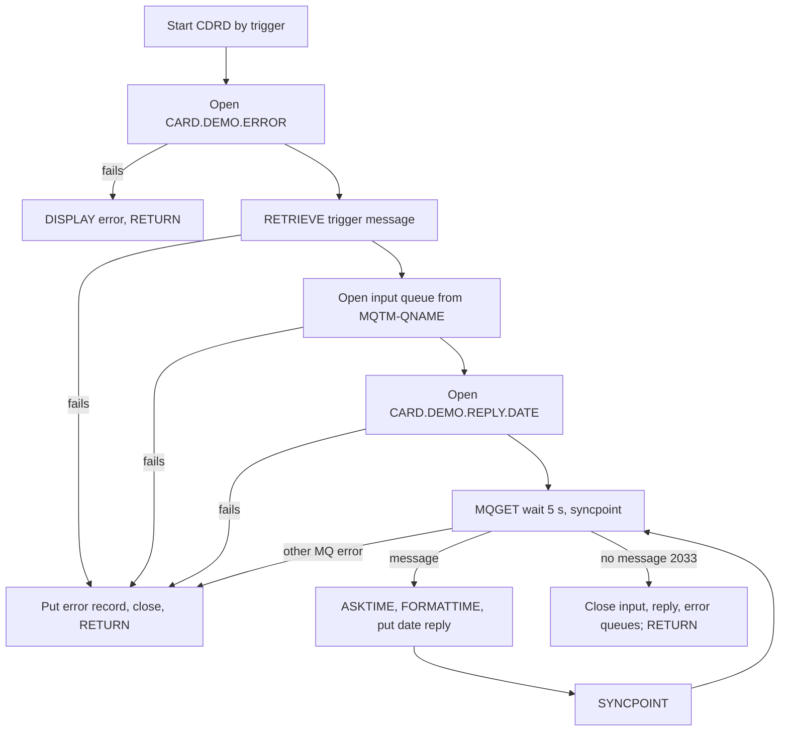
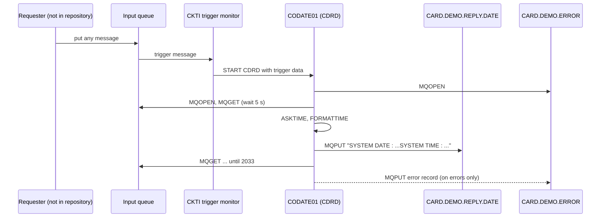

# CODATE01: System date and time inquiry over IBM MQ (CDRD)

## 1. Summary

CODATE01 is a CICS program (transaction `CDRD`) that answers every message on its input queue with the CICS region's current date and time. It has the same skeleton as COACCT01 (account inquiry over MQ): started by the CICS-MQ trigger monitor, it reads the trigger message to learn the input queue's name, opens the fixed error queue `CARD.DEMO.ERROR`, the input queue and the fixed reply queue `CARD.DEMO.REPLY.DATE`, and drains the input queue until no message arrives for 5 seconds. The content of a request is ignored: whatever arrives, the reply is the 46-character text `SYSTEM DATE : MM-DD-YYYYSYSTEM TIME : HH:MM:SS` padded with spaces to 1000 bytes, with the request's message ID and correlation ID in the descriptor. MQ errors go to the error queue and end the task. The module README describes CDRD as a requester with different message layouts and queues (DEF-MQDT-001).

## 2. Rules at a glance

| ID | Rule |
| :-- | :-- |
| BR-MQDT-001 | Every message received is answered with the current date and time; its content is not looked at. |
| BR-MQDT-002 | The reply text is `SYSTEM DATE : ` + date `MM-DD-YYYY` + `SYSTEM TIME : ` + time `HH:MM:SS`, 46 characters, padded with spaces to 1000 bytes. |
| BR-MQDT-003 | The reply carries the request's message ID and correlation ID in its MQ descriptor. |
| BR-MQDT-004 | Every reply goes to `CARD.DEMO.REPLY.DATE`, whatever reply-to queue the request names. |
| BR-MQDT-005 | Exactly one reply per request, in arrival order; no reply when the task ends on an error. |
| VAL-MQDT-001 | No validation of the request. |

## 3. Actors and triggers

- **Actor:** any application that can put a message on the input queue; the requester is not identified.
- **Trigger (platform-inferred):** the CICS-MQ trigger monitor (CKTI) starts transaction `CDRD` with the trigger message as start data. The program issues `EXEC CICS RETRIEVE INTO(MQTM)` and takes the input queue name from `MQTM-QNAME` (`:140-146`). The queue and its process definition (APPLICID `CDRD`) are not in the repository (Q-MQDT-001). The details are the same as for COACCT01 (FLOW-MQAC-001, Q-MQAC-004).
- **CICS definitions:** program `CODATE01` with `TRANSID(CDRD)` and transaction `CDRD` with `PROGRAM(CODATE01)`, profile `DFHCICST`, `RESSEC(NO) CMDSEC(NO)`, `ACTION(BACKOUT)` (`CRDDEMOM.csd:9-16, 27-36`).
- **Direct start:** typing `CDRD` on a terminal starts the program without start data; the RETRIEVE fails and the task ends after writing an error record (ERR-MQDT-001).
- **Preconditions:** the CICS-MQ connection is active; `CARD.DEMO.ERROR`, `CARD.DEMO.REPLY.DATE` and the input queue exist. No file is used.

## 4. Interfaces

### 4.1 MQ queues

| Queue | How the name is obtained | Open options | Use | Lines |
| :-- | :-- | :-- | :-- | :-- |
| Input queue | `MQTM-QNAME` of the trigger message | `MQOO-INPUT-SHARED + MQOO-SAVE-ALL-CONTEXT + MQOO-FAIL-IF-QUIESCING` | MQGET of requests (any content) | 146, 171-202 |
| `CARD.DEMO.REPLY.DATE` | literal | `MQOO-OUTPUT + MQOO-PASS-ALL-CONTEXT + MQOO-FAIL-IF-QUIESCING` | MQPUT of replies, ENT-MQ-DATE-REPLY | 147, 204-236 |
| `CARD.DEMO.ERROR` | literal | `MQOO-OUTPUT + MQOO-PASS-ALL-CONTEXT + MQOO-FAIL-IF-QUIESCING` | MQPUT of error records, ENT-MQ-ERROR-MSG | 243, 238-271 |

Connection handles as in COACCT01: `QMGR-HANDLE-CONN` = 0 for MQOPEN, `MQ-HCONN` = 0 for the other calls (`:44, 104, 182, 216, 251, 301`).

### 4.2 Request message

Any message up to 1000 bytes. It is copied into a 1000-byte buffer and into `REQUEST-MSG-COPY` (`WS-FUNC` X(4), `WS-KEY` 9(11), `WS-FILLER` X(985), `:109-112, 318, 322`), but nothing reads those fields (DEF-MQDT-011). There is no request entity: the request has no defined content (DEF-MQDT-004).

### 4.3 Reply message (ENT-MQ-DATE-REPLY)

1000 bytes, `MQFMT-STRING`, character set of the queue manager. Layout in NUM-MQDT-001.

### 4.4 Error record (ENT-MQ-ERROR-MSG)

Same 113-byte `MQ-ERR-DISPLAY` layout as COACCT01 (NUM-MQAC-004), here at `:58-67`, padded to 1000 bytes and put on `CARD.DEMO.ERROR` (`:409-427`). Texts in section 8.2.

### 4.5 Files

None. The program declares the literal `ACCTDAT ` and file response fields (`:114-120`) but performs no file command (DEF-MQDT-011).

### 4.6 Console output

`DISPLAY MQ-ERR-DISPLAY` when the error queue cannot be opened (`:269`) or an error record cannot be put (`:438`). Incidental.

## 5. Data used

| Entity field | Read | Written | How |
| :-- | :-- | :-- | :-- |
| ENT-MQ-DATE-REPLY (all) | no | yes | section 4.3, NUM-MQDT-001 |
| ENT-MQ-ERROR-MSG (all) | no | yes | section 4.4 |

`PROGRAM-ID. CODATE01 IS INITIAL` (`:2`), transaction defined with `STORAGECLEAR(NO)` (`app/app-vsam-mq/csd/CRDDEMOM.csd:29`): items without VALUE have no defined initial content (platform-inferred). Program-local data with behaviour (`:13-120`): `WS-MQ-MSG-FLAG`/`NO-MORE-MSGS` (`:13-14`); the queue-open flags (`:16-23`, the input queue uses `REPLY-QUEUE-OPEN`, `:194`); `SAVE-MSGID`, `SAVE-CORELID` (`:55-56`); `MQ-ERR-DISPLAY` (`:58-67`); the date fields `WS-ABS-TIME` S9(15) COMP-3, `WS-MMDDYYYY` X(10), `WS-TIME` X(8) (`:35-38`). Declared without effect: `QMGR-NAME`, `QUEUE-MESSAGE`, `MQ-QUEUE`, `MQ-QUEUE-REPLY`/`SAVE-REPLY2Q`, `MQ-MSG-COUNT` (DEF-MQDT-008), `REQUEST-MSG-COPY`, `LIT-ACCTFILENAME`, `WS-RESP-CD`, `WS-REAS-CD`, `WS-CICS-RESP2-CD-D` (always zero).

## 6. Processing flow

Steps (`1000-CONTROL`, `:127-169`), identical to COACCT01 (section 6 of its spec) except for the reply queue name:

1. Blank the input queue name, queue manager name and `QUEUE-MESSAGE`; initialise the error record (`:129-134`).
2. Open `CARD.DEMO.ERROR` (`:136`).
3. Retrieve the trigger message; input queue = `MQTM-QNAME`, reply queue = `CARD.DEMO.REPLY.DATE` (`:140-147`).
4. Open the input queue, then the reply queue (`:161-162`).
5. Get the first request (`:163`); loop `SYNCPOINT` + get until no message (`:164-165`, `:274-280`).
6. For each message (`:339-364`): read the clock, format date and time, build the reply, put it.
7. Terminate (`:167`, `:442-454`).

## 7. Business rules

#### BR-MQDT-001 · Every message gets the current date and time
- **When:** a message is received from the input queue (any content, any length up to 1000 bytes).
- **Then:** the program blanks the reply, reads the CICS clock (`EXEC CICS ASKTIME ABSTIME`), formats it (`EXEC CICS FORMATTIME`) and puts the reply of BR-MQDT-002. The request bytes are copied into `REQUEST-MSG-COPY` but never examined.
- **Source:** `:318-323, 339-361`
- **Fidelity:** must-preserve · **Confidence:** reviewed

#### BR-MQDT-002 · Reply text
- **When:** a reply is built.
- **Then:** the reply is `SYSTEM DATE : ` (14 characters), the date as `MM-DD-YYYY` (10), `SYSTEM TIME : ` (14) and the time as `HH:MM:SS` (8): 46 characters with **no separator** between the date and `SYSTEM TIME`, then spaces to 1000 bytes. Example: `SYSTEM DATE : 07-06-2022SYSTEM TIME : 14:05:09`.
- **Source:** `:340, 347-360`
- **Fidelity:** must-preserve · **Confidence:** reviewed; FORMATTIME output platform-inferred

#### BR-MQDT-003 · Reply correlation
- **When:** a reply is put.
- **Then:** the reply's MQMD message ID and correlation ID are set to the request's message ID and correlation ID; all other MQMD fields except Format (`MQFMT-STRING`, `:375`) and CodedCharSetId (`MQCCSI-Q-MGR`, `:377`) keep the values from the request's get. Same as BR-MQAC-005.
- **Source:** `:313-314, 319, 321, 373-377`
- **Fidelity:** must-preserve · **Confidence:** platform-inferred

#### BR-MQDT-004 · Fixed reply queue
- **When:** the program starts successfully.
- **Then:** all replies are put on `CARD.DEMO.REPLY.DATE`; the request's reply-to queue is saved in `SAVE-REPLY2Q` but never used (DEF-MQDT-002).
- **Source:** `:147, 210, 315, 320, 383-384`
- **Fidelity:** must-preserve (or change by decision, Q-MQAC-002) · **Confidence:** reviewed

#### BR-MQDT-005 · One reply per request, in arrival order
- **When:** the drain loop runs.
- **Then:** requests are taken one at a time in queue order and each gets exactly one reply before the next get. The loop ends after a 5-second wait with no message. If an error ends the task, the request being processed gets no reply.
- **Source:** `:163-165, 274-280, 286, 292-293, 323`
- **Fidelity:** must-preserve · **Confidence:** reviewed

## 8. Validations and messages

#### VAL-MQDT-001 · No request validation
- **When:** a message is received.
- **Then:** nothing is checked: not the content, not the length (`MQ-DATA-LENGTH` is ignored), not the requester. An empty message, a message reading `DATE` (the README's request type) and any other text get the same reply.
- **Source:** `:312-323, 339-361`
- **Fidelity:** must-preserve · **Confidence:** reviewed

### 8.1 Reply texts (to `CARD.DEMO.REPLY.DATE`)

| Text (exact) | Length | Use |
| :-- | --: | :-- |
| `SYSTEM DATE : ` | 14 | label before the date |
| `SYSTEM TIME : ` | 14 | label before the time |

### 8.2 Error record texts (to `CARD.DEMO.ERROR`)

Identical to COACCT01 section 8.2 except: the RETRIEVE path writes `CICS RETRIEVE` (spelled correctly, `:149`) in the paragraph field; the reply queue name is `CARD.DEMO.REPLY.DATE`; there is no file error text.

| Text in the record (exact) | Paragraph field (25) | Queue name field (48) | Cause | Item |
| :-- | :-- | :-- | :-- | :-- |
| `RESP: ` + 8-digit RESP + `00000000` + `END` (25 bytes) | `CICS RETRIEVE` | spaces | RETRIEVE failed | ERR-MQDT-001 |
| `ERR MQOPEN ERR` | spaces | `CARD.DEMO.ERROR` | error queue open failed (DISPLAY only) | ERR-MQDT-002 |
| `INP MQOPEN ERR` | spaces | input queue name | input queue open failed | ERR-MQDT-003 |
| `OUT MQOPEN ERR` | spaces | `CARD.DEMO.REPLY.DATE` | reply queue open failed | ERR-MQDT-003 |
| `INP MQGET ERR:` | spaces | input queue name | MQGET failed, reason not 2033 | ERR-MQDT-004 |
| `MQPUT ERR` | spaces | `CARD.DEMO.REPLY.DATE` | reply put failed | ERR-MQDT-005 |
| `MQPUT ERR` | spaces | `CARD.DEMO.ERROR` | error put failed (DISPLAY only) | ERR-MQDT-006 |
| `MQCLOSE ERR` | spaces | `CARD.DEMO.ERROR` | error queue close failed (put, then loop) | ERR-MQDT-007 |
| `MQCLOSE ERR` | spaces | input queue name | input or reply queue close failed (not put; loop) | ERR-MQDT-007 |

### 8.3 Flow

#### FLOW-MQDT-001 · Start from the trigger message
- **When:** the task starts.
- **Then:** after opening the error queue, retrieve the start data into `MQTM`, take `MQTM-QNAME` as the input queue name and set the reply queue name to `CARD.DEMO.REPLY.DATE`. Same as FLOW-MQAC-001.
- **Otherwise:** ERR-MQDT-001.
- **Source:** `:127-147`
- **Fidelity:** must-preserve · **Confidence:** platform-inferred

#### FLOW-MQDT-002 · Open order
- **When:** the task starts.
- **Then:** open `CARD.DEMO.ERROR` (before the RETRIEVE), the input queue, then `CARD.DEMO.REPLY.DATE`; store each handle and set its flag; any failure ends the task.
- **Source:** `:136, 161-162, 171-202, 204-236, 238-271`
- **Fidelity:** incidental · **Confidence:** reviewed

#### FLOW-MQDT-003 · Drain loop
- **When:** the three queues are open.
- **Then:** get one message; while no "no more messages": `EXEC CICS SYNCPOINT`, get the next. Each get waits up to 5000 ms; reason 2033 ends the loop. A successful get is answered immediately and adds 1 to `MQ-MSG-COUNT`. Same as FLOW-MQAC-003.
- **Source:** `:163-165, 274-280, 283-337`
- **Fidelity:** must-preserve · **Confidence:** platform-inferred

#### FLOW-MQDT-004 · Termination
- **When:** the loop ends or an error path calls it.
- **Then:** close the input queue if `REPLY-QUEUE-OPEN`, the reply queue if `RESP-QUEUE-OPEN`, the error queue if `ERR-QUEUE-OPEN` (`MQCO-NONE`), then `EXEC CICS RETURN`, which commits. Same as FLOW-MQAC-004.
- **Source:** `:167, 442-454`
- **Fidelity:** must-preserve · **Confidence:** platform-inferred

## 9. Side effects

#### SE-MQDT-001 · Get the request
- **What:** MQGET on the input queue with `MQGMO-SYNCPOINT + MQGMO-FAIL-IF-QUIESCING + MQGMO-CONVERT + MQGMO-WAIT`, wait 5000 ms, buffer 1000, `MQMI-NONE`/`MQCI-NONE`. Removed from the queue on commit. Same as SE-MQAC-001.
- **Source:** `:286-322`
- **Fidelity:** must-preserve · **Confidence:** platform-inferred

#### SE-MQDT-002 · Put the reply
- **What:** MQPUT on the reply queue: 1000 bytes, request MsgId and CorrelId, `MQFMT-STRING`, `MQCCSI-Q-MGR`, `MQPMO-SYNCPOINT + MQPMO-DEFAULT-CONTEXT + MQPMO-FAIL-IF-QUIESCING`. Same as SE-MQAC-003.
- **Source:** `:366-403`
- **Fidelity:** must-preserve · **Confidence:** platform-inferred

#### SE-MQDT-003 · Put an error record
- **What:** MQPUT on `CARD.DEMO.ERROR`: `MQ-ERR-DISPLAY` padded to 1000 bytes, same format and options; MsgId and CorrelId are whatever the shared MQMD holds. The queue and layout are shared with COACCT01 (SE-MQAC-004).
- **Source:** `:405-427`
- **Fidelity:** must-preserve · **Confidence:** platform-inferred

#### SE-MQDT-004 · Commit points
- **What:** `EXEC CICS SYNCPOINT` at each loop iteration commits the previous get and reply; the final CICS RETURN commits the rest. `ACTION(BACKOUT)` on the transaction. Same as SE-MQAC-005.
- **Source:** `:275-277, 453`; `CRDDEMOM.csd:33`
- **Fidelity:** must-preserve · **Confidence:** platform-inferred

## 10. Error handling

#### ERR-MQDT-001 · Trigger data cannot be retrieved
- **When:** RETRIEVE returns a response other than NORMAL.
- **Then:** paragraph field `CICS RETRIEVE`; return-message field `RESP: ` + RESP as 8 digits + `00000000` (RESP2 is moved to itself, `:151`) + `END`; put on the error queue; termination. Same as ERR-MQAC-001 except the spelling.
- **Source:** `:145-159`
- **Fidelity:** incidental · **Confidence:** reviewed

#### ERR-MQDT-002 · Error queue cannot be opened
- **When:** MQOPEN of `CARD.DEMO.ERROR` fails.
- **Then:** error record with `ERR MQOPEN ERR` written to the console only; termination returns at once. Same as ERR-MQAC-002.
- **Source:** `:258-270`
- **Fidelity:** incidental · **Confidence:** reviewed

#### ERR-MQDT-003 · Input or reply queue cannot be opened
- **When:** MQOPEN of the input queue (`INP MQOPEN ERR`) or of `CARD.DEMO.REPLY.DATE` (`OUT MQOPEN ERR`) fails.
- **Then:** error record put on the error queue; termination. Same as ERR-MQAC-003.
- **Source:** `:189-201, 223-235`
- **Fidelity:** must-preserve · **Confidence:** reviewed

#### ERR-MQDT-004 · Get fails
- **When:** MQGET fails with a reason other than 2033 (for example 2080 for a message over 1000 bytes, DEF-MQDT-009).
- **Then:** error record `INP MQGET ERR:` with the input queue name, put; termination. Same as ERR-MQAC-004.
- **Source:** `:325-337`
- **Fidelity:** must-preserve · **Confidence:** platform-inferred

#### ERR-MQDT-005 · Reply cannot be put
- **When:** MQPUT of a reply fails.
- **Then:** error record `MQPUT ERR` with `CARD.DEMO.REPLY.DATE`, put on the error queue; termination. The request is consumed without a reply.
- **Source:** `:392-403`
- **Fidelity:** must-preserve · **Confidence:** reviewed

#### ERR-MQDT-006 · Error record cannot be put
- **When:** MQPUT on the error queue fails.
- **Then:** record rewritten with `MQPUT ERR` and `CARD.DEMO.ERROR`, DISPLAYed, termination. Same as ERR-MQAC-007.
- **Source:** `:429-440`
- **Fidelity:** incidental · **Confidence:** reviewed

#### ERR-MQDT-007 · Close fails
- **When:** an MQCLOSE fails.
- **Then:** as in ERR-MQAC-008: the input and reply queue close failures set `MQCLOSE ERR` with the **input** queue name and perform termination again without putting anything; the error queue close failure puts the record on the error queue (`9000-ERROR`) and performs termination again (DEF-MQDT-005).
- **Source:** `:456-477, 478-499, 501-523`
- **Fidelity:** defect-decide · **Confidence:** reviewed; loop outcome platform-inferred

#### ERR-MQDT-008 · Unhandled conditions
- **What:** ASKTIME and FORMATTIME have no RESP option and there is no `HANDLE ABEND`; a failure of either (or of SYNCPOINT, or a data exception on `MQ-MSG-COUNT`, DEF-MQDT-008) abends the task and CICS backs out the uncommitted get and put.
- **Source:** `:275-277, 343-353`
- **Fidelity:** incidental · **Confidence:** platform-inferred

## 11. Interactions

- **Inbound:** a trigger on the input queue (platform-inferred); no program in the repository puts requests on it.
- **Outbound:** none besides the MQ API.
- **Shared data:** no file. `CARD.DEMO.ERROR` is shared with COACCT01 (SE-MQAC-004).

### Module extraction notes

| Boundary | Contract |
| :-- | :-- |
| Request | Any message up to 1000 bytes; content ignored. |
| Reply | 1000-byte `MQSTR` on `CARD.DEMO.REPLY.DATE`, body NUM-MQDT-001, MsgId and CorrelId from the request. |
| Errors | 1000-byte record on `CARD.DEMO.ERROR` (NUM-MQAC-004 layout). |
| Clock | The CICS region's local date and time; a replacement must use the same time zone (Q-MQDT-002). |

## 12. Numeric, date and format details

#### NUM-MQDT-001 · Reply layout
| Bytes | Content | Length |
| :-- | :-- | --: |
| 1-14 | `SYSTEM DATE : ` | 14 |
| 15-24 | date `MM-DD-YYYY` | 10 |
| 25-38 | `SYSTEM TIME : ` | 14 |
| 39-46 | time `HH:MM:SS` | 8 |
| 47-1000 | spaces | 954 |
- **Source:** `:340, 355-360, 371-372`

#### NUM-MQDT-002 · Date and time formatting
- `ASKTIME ABSTIME` gives the current time as milliseconds since 1 January 1900 in `WS-ABS-TIME` (packed S9(15)). `FORMATTIME` with `MMDDYYYY` and `DATESEP('-')` gives month-day-year with hyphens, 4-digit year; `TIME` with `TIMESEP` (default separator `:`) gives a 24-hour `HH:MM:SS`. Seconds are truncated (no fraction). The values are in the region's local time; no time zone is sent.
- **Source:** `:35-38, 341-353`
- **Confidence:** platform-inferred

#### NUM-MQDT-003 · Message size and format
- Replies and error records: always 1000 bytes, `MQFMT-STRING`, `MQCCSI-Q-MGR`, tail spaces. Requests: read into 1000 bytes; longer messages fail the get. Same as NUM-MQAC-003.
- **Source:** `:291, 296-299, 371-377, 409-414`

#### NUM-MQDT-004 · Error record layout
- Same as NUM-MQAC-004 (`:58-67` here), with `CICS RETRIEVE` in the paragraph field on the RETRIEVE path. Condition code 9(2) and reason code 9(5) are unsigned display fields.
- **Source:** `:58-67, 409-411`

## 13. Known defects and oddities

#### DEF-MQDT-001 · The README describes a different program
- The README says CDRD is run in CICS, sends a request to a request queue and displays the response, with request `DATE-REQUEST-MSG` (`REQUEST-TYPE` `DATE`, `REQUEST-ID` X(8)) and response `DATE-RESPONSE-MSG` (`RESPONSE-TYPE`, `RESPONSE-ID`, `SYSTEM-DATE` X(10)), on `CARDDEMO.REQUEST.QUEUE` / `CARDDEMO.RESPONSE.QUEUE`. The code is a trigger-started server that ignores the request, sends a 46-character text with date and time and no request ID, on `CARD.DEMO.REPLY.DATE`. The README gives the serving role to an unnamed "listener program" (README `:83`), which is what CODATE01 actually does.
- **Source:** `app/app-vsam-mq/README.md:50-55, 77-84, 99-112`; code `:140-147, 355-360`
- **Status:** open · **Fidelity:** defect-decide (Q-MQDT-003) · **Confidence:** reviewed

#### DEF-MQDT-002 · Request's reply-to queue is ignored
- Every reply goes to `CARD.DEMO.REPLY.DATE`; `SAVE-REPLY2Q` is never used. Same as DEF-MQAC-002.
- **Source:** `:147, 315, 320`
- **Status:** open · **Fidelity:** defect-decide (Q-MQAC-002) · **Confidence:** reviewed

#### DEF-MQDT-003 · Reply descriptor copied from the request
- Shared MQMD: the reply reuses the request's message ID and correlation ID and inherits its other descriptor fields. Same as DEF-MQAC-003.
- **Source:** `:292-293, 313-314, 373-377`
- **Status:** open · **Fidelity:** defect-decide (Q-MQAC-002) · **Confidence:** platform-inferred

#### DEF-MQDT-004 · Any message is a date request
- No function code is checked, so any message, including one meant for another service or a malformed one, consumes the clock service and gets a reply. The requester is not identified; the data returned (the clock) is not sensitive, so this is not tagged as a security finding.
- **Source:** `:312-323, 339-361`
- **Status:** open · **Fidelity:** defect-decide · **Confidence:** reviewed

#### DEF-MQDT-005 · Close failure can loop
- Same as DEF-MQAC-008: the open flags are never reset and each close failure performs termination again.
- **Source:** `:444-452, 471-476, 493-498, 516-522`
- **Status:** open · **Confidence:** platform-inferred

#### DEF-MQDT-006 · Copy-paste and naming slips
- The input queue's open flag is `REPLY-QUEUE-OPEN` (`:194, 444`); the reply-queue close error reports the input queue name (`:496`); RESP2 is moved to itself (`:151`), so the RETRIEVE error shows `00000000` for RESP2. Unlike COACCT01, the paragraph field is spelled `CICS RETRIEVE` (`:149`).
- **Source:** `:149-151, 194, 496`
- **Status:** open · **Fidelity:** incidental · **Confidence:** reviewed

#### DEF-MQDT-007 · Context options have no effect
- Opened with `MQOO-SAVE-ALL-CONTEXT` / `MQOO-PASS-ALL-CONTEXT`, put with `MQPMO-DEFAULT-CONTEXT`. Same as DEF-MQAC-010.
- **Source:** `:178-180, 212-214, 247-249, 379-381, 416-418`
- **Status:** open · **Fidelity:** incidental · **Confidence:** platform-inferred

#### DEF-MQDT-008 · Message counter has no initial value
- `MQ-MSG-COUNT PIC 9(09)` has no VALUE and is incremented after each reply (`:324`), never read; possible data exception as in DEF-MQAC-011 (Q-MQAC-005).
- **Source:** `:54, 324`
- **Status:** open · **Confidence:** platform-inferred

#### DEF-MQDT-009 · Requests longer than 1000 bytes block the queue
- Same as DEF-MQAC-012: the get fails with reason 2080, the message stays on the queue, the task ends; every later trigger meets it again.
- **Source:** `:291, 296-299, 325-335`
- **Status:** open · **Confidence:** platform-inferred

#### DEF-MQDT-010 · CICS program description copied
- `CRDDEMOM.csd` gives `CODATE01` the description `LIST CARDS`.
- **Source:** `CRDDEMOM.csd:9-10`
- **Status:** open · **Fidelity:** incidental · **Confidence:** reviewed

#### DEF-MQDT-011 · Account-inquiry leftovers
- The program was cloned from COACCT01: it keeps the file name literal `ACCTDAT `, the file response fields and the request layout `WS-FUNC`/`WS-KEY` (`:109-120`), and copies every request into it (`:322`), none of which is used. The `INITIALIZE REQUEST-MSG-COPY` and the blanking of `MQ-CORRELID`/`MQ-MSG-ID` before each get (`:287-288, 294`) and `INITIALIZE WS-DATE-TIME` before ASKTIME (`:341`) have no effect.
- **Source:** `:109-120, 287-288, 294, 322, 341`
- **Status:** open (dead code) · **Fidelity:** incidental · **Confidence:** reviewed

#### DEF-MQDT-012 · Reply format is hard to parse
- The date runs straight into `SYSTEM TIME : ` with no separator, the date is in US month-day-year order and no time zone is given. A consumer must cut the text by position.
- **Source:** `:349-356`
- **Status:** open · **Fidelity:** defect-decide (Q-MQDT-002) · **Confidence:** reviewed

## 14. Open questions

| ID | Question | For |
| :-- | :-- | :-- |
| Q-MQDT-001 | Which queue triggers `CDRD` (name, trigger type, process definition), and where are these MQ definitions kept? | mainframe team |
| Q-MQDT-002 | Which time zone does the region's clock use, and do requesters need the exact `MM-DD-YYYY` / `HH:MM:SS` text, or may the target send an ISO 8601 timestamp with a zone? | business, integration owners |
| Q-MQDT-003 | Which contract is authoritative for existing requesters: the code (any request, 46-character text) or the README (`DATE` request with a request ID echoed in the response)? | business, integration owners |

## 15. Equivalence contract

The independent review of this spec is recorded in `docs/modernization/spec/evidence/f-trantype-vsam-mq-review.md`.

A reimplementation must reproduce, for each request: the queue receiving the message, the 1000-byte reply or error record, the reply's MsgId and CorrelId (BR-MQDT-003), and the order of replies. The date and time values may differ (clock), but their format and positions must match NUM-MQDT-001. Console output, MQ context and the 5-second loop mechanics may differ. These scenarios cannot run locally (no CICS, MQ or trigger monitor); they become acceptance tests for the target.

| # | Request (MQMD MsgId / CorrelId) | Clock | Expected |
| --: | :-- | :-- | :-- |
| S1 | `DATE` (M1 / C1) | 2022-07-06 14:05:09 | reply on `CARD.DEMO.REPLY.DATE`, MsgId M1, CorrelId C1: `SYSTEM DATE : 07-06-2022SYSTEM TIME : 14:05:09` + 954 spaces |
| S2 | empty message | 2022-12-31 23:59:59 | `SYSTEM DATE : 12-31-2022SYSTEM TIME : 23:59:59` + 954 spaces |
| S3 | `INQA00000000001` | any | a date reply in the same format (the content is ignored) |
| S4 | three messages | any | three replies in arrival order, each with its request's MsgId/CorrelId |
| S5 | `CDRD` started from a terminal | any | one error record: `CICS RETRIEVE` + 12 spaces, 2 spaces, `RESP: nnnnnnnn00000000END`, `00`, `00000`, queue name spaces |
| S6 | message of 1001 bytes | any | no reply; error record `INP MQGET ERR:`, condition `01`, reason `02080`; message stays on the queue |

Evidence: none yet (draft).

## 16. Paragraph coverage

| Paragraph | Lines | Covered by |
| :-- | :-- | :-- |
| (data division) | 13-120 | §4.2, §5, NUM-MQDT-002, NUM-MQDT-004, DEF-MQDT-008, DEF-MQDT-011 |
| `1000-CONTROL` | 127-169 | FLOW-MQDT-001, FLOW-MQDT-002, FLOW-MQDT-003, ERR-MQDT-001, DEF-MQDT-006, §6 |
| `2300-OPEN-INPUT-QUEUE` | 171-202 | FLOW-MQDT-002, ERR-MQDT-003, DEF-MQDT-006, DEF-MQDT-007 |
| `2400-OPEN-OUTPUT-QUEUE` | 204-236 | FLOW-MQDT-002, BR-MQDT-004, ERR-MQDT-003, DEF-MQDT-007 |
| `2100-OPEN-ERROR-QUEUE` | 238-271 | FLOW-MQDT-002, ERR-MQDT-002, DEF-MQDT-007 |
| `4000-MAIN-PROCESS` | 274-280 | FLOW-MQDT-003, SE-MQDT-004 |
| `3000-GET-REQUEST` | 283-337 | SE-MQDT-001, FLOW-MQDT-003, BR-MQDT-005, VAL-MQDT-001, ERR-MQDT-004, DEF-MQDT-008, DEF-MQDT-009 |
| `4000-PROCESS-REQUEST-REPLY` | 339-364 | BR-MQDT-001, BR-MQDT-002, NUM-MQDT-001, NUM-MQDT-002, ERR-MQDT-008, DEF-MQDT-004, DEF-MQDT-012 |
| `4100-PUT-REPLY` | 366-403 | SE-MQDT-002, BR-MQDT-003, BR-MQDT-004, ERR-MQDT-005, DEF-MQDT-003, NUM-MQDT-003 |
| `9000-ERROR` | 405-441 | SE-MQDT-003, ERR-MQDT-006, NUM-MQDT-004 |
| `8000-TERMINATION` | 442-454 | FLOW-MQDT-004, SE-MQDT-004, DEF-MQDT-005 |
| `5000-CLOSE-INPUT-QUEUE` | 456-477 | ERR-MQDT-007, DEF-MQDT-005 |
| `5100-CLOSE-OUTPUT-QUEUE` | 478-499 | ERR-MQDT-007, DEF-MQDT-005, DEF-MQDT-006 |
| `5200-CLOSE-ERROR-QUEUE` | 501-523 | ERR-MQDT-007, DEF-MQDT-005 |

13 of 13 paragraphs covered (plus the data division row).
