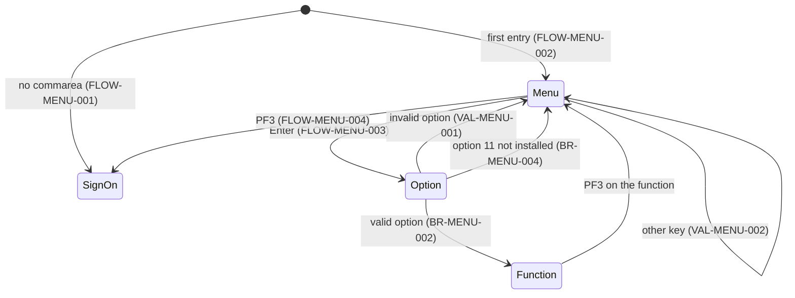
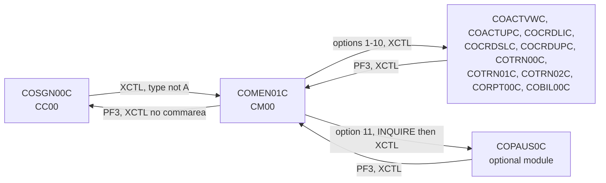

# COMEN01C: Main menu

## 1. Summary

COMEN01C is the menu a regular user (type `U`) reaches after sign-on. It lists the 11 functions of the main menu table `COMEN02Y` (account view and update, card list, view and update, transaction list, view and add, reports, bill payment, pending authorisations), reads the option number the user types and transfers control (XCTL) to the program of that option with the commarea. Option 11 (pending authorisations, an optional module) is first checked for installation. PF3 returns to the sign-on screen. The program reads no file. The table has a per-option user-type column meant to hide admin-only options, but every shipped option is open to regular users.

## 2. Rules at a glance

| ID | Rule |
| :-- | :-- |
| BR-MENU-001 | The menu shows every option of the main menu table, numbered `01`-`11`, in table order. |
| BR-MENU-002 | A valid option transfers to the option's program with the commarea, as a first entry. |
| BR-MENU-003 | An option marked admin-only (`A`) is refused to a regular user; no shipped option is marked so. |
| BR-MENU-004 | Option 11 (Pending Authorization View) is offered only if its program is installed in CICS. |
| BR-MENU-005 | An option whose program name starts with `DUMMY` shows "coming soon"; no shipped option does. |
| VAL-MENU-001 | The option must be a number from 1 to the option count (11). |
| VAL-MENU-002 | Only Enter and PF3 are valid keys. |

## 3. Actors and triggers

- **Actor:** a signed-on user. The program does not read `USRSEC`; it trusts `CDEMO-USER-TYPE` in the commarea (DEF-MENU-003).
- **Normal trigger:** sign-on `COSGN00C` transfers here (XCTL) for every user type other than `A`, with `CDEMO-PGM-CONTEXT` = 0 (`app/cbl/COSGN00C.cbl:235-239`; BR-SGN-004).
- **Return trigger:** the functions return here when the user presses PF3 on them, by XCTL with their commarea and context 0 (for example `app/cbl/COBIL00C.cbl:128-135`).
- **Re-entry trigger:** each interaction ends with "return, next transaction `CM00`" (`app/csd/CARDDEMO.CSD:399-408`), so the next key on the menu starts COMEN01C again (FLOW-MENU-006).
- **Direct start:** typing `CM00` on a blank terminal starts the program with no commarea; it sends the user to sign-on (FLOW-MENU-001).

## 4. Interfaces

### 4.1 Screen COMEN1A (mapset COMEN01), 24 x 80

Source: `app/bms/COMEN01.bms:26-162`; symbolic map `app/cpy-bms/COMEN01.CPY:17-260`. Mapset `CTRL=(ALARM,FREEKB)`, `EXTATT=YES`. The admin menu map `COADM1A` has the same layout except the title (COADM01C §4.1).

| Row,Col | Field | Len | Direction | Attributes | Content |
| :-- | :-- | --: | :-- | :-- | :-- |
| 1,1 | (label) | 5 | out | protected, blue | `Tran:` |
| 1,7 | `TRNNAME` | 4 | out | protected, blue | `CM00` |
| 1,21 | `TITLE01` | 40 | out | protected, yellow | `      AWS Mainframe Modernization       ` |
| 1,65 | (label) | 5 | out | protected, blue | `Date:` |
| 1,71 | `CURDATE` | 8 | out | protected, blue | today `mm/dd/yy` |
| 2,1 | (label) | 5 | out | protected, blue | `Prog:` |
| 2,7 | `PGMNAME` | 8 | out | protected, blue | `COMEN01C` |
| 2,21 | `TITLE02` | 40 | out | protected, yellow | `              CardDemo                  ` |
| 2,65 | (label) | 5 | out | protected, blue | `Time:` |
| 2,71 | `CURTIME` | 8 | out | protected, blue | now `hh:mm:ss` |
| 4,35 | (label) | 9 | out | protected, bright, neutral | `Main Menu` |
| 6-17,20 | `OPTN001`-`OPTN012` | 40 each | out | protected, blue | option lines (BR-MENU-001); rows 6-16 used, row 17 (`OPTN012`) always blank |
| 20,15 | (label) | 25 | out | protected, bright, turquoise | `Please select an option :` |
| 20,41 | `OPTION` | 2 | in/out | **unprotected**, numeric, underlined, right-justified and zero-filled (`JUSTIFY=(RIGHT,ZERO)`), initial cursor | option number |
| 23,1 | `ERRMSG` | 78 | out | protected, bright, red (green or red as set, §8.3) | message |
| 24,1 | (label) | 23 | out | protected, yellow | `ENTER=Continue  F3=Exit` |

### 4.2 Files

None. The program reads and writes no file (`USRSEC` is named in working storage, `:39`, but never used).

### 4.3 Commarea

ENT-COMMAREA, 160 bytes, no extension. A longer commarea from a returning function is truncated to 160 bytes (`:86`). The program uses:

| Field | Read | Written | Use |
| :-- | :-- | :-- | :-- |
| `CDEMO-PGM-CONTEXT` | yes | yes | 0 = first entry, 1 = re-entry; set to 0 before transferring to an option |
| `CDEMO-USER-TYPE` | yes | no | admin-only check (BR-MENU-003) |
| `CDEMO-FROM-TRANID`, `CDEMO-FROM-PROGRAM` | no | yes | set to `CM00` / `COMEN01C` before transferring to an option (or `COSGN00C` when started without a commarea) |
| `CDEMO-TO-PROGRAM` | yes | yes | PF3 target, set to `COSGN00C` |

All other fields, including `CDEMO-USER-ID`, pass through unchanged.

### 4.4 Console output

None.

## 5. Data used

| Data | Read | Written | How |
| :-- | :-- | :-- | :-- |
| ENT-MAIN-MENU-OPTIONS (`COMEN02Y`, compiled into the program) | yes | no | option count, number, name, program, user type |
| ENT-COMMAREA | yes | yes | §4.3 |

Program-local data with behaviour: `WS-OPTION-X PIC X(02) JUST RIGHT` and `WS-OPTION PIC 9(02)` (`:45-46`) for the typed option, `WS-IDX` (`:47`), `WS-MENU-OPT-TXT PIC X(40)` (`:48`) for an option line, error flag `WS-ERR-FLG` (`:40-42`).

## 6. Processing flow

**Entry (MAIN-PARA, lines 75-110)**

1. Clear the error flag and the message (77-80).
2. No commarea: go to sign-on (82-84, FLOW-MENU-001).
3. Copy the received commarea (first 160 bytes) into the work commarea (86).
4. First entry (`CDEMO-PGM-CONTEXT` not 1): mark re-entry, blank the screen, send the menu (87-90).
5. Re-entry: receive the screen, then act on the key: Enter, PF3 or other (91-103).
6. Return to CICS with next transaction `CM00` and the commarea (107-110).

**Enter (PROCESS-ENTER-KEY, lines 115-191)**

1. Normalise the typed option to two digits (117-125, NUM-MENU-001) and echo it into the option field.
2. Not numeric, 0 or above 11: VAL-MENU-001 (127-134).
3. Regular user and option marked `A`: refused (136-143, BR-MENU-003). Step 3 runs even after step 2 failed (DEF-MENU-001).
4. No error: by the option's program name: `COPAUS0C` checked for installation (BR-MENU-004); name starting `DUMMY` (BR-MENU-005); otherwise transfer (BR-MENU-002) (145-188).
5. If control is still here, send the menu with the message (190).

## 7. Business rules

#### BR-MENU-001 · Menu content
- **When:** the menu is sent.
- **Then:** for each option 1 to `CDEMO-MENU-OPT-COUNT` (11), the line `NN. <name>` is built from the option number (2 digits with a leading zero), `. ` and the 35-character name, and put in option line `OPTN0NN` (40 characters). The shipped options are:

| No. | Line shown (trailing spaces omitted) | Program | User type | Area / spec |
| --: | :-- | :-- | :-- | :-- |
| 1 | `01. Account View` | `COACTVWC` | `U` | b (ACVW) |
| 2 | `02. Account Update` | `COACTUPC` | `U` | b (ACUP) |
| 3 | `03. Credit Card List` | `COCRDLIC` | `U` | b (CRDL) |
| 4 | `04. Credit Card View` | `COCRDSLC` | `U` | b (CRDV) |
| 5 | `05. Credit Card Update` | `COCRDUPC` | `U` | b (CRDU) |
| 6 | `06. Transaction List` | `COTRN00C` | `U` | c (TRNL) |
| 7 | `07. Transaction View` | `COTRN01C` | `U` | c (TRNV) |
| 8 | `08. Transaction Add` | `COTRN02C` | `U` | c (TRNA) |
| 9 | `09. Transaction Reports` | `CORPT00C` | `U` | c (RPTS) |
| 10 | `10. Bill Payment` | `COBIL00C` | `U` | lead (BILL) |
| 11 | `11. Pending Authorization View` | `COPAUS0C` | `U` | e (AUSM) |

- **Source:** `:262-303`; table `app/cpy/COMEN02Y.cpy:21-98`
- **Fidelity:** must-preserve (option list and numbering) · **Confidence:** runtime-verified (line format, GnuCOBOL), reviewed (table)

#### BR-MENU-002 · Transfer to the chosen function
- **When:** the option is valid, not refused, and its program is neither `COPAUS0C` nor a `DUMMY` placeholder.
- **Then:** `CDEMO-FROM-TRANID` = `CM00`, `CDEMO-FROM-PROGRAM` = `COMEN01C`, `CDEMO-PGM-CONTEXT` = 0, and XCTL to the option's program with the 160-byte commarea. The function then starts as a first entry; what it does is in its own spec.
- **Source:** `:177-187`
- **Fidelity:** must-preserve · **Confidence:** reviewed

#### BR-MENU-003 · Admin-only options
- **When:** the commarea user type is `U` (`CDEMO-USRTYP-USER`) and the chosen option's user type in the table is `A`.
- **Then:** message `No access - Admin Only option... ` (with a trailing space), menu sent, no transfer. A user type other than `U` (for example `A`, or blank) is never refused. With the shipped table no option is `A`, so the rule never fires (DEF-MENU-002); option 8 was once "Transaction Add (Admin Only)" (commented out at `app/cpy/COMEN02Y.cpy:69`).
- **Source:** `:136-143`
- **Fidelity:** must-preserve (the mechanism), defect-decide (whether any option should be admin-only, Q-MENU-001) · **Confidence:** reviewed

#### BR-MENU-004 · Optional module check for option 11
- **When:** the chosen option's program is `COPAUS0C` (Pending Authorization View, part of the optional authorisation module).
- **Then:** the program asks CICS whether the program is defined (EXEC CICS INQUIRE PROGRAM, NOHANDLE). If the response is NORMAL: transfer as in BR-MENU-002. Otherwise: message `This option Pending Authorization View is not installed...` in red (the option name up to the first double space), menu sent.
- **Source:** `:147-168`
- **Fidelity:** must-preserve · **Confidence:** reviewed (logic), runtime-verified (message text, GnuCOBOL), platform-inferred (INQUIRE response when the module is absent)

#### BR-MENU-005 · Placeholder options
- **When:** the chosen option's program name starts with `DUMMY`.
- **Then:** message `This option <first word of the name>is coming soon ...` in green, menu sent. No shipped option has such a name, so this never happens (dead code; DEF-MENU-004).
- **Source:** `:169-176`
- **Fidelity:** incidental · **Confidence:** reviewed

## 8. Validations and messages

#### VAL-MENU-001 · Option number
- **When:** Enter is processed and the normalised option (NUM-MENU-001) is not numeric, is 0, or is greater than `CDEMO-MENU-OPT-COUNT` (11).
- **Then:** message `Please enter a valid option number...`, menu sent with the option field showing the normalised value; no transfer.
- **Source:** `:127-134`
- **Fidelity:** must-preserve · **Confidence:** reviewed

#### VAL-MENU-002 · Valid keys
- **When:** re-entry with a key other than Enter or PF3.
- **Then:** message `Invalid key pressed. Please see below...`, menu sent.
- **Source:** `:99-102`
- **Fidelity:** must-preserve · **Confidence:** reviewed

### 8.1 Flow and keys

#### FLOW-MENU-001 · No commarea
- **When:** the program starts with no commarea (`EIBCALEN` = 0).
- **Then:** `CDEMO-FROM-PROGRAM` = `COSGN00C`, then FLOW-MENU-004's transfer: XCTL to `CDEMO-TO-PROGRAM`, which is not initialised in this path; when it is low-values or spaces the target is `COSGN00C` (DEF-MENU-005).
- **Source:** `:82-84, 196-203`

#### FLOW-MENU-002 · First entry
- **When:** commarea present and `CDEMO-PGM-CONTEXT` is not 1.
- **Then:** set it to 1, blank the output map, send the menu. No message.
- **Source:** `:86-90`

#### FLOW-MENU-003 · Enter
- **Then:** section 6 "Enter".
- **Source:** `:94-95`

#### FLOW-MENU-004 · PF3, back to sign-on
- **Then:** `CDEMO-TO-PROGRAM` = `COSGN00C`; XCTL to it **without a commarea**. Sign-on starts as on a blank terminal and shows an empty sign-on screen (FLOW-SGN-001); the session is dropped without a goodbye message.
- **Source:** `:96-98, 196-203`

#### FLOW-MENU-005 · Other keys
- **Then:** VAL-MENU-002.
- **Source:** `:99-102`

#### FLOW-MENU-006 · End of every interaction
- **Then:** return to CICS naming `CM00` as the next transaction, with the 160-byte commarea.
- **Source:** `:107-110`

#### FLOW-MENU-007 · Header on every screen
- **Then:** titles, `CM00`, `COMEN01C`, date `mm/dd/yy`, time `hh:mm:ss`, the option lines (BR-MENU-001) and the current message are filled in before each send; the screen is sent with erase. The cursor goes to the option field (its `IC` attribute); the program sets no cursor position.
- **Source:** `:208-220, 238-257`

### 8.2 Decision table for Enter

| Normalised option | User type (commarea) | Option's type | Option's program | Result |
| :-- | :-- | :-- | :-- | :-- |
| not numeric, `00`, or `12`-`99` | any | - | - | VAL-MENU-001 |
| `01`-`11` | `U` | `A` | any | BR-MENU-003 refusal |
| `11` | any | `U` | `COPAUS0C`, installed | XCTL `COPAUS0C` |
| `11` | any | `U` | `COPAUS0C`, not installed | `This option Pending Authorization View is not installed...` |
| `01`-`10` | any | `U` | other | XCTL to the program |

### 8.3 Message catalog

Messages appear in `ERRMSG` (row 23, 78 characters). Colour is the map's red unless noted.

| Text (exact) | Cause | Item |
| :-- | :-- | :-- |
| `Please enter a valid option number...` | option invalid | VAL-MENU-001 |
| `No access - Admin Only option... ` | admin-only option, regular user (never with the shipped table) | BR-MENU-003 |
| `This option Pending Authorization View is not installed...` (red) | option 11, module not installed | BR-MENU-004 |
| `This option <word>is coming soon ...` (green) | `DUMMY` program (never with the shipped table) | BR-MENU-005 |
| `Invalid key pressed. Please see below...` | wrong key | VAL-MENU-002 |

## 9. Side effects

None. The program reads and writes no data store; its only effects are the screen and the transfer of control.

## 10. Error handling

#### ERR-MENU-001 · Screen receive not checked
- **What:** the response of RECEIVE MAP is stored but never tested.
- **Source:** `:225-233`
- **Fidelity:** incidental · **Confidence:** reviewed

#### ERR-MENU-002 · Transfer failures
- **What:** the XCTL to options 1-10 has no RESP option and the program has no HANDLE CONDITION. If the option's program is not installed, CICS raises PGMIDERR and the task abends (abend code AEI0) instead of showing a message. Only option 11 is protected by the installation check (BR-MENU-004); the INQUIRE itself uses NOHANDLE and its response is read from `EIBRESP`.
- **Source:** `:148-159, 184-187`; no `HANDLE` command in `app/cbl/COMEN01C.cbl`
- **Fidelity:** incidental · **Confidence:** platform-inferred

## 11. Interactions

- **Inbound:** `COSGN00C` (BR-SGN-004); the PF3 return of every function on the menu.
- **Outbound:** the option programs (interface: XCTL, 160-byte commarea, `CDEMO-PGM-CONTEXT` = 0, `CDEMO-FROM-PROGRAM` = `COMEN01C`; each function's spec says what it does with it, for bill payment FLOW-BILL-002 and FLOW-BILL-004); `COSGN00C` without commarea.
- **Cross-module:** option 11 reaches into the authorisation module (`app/app-authorization-ims-db2-mq`, area e). The base menu depends on that module only by program name and degrades to a message when it is absent.
- **Shared data:** the commarea; no files.

### Module extraction notes

| Boundary | Contract |
| :-- | :-- |
| Entry | XCTL from sign-on or a returning function, 160-byte commarea (longer ones truncated). |
| Exit | XCTL to the option's program with `CDEMO-FROM-TRANID` = `CM00`, `CDEMO-FROM-PROGRAM` = `COMEN01C`, `CDEMO-PGM-CONTEXT` = 0 and every other commarea field unchanged; the functions use `CDEMO-FROM-PROGRAM` as their PF3 target. |
| Menu table | 11 options from `COMEN02Y`, compiled in; adding a function means changing the copybook and recompiling. |

## 12. Numeric, date and format details

#### NUM-MENU-001 · Option normalisation
- The 2-character option field arrives right-justified and zero-filled by BMS (`JUSTIFY=(RIGHT,ZERO)`), so `5` normally arrives as `05`. The program then (1) finds the last non-space character, (2) moves the characters up to it into `WS-OPTION-X` right-justified, (3) replaces spaces with `0`, (4) moves the result to the 2-digit `WS-OPTION`, and echoes `WS-OPTION` into the option field. Results on GnuCOBOL 3.2 with the project flags: `05`, ` 5` and `5 ` all give 5; `00` and low-values give 0 (rejected). For non-digit characters the result depends on the compiler: GnuCOBOL turns `AB` into 0 (rejected) and `1A` into 1 (accepted as option 1); the z/OS result was not tested (Q-MENU-002). The field's numeric attribute normally stops letters being typed.
- **Source:** `:117-125`; `app/bms/COMEN01.bms:145-149`
- **Confidence:** runtime-verified (GnuCOBOL), platform-inferred (BMS justification, z/OS)

#### NUM-MENU-002 · Header date and time
- Date `mm/dd/yy`, time `hh:mm:ss`, from `FUNCTION CURRENT-DATE`.
- **Source:** `:238-257`

## 13. Known defects and oddities

None of these were changed in this branch (`COMEN01C.cbl` and `COMEN02Y.cpy` are not touched after the original import; `CHANGELOG.md` "Fixed" lists only batch and JCL fixes).

#### DEF-MENU-001 · Admin check runs after an invalid option
- After VAL-MENU-001 has sent its message, the admin-only test still evaluates the table entry for the invalid option: for 0 or 12-99 it reads outside the 11 defined entries (the table is declared with 12 occurrences over 11 entries, and no subscript checking is compiled in). If the byte read happens to be `A` and the user is type `U`, a second screen with `No access - Admin Only option... ` follows; normally nothing visible happens.
- **Source:** `:127-143`; `app/cpy/COMEN02Y.cpy:93-98`
- **Status:** open · **Confidence:** platform-inferred (storage layout)

#### DEF-MENU-002 · Admin-only mechanism is unused
- All 11 options have user type `U`, so BR-MENU-003 never refuses anything, and the menu offers every function (including transaction add) to every user. Admin users never see this menu, because sign-on sends type `A` to `COADM01C`.
- **Source:** `app/cpy/COMEN02Y.cpy:25-90`
- **Status:** open · **Fidelity:** defect-decide (Q-MENU-001) · **Confidence:** reviewed

#### DEF-MENU-003 · [security] No check that the user is signed on
- The menu accepts any commarea: it does not check that `CDEMO-USER-ID` is filled in or that the user type is valid. It is reachable only by XCTL from CardDemo programs (a direct `CM00` without commarea goes to sign-on), so in practice the protection is the sign-on routing (DEF-SGN-006).
- **Source:** `:82-91`
- **Status:** open · **Fidelity:** defect-decide · **Confidence:** reviewed

#### DEF-MENU-004 · "Coming soon" message is malformed
- The placeholder message takes only the first word of the option name and has no space before `is`: for a placeholder named `Account View` it would read `This option Accountis coming soon ...` (GnuCOBOL test). Dead code with the shipped table.
- **Source:** `:172-176`
- **Status:** open (cosmetic, unreachable) · **Fidelity:** incidental · **Confidence:** runtime-verified

#### DEF-MENU-005 · Start without commarea uses an uninitialised target
- With no commarea, `CDEMO-TO-PROGRAM` is not set before the transfer; the code relies on it being low-values or spaces to fall back to `COSGN00C`. With other storage contents the XCTL names garbage and abends (PGMIDERR).
- **Source:** `:82-84, 198-203`
- **Status:** open · **Confidence:** platform-inferred

#### DEF-MENU-006 · Option 11 message colour differs from the admin menu
- The "not installed" message is red here and green on the admin menu (BR-ADMN-003), and the wording differs (`... is not installed...` with the option name here, `This option is not installed ...` there).
- **Source:** `:161-167`; `app/cbl/COADM01C.cbl:150-156`
- **Status:** open (cosmetic) · **Fidelity:** incidental · **Confidence:** reviewed

## 14. Open questions

| ID | Question | For |
| :-- | :-- | :-- |
| Q-MENU-001 | Should any main-menu function be restricted (for example transaction add, once marked "Admin Only"), and should regular users be limited to their own accounts and cards? The menu offers everything to everyone today. | business, security |
| Q-MENU-002 | On z/OS: what does a non-digit option such as `1A` normalise to (NUM-MENU-001)? Rejected, or accepted as some option? | mainframe team |
| Q-MENU-003 | Keep "PF3 = back to sign-on without a goodbye", or make PF3 a proper sign-off? | business |

## 15. Equivalence contract

A reimplementation must reproduce the option list (numbers, names, order), the program reached for each option with the commarea fields of BR-MENU-002, the messages and their colours. It may differ in screen technology and clock values.

| # | Start state | Input | Expected |
| --: | :-- | :-- | :-- |
| S1 | no commarea | `CM00` | sign-on screen |
| S2 | from sign-on, type `U` | - | menu with lines `01. Account View` ... `11. Pending Authorization View` |
| S3 | menu | Enter, option `10` | XCTL `COBIL00C`, context 0, from `CM00`/`COMEN01C` |
| S4 | menu | Enter, option `5` | XCTL `COCRDUPC` |
| S5 | menu | Enter, option blank, `00`, `12` or `99` | `Please enter a valid option number...` |
| S6 | menu, authorisation module not installed | Enter, option `11` | red `This option Pending Authorization View is not installed...` |
| S7 | menu, module installed | Enter, option `11` | XCTL `COPAUS0C` |
| S8 | menu | PF3 | empty sign-on screen, no commarea |
| S9 | menu | PF7 | `Invalid key pressed. Please see below...` |

These scenarios cannot run locally (no CICS); they become acceptance tests for the target. Review evidence: `evidence/a-signon-admin-review.md`.

## 16. Paragraph coverage

| Paragraph | Lines | Covered by |
| :-- | :-- | :-- |
| (data division) | 33-69 | §4.3, §5, DEF-MENU-001 |
| `MAIN-PARA` | 75-110 | FLOW-MENU-001..006, VAL-MENU-002 |
| `PROCESS-ENTER-KEY` | 115-191 | NUM-MENU-001, VAL-MENU-001, BR-MENU-002..005, DEF-MENU-001, DEF-MENU-004, ERR-MENU-002 |
| `RETURN-TO-SIGNON-SCREEN` | 196-203 | FLOW-MENU-004, DEF-MENU-005 |
| `SEND-MENU-SCREEN` | 208-220 | FLOW-MENU-007 |
| `RECEIVE-MENU-SCREEN` | 225-233 | ERR-MENU-001 |
| `POPULATE-HEADER-INFO` | 238-257 | FLOW-MENU-007, NUM-MENU-002 |
| `BUILD-MENU-OPTIONS` | 262-303 | BR-MENU-001 |

7 of 7 paragraphs covered (plus the data division row).
