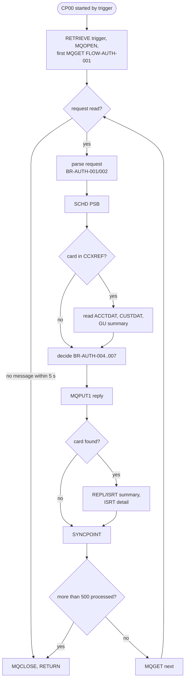
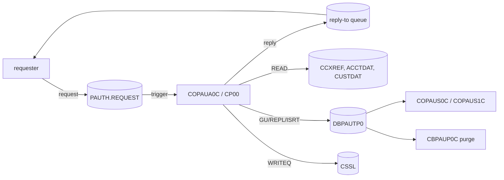

# COPAUA0C: Card authorization decision (CP00)

## 1. Summary

A CICS transaction (`CP00`) started by an IBM MQ trigger when authorization requests arrive on the request queue. It has no screen. In one task it reads up to 501 request messages, one after another, waiting up to 5 seconds for each. For every request it looks the card up in the card cross-reference (ENT-CARD-XREF), reads the account (ENT-ACCOUNT) and customer (ENT-CUSTOMER) and the account's pending-authorization summary (ENT-AUTH-SUMMARY) in IMS, and decides: **approve** the full amount when it does not exceed the available credit, otherwise **decline**. It sends a comma-separated reply to the requester's reply-to queue, then (when the card was found) updates the summary totals and stores one authorization detail (ENT-AUTH-DETAIL), and commits. Errors are written to the CICS transient data queue `CSSL`; a critical error ends the task.

The decision has several state-carry-over defects: replies after the first in a task contain the earlier replies (DEF-AUTH-001), and a card that is not in the cross-reference can be approved when an earlier request in the same task found a summary (DEF-AUTH-002).

## 2. Rules at a glance

| ID | Rule |
| :-- | :-- |
| FLOW-AUTH-001 | Task start: take the queue name from the trigger message, open the queue, read the first request. |
| FLOW-AUTH-002 | Request loop: process one request per iteration, commit, read the next; stop when no request arrives within 5 seconds or after 501 requests. |
| FLOW-AUTH-003 | Per request: schedule the PSB, read cross-reference, account, customer and summary, decide, reply, write to IMS. |
| BR-AUTH-001 | The request is 18 comma-separated values in a fixed order. |
| BR-AUTH-002 | The amount text is converted to a number with `NUMVAL`. |
| BR-AUTH-003 | A card that is not in the cross-reference is declined (reason 3100) and nothing is stored. |
| BR-AUTH-004 | Available credit = summary credit limit - summary credit balance when a summary exists, else account credit limit - account current balance. |
| BR-AUTH-005 | Decline when the amount is greater than the available credit, or when neither summary nor account was found. |
| BR-AUTH-006 | Approved: response `00`, approved amount = requested amount. Declined: `05`, approved amount 0. |
| BR-AUTH-007 | Reason code: `0000` approved; declined `3100` (card, account or customer not found), `4100` (insufficient funds), `9000` other. |
| BR-AUTH-008 | The authorization ID code returned is the request's time field. |
| BR-AUTH-009 | The account's summary is created on the first request and its counts, amounts and limits updated on every request whose card was found. |
| BR-AUTH-010 | One detail segment is inserted per request whose card was found, keyed by the complement of the CICS date and time. |

## 3. Actors and triggers

- **Requester:** an external point-of-sale emulator or any MQ client (not in the repository) that puts a request on `AWS.M2.CARDDEMO.PAUTH.REQUEST` and waits on `AWS.M2.CARDDEMO.PAUTH.REPLY` (`app/app-authorization-ims-db2-mq/README.md:63, 70-75, 276-279`).
- **Trigger:** the queue is set up for triggering; the CICS MQ trigger monitor starts transaction `CP00` and passes the trigger message (`MQTM`), from which the program takes the queue name (`:233-240`). The queue and process definitions are not in the repository. **Confidence:** platform-inferred.
- **CICS resources:** program `COPAUA0C` with `TRANSID(CP00)` (`CRDDEMO2.csd:11-17`); transaction `CP00` (`CRDDEMO2.csd:59-68`); files `ACCTDAT`, `CCXREF`, `CUSTDAT` (`CARDDEMO.CSD:1-12, 37-62`). The program also names `CARDDAT` and `CARDAIX` but never uses them (`:37-38`).
- **PSB:** `PSBPAUTB`, one database PCB `PAUTBPCB` on `DBPAUTP0`, `PROCOPT=AP` (`PSBPAUTB.psb:17-20`). Calls use PCB number 1 (`:84`); under CICS a PSB scheduled with `SCHD` has no I/O PCB, so PCB 1 is `PAUTBPCB`. **Confidence:** platform-inferred.
- **Not reachable from a menu:** no screen and no `COMEN02Y` option starts it.

## 4. Interfaces

### 4.1 Request message (input, ENT-AUTH-REQUEST)

`MQGET` into a 500-byte buffer (`:103, 398`), format `MQFMT-STRING` with conversion (`:389-397`). The text is split on `,` into the 18 fields of `CCPAURQY` in this order (`:354-374`, `CCPAURQY.cpy:19-36`): auth date, auth time, card number, auth type, card expiry date, message type, message source, processing code, transaction amount, merchant category code, acquirer country code, POS entry mode, merchant ID, merchant name, merchant city, merchant state, merchant ZIP, transaction ID. The order matches `app/app-authorization-ims-db2-mq/README.md:284-306`. Parsing rules: BR-AUTH-001, BR-AUTH-002.

### 4.2 Reply message (output, ENT-AUTH-RESPONSE)

`MQPUT1` to the queue named in the request's `MQMD-REPLYTOQ` (`:413-414, 742`), message type reply, correlation ID = the request's correlation ID (`:411-412, 745`), message ID none, not persistent, expiry 50 (tenths of a second, 5 seconds), format string, outside the unit of work (`:744-754`). Content: NUM-AUTH-003. The README order (`app/app-authorization-ims-db2-mq/README.md:309-318`) matches.

### 4.3 Files and database

| Resource | Access | Key | Into | Source |
| :-- | :-- | :-- | :-- | :-- |
| `CCXREF` (ENT-CARD-XREF) | `READ` | `XREF-CARD-NUM` = request card number | `CARD-XREF-RECORD` | `:475-485` |
| `ACCTDAT` (ENT-ACCOUNT) | `READ` | `XREF-ACCT-ID` as 11 characters | `ACCOUNT-RECORD` | `:523-533` |
| `CUSTDAT` (ENT-CUSTOMER) | `READ` | `XREF-CUST-ID` as 9 characters | `CUSTOMER-RECORD` | `:571-581` |
| `PAUTSUM0` (ENT-AUTH-SUMMARY) | `GU ... WHERE (ACCNTID = PA-ACCT-ID)` | `XREF-ACCT-ID` | `PENDING-AUTH-SUMMARY` | `:619-624` |
| `PAUTSUM0` | `REPL` or `ISRT` | current or new summary | | `:824-834` |
| `PAUTDTL1` (ENT-AUTH-DETAIL) | `ISRT` under `PAUTSUM0 WHERE (ACCNTID = PA-ACCT-ID)` | `PA-AUTHORIZATION-KEY` | `PENDING-AUTH-DETAILS` | `:913-919` |

The VSAM reads are plain reads (no update intent). IMS calls are command-level (`EXEC DLI`); the status is taken from `DIBSTAT`, and `'  '` or `FW` count as success (`:86`).

### 4.4 Error log (CSSL)

One ENT-AUTH-ERROR-LOG record of 122 bytes per logged error (`CCPAUERY.cpy:19-40`), written with `WRITEQ TD QUEUE('CSSL') ... NOHANDLE` (`:1001-1006`). The error locations, levels and texts are in section 10.

### 4.5 Commarea

`DFHCOMMAREA` of 4096 bytes is declared (`:214-215`) and never used; a trigger-started task has no commarea.

## 5. Data used

| Entity field | Read | Written | Use |
| :-- | :-- | :-- | :-- |
| ENT-AUTH-REQUEST (all 18 fields) | yes | - | BR-AUTH-001; copied into the detail (BR-AUTH-010) |
| ENT-CARD-XREF.XREF-CARD-NUM, XREF-ACCT-ID, XREF-CUST-ID | yes | - | card lookup; keys of account, customer, summary |
| ENT-ACCOUNT.ACCT-CREDIT-LIMIT, ACCT-CURR-BAL | yes | - | BR-AUTH-004 (when there is no summary) |
| ENT-ACCOUNT.ACCT-CREDIT-LIMIT, ACCT-CASH-CREDIT-LIMIT | yes | - | copied to the summary (BR-AUTH-009) |
| ENT-CUSTOMER (whole record) | yes | - | existence only; affects the reason code (BR-AUTH-007) |
| ENT-AUTH-SUMMARY.PA-CREDIT-LIMIT, PA-CREDIT-BALANCE | yes | yes | BR-AUTH-004, BR-AUTH-009 |
| ENT-AUTH-SUMMARY (counts, amounts, limits, cash balance, keys) | yes | yes | BR-AUTH-009 |
| ENT-AUTH-DETAIL (every field except FILLER) | - | yes | BR-AUTH-010 |
| ENT-AUTH-RESPONSE | - | yes | NUM-AUTH-003 |
| ENT-AUTH-ERROR-LOG | - | yes | SE-AUTH-006 |

Program-local data with behaviour: `WS-REQSTS-PROCESS-LIMIT` 500 (`:40`), `WS-MSG-PROCESSED` (`:42`), `WS-RESP-LENGTH PIC S9(4) VALUE 1`, the reply pointer (`:46`, DEF-AUTH-001), `WS-WAIT-INTERVAL` (`:60`), `WS-AVAILABLE-AMT S9(09)V99 COMP-3` (`:62`), `WS-TRANSACTION-AMT-AN X(13)` (`:63`), `WS-TRANSACTION-AMT`, `WS-APPROVED-AMT S9(10)V99` (`:64-65`), `WS-APPROVED-AMT-DIS PIC -zzzzzzzzz9.99` (`:66`), the flags of `WS-SWITCHES` (`:110-145`). Only `WS-MSG-LOOP-FLG`, `WS-MSG-AVAILABLE-FLG` and the two queue flags have initial values; the others have none. Every request sets `APPROVE-AUTH`, `CARD-FOUND-XREF` and `FOUND-ACCT-IN-MSTR` (`:441-446`); `WS-PAUT-SMRY-SEG-FLG` (set only in 5500), `WS-CUST-MASTER-READ-FLG` (set only in 5300) and `WS-DECLINE-REASON-FLG` (never reset) carry over from earlier requests, as do the record areas (DEF-AUTH-002, DEF-AUTH-003, DEF-AUTH-004). The decline reasons "card not active", "account closed", "card fraud" and "merchant fraud" (`:142-145`) are never set (DEF-AUTH-006).

## 6. Processing flow

1. Retrieve the trigger message; open the request queue; get the first request (`:233-246`).
2. While a request was read and the limit is not reached (`:326-344`):
   1. Parse it (`:328`, BR-AUTH-001).
   2. Process it (`:330`, FLOW-AUTH-003): reply and database updates.
   3. Count it, `SYNCPOINT`, mark the PSB as no longer scheduled (`:332-337`).
   4. If more than 500 requests were processed, stop; else get the next request (`:339-343`).
3. Terminate the PSB if still scheduled and close the queue (`:940-948`), then `RETURN` (`:226-227`).

## 7. Business rules

#### FLOW-AUTH-001 · Task start
- **When:** the task starts.
- **Then:** `RETRIEVE INTO(MQTM) NOHANDLE`; when it succeeds, the trigger's queue name becomes the request queue and the trigger data is kept (unused). The wait interval is set to 5000 ms. The queue is opened for shared input (`MQOO-INPUT-SHARED`) and the first request is read (SE-AUTH-001).
- **Otherwise:** when `RETRIEVE` fails (the transaction was started without a trigger message), the queue name keeps its uninitialized content (no `VALUE`, `:43`), `MQOPEN` fails and the task ends with error M001 (ERR-AUTH-002).
- **Source:** `:230-247, 255-284`
- **Fidelity:** must-preserve (triggered start) · **Confidence:** platform-inferred

#### FLOW-AUTH-002 · Request loop and limit
- **When:** a request was read.
- **Then:** process it (FLOW-AUTH-003), add 1 to the processed count, `EXEC CICS SYNCPOINT` (SE-AUTH-005). If the count is now greater than 500, the loop ends; else the next request is read, waiting up to 5 seconds. The loop also ends when no request arrives in time (`MQRC-NO-MSG-AVAILABLE`). So a task processes at most 501 requests (DEF-AUTH-012).
- **Then (end):** 9000-TERMINATE closes the queue; the task returns to CICS. Requests still on the queue are left for the next trigger (Q-AUTH-006).
- **Source:** `:323-345, 416-417`
- **Fidelity:** must-preserve (one commit per request); incidental (limit, wait time) · **Confidence:** reviewed

#### FLOW-AUTH-003 · Order of work for one request
- **Then:** in this order: set "approve"; schedule the PSB (`SCHD PSB(PSBPAUTB) NODHABEND`; on status `TC`, already scheduled, `TERM` and `SCHD` again); set "card found" and "account found"; read the cross-reference. If the card was found: read account, customer and summary, then the empty profile step (`5600-READ-PROFILE-DATA` is only `CONTINUE`). Then decide (BR-AUTH-004 to BR-AUTH-008), send the reply (SE-AUTH-002), and, if the card was found, update the summary and insert the detail (SE-AUTH-003, SE-AUTH-004).
- **Note:** the reply is sent before the database is updated and committed (DEF-AUTH-008).
- **Source:** `:292-318, 438-466, 647-651`
- **Fidelity:** must-preserve (reads and decision); defect-decide (reply before commit, Q-AUTH-005) · **Confidence:** reviewed

#### BR-AUTH-001 · Request parsing
- **When:** a request of `W01-DATALEN` bytes was read.
- **Then:** `UNSTRING ... DELIMITED BY ','` into the 18 fields in order (section 4.1). A value longer than its field is truncated on the right; a shorter text value is padded with spaces; the numeric fields `PA-RQ-PROCESSING-CODE 9(06)` and `PA-RQ-POS-ENTRY-MODE 9(02)` receive the text right-aligned as digits, unchecked. The ninth value goes to `WS-TRANSACTION-AMT-AN X(13)` (BR-AUTH-002). Values after the 18th are ignored.
- **Note:** no field is validated: not the card number format, the dates, the expiry or the codes. A comma inside a value (for example in a merchant name) shifts every later field. A request with fewer than 18 values leaves the remaining fields with the previous request's values (DEF-AUTH-009).
- **Source:** `:351-374`, `CCPAURQY.cpy:19-36`
- **Fidelity:** must-preserve (field order and lengths) · **Confidence:** reviewed

#### BR-AUTH-002 · Amount conversion
- **Then:** `PA-RQ-TRANSACTION-AMT = FUNCTION NUMVAL(WS-TRANSACTION-AMT-AN)`; the result is stored in the edited field `+9(10).99` and moved (de-edited) to `WS-TRANSACTION-AMT S9(10)V99`, the value used by the decision. `NUMVAL` accepts leading or trailing spaces, a sign (`+`, `-`, `CR`, `DB`) and a decimal point; decimals beyond two are truncated, not rounded; more than 10 integer digits lose the high-order digits. A negative or zero amount is accepted (DEF-AUTH-007). The result for text that is not a number depends on the compiler (Q-AUTH-004).
- **Source:** `:376-379`, `CCPAURQY.cpy:27`
- **Fidelity:** must-preserve · **Confidence:** reviewed (invalid text: platform-inferred)

#### BR-AUTH-003 · Card must be in the cross-reference
- **When:** `READ CCXREF` with the request's card number returns `NOTFND`.
- **Then:** "card not found" and "account not found" are set and warning A001 is logged (ERR-AUTH-006). Account, customer and summary are not read; the request is declined (BR-AUTH-005) with reason `3100`; the reply is sent; nothing is written to IMS (no summary, no detail).
- **Exception (defect):** the summary-found flag is not reset per request, so if an earlier request in the same task found a summary, this request is decided against that other account's summary and can be approved (DEF-AUTH-002).
- **Source:** `:445-450, 463-465, 487-500`
- **Fidelity:** must-preserve (decline, no record); defect-decide (DEF-AUTH-002) · **Confidence:** reviewed

#### BR-AUTH-004 · Available credit
- **When:** deciding.
- **Then:**
  - when the summary of the account was found (`GU` status success): `WS-AVAILABLE-AMT = PA-CREDIT-LIMIT - PA-CREDIT-BALANCE` (ENT-AUTH-SUMMARY). The account's current balance is not used (DEF-AUTH-005);
  - else, when the account was found: `WS-AVAILABLE-AMT = ACCT-CREDIT-LIMIT - ACCT-CURR-BAL` (ENT-AUTH-SUMMARY does not exist yet: first request for the account);
  - else: no available credit is computed and the request is declined.
- **Source:** `:664-683`
- **Fidelity:** must-preserve (defect-decide for the basis, Q-AUTH-003) · **Confidence:** reviewed

#### BR-AUTH-005 · Approve or decline
- **When:** available credit was computed (BR-AUTH-004).
- **Then:** if `WS-TRANSACTION-AMT > WS-AVAILABLE-AMT`: decline, reason flag "insufficient funds". Otherwise approve the full requested amount (BR-AUTH-006); the comparison is strict, so a requested amount equal to the available credit is approved.
- **Also declined:** neither summary nor account found.
- **Not checked:** card status, card expiry, account status, customer existence (except for the reason code), fraud, merchant, the processing code, duplicate requests (DEF-AUTH-006).
- **Source:** `:665-683`
- **Fidelity:** must-preserve · **Confidence:** reviewed

#### BR-AUTH-006 · Response code and approved amount
- **Then:** declined: `PA-RL-AUTH-RESP-CODE = '05'`, approved amount 0. Approved: `'00'`, approved amount = the requested amount (`PA-RQ-TRANSACTION-AMT`); there are no partial approvals.
- **Source:** `:685-696`
- **Fidelity:** must-preserve · **Confidence:** reviewed

#### BR-AUTH-007 · Reason code
- **Then:** `PA-RL-AUTH-RESP-REASON = '0000'`; when declined, the first true of:

| Condition | Reason |
| :-- | :-- |
| card not found, account not found, or customer not found | `3100` |
| insufficient funds | `4100` |
| card not active (never set) | `4200` |
| account closed (never set) | `4300` |
| card fraud (never set) | `5100` |
| merchant fraud (never set) | `5200` |
| otherwise | `9000` |

- **Consequences:** a missing customer record does not decline a request on its own; it only turns a decline for insufficient funds into `3100`. `4200` to `5200` and `9000` are unreachable (DEF-AUTH-006). The descriptions shown online for these codes are in COPAUS1C BR-AUDT-003.
- **Source:** `:698-718`
- **Fidelity:** must-preserve (codes); defect-decide (unreachable codes, Q-AUTH-002) · **Confidence:** reviewed

#### BR-AUTH-008 · Authorization ID code
- **Then:** the reply's card number and transaction ID are the request's; the authorization ID code is the request's time field `PA-RQ-AUTH-TIME`, not a generated code. The same value is stored in the detail.
- **Source:** `:660-662, 897`
- **Fidelity:** must-preserve (defect-decide, Q-AUTH-002) · **Confidence:** reviewed

#### BR-AUTH-009 · Summary create and update
- **When:** the card was found, after the reply was sent.
- **Then:**
  - no summary found (`GE`): `INITIALIZE PENDING-AUTH-SUMMARY REPLACING NUMERIC DATA BY ZERO`, then `PA-ACCT-ID = XREF-ACCT-ID`, `PA-CUST-ID = XREF-CUST-ID`. Text fields (`PA-AUTH-STATUS`, `PA-ACCOUNT-STATUS`) are not cleared by this form of `INITIALIZE` and keep whatever the work area held (DEF-AUTH-013);
  - always: `PA-CREDIT-LIMIT = ACCT-CREDIT-LIMIT`, `PA-CASH-LIMIT = ACCT-CASH-CREDIT-LIMIT` (ENT-ACCOUNT; from the work area even when the account was not found, DEF-AUTH-003);
  - approved: approved count + 1, approved amount + approved amount, `PA-CREDIT-BALANCE` + approved amount, `PA-CASH-BALANCE = 0`;
  - declined: declined count + 1, declined amount + `PA-TRANSACTION-AMT`, which at this point still holds the amount of the last earlier request in the task whose card was found (DEF-AUTH-004);
  - write: `REPL` when the summary was found, `ISRT` when not (SE-AUTH-003).
- **Source:** `:798-834`
- **Fidelity:** must-preserve (counts and credit balance); defect-decide (DEF-AUTH-003, DEF-AUTH-004) · **Confidence:** reviewed

#### BR-AUTH-010 · Detail insert
- **When:** after the summary update.
- **Then:** build ENT-AUTH-DETAIL: key from the CICS clock (NUM-AUTH-005); `PA-AUTH-ORIG-DATE` and `-TIME`, card number, auth type, expiry, message type and source, processing code, transaction amount, merchant category, acquirer country, POS entry mode, merchant ID, name, city, state, ZIP and transaction ID from the request; authorization ID code, response code, reason and approved amount from the reply; match status `P` when approved, `D` when declined; fraud flag and fraud report date spaces. Insert it under the account's summary (SE-AUTH-004).
- **Source:** `:854-919`
- **Fidelity:** must-preserve · **Confidence:** reviewed

## 8. Validations and messages

The program validates nothing in the request (BR-AUTH-001, BR-AUTH-002); every well-formed or malformed request gets a decision. It has no user messages; its only outputs are the reply (NUM-AUTH-003) and the error log records of section 10.

## 9. Side effects

In execution order for one request. The MQ calls are outside the CICS unit of work (`NO-SYNCPOINT`); the IMS updates are committed by the `SYNCPOINT` after each request, or at task end after a critical error.

#### SE-AUTH-001 · Request removed from the queue
- `MQGET` with `MQGMO-NO-SYNCPOINT + MQGMO-WAIT + MQGMO-CONVERT + MQGMO-FAIL-IF-QUIESCING`, wait 5000 ms, any message (message and correlation IDs set to none). The request leaves the queue at once, whatever happens to its processing later (DEF-AUTH-008). The request's correlation ID and reply-to queue name are saved.
- **Source:** `:386-414`
- **Confidence:** platform-inferred

#### SE-AUTH-002 · Reply put
- `MQPUT1` of `W02-BUFFLEN` = `WS-RESP-LENGTH` bytes of `W02-PUT-BUFFER` (NUM-AUTH-003) to the reply-to queue, outside the unit of work, default context. The reply is visible to the requester immediately, before the IMS updates are made or committed.
- **Source:** `:738-766`
- **Confidence:** platform-inferred

#### SE-AUTH-003 · Summary replace or insert
- `REPL PAUTSUM0 FROM (PENDING-AUTH-SUMMARY)` after the `GU` of 5500, or `ISRT PAUTSUM0` for a new account (BR-AUTH-009).
- **Source:** `:824-835`
- **Confidence:** platform-inferred (command-level `REPL` after `GU` needs no hold form)

#### SE-AUTH-004 · Detail insert
- `ISRT` of the child segment `PAUTDTL1` under the parent qualified by `SEGMENT (PAUTSUM0) WHERE (ACCNTID = PA-ACCT-ID)`, `FROM (PENDING-AUTH-DETAILS) SEGLENGTH (LENGTH OF PENDING-AUTH-DETAILS)` (= 200 bytes).
- **Source:** `:911-920`
- **Confidence:** platform-inferred

#### SE-AUTH-005 · Commit per request
- `EXEC CICS SYNCPOINT` after each request commits the IMS updates and releases the PSB, which is scheduled again for the next request.
- **Source:** `:334-337`
- **Confidence:** platform-inferred

#### SE-AUTH-006 · Error log record
- For each logged error: CICS clock as `YYMMDD` and `HHMMSS` (NUM-AUTH-004), application `CP00`, program `COPAUA0C`, then `WRITEQ TD QUEUE('CSSL')` of the whole ENT-AUTH-ERROR-LOG record, `NOHANDLE` (a failed write is ignored). A critical error then ends the task (ERR-AUTH-001).
- **Source:** `:983-1011`
- **Confidence:** platform-inferred

## 10. Error handling

#### ERR-AUTH-001 · Error levels and task end
- Every error goes through 9500-LOG-ERROR (SE-AUTH-006). **Warning** (`W`): processing continues. **Critical** (`C`): 9990-END-ROUTINE performs 9000-TERMINATE (`TERM` the PSB if scheduled, close the request queue) and `EXEC CICS RETURN`. No abend, no rollback: the IMS updates of the current request made before the error are committed (by `TERM` or at normal task end); the request message is already gone; the requester gets a reply only when the error came after SE-AUTH-002. The other fields of the error record are not cleared between errors (DEF-AUTH-010).
- **Source:** `:940-948, 1008-1010, 1016-1023`
- **Confidence:** platform-inferred (commit at `TERM` and task end)

#### ERR-AUTH-002 · Request queue open failure (M001, critical)
- `MQOPEN` completion code not OK: location `M001`, level C, subsystem M, code 1 = completion code, code 2 = reason, message `REQ MQ OPEN ERROR`. No request is read.
- **Source:** `:270-283`

#### ERR-AUTH-003 · Request read failure (M003, critical)
- `MQGET` not OK and reason other than "no message available": `M003`, level C, subsystem **C** (CICS, not MQ), codes = completion code and reason, message `FAILED TO READ REQUEST MQ`, event key = `PA-CARD-NUM` of the previous detail (DEF-AUTH-010). A request longer than 500 bytes fails this way; it is then left on the queue (the get does not accept truncation) and fails again at every new trigger. **Confidence:** platform-inferred for the long-message behaviour.
- **Source:** `:415-431`

#### ERR-AUTH-004 · PSB schedule failure (I001, critical)
- `SCHD` status not success (after one retry on `TC`): `I001`, level C, subsystem I, code 1 = status, message `IMS SCHD FAILED`. The request was already removed; no reply is sent.
- **Source:** `:308-317`

#### ERR-AUTH-005 · File read failures (C001, C002, C003, critical)
- Any `RESP` other than `NORMAL` or `NOTFND`: codes = `RESP` and `RESP2`, event key = the key read.
  - `CCXREF`: `C001`, `FAILED TO READ XREF FILE`, key card number.
  - `ACCTDAT`: `C002`, `FAILED TO READ ACCT FILE`, key account ID.
  - `CUSTDAT`: `C003`, `FAILED TO READ CUST FILE`, key customer ID.
- No reply is sent.
- **Source:** `:501-512, 549-560, 597-608`

#### ERR-AUTH-006 · Record not found (A001, A002, A003, warning)
- `NOTFND`: level W, subsystem A, processing continues (BR-AUTH-003, BR-AUTH-005, BR-AUTH-007).
  - `CCXREF`: `A001`, `CARD NOT FOUND IN XREF`, key card number.
  - `ACCTDAT`: `A002`, `ACCT NOT FOUND IN XREF`, key account ID.
  - `CUSTDAT`: `A003`, `CUST NOT FOUND IN XREF`, key customer ID.
- The texts say "IN XREF" for the account and customer files too.
- **Source:** `:490-500, 538-547, 586-595`

#### ERR-AUTH-007 · Summary read failure (I002, critical)
- `GU PAUTSUM0` status other than success or `GE`: `I002`, `IMS GET SUMMARY FAILED`, code 1 = status, event key = previous `PA-CARD-NUM`. No reply.
- **Source:** `:626-640`

#### ERR-AUTH-008 · Reply put failure (M004, critical)
- `MQPUT1` not OK (for example when the request has no reply-to queue): `M004`, `FAILED TO PUT ON REPLY MQ`, codes = completion code and reason, event key = previous `PA-CARD-NUM`. Nothing is written to IMS for this request.
- **Source:** `:767-779`

#### ERR-AUTH-009 · IMS write failures (I003, I004, critical)
- Summary `REPL`/`ISRT` not success: `I003`, `IMS UPDATE SUMRY FAILED`, event key = previous `PA-CARD-NUM`. Detail `ISRT` not success (for example `II`, duplicate key): `I004`, `IMS INSERT DETL FAILED`, event key = this request's card number. In both cases the reply has already been sent; after I004 the summary update is committed without its detail (ERR-AUTH-001).
- **Source:** `:837-847, 922-932`

#### ERR-AUTH-010 · Request queue close failure (M005, warning)
- `MQCLOSE` not OK: `M005`, level W, subsystem M, `FAILED TO CLOSE REQUEST MQ`. The task still returns normally.
- **Source:** `:953-977`

## 11. Interactions

- **Upstream:** the requester and the MQ trigger (section 3). The base application's files are maintained by the base programs (accounts, customers, cross-reference).
- **Downstream:** COPAUS0C and COPAUS1C show the summaries and details it writes; COPAUS1C and COPAUS2C mark details as fraud; CBPAUP0C deletes expired details and summaries (BR-AUPG-004). Nothing in the repository matches an authorization with a posted transaction (match status `M` is never set) or reduces `PA-CREDIT-BALANCE` (other than an approved negative amount, DEF-AUTH-007).
- **Shared data:** `DBPAUTP0` is updated concurrently by COPAUS1C (fraud flag) and CBPAUP0C (deletes); IMS serializes the calls.
- **No Db2.** Transaction `CP00` has no `DB2TRAN` entry.

## 12. Numeric, date and format details

#### NUM-AUTH-001 · Amount precision
- Request amount: `NUMVAL` result stored in `+9(10).99` and `S9(10)V99` (BR-AUTH-002). Detail amounts `S9(10)V99 COMP-3`. Summary amounts and limits `S9(09)V99 COMP-3`: adding a detail amount can lose the high-order digit, without error. Counts `S9(04) COMP`; no size check on `ADD 1`.
- **Source:** `:62-65, 376-379, 814-821`, `CIPAUSMY.cpy:23-30`, `CIPAUDTY.cpy:34-35`

#### NUM-AUTH-002 · Available credit arithmetic
- `WS-AVAILABLE-AMT S9(09)V99 COMP-3` (`:62`) = limit - balance. The operands are `S9(10)V99` in the account branch (ENT-ACCOUNT) and `S9(09)V99` in the summary branch (ENT-AUTH-SUMMARY); with no `ON SIZE ERROR`, a difference of 1,000,000,000.00 or more in absolute value loses its high-order digits. The result can be negative (balance over limit); then only amounts less than or equal to that negative value are approved, and every zero or positive amount is declined. The comparison is `WS-TRANSACTION-AMT > WS-AVAILABLE-AMT` with two decimals.
- **Source:** `:62, 665-679`

#### NUM-AUTH-003 · Reply format
- `STRING ... DELIMITED BY SIZE INTO W02-PUT-BUFFER WITH POINTER WS-RESP-LENGTH` of: card number (16), `,`, transaction ID (15), `,`, authorization ID code (6), `,`, response code (2), `,`, reason (4), `,`, approved amount edited as `-zzzzzzzzz9.99` (14), `,`: 63 characters with a trailing comma. Text values keep trailing spaces. Amount examples: 50.00 → 9 spaces + `50.00`; declined 0 → 10 spaces + `0.00`; a negative approved amount has `-` in the first position.
- The message length sent is the pointer value, which is the next free position, one more than the characters written: the first reply of a task is 64 bytes, its last byte being whatever the buffer held. Because the pointer is never reset, later replies in the same task are longer (DEF-AUTH-001).
- **Source:** `:66, 720-731, 756`, `CCPAURLY.cpy:19-24`
- **Fidelity:** must-preserve (field order, values); defect-decide (length, DEF-AUTH-001) · **Confidence:** reviewed

#### NUM-AUTH-004 · Error log date and time
- `ERR-DATE` = CICS `FORMATTIME YYMMDD` (6 digits, no separators), `ERR-TIME` = `TIME` `HHMMSS`, both from `ASKTIME` at the moment of logging.
- **Source:** `:986-999`

#### NUM-AUTH-005 · Detail key from the CICS clock
- `ASKTIME`, `FORMATTIME YYDDD`, `TIME` (`HHMMSS`) and `MILLISECONDS`. `PA-AUTH-DATE-9C = 99999 - YYDDD` (`S9(05) COMP-3`) and `PA-AUTH-TIME-9C = 999999999 - (HHMMSS * 1000 + milliseconds)` (`S9(09) COMP-3`). Together they form the 8-byte unique key `PAUT9CTS` (`DBPAUTP0.dbd:37`), so details sort newest first. Example: 2024-04-05 (24096) 14:30:15.250 → date 75903, time 856984749.
- The key depends only on the clock, not on the request: two requests for the same account in the same millisecond collide (ERR-AUTH-009). Across a century change (`99365` → `00001`) the newest details sort last. The request's own date and time are kept separately (`PA-AUTH-ORIG-DATE`, `-TIME`). CBPAUP0C reverses the date part to compute ages (NUM-AUPG-001); COPAUS2C uses the time part to build the Db2 timestamp (NUM-AUFR-002).
- **Source:** `:857-875`, `CIPAUDTY.cpy:19-21`
- **Fidelity:** must-preserve (newest-first order, key uniqueness) · **Confidence:** reviewed

## 13. Known defects and oddities

#### DEF-AUTH-001 · Reply pointer never reset: later replies carry earlier ones
- `WS-RESP-LENGTH` starts at 1 once per task and is used as the `STRING` pointer and as the message length, but is never reset. Second request: its 63 characters are appended after the first reply, and the message sent is reply 1 + reply 2 + 1 byte (127 bytes). Third: 190 bytes. Fourth: only the first 11 characters fit in the 200-byte buffer, the `STRING` overflows, the pointer becomes 201 and 201 bytes are sent, one beyond the buffer. Every later request in the task: the `STRING` transfers nothing and the same 201 bytes go out. A requester reading the first six values of a reply gets the **first** request's decision, card number and transaction ID.
- **Impact:** wrong decisions returned to every request after the first in a task, and card numbers of other cardholders disclosed in replies [security]. Reachable whenever two or more requests arrive within 5 seconds of each other.
- **Source:** `:46, 722-731, 756` · **Status:** open · **Fidelity:** defect-decide (Q-AUTH-001) · **Confidence:** reviewed

#### DEF-AUTH-002 · Unknown card approved against the previous account's summary
- `WS-PAUT-SMRY-SEG-FLG` is set only when the summary is read, which happens only for a card found in the cross-reference. For a card not found, the flag keeps the value of the previous request in the task. If that request found a summary, BR-AUTH-004 uses the summary still in the work area (another account's, already updated by its approval) and approves the unknown card when the amount fits, with reason `0000`. No detail is stored (the card was not found), so the approval leaves no trace in IMS. The first request of a task, or one after a request that created a summary, is declined as intended.
- **Source:** `:445-457, 665-671` · **Status:** open · **Fidelity:** defect-decide (Q-AUTH-002) · **Confidence:** reviewed

#### DEF-AUTH-003 · Account not found: summary updated with the previous account's limits
- When the card is in the cross-reference but `ACCTDAT` returns `NOTFND`, `ACCOUNT-RECORD` still holds the previous request's account (or uninitialized storage for the first request). The decision uses the summary if one exists (so it can approve); BR-AUTH-009 then copies the stale credit and cash limits into the summary and replaces it. When no summary exists, the request is declined and a new summary is created for the non-existent account with stale limits, a declined count of 1 and the stale declined amount of DEF-AUTH-004.
- **Source:** `:535-547, 673-682, 801-811` · **Status:** open · **Fidelity:** defect-decide · **Confidence:** reviewed

#### DEF-AUTH-004 · Declined amount comes from the previous request
- BR-AUTH-009 adds `PA-TRANSACTION-AMT` to the declined amount, but the detail area is filled for the current request only later, in 8500, which runs only for requests whose card was found. The amount added is therefore the amount of the last earlier request in the task whose card was found, not necessarily the previous request (or, for the first request of a task, whatever the uninitialized packed field holds; invalid packed data would raise a data exception and abend the task, platform-inferred). The detail itself stores the correct amount.
- **Source:** `:463-465, 819-821, 885` · **Status:** open · **Fidelity:** defect-decide · **Confidence:** reviewed

#### DEF-AUTH-005 · Available credit ignores the posted balance once a summary exists
- With a summary, available credit = credit limit - `PA-CREDIT-BALANCE`, the running sum of approvals in IMS. Posted transactions and payments in ENT-ACCOUNT are ignored; without a summary the account's current balance is used. Nothing in the repository decreases `PA-CREDIT-BALANCE`, except an approved negative amount (DEF-AUTH-007): there is no matching with posted transactions, and the purge does not write its adjustments back (CBPAUP0C DEF-AUPG-003). So available credit only shrinks until the summary is deleted, and when the purge deletes it, the next request is checked against the account balance again.
- **Source:** `:665-683, 817` · **Status:** open · **Fidelity:** defect-decide (Q-AUTH-003)

#### DEF-AUTH-006 · Missing checks and unreachable reason codes
- The program declares the card files `CARDDAT` and `CARDAIX` and the reasons "card not active", "account closed", "card fraud" and "merchant fraud" (`4200`, `4300`, `5100`, `5200`) but never reads a card or sets these reasons; the profile step is empty. Card status, card expiry (the request's expiry is stored, not compared), account active status and expiry are not checked. Reason `9000` cannot occur. A missing customer does not decline.
- **Source:** `:37-38, 140-145, 647-651, 698-718` · **Status:** open · **Fidelity:** defect-decide (Q-AUTH-002)

#### DEF-AUTH-007 · No amount validation
- Zero and negative amounts are approved whenever available credit is not negative (a negative amount is never greater than it); an approved negative amount decreases `PA-CREDIT-BALANCE` and the approved amount, so it increases available credit. An amount text that is not a number is not rejected.
- **Source:** `:376-379, 668, 815-817` · **Status:** open · **Fidelity:** defect-decide (Q-AUTH-004)

#### DEF-AUTH-008 · Reply before commit; requests outside the unit of work
- The request is removed from the queue outside the unit of work (SE-AUTH-001) and the reply is put outside it before IMS is updated (SE-AUTH-002). A critical error before the reply loses the request without a reply; a failure after the reply (I003, I004) leaves the requester with a decision that is not recorded, or recorded only in the summary. There is no rollback anywhere.
- **Source:** `:389, 461-464, 753` · **Status:** open · **Fidelity:** defect-decide (Q-AUTH-005) · **Confidence:** platform-inferred

#### DEF-AUTH-009 · Short requests reuse the previous request's values
- `UNSTRING` does not change receiving fields for which there is no value. A request with fewer than 18 values keeps the previous request's values in the missing fields (including the transaction ID that is echoed back and the merchant data that is stored). The amount text field is likewise reused when missing.
- **Source:** `:354-374` · **Status:** open · **Confidence:** reviewed

#### DEF-AUTH-010 · Error log fields are stale
- `ERROR-LOG-RECORD` is never initialized. M003, M004, I002 and I003 set the event key from `PA-CARD-NUM` of the detail area, which holds the card of the last earlier request whose detail was built (or uninitialized content for the first). M001, I001 and M005 do not set the event key at all; A001, A002 and A003 set neither code 1 nor code 2, and I001, I002 and I003 do not set code 2, so values from an earlier error remain. M003 is tagged subsystem CICS although it is an MQ error.
- **Source:** `:273-281, 311-315, 419-428, 494-499, 541-546, 589-594, 638, 777, 845, 966-974` · **Status:** open (incidental)

#### DEF-AUTH-011 · [security] Card numbers in logs and replies
- The full card number is written in clear to the CSSL log (event key of A001, C001 and the stale keys of DEF-AUTH-010) and returned in every reply. Combined with DEF-AUTH-001 a reply discloses the card numbers of other requests. See `docs/security/data-handling.md`.
- **Source:** `:499, 511, 722, 777, 930` · **Status:** open

#### DEF-AUTH-012 · Request limit is 501, not 500
- The loop stops when the processed count is **greater than** 500, after the 501st request.
- **Source:** `:339` · **Status:** open (incidental)

#### DEF-AUTH-013 · New summary keeps old text fields
- `INITIALIZE ... REPLACING NUMERIC DATA BY ZERO` initializes only numeric fields; `PA-AUTH-STATUS` and the five `PA-ACCOUNT-STATUS` values of a new summary keep the previous summary's content from the work area (or uninitialized bytes). No program reads them.
- **Source:** `:801-803` · **Status:** open (incidental)

#### DEF-AUTH-014 · Cash fields are meaningless
- `PA-CASH-LIMIT` is copied from the account but never used; `PA-CASH-BALANCE` is set to 0 on every approval and never increased. No request is treated as a cash advance (the processing code is ignored).
- **Source:** `:811, 818` · **Status:** open (incidental)

#### DEF-AUTH-015 · Reply correlated by the request's correlation ID
- The reply's correlation ID is copied from the request's correlation ID, not its message ID. A requester that does not set a correlation ID (the MQ default is none) receives every reply with correlation ID none and cannot match replies to requests.
- **Source:** `:395-396, 411-412, 745-746` · **Status:** open · **Fidelity:** defect-decide (Q-AUTH-001) · **Confidence:** platform-inferred

## 14. Open questions

| ID | Question | For |
| :-- | :-- | :-- |
| Q-AUTH-001 | What reply framing and correlation does the requester expect: one 63-character reply per request (DEF-AUTH-001), correlation by request correlation ID or by message ID (DEF-AUTH-015)? | requester owner |
| Q-AUTH-002 | Should unknown cards always be declined (DEF-AUTH-002), and should card status, expiry, account status and fraud be checked with the reason codes 4200-5200 (DEF-AUTH-006)? What should the authorization ID code be (BR-AUTH-008)? | business |
| Q-AUTH-003 | What is available credit: limit minus posted balance minus pending approvals? When should pending approvals be released (DEF-AUTH-005)? | business |
| Q-AUTH-004 | Should zero, negative or non-numeric amounts be rejected, and with which reason (DEF-AUTH-007)? | business |
| Q-AUTH-005 | Must the reply be sent only after the authorization is committed, and must the request be consumed in the same unit of work (DEF-AUTH-008)? | business, architecture |
| Q-AUTH-006 | How are the request queue's trigger type and the process definition set up, and are requests left after the 501st picked up by a new trigger? | mainframe team |

## 15. Equivalence contract

A reimplementation is equivalent when, for the same requests in the same order, the same base files and the same IMS content:

- each request gets one reply on its reply-to queue with the same six values (card number, transaction ID, authorization ID code, response code, reason, approved amount formatted as in NUM-AUTH-003), unless the defect decisions on DEF-AUTH-001 and DEF-AUTH-002 say otherwise;
- the same summaries are created or updated with the same counts, amounts, credit balance and limits, and one detail per found card with the same field values; the key may come from a different clock but must keep newest-first order and uniqueness;
- the same conditions produce error log records with the same location, level and message; the task ends at the same critical errors;
- incidental: the 501-request limit, the 5-second wait, the reply expiry, console and log formatting.

Not runnable locally (CICS, IMS, MQ). Scenario checks: a request for card in ENT-CARD-XREF with no summary and amount ≤ account limit - balance → `00`, reason `0000`, new summary with count 1; amount > available → `05`, `4100`, summary declined count 1; unknown card as first request of a task → `05`, `3100`, no IMS change. Review record: `docs/modernization/spec/evidence/e-review.md`.

## 16. Paragraph coverage

| Paragraph | Lines | Covered by |
| :-- | :-- | :-- |
| (data division) | 32-215 | §4, §5, DEF-AUTH-006, DEF-AUTH-012 |
| (procedure division header) | 218 | §6 |
| `MAIN-PARA` | 220-227 | FLOW-AUTH-001, FLOW-AUTH-002 |
| `1000-INITIALIZE` | 230-247 | FLOW-AUTH-001 |
| `1000-EXIT` | 249-250 | FLOW-AUTH-001 |
| `1100-OPEN-REQUEST-QUEUE` | 255-284 | FLOW-AUTH-001, ERR-AUTH-002 |
| `1100-EXIT` | 286-287 | FLOW-AUTH-001 |
| `1200-SCHEDULE-PSB` | 292-318 | FLOW-AUTH-003, ERR-AUTH-004 |
| `1200-EXIT` | 319-321 | FLOW-AUTH-003 |
| `2000-MAIN-PROCESS` | 323-345 | FLOW-AUTH-002, SE-AUTH-005, DEF-AUTH-012 |
| `2000-EXIT` | 347-348 | FLOW-AUTH-002 |
| `2100-EXTRACT-REQUEST-MSG` | 351-380 | BR-AUTH-001, BR-AUTH-002, DEF-AUTH-009 |
| `2100-EXIT` | 382-383 | BR-AUTH-001 |
| `3100-READ-REQUEST-MQ` | 386-432 | SE-AUTH-001, ERR-AUTH-003 |
| `3100-EXIT` | 434-435 | SE-AUTH-001 |
| `5000-PROCESS-AUTH` | 438-466 | FLOW-AUTH-003, DEF-AUTH-002 |
| `5000-EXIT` | 468-469 | FLOW-AUTH-003 |
| `5100-READ-XREF-RECORD` | 472-514 | BR-AUTH-003, ERR-AUTH-005, ERR-AUTH-006 |
| `5100-EXIT` | 516-517 | BR-AUTH-003 |
| `5200-READ-ACCT-RECORD` | 520-562 | BR-AUTH-004, ERR-AUTH-005, ERR-AUTH-006, DEF-AUTH-003 |
| `5200-EXIT` | 564-565 | BR-AUTH-004 |
| `5300-READ-CUST-RECORD` | 568-610 | BR-AUTH-007, ERR-AUTH-005, ERR-AUTH-006 |
| `5300-EXIT` | 612-613 | BR-AUTH-007 |
| `5500-READ-AUTH-SUMMRY` | 616-641 | BR-AUTH-004, ERR-AUTH-007 |
| `5500-EXIT` | 643-644 | BR-AUTH-004 |
| `5600-READ-PROFILE-DATA` | 647-651 | FLOW-AUTH-003, DEF-AUTH-006 |
| `5600-EXIT` | 653-654 | FLOW-AUTH-003 |
| `6000-MAKE-DECISION` | 657-732 | BR-AUTH-004, BR-AUTH-005, BR-AUTH-006, BR-AUTH-007, BR-AUTH-008, NUM-AUTH-002, NUM-AUTH-003, DEF-AUTH-001 |
| `6000-EXIT` | 734-735 | BR-AUTH-005 |
| `7100-SEND-RESPONSE` | 738-780 | SE-AUTH-002, ERR-AUTH-008, DEF-AUTH-015 |
| `7100-EXIT` | 782-783 | SE-AUTH-002 |
| `8000-WRITE-AUTH-TO-DB` | 786-792 | BR-AUTH-009, BR-AUTH-010 |
| `8000-EXIT` | 794-795 | BR-AUTH-009 |
| `8400-UPDATE-SUMMARY` | 798-848 | BR-AUTH-009, SE-AUTH-003, ERR-AUTH-009, DEF-AUTH-003, DEF-AUTH-004, DEF-AUTH-013, DEF-AUTH-014 |
| `8400-EXIT` | 850-851 | BR-AUTH-009 |
| `8500-INSERT-AUTH` | 854-933 | BR-AUTH-010, NUM-AUTH-005, SE-AUTH-004, ERR-AUTH-009 |
| `8500-EXIT` | 935-936 | BR-AUTH-010 |
| `9000-TERMINATE` | 940-948 | FLOW-AUTH-002, ERR-AUTH-001 |
| `9000-EXIT` | 950-951 | FLOW-AUTH-002 |
| `9100-CLOSE-REQUEST-QUEUE` | 953-977 | ERR-AUTH-010 |
| `9100-EXIT` | 979-980 | ERR-AUTH-010 |
| `9500-LOG-ERROR` | 983-1011 | SE-AUTH-006, NUM-AUTH-004, ERR-AUTH-001 |
| `9500-EXIT` | 1012-1013 | SE-AUTH-006 |
| `9990-END-ROUTINE` | 1016-1023 | ERR-AUTH-001 |
| `9990-EXIT` | 1024-1025 | ERR-AUTH-001 |

43 of 43 paragraphs plus the procedure division header covered.
