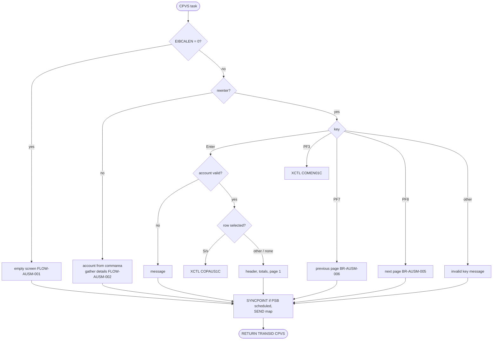
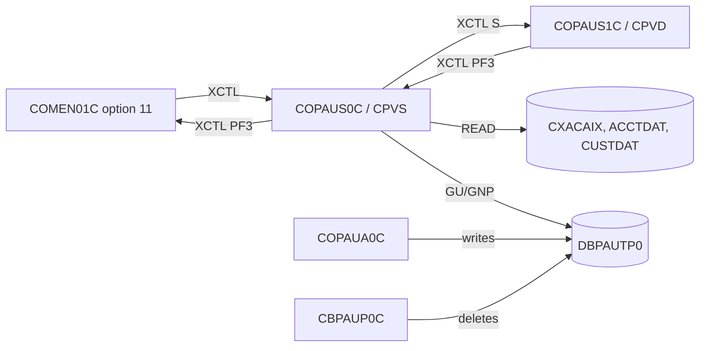

# COPAUS0C: Pending authorization summary screen (CPVS)

## 1. Summary

A pseudo-conversational CICS screen (transaction `CPVS`, map `COPAU0A`) reached from main menu option 11 "Pending Authorization View". The user types an 11-digit account ID; the program shows the account's customer name, address and phone (ENT-CUSTOMER, found through the card cross-reference by account, ENT-CARD-XREF), the account's credit and cash limits (ENT-ACCOUNT), the totals of the account's pending-authorization summary (ENT-AUTH-SUMMARY) and a list of its authorizations (ENT-AUTH-DETAIL), five per page, newest first. PF8 and PF7 page forward and backward; typing `S` next to an authorization opens the detail screen COPAUS1C; PF3 returns to the menu. The program only reads; it changes nothing.

## 2. Rules at a glance

| ID | Rule |
| :-- | :-- |
| FLOW-AUSM-001 | Started without a commarea: show an empty screen. |
| FLOW-AUSM-002 | Arriving from the menu or from COPAUS1C: show the account in the commarea at once, if it is numeric. |
| FLOW-AUSM-003 | On each later interaction: Enter searches or selects, PF3 returns to the menu, PF7 and PF8 page, any other key is rejected. |
| BR-AUSM-001 | Header: customer and first card come from the cross-reference by account; name, address and phone from the customer; limits from the account. |
| BR-AUSM-002 | Summary totals: approval and decline counts and amounts, credit and cash balances from the account's summary, or zeros. |
| BR-AUSM-003 | List: up to five authorizations per page in key order (newest first): transaction ID, request date and time, type, A/D, match status, approved amount. |
| BR-AUSM-004 | After a full page the program reads one more authorization to know whether a next page exists. |
| BR-AUSM-005 | PF8 shows the five authorizations after the last one shown. |
| BR-AUSM-006 | PF7 shows the page whose first key was saved for the previous page number. |
| BR-AUSM-007 | `S` or `s` in a row's selection field opens COPAUS1C for that authorization. |
| BR-AUSM-008 | PF3 transfers to the main menu. |
| VAL-AUSM-001 | The account ID is required. |
| VAL-AUSM-002 | The account ID must be numeric (all 11 characters). |
| VAL-AUSM-003 | Only `S` or `s` is a valid selection. |
| VAL-AUSM-004 | Only Enter, PF3, PF7 and PF8 are valid keys. |
| VAL-AUSM-005 | PF7 on the first page and PF8 without a next page give a message. |

## 3. Actors and triggers

- **Actor:** a signed-on CardDemo user. The menu option is for regular users (type `U`, `app/cpy/COMEN02Y.cpy:86-90`). The program does not check the user or whether the account belongs to them (DEF-AUSM-007).
- **Trigger from the menu:** COMEN01C checks that the program is installed (`INQUIRE PROGRAM`), sets `CDEMO-PGM-CONTEXT` = 0 and transfers control (XCTL) with the commarea (`app/cbl/COMEN01C.cbl:147-159`).
- **Trigger from COPAUS1C:** PF3 on the detail screen transfers back with context 0 (COPAUS1C BR-AUDT-005).
- **Pseudo-conversation:** every interaction ends with `RETURN TRANSID('CPVS') COMMAREA(...)` (`:254-257`); transaction `CPVS` runs program `COPAUS0C` (`CRDDEMO2.csd:18-24, 49-58`).
- **PSB:** `PSBPAUTB`, PCB 1 (`:75-77`, `PSBPAUTB.psb:17-20`), scheduled for each interaction that reads IMS and released by a `SYNCPOINT` before the screen is sent.

## 4. Interfaces

### 4.1 Screen COPAU0A (mapset COPAU00), 24 x 80

| Row,Col | Field | Len | Attributes | Direction | Content | Source |
| :-- | :-- | --: | :-- | :-- | :-- | :-- |
| 1,1 | label | 5 | ASKIP | out | `Tran:` | `COPAU00.bms:29-33` |
| 1,7 | `TRNNAME` | 4 | ASKIP, FSET | out | `CPVS` | `COPAU00.bms:34-37` |
| 1,21 | `TITLE01` | 40 | ASKIP, FSET, yellow | out | title line 1 (`COTTL01Y.cpy:18-19`) | `COPAU00.bms:38-41` |
| 1,65 / 1,71 | `Date:` / `CURDATE` | 5 / 8 | ASKIP | out | today `MM/DD/YY` | `COPAU00.bms:42-51` |
| 2,1 / 2,7 | `Prog:` / `PGMNAME` | 5 / 8 | ASKIP | out | `COPAUS0C` | `COPAU00.bms:52-60` |
| 2,21 | `TITLE02` | 40 | ASKIP, FSET, yellow | out | title line 2 (`COTTL01Y.cpy:20-22`) | `COPAU00.bms:61-64` |
| 2,65 / 2,71 | `Time:` / `CURTIME` | 5 / 8 | ASKIP | out | now `HH:MM:SS` | `COPAU00.bms:65-74` |
| 3,30 | label | 19 | | out | `View Authorizations` | `COPAU00.bms:75-78` |
| 5,3 | label | 15 | ASKIP | out | `Search Acct Id:` | `COPAU00.bms:79-83` |
| 5,19 | `ACCTID` | 11 | UNPROT, FSET, green, underline | in/out | account ID; cursor is placed here | `COPAU00.bms:84-88` |
| 6,3 / 6,10 | `Name: ` / `CNAME` | 6 / 25 | ASKIP | out | BR-AUSM-001 | `COPAU00.bms:92-99` |
| 6,44 / 6,58 | `Customer Id: ` / `CUSTID` | 13 / 9 | ASKIP | out | `CUST-ID` | `COPAU00.bms:100-106` |
| 7,10 | `ADDR001` | 25 | ASKIP | out | address line 1 | `COPAU00.bms:107-110` |
| 7,44 / 7,58 | `Acct Status: ` / `ACCSTAT` | 13 / 1 | ASKIP | out | never filled (DEF-AUSM-003) | `COPAU00.bms:111-117` |
| 8,10 | `ADDR002` | 25 | ASKIP | out | address line 2 | `COPAU00.bms:118-121` |
| 9,10 / 9,15 | `PH:` / `PHONE1` | 3 / 13 | ASKIP | out | phone | `COPAU00.bms:122-128` |
| 9,44 / 9,58 | `Approval # : ` / `APPRCNT` | 13 / 3 | ASKIP | out | BR-AUSM-002 | `COPAU00.bms:129-135` |
| 9,64 / 9,76 | `Decline #:` / `DECLCNT` | 10 / 3 | ASKIP | out | BR-AUSM-002 | `COPAU00.bms:136-142` |
| 11,6 / 11,19 | `Credit Lim:` / `CREDLIM` | 11 / 12 | ASKIP, FSET | out | BR-AUSM-001 | `COPAU00.bms:143-151` |
| 11,35 / 11,46 | `Cash Lim:` / `CASHLIM` | 9 / 9 | ASKIP, FSET | out | BR-AUSM-001 | `COPAU00.bms:152-160` |
| 11,58 / 11,69 | `Appr Amt:` / `APPRAMT` | 9 / 10 | ASKIP, FSET | out | BR-AUSM-002 | `COPAU00.bms:161-169` |
| 12,6 / 12,19 | `Credit Bal:` / `CREDBAL` | 11 / 12 | ASKIP, FSET | out | BR-AUSM-002 | `COPAU00.bms:170-178` |
| 12,35 / 12,46 | `Cash Bal:` / `CASHBAL` | 9 / 9 | ASKIP, FSET | out | BR-AUSM-002 | `COPAU00.bms:179-187` |
| 12,58 / 12,69 | `Decl Amt:` / `DECLAMT` | 9 / 10 | ASKIP, FSET | out | BR-AUSM-002 | `COPAU00.bms:188-196` |
| 14 / 15 | column headings and dashes | | ASKIP | out | `Sel`, ` Transaction ID `, `  Date  `, `  Time  `, `Type `, `A/D`, `STS`, `   Amount   ` | `COPAU00.bms:197-276` |
| 16-20,3 | `SEL0001`-`SEL0005` | 1 | UNPROT, FSET, green, underline; set protected when the row is empty | in | selection (BR-AUSM-007) | `COPAU00.bms:277-282, 321-326, 365-370, 409-414, 488-493` |
| 16-20,8 | `TRNID01`-`05` | 16 | ASKIP, FSET | out | `PA-TRANSACTION-ID` | `COPAU00.bms:286-290` and repeats |
| 16-20,27 | `PDATE01`-`05` | 8 | ASKIP, FSET | out | request date `MM/DD/YY` | `COPAU00.bms:291-295` and repeats |
| 16-20,38 | `PTIME01`-`05` | 8 | ASKIP, FSET | out | request time `HH:MM:SS` | `COPAU00.bms:296-300` and repeats |
| 16-20,49 | `PTYPE01`-`05` | 4 | ASKIP, FSET | out | `PA-AUTH-TYPE` | `COPAU00.bms:301-305` and repeats |
| 16-20,58 | `PAPRV01`-`05` | 1 | ASKIP, FSET | out | `A` approved / `D` declined | `COPAU00.bms:306-310` and repeats |
| 16-20,63 | `PSTAT01`-`05` | 1 | ASKIP, FSET | out | `PA-MATCH-STATUS` | `COPAU00.bms:311-315` and repeats |
| 16-20,67 | `PAMT001`-`005` | 12 | ASKIP, FSET | out | approved amount | `COPAU00.bms:316-320` and repeats |
| 22,12 | label | 52 | ASKIP, BRT | out | `Type 'S' to View Authorization details from the list` | `COPAU00.bms:497-502` |
| 23,1 | `ERRMSG` | 78 | ASKIP, BRT, FSET, red | out | message (section 8) | `COPAU00.bms:503-506` |
| 24,1 | label | 48 | ASKIP, yellow | out | `ENTER=Continue  F3=Back  F7=Backward  F8=Forward` | `COPAU00.bms:507-512` |

The mapset has `CTRL=(ALARM,FREEKB)` (`COPAU00.bms:19`). In the source the row-5 selection field `SEL0005` is defined after the other row-5 fields (`COPAU00.bms:488-496`) instead of in screen order (DEF-AUSM-008).

### 4.2 Commarea

`CARDDEMO-COMMAREA` (`COCOM01Y.cpy:19-44`, 160 bytes) followed by `CDEMO-CPVS-INFO` (220 bytes, `:117-126`):

| Field | PIC | Use |
| :-- | :-- | :-- |
| `CDEMO-ACCT-ID` | `9(11)` | account shown; set from the screen on Enter, read on entry and by `GU` (BR-AUSM-002) |
| `CDEMO-CUST-ID`, `CDEMO-CARD-NUM` | `9(09)`, `9(16)` | set from the cross-reference (BR-AUSM-001); not used here |
| `CDEMO-FROM-TRANID`, `-FROM-PROGRAM`, `-TO-PROGRAM`, `-PGM-CONTEXT` | | navigation (BR-AUSM-007, BR-AUSM-008) |
| `CDEMO-CPVS-PAU-SEL-FLG` | `X(01)` | selection character typed |
| `CDEMO-CPVS-PAU-SELECTED` | `X(08)` | key of the selected authorization, passed to COPAUS1C |
| `CDEMO-CPVS-PAUKEY-PREV-PG` | `X(08) OCCURS 20` | first key of each page, by page number (BR-AUSM-006) |
| `CDEMO-CPVS-PAUKEY-LAST` | `X(08)` | key of the last row shown (BR-AUSM-005) |
| `CDEMO-CPVS-PAGE-NUM` | `S9(04) COMP` | current page number |
| `CDEMO-CPVS-NEXT-PAGE-FLG` | `X(01)` | `Y` when a next page exists (BR-AUSM-004) |
| `CDEMO-CPVS-AUTH-KEYS` | `X(08) OCCURS 5` | keys of the rows shown, by row |

### 4.3 Files and database

| Resource | Access | Key | Source |
| :-- | :-- | :-- | :-- |
| `CXACAIX` (ENT-CARD-XREF by account) | `READ` | account ID typed (11 characters) | `:817-826` |
| `ACCTDAT` (ENT-ACCOUNT) | `READ` | `XREF-ACCT-ID` | `:868-877` |
| `CUSTDAT` (ENT-CUSTOMER) | `READ` | `XREF-CUST-ID` | `:918-928` |
| `PAUTSUM0` (ENT-AUTH-SUMMARY) | `GU WHERE (ACCNTID = PA-ACCT-ID)` | `CDEMO-ACCT-ID` | `:969-977` |
| `PAUTDTL1` (ENT-AUTH-DETAIL) | `GNP` | next under the summary | `:461-464` |
| `PAUTDTL1` | `GNP WHERE (PAUT9CTS = PA-AUTHORIZATION-KEY)` | a saved key | `:491-497` |

CICS file definitions: `ACCTDAT` and `CUSTDAT` (`CARDDEMO.CSD:1-12, 50-62`), `CXACAIX`, the path over the cross-reference by account (`CARDDEMO.CSD:63-74`).

## 5. Data used

| Entity field | Read | Written | Use |
| :-- | :-- | :-- | :-- |
| ENT-CARD-XREF.XREF-ACCT-ID, XREF-CUST-ID, XREF-CARD-NUM | yes | commarea | BR-AUSM-001 |
| ENT-ACCOUNT.ACCT-CREDIT-LIMIT, ACCT-CASH-CREDIT-LIMIT | yes | - | BR-AUSM-001 |
| ENT-CUSTOMER.CUST-ID, names, address lines, state, ZIP, phone 1 | yes | - | BR-AUSM-001 |
| ENT-AUTH-SUMMARY.PA-APPROVED-AUTH-CNT, PA-DECLINED-AUTH-CNT, PA-APPROVED-AUTH-AMT, PA-DECLINED-AUTH-AMT, PA-CREDIT-BALANCE, PA-CASH-BALANCE | yes | - | BR-AUSM-002 |
| ENT-AUTH-DETAIL.PA-AUTHORIZATION-KEY, PA-TRANSACTION-ID, PA-AUTH-ORIG-DATE, PA-AUTH-ORIG-TIME, PA-AUTH-TYPE, PA-AUTH-RESP-CODE, PA-MATCH-STATUS, PA-APPROVED-AMT | yes | - | BR-AUSM-003 |

The account's status, the summary's limits and the card record (`CVACT02Y` is copied in) are not used.

## 6. Processing flow

1. Reset the error, end-of-list, next-page and erase flags and the message (`:181-188`).
2. No commarea: FLOW-AUSM-001. Commarea, first time: FLOW-AUSM-002. Commarea, reentry: receive the map and dispatch on the key (FLOW-AUSM-003) (`:190-252`).
3. `RETURN TRANSID('CPVS')` with the commarea (`:254-257`).

## 7. Business rules

#### FLOW-AUSM-001 · Start without commarea
- **When:** `EIBCALEN = 0` (the transaction typed directly).
- **Then:** initialize the commarea, set "to program" to `COPAUS0C` and the context to reenter, clear the map and send it with `ERASE`, cursor on the account field. No account is shown.
- **Source:** `:190-198`
- **Fidelity:** must-preserve · **Confidence:** reviewed

#### FLOW-AUSM-002 · First display from the menu or the detail screen
- **When:** a commarea is passed and the context is not reenter (the menu and COPAUS1C pass context 0).
- **Then:** set the context to reenter; clear the map; if `CDEMO-ACCT-ID` is numeric, put it in the account field and gather the details (header, totals, first page; BR-AUSM-001 to BR-AUSM-004); else leave the field blank and show nothing. Send with `ERASE`.
- **Note:** `CDEMO-ACCT-ID` is `9(11)` and is numeric even when it is all zeros, so arriving from the menu without an earlier account shows account `00000000000` and the not-found messages of ERR-AUSM-001.
- **Source:** `:199-219`
- **Fidelity:** must-preserve · **Confidence:** reviewed

#### FLOW-AUSM-003 · Key dispatch on reentry
- **When:** context is reenter.
- **Then:** `RECEIVE MAP` (the response is not checked) and, by `EIBAID`:
  - Enter: VAL-AUSM-001, VAL-AUSM-002, BR-AUSM-007, then gather the details (header, totals, first page) for a valid account; send with `ERASE`.
  - PF3: BR-AUSM-008.
  - PF7: BR-AUSM-006; PF8: BR-AUSM-005; both send without `ERASE`, so the header lines already on the screen stay.
  - Any other key: VAL-AUSM-004.
- **Source:** `:221-251, 261-338, 342-358, 712-722`
- **Fidelity:** must-preserve · **Confidence:** reviewed

#### BR-AUSM-001 · Account header
- **When:** details are gathered for an account ID.
- **Then:**
  1. Read the cross-reference by account through `CXACAIX`; keep the first record's customer ID and card number in the commarea.
  2. Read the account by `XREF-ACCT-ID` and the customer by `XREF-CUST-ID`.
  3. Show: `CUSTID` = `CUST-ID`; `CNAME` = first word of the first name, space, first letter of the middle name, space, first word of the last name (each name is cut at its first space), truncated to 25; `ADDR001` = address line 1 up to its first double space, `,`, address line 2 up to its first double space; `ADDR002` = line 3 up to its first double space, `,`, state, `,`, first 5 characters of the ZIP; `PHONE1` = the first 13 of the 15 characters of phone 1; `CREDLIM` and `CASHLIM` from the account (NUM-AUSM-001).
- A record that is not found does not stop the sequence (DEF-AUSM-001).
- **Source:** `:750-783, 812-831, 865-881, 915-932`
- **Fidelity:** must-preserve (content); incidental (exact formatting) · **Confidence:** reviewed

#### BR-AUSM-002 · Summary totals
- **When:** after the header.
- **Then:** schedule the PSB and `GU` the summary of `CDEMO-ACCT-ID`. Found: approval and decline counts (NUM-AUSM-002), credit balance, cash balance, approved amount and declined amount (NUM-AUSM-001). Not found (`GE`): each of these six fields is filled with zeros (`000`, `000000000000` and so on) and the list stays empty.
- **Source:** `:785-807, 966-984`
- **Fidelity:** must-preserve · **Confidence:** reviewed

#### BR-AUSM-003 · Authorization list
- **When:** the summary was found (first page) or PF7/PF8 paging.
- **Then:** clear the five rows and protect their selection fields; then read details under the summary with `GNP` in key order, which is newest first (COPAUA0C NUM-AUTH-005), and fill rows 1 to 5:
  - selection field unprotected; transaction ID; request date `PA-AUTH-ORIG-DATE` (`YYMMDD`) shown as `MM/DD/YY`; request time `HHMMSS` as `HH:MM:SS`; auth type; `A` when the response code is `00`, else `D`; the match status letter (`P`, `D`, `E`, `M`); the approved amount (declined rows show 0.00).
  - the row's key is saved in `CDEMO-CPVS-AUTH-KEYS(row)`; the key of the last row filled in `CDEMO-CPVS-PAUKEY-LAST`.
  - when the first row is filled, the page number is increased by 1 and that row's key saved in `CDEMO-CPVS-PAUKEY-PREV-PG(page)`.
- Reading stops after five rows, at the end of the details (`GE` or `GB`) or at an error.
- **Source:** `:415-443, 522-605, 608-662`
- **Fidelity:** must-preserve (order, columns) · **Confidence:** reviewed

#### BR-AUSM-004 · Next-page look-ahead
- **When:** five rows were filled without reaching the end.
- **Then:** one more `GNP`; found: next page exists (`Y`), else `N`. When the end was reached while filling, the flag keeps its earlier value (set to `N` at the start of a search).
- **Source:** `:445-452`
- **Fidelity:** must-preserve · **Confidence:** reviewed

#### BR-AUSM-005 · Page forward (PF8)
- **When:** PF8.
- **Then:** if a last key is saved: schedule the PSB, `GU` the summary, then `GNP` qualified with `PAUT9CTS = last key` to re-position on the last row shown. If a next page exists (BR-AUSM-004, from the commarea): clear the rows and fill the next five (BR-AUSM-003), which continue after the last key. Else: VAL-AUSM-005.
- **Note:** if the last row was deleted in the meantime (for example by the purge), the qualified `GNP` returns `GE`, the end flag is set and the page comes out empty.
- **Source:** `:388-412, 488-505`
- **Fidelity:** must-preserve · **Confidence:** reviewed

#### BR-AUSM-006 · Page backward (PF7)
- **When:** PF7 and the page number is greater than 1.
- **Then:** page number - 1; take the first key saved for that page; schedule the PSB and `GU` the summary; clear the rows; fill the page, the first row by a `GNP` qualified with that key and the next ones by unqualified `GNP` (BR-AUSM-003). The next-page flag is set to `Y` before filling.
- **Defect:** filling the first row increases the page number again (BR-AUSM-003), so after PF7 the page number is the old one, and the first key of the page just shown is stored under it. A second PF7 shows the same page again (DEF-AUSM-002).
- **Otherwise:** VAL-AUSM-005.
- **Source:** `:362-385, 425-441`
- **Fidelity:** must-preserve (backward paging); defect-decide (DEF-AUSM-002) · **Confidence:** reviewed

#### BR-AUSM-007 · Select an authorization
- **When:** Enter with a valid account ID.
- **Then:** the first of the five selection fields (row 1 to 5) that is not blank decides: its character becomes the selection flag and the key saved for that row in the previous display becomes the selected key. If both are present:
  - `S` or `s`: set "to program" `COPAUS1C`, "from transaction" `CPVS`, "from program" `COPAUS0C`, context 0, and transfer control (XCTL) with the commarea. COPAUS1C reads the authorization with `CDEMO-ACCT-ID` and the selected key.
  - other: VAL-AUSM-003.
- **Note:** the account ID typed on the same Enter replaces `CDEMO-ACCT-ID` before the selection; typing a different account and `S` on a row of the old list sends COPAUS1C the new account with a key from the old account.
- **Source:** `:283-333`
- **Fidelity:** must-preserve · **Confidence:** reviewed

#### BR-AUSM-008 · Return to the menu (PF3)
- **When:** PF3.
- **Then:** "to program" = `COMEN01C` (if it were blank, `COSGN00C`), "from transaction" `CPVS`, "from program" `COPAUS0C`, context 0; XCTL with the commarea.
- **Source:** `:235-238, 665-677`
- **Fidelity:** must-preserve · **Confidence:** reviewed

## 8. Validations and messages

Messages are shown in `ERRMSG` (row 23). The cursor is always placed on the account ID field.

#### VAL-AUSM-001 · Account ID required
- **When:** Enter and the account field is spaces or low-values.
- **Then:** message `Please enter Acct Id...`; nothing is read; the list rows keep what the screen sent back.
- **Source:** `:264-271`
- **Fidelity:** must-preserve · **Confidence:** reviewed

#### VAL-AUSM-002 · Account ID numeric
- **When:** Enter and the 11-character field is not all digits.
- **Then:** message `Acct Id must be Numeric ...`; nothing is read. Because BMS pads a shorter entry with spaces, an account ID typed without its leading zeros is rejected (DEF-AUSM-005).
- **Source:** `:273-280`
- **Fidelity:** must-preserve · **Confidence:** reviewed (padding: platform-inferred)

#### VAL-AUSM-003 · Selection value
- **When:** a selection character other than `S` or `s` on a row with a saved key.
- **Then:** message `Invalid selection. Valid value is S`; the account is still displayed (header, totals, first page).
- **Source:** `:326-330, 337`
- **Fidelity:** must-preserve · **Confidence:** reviewed

#### VAL-AUSM-004 · Invalid key
- **When:** any key other than Enter, PF3, PF7, PF8 (including PA keys and Clear).
- **Then:** message `Invalid key pressed. Please see below...` (`CSMSG01Y.cpy:20-21`), screen sent with `ERASE`. The header fields that the terminal does not send back (name, customer ID, address, phone, counts) come back blank (DEF-AUSM-006).
- **Source:** `:245-249`
- **Fidelity:** must-preserve (rejection) · **Confidence:** reviewed (blank header: platform-inferred)

#### VAL-AUSM-005 · Paging limits
- **When:** PF7 with page number 1 or less → `You are already at the top of the page...`. PF8 when no next page exists → `You are already at the bottom of the page...`. The list stays as it was (no erase, nothing re-read).
- **Source:** `:380-384, 408-411`
- **Fidelity:** must-preserve · **Confidence:** reviewed

## 9. Side effects

The program writes no file, segment or table.

#### SE-AUSM-001 · Commit before each screen
- Before sending the map, if the PSB is scheduled, `EXEC CICS SYNCPOINT` releases it (`IMS-PSB-NOT-SCHD` is set first). Nothing is updated, so the commit has no data effect; it ends the IMS position, which is why paging re-positions by key.
- **Source:** `:681-688`
- **Confidence:** platform-inferred

#### SE-AUSM-002 · Commarea saved between interactions
- `RETURN TRANSID('CPVS') COMMAREA(CARDDEMO-COMMAREA)` keeps the account, the page keys, the page number and the next-page flag (section 4.2) for the next interaction.
- **Source:** `:254-257`
- **Confidence:** reviewed

## 10. Error handling

None of these errors ends the task. Most of them send the screen with the message immediately and then let processing continue, so the screen can be sent several times in one interaction; the user sees the last one (DEF-AUSM-001).

#### ERR-AUSM-001 · Cross-reference read
- `NOTFND`: message `Account:` + account ID + ` not found in XREF file. Resp:` + RESP (9 digits) + ` Reas:` + RESP2 (9 digits); screen sent; processing continues with the account read (DEF-AUSM-001). Other response: same layout with ` System error while reading XREF file. Resp:`, error flag set, screen sent.
- **Source:** `:832-860`

#### ERR-AUSM-002 · Account read
- `NOTFND`: `Account:` + key + ` not found in ACCT file. Resp:` ...; other: ` System error while reading ACCT file. Resp:` ... with the error flag. Screen sent; processing continues.
- **Source:** `:882-910`

#### ERR-AUSM-003 · Customer read
- `NOTFND`: `Customer:` + key + ` not found in CUST file. Resp:` ...; other: ` System error while reading CUST file. Resp:` ... with the error flag. Screen sent; processing continues.
- **Source:** `:933-961`

#### ERR-AUSM-004 · PSB schedule and summary read
- `SCHD` not successful (after one `TERM`/`SCHD` retry on `TC`): ` System error while scheduling PSB: Code:` + status, error flag, screen sent; the `GU` is still issued. `GU` status other than success or `GE`: ` System error while reading AUTH Summary: Code:` + status, error flag, screen sent. With the error flag on, no list is read.
- **Source:** `:985-995, 1001-1030`
- **Confidence:** reviewed (outcome of a `GU` without a scheduled PSB: platform-inferred)

#### ERR-AUSM-005 · Detail read
- `GNP` status other than success, `GE` or `GB`: ` System error while reading AUTH Details: Code:` + status; qualified `GNP`: ` System error while repos. AUTH Details: Code:` + status. Error flag set, screen sent, the list stops.
- **Source:** `:473-484, 506-517`

## 11. Interactions

- **Upstream:** COMEN01C (menu), COPAUS1C (back). The data comes from COPAUA0C (summaries and details) and the base files.
- **Downstream:** COPAUS1C receives the account and selected key in the commarea.
- **Shared data:** the purge (CBPAUP0C) can delete the details whose keys are saved in the commarea between two interactions (BR-AUSM-005).

## 12. Numeric, date and format details

#### NUM-AUSM-001 · Amount display
- `CREDLIM`, `CREDBAL`: `PIC -zzzzzzz9.99` (12 characters, 8 integer digits). `CASHLIM`, `CASHBAL`, `APPRAMT`, `DECLAMT`: `PIC -zzzz9.99` (9 characters, 5 integer digits; `APPRAMT` and `DECLAMT` are 10-character fields, left-aligned). List amounts: `PIC -zzzzzzz9.99` (12). Higher-order digits are dropped without warning: an approved total of 123,456.78 shows as `23456.78` (DEF-AUSM-004).
- **Source:** `:55-57, 525, 780-799`

#### NUM-AUSM-002 · Counts
- `PA-APPROVED-AUTH-CNT` and `PA-DECLINED-AUTH-CNT` (`S9(04) COMP`) are moved to `9(03)`: only the last three digits are shown and a negative count shows without sign.
- **Source:** `:58, 788-791`

#### NUM-AUSM-003 · Dates and times
- Header: `FUNCTION CURRENT-DATE` as `MM/DD/YY` and `HH:MM:SS` (`CSDAT01Y.cpy:30-41`). List: the request's own date and time (`PA-AUTH-ORIG-DATE` `YYMMDD`, `PA-AUTH-ORIG-TIME` `HHMMSS`), rearranged without validation; not the stored key time.
- **Source:** `:527-534, 729-746`

## 13. Known defects and oddities

#### DEF-AUSM-001 · Not-found records do not stop the display
- After `NOTFND` on the cross-reference the program sends the screen and goes on to read the account with `XREF-ACCT-ID`, which still holds whatever the record area contained (nothing was read). The same happens after `NOTFND` on the account or customer. Each failure sends the screen once more, and each message is written over the previous one without clearing it, so a shorter message can keep the last characters of a longer one. The header can then show stale or empty customer data together with the summary of the typed account, which is read by `CDEMO-ACCT-ID` regardless.
- **Source:** `:753-785, 832-845, 882-895, 933-946` · **Status:** open · **Confidence:** reviewed (record-area content: platform-inferred)

#### DEF-AUSM-002 · Backward paging repeats a page
- BR-AUSM-006 decreases the page number and BR-AUSM-003 increases it again when the first row is filled, overwriting the saved first key of the current page number with the first key of the page shown. From page 3, PF7 shows page 2, and every further PF7 shows page 2 again; page 1 is reachable only by a new Enter. PF8 keeps working (it re-positions by the last key) but the page number keeps growing.
- **Source:** `:365-379, 436-441` · **Status:** open · **Fidelity:** defect-decide (Q-AUSM-001) · **Confidence:** reviewed

#### DEF-AUSM-003 · Account status never shown
- The screen has an `Acct Status:` field (`ACCSTAT`) but no statement fills it; `ACCT-ACTIVE-STATUS` is not used.
- **Source:** `COPAU00.bms:111-117` · **Status:** open

#### DEF-AUSM-004 · Truncated display values
- Phone shows 13 of 15 characters; cash limit, cash balance and approved and declined totals show 5 integer digits; counts show 3 digits without sign (NUM-AUSM-001, NUM-AUSM-002); names show only their first word; addresses are cut at the first double space and at 25 characters.
- **Source:** `:758-799` · **Status:** open (incidental)

#### DEF-AUSM-005 · Account ID must be typed with leading zeros
- VAL-AUSM-002 tests the whole 11-character field; a shorter entry is padded with spaces by BMS and fails the numeric test.
- **Source:** `:273` · **Status:** open · **Confidence:** platform-inferred

#### DEF-AUSM-006 · Errors erase the header
- Every interaction except PF7/PF8 sends with `ERASE`. When the interaction does not re-read the account (invalid key, VAL-AUSM-001, VAL-AUSM-002), the header fields without `FSET` are not sent back by the terminal and are blank on the new screen.
- **Source:** `:184, 245-249, 694-701` · **Status:** open (incidental) · **Confidence:** platform-inferred

#### DEF-AUSM-007 · [security] No authorization check
- Any signed-on user can view the authorizations, name, address and phone of any account by typing its number. The user type in the commarea is not checked.
- **Source:** `:264-284` · **Status:** open · **Fidelity:** defect-decide (Q-AUSM-002)

#### DEF-AUSM-008 · Map field out of screen order
- `SEL0005` (row 20, column 3) is defined after the other row-20 fields. BMS normally expects fields in screen order; whether the map assembles cleanly is not known (Q-AUSM-003). The symbolic map has `SEL0005` after `PAMT005`.
- **Source:** `COPAU00.bms:453-496`, `COPAU00.cpy:337-384` · **Status:** open · **Confidence:** platform-inferred

#### DEF-AUSM-009 · Page-key table has no bound
- `CDEMO-CPVS-PAUKEY-PREV-PG` has 20 entries but the page number is never limited. From page 21 on, the key is stored past the table, over `CDEMO-CPVS-PAUKEY-LAST`, then over the page number and the next-page flag, corrupting the paging state (and, with a corrupted page number, storage beyond the commarea). Reached after about 100 authorizations, or sooner with DEF-AUSM-002.
- **Source:** `:120-122, 437-440` · **Status:** open · **Confidence:** reviewed (overlay without subscript checking: platform-inferred)

## 14. Open questions

| ID | Question | For |
| :-- | :-- | :-- |
| Q-AUSM-001 | Confirm the intended paging: PF7 should go back one page each time down to page 1 (DEF-AUSM-002), with no limit on the number of pages (DEF-AUSM-009)? | business |
| Q-AUSM-002 | Should users be limited to accounts they own, or should the option be admin-only (DEF-AUSM-007)? | business, security |
| Q-AUSM-003 | Does `COPAU00` assemble without warnings with `SEL0005` out of order, and does row 5's selection work on the real terminal (DEF-AUSM-008)? | mainframe team |

## 15. Equivalence contract

A reimplementation is equivalent when, for the same commarea, screen input, key and data:

- the same header values (subject to DEF-AUSM-004 decisions), totals and list rows are shown, in the same order, with the same messages;
- paging gives the same pages for PF8, and for PF7 as decided under Q-AUSM-001;
- `S`/`s` hands COPAUS1C the same account and authorization key; PF3 returns to the menu;
- no data is changed;
- incidental: the exact number of screen sends per interaction, the cursor handling and the header-blanking of DEF-AUSM-006.

Not runnable locally (CICS, IMS). Scenario check on the sample data: account 1 (ENT-AUTH-SUMMARY sample) shows its approved count and the first five of its details, newest key first. Review record: `docs/modernization/spec/evidence/e-review.md`.

## 16. Paragraph coverage

| Paragraph | Lines | Covered by |
| :-- | :-- | :-- |
| (data division) | 32-174 | §4.2, §5, NUM-AUSM-001 |
| (procedure division header) | 176 | §6 |
| `MAIN-PARA` | 178-257 | FLOW-AUSM-001, FLOW-AUSM-002, FLOW-AUSM-003, BR-AUSM-008, VAL-AUSM-004, SE-AUSM-002 |
| `PROCESS-ENTER-KEY` | 261-338 | VAL-AUSM-001, VAL-AUSM-002, VAL-AUSM-003, BR-AUSM-007 |
| `GATHER-DETAILS` | 342-358 | FLOW-AUSM-003, BR-AUSM-003 |
| `PROCESS-PF7-KEY` | 362-385 | BR-AUSM-006, VAL-AUSM-005, DEF-AUSM-002 |
| `PROCESS-PF8-KEY` | 388-412 | BR-AUSM-005, VAL-AUSM-005 |
| `PROCESS-PAGE-FORWARD` | 415-454 | BR-AUSM-003, BR-AUSM-004, DEF-AUSM-009 |
| `GET-AUTHORIZATIONS` | 458-486 | BR-AUSM-003, ERR-AUSM-005 |
| `REPOSITION-AUTHORIZATIONS` | 488-519 | BR-AUSM-005, BR-AUSM-006, ERR-AUSM-005 |
| `POPULATE-AUTH-LIST` | 522-605 | BR-AUSM-003, NUM-AUSM-001, NUM-AUSM-003 |
| `INITIALIZE-AUTH-DATA` | 608-662 | BR-AUSM-003 |
| `RETURN-TO-PREV-SCREEN` | 665-677 | BR-AUSM-008 |
| `SEND-PAULST-SCREEN` | 681-709 | SE-AUSM-001, DEF-AUSM-006 |
| `RECEIVE-PAULST-SCREEN` | 712-722 | FLOW-AUSM-003 |
| `POPULATE-HEADER-INFO` | 726-747 | NUM-AUSM-003 |
| `GATHER-ACCOUNT-DETAILS` | 750-808 | BR-AUSM-001, BR-AUSM-002, NUM-AUSM-002, DEF-AUSM-004 |
| `GETCARDXREF-BYACCT` | 812-862 | BR-AUSM-001, ERR-AUSM-001, DEF-AUSM-001 |
| `GETACCTDATA-BYACCT` | 865-912 | BR-AUSM-001, ERR-AUSM-002 |
| `GETCUSTDATA-BYCUST` | 915-963 | BR-AUSM-001, ERR-AUSM-003 |
| `GET-AUTH-SUMMARY` | 966-997 | BR-AUSM-002, ERR-AUSM-004 |
| `SCHEDULE-PSB` | 1001-1031 | ERR-AUSM-004 |

20 of 20 paragraphs plus the procedure division header covered.
