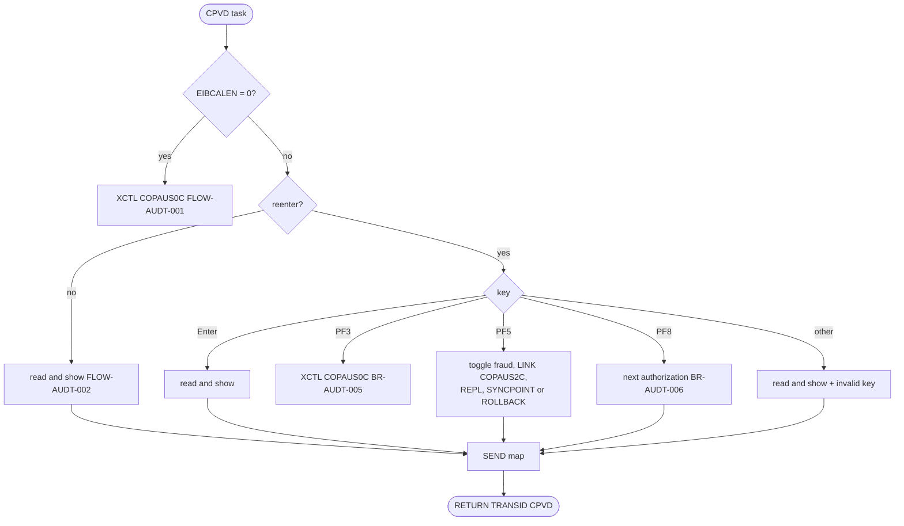
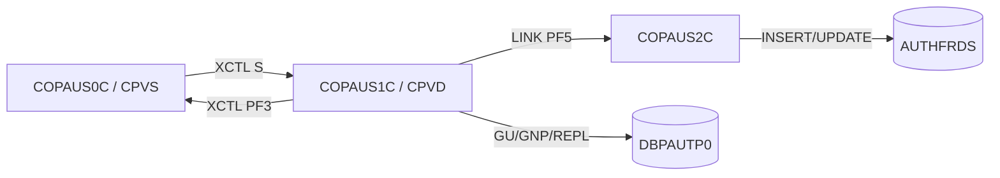

# COPAUS1C: Authorization detail screen and fraud marking (CPVD)

## 1. Summary

A pseudo-conversational CICS screen (transaction `CPVD`, map `COPAU1A`) that shows one pending authorization (ENT-AUTH-DETAIL) of an account. COPAUS0C opens it when the user selects a row with `S`; the account ID and the authorization key arrive in the commarea. The screen has no input fields. PF8 shows the next (older) authorization of the same account, PF5 marks the authorization as fraud or removes the mark, PF3 returns to COPAUS0C. Marking fraud changes the fraud flag and report date of the IMS detail and, through COPAUS2C, adds or updates a row of the Db2 table `AUTHFRDS` (ENT-AUTH-FRAUD); both changes are committed together.

## 2. Rules at a glance

| ID | Rule |
| :-- | :-- |
| FLOW-AUDT-001 | Started without a commarea: transfer to COPAUS0C. |
| FLOW-AUDT-002 | Arriving from COPAUS0C: show the selected authorization at once. |
| FLOW-AUDT-003 | On each later interaction: Enter re-shows, PF3 goes back, PF5 toggles fraud, PF8 shows the next authorization, other keys are rejected. |
| BR-AUDT-001 | The authorization is read by account ID (summary) and key (detail). |
| BR-AUDT-002 | The screen shows the detail's card, request date and time, response, amounts, codes and merchant. |
| BR-AUDT-003 | The decline reason code is shown with a description from a fixed table of 10 codes. |
| BR-AUDT-004 | Fraud status: flag, `-` and report date when marked or removed, else `-`. |
| BR-AUDT-005 | PF3 transfers back to COPAUS0C with context 0. |
| BR-AUDT-006 | PF8 shows the authorization after the current one in key order. |
| BR-AUDT-007 | PF5 toggles the fraud flag: `F` becomes `R`, anything else becomes `F`, and calls COPAUS2C. |
| BR-AUDT-008 | After COPAUS2C succeeds, the detail is replaced and both updates are committed. |
| VAL-AUDT-001 | Without a numeric account or a selected key nothing is shown. |
| VAL-AUDT-002 | Only Enter, PF3, PF5 and PF8 are valid keys. |
| VAL-AUDT-003 | PF8 on the last authorization gives a message. |

## 3. Actors and triggers

- **Actor:** a signed-on CardDemo user who came through COPAUS0C. The program does not check the user (DEF-AUDT-006).
- **Trigger:** COPAUS0C sets "to program" `COPAUS1C`, context 0 and the selected key, and transfers control (XCTL) (COPAUS0C BR-AUSM-007).
- **Pseudo-conversation:** each interaction ends with `RETURN TRANSID('CPVD') COMMAREA(...)` (`:202-205`); transaction `CPVD` runs `COPAUS1C` (`CRDDEMO2.csd:25-31, 39-48`).
- **Db2:** the transaction `CPVD` is bound to the Db2 entry `AWS01PLN` by `DB2TRAN CPVDTRAN` (`CRDDEMO2.csd:69-79`), so COPAUS2C, linked from this task, runs under plan `AWS01PLN`. The module README names the entry `DB201PLN` (`app/app-authorization-ims-db2-mq/README.md:177-178`) (Q-AUDT-004).
- **PSB:** `PSBPAUTB`, PCB 1, `PROCOPT=AP` (`:76-78`, `PSBPAUTB.psb:17-20`).

## 4. Interfaces

### 4.1 Screen COPAU1A (mapset COPAU01), 24 x 80

Every field is `ASKIP` (protected); all are `NORM` except the title label (`ASKIP,BRT`, `COPAU01.bms:75`), `ERRMSG` (`ASKIP,BRT,FSET`, `COPAU01.bms:284`) and the `Merchant Details` label, which has no `ATTRB` (`COPAU01.bms:229`). The user cannot type anything (`COPAU01.bms:29-292`).

| Row,Col | Field | Len | Attributes | Content | Source |
| :-- | :-- | --: | :-- | :-- | :-- |
| 1,1 / 1,7 | `Tran:` / `TRNNAME` | 5 / 4 | blue | `CPVD` | `COPAU01.bms:29-37` |
| 1,21 | `TITLE01` | 40 | yellow | title line 1 (`COTTL01Y.cpy:18-19`) | `COPAU01.bms:38-41` |
| 1,65 / 1,71 | `Date:` / `CURDATE` | 5 / 8 | blue | today `MM/DD/YY` | `COPAU01.bms:42-51` |
| 2,1 / 2,7 | `Prog:` / `PGMNAME` | 5 / 8 | blue | `COPAUS1C` | `COPAU01.bms:52-60` |
| 2,21 | `TITLE02` | 40 | yellow | title line 2 | `COPAU01.bms:61-64` |
| 2,65 / 2,71 | `Time:` / `CURTIME` | 5 / 8 | blue | now `HH:MM:SS` | `COPAU01.bms:65-74` |
| 4,27 | label | 26 | BRT, neutral | `View Authorization Details` | `COPAU01.bms:75-79` |
| 7,2 / 7,11 | `Card #:` / `CARDNUM` | 7 / 16 | pink; cursor placed here | `PA-CARD-NUM` | `COPAU01.bms:80-88` |
| 7,31 / 7,43 | `Auth Date:` / `AUTHDT` | 10 / 10 | pink | request date `MM/DD/YY` (NUM-AUDT-002) | `COPAU01.bms:89-98` |
| 7,56 / 7,68 | `Auth Time:` / `AUTHTM` | 10 / 10 | pink | request time `HH:MM:SS` | `COPAU01.bms:99-108` |
| 9,2 / 9,14 | `Auth Resp:` / `AUTHRSP` | 10 / 1 | pink, then green or red | `A` or `D` (BR-AUDT-002) | `COPAU01.bms:109-118` |
| 9,18 / 9,32 | `Resp Reason:` / `AUTHRSN` | 12 / 20 | blue | `code-description` (BR-AUDT-003) | `COPAU01.bms:119-128` |
| 9,56 / 9,68 | `Auth Code:` / `AUTHCD` | 10 / 6 | blue | `PA-PROCESSING-CODE` (DEF-AUDT-002) | `COPAU01.bms:129-138` |
| 11,2 / 11,11 | `Amount:` / `AUTHAMT` | 7 / 12 | blue | approved amount (NUM-AUDT-001) | `COPAU01.bms:139-148` |
| 11,29 / 11,46 | `POS Entry Mode:` / `POSEMD` | 15 / 4 | blue | `PA-POS-ENTRY-MODE` (2 digits) | `COPAU01.bms:149-158` |
| 11,56 / 11,68 | `Source   :` / `AUTHSRC` | 10 / 10 | blue | `PA-MESSAGE-SOURCE` | `COPAU01.bms:159-168` |
| 13,2 / 13,13 | `MCC Code:` / `MCCCD` | 9 / 4 | blue | `PA-MERCHANT-CATAGORY-CODE` | `COPAU01.bms:169-178` |
| 13,25 / 13,42 | `Card Exp. Date:` / `CRDEXP` | 15 / 5 | blue | expiry `xx/yy` (NUM-AUDT-003) | `COPAU01.bms:179-188` |
| 13,52 / 13,64 | `Auth Type:` / `AUTHTYP` | 10 / 14 | blue | `PA-AUTH-TYPE` | `COPAU01.bms:189-198` |
| 15,2 / 15,12 | `Tran Id:` / `TRNID` | 18 / 15 | blue | `PA-TRANSACTION-ID` | `COPAU01.bms:199-208` |
| 15,31 / 15,46 | `Match Status:` / `AUTHMTC` | 13 / 1 | red | `PA-MATCH-STATUS` | `COPAU01.bms:209-218` |
| 15,52 / 15,67 | `Fraud Status:` / `AUTHFRD` | 13 / 10 | red | BR-AUDT-004 | `COPAU01.bms:219-228` |
| 17,2 | label | 76 | neutral | `Merchant Details ----...` | `COPAU01.bms:229-233` |
| 19,2 / 19,9 | `Name:` / `MERNAME` | 5 / 25 | blue | `PA-MERCHANT-NAME` | `COPAU01.bms:234-243` |
| 19,41 / 19,55 | `Merchant ID:` / `MERID` | 12 / 15 | blue | `PA-MERCHANT-ID` | `COPAU01.bms:244-253` |
| 21,2 / 21,9 | `City:` / `MERCITY` | 5 / 25 | blue | `PA-MERCHANT-CITY` | `COPAU01.bms:254-263` |
| 21,41 / 21,49 | `State:` / `MERST` | 6 / 2 | blue | `PA-MERCHANT-STATE` | `COPAU01.bms:264-273` |
| 21,55 / 21,61 | `Zip:` / `MERZIP` | 4 / 10 | blue | `PA-MERCHANT-ZIP` | `COPAU01.bms:274-283` |
| 23,1 | `ERRMSG` | 78 | ASKIP, BRT, FSET, red | message (sections 8, 10) | `COPAU01.bms:284-287` |
| 24,1 | label | 45 | yellow | ` F3=Back  F5=Mark/Remove Fraud  F8=Next Auth` | `COPAU01.bms:288-292` |

The `Tran Id:` label is 18 characters long at column 2, so it overlaps the `TRNID` field that starts at column 12; on the screen the label is cut by the field's attribute byte (platform-inferred).

### 4.2 Commarea

`CARDDEMO-COMMAREA` (`COCOM01Y.cpy:19-44`, 160 bytes) followed by `CDEMO-CPVD-INFO` (`:110-120`, 320 bytes). The first 220 bytes of `CDEMO-CPVD-INFO` have the same layout as COPAUS0C's `CDEMO-CPVS-INFO` (`COPAUS0C.cbl:117-126`), so the selected key and the page state pass both ways unchanged. `CDEMO-CPVD-FRAUD-DATA` (`X(100)`) is set to spaces on every entry and not used otherwise (DEF-AUDT-008).

| Field | Use here |
| :-- | :-- |
| `CDEMO-ACCT-ID` `9(11)` | account of the authorization (BR-AUDT-001) |
| `CDEMO-CUST-ID` `9(09)` | passed to COPAUS2C (set by COPAUS0C from the cross-reference) |
| `CDEMO-CPVD-PAU-SELECTED` `X(08)` | key of the authorization shown; replaced by PF8 (BR-AUDT-006) |
| `CDEMO-FROM-TRANID`, `-FROM-PROGRAM`, `-TO-PROGRAM`, `-PGM-CONTEXT` | navigation (BR-AUDT-005) |

### 4.3 Link to COPAUS2C

`EXEC CICS LINK PROGRAM('COPAUS2C') COMMAREA(WS-FRAUD-DATA) NOHANDLE` (`:248-252`). `WS-FRAUD-DATA` (`:93-104`, 272 bytes):

| Field | PIC | Direction | Content |
| :-- | :-- | :-- | :-- |
| `WS-FRD-ACCT-ID` | `9(11)` | in | `CDEMO-ACCT-ID` |
| `WS-FRD-CUST-ID` | `9(09)` | in | `CDEMO-CUST-ID` |
| `WS-FRAUD-AUTH-RECORD` | `X(200)` | in/out | the detail with the toggled fraud flag; COPAUS2C sets its fraud report date |
| `WS-FRD-ACTION` | `X(01)` | in | `F` report fraud, `R` remove fraud |
| `WS-FRD-UPDATE-STATUS` | `X(01)` | out | `S` success, `F` failed |
| `WS-FRD-ACT-MSG` | `X(50)` | out | message (COPAUS2C ERR-AUFR-001) |

### 4.4 Database

| Segment | Call | Qualification | Source |
| :-- | :-- | :-- | :-- |
| `PAUTSUM0` (ENT-AUTH-SUMMARY) | `GU` | `ACCNTID = CDEMO-ACCT-ID` | `:439-443` |
| `PAUTDTL1` (ENT-AUTH-DETAIL) | `GNP` | `PAUT9CTS = selected key` | `:465-469` |
| `PAUTDTL1` | `GNP` | none (next detail) | `:495-498` |
| `PAUTDTL1` | `REPL` | current detail | `:525-528` |

## 5. Data used

| Entity field | Read | Written | Use |
| :-- | :-- | :-- | :-- |
| ENT-AUTH-SUMMARY.PA-ACCT-ID | key | - | BR-AUDT-001 |
| ENT-AUTH-DETAIL.PA-AUTHORIZATION-KEY | key | - | BR-AUDT-001, BR-AUDT-006 |
| ENT-AUTH-DETAIL.PA-CARD-NUM, PA-AUTH-ORIG-DATE, PA-AUTH-ORIG-TIME, PA-APPROVED-AMT, PA-AUTH-RESP-CODE, PA-AUTH-RESP-REASON, PA-PROCESSING-CODE, PA-POS-ENTRY-MODE, PA-MESSAGE-SOURCE, PA-MERCHANT-CATAGORY-CODE, PA-CARD-EXPIRY-DATE, PA-AUTH-TYPE, PA-TRANSACTION-ID, PA-MATCH-STATUS, PA-MERCHANT-NAME, PA-MERCHANT-ID, PA-MERCHANT-CITY, PA-MERCHANT-STATE, PA-MERCHANT-ZIP | yes | - | BR-AUDT-002 |
| ENT-AUTH-DETAIL.PA-AUTH-FRAUD | yes | yes | BR-AUDT-004, BR-AUDT-007 |
| ENT-AUTH-DETAIL.PA-FRAUD-RPT-DATE | yes | yes (value set by COPAUS2C) | BR-AUDT-004, BR-AUDT-008 |
| ENT-AUTH-FRAUD (all columns) | - | through COPAUS2C | SE-AUDT-002 |

`PA-AUTH-ID-CODE`, `PA-MESSAGE-TYPE`, `PA-TRANSACTION-AMT` and `PA-ACQR-COUNTRY-CODE` are not shown. No summary field is shown; the summary is read only to position on the account.

## 6. Processing flow

1. Reset the error flag, set erase on, clear the message (`:159-163`).
2. No commarea: FLOW-AUDT-001. Commarea: copy it, clear `CDEMO-CPVD-FRAUD-DATA`; first time FLOW-AUDT-002; reentry FLOW-AUDT-003 (`:165-200`).
3. `RETURN TRANSID('CPVD')` with the commarea (`:202-205`).

## 7. Business rules

#### FLOW-AUDT-001 · Start without commarea
- **When:** `EIBCALEN = 0` (the transaction typed directly).
- **Then:** initialize the commarea, set "to program" `COPAUS0C` and transfer control to it (BR-AUDT-005 steps). COPAUS0C then shows account `00000000000` (COPAUS0C FLOW-AUSM-002).
- **Source:** `:165-169, 360-370`
- **Fidelity:** must-preserve · **Confidence:** reviewed

#### FLOW-AUDT-002 · First display from COPAUS0C
- **When:** a commarea is passed and the context is not reenter.
- **Then:** set the context to reenter, read and show the selected authorization (BR-AUDT-001, BR-AUDT-002), send the screen with `ERASE`.
- **Source:** `:171-177`
- **Fidelity:** must-preserve · **Confidence:** reviewed

#### FLOW-AUDT-003 · Key dispatch on reentry
- **When:** context is reenter.
- **Then:** `RECEIVE MAP ... NOHANDLE` (the result is not used; the map has no input fields), then by `EIBAID`:
  - Enter: read and show the selected authorization again, send.
  - PF3: BR-AUDT-005.
  - PF5: BR-AUDT-007, send.
  - PF8: BR-AUDT-006, send.
  - other (including PA keys and Clear): VAL-AUDT-002.
- **Source:** `:178-199, 398-406`
- **Fidelity:** must-preserve · **Confidence:** reviewed

#### BR-AUDT-001 · Read the selected authorization
- **When:** Enter, first display, PF5, PF8 or an invalid key, with a numeric `CDEMO-ACCT-ID` and a selected key that is not spaces or low-values (PF5 and PF8 do not test this; see DEF-AUDT-001).
- **Then:** schedule the PSB; `GU PAUTSUM0 WHERE ACCNTID = account`; unless the `GU` returned `GE` or `GB`, `GNP PAUTDTL1 WHERE PAUT9CTS = selected key` (the `GNP` is also issued after a `GU` system error, which leaves the end flag at its initial `N`, `:41, 452-464`). `GE` or `GB` on either call sets the end flag; other statuses give ERR-AUDT-002. On Enter, first display and invalid key the program then takes a `SYNCPOINT` if the PSB is scheduled (SE-AUDT-003).
- **Source:** `:208-221, 431-491`
- **Fidelity:** must-preserve · **Confidence:** reviewed

#### BR-AUDT-002 · Detail display
- **When:** the error flag is off (the read did not fail with a system error and VAL-AUDT-001 did not apply).
- **Then:** fill the screen from the detail record area:
  - `CARDNUM` = `PA-CARD-NUM`;
  - `AUTHDT` = `PA-AUTH-ORIG-DATE` (`YYMMDD`) as `MM/DD/YY`; `AUTHTM` = `PA-AUTH-ORIG-TIME` (`HHMMSS`) as `HH:MM:SS` (NUM-AUDT-002);
  - `AUTHAMT` = `PA-APPROVED-AMT` (NUM-AUDT-001);
  - `AUTHRSP` = `A` in green when `PA-AUTH-RESP-CODE` = `00`, else `D` in red;
  - `AUTHRSN`: BR-AUDT-003;
  - `AUTHCD` = `PA-PROCESSING-CODE` (DEF-AUDT-002); `POSEMD` = `PA-POS-ENTRY-MODE`; `AUTHSRC` = `PA-MESSAGE-SOURCE`; `MCCCD` = `PA-MERCHANT-CATAGORY-CODE`; `CRDEXP` (NUM-AUDT-003); `AUTHTYP` = `PA-AUTH-TYPE`; `TRNID` = `PA-TRANSACTION-ID`; `AUTHMTC` = `PA-MATCH-STATUS`;
  - `AUTHFRD`: BR-AUDT-004;
  - merchant name, ID, city, state and ZIP.
- The screen is filled from the record area whether or not the read found the record (`:294`); see DEF-AUDT-004.
- **Source:** `:291-358`
- **Fidelity:** must-preserve (content); incidental (colors) · **Confidence:** reviewed

#### BR-AUDT-003 · Decline reason description
- **When:** BR-AUDT-002.
- **Then:** binary search (`SEARCH ALL`) of the table below by `PA-AUTH-RESP-REASON`. Found: `AUTHRSN` = code + `-` + description; the 16-character description goes into the 15 remaining positions of the 20-character field (`AUTHRSNO(6:)`), and every description is at most 15 characters, so nothing visible is lost. Not found: `9999-ERROR`.

  | Code | Description |
  | :-- | :-- |
  | `0000` | `APPROVED` |
  | `3100` | `INVALID CARD` |
  | `4100` | `INSUFFICNT FUND` |
  | `4200` | `CARD NOT ACTIVE` |
  | `4300` | `ACCOUNT CLOSED` |
  | `4400` | `EXCED DAILY LMT` |
  | `5100` | `CARD FRAUD` |
  | `5200` | `MERCHANT FRAUD` |
  | `5300` | `LOST CARD` |
  | `9000` | `UNKNOWN` |

- The codes are the ones COPAUA0C sets (COPAUA0C BR-AUTH-007); `4400` and `5300` are not set by COPAUA0C, which sets `0000`, `3100`, `4100`, `4200`, `4300`, `5100`, `5200` and `9000` (`COPAUA0C.cbl:698-716`). The table is in ascending code order, which `SEARCH ALL` requires.
- **Source:** `:56-73, 319-328`
- **Fidelity:** must-preserve · **Confidence:** reviewed

#### BR-AUDT-004 · Fraud status display
- **When:** BR-AUDT-002.
- **Then:** if `PA-AUTH-FRAUD` is `F` (fraud confirmed) or `R` (fraud removed): `AUTHFRD` = flag + `-` + `PA-FRAUD-RPT-DATE` (8 characters, `MM/DD/YY` as set by COPAUS2C), for example `F-03/24/23`. Otherwise `AUTHFRD` = `-`.
- **Source:** `:344-350`, `CIPAUDTY.cpy:50-53`
- **Fidelity:** must-preserve · **Confidence:** reviewed

#### BR-AUDT-005 · Return to the summary (PF3)
- **When:** PF3.
- **Then:** "to program" `COPAUS0C`, "from transaction" `CPVD`, "from program" `COPAUS1C`, context 0 (enter); XCTL with the commarea. COPAUS0C shows the account again from page 1 (COPAUS0C FLOW-AUSM-002).
- **Source:** `:184-186, 360-370`
- **Fidelity:** must-preserve · **Confidence:** reviewed

#### BR-AUDT-006 · Next authorization (PF8)
- **When:** PF8.
- **Then:** read the current authorization (BR-AUDT-001), then one unqualified `GNP PAUTDTL1`, which returns the next detail of the same account in key order (the next older one, COPAUA0C NUM-AUTH-005). `SYNCPOINT` if the PSB is scheduled. Found: the new key becomes the selected key and the detail is shown (BR-AUDT-002). Not found: VAL-AUDT-003.
- **Note:** the `GNP` is issued even when the first read ended with `GE`. If the current authorization was deleted meanwhile, the result depends on where IMS left its position (platform-inferred).
- **Source:** `:268-289, 493-518`
- **Fidelity:** must-preserve · **Confidence:** reviewed

#### BR-AUDT-007 · Mark or remove fraud (PF5)
- **When:** PF5.
- **Then:**
  1. Read the current authorization (BR-AUDT-001); the result is not checked (DEF-AUDT-001).
  2. If `PA-AUTH-FRAUD` = `F`: set it to `R` and the action to remove (`R`). Otherwise (blank or `R`): set it to `F` and the action to report (`F`). Repeated PF5 alternates `F`, `R`, `F`, ...
  3. Copy the detail record (with the new flag), the account ID and `CDEMO-CUST-ID` to `WS-FRAUD-DATA` and LINK COPAUS2C (section 4.3).
  4. LINK normal and status `S`: BR-AUDT-008. Status `F`: ERR-AUDT-004. LINK not normal: ERR-AUDT-005.
  5. The selected key is set to the key of the record area, and the detail is shown (BR-AUDT-002).
- **Source:** `:230-266`
- **Fidelity:** must-preserve · **Confidence:** reviewed

#### BR-AUDT-008 · Save the fraud change
- **When:** COPAUS2C reported success.
- **Then:** copy the record returned by COPAUS2C (new flag, report date = today `MM/DD/YY`, COPAUS2C BR-AUFR-001) back to the detail record area and `REPL PAUTDTL1` (SE-AUDT-001). Success: `SYNCPOINT`, which commits the IMS replace and COPAUS2C's Db2 change together (SE-AUDT-002); message `AUTH FRAUD REMOVED...` when the new flag is `R`, else `AUTH MARKED FRAUD...`. Failure: ERR-AUDT-006.
- **Source:** `:520-552`
- **Fidelity:** must-preserve · **Confidence:** reviewed (single unit of work across IMS and Db2: platform-inferred)

## 8. Validations and messages

Messages are shown in `ERRMSG` (row 23). The cursor is placed on `CARDNUM` (`:378`).

#### VAL-AUDT-001 · Account and selected key present
- **When:** Enter, first display or invalid key, and `CDEMO-ACCT-ID` is not numeric or `CDEMO-CPVD-PAU-SELECTED` is spaces or low-values.
- **Then:** nothing is read, the error flag is set and no detail is shown; there is no message. Through COPAUS0C this cannot happen, because COPAUS0C only transfers with a selected key.
- **Source:** `:211-225, 294`
- **Fidelity:** must-preserve · **Confidence:** reviewed

#### VAL-AUDT-002 · Invalid key
- **When:** any key other than Enter, PF3, PF5, PF8.
- **Then:** read and show the authorization as for Enter and display `Invalid key pressed. Please see below...` (`CSMSG01Y.cpy:20-21`).
- **Source:** `:193-197`
- **Fidelity:** must-preserve · **Confidence:** reviewed

#### VAL-AUDT-003 · Already at the last authorization
- **When:** PF8 and the next `GNP` returns `GE` or `GB`.
- **Then:** message `Already at the last Authorization...`; the screen is sent without `ERASE` and without detail values, so the detail already on the terminal stays (platform-inferred); the selected key does not change.
- **Source:** `:281-284, 380-395`
- **Fidelity:** must-preserve · **Confidence:** reviewed

## 9. Side effects

#### SE-AUDT-001 · Replace the authorization detail
- PF5 with COPAUS2C success replaces the current `PAUTDTL1` segment with the same record except `PA-AUTH-FRAUD` (new flag) and `PA-FRAUD-RPT-DATE` (today, `MM/DD/YY`). The key is not changed. The replace relies on the preceding `GNP` of the same task for its position; EXEC DLI has no separate get-hold call (platform-inferred).
- **Source:** `:520-528`
- **Fidelity:** must-preserve · **Confidence:** reviewed

#### SE-AUDT-002 · Fraud row in Db2 through COPAUS2C
- COPAUS2C inserts or updates the row of ENT-AUTH-FRAUD for the authorization (COPAUS2C SE-AUFR-001). It does not commit; the `SYNCPOINT` of BR-AUDT-008 commits it with the IMS replace, and every `SYNCPOINT ROLLBACK` of ERR-AUDT-004 to ERR-AUDT-006 backs it out.
- **Source:** `:248-262, 533, 540, 557-569`
- **Fidelity:** must-preserve · **Confidence:** platform-inferred

#### SE-AUDT-003 · Commit after reads and commarea saved
- After the reads of Enter, first display, invalid key and PF8, `SYNCPOINT` releases the PSB (no data was changed). `RETURN TRANSID('CPVD') COMMAREA(CARDDEMO-COMMAREA)` keeps the account and selected key for the next interaction.
- **Source:** `:202-205, 218-221, 276-279, 557-560`
- **Fidelity:** must-preserve · **Confidence:** reviewed

#### SE-AUDT-004 · Debug line on the job log
- Before the replace, `DISPLAY 'RPT DT: ' PA-FRAUD-RPT-DATE` writes the report date to the CICS region's standard output (DEF-AUDT-007).
- **Source:** `:523`
- **Fidelity:** incidental · **Confidence:** platform-inferred

## 10. Error handling

None of these errors ends the task. Each error message is built with `STRING` into the message area without clearing it first, so a shorter message keeps the end of an earlier one (as in COPAUS0C DEF-AUSM-001); the screen is sent at the error and again at the end of the interaction.

#### ERR-AUDT-001 · PSB not scheduled
- `SCHD` not successful (after one `TERM` and `SCHD` retry on `TC`): ` System error while scheduling PSB: Code:` + status, error flag on, screen sent. The `GU` is still issued.
- **Source:** `:574-603`
- **Fidelity:** must-preserve · **Confidence:** reviewed (outcome of a `GU` without a scheduled PSB: platform-inferred)

#### ERR-AUDT-002 · Summary or detail read error
- `GU` status other than success, `GE`, `GB`: ` System error while reading Auth Summary: Code:` + status. `GNP` qualified: ` System error while reading Auth Details: Code:` + status. Error flag on, screen sent; no detail is shown.
- **Source:** `:452-461, 478-487`
- **Fidelity:** must-preserve · **Confidence:** reviewed

#### ERR-AUDT-003 · Next read error
- Unqualified `GNP` status other than success, `GE`, `GB`: ` System error while reading next Auth: Code:` + status, error flag on, screen sent.
- **Source:** `:507-516`
- **Fidelity:** must-preserve · **Confidence:** reviewed

#### ERR-AUDT-004 · COPAUS2C reported failure
- Status `F`: the message returned by COPAUS2C (for example ` SYSTEM ERROR DB2: CODE:-000904, STATE: +000057011`) is shown and `SYNCPOINT ROLLBACK` is taken. The error flag stays off, so the detail is shown with the toggled flag although nothing was saved (DEF-AUDT-003).
- **Source:** `:254-259`
- **Fidelity:** must-preserve · **Confidence:** reviewed

#### ERR-AUDT-005 · LINK to COPAUS2C failed
- `EIBRESP` not normal (for example COPAUS2C not installed): `SYNCPOINT ROLLBACK`, no message, the detail is shown with the toggled flag (DEF-AUDT-003, DEF-AUDT-005). An abend inside COPAUS2C is not caught by `NOHANDLE` and ends the task with a backout (platform-inferred).
- **Source:** `:253, 260-262`
- **Fidelity:** must-preserve · **Confidence:** reviewed

#### ERR-AUDT-006 · Replace failed
- `REPL` status other than success: `SYNCPOINT ROLLBACK` (backs out the Db2 change too), error flag on, ` System error while FRAUD Tagging, ROLLBACK||` + status, screen sent. No detail is shown.
- **Source:** `:539-551, 565-569`
- **Fidelity:** must-preserve · **Confidence:** reviewed

## 11. Interactions

- **Upstream:** COPAUS0C (account ID and selected key in the commarea).
- **Downstream:** COPAUS0C (PF3); COPAUS2C (PF5) with the record and the action.
- **Shared data:** ENT-AUTH-DETAIL is written by COPAUA0C and deleted by CBPAUP0C; a detail marked as fraud is purged like any other (CBPAUP0C does not look at the fraud flag), while its ENT-AUTH-FRAUD row stays.

## 12. Numeric, date and format details

#### NUM-AUDT-001 · Amount display
- `PA-APPROVED-AMT` (`S9(10)V99 COMP-3`) is edited with `-zzzzzzz9.99` (12 characters, 8 integer digits); higher digits are dropped. A declined authorization shows `0.00` (its approved amount is 0).
- **Source:** `:52, 308-309`
- **Fidelity:** must-preserve · **Confidence:** reviewed

#### NUM-AUDT-002 · Request date and time
- `PA-AUTH-ORIG-DATE` `YYMMDD` → `MM/DD/YY` through the `CSDAT01Y` work fields; `PA-AUTH-ORIG-TIME` `HHMMSS` → `HH:MM:SS`. The values are rearranged without validation. These are the request's date and time from the MQ message, not the key's processing time. Header date and time: `FUNCTION CURRENT-DATE` as `MM/DD/YY` and `HH:MM:SS`.
- **Source:** `:297-306, 409-429`, `CSDAT01Y.cpy:30-41`
- **Fidelity:** must-preserve · **Confidence:** reviewed

#### NUM-AUDT-003 · Card expiry display
- `PA-CARD-EXPIRY-DATE` `X(04)` is shown as characters 1-2, `/`, characters 3-4. The meaning of the four characters (month-year or year-month) comes from the request and is not checked here.
- **Source:** `:336-338`
- **Fidelity:** must-preserve · **Confidence:** reviewed

## 13. Known defects and oddities

#### DEF-AUDT-001 · PF5 and PF8 do not check the read
- PF5 and PF8 skip the test of VAL-AUDT-001 and PF5 ignores the result of BR-AUDT-001. When the summary or the detail is not found, or the read failed, PF5 still toggles the flag in whatever the record area holds and links COPAUS2C, which can insert a Db2 row for that content; the following `REPL` then fails and ERR-AUDT-006 rolls the row back.
- **Source:** `:230-247` · **Status:** open · **Fidelity:** defect-decide (Q-AUDT-002) · **Confidence:** reviewed (REPL failure without a current segment: platform-inferred)

#### DEF-AUDT-002 · Auth Code shows the processing code
- The `Auth Code:` field shows `PA-PROCESSING-CODE` (the request's processing code) instead of `PA-AUTH-ID-CODE`, the authorization ID code that COPAUA0C returns in the response. The authorization ID code is not shown anywhere.
- **Source:** `:331`, `CIPAUDTY.cpy:29, 33` · **Status:** open · **Fidelity:** defect-decide (Q-AUDT-001) · **Confidence:** reviewed

#### DEF-AUDT-003 · Failed fraud change still shows the new status
- The flag is toggled in the record area before COPAUS2C is called. When COPAUS2C fails or the LINK fails, the change is rolled back but the error flag stays off, so the screen shows the new flag (for example `F-` followed by the old, usually blank, report date): with no message when the LINK failed (DEF-AUDT-005), and with COPAUS2C's Db2 error text when it returned status `F` (`:257`). The next Enter shows the stored value again.
- **Source:** `:236-242, 253-265` · **Status:** open · **Fidelity:** defect-decide (Q-AUDT-002) · **Confidence:** reviewed

#### DEF-AUDT-004 · Not found gives no message
- When the summary or the detail is not found (`GE`), the end flag is set but no message is given and the error flag stays off, so the screen shows the content of the record area, which is not loaded by the failed call (initial storage on first display, platform-inferred). Possible when CBPAUP0C purged the authorization after COPAUS0C listed it.
- **Source:** `:449-451, 475-477, 294` · **Status:** open · **Confidence:** reviewed (record-area content: platform-inferred)

#### DEF-AUDT-005 · LINK failure is silent
- ERR-AUDT-005 gives no message; the user sees the screen as if the change had worked (DEF-AUDT-003).
- **Source:** `:260-262` · **Status:** open · **Fidelity:** defect-decide (Q-AUDT-002) · **Confidence:** reviewed

#### DEF-AUDT-006 · [security] No authorization check for fraud marking
- Any user who reaches the screen can mark or unmark any authorization as fraud; neither the user ID nor the user type is checked or recorded with the change.
- **Source:** `:187-189, 230-266` · **Status:** open · **Fidelity:** defect-decide (Q-AUDT-003) · **Confidence:** reviewed

#### DEF-AUDT-007 · Debug DISPLAY left in the program
- SE-AUDT-004 writes `RPT DT: ` and the date to the region's output whenever COPAUS2C reports success, before the replace (`:523-525`), so also when the replace then fails and is rolled back.
- **Source:** `:523` · **Status:** open (incidental)

#### DEF-AUDT-008 · Unused 100-byte commarea extension
- `CDEMO-CPVD-FRAUD-DATA` is cleared and passed around but never used. The commarea is 100 bytes longer than COPAUS0C's; COPAUS0C keeps only its own length when it copies the commarea, so nothing is lost that matters.
- **Source:** `:120, 172` · **Status:** open (incidental) · **Confidence:** reviewed

## 14. Open questions

| ID | Question | For |
| :-- | :-- | :-- |
| Q-AUDT-001 | Should `Auth Code:` show the authorization ID code returned to the merchant instead of the processing code (DEF-AUDT-002)? | business |
| Q-AUDT-002 | When the fraud change fails, should the screen keep the stored status and always show a message (DEF-AUDT-001, DEF-AUDT-003, DEF-AUDT-005)? | business |
| Q-AUDT-003 | Who may mark or remove fraud, and should the user be recorded with the change (DEF-AUDT-006)? | business, security |
| Q-AUDT-004 | Which Db2 entry name is installed for `CPVD`: `AWS01PLN` (CSD) or `DB201PLN` (module README)? | mainframe team |

## 15. Equivalence contract

A reimplementation is equivalent when, for the same commarea, key and data:

- the same detail values, response letter, reason text and fraud status are shown, with the same messages;
- PF8 moves to the same next authorization and stops with the same message at the last one;
- PF5 toggles the flag the same way (`F` → `R`, anything else → `F`), writes the same report date to the detail and the same ENT-AUTH-FRAUD row (COPAUS2C), and commits or backs out both together;
- PF3 returns to COPAUS0C with the same account and context;
- incidental: colors, the number of screen sends per interaction, the debug line, the overlapping `Tran Id:` label.

Not runnable locally (CICS, IMS, Db2). Scenario check: a detail with blank fraud flag, PF5 → message `AUTH MARKED FRAUD...`, `Fraud Status:` `F-` + today, a new ENT-AUTH-FRAUD row with `AUTH_FRAUD = 'F'`; PF5 again → `AUTH FRAUD REMOVED...`, `R-` + today, the same row updated to `'R'`. Review record: `docs/modernization/spec/evidence/e-review.md`.

## 16. Paragraph coverage

| Paragraph | Lines | Covered by |
| :-- | :-- | :-- |
| (data division) | 29-154 | §4.2, §4.3, BR-AUDT-003 |
| (procedure division header) | 156 | §6 |
| `MAIN-PARA` | 157-206 | FLOW-AUDT-001, FLOW-AUDT-002, FLOW-AUDT-003, VAL-AUDT-002, SE-AUDT-003 |
| `PROCESS-ENTER-KEY` | 208-228 | BR-AUDT-001, VAL-AUDT-001 |
| `MARK-AUTH-FRAUD` | 230-266 | BR-AUDT-007, ERR-AUDT-004, ERR-AUDT-005, DEF-AUDT-001, DEF-AUDT-003 |
| `PROCESS-PF8-KEY` | 268-289 | BR-AUDT-006, VAL-AUDT-003 |
| `POPULATE-AUTH-DETAILS` | 291-358 | BR-AUDT-002, BR-AUDT-003, BR-AUDT-004, NUM-AUDT-001, NUM-AUDT-002, NUM-AUDT-003 |
| `RETURN-TO-PREV-SCREEN` | 360-370 | BR-AUDT-005 |
| `SEND-AUTHVIEW-SCREEN` | 373-396 | VAL-AUDT-003 |
| `RECEIVE-AUTHVIEW-SCREEN` | 398-406 | FLOW-AUDT-003 |
| `POPULATE-HEADER-INFO` | 409-429 | NUM-AUDT-002 |
| `READ-AUTH-RECORD` | 431-491 | BR-AUDT-001, ERR-AUDT-002, DEF-AUDT-004 |
| `READ-NEXT-AUTH-RECORD` | 493-518 | BR-AUDT-006, ERR-AUDT-003 |
| `UPDATE-AUTH-DETAILS` | 520-552 | BR-AUDT-008, SE-AUDT-001, SE-AUDT-004, ERR-AUDT-006 |
| `TAKE-SYNCPOINT` | 557-560 | SE-AUDT-002, SE-AUDT-003 |
| `ROLL-BACK` | 565-569 | SE-AUDT-002, ERR-AUDT-006 |
| `SCHEDULE-PSB` | 574-603 | ERR-AUDT-001 |

15 of 15 paragraphs plus the procedure division header covered.
